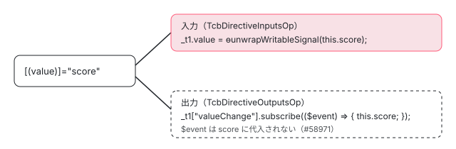

[目次](../README.md) › [テンプレート型チェックの内側](README.md) › 第 12 回 / 全 20 回

# 双方向バインディングと model()・\[formField\]

> \[(x)\] が入力と出力の 2 つとして TCB に書かれる行、signal を直接渡す双方向バインディング（allowSignalsInTwoWayBindings）と model() の型、signal forms の \[formField\] を特別に扱う signal\_forms.ts。双方向バインディングで出力の型が見られない開いている issue。

angular/angular · 読了 約 13 分 · 発展 · [サイトで読む（デモが動きます）](https://angular-deep-dive-cyan.vercel.app/chapter/typecheck-two-way)

---

`[(value)]="score"` は、パーサの段階で `[value]="score"` と `(valueChange)` の 2 つのバインディングに分かれます。TCB もそれぞれを入力（[第 10 回](10-typecheck-inputs.md)）と出力（[第 11 回](11-typecheck-outputs-events.md)）として書きます。この章では、その 2 つに双方向ならではの手が加わる行を読みます。signal を直接渡せるようにする `ɵunwrapWritableSignal`、入力と出力が別のものに当たったときの `splitTwoWayBinding`、signal forms の `[formField]` が足す見えないバインディング、そして**出力の側が実は型検査されていない**という開いている issue です。

読む対象は compiler の `typecheck/ops/inputs.ts`・`ops/events.ts`・`ops/bindings.ts`（双方向の部分）・`ops/signal_forms.ts`、core の `render3/reactivity/signal.ts`（`ɵunwrapWritableSignal`）と `authoring/model/model_signal.ts`、テストは `type_check_block_spec.ts` です。

1. [1. 全体像](01-typecheck-overview.md)
2. [2. 設定](02-typecheck-config.md)
3. [3. TCB の置き場所](03-typecheck-context.md)
4. [4. 派生プログラム](04-typecheck-program-driver.md)
5. [5. Environment](05-typecheck-environment.md)
6. [6. Scope と TcbOp](06-typecheck-scope.md)
7. [7. 式](07-typecheck-expressions.md)
8. [8. 要素と DOM](08-typecheck-elements-dom.md)
9. [9. 型コンストラクタ](09-typecheck-type-constructor.md)
10. [10. 入力](10-typecheck-inputs.md)
11. [11. 出力とイベント](11-typecheck-outputs-events.md)
12. **12. 双方向**（この章）
13. [13. 制御フロー](13-typecheck-control-flow.md)
14. [14. ng-template のガード](14-typecheck-template-guards.md)
15. [15. 参照と pipe](15-typecheck-refs-pipes.md)
16. [16. 診断の対応付け](16-typecheck-diagnostics-mapping.md)
17. [17. 帯域外の診断](17-typecheck-oob.md)
18. [18. 拡張診断](18-typecheck-extended.md)
19. [19. TemplateTypeChecker](19-typecheck-template-type-checker.md)
20. [20. issue と PR を読む](20-typecheck-issues.md)

> [!NOTE]
> **ポイント**
>
> `[(x)]` が `BindingType.TwoWay` の入力と `ParsedEventType.TwoWay` のイベントに分かれ、イベントの側のハンドラが「代入の式」ではなく**書いた式そのもの**（`score`）として保たれること、`score`・`a.b`・`a[i]`・`x!`・`$any(x)` 以外の式は「Unsupported expression in a two-way binding」になることは[テンプレートコンパイラの binding parser の章](../compiler/06-compiler-binding-parser.md)で読みました。実行時に `ɵɵtwoWayBindingSet` が signal なら `set`、そうでなければ代入する仕組みは[signals シリーズの model と output の章](../signals/13-signals-model-output.md)です。



*\[(value)\]="score" は入力と出力の 2 つの文になる。出力の側は、書いた式を置くだけで $event を代入しない*

## 1. 入力の側：ɵunwrapWritableSignal で包む

📄 `angular/packages/compiler/src/typecheck/ops/inputs.ts` L187–193 （▶ の行: 187–189, 193）

```ts
187 ▶         // Two-way bindings accept `T | WritableSignal<T>` so we have to unwrap the value.
188 ▶         if (isTwoWayBinding && this.tcb.env.config.allowSignalsInTwoWayBindings) {
189 ▶           assignment = unwrapWritableSignal(assignment, this.tcb);
190 │         }
191 │ 
192 │         // Finally the assignment is extended by assigning it into the target expression.
193 ▶         assignment = new TcbExpr(`${target.print()} = ${assignment.print()}`);
```

187 行目のコメントのとおり、双方向のバインディングには `T` と `WritableSignal<T>` のどちらも渡せます。188〜189 行目で右辺を `ɵunwrapWritableSignal(...)` で包み、193 行目で `_t1.value = ɵunwrapWritableSignal(this.score)` にします。ジェネリックなディレクティブの型コンストラクタの引数も同じように包みます（[第 9 回](09-typecheck-type-constructor.md)の `tcbCallTypeCtor`）。

📄 `angular/packages/core/src/render3/reactivity/signal.ts` L42–52 （▶ の行: 44, 47–50）

```ts
42 │ 
43 │ /**
44 ▶  * Utility function used during template type checking to extract the value from a `WritableSignal`.
45 │  * @codeGenApi
46 │  */
47 ▶ export function ɵunwrapWritableSignal<T>(value: T | {[ɵWRITABLE_SIGNAL]: T}): T {
48 ▶   // Note: the function uses `WRITABLE_SIGNAL` as a brand instead of `WritableSignal<T>`,
49 ▶   // because the latter incorrectly unwraps non-signal getter functions.
50 ▶   return null!;
51 │ }
52 │ 
```

1. **47 行目 T か、ɵWRITABLE\_SIGNAL の印を持つもの**

   引数の型は `T | {[ɵWRITABLE_SIGNAL]: T}`。`WritableSignal<number>` は `[ɵWRITABLE_SIGNAL]: number` を持つので `T = number`、ただの `number` なら左側に当てはまって `T = number`。どちらでも戻り値は中身の型です。
2. **48〜49 行目 WritableSignal&lt;T&gt; ではなく印で見る理由**

   `WritableSignal<T>` は「引数なしで呼べる関数」でもあるので、`WritableSignal<T>` で受けると、signal でない getter 関数まで中身の型に化けてしまいます。印は本物の signal にしか無いので、それを避けられます。
3. **44・50 行目 型検査のためだけの関数**

   `return null!` で、実行はされません（TCB は実行されない）。

包むかどうかは `allowSignalsInTwoWayBindings` で決まり、compiler.ts の `getTypeCheckingConfig` が、プログラムに入っている `@angular/core` の版が 17.2 以上（または版が分からない）なら真にします（[第 2 回](02-typecheck-config.md)）。17.2 より前の core には `ɵunwrapWritableSignal` が無いからです。

📄 `angular/packages/compiler-cli/src/ngtsc/typecheck/test/type_check_block_spec.ts` L892–929 （▶ の行: 893, 900, 904–905, 917, 922, 925, 927）

```ts
892 │   it('should handle a two-way binding to an input/output pair', () => {
893 ▶     const TEMPLATE = `<div twoWay [(input)]="value"></div>`;
894 │     const DIRECTIVES: TestDeclaration[] = [
895 │       {
896 │         type: 'directive',
897 │         name: 'TwoWay',
898 │         selector: '[twoWay]',
899 │         inputs: {input: 'input'},
900 ▶         outputs: {inputChange: 'inputChange'},
901 │       },
902 │     ];
903 │     const block = tcb(TEMPLATE, DIRECTIVES);
904 ▶     expect(block).toContain('var _t1 = null! as i0.TwoWay;');
905 ▶     expect(block).toContain('_t1.input = i1.ɵunwrapWritableSignal((((this).value)));');
906 │   });
907 │ 
908 │   it('should handle a two-way binding to an input/output pair of a generic directive', () => {
909 │     const TEMPLATE = `<div twoWay [(input)]="value"></div>`;
910 │     const DIRECTIVES: TestDeclaration[] = [
911 │       {
912 │         type: 'directive',
913 │         name: 'TwoWay',
914 │         selector: '[twoWay]',
915 │         inputs: {input: 'input'},
916 │         outputs: {inputChange: 'inputChange'},
917 ▶         isGeneric: true,
918 │       },
919 │     ];
920 │     const block = tcb(TEMPLATE, DIRECTIVES);
921 │     expect(block).toContain(
922 ▶       'const _ctor1: <T extends string = any>(init: Pick<i0.TwoWay<T>, "input">) => i0.TwoWay<T> = null!',
923 │     );
924 │     expect(block).toContain(
925 ▶       'var _t1 = _ctor1({ "input": (i1.ɵunwrapWritableSignal(((this).value))) });',
926 │     );
927 ▶     expect(block).toContain('_t1.input = i1.ɵunwrapWritableSignal((((this).value)));');
928 │   });
929 │ 
```
*type\_check\_block\_spec.ts*

📄 `angular/packages/compiler-cli/src/ngtsc/typecheck/test/type_check_block_spec.ts` L1615–1652 （▶ の行: 1629, 1631, 1643, 1648, 1650）

```ts
1615 │     describe('config.allowSignalsInTwoWayBindings', () => {
1616 │       it('should not unwrap signals in two-way binding expressions', () => {
1617 │         const TEMPLATE = `<div twoWay [(input)]="value"></div>`;
1618 │         const DIRECTIVES: TestDeclaration[] = [
1619 │           {
1620 │             type: 'directive',
1621 │             name: 'TwoWay',
1622 │             selector: '[twoWay]',
1623 │             inputs: {input: 'input'},
1624 │             outputs: {inputChange: 'inputChange'},
1625 │           },
1626 │         ];
1627 │         const block = tcb(TEMPLATE, DIRECTIVES, {
1628 │           ...BASE_CONFIG,
1629 ▶           allowSignalsInTwoWayBindings: false,
1630 │         });
1631 ▶         expect(block).not.toContain('ɵunwrapWritableSignal');
1632 │       });
1633 │ 
1634 │       it('should not unwrap signals in two-way bindings to generic directives', () => {
1635 │         const TEMPLATE = `<div twoWay [(input)]="value"></div>`;
1636 │         const DIRECTIVES: TestDeclaration[] = [
1637 │           {
1638 │             type: 'directive',
1639 │             name: 'TwoWay',
1640 │             selector: '[twoWay]',
1641 │             inputs: {input: 'input'},
1642 │             outputs: {inputChange: 'inputChange'},
1643 ▶             isGeneric: true,
1644 │           },
1645 │         ];
1646 │         const block = tcb(TEMPLATE, DIRECTIVES, {
1647 │           ...BASE_CONFIG,
1648 ▶           allowSignalsInTwoWayBindings: false,
1649 │         });
1650 ▶         expect(block).not.toContain('ɵunwrapWritableSignal');
1651 │       });
1652 │     });
```
*type\_check\_block\_spec.ts（describe('config') の中）*

905 行目が普通の入力、925 行目と 927 行目がジェネリックなディレクティブの型コンストラクタと代入の両方です。1629・1648 行目で設定を偽にすると、1631・1650 行目のとおり包まれません。

## 2. model() の型

📄 `angular/packages/core/src/authoring/model/model_signal.ts` L45–55 （▶ の行: 53）

```ts
45 │ /**
46 │  * `ModelSignal` represents a special `Signal` for a directive/component model field.
47 │  *
48 │  * A model signal is a writeable signal that can be exposed as an output.
49 │  * Whenever its value is updated, it emits to the output.
50 │  *
51 │  * @publicAPI
52 │  */
53 ▶ export interface ModelSignal<T> extends WritableSignal<T>, InputSignal<T>, OutputRef<T> {
54 │   [SIGNAL]: InputSignalNode<T, T>;
55 │ }
```

📄 `angular/packages/compiler-cli/src/ngtsc/typecheck/test/type_check_block_spec.ts` L930–954 （▶ の行: 942, 946, 950, 952）

```ts
930 │   it('should handle a two-way binding to a model()', () => {
931 │     const TEMPLATE = `<div twoWay [(input)]="value"></div>`;
932 │     const DIRECTIVES: TestDeclaration[] = [
933 │       {
934 │         type: 'directive',
935 │         name: 'TwoWay',
936 │         selector: '[twoWay]',
937 │         inputs: {
938 │           input: {
939 │             classPropertyName: 'input',
940 │             bindingPropertyName: 'input',
941 │             required: false,
942 ▶             isSignal: true,
943 │             transform: null,
944 │           },
945 │         },
946 ▶         outputs: {inputChange: 'inputChange'},
947 │       },
948 │     ];
949 │     const block = tcb(TEMPLATE, DIRECTIVES);
950 ▶     expect(block).toContain('var _t1 = null! as i0.TwoWay;');
951 │     expect(block).toContain(
952 ▶       '_t1.input[i1.ɵINPUT_SIGNAL_BRAND_WRITE_TYPE] = i1.ɵunwrapWritableSignal((((this).value)));',
953 │     );
954 │   });
```
*type\_check\_block\_spec.ts*

53 行目、`ModelSignal<T>` は `WritableSignal<T>`・`InputSignal<T>`・`OutputRef<T>` の 3 つを兼ねます。だから TCB の入力の側は `input()` と同じ `[ɵINPUT_SIGNAL_BRAND_WRITE_TYPE]` への代入（952 行目）、出力の側は `OutputRef<T>` の `subscribe`（第 11 回）になります。ngtsc は `model()` を「signal の入力 `value` と出力 `valueChange`」として登録するので（[signals シリーズ](../signals/13-signals-model-output.md)）、TCB の op から見ると、model は 942 行目の `isSignal: true` の入力と 946 行目の出力の組でしかありません。実際の `readonly value = model(0)` は readonly なので、[第 10 回](10-typecheck-inputs.md)の一時変数の形になります（4 節のデモの「model()」）。

## 3. 出力の側：式を置くだけ

出力の側は、第 11 回の `TcbDirectiveOutputsOp` が `_t1["valueChange"].subscribe(($event): any => { ハンドラ })` を書きます。双方向のときのハンドラは、パーサが保った式 `score` そのものです。つまり TCB は `{ this.score; }` になり、**`$event` を `score` に代入する文がありません**。出力の型が `score` の型に合うかは検査されません。

📄 `angular/packages/compiler/src/typecheck/ops/events.ts` L9–20 （▶ の行: 17, 19）

```ts
 9 │ import {AST, ImplicitReceiver, ParsedEventType, PropertyRead} from '../../expression_parser/ast';
10 │ import {BoundAttribute, BoundEvent, Element} from '../../render3/r3_ast';
11 │ import {DirectiveOwner} from '../../render3/view/t2_api';
12 │ import {TcbOp} from './base';
13 │ import {getStatementsBlock, TcbExpr} from './codegen';
14 │ import type {Context} from './context';
15 │ import type {Scope} from './scope';
16 │ import {TcbDirectiveMetadata} from '../api';
17 ▶ import {TcbExpressionTranslator, unwrapWritableSignal} from './expression';
18 │ import {ExpressionIdentifier} from '../comments';
19 ▶ import {checkSplitTwoWayBinding} from './bindings';
20 │ import {LocalSymbol} from './references';
```

17 行目で `unwrapWritableSignal` を import していますが、events.ts の中で使っている所はありません（`grep -n unwrapWritableSignal` で 17 行目だけ）。これは、出力の側を検査するコードがかつてここにあった名残です。その経緯が「テストと直し方」の #58971 です。

## 4. 入力と出力が別のものに当たったとき：splitTwoWayBinding

📄 `angular/packages/compiler/src/typecheck/ops/events.ts` L76–83 （▶ の行: 77–79, 81–82）

```ts
76 │       if (
77 ▶         this.tcb.env.config.checkTypeOfOutputEvents &&
78 ▶         this.inputs !== null &&
79 ▶         output.name.endsWith('Change')
80 │       ) {
81 ▶         const inputName = output.name.slice(0, -6);
82 ▶         checkSplitTwoWayBinding(inputName, output, this.inputs, this.tcb);
83 │       }
```
*TcbDirectiveOutputsOp の中*

📄 `angular/packages/compiler/src/typecheck/ops/events.ts` L151–161 （▶ の行: 152, 154, 156–157, 159）

```ts
151 │       if (
152 ▶         this.tcb.env.config.checkTypeOfOutputEvents &&
153 │         this.inputs !== null &&
154 ▶         output.name.endsWith('Change')
155 │       ) {
156 ▶         const inputName = output.name.slice(0, -6);
157 ▶         if (checkSplitTwoWayBinding(inputName, output, this.inputs, this.tcb)) {
158 │           // Skip this event handler as the error was already handled.
159 ▶           continue;
160 │         }
161 │       }
```
*TcbUnclaimedOutputsOp の中*

📄 `angular/packages/compiler/src/typecheck/ops/bindings.ts` L136–164 （▶ の行: 142–143, 147–148, 156–157, 159–160）

```ts
136 │ export function checkSplitTwoWayBinding(
137 │   inputName: string,
138 │   output: BoundEvent,
139 │   inputs: BoundAttribute[],
140 │   tcb: Context,
141 │ ) {
142 ▶   const input = inputs.find((input) => input.name === inputName);
143 ▶   if (input === undefined || input.sourceSpan !== output.sourceSpan) {
144 │     return false;
145 │   }
146 │   // Input consumer should be a directive because it's claimed
147 ▶   const inputConsumer = tcb.boundTarget.getConsumerOfBinding(input) as TcbDirectiveMetadata;
148 ▶   const outputConsumer = tcb.boundTarget.getConsumerOfBinding(output);
149 │   if (
150 │     outputConsumer === null ||
151 │     inputConsumer.ref === undefined ||
152 │     outputConsumer instanceof Template
153 │   ) {
154 │     return false;
155 │   }
156 ▶   if (outputConsumer instanceof Element) {
157 ▶     tcb.oobRecorder.splitTwoWayBinding(tcb.id, input, output, inputConsumer, outputConsumer);
158 │     return true;
159 ▶   } else if (outputConsumer.ref !== inputConsumer.ref) {
160 ▶     tcb.oobRecorder.splitTwoWayBinding(tcb.id, input, output, inputConsumer, outputConsumer);
161 │     return true;
162 │   }
163 │   return false;
164 │ }
```

1. **77〜82 行目・152〜157 行目 名前が Change で終わる出力だけ**

   `checkTypeOfOutputEvents` が真で、名前が `Change` で終わるイベントについて、末尾の 6 文字を落とした名前（`value`）で入力を探します。
2. **142〜143 行目 同じ \[(x)\] から来たものか**

   入力と出力の `sourceSpan`（テンプレートの位置）が同じなら、同じ `[(value)]` を 2 つに分けたものです。`[value]` と `(valueChange)` を別々に書いたときは、ここで外れます。
3. **147〜148 行目 誰が受け取ったか**

   `getConsumerOfBinding` は、そのバインディングを受け取ったディレクティブ（または要素）を返します（[ディレクティブの照合の章](../compiler/09-compiler-binder.md)）。
4. **156〜161 行目 要素か、別のディレクティブなら診断**

   出力を受け取ったのが要素（どのディレクティブにも `valueChange` が無い）か、入力と違うディレクティブなら、`oobRecorder.splitTwoWayBinding` で帯域外の診断を作ります（[第 17 回](17-typecheck-oob.md)）。TcbUnclaimedOutputsOp の側は、157 行目で真が返ると 159 行目の `continue` で `addEventListener` を書きません。

## 5. signal forms の \[formField\]：見えない双方向バインディング

signal forms の `[formField]="f"`（[Signal Forms の章](../signals/17-signal-forms.md)）は、書いた入力は 1 つですが、型検査では「値の双方向バインディング」と「状態の入力」を足して検査します。その判断をするのが ops/signal\_forms.ts で、[第 10 回](10-typecheck-inputs.md)で読んだ `appendDirectiveInputs`（`isFormControl`・`getCustomFieldDirectiveType`・`isNativeField` を呼ぶ）と `TcbDirectiveInputsOp` の冒頭（`expandBoundAttributesForField` を呼ぶ）から使われます。

📄 `angular/packages/compiler/src/typecheck/ops/signal_forms.ts` L367–402 （▶ の行: 371–374, 386, 391–393, 399–400）

```ts
367 │ /** Determines if a directive is a custom field and its type. */
368 │ export function getCustomFieldDirectiveType(
369 │   meta: TcbDirectiveMetadata,
370 │ ): CustomFormControlType | null {
371 ▶   if (hasModelInput('value', meta)) {
372 ▶     return 'value';
373 ▶   } else if (hasModelInput('checked', meta)) {
374 ▶     return 'checkbox';
375 │   }
376 │   return null;
377 │ }
378 │ 
379 │ /** Determines if a directive usage is on a native field. */
380 │ export function isNativeField(
381 │   dir: TcbDirectiveMetadata,
382 │   node: Node,
383 │   allDirectiveMatches: TcbDirectiveMetadata[],
384 │ ): node is Element & {name: 'input' | 'select' | 'textarea'} {
385 │   // Only applies to the `FormField` directive.
386 ▶   if (!isFieldDirective(dir)) {
387 │     return false;
388 │   }
389 │ 
390 │   // Only applies to input, select and textarea elements.
391 ▶   if (
392 ▶     !(node instanceof Element) ||
393 ▶     (node.name !== 'input' && node.name !== 'select' && node.name !== 'textarea')
394 │   ) {
395 │     return false;
396 │   }
397 │ 
398 │   // Only applies if there are no custom fields or ControlValueAccessors.
399 ▶   return allDirectiveMatches.every((meta) => {
400 ▶     return getCustomFieldDirectiveType(meta) === null && !isControlValueAccessorLike(meta);
401 │   });
402 │ }
```

- 371〜376 行目：ディレクティブが `value` と `valueChange` の組（同じファイルの `hasModelInput`）を持てば値のコントロール、`checked` と `checkedChange` ならチェックボックスのコントロール。`model()` で書いた自作のコントロールがこれに当たります。
- 380〜402 行目：`FormField` を `<input>`・`<select>`・`<textarea>` に付け（391〜394 行目）、他に自作のコントロールも `ControlValueAccessor` の形のディレクティブも無ければ（399〜401 行目）、素の要素のフィールドとして扱う。

📄 `angular/packages/compiler/src/typecheck/ops/signal_forms.ts` L335–365 （▶ の行: 336–340, 344–345, 348, 350, 362）

```ts
335 │   const {span, sourceSpan} = fieldBinding.value;
336 ▶   const outerCall = new Call(span, sourceSpan, fieldBinding.value, [], sourceSpan);
337 ▶   const read = new PropertyRead(span, sourceSpan, sourceSpan, outerCall, fieldPropertyName);
338 ▶   const isTwoWayBinding =
339 ▶     (customFieldType === 'value' && inputName === 'value') ||
340 ▶     (customFieldType === 'checkbox' && inputName === 'checked');
341 │ 
342 │   let value: AST;
343 │ 
344 ▶   if (isTwoWayBinding) {
345 ▶     value = read;
346 │   } else if (formControlOptionalFields.has(fieldPropertyName)) {
347 │     // Some fields can be optional so we need to invoke them using a `SafeCall`.
348 ▶     value = new SafeCall(span, sourceSpan, read, [], sourceSpan);
349 │   } else {
350 ▶     value = new Call(span, sourceSpan, read, [], sourceSpan);
351 │   }
352 │ 
353 │   return {
354 │     value,
355 │     sourceSpan: fieldBinding.sourceSpan,
356 │     keySpan: fieldBinding.keySpan ?? null,
357 │     inputs: inputs.map((input: TcbInputMapping) => ({
358 │       fieldName: input.classPropertyName,
359 │       required: input.required,
360 │       transformType: input.transformType,
361 │       isSignal: input.isSignal,
362 ▶       isTwoWayBinding,
363 │     })),
364 │   };
365 │ }
```

自作のコントロールには、テンプレートに書かれていないバインディングを作って足します。336〜337 行目で `f().value` の AST を組み立て、338〜340 行目、値の入力（`value` か `checked`）だけを双方向とします。344〜345 行目、双方向の値は `f().value`（呼ばない。`WritableSignal` のまま）で、1 節の `ɵunwrapWritableSignal` がそれを中身の型にします。それ以外の `errors`・`disabled` などは 350 行目で `f().disabled()` と呼んだ値です。

📄 `angular/packages/compiler-cli/src/ngtsc/typecheck/test/type_check_block_spec.ts` L3134–3151 （▶ の行: 3138, 3141, 3144, 3150）

```ts
3134 │       ]);
3135 │ 
3136 │       expect(block).toContain('var _t1 = null! as i0.CustomControl;');
3137 │       expect(block).toContain(
3138 ▶         '_t1.value[i1.ɵINPUT_SIGNAL_BRAND_WRITE_TYPE] = i1.ɵunwrapWritableSignal((((((this).f)()).value)));',
3139 │       );
3140 │       expect(block).toContain(
3141 ▶         '_t1.required[i1.ɵINPUT_SIGNAL_BRAND_WRITE_TYPE] = ((((this).f)()).required());',
3142 │       );
3143 │       expect(block).toContain(
3144 ▶         '_t1.disabled[i1.ɵINPUT_SIGNAL_BRAND_WRITE_TYPE] = ((((this).f)()).disabled());',
3145 │       );
3146 │       expect(block).toContain(
3147 │         '_t1.name[i1.ɵINPUT_SIGNAL_BRAND_WRITE_TYPE] = ((((this).f)()).name());',
3148 │       );
3149 │       expect(block).toContain('var _t2 = null! as i0.FormField;');
3150 ▶       expect(block).toContain('_t2.field = (((this).f));');
3151 │     });
```
*type\_check\_block\_spec.ts（describe('signal forms') の中。CustomControl は value・required・disabled・name の入力と valueChange の出力を持つ）*

3138 行目、`f().value` の signal が `ɵunwrapWritableSignal` で包まれ、コントロールの `value`（model）の書き込みの型に代入されます。フィールドの値の型とコントロールの値の型が合わなければ、ここで型エラーになります。

📄 `angular/packages/compiler/src/typecheck/ops/signal_forms.ts` L136–166 （▶ の行: 136, 138, 140, 144, 147, 149, 156, 160–161, 164–165）

```ts
136 ▶     checkUnsupportedFieldBindings(this.node, this.unsupportedBindingFields, this.tcb);
137 │ 
138 ▶     const rawExpectedType = this.getExpectedTypeFromDomNode(this.node);
139 │ 
140 ▶     if (rawExpectedType === null) {
141 │       // For text-like <input> elements, use an invariant check on the value signal.
142 │       // WritableSignal<T> is invariant in T, so assigning it to a union of structural types
143 │       // gives us exact type matching: only Field<string> or Field<number|null> are accepted.
144 ▶       const signal = extractFieldValueSignal(fieldBinding.value, this.tcb, this.scope);
145 │       const id = new TcbExpr(this.tcb.allocateId());
146 │       const unionType = new TcbExpr(
147 ▶         '{ (): string; set: (v: string) => void; } | { (): number | null; set: (v: number | null) => void; }',
148 │       );
149 ▶       const assignment = new TcbExpr(`${id.print()} = ${signal.print()}`);
150 │       assignment.addParseSpanInfo(fieldBinding.valueSpan ?? fieldBinding.sourceSpan);
151 │ 
152 │       this.scope.addStatement(declareVariable(id, unionType));
153 │       this.scope.addStatement(assignment);
154 │     } else {
155 │       const expectedType = new TcbExpr(rawExpectedType);
156 ▶       const value = extractFieldValue(fieldBinding.value, this.tcb, this.scope);
157 │ 
158 │       // Create a variable with the expected type and check that the field value is assignable, e.g.
159 │       // var t1 = null! as string | number; t1 = f().value()`.
160 ▶       const id = new TcbExpr(this.tcb.allocateId());
161 ▶       const assignment = new TcbExpr(`${id.print()} = ${value.print()}`);
162 │       assignment.addParseSpanInfo(fieldBinding.valueSpan ?? fieldBinding.sourceSpan);
163 │ 
164 ▶       this.scope.addStatement(declareVariable(id, expectedType));
165 ▶       this.scope.addStatement(assignment);
166 │     }
```

📄 `angular/packages/compiler-cli/src/ngtsc/typecheck/test/type_check_block_spec.ts` L2949–2958 （▶ の行: 2951, 2953, 2955）

```ts
2949 │ 
2950 │     it('should generate a string field for an input without a type', () => {
2951 ▶       const block = tcb('<input [formField]="f"/>', [FieldMock]);
2952 │       expect(block).toContain(
2953 ▶         'var _t1 = null! as { (): string; set: (v: string) => void; } | { (): number | null; set: (v: number | null) => void; };',
2954 │       );
2955 ▶       expect(block).toContain('_t1 = ((this).f)().value;');
2956 │       expect(block).toContain('var _t2 = null! as i0.FormField;');
2957 │       expect(block).toContain('_t2.field = (((this).f));');
2958 │     });
```
*type\_check\_block\_spec.ts*

素の要素では、要素の種類から期待する型を決めます（138 行目）。`type` の無い `<input>` は 140〜153 行目で、値の signal を `{ (): string; set: ... } | { (): number | null; set: ... }` の変数に代入します（2953・2955 行目）。142〜143 行目のコメントのとおり `WritableSignal<T>` は T について不変（広くも狭くもできない）なので、`string` か `number | null` の field だけが通ります。`type="number"` などは 156〜165 行目で `var _t1 = null! as string | number | null; _t1 = f().value();` の形です。

📄 `angular/packages/compiler/src/typecheck/ops/signal_forms.ts` L29–59 （▶ の行: 33–35, 52, 55–59）

```ts
29 │ /** Possible types of custom form control directives. */
30 │ export type CustomFormControlType = 'value' | 'checkbox';
31 │ 
32 │ /** Names of the input fields on custom controls. */
33 ▶ const formControlInputFields = [
34 ▶   // Should be kept in sync with the `FormUiControl` bindings,
35 ▶   // defined in `packages/forms/signals/src/api/control.ts`.
36 │   'errors',
37 │   'dirty',
38 │   'disabled',
39 │   'disabledReasons',
40 │   'hidden',
41 │   'invalid',
42 │   'name',
43 │   'pending',
44 │   'readonly',
45 │   'touched',
46 │   'max',
47 │   'maxLength',
48 │   'min',
49 │   'minLength',
50 │   'pattern',
51 │   'required',
52 ▶ ];
53 │ 
54 │ /** Names of input fields to which users aren't allowed to bind when using a `field` directive. */
55 ▶ export const customFormControlBannedInputFields = new Set([
56 ▶   ...formControlInputFields,
57 ▶   'value',
58 ▶   'checked',
59 ▶ ]);
```

📄 `angular/packages/compiler/src/typecheck/ops/signal_forms.ts` L416–444 （▶ の行: 425–427, 431–433, 438–440）

```ts
416 │ /** Checks whether a node has bindings that aren't supported on fields. */
417 │ export function checkUnsupportedFieldBindings(
418 │   node: DirectiveOwner,
419 │   unsupportedBindingFields: Set<string>,
420 │   tcb: Context,
421 │ ) {
422 │   const inputs = node instanceof HostElement ? node.bindings : node.inputs;
423 │ 
424 │   for (const input of inputs) {
425 ▶     if (input.type === BindingType.Property && unsupportedBindingFields.has(input.name)) {
426 ▶       tcb.oobRecorder.formFieldUnsupportedBinding(tcb.id, input);
427 ▶     } else if (
428 │       input.type === BindingType.Attribute &&
429 │       unsupportedBindingFields.has(input.name.toLowerCase())
430 │     ) {
431 ▶       tcb.oobRecorder.formFieldUnsupportedBinding(tcb.id, input);
432 ▶     } else if (input.type === BindingType.TwoWay && unsupportedBindingFields.has(input.name)) {
433 ▶       tcb.oobRecorder.formFieldUnsupportedBinding(tcb.id, input);
434 │     }
435 │   }
436 │ 
437 │   if (!(node instanceof HostElement)) {
438 ▶     for (const attr of node.attributes) {
439 ▶       if (unsupportedBindingFields.has(attr.name.toLowerCase())) {
440 ▶         tcb.oobRecorder.formFieldUnsupportedBinding(tcb.id, attr);
441 │       }
442 │     }
443 │   }
444 │ }
```

`[formField]` がこれらの状態を受け持つので、同じ要素に `[disabled]`・`[value]` などを自分で書くことは禁止です。一覧の元は 33〜52 行目の `formControlInputFields`（34〜35 行目のコメントのとおり forms の `FormUiControl` と同期させる）で、自作のコントロールには 55〜59 行目の一覧（`value`・`checked` を足したもの）を TcbDirectiveInputsOp が、素の要素には同じ一覧に `maxlength` などを足したものを TcbNativeFieldOp が、136 行目と同じ関数で調べます。425 行目が `[x]`、427〜431 行目が `[attr.x]`、438〜442 行目が `x="..."` の文字列の属性で、どれも `formFieldUnsupportedBinding` の帯域外の診断になります。**432〜433 行目の `[(x)]` の分岐**は、c819880b91b（2026-08-16、「`FormField` があるときに禁止の双方向バインディングを報告する。普通のバインディングは報告していたが双方向はしていなかった」、#70219 を修正）で足された 2 行です。このコミットは test/ngtsc/signal\_forms\_spec.ts に `it('should report unsupported two-way bindings on a field')` を足していて、`<input type="number" [formField]="f" [(max)]="maxLength"/>` が「Binding to '\[(max)\]' is not allowed on nodes using the '\[formField\]' directive」になることを確かめています。

## 6. デモ：\[(value)\] の 2 つの文を見る

> **🧪 DEMO — このページの @angular/compiler（22.1.6）の generateTypeCheckBlock**
>
> ボタンで `Rating` の入力と出力の形を切り替えて TCB を作ります。強調した行が、入力の側の代入と出力の側の `subscribe` とその中身です。`[formField]` のボタンでは、デモの `FormField` に本物と見分ける印（`hasNgFieldDirective`）を付けています（本物は `@angular/forms/signals` から来たことでも見分ける。5 節の `isFieldDirective`）。inputs.ts・events.ts・bindings.ts・signal\_forms.ts は 22.1.6 と読んでいるソースで同じです。
>
> ▶ [このデモはサイトで動かせます](https://angular-deep-dive-cyan.vercel.app/chapter/typecheck-two-way)

2026-11-02 に Node で同じ関数を呼んで確かめた出力の要点です（位置と印のコメントは省いた）。

| ボタン | 入力の側 | 出力の側 |
| --- | --- | --- |
| @Input + @Output | `_t1.value = i0.ɵunwrapWritableSignal((((this).score)));` | `_t1["valueChange"].subscribe(($event): any => { ((this).score); });` |
| model() | `var _t2 = null! as (typeof _t1)["value"]; _t2[i0.ɵINPUT_SIGNAL_BRAND_WRITE_TYPE] = i0.ɵunwrapWritableSignal(...);` | 同上 |
| allowSignalsInTwoWayBindings: false | `_t1.value = (((this).score));` | 同上 |
| 入力と出力が別のディレクティブ | `_t1.value = ...`（DirA） | `_t2["valueChange"].subscribe(...)`（DirB）と oob の `splitTwoWayBinding` |
| 出力が無い | `_t1.value = ...` | （文なし）oob の `splitTwoWayBinding` |
| score! と書く | `i0.ɵunwrapWritableSignal(((((this).score))!))` | `{ (((this).score))!; }` |
| \[formField\] を input に | `var _t1 = null! as { (): string; set: (v: string) => void; } \| { (): number \| null; ... }; _t1 = ((((this).f)).name)().value;` |   |
| \[formField\] を type="number" に | `var _t1 = null! as string \| number \| null; _t1 = ((((this).f)).age)().value();` |   |
| \[formField\] と \[disabled\]・\[(max)\] | oob に `formFieldUnsupportedBinding` が 2 回 |   |
| \[formField\] を自作のコントロールに | `_t1.value[i0.ɵINPUT_SIGNAL_BRAND_WRITE_TYPE] = i0.ɵunwrapWritableSignal((((((((this).f)).score)()).value)));` と `_t1.disabled[...] = ((((((this).f)).score)()).disabled());` |   |
| score() と書く | パースエラー「Unsupported expression in a two-way binding」。TCB は作られる |   |

どの形でも、出力の側の `subscribe` の中に `$event` は出てきません。自作のコントロールの形では、`valueChange` の出力の文も書かれていません（`[formField]` は出力のバインディングを足さない）。

## 7. 呼び出しの連なり

- 👤 `<app-rating [(value)]="score">` — 利用者のテンプレート
  - `BindingParser` — template\_parser/binding\_parser.ts — *TwoWay の入力と、ハンドラが score の TwoWay イベント*
  - `TcbDirectiveInputsOp.execute` — ops/inputs.ts — *第 10 回*
    - `unwrapWritableSignal(assignment)` — ops/inputs.ts L188-189 — *allowSignalsInTwoWayBindings が真なら*
  - `TcbDirectiveOutputsOp.execute` — ops/events.ts — *第 11 回*
    - `checkSplitTwoWayBinding` — ops/bindings.ts L136 — *入力と出力の受け手が違えば oob*
    - `_t1["valueChange"].subscribe(($event) => { this.score; })` — ops/events.ts L98 — *$event は使われない*

## テストと直し方

- type\_check\_block\_spec.ts のトップレベルの `it('should handle a two-way binding to an input/output pair')`（:892）、`'...of a generic directive'`（:908）、`'should handle a two-way binding to a model()'`（:930）、`'should handle a two-way binding to an input with a transform'`（:956）。
- 同じファイルの `describe('config.allowSignalsInTwoWayBindings')`（:1615）と、`describe('outputs')` の `it('should handle $any cast in a two-way binding')`（:1127）。
- signal forms は同じファイルの `describe('signal forms')`（:2928）と test/ngtsc/signal\_forms\_spec.ts。
- エラーが出るかは typecheck/test/model\_signal\_diagnostics\_spec.ts の `describe('model inputs type-check diagnostics')`（:14）と、test/ngtsc/template\_typecheck\_spec.ts の `it('should type check a two-way binding to a generic property')`（:545）など。

📄 `ターミナル`

```
cd ~/angular-research/angular
pnpm bazel test //packages/compiler-cli/src/ngtsc/typecheck/test:test \
  --nocache_test_results --test_output=all \
  '--test_arg=--filter=two-way|allowSignalsInTwoWayBindings|model'

pnpm bazel test //packages/compiler-cli/test/ngtsc:ngtsc \
  --nocache_test_results --test_output=all \
  '--test_arg=--filter=two-way|strictOutputEventTypes'
```

📄 `出力（抜粋。2026-11-02 に実行。ログは scratchpad/tc-logs/c-twoway.log・c-ngtsc-twoway.log）`

```
==================== Test output for //packages/compiler-cli/src/ngtsc/typecheck/test:test:
Ran 371 of 1747 specs
371 specs, 0 failures
//packages/compiler-cli/src/ngtsc/typecheck/test:test                    PASSED in 2.7s

==================== Test output for //packages/compiler-cli/test/ngtsc:ngtsc (shard 1〜4 of 4):
Ran 24 of 6670 specs / Ran 32 of 6678 specs（4 pending specs）/ Ran 20 of 6666 specs / Ran 32 of 6678 specs
（どの shard も 0 failures）
INFO: Elapsed time: 3.262s, Critical Path: 3.04s
//packages/compiler-cli/test/ngtsc:ngtsc                                 PASSED in 3.0s
```

フィルタの `model` は「model inputs」の describe 全体にも合うので、typecheck/test の 371 件は双方向の spec より多めです。test/ngtsc は 4 つの shard の合計で 108 件、4 件は pending（`xit` などで止めてある spec）でした。

1. **開いている issue：#58971 双方向バインディングが出力の型を見ない（17.2 以降）**

   2024-11-29 に開かれ、ラベルは `state: has PR`・P3。`@Input() value: string | number | undefined` と `@Output() valueChange = new EventEmitter<number>()` に `[(value)]="str"`（`str: string`）を渡してもエラーにならない、という報告です。入力の側は `string` を `string | number | undefined` に代入するので通り、出力の側は 3 節のとおり `$event`（`number`）を `str` に代入する文が無いからです。
2. **手元で確かめる**

   TCB の形を手で写した TypeScript を ../angular の TypeScript（6.0.3）で検査しました。

📄 `twoway.ts（TCB の形を手で写したもの）`

```
declare const ɵWRITABLE_SIGNAL: unique symbol;
declare function ɵunwrapWritableSignal<T>(value: T | { [ɵWRITABLE_SIGNAL]: T }): T;
interface OutputRef<T> { subscribe(callback: (value: T) => void): unknown; }
class Foo {
  value!: string | number | undefined;
  valueChange!: OutputRef<number>;
}
class App {
  str: string = '';
}
function _tcb1(this: App) {
  var _t1 = null! as Foo;
  // <foo [(value)]="str"> の TCB
  _t1.value = ɵunwrapWritableSignal(this.str);
  _t1['valueChange'].subscribe(($event): any => {
    this.str;
  });
  // <foo [value]="str" (valueChange)="str = $event"> の TCB
  _t1.value = this.str;
  _t1['valueChange'].subscribe(($event): any => {
    this.str = $event;
  });
}
```

📄 `出力（2026-11-02 に実行）`

```
$ node ~/angular-research/angular/node_modules/typescript/bin/tsc --noEmit --strict \
    --target es2022 --lib es2022,dom twoway.ts
twoway.ts(21,5): error TS2322: Type 'number' is not assignable to type 'string'.
```

エラーは `(21,5)`、`[value]` と `(valueChange)="str = $event"` を分けて書いた側の `this.str = $event` だけです。`[(value)]` の側の `subscribe` の中の `this.str;` は何も検査しません。

1. **一度入って、消えた修正**

   PR #59002（crisbeto）の説明によると、以前はパーサが `[(x)]="foo"` の出力を `foo = $event` に書き換えていました。#54065（93188cb4391。`git tag --contains` で最初に入った版は 17.2.0-next.1）で、signal を渡せるように書いた式そのものを保つ形に変わり、TCB が `someOutput.subscribe($event => expr)`（何もしない文）になったのが原因です。修正の c5c20e9d86d（2024-12-02）はハンドラを `var _t1 = unwrap(this.someField); _t1 = $event;` にするもので、内部のテストで破壊的だったため 6fd8a209788（2024-12-05）で `_checkTwoWayBoundEvents` というフラグの後ろに隠されました。issue のコメントは「v20 でフラグを反転する」。そのフラグは反転されないまま、72be5be9c1d（2026-04-28）で消されました。

📄 `git show（抜粋）`

```
$ git -C ~/angular-research/angular show 72be5be9c1d -- packages/compiler/src/typecheck/ops/events.ts
commit 72be5be9c1d6486a54d8ea02cc44222d19cbed36
Author: Kristiyan Kostadinov（メールアドレスは省略）
Date:   Tue Apr 28 09:10:16 2026 +0200

    refactor(compiler-cli): remove checkTwoWayBoundEvents flag

    Removes the `checkTwoWayBoundEvents` flag since the code it generates is quite breaking and we never got the chance to enable it. Also it caused our tests to misrepresent how the compiler behaves for actual users.

-  // TODO(crisbeto): remove the `checkTwoWayBoundEvents` check in v20.
-  if (event.type === ParsedEventType.TwoWay && tcb.env.config.checkTwoWayBoundEvents) {
-    // If we're dealing with a two-way event, we create a variable initialized to the unwrapped
-    // signal value of the expression and then we assign `$event` to it. Note that in most cases
-    // this will already be covered by the corresponding input binding, however it allows us to
-    // handle the case where the input has a wider type than the output (see #58971).
-    const target = tcb.allocateId();
-    const initializer = tcb.env.config.allowSignalsInTwoWayBindings
-      ? unwrapWritableSignal(handler, tcb)
-      : handler;
-
-    statements.push(
-      new TcbExpr(`var ${target} = ${initializer.print()}`),
-      new TcbExpr(`${target} = ${EVENT_PARAMETER}`),
-    );
-  } else {
-    statements.push(handler);
-  }
+  statements.push(handler);
（以下略）
```

消された行が、3 節で「名残」と書いた `unwrapWritableSignal` の使い道でした。このコミットは model\_signal\_diagnostics\_spec.ts などの期待値から、出力の側のエラー（`Type 'boolean' is not assignable to type 'string'.` の 2 つ目の行）を消しています。import の 1 行は main でも残っていました（`gh api` で main の events.ts を読んで確かめた）。

1. **開いている issue：#59116 双方向バインディングの non-null アサーションをやめる**

   2024-12-09 に開かれた `breaking changes` の issue で、「`[(ngModel)]="someExpr!"` の型検査は分かりにくいので v20 で落とす」。6 節のデモの「score! と書く」のとおり、`!` は入力の側にも残るので、入力の側の `null` の検査が消えます。PR #63535（2025-09）は WIP のまま 2025-09-23 に閉じられています。`!` を許しているのはパーサの `_isAllowedAssignmentEvent` です（binding parser の章）。
2. **開いている issue：#69373 ジェネリックなコンポーネントの model 入力で NoInfer を尊重する**

   2026-06-16 に開かれ、`class Picker<T extends Mode = 'single'>` の `value = model<NoInfer<Value<T>> | null>(null)` に、`mode` を書かずに `[(value)]="range"` を渡してもエラーにならない、という報告です。コメントで、PR #69819 を出した人自身が「根の原因は型コンストラクタの `0 as any` で #57644 と同じ」と書いています（[第 9 回](09-typecheck-type-constructor.md)）。core の型を最小に写して確かめました。

📄 `noinfer.ts（TCB の型コンストラクタと core の型を手で写したもの）`

```
declare const W: unique symbol;
interface InputSignalWithTransform<T, WriteT> { (): T; [W]: WriteT; }
interface ModelSignal<T> extends InputSignalWithTransform<T, T> { set(v: T): void; }
type UnwrapWrite<F> = F extends InputSignalWithTransform<any, infer WriteT> ? WriteT : never;
type UnwrapDirectiveSignalInputs<Dir, K extends keyof Dir> = { [P in K]: UnwrapWrite<Dir[P]> };

type Mode = 'single' | 'range';
type ValueByMode = { single: string; range: readonly [string, string] };
type Value<T extends Mode = 'single'> = ValueByMode[T];
class Picker<T extends Mode = 'single'> {
  value!: ModelSignal<NoInfer<Value<T>> | null>;
  mode!: InputSignalWithTransform<T | undefined, T | undefined>;
}
declare const range: readonly [string, string] | null;
declare function typeArgOf<T extends Mode>(p: Picker<T>): T;

// <app-picker [(value)]="range" /> の型コンストラクタ（mode は書かれていない）
const _ctor1: <T extends Mode = 'single'>(
  init: UnwrapDirectiveSignalInputs<Picker<T>, 'value' | 'mode'>,
) => Picker<T> = null!;
var _t1 = _ctor1({ value: range, mode: 0 as any });
const t1: number = typeArgOf(_t1);

// mode を型コンストラクタから外したとき（#69819 の案）
const _ctor2: <T extends Mode = 'single'>(
  init: UnwrapDirectiveSignalInputs<Picker<T>, 'value'>,
) => Picker<T> = null!;
var _t2 = _ctor2({ value: range });
```

📄 `出力（2026-11-02 に実行）`

```
$ node ~/angular-research/angular/node_modules/typescript/bin/tsc --noEmit --strict \
    --target es2022 --lib es2022,dom noinfer.ts
noinfer.ts(28,20): error TS2322: Type 'readonly [string, string] | null' is not assignable to type 'string | null'.
  Type 'readonly [string, string]' is not assignable to type 'string'.
```

`mode: 0 as any` を渡した `_ctor1` の側は、`const t1: number` がエラーにならず、`T` が `any` に決まったことが分かります（`number` の代わりに存在しない文字列リテラル型で受けてもエラーになりませんでした）。`mode` を外した `_ctor2` の側は `T` が既定の `'single'` のままで、`(28,20)` で `range` が `string | null` に合わないエラーになりました。`NoInfer` は効いていて、効かなくしているのは `0 as any` です。

1. **直すとしたら**

   出力の側を検査するなら events.ts の `tcbCreateEventHandler`（72be5be9c1d が消した分岐の場所）で、TCB の形は type\_check\_block\_spec.ts、エラーは model\_signal\_diagnostics\_spec.ts と test/ngtsc/template\_typecheck\_spec.ts に足すのが入口です。ただし上のとおり、一度入れて「破壊的すぎる」と外された変更です。signal forms の禁止の一覧は signal\_forms.ts の `checkUnsupportedFieldBindings` と、forms の `FormUiControl` の側の両方を揃える必要があります（34〜35 行目のコメント）。issue の読み方は[第 20 回](20-typecheck-issues.md)です。

## 聞かれそうな質問

**Q. \[(value)\] に signal をそのまま渡せるのはなぜですか？**

入力の側の右辺が 1 節の 188〜189 行目で `ɵunwrapWritableSignal(...)` に包まれ、その引数の型が `T | {[ɵWRITABLE_SIGNAL]: T}`（signal.ts の 47 行目）だからです。`WritableSignal<number>` を渡すと `number` として入力に代入されます。

**Q. \[(value)\] の出力の型は検査されますか？**

されません。出力の側の TCB は `subscribe(($event) => { this.score; })` で、`$event` を代入する文がありません（3 節）。開いている #58971 で、検査するコードは 72be5be9c1d で消されました。出力の型まで検査したいなら、`[value]="score" (valueChange)="score = $event"` と分けて書きます（「テストと直し方」の再現の 2 つ目の形）。

**Q. \[(value)\] の入力と出力が別々のディレクティブに当たるとどうなりますか？**

4 節の 159〜161 行目で `splitTwoWayBinding` の帯域外の診断になります。出力を持つものが無く要素に行ったときも 156〜158 行目で同じ診断です。`[value]` と `(valueChange)` を分けて書いたときは、143 行目で位置が違うので診断になりません。

**Q. \[formField\] を付けた input に \[disabled\] を書くとエラーになるのはなぜですか？**

5 節の 33〜52 行目の一覧に `disabled` があり（素の要素なら 136 行目、自作のコントロールなら 55〜59 行目の一覧で調べる）、425 行目で `formFieldUnsupportedBinding` の帯域外の診断になるからです。disabled はフィールドの状態から `[formField]` が設定するので、二重に書けません。`[(disabled)]` の形も 432〜433 行目（c819880b91b）で同じく報告されます。

**Q. model() と @Input + @Output の組で、型検査に違いはありますか？**

入力の側だけ違います。model は signal の入力なので `[ɵINPUT_SIGNAL_BRAND_WRITE_TYPE]` への代入になり（2 節の 952 行目）、readonly で書けば一時変数を経由します。出力の側はどちらも同じ `subscribe` で、どちらも検査されません。

## 読み終えて

- `[(x)]` は入力と出力の 2 つの文になる。入力の右辺は `ɵunwrapWritableSignal` で包まれ、`T` と `WritableSignal<T>` の両方を受ける（inputs.ts L187-193、signal.ts L47）。
- 出力の側は書いた式を置くだけで、`$event` を代入しない。出力の型は検査されない（#58971、72be5be9c1d でフラグごと削除）。
- 入力と出力の受け手が違えば `splitTwoWayBinding` の帯域外の診断（bindings.ts L136-164）。
- `[formField]` は自作のコントロールに `f().value` の双方向と状態の入力を足し、素の要素では要素の種類から値の型を決め、状態の入力を自分で書くことを禁止する（signal\_forms.ts）。
- ジェネリックな model の推論が `NoInfer` を無視するように見えるのは、型コンストラクタの `0 as any` のせい（#69373、第 9 回）。

---

← 前: [出力とイベント：$event の型](11-typecheck-outputs-events.md)  
次: [@if・@for・@switch・@let の型の絞り込み](13-typecheck-control-flow.md) →
