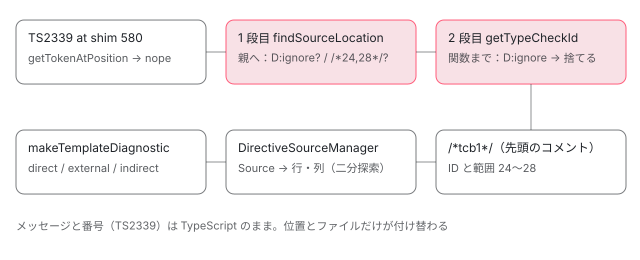

[目次](../README.md) › [テンプレート型チェックの内側](README.md) › 第 16 回 / 全 20 回

# TCB の診断をテンプレートの位置に戻す

> TypeScript が TCB に出した診断を、TCB に付けた位置のコメント（/\*start,end\*/、/\*D:ignore\*/、/\*T:...\*/、/\*tcb1\*/）から元のテンプレートの位置に戻す仕組み。先祖の D:ignore で捨てる 2 段の親たどり（findSourceLocation と getTypeCheckId）、番号で捨てる診断（shouldReportDiagnostic）、DirectiveSourceManager と外部テンプレートの行と列、direct・external・indirect の makeTemplateDiagnostic、TS2339 と NG 番号の出どころ、span\_comments\_spec。

angular/angular · 読了 約 13 分 · 発展 · [サイトで読む（デモが動きます）](https://angular-deep-dive-cyan.vercel.app/chapter/typecheck-diagnostics-mapping)

---

TypeScript がエラーを出すのは `app.component.ngtypecheck.ts` の何文字目、という TCB の中の位置です。それがエディタでは `app.component.html` の 2 行 11 列に出ます。入口（`translateDiagnostic` → `getSourceMapping` → `findSourceLocation` → `readSpanComment`）は[テンプレートコンパイラ第 17 回](../compiler/17-compiler-typecheck.md)で読みました。この章では、位置のコメントの種類（`/*開始,終了*/`・`/*D:ignore*/`・`/*T:…*/`・`/*tcb1*/`）、**報告しない診断**を決める 2 か所、テンプレートの位置を行と列にする `DirectiveSourceManager` と `line_mappings.ts`、インライン・外部・間接の 3 種類のテンプレートで `makeTemplateDiagnostic` が診断をどのファイルに付けるか、そして `TS2339` と `NG8004` の番号の出どころを読みます。

読む対象は `packages/compiler/src/typecheck/comments.ts`、`packages/compiler-cli/src/ngtsc/typecheck/src/` の `comments.ts`・`tcb_util.ts`・`diagnostics.ts`・`source.ts`・`line_mappings.ts`、`typecheck/diagnostics/src/`、`typecheck/api/api.ts` の `SourceMapping`、`ngtsc/diagnostics/src/util.ts` です。

1. [1. 全体像](01-typecheck-overview.md)
2. [2. 設定](02-typecheck-config.md)
3. [3. TCB の置き場所](03-typecheck-context.md)
4. [4. 派生プログラム](04-typecheck-program-driver.md)
5. [5. Environment](05-typecheck-environment.md)
6. [6. Scope と TcbOp](06-typecheck-scope.md)
7. [7. 式](07-typecheck-expressions.md)
8. [8. 要素と DOM](08-typecheck-elements-dom.md)
9. [9. 型コンストラクタ](09-typecheck-type-constructor.md)
10. [10. 入力](10-typecheck-inputs.md)
11. [11. 出力とイベント](11-typecheck-outputs-events.md)
12. [12. 双方向](12-typecheck-two-way.md)
13. [13. 制御フロー](13-typecheck-control-flow.md)
14. [14. ng-template のガード](14-typecheck-template-guards.md)
15. [15. 参照と pipe](15-typecheck-refs-pipes.md)
16. **16. 診断の対応付け**（この章）
17. [17. 帯域外の診断](17-typecheck-oob.md)
18. [18. 拡張診断](18-typecheck-extended.md)
19. [19. TemplateTypeChecker](19-typecheck-template-type-checker.md)
20. [20. issue と PR を読む](20-typecheck-issues.md)

## 1. TCB に書かれるコメントは 4 種類

📄 `angular/packages/compiler/src/typecheck/comments.ts` L9–22 （▶ の行: 11–12, 17, 20–21）

```ts
 9 │ /** Used to identify what type the comment is. */
10 │ export enum CommentTriviaType {
11 ▶   DIAGNOSTIC = 'D',
12 ▶   EXPRESSION_TYPE_IDENTIFIER = 'T',
13 │ }
14 │ 
15 │ /** Identifies what the TCB expression is for (for example, a directive declaration). */
16 │ export enum ExpressionIdentifier {
17 ▶   DIRECTIVE = 'DIR',
18 │   HOST_DIRECTIVE = 'HOSTDIR',
19 │   COMPONENT_COMPLETION = 'COMPCOMP',
20 ▶   EVENT_PARAMETER = 'EP',
21 ▶   VARIABLE_AS_EXPRESSION = 'VAE',
22 │ }
```

| コメント | 付ける場所 | 読む人 |
| --- | --- | --- |
| `/*12,16*/` | 式・変数のほぼ全部（`addParseSpanInfo`。第 17 回の codegen.ts） | 診断の位置を戻す（3 節）／言語サービスがテンプレートの位置から TCB のノードを探す |
| `/*D:ignore*/`（11 行目の `D`） | 再掲したガードの式、型コンストラクタの呼び出しなど（`markIgnoreDiagnostics`） | その下で出た診断を捨てる（4 節） |
| `/*T:DIR:0*/`・`/*T:EP*/`・`/*T:VAE*/` など（12 行目の `T`） | ディレクティブの変数、`$event` の引数、型だけの変数 | TemplateTypeChecker が「この変数はディレクティブ」などを見分ける（[第 19 回](19-typecheck-template-type-checker.md)） |
| `/*tcb1*/` | TCB の関数の直前（先頭のコメント） | どのコンポーネントの TCB か（5 節） |

📄 `angular/packages/compiler-cli/src/ngtsc/typecheck/test/span_comments_spec.ts` L232–244 （▶ の行: 234, 236–237, 240, 243）

```ts
232 │     describe('control flow', () => {
233 │       it('@for', () => {
234 ▶         const template = `@for (user of users; track user; let i = $index) { {{i}} }`;
235 │         // user variable
236 ▶         expect(tcbWithSpans(template, [])).toContain('const _t1 /*6,10*/');
237 ▶         expect(tcbWithSpans(template, [])).toContain('(this).users /*14,19*/');
238 │         // index variable
239 │         expect(tcbWithSpans(template, [])).toContain(
240 ▶           'var _t2 /*37,38*/ = null! as number /*T:VAE*/ /*37,47*/',
241 │         );
242 │         // track expression
243 ▶         expect(tcbWithSpans(template, [])).toContain('_t1 /*27,31*/;');
244 │       });
```
*span\_comments\_spec.ts（ファイル末尾の tcbWithSpans は tcb(…, {emitSpans: true}) で、位置コメントを残した TCB を返す）*

240 行目、`let i = $index` の変数には 3 つのコメントが付きます。`_t2` の直後の `/*37,38*/` は名前 `i` の範囲、`/*T:VAE*/` は「変数を式として宣言した」印（21 行目の `VARIABLE_AS_EXPRESSION`）、最後の `/*37,47*/` は `i = $index` 全体です。1 つのノードに複数のコメントが並ぶので、読む側は「どの種類のコメントを探すか」を決めて読みます。

📄 `angular/packages/compiler-cli/src/ngtsc/typecheck/src/comments.ts` L165–180 （▶ の行: 171–172, 176–177）

```ts
165 │ export function hasExpressionIdentifier(
166 │   sourceFile: ts.SourceFile,
167 │   node: ts.Node,
168 │   identifier: ExpressionIdentifier,
169 │ ): boolean {
170 │   return (
171 ▶     ts.forEachTrailingCommentRange(sourceFile.text, node.getEnd(), (pos, end, kind) => {
172 ▶       if (kind !== ts.SyntaxKind.MultiLineCommentTrivia) {
173 │         return false;
174 │       }
175 │       const commentText = sourceFile.text.substring(pos + 2, end - 2);
176 ▶       const prefix = `${CommentTriviaType.EXPRESSION_TYPE_IDENTIFIER}:${identifier}`;
177 ▶       return commentText === prefix || commentText.startsWith(prefix + ':');
178 │     }) || false
179 │   );
180 │ }
```

`T:` の印を読む `hasExpressionIdentifier` です。171 行目、ノードの**直後（trailing）**のコメントを順に見て、172 行目で `/* */` の形だけ、176〜177 行目で `T:VAE` のような名前と一致するか（`T:DIR:0` のように後ろに番号が続くものも）を確かめます。位置のコメントを読む `readSpanComment`（第 17 回で引用）も、印を読む 2 節の関数も、同じく「ノードの終わりの直後のコメント」を読みます。**コメントはノードの直後に置く**、が全体の約束です。

## 2. TypeScript の診断のうち、最初から捨てるもの

TypeScript のエラーは全部がテンプレートの誤りではありません。TCB の書き方のせいで出るものがあるので、位置を戻す前に番号で捨てます。

📄 `angular/packages/compiler-cli/src/ngtsc/typecheck/src/diagnostics.ts` L24–58 （▶ の行: 29, 31, 33, 35, 37, 39, 42, 55–57）

```ts
24 │ /**
25 │  * Determines if the diagnostic should be reported. Some diagnostics are produced because of the
26 │  * way TCBs are generated; those diagnostics should not be reported as type check errors of the
27 │  * template.
28 │  */
29 ▶ export function shouldReportDiagnostic(diagnostic: ts.Diagnostic): boolean {
30 │   const {code} = diagnostic;
31 ▶   if (code === 6133 /* $var is declared but its value is never read. */) {
32 │     return false;
33 ▶   } else if (code === 6199 /* All variables are unused. */) {
34 │     return false;
35 ▶   } else if (code === 2695 /* Left side of comma operator is unused and has no side effects. */) {
36 │     return false;
37 ▶   } else if (code === 7006 /* Parameter '$event' implicitly has an 'any' type. */) {
38 │     return false;
39 ▶   } else if (code === 2341 /* Property 'X' is private and only accessible within class */) {
40 │     if (diagnostic.file !== undefined && diagnostic.start !== undefined) {
41 │       // Here we're discarding private property reads error to allow them to be used in template expressions
42 ▶       if (isAccessOnThis(diagnostic.file.text, diagnostic.start)) {
43 │         return false;
44 │       }
45 │     }
46 │   }
47 │ 
48 │   return true;
49 │ }
50 │ 
51 │ /**
52 │  * Attempts to translate a TypeScript diagnostic produced during template type-checking to their
53 │  * location of origin, based on the comments that are emitted in the TCB code.
54 │  *
55 ▶  * If the diagnostic could not be translated, `null` is returned to indicate that the diagnostic
56 ▶  * should not be reported at all. This prevents diagnostics from non-TCB code in a user's source
57 ▶  * file from being reported as type-check errors.
58 │  */
```

1. **31〜34 行目：TS6133・TS6199「宣言したが読まれていない」**

   `noUnusedLocals` のプロジェクトで、TCB の `var _t1 = …` や `const tcbExhaustive_t1`（[第 13 回](13-typecheck-control-flow.md)）が読まれないと出ます。
2. **35 行目：TS2695「カンマ演算子の左が使われていない」**

   イベントの `(click)="a; b"` は TCB で `(a, b)` のカンマ式になる（span\_comments\_spec の `it('should annotate chained expressions')`）ので出ます。
3. **37 行目：TS7006「`$event` が暗黙に any」**

   TCB は `$event` の引数に型を書かず、TypeScript の推論に任せることがあります（[第 11 回](11-typecheck-outputs-events.md)）。推論の元になる型が無いとき（購読先が `any` など）に出ます。
4. **39〜45 行目：TS2341「private のプロパティ」を、`this.` の直後のときだけ捨てる**

   テンプレートからコンポーネントの `private` なプロパティを読むのは許す、という判断です。42 行目の `isAccessOnThis`（18〜22 行目、引用の外）は TCB の文字列で直前が `this.` か `(this).` かだけを見ます。この「private を許す」を設定で変えたい、という開いている issue が #71066（2026-09-30、コメント 19）です（[第 20 回](20-typecheck-issues.md)）。

この関数を呼ぶのは checker.ts の `convertDiagnostic` で、`shouldReportDiagnostic` が偽なら `translateDiagnostic` を呼ばずに捨てます（第 17 回で引用済みの範囲）。55〜57 行目のコメントのとおり、位置が戻せない診断（TCB の外のコード）も `null` にして捨てます。インラインの TCB では利用者の .ts ファイルそのものに TCB を足して型検査するので、**そのファイルのふつうのコードの型エラー**もここを通ります。それを型チェックのエラーとして二重に出さないための `null` です。

## 3. 位置のコメントから親へ：findSourceLocation の 2 段

`findSourceLocation`（tcb\_util.ts。第 17 回で引用済み）は、TypeScript がエラーを付けたノードから親へ 1 つずつ上がり、各ノードで「`D:ignore` の印があれば捨てる」「位置のコメントがあれば採る」を繰り返します。位置のコメントが見つかったら、次の `getTypeCheckId` で **もう一度**関数まで上がります。

📄 `angular/packages/compiler-cli/src/ngtsc/typecheck/src/comments.ts` L45–59 （▶ の行: 46, 51–52, 55–56）

```ts
45 │ 
46 ▶ const IGNORE_FOR_DIAGNOSTICS_MARKER = `${CommentTriviaType.DIAGNOSTIC}:ignore`;
47 │ 
48 │ /** Returns true if the node has a marker that indicates diagnostics errors should be ignored.  */
49 │ export function hasIgnoreForDiagnosticsMarker(node: ts.Node, sourceFile: ts.SourceFile): boolean {
50 │   return (
51 ▶     ts.forEachTrailingCommentRange(sourceFile.text, node.getEnd(), (pos, end, kind) => {
52 ▶       if (kind !== ts.SyntaxKind.MultiLineCommentTrivia) {
53 │         return null;
54 │       }
55 ▶       const commentText = sourceFile.text.substring(pos + 2, end - 2);
56 ▶       return commentText === IGNORE_FOR_DIAGNOSTICS_MARKER;
57 │     }) === true
58 │   );
59 │ }
```

📄 `angular/packages/compiler-cli/src/ngtsc/typecheck/src/tcb_util.ts` L231–261 （▶ の行: 238–241, 243, 251, 253, 257–258）

```ts
231 │ 
232 │ function getTypeCheckId(
233 │   node: ts.Node,
234 │   sourceFile: ts.SourceFile,
235 │   isDiagnosticRequest: boolean,
236 │ ): TypeCheckId | null {
237 │   // Walk up to the function declaration of the TCB, the file information is attached there.
238 ▶   while (!ts.isFunctionDeclaration(node)) {
239 ▶     if (hasIgnoreForDiagnosticsMarker(node, sourceFile) && isDiagnosticRequest) {
240 ▶       // There's an ignore marker on this node, so the diagnostic should not be reported.
241 ▶       return null;
242 │     }
243 ▶     node = node.parent;
244 │ 
245 │     // Bail once we have reached the root.
246 │     if (node === undefined) {
247 │       return null;
248 │     }
249 │   }
250 │ 
251 ▶   const start = node.getFullStart();
252 │   return (
253 ▶     (ts.forEachLeadingCommentRange(sourceFile.text, start, (pos, end, kind) => {
254 │       if (kind !== ts.SyntaxKind.MultiLineCommentTrivia) {
255 │         return null;
256 │       }
257 ▶       const commentText = sourceFile.text.substring(pos + 2, end - 2);
258 ▶       return commentText;
259 │     }) as TypeCheckId) || null
260 │   );
261 │ }
```

1. **51〜56 行目：`D:ignore` は「直後のコメントがちょうど `D:ignore`」**

   46 行目の印の文字列と完全に一致するものだけ。`/*D:ignore*/ /*24,27*/` のように位置のコメントと並んでいても、どちらも見つかります。
2. **238〜243 行目：位置を見つけた後も、関数まで上がる途中で `D:ignore` を探す**

   ここが大事です。再掲したガードの `((this).nope /*24,28*/) /*D:ignore*/` では、エラーの付いた `nope` の直後にあるのは位置のコメントだけなので、`findSourceLocation` の 1 段目は位置を採ります。ところが 2 段目の 239〜241 行目で、親の括弧の式に `D:ignore` が見つかり、`null` を返します。**先祖のどこかに印があれば捨てる**のです。印を式全体に 1 つ付けるだけで、その中の全部のエラーを黙らせられるのはこのためです。
3. **251〜258 行目：関数の**前の**コメントが TCB の ID**

   251 行目の `getFullStart()` は前置きの空白とコメントを含む開始位置で、253 行目でそこにある `/* */` を読みます。`/*tcb1*/ function _tcb1(…)` の `tcb1` です。ここだけは「直後」ではなく「直前（leading）」のコメントです。

手元で、本物の ngc（このサイトの node\_modules の 22.1.6、`strictTemplates: true`）にかけて確かめました。

📄 `ngc -p tsconfig.json の出力（抜粋。2026-11-02、scratchpad の小さなプロジェクト）`

```
src/cmps.ts:7:48 - error TS2339: Property 'nope' does not exist on type 'IfDup'.

7 @Component({ selector: 'c-if', template: `@if (nope) { <button (click)="go()"></button> }` })
                                                 ~~~~

src/cmps.ts:13:55 - error TS2322: Type '"b"' is not assignable to type 'never'.

13 @Component({ selector: 'c-never', template: `@switch (kind) {
                                                         ~~~~

src/ext.html:2:11 - error TS2339: Property 'nmae' does not exist on type '{ name: string; }'.

2   {{ user.nmae }}
            ~~~~

  src/cmps.ts:25:46
    25 @Component({ selector: 'c-ext', templateUrl: './ext.html' })
                                                    ~~~~~~~~~~~~
    Error occurs in the template of component Ext.

src/more.ts (Ind template):1:12 - error TS2339: Property 'nmae' does not exist on type '{ name: string; }'.

1 <p>{{ user.nmae }}</p>
             ~~~~

  src/more.ts:4:43
    4 @Component({ selector: 'c-ind', template: head + '{{ user.nmae }}</p>' })
                                                ~~~~~~~~~~~~~~~~~~~~~~~~~~~~
    Error occurs in the template of component Ind.
```

1 つ目の `@if (nope) { <button (click)="go()"> }` では、TCB に `(this).nope` が 2 か所（`if` の条件と、ハンドラの中の再掲）あり、型検査用のプログラムから直接取った TypeScript の診断は **2 つ**でした。ngc が出したのは上の 1 つだけで、もう 1 つは 239〜241 行目で捨てられています。同じ形の `@switch` の `@case (nope2)` も、TypeScript の 2 つが 1 つになりました。2 つ目は第 13 回の `@default never` で、エラーの付いた `tcbExhaustive_t1` には位置のコメントが無く、親の変数宣言の直後の `/*9,13*/`（`@switch (kind)` の `kind`）が採られています。

## 4. TCB の ID と、ID からテンプレートを引く表

📄 `angular/packages/compiler-cli/src/ngtsc/typecheck/diagnostics/src/id.ts` L13–28 （▶ の行: 19, 21–22, 24–25）

```ts
13 │ const TYPE_CHECK_ID_MAP = Symbol('TypeCheckId');
14 │ 
15 │ interface HasNextTypeCheckId {
16 │   [TYPE_CHECK_ID_MAP]: Map<ts.Node, TypeCheckId>;
17 │ }
18 │ 
19 ▶ export function getTypeCheckId(clazz: DeclarationNode): TypeCheckId {
20 │   const sf = clazz.getSourceFile() as ts.SourceFile & Partial<HasNextTypeCheckId>;
21 ▶   if (sf[TYPE_CHECK_ID_MAP] === undefined) {
22 ▶     sf[TYPE_CHECK_ID_MAP] = new Map();
23 │   }
24 ▶   if (sf[TYPE_CHECK_ID_MAP].get(clazz) === undefined) {
25 ▶     sf[TYPE_CHECK_ID_MAP].set(clazz, `tcb${sf[TYPE_CHECK_ID_MAP].size + 1}` as TypeCheckId);
26 │   }
27 │   return sf[TYPE_CHECK_ID_MAP].get(clazz)!;
28 │ }
```

ID は **ソースファイルごと**の連番です（21〜23 行目で `ts.SourceFile` に表を持たせ、25 行目で `tcb1`、`tcb2`…）。別のファイルの TCB と ID が同じになっても、診断はファイルごとの `DirectiveSourceManager` で引くので混ざりません。ID から「テンプレートの元」を引く側の約束が、次のインタフェースです。

📄 `angular/packages/compiler-cli/src/ngtsc/typecheck/src/tcb_util.ts` L47–76 （▶ の行: 52, 58, 65, 68, 75）

```ts
47 │ /**
48 │  * Adapter interface which allows the directive type-checking diagnostics code to interpret offsets
49 │  * in a TCB and map them back to their original locations.
50 │  */
51 │ export interface TypeCheckSourceResolver {
52 ▶   getTypeCheckId(node: ts.ClassDeclaration): TypeCheckId;
53 │ 
54 │   /**
55 │    * For the given type checking id, retrieve the original source mapping which describes how the
56 │    * offsets in the template should be interpreted.
57 │    */
58 ▶   getTemplateSourceMapping(id: TypeCheckId): SourceMapping;
59 │ 
60 │   /**
61 │    * Convert an absolute source span coming from the template associated with the given type
62 │    * checking id into a full `ParseSourceSpan`. The returned parse span has line and column
63 │    * numbers in addition to only absolute offsets and gives access to the original source code.
64 │    */
65 ▶   toTemplateParseSourceSpan(id: TypeCheckId, span: AbsoluteSourceSpan): ParseSourceSpan | null;
66 │ 
67 │   /** For the given type checking id, retrieve the source mapping of its host bindings. */
68 ▶   getHostBindingsMapping(id: TypeCheckId): SourceMapping;
69 │ 
70 │   /**
71 │    * Convert an absolute source span coming from a host binding associated with the given type
72 │    * checking id into a full `ParseSourceSpan`. The returned parse span has line and column
73 │    * numbers in addition to only absolute offsets and gives access to the original source code.
74 │    */
75 ▶   toHostParseSourceSpan(id: TypeCheckId, span: AbsoluteSourceSpan): ParseSourceSpan | null;
76 │ }
```

📄 `angular/packages/compiler-cli/src/ngtsc/typecheck/src/source.ts` L98–113 （▶ の行: 98–99, 102–103, 106）

```ts
 98 ▶   toTemplateParseSourceSpan(id: TypeCheckId, span: AbsoluteSourceSpan): ParseSourceSpan | null {
 99 ▶     if (!this.templateSources.has(id)) {
100 │       return null;
101 │     }
102 ▶     const templateSource = this.templateSources.get(id)!;
103 ▶     return templateSource.toParseSourceSpan(span.start, span.end);
104 │   }
105 │ 
106 ▶   toHostParseSourceSpan(id: TypeCheckId, span: AbsoluteSourceSpan): ParseSourceSpan | null {
107 │     if (!this.hostBindingSources.has(id)) {
108 │       return null;
109 │     }
110 │     const source = this.hostBindingSources.get(id)!;
111 │     return source.toParseSourceSpan(span.start, span.end);
112 │   }
113 │ }
```
*source.ts の DirectiveSourceManager（TypeCheckSourceResolver の実装）*

TCB を作るとき、`TypeCheckContextImpl.addDirective` が ID ごとにテンプレートの元（`SourceMapping` と `ParseSourceFile`）を `captureTemplateSource` で覚えます（[第 3 回](03-typecheck-context.md)の context.ts）。診断のときは 98〜104 行目、ID で引いた `Source` に文字の範囲を渡して `ParseSourceSpan`（行と列を持つ範囲）にします。ホストバインディングは別の表（106〜112 行目）です。

## 5. 文字の位置を行と列に：Source と line\_mappings

📄 `angular/packages/compiler-cli/src/ngtsc/typecheck/src/source.ts` L24–54 （▶ の行: 36–37, 43–45, 49–50）

```ts
24 │ /**
25 │  * Represents the source of code processed during type-checking. This information is used when
26 │  * translating parse offsets in diagnostics back to their original line/column location.
27 │  */
28 │ class Source {
29 │   private lineStarts: number[] | null = null;
30 │ 
31 │   constructor(
32 │     readonly mapping: SourceMapping,
33 │     private file: ParseSourceFile,
34 │   ) {}
35 │ 
36 ▶   toParseSourceSpan(start: number, end: number): ParseSourceSpan {
37 ▶     const startLoc = this.toParseLocation(start);
38 │     const endLoc = this.toParseLocation(end);
39 │     return new ParseSourceSpan(startLoc, endLoc);
40 │   }
41 │ 
42 │   private toParseLocation(position: number) {
43 ▶     const lineStarts = this.acquireLineStarts();
44 ▶     const {line, character} = getLineAndCharacterFromPosition(lineStarts, position);
45 ▶     return new ParseLocation(this.file, position, line, character);
46 │   }
47 │ 
48 │   private acquireLineStarts(): number[] {
49 ▶     if (this.lineStarts === null) {
50 ▶       this.lineStarts = computeLineStartsMap(this.file.content);
51 │     }
52 │     return this.lineStarts;
53 │   }
54 │ }
```

📄 `angular/packages/compiler-cli/src/ngtsc/typecheck/src/line_mappings.ts` L14–42 （▶ の行: 15–17, 25, 31–33, 35–36, 40）

```ts
14 │ /** Gets the line and character for the given position from the line starts map. */
15 ▶ export function getLineAndCharacterFromPosition(lineStartsMap: number[], position: number) {
16 ▶   const lineIndex = findClosestLineStartPosition(lineStartsMap, position);
17 ▶   return {character: position - lineStartsMap[lineIndex], line: lineIndex};
18 │ }
19 │ 
20 │ /**
21 │  * Computes the line start map of the given text. This can be used in order to
22 │  * retrieve the line and character of a given text position index.
23 │  */
24 │ export function computeLineStartsMap(text: string): number[] {
25 ▶   const result: number[] = [0];
26 │   let pos = 0;
27 │   while (pos < text.length) {
28 │     const char = text.charCodeAt(pos++);
29 │     // Handles the "CRLF" line break. In that case we peek the character
30 │     // after the "CR" and check if it is a line feed.
31 ▶     if (char === CR_CHAR) {
32 ▶       if (text.charCodeAt(pos) === LF_CHAR) {
33 ▶         pos++;
34 │       }
35 ▶       result.push(pos);
36 ▶     } else if (char === LF_CHAR || char === LINE_SEP_CHAR || char === PARAGRAPH_CHAR) {
37 │       result.push(pos);
38 │     }
39 │   }
40 ▶   result.push(pos);
41 │   return result;
42 │ }
```

1. **49〜50 行目：最初に使うときに「各行の先頭の位置」の配列を 1 回だけ作る**

   24〜42 行目の `computeLineStartsMap` は、テキストを 1 文字ずつ見て、改行の次の位置を配列に積みます。31〜35 行目、CR LF は 2 文字で 1 つの改行、36 行目、U+2028・U+2029（行区切り・段落区切り）も改行に数えます。Windows の改行のテンプレートで列がずれないのはこの数え方のためです（CRLF の例は[第 1 回](01-typecheck-overview.md)の spec）。
2. **15〜17 行目：二分探索で「その位置を含む行」**

   行の番号と、行の先頭からの文字数（列）を返します。どちらも 0 から数えます。ngc の表示（`2:11`）は 1 から数えた値です。
3. **45 行目：`ParseLocation(file, 位置, 行, 列)`**

   `file` は 4 節で覚えた `ParseSourceFile` です。annotations/component/src/resources.ts でテンプレートを読むとき、`template: '…'` の文字列 1 つ（次節の direct）なら **.ts の全文**を、`templateUrl` なら .html の中身を、それ以外（indirect）なら組み立て後のテンプレートの文字列を元の文字列にしています。だから direct のテンプレートの位置コメントは、.ts の中の文字位置になります（7 節の `/*231,235*/`）。

## 6. 3 種類のテンプレートの元と、診断を付けるファイル

📄 `angular/packages/compiler-cli/src/ngtsc/typecheck/api/api.ts` L102–141 （▶ の行: 102–103, 111–112, 123, 126, 136, 140）

```ts
102 ▶ export type SourceMapping =
103 ▶   DirectSourceMapping | IndirectSourceMapping | ExternalTemplateSourceMapping;
104 │ 
105 │ /**
106 │  * A mapping to a node within the same source file..
107 │  *
108 │  * `ParseSourceSpan`s for this node should be accurate for direct reporting in a TS error message.
109 │  */
110 │ export interface DirectSourceMapping {
111 ▶   type: 'direct';
112 ▶   node: ts.Node;
113 │ }
114 │ 
115 │ /**
116 │  * A mapping to a node which is still in a TS file, but where the positions in any
117 │  * `ParseSourceSpan`s are not accurate for one reason or another.
118 │  *
119 │  * This can occur if the expression was interpolated in a way where the compiler could not
120 │  * construct a contiguous mapping for the template string.
121 │  */
122 │ export interface IndirectSourceMapping {
123 ▶   type: 'indirect';
124 │   componentClass: ClassDeclaration;
125 │   node: ts.Expression;
126 ▶   template: string;
127 │ }
128 │ 
129 │ /**
130 │  * A mapping to a template declared in an external HTML file, where node positions in
131 │  * `ParseSourceSpan`s represent accurate offsets into the external file.
132 │  *
133 │  * In this case, the given `node` refers to the `templateUrl` expression.
134 │  */
135 │ export interface ExternalTemplateSourceMapping {
136 ▶   type: 'external';
137 │   componentClass: ClassDeclaration;
138 │   node: ts.Expression;
139 │   template: string;
140 ▶   templateUrl: string;
141 │ }
```

📄 `angular/packages/compiler-cli/src/ngtsc/typecheck/diagnostics/src/diagnostic.ts` L77–107 （▶ の行: 77–78, 85, 88–89, 93, 101–103, 107）

```ts
 77 ▶     // For direct mappings, the error is shown inline as ngtsc was able to pinpoint a string
 78 ▶     // constant within the `@Component` decorator for the template. This allows us to map the error
 79 │     // directly into the bytes of the source file.
 80 │     return {
 81 │       source: 'ngtsc',
 82 │       code,
 83 │       category,
 84 │       messageText,
 85 ▶       file: mapping.node.getSourceFile(),
 86 │       sourceFile: mapping.node.getSourceFile(),
 87 │       typeCheckId: id,
 88 ▶       start: span.start.offset,
 89 ▶       length: span.end.offset - span.start.offset,
 90 │       relatedInformation,
 91 │       reportsDeprecated: deprecatedDiagInfo?.reportsDeprecated,
 92 │     };
 93 ▶   } else if (mapping.type === 'indirect' || mapping.type === 'external') {
 94 │     // For indirect mappings (template was declared inline, but ngtsc couldn't map it directly
 95 │     // to a string constant in the decorator), the component's file name is given with a suffix
 96 │     // indicating it's not the TS file being displayed, but a template.
 97 │     // For external temoplates, the HTML filename is used.
 98 │     const componentSf = mapping.componentClass.getSourceFile();
 99 │     const componentName = mapping.componentClass.name.text;
100 │     const fileName =
101 ▶       mapping.type === 'indirect'
102 ▶         ? `${componentSf.fileName} (${componentName} template)`
103 ▶         : mapping.templateUrl;
104 │ 
105 │     let sf: ts.SourceFile;
106 │     try {
107 ▶       sf = getParsedTemplateSourceFile(fileName, mapping);
```
*makeTemplateDiagnostic（typecheck/diagnostics/src/diagnostic.ts）の、direct の返り値と、indirect / external の始まり*

📄 `angular/packages/compiler-cli/src/ngtsc/typecheck/diagnostics/src/diagnostic.ts` L175–199 （▶ の行: 175, 181, 183, 191–192, 194–195）

```ts
175 ▶     relatedInformation.push({
176 │       category: ts.DiagnosticCategory.Message,
177 │       code: 0,
178 │       file: componentSf,
179 │       // mapping.node represents either the 'template' or 'templateUrl' expression. getStart()
180 │       // and getEnd() are used because they don't include surrounding whitespace.
181 ▶       start: mapping.node.getStart(),
182 │       length: mapping.node.getEnd() - mapping.node.getStart(),
183 ▶       messageText: `${typeForMessage} occurs in the template of component ${componentName}.`,
184 │     });
185 │ 
186 │     return {
187 │       source: 'ngtsc',
188 │       category,
189 │       code,
190 │       messageText,
191 ▶       file: sf,
192 ▶       sourceFile: componentSf,
193 │       typeCheckId: id,
194 ▶       start: span.start.offset,
195 ▶       length: span.end.offset - span.start.offset,
196 │       // Show a secondary message indicating the component whose template contains the error.
197 │       relatedInformation,
198 │       reportsDeprecated: deprecatedDiagInfo?.reportsDeprecated,
199 │     };
```

| 種類 | テンプレートの書き方 | 診断の `file` | ngc の表示（手元の結果） |
| --- | --- | --- | --- |
| `direct`（110〜113 行目） | `template: '…'`（文字列 1 つ） | コンポーネントの .ts（85 行目）。位置は .ts の中の文字位置（88 行目） | `src/cmps.ts:7:48` |
| `external`（135〜141 行目） | `templateUrl: './ext.html'` | .html を TypeScript の `SourceFile` として作ったもの（191 行目） | `src/ext.html:2:11` ＋「Error occurs in the template of component Ext.」 |
| `indirect`（122〜127 行目） | `template: head + '…'` など、1 つの文字列に定まらないもの | 名前が `.ts (Ind template)` の仮のファイル（102 行目） | `src/more.ts (Ind template):1:12` ＋ 同じ付記 |

direct は 77〜79 行目のコメントのとおり、テンプレートの文字列が .ts の中のどこにあるかが分かっているので、エラーを .ts の文字位置にそのまま付けます。external と indirect は、テンプレートの文字列を 107 行目で TypeScript の `SourceFile` に作り（下の引用の 241〜247 行目。HTML を JSX として読ませる。239〜240 行目のコメントは「偽の SourceFile にしたい」という TODO）、その中の位置に付けます。175〜184 行目で、どのコンポーネントのテンプレートかを付記（`relatedInformation`）として足し、192 行目で `sourceFile` にはコンポーネントの .ts を入れます（エディタがどのファイルの診断として扱うかに使う）。

📄 `angular/packages/compiler-cli/src/ngtsc/typecheck/diagnostics/src/diagnostic.ts` L213–248 （▶ の行: 217–218, 226, 234–235, 239–241, 246）

```ts
213 │ function getParsedTemplateSourceFile(
214 │   fileName: string,
215 │   mapping: TemplateSourceMappingWithSourceFile,
216 │ ): ts.SourceFile {
217 ▶   if (mapping[TemplateSourceFile] === undefined) {
218 ▶     mapping[TemplateSourceFile] = parseTemplateAsSourceFile(fileName, mapping.template);
219 │   }
220 │ 
221 │   return mapping[TemplateSourceFile];
222 │ }
223 │ 
224 │ let parseTemplateAsSourceFileForTest: typeof parseTemplateAsSourceFile | null = null;
225 │ 
226 ▶ export function setParseTemplateAsSourceFileForTest(fn: typeof parseTemplateAsSourceFile): void {
227 │   parseTemplateAsSourceFileForTest = fn;
228 │ }
229 │ 
230 │ export function resetParseTemplateAsSourceFileForTest(): void {
231 │   parseTemplateAsSourceFileForTest = null;
232 │ }
233 │ 
234 ▶ function parseTemplateAsSourceFile(fileName: string, template: string): ts.SourceFile {
235 ▶   if (parseTemplateAsSourceFileForTest !== null) {
236 │     return parseTemplateAsSourceFileForTest(fileName, template);
237 │   }
238 │ 
239 ▶   // TODO(alxhub): investigate creating a fake `ts.SourceFile` here instead of invoking the TS
240 ▶   // parser against the template (HTML is just really syntactically invalid TypeScript code ;).
241 ▶   return ts.createSourceFile(
242 │     fileName,
243 │     template,
244 │     ts.ScriptTarget.Latest,
245 │     /* setParentNodes */ false,
246 ▶     ts.ScriptKind.JSX,
247 │   );
248 │ }
```

217〜218 行目、作った `SourceFile` は `mapping` に覚えて使い回します。226 行目は、テストで「ここで例外が出たら」を差し替える口です。例外が出たときは、`makeTemplateDiagnostic` の `catch` がコンポーネントの .ts の `template` / `templateUrl` の式の位置に、「Failed to report an error in '…' at 行:列」を足した診断を作ります。これを確かめているのが diagnostics\_spec.ts の `describe('template parse failures')`（:1529。issue #43970 の回帰テスト）です。

## 7. インラインの TCB と、ID から TCB を探す逆向き

📄 `angular/packages/compiler-cli/src/ngtsc/typecheck/src/tcb_util.ts` L102–127 （▶ の行: 111, 113–115, 119–120, 123）

```ts
102 │ export function requiresInlineTypeCheckBlock(
103 │   ref: Reference<ClassDeclaration<ts.ClassDeclaration>>,
104 │   env: ReferenceEmitEnvironment,
105 │   usedPipes: Reference<ClassDeclaration<ts.ClassDeclaration>>[],
106 │   reflector: ReflectionHost,
107 │ ): TcbInliningRequirement {
108 │   // In order to qualify for a declared TCB (not inline) two conditions must be met:
109 │   // 1) the class must be suitable to be referenced from `env` (e.g. it must be exported)
110 │   // 2) it must not have contextual generic type bounds
111 ▶   if (!env.canReferenceType(ref)) {
112 │     // Condition 1 is false, the class is not exported.
113 ▶     return TcbInliningRequirement.MustInline;
114 ▶   } else if (
115 ▶     !checkIfGenericTypeBoundsCanBeEmitted(ref.node, reflector, (r) => env.canReferenceType(r))
116 │   ) {
117 │     // Condition 2 is false, the class has constrained generic types. It should be checked with an
118 │     // inline TCB if possible, but can potentially use fallbacks to avoid inlining if not.
119 ▶     return TcbInliningRequirement.ShouldInlineForGenericBounds;
120 ▶   } else if (usedPipes.some((pipeRef) => !env.canReferenceType(pipeRef))) {
121 │     // If one of the pipes used by the component is not exported, a non-inline TCB will not be able
122 │     // to import it, so this requires an inline TCB.
123 ▶     return TcbInliningRequirement.MustInline;
124 │   } else {
125 │     return TcbInliningRequirement.None;
126 │   }
127 │ }
```

コンポーネントが export されていない（111〜113 行目）、または使う pipe が export されていない（120〜123 行目）と、shim ファイルから import できないので、TCB を元の .ts に差し込みます（どちらに書くかを決める行は[第 3 回](03-typecheck-context.md)）。手元の ngc で `export` の無い `class Hidden` を作ると、型検査用のプログラムの中の `more.ts` は次の形でした。

📄 `型検査用のプログラムの中の src/more.ts（抜粋。NgtscProgram から取り出したもの）`

```
@Component({ selector: 'c-hidden', template: '{{ user.nmae }}' })
class Hidden { user = { name: 'a' }; }

/*tcb2*/
function _tcb_180(this: Hidden) {
if (true) {
"" + (((((this).user /*231,235*/) /*231,235*/).nmae /*236,240*/) /*231,240*/);

}
}export const keep = Hidden;
```

TCB はクラスの直後に置かれ、位置のコメントは `/*231,235*/` のように **.ts ファイルの中の文字位置**です（インラインの `template: '…'` は direct なので、テンプレートの位置がそもそも .ts の位置）。エラーは `src/more.ts:7:55` に出ました。つまりインラインの TCB でも、診断の戻し方（3〜6 節）は同じで、違うのは型検査するファイルが shim ではなく元の .ts になることと、2 節の 55〜57 行目の「TCB の外の診断を捨てる」が効いてくることです。

📄 `angular/packages/compiler-cli/src/ngtsc/typecheck/src/tcb_util.ts` L163–195 （▶ の行: 164, 166–167, 175, 182–183, 190）

```ts
163 │ 
164 ▶ function isInHostBindingTcb(node: ts.Node): boolean {
165 │   let current = node;
166 ▶   while (current && !ts.isFunctionDeclaration(current)) {
167 ▶     if (isHostBindingsBlockGuard(current)) {
168 │       return true;
169 │     }
170 │     current = current.parent;
171 │   }
172 │   return false;
173 │ }
174 │ 
175 ▶ export function findTypeCheckBlock(
176 │   file: ts.SourceFile,
177 │   id: TypeCheckId,
178 │   isDiagnosticRequest: boolean,
179 │ ): ts.Node | null {
180 │   // This prioritised-level statements using a breadth-first search
181 │   // This is usually sufficient to find the TCB we're looking for
182 ▶   for (const stmt of file.statements) {
183 ▶     if (ts.isFunctionDeclaration(stmt) && getTypeCheckId(stmt, file, isDiagnosticRequest) === id) {
184 │       return stmt;
185 │     }
186 │   }
187 │ 
188 │   // In case the TCB we're looking for is nested (which is not common)
189 │   // eg: when a directive is declared inside a function, as it can happen in test files
190 ▶   return findNodeInFile(
191 │     file,
192 │     (node) =>
193 │       ts.isFunctionDeclaration(node) && getTypeCheckId(node, file, isDiagnosticRequest) === id,
194 │   );
195 │ }
```

175〜195 行目の `findTypeCheckBlock` は逆向きで、ID から TCB の関数を探します。TemplateTypeChecker が「テンプレートのこの位置の記号は何か」を答えるときに使います（[第 19 回](19-typecheck-template-type-checker.md)）。164〜173 行目の `isInHostBindingTcb` は、ノードがホストバインディング用の `if` の中なら、4 節の 2 つ目の表（ホストバインディングの元）で引くための判定です。

## 8. TS2339 と NG8004：番号はどこから来るか

📄 `angular/packages/compiler-cli/src/ngtsc/diagnostics/src/util.ts` L12–29 （▶ の行: 12, 14, 19–22, 27–28）

```ts
12 ▶ const ERROR_CODE_MATCHER = /(\u001b\[\d+m ?)TS-99(\d+: ?\u001b\[\d+m)/g;
13 │ 
14 ▶ const ERROR_CODE_MARKER = 99;
15 │ 
16 │ const ERROR_CODE_MARKER_DIGITS = String(ERROR_CODE_MARKER).length;
17 │ 
18 │ /**
19 ▶  * During formatting of `ts.Diagnostic`s, the numeric code of each diagnostic is prefixed with the
20 ▶  * hard-coded "TS" prefix. For Angular's own error codes, a prefix of "NG" is desirable. To achieve
21 ▶  * this, all Angular error codes start with "-99" so that the sequence "TS-99" can be assumed to
22 ▶  * correspond with an Angular specific error code. This function replaces those occurrences with
23 │  * just "NG".
24 │  *
25 │  * @param errors The formatted diagnostics
26 │  */
27 ▶ export function replaceTsWithNgInErrors(errors: string): string {
28 ▶   return errors.replace(ERROR_CODE_MATCHER, '$1NG$2');
29 │ }
```

- **TypeScript のエラー**（TS2339 など）：`translateDiagnostic` は位置だけを差し替え、`code` は TypeScript のものをそのまま渡します（第 17 回で引用した diagnostics.ts の `diagnostic.code`）。`ts.formatDiagnostics` が番号の前に `TS` を付けるので `TS2339` と表示されます。
- **Angular 自身のエラー**（帯域外の診断など）：番号を `-99` で始まる負の数にしておき（`ngErrorCode`。[第 17 回](17-typecheck-oob.md)）、TypeScript の整形が `TS-998004` と書いたものを、12 行目の正規表現と 27〜28 行目の置き換えで `NG8004` にします（19〜23 行目のコメント）。

つまりテンプレートの「TS2339」は、本当に TypeScript が TCB に出したエラーで、Angular が作ったものではありません。逆に NG で始まる番号は、TypeScript を通さずに Angular が作った診断です。

## 9. デモ：位置の対応表（再現）

> **🧪 DEMO — 本物の generateTypeCheckBlock（22.1.6）が書いた位置のコメントを、テンプレートの範囲に戻す**
>
> 「TCB を作る」で TCB を作り、その文字列から `/*開始,終了*/` を正規表現で拾って並べます。行を選ぶと、テンプレートのその範囲を強調します。これは**再現**です。ngtsc は文字列ではなく TypeScript の構文木のノードから親へたどってコメントを読みます（3 節）。「D:ignore」は、そのコメントの直前に `/*D:ignore*/` がある（同じノードに印がある）ものです。
>
> ▶ [このデモはサイトで動かせます](https://angular-deep-dive-cyan.vercel.app/chapter/typecheck-diagnostics-mapping)

見るところ（2026-11-02 に Node で同じ 22.1.6 を呼んで確かめた出力です）：

- **補間とメソッド**：`user`・`user.name`・`total`・`items`・`2`・`total(items, 2)` がそれぞれ別の範囲です。`user` の範囲（`/*6,10*/`）は `×2`（`(this).user` と、それを包む括弧の両方）になります。
- **イベントと @if**：条件の `user` の範囲 `/*5,9*/` が `×4` で「D:ignore」付き（ハンドラの中に再掲したガードの 1 つに印がある）。ハンドラの引数の `user` は別の範囲 `/*37,41*/` で、印はありません。`/*T:EP*/` が 1 個（`$event` の引数）。
- **@switch と D:ignore**：`'a'` の範囲 `/*26,29*/` が `×2` の「D:ignore」付きで現れます（`case` と、ハンドラの中のガード）。`kind` の範囲は `×6` です。`@default never` の `default:` の行には新しい範囲は無く、`kind` の範囲が使われます。
- **@for**：1 節の span\_comments\_spec の 236〜243 行目と同じ範囲（名前・`i = $index` 全体・`track` の式）が並びます。



*TypeScript の診断が、2 段の親たどりを通ってテンプレートの位置になるまで*

## ここまでの呼び出し

- 👤 `ng build` / エディタがテンプレートの診断を求める
  - `typeCheckProgram.getSemanticDiagnostics(shimSf または inline の .ts)` — checker.ts L657〜 — *TypeScript が TCB を型検査*
  - `convertDiagnostic()` → `shouldReportDiagnostic()` — checker.ts L1784 / diagnostics.ts L29 — *TS6133・TS2695・TS7006・this. の TS2341 を捨てる*
    - `translateDiagnostic()` → `getSourceMapping()` — diagnostics.ts L59 / tcb\_util.ts L130
      - `findSourceLocation()` → `hasIgnoreForDiagnosticsMarker()` / `readSpanComment()` — tcb\_util.ts L203 / comments.ts L49 / L26 — *1 段目*
      - `getTypeCheckId()` — tcb\_util.ts L232 — *2 段目：先祖の D:ignore と /\*tcb1\*/*
      - `DirectiveSourceManager.toTemplateParseSourceSpan()` → `Source.toParseSourceSpan()` — source.ts L98 / L36 — *computeLineStartsMap と二分探索*
    - `makeTemplateDiagnostic()` — typecheck/diagnostics/src/diagnostic.ts L43 — *direct は .ts、external は .html、indirect は「(X template)」*
- 👤 `replaceTsWithNgInErrors()` を通って `TS2339` / `NG8004` が表示される — ngtsc/diagnostics/src/util.ts L27

## テストと直し方

- **位置のコメントの形**：span\_comments\_spec.ts の `describe('type check blocks diagnostics')`（:12）→ `describe('parse spans')`（:15）。it は全部で 32 本（`grep -c "it("` で数えた）。`it('should annotate pipe usages')`（:172）、`describe('control flow')`（:232）など。
- **診断の位置（行・列）**：diagnostics\_spec.ts の `diagnose()`（testing/index.ts :790）は、診断を「ファイル名(行, 列): メッセージ」の文字列にして比べます。`describe('method call spans')`（:783）、`describe('switch exhaustiveness')`（:1429）、`describe('template parse failures')`（:1529）。
- **名前が似ているが別物**：test/ngtsc/template\_mapping\_spec.ts（`describe('template source-mapping')`）は、**生成した JS（`ɵɵelementStart` など）の source map** がテンプレートを指すかを確かめる spec で、型チェックの診断の位置ではありません（:27〜:31 で `sourceMap: true` にし、:40 で `i0.ɵɵelementStart(0, "h1")` を期待する）。

📄 `ターミナル`

```
cd ~/angular-research/angular
# 位置コメントの形（span_comments_spec）と、診断の位置（diagnostics_spec）
pnpm bazel test //packages/compiler-cli/src/ngtsc/typecheck/test:test \
  --nocache_test_results --test_output=all \
  '--test_arg=--filter=type check blocks diagnostics|template parse failures|switch exhaustiveness|method call spans'

# 名前が似ているが別物：生成した JS の source map（型チェックではない）
pnpm bazel test //packages/compiler-cli/test/ngtsc:ngtsc \
  --nocache_test_results --test_output=all \
  '--test_arg=--filter=template source-mapping'
```

📄 `出力（抜粋。2026-11-02 に実行）`

```
Ran 80 of 1747 specs
80 specs, 0 failures
Finished in 0.411 seconds
//packages/compiler-cli/src/ngtsc/typecheck/test:test                    PASSED in 1.2s

Ran 29 of 6667 specs   (4 つの shard のどれも同じ)
29 specs, 0 failures, 1 pending spec
//packages/compiler-cli/test/ngtsc:ngtsc                                 PASSED in 2.9s
```

1 本目の 80 本は、span\_comments\_spec の 32 本に、diagnostics\_spec の 12 本（`method call spans` 2・名前に同じ語を含む `safe method call spans` 2・`switch exhaustiveness` 5・`template parse failures` 3）× `runInEachFileSystem` の 4 回 = 48 本を足したものです。2 本目は template\_mapping\_spec の it が 29 本（`xit` の 1 本は pending）で、4 つの shard がファイルシステムごとに同じ 29 本を走らせています。

1. **直すとしたら**

   「エラーの位置がずれる」「エラーが出ない」なら、まず TCB の該当の式に位置のコメントが付いているか（op の `addParseSpanInfo`）、先祖に余計な `D:ignore` が無いか（3 節）を確かめます。デモの表と、`tcb(…, {emitSpans: true})` が入口です。戻し方そのものなら tcb\_util.ts の `findSourceLocation` / `getTypeCheckId`、捨てる番号なら diagnostics.ts の `shouldReportDiagnostic`、ファイルと行・列なら source.ts・line\_mappings.ts・diagnostic.ts の `makeTemplateDiagnostic` です。TCB の形が変わるなら span\_comments\_spec.ts に、表示される「ファイル(行, 列)」が変わるなら diagnostics\_spec.ts に it を足します。
2. **issue を読むときの手がかり**

   「エラーがテンプレートではなく .ts の変な場所を指す」は 6 節の `indirect` か、`getParsedTemplateSourceFile` の失敗（`Failed to report an error`）を疑います。「private のメンバを読んでもエラーにならない」は 2 節の 39〜45 行目で、#71066 がその設定化の議論です（[第 20 回](20-typecheck-issues.md)）。

## 聞かれそうな質問

**Q. エラーが TCB の中を指して出ることはありますか？**

ありません。位置を戻せない診断は、diagnostics.ts 55〜57 行目のとおり `translateDiagnostic` が `null` を返して捨てます（`findSourceLocation` が関数まで上がっても位置のコメントを見つけられなかったとき、途中に `D:ignore` があったとき、tcb\_util.ts 239〜241・246〜248 行目）。そのかわり、位置のコメントを付け忘れた式のエラーは「出ない」ことになります。TCB の中を指すのではなく、消えるのです。

**Q. インラインの TCB のときは、エラーの位置はどうなりますか？**

TCB がコンポーネントの .ts の中（クラスの直後）に入り、その .ts ごと型検査されますが、戻し方は同じです。手元の ngc では `/*tcb2*/ function _tcb_180(this: Hidden)` が .ts の中にあり、エラーは `src/more.ts:7:55`（テンプレートの文字列の中）に出ました。インラインになる条件は tcb\_util.ts 111〜123 行目（export されていないクラスや pipe）です。

**Q. エラー番号の TS2339 はどこから来ますか？Angular が付けているのですか？**

TypeScript です。`translateDiagnostic` は TypeScript の診断の `code` をそのまま渡し（第 17 回で引用した diagnostics.ts の `diagnostic.code`）、位置とファイルだけを差し替えます。Angular 自身の診断は番号を `-99…` にしておき、表示のときに util.ts 12・27〜28 行目で `TS-99` を `NG` に置き換えます。

**Q. 同じエラーが 2 回出ないのはなぜですか？**

TCB には同じ式が 2 回書かれることがあります（`@if` の条件とハンドラの中のガード、入力への代入と型コンストラクタなど）。2 回目には `/*D:ignore*/` を付け、tcb\_util.ts 239〜241 行目が先祖のどこかにその印があれば捨てます。手元の ngc で、TypeScript が出した 2 つの TS2339 が 1 つになることを確かめました（3 節）。

**Q. 外部テンプレート（templateUrl）の行と列は、どうやって計算しますか？**

ID ごとに覚えた .html の中身（`ParseSourceFile`）から、line\_mappings.ts 24〜42 行目で各行の先頭位置の配列を 1 回だけ作り（source.ts 49〜50 行目）、15〜17 行目の二分探索で行と列にします。診断のファイルは .html を TypeScript の `SourceFile` として作ったもので（diagnostic.ts 191 行目）、コンポーネントの名前が付記されます（175〜184 行目）。

## 読み終えて

- TCB のコメントは 4 種類。位置 `/*a,b*/`、捨てる印 `/*D:ignore*/`、記号の種類 `/*T:…*/`、関数の前の ID `/*tcb1*/`。どれもノードの直後（ID だけ直前）に置く。
- 診断は 2 段で戻す。エラーのノードから親へ上がって位置のコメントを採り、さらに関数まで上がって先祖の `D:ignore` と ID を確かめる。印は先祖に 1 つあれば効く。
- 番号で最初から捨てる診断がある（TS6133・TS2695・TS7006・`this.` の TS2341）。
- 行と列は ID ごとのテンプレートの元から、改行の位置の配列と二分探索で出す。direct は .ts、external は .html、indirect は「(X template)」の仮のファイルに付く。
- TS で始まる番号は TypeScript のエラーそのもの、NG で始まる番号は Angular が作った診断。

---

← 前: [テンプレート参照（#ref）と pipe の型](15-typecheck-refs-pipes.md)  
次: [帯域外の診断：TypeScript では見つけられないエラー](17-typecheck-oob.md) →
