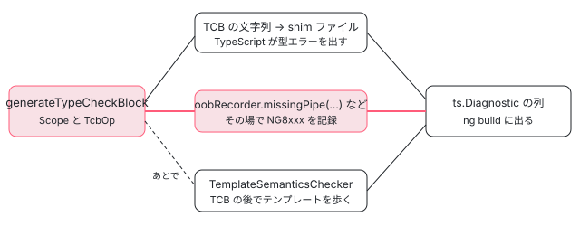

[目次](../README.md) › [テンプレート型チェックの内側](README.md) › 第 17 回 / 全 20 回

# 帯域外の診断：TypeScript では見つけられないエラー

> OutOfBandDiagnosticRecorder が TCB を作りながら記録する 22 種類のエラー（存在しない #ref の exportAs、知らない pipe、必須の入力の欠落、@for の track で読めない変数、ng-content に届かない制御フロー、@let への代入など）を、呼んでいる op と一緒に一覧にし、実装が NG8xxx の ts.Diagnostic を作る行、TCB の後で TemplateSemanticsChecker がテンプレート変数への代入を見つける行を読む。エラー番号（負の値はエラーガイドの印、99 を付けて TypeScript の診断に載せる）の決まりと、呼ぶ場所の無くなった suboptimalTypeInference。

angular/angular · 読了 約 12 分 · 中核 · [サイトで読む（デモが動きます）](https://angular-deep-dive-cyan.vercel.app/chapter/typecheck-oob)

---

テンプレートのエラーの多くは、TCB（Type Check Block。テンプレートを書き直した TypeScript の関数）を TypeScript に読ませて出します。ところが「`#f="ngForm"` の ngForm を export しているディレクティブが無い」「`| upper` という pipe が無い」のように、TCB を作っている途中で**コンパイラ自身が先に気づく**エラーがあります。これを TypeScript の外で記録する係が `OutOfBandDiagnosticRecorder`（帯域外の診断の記録係）です。この章では、記録係の 22 のメソッドを「どの op が呼ぶか」と一緒に一覧にし、記録された診断が NG8xxx の番号付きの `ts.Diagnostic` になる行、TCB を作り終えたあとに別の係 `TemplateSemanticsChecker` が「テンプレート変数への代入」を見つける行を読みます。

読む対象は compiler/src/typecheck/oob.ts（インタフェース）、compiler-cli/src/ngtsc/typecheck/src/oob.ts（実装）、compiler/src/typecheck/ops/content\_projection.ts、compiler-cli/src/ngtsc/typecheck/template\_semantics/、compiler-cli/src/ngtsc/diagnostics/src/ の error\_code.ts と util.ts です。

1. [1. 全体像](01-typecheck-overview.md)
2. [2. 設定](02-typecheck-config.md)
3. [3. TCB の置き場所](03-typecheck-context.md)
4. [4. 派生プログラム](04-typecheck-program-driver.md)
5. [5. Environment](05-typecheck-environment.md)
6. [6. Scope と TcbOp](06-typecheck-scope.md)
7. [7. 式](07-typecheck-expressions.md)
8. [8. 要素と DOM](08-typecheck-elements-dom.md)
9. [9. 型コンストラクタ](09-typecheck-type-constructor.md)
10. [10. 入力](10-typecheck-inputs.md)
11. [11. 出力とイベント](11-typecheck-outputs-events.md)
12. [12. 双方向](12-typecheck-two-way.md)
13. [13. 制御フロー](13-typecheck-control-flow.md)
14. [14. ng-template のガード](14-typecheck-template-guards.md)
15. [15. 参照と pipe](15-typecheck-refs-pipes.md)
16. [16. 診断の対応付け](16-typecheck-diagnostics-mapping.md)
17. **17. 帯域外の診断**（この章）
18. [18. 拡張診断](18-typecheck-extended.md)
19. [19. TemplateTypeChecker](19-typecheck-template-type-checker.md)
20. [20. issue と PR を読む](20-typecheck-issues.md)

TCB を作る `generateTypeCheckBlock` の入口と、TypeScript のエラーの位置をテンプレートに戻す仕組みは [テンプレートコンパイラ第 17 回](../compiler/17-compiler-typecheck.md)と[第 16 回](16-typecheck-diagnostics-mapping.md)で読みました。ここではその横を流れるもう 1 本の道を追います。



*テンプレートのエラーが出てくる 3 つの道。TCB を TypeScript に読ませる道（上）と、TCB を作りながら記録する道（中）と、TCB ができたあとにテンプレートを歩く道（下）*

## 1. インタフェース：compiler 側に置かれた「記録係の形」

📄 `angular/packages/compiler/src/typecheck/oob.ts` L33–58 （▶ の行: 34–36, 40–41, 48–49, 58）

```ts
33 │ /** Categories of diagnostics that can be reported by a `OutOfBandDiagnosticRecorder`. */
34 ▶ export enum OutOfBandDiagnosticCategory {
35 ▶   Error,
36 ▶   Warning,
37 │ }
38 │ 
39 │ /**
40 ▶  * Collects diagnostics on problems which occur in the template which aren't directly sourced
41 ▶  * from type check blocks.
42 │  *
43 │  * During the creation of a type check block, the template is traversed and the
44 │  * `OutOfBandDiagnosticRecorder` is called to record cases when a correct interpretation for the
45 │  * template cannot be found. These operations create diagnostics which are stored by the
46 │  * recorder for later display.
47 │  */
48 ▶ export interface OutOfBandDiagnosticRecorder<T> {
49 ▶   readonly diagnostics: ReadonlyArray<T>;
50 │ 
51 │   /**
52 │    * Reports a `#ref="target"` expression in the template for which a target directive could not be
53 │    * found.
54 │    *
55 │    * @param id the type-checking ID of the template which contains the broken reference.
56 │    * @param ref the `Reference` which could not be matched to a directive.
57 │    */
58 ▶   missingReferenceTarget(id: TypeCheckId, ref: Reference): void;
```

40〜46 行目のコメントがこの係の定義です。「TCB を作る途中でテンプレートを歩き、**正しい解釈が見つからなかった**ときに呼ばれる」。48 行目の型引数 `T` は診断の型で、49 行目の `diagnostics` に貯まります。compiler パッケージ（TypeScript に依存しない側）にはインタフェースだけがあり、`ts.Diagnostic` を作る実装は compiler-cli 側にあります（2 節）。この分け方は 2026-03-25 の 3382e8a34b9「generalize out of band diagnostics recorder」で `T` を足し、2026-04-13 の 7fa274510fc「move TCB generation logic into compiler」で TCB の生成ごと compiler に移した結果です。

34〜37 行目の `OutOfBandDiagnosticCategory` は Error と Warning の 2 つだけです。これを引数に取るメソッドは 1 つしかありません（下の 151〜159 行目）。

📄 `angular/packages/compiler/src/typecheck/oob.ts` L148–173 （▶ の行: 151, 153, 162, 165, 173）

```ts
148 │   /**
149 │    * Reports cases where control flow nodes prevent content projection.
150 │    */
151 ▶   controlFlowPreventingContentProjection(
152 │     id: TypeCheckId,
153 ▶     category: OutOfBandDiagnosticCategory,
154 │     projectionNode: Element | Template,
155 │     componentName: string,
156 │     slotSelector: string,
157 │     controlFlowNode: IfBlockBranch | SwitchBlockCase | ForLoopBlock | ForLoopBlockEmpty,
158 │     preservesWhitespaces: boolean,
159 │   ): void;
160 │ 
161 │   /** Reports cases where users are writing to `@let` declarations. */
162 ▶   illegalWriteToLetDeclaration(id: TypeCheckId, node: AST, target: LetDeclaration): void;
163 │ 
164 │   /** Reports cases where users are accessing an `@let` before it is defined.. */
165 ▶   letUsedBeforeDefinition(id: TypeCheckId, node: PropertyRead, target: LetDeclaration): void;
166 │ 
167 │   /**
168 │    * Reports a `@let` declaration that conflicts with another symbol in the same scope.
169 │    *
170 │    * @param id the type-checking ID of the template which contains the declaration.
171 │    * @param current the `LetDeclaration` which is invalid.
172 │    */
173 ▶   conflictingDeclaration(id: TypeCheckId, current: LetDeclaration): void;
```

153 行目、`controlFlowPreventingContentProjection` だけが category を受け取ります（4 節）。162・165・173 行目は `@let` の 3 つ（代入・宣言より前の読み出し・名前の衝突）です。

### 22 のメソッドと、呼んでいる場所

../angular の packages/compiler/src/typecheck を `grep -n "oobRecorder\."` して、呼んでいる関数を数えました（32 か所）。表の「場所」は `ファイル:行`（ops/ の下）です。NG 番号は compiler-cli の実装（2 節）が使う `ErrorCode` の値です。

| メソッド | NG | 呼ぶ関数（場所） | 見つけるもの |
| --- | --- | --- | --- |
| missingReferenceTarget | 8003 | Scope.checkAndAppendReferencesOfNode（scope.ts:558） | `#f="ngForm"` の exportAs を持つディレクティブが無い |
| missingPipe | 8004 | TcbExpressionTranslator.resolve（expression.ts:186） | 名前の pipe がスコープに無い |
| deferredPipeUsedEagerly | 8012 | 同上（expression.ts:194・204） | deferredImports の pipe を @defer の外（または別の名前の @defer）で使う |
| deferredComponentUsedEagerly | 8013 | Scope.appendDirectivesAndInputsOfElementLikeNode（scope.ts:617・626） | 同じことをコンポーネント・ディレクティブで |
| duplicateTemplateVar | 8006 | Scope.forNodes（scope.ts:213） | `let i of items; let i = index` |
| suboptimalTypeInference | 10002 | **呼ぶ場所が無い**（3 節） | — |
| splitTwoWayBinding | 8007 | checkSplitTwoWayBinding（bindings.ts:157・160）← events.ts:82・157 | `[(x)]` の入力と出力が別の相手に付く（[第 12 回](12-typecheck-two-way.md)） |
| missingRequiredInputs | 8008 | TcbDirectiveInputsOp.checkRequiredInputs（inputs.ts:221） | required の入力が無い（[第 10 回](10-typecheck-inputs.md)） |
| illegalForLoopTrackAccess | 8009 | TcbForLoopTrackTranslator.resolve（for\_block.ts:102） | track の式で item・$index 以外のテンプレート変数を読む（[第 13 回](13-typecheck-control-flow.md)） |
| inaccessibleDeferredTriggerElement | 8010 | Scope.validateReferenceBasedDeferredTrigger（scope.ts:1082） | `on hover(ref)` の ref が見えない |
| controlFlowPreventingContentProjection | 8011 | TcbControlFlowContentProjectionOp.execute（content\_projection.ts:78） | @if などの中身が 2 ノード以上で、ng-content の select に届かない（4 節） |
| illegalWriteToLetDeclaration | 8015 | TcbExpressionTranslator.resolve（expression.ts:162） | `@let` に代入 |
| letUsedBeforeDefinition | 8016 | 同上（expression.ts:130） | `@let` を宣言より前で読む |
| conflictingDeclaration | 8017 | Scope.appendNode（scope.ts:536）・Scope.checkConflictingLet（scope.ts:1089） | `@let` の名前が他の記号と同じ |
| missingNamedTemplateDependency | 2024 | Scope.appendSelectorlessDirectives（scope.ts:851）・appendComponentNode（scope.ts:946） | selectorless の `<Missing/>` が見つからない |
| incorrectTemplateDependencyType | 2025 | 同上（scope.ts:862・957） | selectorless で参照した記号の種類が違う |
| unclaimedDirectiveBinding | 8018 | Scope.appendInputsOfSelectorlessNode（scope.ts:745・751）・appendOutputsOfSelectorlessNode（scope.ts:784） | selectorless のディレクティブに無い入力・出力 |
| deferImplicitTriggerMissingPlaceholder | 8019 | Scope.validateReferenceBasedDeferredTrigger（scope.ts:1048） | 対象なしの trigger に @placeholder が無い |
| deferImplicitTriggerInvalidPlaceholder | 8020 | 同上（scope.ts:1076） | @placeholder の根が 1 要素でない |
| formFieldUnsupportedBinding | 8022 | checkUnsupportedFieldBindings（signal\_forms.ts:426〜440）← signal\_forms.ts:136・inputs.ts:74 | `[formField]` の付いた要素に禁じられた束縛 |
| multipleMatchingComponents | 8023 | Scope.appendDirectivesAndInputsOfElementLikeNode（scope.ts:641） | 1 つの要素に 2 つのコンポーネント（[テンプレートコンパイラ第 9 回](../compiler/09-compiler-binder.md)） |
| conflictingHostDirectiveBinding | 8024 | Scope.reportConflictingBindings（scope.ts:1101） | host directive の入力・出力が 2 つの名前で公開されている |

呼ぶ場所の半分以上は `Scope`（[第 6 回](06-typecheck-scope.md)）が op を積むときと、式を訳す `TcbExpressionTranslator.resolve`（[第 7 回](07-typecheck-expressions.md)）です。どちらも「TCB にどう書くか」を決める場所で、書けないものに出会ったその場で記録します。

## 2. 実装：OutOfBandDiagnosticRecorderImpl が ts.Diagnostic を作る

📄 `angular/packages/compiler-cli/src/ngtsc/typecheck/src/oob.ts` L73–97 （▶ の行: 74, 78–79, 83, 86, 88, 91–93）

```ts
73 │   constructor(
74 ▶     private resolver: TypeCheckSourceResolver,
75 │     private getSourceFile: (fileName: string) => ts.SourceFile | undefined = (name) => undefined,
76 │   ) {}
77 │ 
78 ▶   get diagnostics() {
79 ▶     return this._diagnostics;
80 │   }
81 │ 
82 │   missingReferenceTarget(id: TypeCheckId, ref: TmplAstReference): void {
83 ▶     const mapping = this.resolver.getTemplateSourceMapping(id);
84 │     const value = ref.value.trim();
85 │ 
86 ▶     const errorMsg = `No directive found with exportAs '${value}'.`;
87 │     this._diagnostics.push(
88 ▶       makeTemplateDiagnostic(
89 │         id,
90 │         mapping,
91 ▶         ref.valueSpan || ref.sourceSpan,
92 ▶         ts.DiagnosticCategory.Error,
93 ▶         ngErrorCode(ErrorCode.MISSING_REFERENCE_TARGET),
94 │         errorMsg,
95 │       ),
96 │     );
97 │   }
```

1. **74 行目：resolver は「TCB の id → テンプレートの場所」の帳簿**

   `TypeCheckSourceResolver` は、どのコンポーネントのテンプレートがどのファイルのどこにあるかを id で引ける帳簿です（[第 16 回](16-typecheck-diagnostics-mapping.md)）。83 行目でその帳簿から `mapping`（テンプレートの置き場所）を取ります。
2. **86 行目：英語の文を作る**

   ビルドに出る「No directive found with exportAs 'ngForm'.」はここで組み立てています。
3. **88〜95 行目：makeTemplateDiagnostic**

   91 行目の場所は `ref.valueSpan`（`="ngForm"` の値の部分）、無ければ参照全体。92 行目の重さは Error、93 行目の番号は `ngErrorCode(ErrorCode.MISSING_REFERENCE_TARGET)`。`makeTemplateDiagnostic`（typecheck/src/diagnostics.ts）は、テンプレートの場所を `ts.Diagnostic` の file・start・length に直す共通の関数で、TCB 由来の型エラーを戻すときも同じ関数を使います（[テンプレートコンパイラ第 17 回](../compiler/17-compiler-typecheck.md)の 7 節）。
4. **78〜80 行目：貯めるだけ**

   記録した診断はこの配列に入るだけです。TypeCheckContextImpl.finalize が shim ごとに `domSchemaChecker.diagnostics` と一緒に `genesisDiagnostics` という名前で保存し、`getDiagnosticsForFile` が TypeScript の型エラーの後ろに並べて返します （typecheck/src/checker.ts:692。[テンプレートコンパイラ第 17 回](../compiler/17-compiler-typecheck.md)で引用）。

📄 `angular/packages/compiler-cli/src/ngtsc/typecheck/src/oob.ts` L104–139 （▶ の行: 104–105, 112, 114, 118, 135, 139）

```ts
104 ▶     const sourceSpan = this.resolver.toTemplateParseSourceSpan(id, ast.nameSpan);
105 ▶     if (sourceSpan === null) {
106 │       throw new Error(
107 │         `Assertion failure: no SourceLocation found for usage of pipe '${ast.name}'.`,
108 │       );
109 │     }
110 │ 
111 │     const mapping = this.resolver.getTemplateSourceMapping(id);
112 ▶     let errorMsg = `No pipe found with name '${ast.name}'.`;
113 │ 
114 ▶     if (this.pipeSuggestions.has(ast.name)) {
115 │       const suggestedClassName = this.pipeSuggestions.get(ast.name)!;
116 │       const suggestedImport = '@angular/common';
117 │ 
118 ▶       if (isStandalone) {
119 │         errorMsg +=
120 │           `\nTo fix this, import the "${suggestedClassName}" class from "${suggestedImport}"` +
121 │           ` and add it to the "imports" array of the component.`;
122 │       } else {
123 │         errorMsg +=
124 │           `\nTo fix this, import the "${suggestedClassName}" class from "${suggestedImport}"` +
125 │           ` and add it to the "imports" array of the module declaring the component.`;
126 │       }
127 │     }
128 │ 
129 │     this._diagnostics.push(
130 │       makeTemplateDiagnostic(
131 │         id,
132 │         mapping,
133 │         sourceSpan,
134 │         ts.DiagnosticCategory.Error,
135 ▶         ngErrorCode(ErrorCode.MISSING_PIPE),
136 │         errorMsg,
137 │       ),
138 │     );
139 ▶     this.recordedPipes.add(ast);
```

pipe はもう少し手が込んでいます。104 行目、場所は pipe の名前だけ（`ast.nameSpan`）で、TCB の中の位置（absolute span）からテンプレートの位置に直します。直せなければ 105〜109 行目で例外を投げます（ここに来るのはコンパイラの不具合だけ、という意味の Assertion failure です）。114〜127 行目、`async` や `date` のような @angular/common の pipe なら、118 行目で standalone かどうかを見て「imports に足して」の一文を添えます。139 行目で同じ `BindingPipe` を覚え、2 度目はメソッドの先頭（oob.ts:100）で何もせずに戻ります。

> [!TIP]
> **新卒エンジニアへ**
>
> 「TypeScript に任せないのは何故か」の答えがここにあります。知らない pipe は TCB に `(0 as any).transform(...)` と書かれます（デモで見えます）。`any` なので TypeScript は何も言いません。**エラーを出せるのは「pipe が無い」と知っているコンパイラだけ**で、しかも any にしておくと pipe の引数側の式は型検査が続けられます。

## 3. 番号の決まり：NG8xxx・負の値・10xxx

📄 `angular/packages/compiler-cli/src/ngtsc/diagnostics/src/error_code.ts` L287–305 （▶ の行: 290, 295, 300, 305）

```ts
287 │   /**
288 │    * An element name failed validation against the DOM schema.
289 │    */
290 ▶   SCHEMA_INVALID_ELEMENT = -8001,
291 │ 
292 │   /**
293 │    * An element's attribute name failed validation against the DOM schema.
294 │    */
295 ▶   SCHEMA_INVALID_ATTRIBUTE = -8002,
296 │ 
297 │   /**
298 │    * No matching directive was found for a `#ref="target"` expression.
299 │    */
300 ▶   MISSING_REFERENCE_TARGET = -8003,
301 │ 
302 │   /**
303 │    * No matching pipe was found for a
304 │    */
305 ▶   MISSING_PIPE = 8004,
```

📄 `angular/packages/compiler-cli/src/ngtsc/diagnostics/src/util.ts` L31–52 （▶ の行: 32–33, 37, 44, 50–51）

```ts
31 │ export function ngErrorCode(code: ErrorCode): number {
32 ▶   const absoluteCode = Math.abs(code);
33 ▶   return -(ERROR_CODE_MARKER * 10 ** decimalDigits(absoluteCode) + absoluteCode);
34 │ }
35 │ 
36 │ export function formatCompilerErrorCode(code: number): string {
37 ▶   return `NG${Math.abs(code)}`;
38 │ }
39 │ 
40 │ /**
41 │  * Given a raw TypeScript diagnostic code, returns the corresponding {@link ErrorCode} if it is a
42 │  * negative Angular error code that has an associated error guide, or `null` otherwise.
43 │  */
44 ▶ export function errorCodeWithGuideFromDiagnosticCode(code: number): ErrorCode | null {
45 │   const absoluteErrorCode = absoluteErrorCodeFromDiagnosticCode(code);
46 │   if (absoluteErrorCode === null) {
47 │     return null;
48 │   }
49 │ 
50 ▶   const codeWithGuide = -absoluteErrorCode;
51 ▶   return ErrorCode[codeWithGuide] !== undefined ? codeWithGuide : null;
52 │ }
```

1. **290・295・300 行目：負の値**

   `SCHEMA_INVALID_ELEMENT = -8001` のように、一部の番号は負です。2026-08-17 の 45ebb127e32（SkyZeroZx「add error guide links to diagnostics」）で、**angular.dev/errors に解説のページがある番号を負にする**決まりになりました。50〜51 行目、負の値が enum にあれば「ガイドがある」と判定し、compiler.ts（core/src）の診断の後処理が `Find more at …/errors/NG8001` を文末に足します。305 行目の MISSING\_PIPE は正なので、リンクは付きません。
2. **32〜33 行目：TypeScript の診断に載せる値**

   符号を外し（32 行目）、頭に 99 を付けて負にします（33 行目）。MISSING\_PIPE なら `-998004`。TypeScript は自分のエラーを `TS2339` のように「TS + 番号」で表示するので、表示すると `TS-998004` になり、同じファイルの `replaceTsWithNgInErrors` がそれを `NG8004` に置き換えます。37 行目の `formatCompilerErrorCode` は符号を外して NG を付けるだけです。

📄 `angular/packages/compiler-cli/src/ngtsc/diagnostics/src/error_code.ts` L709–724 （▶ の行: 709–711, 724）

```ts
709 ▶   // 10XXX error codes are reserved for diagnostics with categories other than
710 ▶   // `ts.DiagnosticCategory.Error`. These diagnostics are generated by the compiler when configured
711 ▶   // to do so by a tool such as the Language Service, or by the Language Service itself.
712 │ 
713 │   /**
714 │    * Suggest users to enable `strictTemplates` to make use of full capabilities
715 │    * provided by Angular language service.
716 │    */
717 │   SUGGEST_STRICT_TEMPLATES = 10001,
718 │ 
719 │   /**
720 │    * Indicates that a particular structural directive provides advanced type narrowing
721 │    * functionality, but the current template type-checking configuration does not allow its usage in
722 │    * type inference.
723 │    */
724 ▶   SUGGEST_SUBOPTIMAL_TYPE_INFERENCE = 10002,
```

709〜711 行目、10xxx は「エラー以外の重さの診断」の帯です。724 行目の `SUGGEST_SUBOPTIMAL_TYPE_INFERENCE` を出すのが、表で「呼ぶ場所が無い」とした `suboptimalTypeInference` です。

📄 `angular/packages/compiler-cli/src/ngtsc/typecheck/src/oob.ts` L268–302 （▶ の行: 268, 290, 297–298）

```ts
268 ▶   suboptimalTypeInference(id: TypeCheckId, variables: TmplAstVariable[]): void {
269 │     const mapping = this.resolver.getTemplateSourceMapping(id);
270 │ 
271 │     // Select one of the template variables that's most suitable for reporting the diagnostic. Any
272 │     // variable will do, but prefer one bound to the context's $implicit if present.
273 │     let diagnosticVar: TmplAstVariable | null = null;
274 │     for (const variable of variables) {
275 │       if (diagnosticVar === null || variable.value === '' || variable.value === '$implicit') {
276 │         diagnosticVar = variable;
277 │       }
278 │     }
279 │     if (diagnosticVar === null) {
280 │       // There is no variable on which to report the diagnostic.
281 │       return;
282 │     }
283 │ 
284 │     let varIdentification = `'${diagnosticVar.name}'`;
285 │     if (variables.length === 2) {
286 │       varIdentification += ` (and 1 other)`;
287 │     } else if (variables.length > 2) {
288 │       varIdentification += ` (and ${variables.length - 1} others)`;
289 │     }
290 ▶     const message = `This structural directive supports advanced type inference, but the current compiler configuration prevents its usage. The variable ${varIdentification} will have type 'any' as a result.\n\nConsider enabling the 'strictTemplates' option in your tsconfig.json for better type inference within this template.`;
291 │ 
292 │     this._diagnostics.push(
293 │       makeTemplateDiagnostic(
294 │         id,
295 │         mapping,
296 │         diagnosticVar.keySpan,
297 ▶         ts.DiagnosticCategory.Suggestion,
298 ▶         ngErrorCode(ErrorCode.SUGGEST_SUBOPTIMAL_TYPE_INFERENCE),
299 │         message,
300 │       ),
301 │     );
302 │   }
```

実装は残っていて、290 行目の文は「strictTemplates を有効にして」、297 行目の重さは Suggestion です。呼んでいた側は compiler-cli の ops/template.ts の `TcbTemplateBodyOp` にあり、`suggestionsForSuboptimalTypeInference` の設定が真のときだけ呼んでいましたが、2026-03-23 の f3c471e0d50（Matthieu Riegler、GitHub では JeanMeche。「remove \`fullTemplateTypeCheck\` compiler option」）でその分岐と設定ごと消えました（`git show f3c471e0d50 -- packages/compiler-cli/src/ngtsc/typecheck/src/ops/template.ts`）。snapshot では compiler・compiler-cli・language-service の src に `suggestionsForSuboptimalTypeInference` の文字は 1 つも無く、インタフェース（oob.ts:113）と実装、testing/index.ts の空の実装だけが残っています。

> [!NOTE]
> **さらに深く**
>
> このサイトの共通デモ部品（typecheck-tcb.ts）の `STRICT_CONFIG` にはまだ `suggestionsForSuboptimalTypeInference: false` がありますが、22.1.6 の generateTypeCheckBlock もこの値を読みません （scratchpad に復元した 22.1.6 の typecheck/ を grep しても、oob.ts のインタフェースにしか出てきません）。

## 4. 警告になりうる唯一の OOB：content projection

📄 `angular/packages/compiler/src/typecheck/ops/content_projection.ts` L28–60 （▶ の行: 46, 53–56, 59）

```ts
28 │ /**
29 │  * A `TcbOp` that finds and flags control flow nodes that interfere with content projection.
30 │  *
31 │  * Context:
32 │  * Control flow blocks try to emulate the content projection behavior of `*ngIf` and `*ngFor`
33 │  * in order to reduce breakages when moving from one syntax to the other (see #52414), however the
34 │  * approach only works if there's only one element at the root of the control flow expression.
35 │  * This means that a stray sibling node (e.g. text) can prevent an element from being projected
36 │  * into the right slot. The purpose of the `TcbOp` is to find any places where a node at the root
37 │  * of a control flow expression *would have been projected* into a specific slot, if the control
38 │  * flow node didn't exist.
39 │  */
40 │ export class TcbControlFlowContentProjectionOp extends TcbOp {
41 │   private readonly category: OutOfBandDiagnosticCategory;
42 │ 
43 │   constructor(
44 │     private tcb: Context,
45 │     private element: Element | Component,
46 ▶     private ngContentSelectors: string[],
47 │     private componentName: string,
48 │   ) {
49 │     super();
50 │ 
51 │     // We only need to account for `error` and `warning` since
52 │     // this check won't be enabled for `suppress`.
53 ▶     this.category =
54 ▶       tcb.env.config.controlFlowPreventingContentProjection === 'error'
55 ▶         ? OutOfBandDiagnosticCategory.Error
56 ▶         : OutOfBandDiagnosticCategory.Warning;
57 │   }
58 │ 
59 ▶   override readonly optional = false;
60 │ 
```

📄 `angular/packages/compiler/src/typecheck/ops/content_projection.ts` L61–94 （▶ の行: 62, 67, 69–70, 74, 76–78, 80）

```ts
61 │   override execute(): null {
62 ▶     const controlFlowToCheck = this.findPotentialControlFlowNodes();
63 │ 
64 │     if (controlFlowToCheck.length > 0) {
65 │       const matcher = new SelectorMatcher<string>();
66 │ 
67 ▶       for (const selector of this.ngContentSelectors) {
68 │         // `*` is a special selector for the catch-all slot.
69 ▶         if (selector !== '*') {
70 ▶           matcher.addSelectables(CssSelector.parse(selector), selector);
71 │         }
72 │       }
73 │ 
74 ▶       for (const root of controlFlowToCheck) {
75 │         for (const child of root.children) {
76 ▶           if (child instanceof Element || child instanceof Template) {
77 ▶             matcher.match(createCssSelectorFromNode(child), (_, originalSelector) => {
78 ▶               this.tcb.oobRecorder.controlFlowPreventingContentProjection(
79 │                 this.tcb.id,
80 ▶                 this.category,
81 │                 child,
82 │                 this.componentName,
83 │                 originalSelector,
84 │                 root,
85 │                 this.tcb.hostPreserveWhitespaces,
86 │               );
87 │             });
88 │           }
89 │         }
90 │       }
91 │     }
92 │ 
93 │     return null;
94 │   }
```

1. **53〜56 行目：設定の値で Error か Warning を決める**

   `tcb.env.config.controlFlowPreventingContentProjection` が `'error'` なら Error、それ以外は Warning。`'suppress'` のときは、Scope がこの op をそもそも積みません（ops/scope.ts:493・963 の `!== 'suppress'`。[第 6 回](06-typecheck-scope.md)）。設定の値は getTypeCheckingConfig が `extendedDiagnostics.checks.controlFlowPreventingContentProjection` から写します（core/src/compiler.ts:1196〜1201。[未使用の import の章](../standalone/04-standalone-used-only.md)で同じ形の unusedStandaloneImports を読みました）。
2. **59 行目：optional ではない**

   誰にも参照されなくても必ず実行されます。この op は TCB に何も書きません（93 行目で null を返す）。診断を出すためだけの op です。
3. **62 行目と 67〜72 行目：子の制御フローと、ng-content の select**

   コンポーネントの子にある @if・@for・@switch のうち、中身が 2 ノード以上のものを集め（62 行目）、46 行目で受け取ったコンポーネントの `ngContentSelectors` を SelectorMatcher に登録します。69 行目、`*`（何でも受ける枠）は登録しません。
4. **74〜87 行目：もし制御フローが無かったら、どの枠に入ったか**

   中身の要素ごとにセレクタで照合し（77 行目）、当たった枠があれば 78 行目で記録します。80 行目で、53〜56 行目で決めた category を渡します。`@if` は中身が 1 要素なら `*ngIf` と同じく select の枠に入りますが、2 ノード以上だと入りません（32〜38 行目のコメント。#52414 で \*ngIf からの移行の互換のために入った振る舞い）。「制御フローが無ければ入っていた枠に、入らない」ことを知らせる診断です。

📄 `angular/packages/compiler-cli/src/ngtsc/typecheck/src/oob.ts` L478–501 （▶ の行: 485–488, 495–497）

```ts
478 │     if (preservesWhitespaces) {
479 │       lines.push(
480 │         'Note: the host component has `preserveWhitespaces: true` which may ' +
481 │           'cause whitespace to affect content projection.',
482 │       );
483 │     }
484 │ 
485 ▶     lines.push(
486 ▶       '',
487 ▶       'This check can be disabled using the `extendedDiagnostics.checks.' +
488 ▶         'controlFlowPreventingContentProjection = "suppress" compiler option.`',
489 │     );
490 │ 
491 │     this._diagnostics.push(
492 │       makeTemplateDiagnostic(
493 │         id,
494 │         this.resolver.getTemplateSourceMapping(id),
495 ▶         projectionNode.startSourceSpan,
496 ▶         translateCategory(category),
497 ▶         ngErrorCode(ErrorCode.CONTROL_FLOW_PREVENTING_CONTENT_PROJECTION),
498 │         lines.join('\n'),
499 │       ),
500 │     );
501 │   }
```

📄 `angular/packages/compiler-cli/src/ngtsc/typecheck/src/oob.ts` L764–773 （▶ の行: 768–771）

```ts
764 │ }
765 │ 
766 │ function translateCategory(category: OutOfBandDiagnosticCategory): ts.DiagnosticCategory {
767 │   switch (category) {
768 ▶     case OutOfBandDiagnosticCategory.Error:
769 ▶       return ts.DiagnosticCategory.Error;
770 ▶     case OutOfBandDiagnosticCategory.Warning:
771 ▶       return ts.DiagnosticCategory.Warning;
772 │   }
773 │ }
```

496 行目、他のメソッドが `ts.DiagnosticCategory.Error` と書くところを、ここだけ `translateCategory(category)` にしています（768〜771 行目）。485〜489 行目の文は「`extendedDiagnostics.checks.controlFlowPreventingContentProjection = "suppress"` で消せる」と案内します。つまりこの診断は、**作られ方は OOB、設定のされ方は拡張診断**です。[第 18 回](18-typecheck-extended.md)で見る `SUPPORTED_DIAGNOSTIC_NAMES` にこの名前が入っているのはそのためです。

## 5. TCB の後：TemplateSemanticsChecker

テンプレート変数（`let-open` や `*ngIf="x as y"` の y）への代入は、TCB を作る時点では見つけません。TCB には `_t2 = false` のように普通の代入として書かれ、TCB の変数は `var` なので TypeScript も黙ります（デモの最後のプリセット）。これを見つけるのは TCB ができたあとに動く別の係です。

📄 `angular/packages/compiler-cli/src/ngtsc/typecheck/template_semantics/src/template_semantics_checker.ts` L31–68 （▶ の行: 32, 35, 37, 54, 59–60, 64, 66）

```ts
31 │ export class TemplateSemanticsCheckerImpl implements TemplateSemanticsChecker {
32 ▶   constructor(private templateTypeChecker: TemplateTypeChecker) {}
33 │ 
34 │   getDiagnosticsForComponent(component: ts.ClassDeclaration): TemplateDiagnostic[] {
35 ▶     const template = this.templateTypeChecker.getTemplate(component);
36 │     return template !== null
37 ▶       ? TemplateSemanticsVisitor.visit(template, component, this.templateTypeChecker)
38 │       : [];
39 │   }
40 │ }
41 │ 
42 │ /** Visitor that verifies the semantics of a template. */
43 │ class TemplateSemanticsVisitor extends TmplAstRecursiveVisitor {
44 │   private constructor(private expressionVisitor: ExpressionsSemanticsVisitor) {
45 │     super();
46 │   }
47 │ 
48 │   static visit(
49 │     nodes: TmplAstNode[],
50 │     component: ts.ClassDeclaration,
51 │     templateTypeChecker: TemplateTypeChecker,
52 │   ) {
53 │     const diagnostics: TemplateDiagnostic[] = [];
54 ▶     const expressionVisitor = new ExpressionsSemanticsVisitor(
55 │       templateTypeChecker,
56 │       component,
57 │       diagnostics,
58 │     );
59 ▶     const templateVisitor = new TemplateSemanticsVisitor(expressionVisitor);
60 ▶     nodes.forEach((node) => node.visit(templateVisitor));
61 │     return diagnostics;
62 │   }
63 │ 
64 ▶   override visitBoundEvent(event: TmplAstBoundEvent): void {
65 │     super.visitBoundEvent(event);
66 ▶     event.handler.visit(this.expressionVisitor, event);
67 │   }
68 │ }
```

📄 `angular/packages/compiler-cli/src/ngtsc/typecheck/template_semantics/src/template_semantics_checker.ts` L80–103 （▶ の行: 81–82, 98–100）

```ts
 80 │   override visitBinary(ast: Binary, context: TmplAstNode): void {
 81 ▶     if (Binary.isAssignmentOperation(ast.operation) && ast.left instanceof PropertyRead) {
 82 ▶       this.checkForIllegalWriteInEventBinding(ast.left, context);
 83 │     } else {
 84 │       super.visitBinary(ast, context);
 85 │     }
 86 │   }
 87 │ 
 88 │   override visitPropertyRead(ast: PropertyRead, context: TmplAstNode) {
 89 │     super.visitPropertyRead(ast, context);
 90 │     this.checkForIllegalWriteInTwoWayBinding(ast, context);
 91 │   }
 92 │ 
 93 │   private checkForIllegalWriteInEventBinding(ast: PropertyRead, context: TmplAstNode) {
 94 │     if (!this.shouldCheckForIllegalWrites(ast, context)) {
 95 │       return;
 96 │     }
 97 │ 
 98 ▶     const target = this.templateTypeChecker.getExpressionTarget(ast, this.component);
 99 ▶     if (target instanceof TmplAstVariable) {
100 ▶       const errorMessage = `Cannot use variable '${target.name}' as the left-hand side of an assignment expression. Template variables are read-only.`;
101 │       this.diagnostics.push(this.makeIllegalTemplateVarDiagnostic(target, context, errorMessage));
102 │     }
103 │   }
```

📄 `angular/packages/compiler-cli/src/ngtsc/typecheck/template_semantics/src/template_semantics_checker.ts` L115–135 （▶ の行: 115, 117, 124–125, 129, 131）

```ts
115 ▶     const target = this.templateTypeChecker.getExpressionTarget(ast, this.component);
116 │     const isVariable = target instanceof TmplAstVariable;
117 ▶     const isLet = target instanceof TmplAstLetDeclaration;
118 │ 
119 │     if (!isVariable && !isLet) {
120 │       return;
121 │     }
122 │ 
123 │     // Two-way bindings to template variables are only allowed if the variables are signals.
124 ▶     const symbol = this.templateTypeChecker.getSymbolOfNode(target, this.component);
125 ▶     if (symbol !== null && !isSignalReference(symbol, this.templateTypeChecker)) {
126 │       let errorMessage: string;
127 │ 
128 │       if (isVariable) {
129 ▶         errorMessage = `Cannot use a non-signal variable '${target.name}' in a two-way binding expression. Template variables are read-only.`;
130 │       } else {
131 ▶         errorMessage = `Cannot use non-signal @let declaration '${target.name}' in a two-way binding expression. @let declarations are read-only.`;
132 │       }
133 │ 
134 │       this.diagnostics.push(this.makeIllegalTemplateVarDiagnostic(target, context, errorMessage));
135 │     }
```

1. **32・35 行目：材料は TemplateTypeChecker**

   コンストラクタは `TemplateTypeChecker`（[第 19 回](19-typecheck-template-type-checker.md)）だけを受け取り、35 行目でテンプレートの R3 AST を返してもらいます。
2. **54〜60 行目と 64〜67 行目：イベントの式だけを歩く**

   テンプレートの訪問者は `visitBoundEvent` だけを上書きし、66 行目でイベントの式を式の訪問者に渡します。代入が書けるのはイベントの中だけだからです。
3. **81〜82 行目と 98〜100 行目：左辺がテンプレート変数なら NG8005**

   代入の左辺が `PropertyRead` なら、98 行目で `getExpressionTarget`（BoundTarget に「この名前は何を指すか」を尋ねる。[テンプレートコンパイラ第 9 回](../compiler/09-compiler-binder.md)）を呼び、99 行目で `TmplAstVariable` なら 100 行目の文で記録します。
4. **115〜131 行目：双方向バインディングは signal なら許す**

   `[(ngModel)]="item"` の item がテンプレート変数か `@let` のとき、124 行目で `getSymbolOfNode` を、125 行目で `isSignalReference` を呼びます。signal ならその set を呼べるので許し、そうでなければ 129 行目・131 行目の文です。ここは**型を見て決める**ので、TCB ができた後でないと書けません。

📄 `angular/packages/compiler-cli/src/ngtsc/core/src/compiler.ts` L1281–1299 （▶ の行: 1282, 1285, 1289, 1292）

```ts
1281 │ 
1282 ▶       if (templateSemanticsChecker !== null) {
1283 │         diagnostics.push(
1284 │           ...compilation.traitCompiler.runAdditionalChecks(sf, (clazz, handler) => {
1285 ▶             return handler.templateSemanticsCheck?.(clazz, templateSemanticsChecker) || null;
1286 │           }),
1287 │         );
1288 │       }
1289 ▶       if (this.strictTemplates && extendedTemplateChecker !== null) {
1290 │         diagnostics.push(
1291 │           ...compilation.traitCompiler.runAdditionalChecks(sf, (clazz, handler) => {
1292 ▶             return handler.extendedTemplateCheck?.(clazz, extendedTemplateChecker) || null;
1293 │           }),
1294 │         );
1295 │       }
1296 │     }
1297 │ 
1298 │     return diagnostics;
1299 │   }
```

呼ぶのは NgCompiler.runAdditionalChecks です。1282〜1288 行目で ComponentDecoratorHandler の `templateSemanticsCheck` を通して呼び、1289 行目の拡張診断（[第 18 回](18-typecheck-extended.md)）と違って **`strictTemplates` を条件にしていません**。テンプレート変数への代入は、strictTemplates を切っていても NG8005 になります。

### @let への代入は TCB の途中で、テンプレート変数への代入は後で

同じ「読み取り専用への代入」でも道が違います。`@let` は TcbExpressionTranslator.resolve（expression.ts:157〜163）が TCB の代入に `/*D:ignore*/`（TypeScript のエラーを捨てる印）を付けたうえで `illegalWriteToLetDeclaration` を呼びます。コメントには「TypeScript の報告には TCB が自動で付けた変数名が入るので使えない」とあります。テンプレート変数のほうは TCB に印を付けないので、次の spec のように**TypeScript のエラーと NG8005 が両方**出ることがあります。

📄 `angular/packages/compiler-cli/test/ngtsc/template_typecheck_spec.ts` L2199–2234 （▶ の行: 2209–2210, 2227, 2230–2232）

```ts
2199 │     it('should detect an illegal write to a template variable', () => {
2200 │       env.write(
2201 │         'test.ts',
2202 │         `
2203 │         import {Component, NgModule} from '@angular/core';
2204 │         import {CommonModule} from '@angular/common';
2205 │ 
2206 │         @Component({
2207 │           selector: 'test',
2208 │           template: \`
2209 ▶             <div *ngIf="x as y">
2210 ▶               <button (click)="y = !y">Toggle</button>
2211 │             </div>
2212 │           \`,
2213 │           standalone: false,
2214 │         })
2215 │         export class TestCmp {
2216 │           x!: boolean;
2217 │         }
2218 │ 
2219 │         @NgModule({
2220 │           declarations: [TestCmp],
2221 │           imports: [CommonModule],
2222 │         })
2223 │         export class Module {}
2224 │       `,
2225 │       );
2226 │       const diags = env.driveDiagnostics();
2227 ▶       expect(diags.length).toEqual(2);
2228 │       expect(getSourceCodeForDiagnostic(diags[0])).toEqual('y');
2229 │       expect(getSourceCodeForDiagnostic(diags[1])).toEqual('y = !y');
2230 ▶       expect(diags[0].messageText).toEqual(`Type 'false' is not assignable to type 'true'.`);
2231 ▶       expect(diags[1].messageText).toEqual(
2232 ▶         `Cannot use variable 'y' as the left-hand side of an assignment expression. Template variables are read-only.`,
2233 │       );
2234 │     });
```

2209〜2210 行目、`*ngIf="x as y"` の y に `!y` を代入しています。2227 行目で診断は 2 つ。2230 行目は TCB を TypeScript が読んだ結果（ngIf のガードで y が `true` に絞られているので `false` を入れられない）、2231〜2233 行目が TemplateSemanticsChecker の NG8005 です。

## 6. デモ：本物の generateTypeCheckBlock で、記録係に何が届くか

> **🧪 OutOfBandDiagnosticRecorder に呼ばれたメソッド**
>
> このサイトに入っている @angular/compiler 22.1.6 の parseTemplate → R3TargetBinder → generateTypeCheckBlock を、ボタンを押したときだけ呼びます。記録係と DomSchemaChecker は「呼ばれたメソッドの名前を残すだけ」の差し替えで、NG 番号の文は 2 節の実装から書き写したもの（実際にはここで作っていない）です。参照はクラス名のまま、pipe は `_pipe_名前` と書く簡易の Environment を使っています（[第 5 回](05-typecheck-environment.md)の本物は import と宣言を足す）。@defer の名前付き deferredImports は 22.1.6 に無いので試せません。content projection の検査は、デモのディレクティブが `ngContentSelectors` を持てないので起きません。
>
> ▶ [このデモはサイトで動かせます](https://angular-deep-dive-cyan.vercel.app/chapter/typecheck-oob)

2026-11-02 にプリセットを 1 つずつ押して見たこと（Node で同じ部品を動かしても同じ）：

- 「知らない #ref」は `missingReferenceTarget` が呼ばれ、TCB では `var _t1 = null! as any;` になります。f.value の検査は any の上で続きます。
- 「知らない pipe」は `missingPipe` と `(0 as any).transform(...)`（2 節の tip）。
- 「必須の入力が無い」は `missingRequiredInputs` が呼ばれますが、TCB の本体は空です（束縛が 1 つも無いので書くものが無い）。**TCB に何も無くてもエラーになる**のが OOB です。
- 「@let に代入する」は TCB に `(_t1 = 2) /*D:ignore*/` が残り、同時に `illegalWriteToLetDeclaration` が呼ばれます（5 節）。
- 「@let を宣言より前で読む」は `_t1 as any` と書かれ、`letUsedBeforeDefinition`。
- 「テンプレート変数に代入する」は oob が空で、TCB には `(_t2 = false)` がそのまま書かれます。NG8005 は 5 節の係が後で出します。

## 7. テストと直し方

📄 `angular/packages/compiler-cli/test/ngtsc/template_typecheck_spec.ts` L7186–7221 （▶ の行: 7194, 7202–7204, 7213–7214, 7216, 7218）

```ts
7186 │       it('should report when an @if block prevents an element from being projected', () => {
7187 │         env.write(
7188 │           'test.ts',
7189 │           `
7190 │           import {Component} from '@angular/core';
7191 │ 
7192 │           @Component({
7193 │             selector: 'comp',
7194 ▶             template: '<ng-content/> <ng-content select="bar, [foo]"/>',
7195 │           })
7196 │           class Comp {}
7197 │ 
7198 │           @Component({
7199 │             imports: [Comp],
7200 │             template: \`
7201 │               <comp>
7202 ▶                 @if (true) {
7203 ▶                   <div foo></div>
7204 ▶                   breaks projection
7205 │                 }
7206 │               </comp>
7207 │             \`,
7208 │           })
7209 │           class TestCmp {}
7210 │         `,
7211 │         );
7212 │ 
7213 ▶         const diags = env
7214 ▶           .driveDiagnostics()
7215 │           .map((d) => ts.flattenDiagnosticMessageText(d.messageText, ''));
7216 ▶         expect(diags.length).toBe(1);
7217 │         expect(diags[0]).toContain(
7218 ▶           `Node matches the "bar, [foo]" slot of the "Comp" component, but will ` +
7219 │             `not be projected into the specific slot because the surrounding @if has more than one node at its root.`,
7220 │         );
7221 │       });
```

4 節の op を確かめているのは test/ngtsc/template\_typecheck\_spec.ts の `describe('control flow content projection diagnostics')`（:7185）で、it は 17 本あります。最初の `it('should report when an @if block prevents an element from being projected')` は、7194 行目で select の枠を持つ Comp を作り、7202〜7205 行目の @if に要素とテキストの 2 ノードを置き、7213〜7214 行目の `env.driveDiagnostics()`（ファイルを書いて ngtsc を走らせ診断を集める。[第 1 回](01-typecheck-overview.md)）で 1 つの診断を確かめます。ほかに、この章の仕組みに当たる it は次のものです（../angular 8576f161ae4）。

- `it('should allow the content projection diagnostic to be disabled individually')`（:7629）と `` …via `defaultCategory` ``（:7668）— 4 節の suppress。
- `it('should detect an illegal write to a template variable')`（:2199）— 5 節の spec。
- `it('should not allow a let declaration value to be changed')`（:8434）— @let の NG8015。
- compiler-cli/src/ngtsc/typecheck/test/diagnostics\_spec.ts の `describe('required inputs')`（:1074）— NG8008 を `typecheck()`（ファイルを書かずにテスト用のプログラムで診断を出す）で。

📄 `ターミナル`

```
cd ~/angular-research/angular

# この章の 3 つの仕組み（content projection の op・TemplateSemanticsChecker・@let の書き込み）を確かめる it
pnpm bazel test //packages/compiler-cli/test/ngtsc:ngtsc --nocache_test_results --test_output=all \
  '--test_arg=--filter=control flow content projection diagnostics|illegal write to a template variable|let declaration value to be changed'
```

📄 `出力（抜粋。2026-11-02 に実行。ログは scratchpad/tc-logs/e-ngtsc-oob.log）`

```
Ran 16 of 6690 specs
16 specs, 0 failures
Finished in 0.942 seconds
…（4 つの shard。残りは 16 / 20 / 28 本）
INFO: Elapsed time: 3.068s, Critical Path: 2.86s
//packages/compiler-cli/test/ngtsc:ngtsc                                 PASSED in 2.8s
Executed 1 out of 1 test: 1 test passes.
```

1. **件数の読み方**

   3 つの文字列に当たる it は 17 + 1 + 2（``…through a `this` access`` も当たる）= 20 本。spec は `runInEachFileSystem` で 4 つの仮想ファイルシステム（OS/X・Windows・Unix・Native）ごとに同じ it を登録するので、4 つの shard の合計は 16 + 16 + 20 + 28 = 80 本でした。**「Ran N of M」を必ず見る**（0 本でも PASSED になる）。
2. **直すとしたら**

   文や場所を直すなら compiler-cli/src/ngtsc/typecheck/src/oob.ts の該当メソッド、いつ呼ぶかを直すなら表の「呼ぶ関数」（compiler/src/typecheck/ops/）。足す spec は、TCB の形も見たいなら typecheck/test/type\_check\_block\_spec.ts、診断の文と場所なら test/ngtsc/template\_typecheck\_spec.ts の該当の describe です。新しい OOB を足した例が ca67828ee24（SkyZeroZx、2026-03-19、NG8023 multipleMatchingComponents）で、`git show --stat` では goldens/public-api/compiler-cli/error\_code.api.md（公開 API の golden）・error\_code.ts・typecheck/src/oob.ts・ops/scope.ts・**testing/index.ts**（spec が使う空の実装 `NoopOobRecorder`）・spec 2 つの 7 ファイルでした。当時は TCB の op もインタフェースも compiler-cli にあったので、今なら op とインタフェースは compiler/src/typecheck/ 側になります。
3. **issue との関係**

   #43131「Out-of-band type-checking」は名前が似ていますが、ビルドの待ち時間から型チェックを外す提案で、この章の記録係とは別の話です（[第 20 回](20-typecheck-issues.md)）。#46351（`button[custom-button]` を import し忘れても報告されない）は、ここに「知らない属性セレクタ」という OOB が無い理由そのものです。

- `ComponentDecoratorHandler.typeCheck` — annotations/component/src/handler.ts — *コンポーネントごと*
  - `TypeCheckContextImpl.addDirective` — typecheck/src/context.ts — *shim ごとに OutOfBandDiagnosticRecorderImpl を 1 つ*
    - `generateTypeCheckBlock` — compiler/src/typecheck/type\_check\_block.ts
      - `Scope.appendNode / TcbExpressionTranslator.resolve / TcbControlFlowContentProjectionOp.execute …` — compiler/src/typecheck/ops/
        - `tcb.oobRecorder.missingPipe(...)` — compiler/src/typecheck/oob.ts（形）
          - `OutOfBandDiagnosticRecorderImpl.missingPipe → makeTemplateDiagnostic` — typecheck/src/oob.ts — *NG8004 を配列に*
  - `TypeCheckContextImpl.finalize` — typecheck/src/context.ts — *genesisDiagnostics として保存*
  - `TemplateTypeCheckerImpl.getDiagnosticsForFile` — typecheck/src/checker.ts — *TypeScript の型エラーの後ろに並べる*
- `NgCompiler.runAdditionalChecks → TemplateSemanticsCheckerImpl` — core/src/compiler.ts — *TCB の後。NG8005*

## 聞かれそうな質問

**Q. なぜ全部 TypeScript に任せないのですか？**

TypeScript が知らない事実だからです。「その名前の pipe がスコープに無い」はコンパイラだけが知っていて、TCB には `(0 as any)` と書くので TypeScript は黙ります（ops/expression.ts:184〜189、デモ）。必須の入力の欠落は TCB に何も書かれないことすらあります（デモ）。@let への代入は TypeScript にも見つけられますが、文に TCB の変数名が出るので印を付けて捨て、自分で出し直します（expression.ts:157〜163）。

**Q. NG8xxx の番号はどう決まっていますか？**

ErrorCode の enum の値そのままで、80xx がテンプレート型チェック（DOM スキーマの 8001・8002 と OOB の大半）、81xx が拡張診断、10xxx がエラー以外の重さ（error\_code.ts の 709〜711 行目）です。例外もあり、selectorless の 2 つは 2024・2025、拡張診断の deferTriggerMisconfiguration は 8021 です。TypeScript の診断には `ngErrorCode` で 99 を前に付けた負の数を載せ（util.ts の 32〜33 行目）、表示のときに TS-99 を NG に置き換えます。enum の値が負なのはエラーガイドのページがある印です（3 節）。

**Q. 警告とエラーの違いはどこで決まりますか？**

OOB は実装の各メソッドが `ts.DiagnosticCategory.Error` を直書きしていて（oob.ts の 92 行目など）、設定で変えられません。例外が `controlFlowPreventingContentProjection` で、content\_projection.ts の 53〜56 行目が設定の 'error' / それ以外を見て、実装の 496 行目が translateCategory で Error か Warning にします。'suppress' なら op が積まれず、検査そのものが走りません。

**Q. OOB の診断は TCB のどこにも現れないのに、なぜエラーの位置が正しいのですか？**

位置をテンプレートの AST（`ref.valueSpan`・`ast.nameSpan` など）から直接取るからです（oob.ts の 91・104 行目）。TCB の位置コメントを経由するのは、pipe のように AST の span が TCB 基準の absolute span のときに `toTemplateParseSourceSpan` で直す場合だけです。

**Q. テンプレート変数への代入は strictTemplates を切ると見逃されますか？**

見逃されません。TemplateSemanticsChecker は runAdditionalChecks の 1282 行目で条件なしに呼ばれます。条件に strictTemplates があるのは 1289 行目の拡張診断のほうです。

## 読み終えて

- OOB は「TCB を作る途中で、書けないものに出会ったその場で」記録する診断。22 のメソッドの半分以上は Scope と TcbExpressionTranslator.resolve が呼ぶ。
- 実装は makeTemplateDiagnostic でテンプレートの位置の ts.Diagnostic を作り、genesisDiagnostics として TypeScript の型エラーの後ろに並ぶ。
- 番号は ErrorCode の値。負の値はエラーガイドがある印で、TypeScript の診断には 99 を付けた負の数で載る。
- 警告にできる OOB は content projection だけで、設定の名前は拡張診断の枠を借りている。
- テンプレート変数への代入は TCB の後の TemplateSemanticsChecker が出す。@let への代入は TCB の途中で OOB が出す。

---

← 前: [TCB の診断をテンプレートの位置に戻す](16-typecheck-diagnostics-mapping.md)  
次: [拡張診断：16 の検査と、それを足す方法](18-typecheck-extended.md) →
