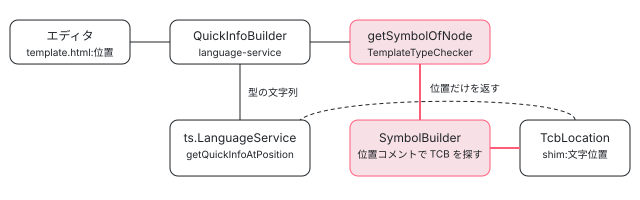

[目次](../README.md) › [テンプレート型チェックの内側](README.md) › 第 19 回 / 全 20 回

# TemplateTypeChecker：言語サービスが型を尋ねる窓口

> TemplateTypeCheckerImpl.getSymbolOfNode が shim の中の TCB を探し、SymbolBuilder が位置コメント（findFirstMatchingNode）でテンプレートの節点に当たる TCB の位置（TcbLocation）を決め、getTypeOfSymbol がその位置で ts.TypeChecker に型を尋ねる仕組み。enableTemplateTypeChecker で TCB に足される補完点（this.）と getGlobalCompletions、言語サービスのホバーが getSymbolOfNode の位置で TypeScript の言語サービスに尋ねる流れ。

angular/angular · 読了 約 13 分 · 発展 · [サイトで読む（デモが動きます）](https://angular-deep-dive-cyan.vercel.app/chapter/typecheck-template-type-checker)

---

エディタでテンプレートの `user.name` にカーソルを乗せると `(property) name: string` と出ます。この型を答えているのは、テンプレートを読める特別な TypeScript ではなく、**TCB の中の対応する位置を TypeScript の言語サービスにそのまま尋ねた結果**です。この章では、その窓口 `TemplateTypeChecker` が、テンプレートの節点から TCB の中の位置（`TcbLocation`）を探す `SymbolBuilder`、位置から `ts.Type` を引く `getTypeOfSymbol`、補完のために TCB に置かれる `this.`、そして言語サービスのホバーがそれらを呼ぶ行を、1 本の道として読みます。

読む対象は compiler-cli/src/ngtsc/typecheck/ の api/checker.ts・api/symbols.ts・src/checker.ts・src/template\_symbol\_builder.ts・src/completion.ts、compiler/src/typecheck/ops/completions.ts、language-service/src/ の language\_service.ts と quick\_info.ts です。

1. [1. 全体像](01-typecheck-overview.md)
2. [2. 設定](02-typecheck-config.md)
3. [3. TCB の置き場所](03-typecheck-context.md)
4. [4. 派生プログラム](04-typecheck-program-driver.md)
5. [5. Environment](05-typecheck-environment.md)
6. [6. Scope と TcbOp](06-typecheck-scope.md)
7. [7. 式](07-typecheck-expressions.md)
8. [8. 要素と DOM](08-typecheck-elements-dom.md)
9. [9. 型コンストラクタ](09-typecheck-type-constructor.md)
10. [10. 入力](10-typecheck-inputs.md)
11. [11. 出力とイベント](11-typecheck-outputs-events.md)
12. [12. 双方向](12-typecheck-two-way.md)
13. [13. 制御フロー](13-typecheck-control-flow.md)
14. [14. ng-template のガード](14-typecheck-template-guards.md)
15. [15. 参照と pipe](15-typecheck-refs-pipes.md)
16. [16. 診断の対応付け](16-typecheck-diagnostics-mapping.md)
17. [17. 帯域外の診断](17-typecheck-oob.md)
18. [18. 拡張診断](18-typecheck-extended.md)
19. **19. TemplateTypeChecker**（この章）
20. [20. issue と PR を読む](20-typecheck-issues.md)



*ホバー 1 回の道。テンプレートの節点 → TCB の位置 → TypeScript の言語サービス、の順に問い合わせが流れる*

## 1. 窓口：TemplateTypeChecker のインタフェース

📄 `angular/packages/compiler-cli/src/ngtsc/typecheck/api/checker.ts` L60–77 （▶ の行: 64, 66–68, 73, 77）

```ts
60 │ /**
61 │  * Interface to the Angular Template Type Checker to extract diagnostics and intelligence from the
62 │  * compiler's understanding of component templates.
63 │  *
64 ▶  * This interface is analogous to TypeScript's own `ts.TypeChecker` API.
65 │  *
66 ▶  * In general, this interface supports two kinds of operations:
67 ▶  *  - updating Type Check Blocks (TCB)s that capture the template in the form of TypeScript code
68 ▶  *  - querying information about available TCBs, including diagnostics
69 │  *
70 │  * Once a TCB is available, information about it can be queried. If no TCB is available to answer a
71 │  * query, depending on the method either `null` will be returned or an error will be thrown.
72 │  */
73 ▶ export interface TemplateTypeChecker {
74 │   /**
75 │    * Retrieve the template in use for the given component.
76 │    */
77 ▶   getTemplate(component: ts.ClassDeclaration, optimizeFor?: OptimizeFor): TmplAstNode[] | null;
```

64 行目、「TypeScript 自身の `ts.TypeChecker` に相当する」と書かれています。66〜68 行目、仕事は 2 種類：TCB を（必要なら作り直して）用意することと、用意した TCB について尋ねること。ビルドの診断を集める側（[第 4 回](04-typecheck-program-driver.md)）と、この章の「尋ねる」側が同じ窓口を使います。

📄 `angular/packages/compiler-cli/src/ngtsc/typecheck/api/checker.ts` L162–195 （▶ の行: 169, 183, 186–187, 189, 194）

```ts
162 │   /**
163 │    * Retrieves a `Symbol` for the node in a component's template.
164 │    *
165 │    * This method can return `null` if a valid `Symbol` cannot be determined for the node.
166 │    *
167 │    * @see Symbol
168 │    */
169 ▶   getSymbolOfNode(node: TmplAstElement, component: ts.ClassDeclaration): ElementSymbol | null;
170 │   getSymbolOfNode(node: TmplAstTemplate, component: ts.ClassDeclaration): TemplateSymbol | null;
171 │   getSymbolOfNode(
172 │     node: TmplAstTemplate | TmplAstElement,
173 │     component: ts.ClassDeclaration,
174 │   ): TemplateSymbol | ElementSymbol | null;
175 │   getSymbolOfNode(
176 │     node: TmplAstComponent,
177 │     component: ts.ClassDeclaration,
178 │   ): SelectorlessComponentSymbol | null;
179 │   getSymbolOfNode(
180 │     node: TmplAstDirective,
181 │     component: ts.ClassDeclaration,
182 │   ): SelectorlessDirectiveSymbol | null;
183 ▶   getSymbolOfNode(node: AST | TmplAstNode, component: ts.ClassDeclaration): Symbol | null;
184 │ 
185 │   /**
186 ▶    * Translates a symbol's TCB location to its corresponding ts.Type using the program's type checker.
187 ▶    * This is used by compiler checks that need semantic type information from a positional symbol.
188 │    */
189 ▶   getTypeOfSymbol(symbol: Symbol | BindingSymbol | ClassSymbol): ts.Type | null;
190 │ 
191 │   /**
192 │    * Translates a symbol's TCB location to its corresponding ts.Symbol using the program's type checker.
193 │    */
194 ▶   getTsSymbolOfSymbol(symbol: Symbol | BindingSymbol | ClassSymbol): ts.Symbol | null;
195 │ 
```

📄 `angular/packages/compiler-cli/src/ngtsc/typecheck/api/checker.ts` L196–214 （▶ の行: 205, 214）

```ts
196 │   /**
197 │    * Get "global" `Completion`s in the given context.
198 │    *
199 │    * Global completions are completions in the global context, as opposed to completions within an
200 │    * existing expression. For example, completing inside a new interpolation expression (`{{|}}`) or
201 │    * inside a new property binding `[input]="|" should retrieve global completions, which will
202 │    * include completions from the template's context component, as well as any local references or
203 │    * template variables which are in scope for that expression.
204 │    */
205 ▶   getGlobalCompletions(
206 │     context: TmplAstTemplate | null,
207 │     component: ts.ClassDeclaration,
208 │     node: AST | TmplAstNode,
209 │   ): GlobalCompletion | null;
210 │ 
211 │   /**
212 │    * Get the `TcbLocation` for the global context, which is the location of the `this` variable.
213 │    */
214 ▶   getGlobalTsContext(component: ts.ClassDeclaration): TcbLocation | null;
```

169〜183 行目の `getSymbolOfNode` が中心です。節点の種類ごとに返る記号の型が違います（要素なら ElementSymbol、など）。189 行目の `getTypeOfSymbol` と 194 行目の `getTsSymbolOfSymbol` が「記号の TCB の位置 → `ts.Type` / `ts.Symbol`」の翻訳で、186〜187 行目に「位置の記号から型の情報が要るコンパイラの検査のため」とあります（[第 18 回](18-typecheck-extended.md)の検査がその使い手）。205 行目の `getGlobalCompletions` と 214 行目の `getGlobalTsContext` は補完用です（5 節）。

## 2. この窓口は言語サービスのときだけ開く

📄 `angular/packages/compiler-cli/src/ngtsc/core/src/compiler.ts` L720–732 （▶ の行: 725–728, 731）

```ts
720 │    */
721 │   getCurrentProgram(): ts.Program {
722 │     return this.currentProgram;
723 │   }
724 │ 
725 ▶   getTemplateTypeChecker(): TemplateTypeChecker {
726 ▶     if (!this.enableTemplateTypeChecker) {
727 ▶       throw new Error(
728 ▶         'The `TemplateTypeChecker` does not work without `enableTemplateTypeChecker`.',
729 │       );
730 │     }
731 ▶     return this.ensureAnalyzed().templateTypeChecker;
732 │   }
```

NgCompiler.getTemplateTypeChecker は、`enableTemplateTypeChecker` が偽なら 726〜730 行目で例外を投げます。この値は NgCompiler を作るときの引数で、言語サービスは language-service/src/compiler\_factory.ts:72 で `true`、ng build の経路（ngtsc/program.ts:120）は `false` を渡します。真のとき TCB の形が 2 か所変わります。

- **ルートの Scope の先頭に補完点**：compiler/src/typecheck/ops/scope.ts:196〜199 が、親の無い Scope に `TcbComponentContextCompletionOp` を積みます（5 節）。
- **optional の op を飛ばさない**：ops/scope.ts:340 の `skipOptional = !…enableTemplateTypeChecker`。誰にも参照されない要素の `var _t1 = document.createElement("span")` も書き出されます。3 節の getSymbolOfElement はこの変数宣言を探すので、無いと要素の記号が作れません。

この 2 つはデモ（7 節）の「enableTemplateTypeChecker」を切り替えると見えます。

## 3. getSymbolOfNode：TCB を見つけ、SymbolBuilder に渡す

📄 `angular/packages/compiler-cli/src/ngtsc/typecheck/src/checker.ts` L1125–1152 （▶ の行: 1126, 1130, 1134, 1138, 1143–1147, 1150）

```ts
1125 │   getSymbolOfNode(node: AST | TmplAstNode, component: ts.ClassDeclaration): Symbol | null {
1126 ▶     const builder = this.getOrCreateSymbolBuilder(component);
1127 │     if (builder === null) {
1128 │       return null;
1129 │     }
1130 ▶     return this.perf.inPhase(PerfPhase.TtcSymbol, () => builder.getSymbol(node));
1131 │   }
1132 │ 
1133 │   private getOrCreateSymbolBuilder(component: ts.ClassDeclaration): SymbolBuilder | null {
1134 ▶     if (this.symbolBuilderCache.has(component)) {
1135 │       return this.symbolBuilderCache.get(component)!;
1136 │     }
1137 │ 
1138 ▶     const {tcb, data, tcbPath, tcbIsShim} = this.getLatestComponentState(component);
1139 │     if (tcb === null || data === null) {
1140 │       return null;
1141 │     }
1142 │ 
1143 ▶     const builder = new SymbolBuilder(
1144 ▶       tcbPath,
1145 ▶       tcbIsShim,
1146 ▶       tcb,
1147 ▶       new BoundTargetAdapter(data.boundTarget, this.componentScopeReader),
1148 │       this.config,
1149 │     );
1150 ▶     this.symbolBuilderCache.set(component, builder);
1151 │     return builder;
1152 │   }
```

📄 `angular/packages/compiler-cli/src/ngtsc/typecheck/src/checker.ts` L506–545 （▶ の行: 508, 512, 519, 526, 529, 532, 535, 540, 544）

```ts
506 │     const sf = component.getSourceFile();
507 │     const sfPath = absoluteFromSourceFile(sf);
508 ▶     const shimPath = TypeCheckShimGenerator.shimFor(sfPath);
509 │ 
510 │     const fileRecord = this.getFileData(sfPath);
511 │ 
512 ▶     if (!fileRecord.shimData.has(shimPath)) {
513 │       return {data: null, tcb: null, tcbPath: shimPath, tcbIsShim: true};
514 │     }
515 │ 
516 │     const id = fileRecord.sourceManager.getTypeCheckId(component);
517 │     const shimRecord = fileRecord.shimData.get(shimPath)!;
518 │ 
519 ▶     const program = this.programDriver.getProgram();
520 │     const shimSf = getSourceFileOrNull(program, shimPath);
521 │ 
522 │     if (shimSf === null || !fileRecord.shimData.has(shimPath)) {
523 │       throw new Error(`Error: no shim file in program: ${shimPath}`);
524 │     }
525 │ 
526 ▶     let tcb: ts.Node | null = findTypeCheckBlock(shimSf, id, /*isDiagnosticsRequest*/ false);
527 │ 
528 │     let tcbPath = shimPath;
529 ▶     if (tcb === null) {
530 │       // Try for an inline block.
531 │       const inlineSf = getSourceFileOrError(program, sfPath);
532 ▶       tcb = findTypeCheckBlock(inlineSf, id, /*isDiagnosticsRequest*/ false);
533 │ 
534 │       if (tcb !== null) {
535 ▶         tcbPath = sfPath;
536 │       }
537 │     }
538 │ 
539 │     let data: TypeCheckData | null = null;
540 ▶     if (shimRecord.data.has(id)) {
541 │       data = shimRecord.data.get(id)!;
542 │     }
543 │ 
544 ▶     return {data, tcb, tcbPath, tcbIsShim: tcbPath === shimPath};
545 │   }
```

1. **1134 行目：コンポーネントごとに 1 つの SymbolBuilder**

   作った SymbolBuilder はキャッシュし、テンプレートが変わると invalidateClass（checker.ts:875〜891）で捨てます。
2. **1138 行目 → 508・526 行目：shim の中から自分の TCB の関数を探す**

   getLatestComponentState は、まずそのコンポーネントの shim を最新にし（506 行目より前の ensureShimForComponent）、508 行目で shim のパス（`app.component.ngtypecheck.ts`）を決め、519 行目の型検査用プログラム（[第 4 回](04-typecheck-program-driver.md)）から shim の `ts.SourceFile` を取り、526 行目の `findTypeCheckBlock` で `/*tcb1*/` のような id の印の付いた関数を探します（id の印は[テンプレートコンパイラ第 17 回](../compiler/17-compiler-typecheck.md)）。529〜537 行目、shim に無ければ元のファイルの inline の TCB を探します。
3. **540〜542 行目：TCB を作ったときの材料**

   `data`（TypeCheckData）には、TCB を作ったときのテンプレートの R3 AST と BoundTarget（どの名前が何を指すか）が残っています。
4. **1143〜1149 行目：SymbolBuilder に渡すもの**

   TCB の場所（パスと shim かどうか）、TCB の関数の `ts.Node`、BoundTarget、設定。**`ts.TypeChecker` は渡していません**。2026-04-03 の 13c8df67d9b（Andrew Scott「decouple TemplateSymbolBuilder from ts.TypeChecker」）からこの形で、SymbolBuilder は「TCB の木の中の位置」だけを決め、型は後で 4 節の getTypeOfSymbol が引きます。

📄 `angular/packages/compiler-cli/src/ngtsc/typecheck/src/checker.ts` L449–460 （▶ の行: 449–451）

```ts
449 ▶   getTemplate(component: ts.ClassDeclaration, optimizeFor?: OptimizeFor): TmplAstNode[] | null {
450 ▶     const {data} = this.getLatestComponentState(component, optimizeFor);
451 ▶     return data?.template ?? null;
452 │   }
453 │ 
454 │   getHostElement(
455 │     directive: ts.ClassDeclaration,
456 │     optimizeFor?: OptimizeFor,
457 │   ): TmplAstHostElement | null {
458 │     const {data} = this.getLatestComponentState(directive, optimizeFor);
459 │     return data?.hostElement ?? null;
460 │   }
```

[第 17 回](17-typecheck-oob.md)の TemplateSemanticsChecker と[第 18 回](18-typecheck-extended.md)の拡張診断が最初に呼ぶ `getTemplate` も、450 行目で同じ getLatestComponentState を通り、451 行目で `data.template`（R3 AST）を返すだけです。

### SymbolBuilder.getSymbol：節点の種類で振り分け

📄 `angular/packages/compiler-cli/src/ngtsc/typecheck/src/template_symbol_builder.ts` L112–148 （▶ の行: 113, 118, 125, 132, 136, 140–141, 143, 146）

```ts
112 │   getSymbol(node: AST | TmplAstNode): Symbol | null {
113 ▶     if (this.symbolCache.has(node)) {
114 │       return this.symbolCache.get(node)!;
115 │     }
116 │ 
117 │     let symbol: Symbol | null = null;
118 ▶     if (node instanceof TmplAstBoundAttribute || node instanceof TmplAstTextAttribute) {
119 │       // TODO(atscott): input and output bindings only return the first directive match but should
120 │       // return a list of bindings for all of them.
121 │       symbol = this.getSymbolOfInputBinding(node);
122 │     } else if (node instanceof TmplAstBoundEvent) {
123 │       symbol = this.getSymbolOfBoundEvent(node);
124 │     } else if (node instanceof TmplAstElement) {
125 ▶       symbol = this.getSymbolOfElement(node);
126 │     } else if (node instanceof TmplAstComponent) {
127 │       symbol = this.getSymbolOfSelectorlessComponent(node);
128 │     } else if (node instanceof TmplAstDirective) {
129 │       symbol = this.getSymbolOfSelectorlessDirective(node);
130 │     } else if (node instanceof TmplAstTemplate) {
131 │       symbol = this.getSymbolOfAstTemplate(node);
132 ▶     } else if (node instanceof TmplAstVariable) {
133 │       symbol = this.getSymbolOfVariable(node);
134 │     } else if (node instanceof TmplAstLetDeclaration) {
135 │       symbol = this.getSymbolOfLetDeclaration(node);
136 ▶     } else if (node instanceof TmplAstReference) {
137 │       symbol = this.getSymbolOfReference(node);
138 │     } else if (node instanceof BindingPipe) {
139 │       symbol = this.getSymbolOfPipe(node);
140 ▶     } else if (node instanceof AST) {
141 ▶       symbol = this.getSymbolOfTemplateExpression(node);
142 │     } else {
143 ▶       // TODO(atscott): TmplAstContent, TmplAstIcu
144 │     }
145 │ 
146 ▶     this.symbolCache.set(node, symbol);
147 │     return symbol;
148 │   }
```

📄 `angular/packages/compiler-cli/src/ngtsc/typecheck/src/template_symbol_builder.ts` L155–178 （▶ の行: 156, 158–160, 166, 174）

```ts
155 │   private getSymbolOfElement(element: TmplAstElement): ElementSymbol | null {
156 ▶     const elementSourceSpan = element.startSourceSpan ?? element.sourceSpan;
157 │ 
158 ▶     const node = findFirstMatchingNode(this.typeCheckBlock, {
159 ▶       withSpan: elementSourceSpan,
160 ▶       filter: ts.isVariableDeclaration,
161 │     });
162 │     if (node === null) {
163 │       return null;
164 │     }
165 │ 
166 ▶     const tcbLocation = this.getTcbLocationForNode(node);
167 │ 
168 │     const directives = this.getDirectivesOfNode(element);
169 │     // All statements in the TCB are `Expression`s that optionally include more information.
170 │     // An `ElementSymbol` uses the information returned for the variable declaration expression,
171 │     // adds the directives for the element, and updates the `kind` to be `SymbolKind.Element`.
172 │     return {
173 │       kind: SymbolKind.Element,
174 ▶       tcbLocation,
175 │       directives,
176 │       templateNode: element,
177 │     };
178 │   }
```

要素は 156 行目で開始タグの span（`<span [title]="name">` なら 0〜21 文字目）を取り、158〜161 行目で **その span と同じ位置コメントが付いた変数宣言**を TCB の木から探します。`findFirstMatchingNode`（typecheck/src/comments.ts）は TCB の `ts.Node` を順に歩き、節点の後ろの `/*開始,終了*/` を読んで span と比べる関数です（コメントの付け方と読み方は[第 16 回](16-typecheck-diagnostics-mapping.md)）。143 行目、`TmplAstContent`（ng-content）と ICU にはまだ記号がありません（TODO）。

### 式：PropertyRead なら PropertyAccessExpression を探す

📄 `angular/packages/compiler-cli/src/ngtsc/typecheck/src/template_symbol_builder.ts` L658–696 （▶ の行: 658–660, 664, 679, 686–689, 694–695）

```ts
658 ▶     const expressionTarget = this.boundTarget.getExpressionTarget(expression);
659 ▶     if (expressionTarget !== null) {
660 ▶       return this.getSymbol(expressionTarget) as
661 │         VariableSymbol | ReferenceSymbol | ExpressionSymbol | LetDeclarationSymbol | null;
662 │     }
663 │ 
664 ▶     let withSpan = expression.sourceSpan;
665 │ 
666 │     // The `name` part of a property write and `ASTWithName` do not have their own
667 │     // AST so there is no way to retrieve a `Symbol` for just the `name` via a specific node.
668 │     if (
669 │       expression instanceof Binary &&
670 │       Binary.isAssignmentOperation(expression.operation) &&
671 │       expression.left instanceof PropertyRead
672 │     ) {
673 │       withSpan = expression.left.nameSpan;
674 │     } else if (
675 │       expression instanceof ASTWithName &&
676 │       !(expression instanceof SafePropertyRead) &&
677 │       expression.constructor.name !== 'MethodCall'
678 │     ) {
679 ▶       withSpan = expression.nameSpan;
680 │     }
681 │ 
682 │     let node: ts.Node | null = null;
683 │ 
684 │     // Property reads in templates usually map to a `PropertyAccessExpression`
685 │     // (e.g. `ctx.foo`) so try looking for one first.
686 ▶     if (expression instanceof PropertyRead || expression instanceof SafePropertyRead) {
687 ▶       node = findFirstMatchingNode(this.typeCheckBlock, {
688 ▶         withSpan,
689 ▶         filter: ts.isPropertyAccessExpression,
690 │       });
691 │     }
692 │ 
693 │     // Otherwise fall back to searching for any AST node.
694 ▶     if (node === null) {
695 ▶       node = findFirstMatchingNode(this.typeCheckBlock, {withSpan, filter: anyNodeFilter});
696 │     }
```

📄 `angular/packages/compiler-cli/src/ngtsc/typecheck/src/template_symbol_builder.ts` L720–746 （▶ の行: 724, 733, 735, 740–743）

```ts
720 │     if (node === null) {
721 │       return null;
722 │     }
723 │ 
724 ▶     while (ts.isParenthesizedExpression(node)) {
725 │       node = node.expression;
726 │     }
727 │ 
728 │     // - If we have safe property read ("a?.b") in the legacy conditional form, we want to get the
729 │     // Symbol for b, the `whenTrue` expression.
730 │     // - If our expression is a pipe binding ("a | test:b:c"), we want the Symbol for the
731 │     // `transform` on the pipe.
732 │     // - Otherwise, we retrieve the symbol for the node itself with no special considerations
733 ▶     if (expression instanceof SafePropertyRead && ts.isConditionalExpression(node)) {
734 │       return {
735 ▶         tcbLocation: this.getTcbLocationForNode(node.whenTrue),
736 │         tcbTypeLocation: this.getTcbSpanForNode(node),
737 │         kind: SymbolKind.Expression,
738 │       };
739 │     } else {
740 ▶       return {
741 ▶         tcbLocation: this.getTcbLocationForNode(node),
742 ▶         tcbTypeLocation: this.getTcbSpanForNode(node),
743 ▶         kind: SymbolKind.Expression,
744 │       };
745 │     }
746 │   }
```

1. **658〜662 行目：テンプレート変数・参照なら、その宣言の記号**

   `item` や `#box` は BoundTarget に尋ねると宣言（TmplAstVariable / TmplAstReference）が返るので、その宣言の記号に置き換えます。
2. **664 行目と 679 行目：探す span を決める**

   `user.name` のような PropertyRead は、679 行目で名前の部分（`name` の nameSpan）に絞ります。
3. **686〜696 行目：まず `a.b` の形の TS の節点、無ければ何でも**

   TCB の `((this).user /*24,28*/).name /*29,33*/` の `.name` は PropertyAccessExpression で、後ろに 29,33 のコメントが付いています。これが見つかります。
4. **740〜744 行目：返すのは 2 つの位置だけ**

   `tcbLocation`（いちばん関係のある位置。下の getTcbPositionForNode で決める）と `tcbTypeLocation`（型を決める節点の始まりと終わり）。記号は型そのものを持っていません。

📄 `angular/packages/compiler-cli/src/ngtsc/typecheck/src/template_symbol_builder.ts` L760–789 （▶ の行: 764–767, 776–777, 780–781）

```ts
760 │   private getTcbLocationForNode(node: ts.Node): TcbLocation {
761 │     while (ts.isParenthesizedExpression(node)) {
762 │       node = node.expression;
763 │     }
764 ▶     return {
765 ▶       tcbPath: this.tcbPath,
766 ▶       isShimFile: this.tcbIsShim,
767 ▶       positionInFile: this.getTcbPositionForNode(node),
768 │     };
769 │   }
770 │ 
771 │   private getTcbPositionForNode(node: ts.Node): number {
772 │     if (ts.isTypeReferenceNode(node)) {
773 │       return this.getTcbPositionForNode(node.typeName);
774 │     } else if (ts.isQualifiedName(node)) {
775 │       return node.right.getStart();
776 ▶     } else if (ts.isPropertyAccessExpression(node)) {
777 ▶       return node.name.getStart();
778 │     } else if (ts.isElementAccessExpression(node)) {
779 │       return node.argumentExpression.getStart();
780 ▶     } else if (ts.isCallExpression(node)) {
781 ▶       return this.getTcbPositionForNode(node.expression);
782 │     } else if (ts.isAsExpression(node)) {
783 │       return this.getTcbPositionForNode(node.expression);
784 │     } else if (ts.isNonNullExpression(node)) {
785 │       return this.getTcbPositionForNode(node.expression);
786 │     } else {
787 │       return node.getStart();
788 │     }
789 │   }
```

📄 `angular/packages/compiler-cli/src/ngtsc/typecheck/api/symbols.ts` L69–86 （▶ の行: 74, 79, 82, 85）

```ts
69 │ export interface TcbLocation {
70 │   /**
71 │    * The fully qualified path of the file which contains the generated TypeScript type check
72 │    * code for the component's template.
73 │    */
74 ▶   tcbPath: AbsoluteFsPath;
75 │ 
76 │   /**
77 │    * Whether the type check block exists in a type-checking shim file or is inline.
78 │    */
79 ▶   isShimFile: boolean;
80 │ 
81 │   /** The location in the file where node appears. */
82 ▶   positionInFile: number;
83 │ 
84 │   /** The end position in the TCB file. Used to correctly resolve AST expressions. */
85 ▶   endInFile?: number;
86 │ }
```

📄 `angular/packages/compiler-cli/src/ngtsc/typecheck/api/symbols.ts` L102–111 （▶ の行: 106, 109）

```ts
102 │ export interface ExpressionSymbol {
103 │   kind: SymbolKind.Expression;
104 │ 
105 │   /** The position of the most relevant part of the expression. */
106 ▶   tcbLocation: TcbLocation;
107 │ 
108 │   /** The position of the expression used to determine the type. */
109 ▶   tcbTypeLocation?: TcbLocation;
110 │ }
111 │ 
```

776〜777 行目、`a.b` なら位置は `b` の始まり。780〜781 行目、呼び出し `f()` なら `f` の側を再帰で。言語サービスのホバーは、まさにこの位置で TypeScript に尋ねます（6 節）。`TcbLocation` は 74 行目のファイルのパス、82 行目の文字位置、85 行目の（あれば）終わりの位置だけの、ただの座標です。

## 4. getTypeOfSymbol：座標から ts.Type へ

📄 `angular/packages/compiler-cli/src/ngtsc/typecheck/src/checker.ts` L310–338 （▶ の行: 311–312, 316–317, 321, 325, 328–331, 337）

```ts
310 │   getTypeOfSymbol(symbol: Symbol | BindingSymbol | ClassSymbol): ts.Type | null {
311 ▶     const location =
312 ▶       'tcbTypeLocation' in symbol && symbol.tcbTypeLocation !== undefined
313 │         ? (symbol.tcbTypeLocation as TcbLocation)
314 │         : 'kind' in symbol &&
315 │             (symbol.kind === SymbolKind.Variable || symbol.kind === SymbolKind.LetDeclaration)
316 ▶           ? symbol.localVarLocation
317 ▶           : getTcbLocationForSymbol(symbol);
318 │     if (!location) {
319 │       return null;
320 │     }
321 ▶     const sf = this.programDriver.getProgram().getSourceFile(location.tcbPath);
322 │     if (!sf) {
323 │       return null;
324 │     }
325 ▶     let node: ts.Node = getTokenAtPosition(sf, location.positionInFile);
326 │     let bestMatch = node;
327 │ 
328 ▶     if (location.endInFile !== undefined) {
329 ▶       while (node && node.getEnd() <= location.endInFile) {
330 ▶         if (node.getStart() >= location.positionInFile) {
331 ▶           bestMatch = node;
332 │         }
333 │         node = node.parent;
334 │       }
335 │     }
336 │     node = bestMatch;
337 ▶     return this.programDriver.getProgram().getTypeChecker().getTypeAtLocation(node);
338 │   }
```

1. **311〜317 行目：どの座標を使うか**

   式なら `tcbTypeLocation`、変数・`@let` なら宣言の位置、それ以外は記号の種類ごとの位置。
2. **321 行目と 325 行目：今のプログラムで、その位置の字句**

   **記号を作ったときではなく、尋ねたときのプログラム**（`programDriver.getProgram()`）から shim の SourceFile を取り、文字位置の字句（token）を取ります。
3. **328〜335 行目：終わりの位置までの、いちばん外側の節点へ登る**

   字句から親へ登り、始まりが座標以降で終わりが `endInFile` 以内の節点を最後の候補にします。`user.name` なら `(this).user` を含む `….name` 全体です。
4. **337 行目：TypeScript に型を尋ねる**

   `getTypeChecker().getTypeAtLocation(node)`。ここで初めて `ts.TypeChecker` が出てきます。

## 5. 補完：TCB に置かれた `this.`

📄 `angular/packages/compiler/src/typecheck/ops/completions.ts` L14–35 （▶ の行: 17, 26, 29–31）

```ts
14 │ /**
15 │  * A `TcbOp` which generates a completion point for the component context.
16 │  *
17 ▶  * This completion point looks like `this. ;` in the TCB output, and does not produce diagnostics.
18 │  * TypeScript autocompletion APIs can be used at this completion point (after the '.') to produce
19 │  * autocompletion results of properties and methods from the template's component context.
20 │  */
21 │ export class TcbComponentContextCompletionOp extends TcbOp {
22 │   constructor(private scope: Scope) {
23 │     super();
24 │   }
25 │ 
26 ▶   override readonly optional = false;
27 │ 
28 │   override execute(): null {
29 ▶     const ctx = new TcbExpr('this.');
30 ▶     ctx.markIgnoreDiagnostics();
31 ▶     ctx.addExpressionIdentifier(ExpressionIdentifier.COMPONENT_COMPLETION);
32 │     this.scope.addStatement(ctx);
33 │     return null;
34 │   }
35 │ }
```

📄 `angular/packages/compiler-cli/src/ngtsc/typecheck/src/completion.ts` L65–95 （▶ の行: 72–74, 84, 89）

```ts
65 │   constructor(
66 │     private tcb: ts.Node,
67 │     private data: TypeCheckData,
68 │     private tcbPath: AbsoluteFsPath,
69 │     private tcbIsShim: boolean,
70 │   ) {
71 │     // Find the component completion expression within the TCB. This looks like: `ctx. /* ... */;`
72 ▶     const globalRead = findFirstMatchingNode(this.tcb, {
73 ▶       filter: ts.isPropertyAccessExpression,
74 ▶       withExpressionIdentifier: ExpressionIdentifier.COMPONENT_COMPLETION,
75 │     });
76 │ 
77 │     if (globalRead !== null) {
78 │       this.componentContext = {
79 │         tcbPath: this.tcbPath,
80 │         isShimFile: this.tcbIsShim,
81 │         // `globalRead.name` is an empty `ts.Identifier`, so its start position immediately follows
82 │         // the `.` in `ctx.`. TS autocompletion APIs can then be used to access completion results
83 │         // for the component context.
84 ▶         positionInFile: globalRead.name.getStart(),
85 │       };
86 │       this.globalTsContext = {
87 │         tcbPath: this.tcbPath,
88 │         isShimFile: this.tcbIsShim,
89 ▶         positionInFile: globalRead.name.getStart() - 1,
90 │       };
91 │     } else {
92 │       this.componentContext = null;
93 │       this.globalTsContext = null;
94 │     }
95 │   }
```

📄 `angular/packages/compiler-cli/src/ngtsc/typecheck/src/completion.ts` L109–135 （▶ の行: 113, 117, 123–126, 132）

```ts
109 │   getGlobalCompletions(
110 │     context: TmplAstTemplate | null,
111 │     node: AST | TmplAstNode,
112 │   ): GlobalCompletion | null {
113 ▶     if (this.componentContext === null) {
114 │       return null;
115 │     }
116 │ 
117 ▶     const templateContext = this.getTemplateContextCompletions(context);
118 │     if (templateContext === null) {
119 │       return null;
120 │     }
121 │ 
122 │     let nodeContext: TcbLocation | null = null;
123 ▶     if (node instanceof EmptyExpr) {
124 ▶       const nodeLocation = findFirstMatchingNode(this.tcb, {
125 ▶         filter: ts.isIdentifier,
126 ▶         withSpan: node.sourceSpan,
127 │       });
128 │       if (nodeLocation !== null) {
129 │         nodeContext = {
130 │           tcbPath: this.tcbPath,
131 │           isShimFile: this.tcbIsShim,
132 ▶           positionInFile: nodeLocation.getStart(),
133 │         };
134 │       }
135 │     }
```

1. **completions.ts の 29〜31 行目：`this.` だけの文**

   29 行目で `this.` という書きかけの式を作り、30 行目で TypeScript のエラーを捨てる印（`/*D:ignore*/`）、31 行目で「ここが補完点」の印（`/*T:COMPCOMP*/`）を付けます。17 行目のコメントのとおり、TypeScript の補完 API をこの `.` の直後で呼べば、コンポーネントのプロパティとメソッドの一覧が返ります。
2. **completion.ts の 72〜75 行目と 84 行目：その場所を覚える**

   CompletionEngine は作られたときに、印の付いた PropertyAccessExpression を探し、84 行目で名前（空の識別子）の始まり＝ `.` の直後を `componentContext` にします。89 行目の 1 つ前は `this` の位置です。
3. **117 行目：テンプレートの変数と参照は Angular が数える**

   `{{ | }}` で出す候補のうち、`user`（@for の変数）や `#box` は TypeScript の補完では出ないので、getTemplateContextCompletions が BoundTarget から集めます。123〜135 行目、書きかけの空の式（EmptyExpr）なら、その場所の TCB の識別子も返します。

📄 `angular/packages/compiler-cli/src/ngtsc/typecheck/src/checker.ts` L935–948 （▶ の行: 936, 940, 945–946）

```ts
935 │   private getOrCreateCompletionEngine(component: ts.ClassDeclaration): CompletionEngine | null {
936 ▶     if (this.completionCache.has(component)) {
937 │       return this.completionCache.get(component)!;
938 │     }
939 │ 
940 ▶     const {tcb, data, tcbPath, tcbIsShim} = this.getLatestComponentState(component);
941 │     if (tcb === null || data === null) {
942 │       return null;
943 │     }
944 │ 
945 ▶     const engine = new CompletionEngine(tcb, data, tcbPath, tcbIsShim);
946 ▶     this.completionCache.set(component, engine);
947 │     return engine;
948 │   }
```

CompletionEngine も SymbolBuilder と同じく、getLatestComponentState（940 行目）で TCB を取り、コンポーネントごとにキャッシュします（946 行目）。

## 6. 言語サービス：ホバーで getSymbolOfNode を呼ぶ行

📄 `angular/packages/language-service/src/language_service.ts` L318–350 （▶ の行: 323, 327, 331, 339–340, 342–343, 349）

```ts
318 │   private getQuickInfoAtPositionImpl(
319 │     fileName: string,
320 │     position: number,
321 │     compiler: NgCompiler,
322 │   ): ts.QuickInfo | undefined {
323 ▶     if (!isInTypeCheckContext(compiler.getCurrentProgram(), fileName, position)) {
324 │       return undefined;
325 │     }
326 │ 
327 ▶     const typeCheckInfo = getTypeCheckInfoAtPosition(fileName, position, compiler);
328 │     if (typeCheckInfo === undefined) {
329 │       return undefined;
330 │     }
331 ▶     const positionDetails = getTargetAtPosition(typeCheckInfo.nodes, position);
332 │     if (positionDetails === null) {
333 │       return undefined;
334 │     }
335 │ 
336 │     // Because we can only show 1 quick info, just use the bound attribute if the target is a two
337 │     // way binding. We may consider concatenating additional display parts from the other target
338 │     // nodes or representing the two way binding in some other manner in the future.
339 ▶     const node =
340 ▶       positionDetails.context.kind === TargetNodeKind.TwoWayBindingContext
341 │         ? positionDetails.context.nodes[0]
342 ▶         : positionDetails.context.node;
343 ▶     return new QuickInfoBuilder(
344 │       this.tsLS,
345 │       compiler,
346 │       typeCheckInfo.declaration,
347 │       node,
348 │       positionDetails,
349 ▶     ).get();
350 │   }
```

📄 `angular/packages/language-service/src/quick_info.ts` L69–80 （▶ の行: 74–76, 78）

```ts
69 │   get(): ts.QuickInfo | undefined {
70 │     if (this.node instanceof TmplAstDeferredTrigger || this.node instanceof TmplAstBlockNode) {
71 │       return createQuickInfoForBuiltIn(this.node, this.positionDetails.position);
72 │     }
73 │ 
74 ▶     const symbol = this.compiler
75 ▶       .getTemplateTypeChecker()
76 ▶       .getSymbolOfNode(this.node, this.component);
77 │     if (symbol !== null) {
78 ▶       return this.getQuickInfoForSymbol(symbol);
79 │     }
80 │ 
```

📄 `angular/packages/language-service/src/quick_info.ts` L106–130 （▶ の行: 107, 113, 128–129）

```ts
106 │   private getQuickInfoForSymbol(symbol: Symbol): ts.QuickInfo | undefined {
107 ▶     switch (symbol.kind) {
108 │       case SymbolKind.Input:
109 │       case SymbolKind.Output:
110 │         return this.getQuickInfoForBindingSymbol(symbol);
111 │       case SymbolKind.Template:
112 │         return createNgTemplateQuickInfo(this.node);
113 ▶       case SymbolKind.Element:
114 │         return this.getQuickInfoForElementSymbol(symbol);
115 │       case SymbolKind.Variable:
116 │         return this.getQuickInfoForVariableSymbol(symbol);
117 │       case SymbolKind.LetDeclaration:
118 │         return this.getQuickInfoForLetDeclarationSymbol(symbol);
119 │       case SymbolKind.Reference:
120 │         return this.getQuickInfoForReferenceSymbol(symbol);
121 │       case SymbolKind.DomBinding:
122 │         return this.getQuickInfoForDomBinding(symbol);
123 │       case SymbolKind.Pipe:
124 │         return this.getQuickInfoForPipeSymbol(symbol);
125 │       case SymbolKind.SelectorlessComponent:
126 │       case SymbolKind.SelectorlessDirective:
127 │         return this.getQuickInfoForSelectorlessSymbol(symbol);
128 ▶       case SymbolKind.Expression:
129 ▶         return this.getQuickInfoAtTcbLocation(symbol.tcbLocation);
130 │       case SymbolKind.Directive:
```

📄 `angular/packages/language-service/src/quick_info.ts` L309–319 （▶ の行: 310, 315, 317–318）

```ts
309 │   private getQuickInfoAtTcbLocation(location: TcbLocation): ts.QuickInfo | undefined {
310 ▶     const quickInfo = this.tsLS.getQuickInfoAtPosition(location.tcbPath, location.positionInFile);
311 │     if (quickInfo === undefined || quickInfo.displayParts === undefined) {
312 │       return quickInfo;
313 │     }
314 │ 
315 ▶     quickInfo.displayParts = filterAliasImports(quickInfo.displayParts);
316 │ 
317 ▶     const textSpan = getTextSpanOfNode(this.node);
318 ▶     return {...quickInfo, textSpan};
319 │   }
```

1. **language\_service.ts の 327・331 行目：エディタの位置 → テンプレートの節点**

   327 行目で「その位置がどのコンポーネントのテンプレートか」を引き、331 行目の `getTargetAtPosition`（template\_target.ts）でカーソルの下の R3 AST / 式の節点を探します。339〜342 行目、`[(x)]` なら入力の側だけを使います。
2. **quick\_info.ts の 74〜76 行目：getSymbolOfNode**

   3 節の窓口をそのまま呼びます。
3. **128〜129 行目：式なら、TCB の位置でホバー**

   記号が Expression なら 309 行目の `getQuickInfoAtTcbLocation` に `tcbLocation` を渡し、310 行目で **TypeScript の言語サービスに「shim ファイルのこの位置のホバー」を尋ねます**。315 行目で import の別名を消し、317〜318 行目で、表示する範囲（textSpan）だけをテンプレートの節点の範囲に差し替えて返します。

> [!NOTE]
> **ポイント**
>
> つまりホバーの文字列「(property) name: string」は TypeScript が TCB を見て作ったもので、Angular がしているのは「どこを尋ねるか」を決めることだけです。要素（113 行目）や変数は少し手を加えます（変数なら表示の名前を TCB の `_t2` からテンプレートの名前に戻す、など。quick\_info.ts の getQuickInfoForVariableSymbol）。

## 7. デモ：テンプレートの位置から TCB の行を探す

> **🧪 位置コメントで TCB の行を探す（再現）**
>
> TCB は本物の generateTypeCheckBlock（このサイトの @angular/compiler 22.1.6）で作ります（ボタンを押したときだけ）。そのあと、選んだ文字位置を**含む位置コメントのうち、いちばん狭いもの**を文字列の上で探して強調します。本物の findFirstMatchingNode は TypeScript の構文木を歩き、AST の span と「ぴったり同じ」コメントを持つ節点を探すので、ここで見せているのは考え方の再現です。点線の枠は補完点の行（`T:COMPCOMP`）です。
>
> ▶ [このデモはサイトで動かせます](https://angular-deep-dive-cyan.vercel.app/chapter/typecheck-template-type-checker)

- 既定のテンプレートで位置 30（`name` の a）を選ぶと、`/*29,33*/` の `.name` の行が強調されます。3 節の 686〜691 行目が探す PropertyAccessExpression です。
- enableTemplateTypeChecker を切って作り直すと、`this. /*T:COMPCOMP*/ /*D:ignore*/;` と `var _t1 /*0,21*/ = document.createElement("span")` の 2 行が消えます（2 節）。後者が無いと、要素の記号（3 節の 158〜161 行目）は見つかりません。

## 8. テストと直し方

📄 `angular/packages/compiler-cli/src/ngtsc/typecheck/test/type_checker__get_symbol_of_template_node_spec.ts` L679–691 （▶ の行: 683–684, 686–687, 689–690）

```ts
679 │         const sf = getSourceFileOrError(program, fileName);
680 │         const cmp = getClass(sf, 'Cmp');
681 │         const nodes = getAstElements(templateTypeChecker, cmp);
682 │ 
683 ▶         const symbol = templateTypeChecker.getSymbolOfNode(nodes[0].inputs[0].value, cmp)!;
684 ▶         assertExpressionSymbol(symbol);
685 │         expect(
686 ▶           program.getTypeChecker().symbolToString(templateTypeChecker.getTsSymbolOfSymbol(symbol)!),
687 ▶         ).toEqual('helloWorld');
688 │         expect(
689 ▶           program.getTypeChecker().typeToString(templateTypeChecker.getTypeOfSymbol(symbol)!),
690 ▶         ).toEqual('false | true | undefined');
691 │       });
```

getSymbolOfNode を確かめているのは typecheck/test/type\_checker\_\_get\_symbol\_of\_template\_node\_spec.ts の `describe('TemplateTypeChecker.getSymbolOfNode')`（:72）で、ファイルの it は 86 本です。`describe('for expressions')`（:668）の最初の it（:669）では、テンプレート `<div [inputA]="helloWorld">`（:671）とクラス `helloWorld?: boolean`（:676）を `setup()` に渡したあと、683 行目で入力の式の記号を取り、684 行目で Expression の記号であること、686〜687 行目で `getTsSymbolOfSymbol` の名前、689〜690 行目で `getTypeOfSymbol` の型（`false | true | undefined`）を確かめます。4 節の 2 つの関数の両方を通る形です。

📄 `angular/packages/compiler-cli/src/ngtsc/typecheck/test/type_checker__completion_spec.ts` L19–32 （▶ の行: 21, 23, 25, 29, 31）

```ts
19 │   describe('TemplateTypeChecker.getGlobalCompletions()', () => {
20 │     it('should return a completion point in the TCB for the component context', () => {
21 ▶       const {completions, program} = setupCompletions(`No special template needed`);
22 │       expect(completions.templateContext.size).toBe(0);
23 ▶       const {tcbPath, positionInFile} = completions.componentContext;
24 │       const tcbSf = getSourceFileOrError(program, tcbPath);
25 ▶       const node = getTokenAtPosition(tcbSf, positionInFile).parent;
26 │       if (!ts.isExpressionStatement(node)) {
27 │         return fail(`Expected a ts.ExpressionStatement`);
28 │       }
29 ▶       expect(node.expression.getText()).toEqual('this.');
30 │       // The position should be between the '.' and a following space.
31 ▶       expect(tcbSf.text.slice(positionInFile - 1, positionInFile + 1)).toEqual('. ');
32 │     });
```

補完は type\_checker\_\_completion\_spec.ts の `describe('TemplateTypeChecker.getGlobalCompletions()')`（:19、it 4 本）。23 行目で componentContext の位置を取り、29 行目でそこが `this.` の文であること、31 行目で位置が `.` とその後ろの空白の間であることを見ます（5 節の 84 行目）。

📄 `ターミナル`

```
cd ~/angular-research/angular

# getSymbolOfNode と getGlobalCompletions の spec（同じターゲットの getTemplateOfComponent() にも当たる）
pnpm bazel test //packages/compiler-cli/src/ngtsc/typecheck/test:test --nocache_test_results --test_output=all \
  '--test_arg=--filter=TemplateTypeChecker.get'

# 言語サービスのホバー（quick_info_spec.ts の describe('quick info')）
pnpm bazel test //packages/language-service/test:test --nocache_test_results --test_output=all \
  '--test_arg=--filter=^quick info'
```

📄 `出力（抜粋。2026-11-02 に実行。ログは scratchpad/tc-logs/e-ttc.log と e-ls-quickinfo.log）`

```
# 1 本目
Ran 372 of 1747 specs
372 specs, 0 failures
//packages/compiler-cli/src/ngtsc/typecheck/test:test                    PASSED in 1.9s

# 2 本目（4 つの shard）
Ran 26 of 609 specs / Ran 27 of 610 specs / Ran 26 of 609 specs / Ran 27 of 610 specs
//packages/language-service/test:test                                    PASSED in 7.0s
```

1. **件数**

   1 本目のフィルタは正規表現なので、`.` が空白にも当たり、type\_checker\_spec.ts の `describe('getTemplateOfComponent()')`（:261）も含みます。どの spec も `runInEachFileSystem` で 4 つの仮想ファイルシステムごとに登録するので、372 本は「書かれた it の 4 倍に近い数」です。言語サービスの quick\_info\_spec.ts は it 106 本で、4 つの shard の合計 26 + 27 + 26 + 27 = 106 と一致しました（こちらはファイルシステムの繰り返しが無い）。
2. **直すとしたら**

   「ホバーで型が出ない・違う記号が出る」は、たいてい template\_symbol\_builder.ts の該当の getSymbolOf…（どの TS の節点を探すか）か、4 節の getTypeOfSymbol（どこまで登るか）です。spec は type\_checker\_\_get\_symbol\_of\_template\_node\_spec.ts、ホバーの見え方まで確かめるなら language-service/test/quick\_info\_spec.ts。TCB の式の形を変える修正は、この 2 つの spec が同時に動きます。#69609（安全な関数呼び出しの TCB）を直した #69621 は、type\_check\_block\_spec・span\_comments\_spec・getSymbolOfNode の spec・quick\_info\_spec を一緒に直しています（[第 20 回](20-typecheck-issues.md)）。

- 👤 `エディタでホバー` — template.html
  - `LanguageService.getQuickInfoAtPositionImpl` — language-service/src/language\_service.ts — *getTargetAtPosition で節点を探す*
    - `QuickInfoBuilder.get` — language-service/src/quick\_info.ts
      - `TemplateTypeCheckerImpl.getSymbolOfNode` — typecheck/src/checker.ts
        - `getLatestComponentState → findTypeCheckBlock` — typecheck/src/checker.ts — *shim の中の \_tcb1*
        - `SymbolBuilder.getSymbolOfTemplateExpression → findFirstMatchingNode` — typecheck/src/template\_symbol\_builder.ts — *位置コメントで TS の節点を探す*
      - `QuickInfoBuilder.getQuickInfoAtTcbLocation` — language-service/src/quick\_info.ts
        - `ts.LanguageService.getQuickInfoAtPosition(tcbPath, positionInFile)` — typescript — *TCB の上でホバー*

## 聞かれそうな質問

**Q. テンプレートのホバーで出る型は、誰が計算していますか？**

TypeScript です。quick\_info.ts の 310 行目で、TypeScript の言語サービスに shim ファイル（TCB の入ったファイル）の位置を渡しています。Angular がするのは、テンプレートの節点から TCB の位置を決めること（template\_symbol\_builder.ts の 686〜696 行目、776〜777 行目）だけです。

**Q. ng build でも TemplateTypeChecker の getSymbolOfNode は使われますか？**

使われます。窓口（getTemplateTypeChecker）が開かないのは外から取り出す場合で（compiler.ts の 726 行目）、コンパイラの中の拡張診断（[第 18 回](18-typecheck-extended.md)）や TemplateSemanticsChecker（[第 17 回](17-typecheck-oob.md)）は同じ TemplateTypeCheckerImpl の getSymbolOfNode と getTypeOfSymbol を直接受け取って使います。ただし ng build は enableTemplateTypeChecker が偽なので、optional の op が飛ばされ、要素の変数宣言が無い TCB になります（2 節）。

**Q. 記号（Symbol）は型を持っていないのですか？**

持っていません。式の記号は `tcbLocation` と `tcbTypeLocation` の 2 つの座標だけで（template\_symbol\_builder.ts の 740〜744 行目、symbols.ts の 106・109 行目）、型は getTypeOfSymbol が尋ねたときのプログラムで `getTypeAtLocation` します（checker.ts の 321・337 行目）。

**Q. 補完の候補はどこから来ますか？**

コンポーネントのメンバーは、TCB に置いた `this.`（completions.ts の 29〜31 行目）の直後で TypeScript の補完を呼んだ結果です。テンプレートの変数と参照は、TypeScript の補完では出ないので、CompletionEngine が BoundTarget から集めます（completion.ts の 117 行目）。

**Q. ng-content の上でホバーしても何も出ないのはなぜですか？**

SymbolBuilder に TmplAstContent の記号がまだ無いからです（template\_symbol\_builder.ts の 143 行目の TODO）。getSymbolOfNode が null を返すと、QuickInfoBuilder.get は $any などの特別扱いを見たあと undefined を返します（quick\_info.ts の 77〜79 行目）。

## 読み終えて

- TemplateTypeChecker は ts.TypeChecker に相当する窓口で、外から使えるのは enableTemplateTypeChecker が真のとき（言語サービス）だけ。真だと TCB に補完点が増え、optional の op も書き出される。
- getSymbolOfNode は getLatestComponentState で shim の中の TCB の関数を探し、SymbolBuilder が位置コメントで TS の節点を探して座標（TcbLocation）を返す。
- 型は getTypeOfSymbol が、尋ねたときのプログラムで getTypeAtLocation する。記号は型を持たない（13c8df67d9b から）。
- 補完は TCB の `this.` と BoundTarget の 2 本立て。ホバーは TCB の位置で TypeScript の言語サービスに尋ねるだけ。

---

← 前: [拡張診断：16 の検査と、それを足す方法](18-typecheck-extended.md)  
次: [issue と PR を読む：テンプレート型チェックの今](20-typecheck-issues.md) →
