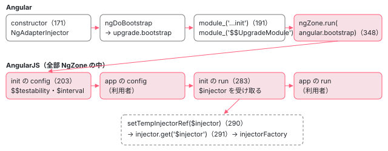

[目次](../README.md) › [@angular/upgrade の内側：AngularJS と 1 つのページを分け合う](README.md) › 第 1 回 / 全 6 回

# 全体と起動：UpgradeModule.bootstrap が 2 つを順に起こす

> パッケージの形（3 つの入口と、static が ɵ の名前空間で使う src/common）、AngularJS を window.angular から 1 つの変数に取る angular1.ts、UpgradeModule の constructor と bootstrap が AngularJS のモジュールを 2 つ作り angular.bootstrap を NgZone の中で呼ぶ順、angular1\_providers の一時変数で $injector を Angular の注入器へ渡す橋と、早く引いたときの NG0200、消えた UpgradeAdapter（f86846555bb）と export から外れた getAngularLib（01a179577b5）。AngularJS 1.8.3 と @angular/upgrade 22.1.6 を Node で起動した記録を 1 段ずつ再生する。

angular/angular · 読了 約 13 分 · 中核 · [サイトで読む（デモが動きます）](https://angular-deep-dive-cyan.vercel.app/chapter/upg-bootstrap)

---

`@angular/upgrade` は、AngularJS（1.x）と Angular を 1 つのページで同時に動かすためのパッケージです。この章では、`UpgradeModule` を import した NgModule を起動したとき、**Angular が先に起き、`ngDoBootstrap` の中の `upgrade.bootstrap()` が AngularJS のモジュールを 2 つ作って `angular.bootstrap` を NgZone の中で呼ぶ**までを 1 行ずつ追います。AngularJS の `$injector` が Angular の注入器へ渡る「一時変数の受け渡し」と、受け渡しの前に引くと何が起きるかも、Node で動かした記録で確かめます。

読む対象は `packages/upgrade` の `public_api.ts`・`static/public_api.ts`・`static/common.ts`・`static/src/upgrade_module.ts`・`static/src/angular1_providers.ts`・`static/src/util.ts`、`src/common/src/angular1.ts`・`constants.ts`・`util.ts`、spec は `static/test/integration/upgrade_module_spec.ts` です。Angular の側の起動（`bootstrapModule` から `ngDoBootstrap` まで）は [ngmodule-bootstrap-module](../ngmodule/11-ngmodule-bootstrap-module.md) で読みました。`upgrade_module.ts` のうち変更検知の橋（`$$testability` と `$interval` の飾り、`onMicrotaskEmpty` から `$digest` を呼ぶ行）は[第 4 回](04-upg-injection-cd.md)で読みます。

1. **1. 全体と起動**（この章）
2. [2. downgradeComponent](02-upg-downgrade-component.md)
3. [3. UpgradeComponent](03-upg-upgrade-component.md)
4. [4. 注入器と変更検知](04-upg-injection-cd.md)
5. [5. downgradeModule](05-upg-downgrade-module.md)
6. [6. spec と issue](06-upg-tests-issues.md)

## 1. パッケージの形：入口は 3 つ、中身は src/common

`@angular/upgrade` の入口（npm の import の名前）は `@angular/upgrade`・`@angular/upgrade/static`・`@angular/upgrade/static/testing` の 3 つです。1 つ目は今は `VERSION` しか出していません。

📄 `angular/packages/upgrade/public_api.ts` L9–19 （▶ の行: 13, 17）

```ts
 9 │ /**
10 │  * @module
11 │  * @description
12 │  *
13 ▶  * @deprecated Use the entry from `@angular/upgrade/static` instead.
14 │  * Entry point for all public APIs of this package. allowing
15 │  * Angular 1 and Angular 2+ to run side by side in the same application.
16 │  */
17 ▶ export {VERSION} from './src/common/src/version';
18 │ 
19 │ // This file only re-exports content of the `src` folder. Keep it that way.
```

17 行目の `VERSION` が、この入口の唯一の export です。13 行目の `@deprecated` は 75fe8f8af94（2025-12-08、v21.1.0 から）が足しました。中身の本体は 2 つ目の `static` です。

📄 `angular/packages/upgrade/static/public_api.ts` L9–18 （▶ の行: 9–11, 13–16）

```ts
 9 ▶ export {getAngularJSGlobal, setAngularJSGlobal} from '../src/common/src/angular1';
10 ▶ export {downgradeComponent} from '../src/common/src/downgrade_component';
11 ▶ export {downgradeInjectable} from '../src/common/src/downgrade_injectable';
12 │ export {VERSION} from '../src/common/src/version';
13 ▶ export * from './common';
14 ▶ export {downgradeModule} from './src/downgrade_module';
15 ▶ export {UpgradeComponent} from './src/upgrade_component';
16 ▶ export {UpgradeModule} from './src/upgrade_module';
17 │ 
18 │ // This file only re-exports items to appear in the public api. Keep it that way.
```

利用者が使う 6 つの名前は、9〜11 行目と 14〜16 行目です。9〜11 行目は `../src/common/src/` から、14〜16 行目は `./src/`（`static/src`）から来ます。つまり `downgradeComponent`・`downgradeInjectable` は `src/common` にあり、`UpgradeModule`・`UpgradeComponent`・`downgradeModule` は `static/src` にあります。13 行目の `./common` は、`static/testing` や `@angular/common/upgrade` が使う内部の名前を出すファイルです。

📄 `angular/packages/upgrade/static/common.ts` L9–24 （▶ の行: 10–11, 16, 20, 22, 24）

```ts
 9 │ /**
10 ▶  * Note: We intentionally use cross entry-point relative paths here. This
11 ▶  * is because the primary entry-point is deprecated and we also don't have
12 │  * it available in G3.
13 │  */
14 │ 
15 │ // @ng_package: ignore-cross-repo-import
16 ▶ import * as ɵangular1 from '../src/common/src/angular1';
17 │ // @ng_package: ignore-cross-repo-import
18 │ import * as ɵconstants from '../src/common/src/constants';
19 │ // @ng_package: ignore-cross-repo-import
20 ▶ import * as ɵupgradeHelper from '../src/common/src/upgrade_helper';
21 │ // @ng_package: ignore-cross-repo-import
22 ▶ import * as ɵutil from '../src/common/src/util';
23 │ 
24 ▶ export {ɵangular1, ɵconstants, ɵupgradeHelper, ɵutil};
```

16〜22 行目で `src/common/src` の 4 つのファイルを丸ごと名前空間として import し、24 行目で `ɵ` を付けて出しています（`ɵ` は「公開 API ではない」という Angular の印です）。`UpgradeModule` も `UpgradeComponent` も、`src/common` の関数をこの 4 つの名前空間を通して呼びます（次の節から出てくる `ɵangular1.module_` や `ɵupgradeHelper.UpgradeHelper`）。10〜11 行目のコメントのとおり、`static` から 1 つ上の `src` を相対パスで読むのはわざとです。

> [!NOTE]
> **さらに深く**
>
> `src/common` という名前は、かつて 2 つ目の使い手がいた名残です。`src/dynamic` の `UpgradeAdapter`（v5 から非推奨）も `src/common` を使っていましたが、f86846555bb で消えました（9 節）。今の `src/common` の使い手は `static` だけです。

## 2. AngularJS をどこから取るか：angular1.ts の変数 1 つ

`@angular/upgrade` は AngularJS を import しません。`window.angular` を 1 つの変数に入れて使います。

📄 `angular/packages/upgrade/src/common/src/angular1.ts` L245–283 （▶ の行: 245–246, 252, 267–268, 277–279, 281–282）

```ts
245 ▶ function noNg(): never {
246 ▶   throw new Error('AngularJS v1.x is not loaded!');
247 │ }
248 │ 
249 │ const noNgElement: typeof angular.element = (() => noNg()) as any;
250 │ noNgElement.cleanData = noNg;
251 │ 
252 ▶ let angular: {
253 │   bootstrap: (
254 │     e: Element,
255 │     modules: (string | IInjectable)[],
256 │     config?: IAngularBootstrapConfig,
257 │   ) => IInjectorService;
258 │   module: (prefix: string, dependencies?: string[]) => IModule;
259 │   element: {
260 │     (e: string | Element | Document | IAugmentedJQuery): IAugmentedJQuery;
261 │     cleanData: (nodes: Node[] | NodeList) => void;
262 │   };
263 │   injector: (modules: Array<string | IInjectable>, strictDi?: boolean) => IInjectorService;
264 │   version: {major: number};
265 │   resumeBootstrap: () => void;
266 │   getTestability: (e: Element) => ITestabilityService;
267 ▶ } = {
268 ▶   bootstrap: noNg,
269 │   module: noNg,
270 │   element: noNgElement,
271 │   injector: noNg,
272 │   version: undefined as any,
273 │   resumeBootstrap: noNg,
274 │   getTestability: noNg,
275 │ };
276 │ 
277 ▶ try {
278 ▶   if (Object.hasOwn(window, 'angular')) {
279 ▶     angular = (<any>window).angular;
280 │   }
281 ▶ } catch {
282 ▶   // ignore in CJS mode.
283 │ }
```

252 行目の `angular` が、このパッケージが AngularJS を指す唯一の変数です。267〜275 行目の初期値は全部 `noNg` で、245〜246 行目のとおり呼ぶと `'AngularJS v1.x is not loaded!'` を投げます。277〜279 行目で、**このファイルが読み込まれた瞬間に**`window` が `angular` を持っていればそれを入れます。281〜282 行目の `catch` は、`window` の無い環境（CommonJS で読んだとき）で黙るためです。

📄 `angular/packages/upgrade/src/common/src/angular1.ts` L285–321 （▶ の行: 290, 299, 310–311, 319–320）

```ts
285 │ /**
286 │  * @deprecated Use `setAngularJSGlobal` instead.
287 │  *
288 │  * @publicApi
289 │  */
290 ▶ export function setAngularLib(ng: any): void {
291 │   setAngularJSGlobal(ng);
292 │ }
293 │ 
294 │ /**
295 │  * @deprecated Use `getAngularJSGlobal` instead.
296 │  *
297 │  * @publicApi
298 │  */
299 ▶ export function getAngularLib(): any {
300 │   return getAngularJSGlobal();
301 │ }
302 │ 
303 │ /**
304 │  * Resets the AngularJS global.
305 │  *
306 │  * Used when AngularJS is loaded lazily, and not available on `window`.
307 │  *
308 │  * @publicApi
309 │  */
310 ▶ export function setAngularJSGlobal(ng: any): void {
311 ▶   angular = ng;
312 │ }
313 │ 
314 │ /**
315 │  * Returns the current AngularJS global.
316 │  *
317 │  * @publicApi
318 │  */
319 ▶ export function getAngularJSGlobal(): any {
320 ▶   return angular;
321 │ }
```

310〜311 行目の `setAngularJSGlobal` は、AngularJS を後から（`window` に置かずに）読む場合に変数を差し替えます。319〜320 行目の `getAngularJSGlobal` はそれを返します。290 行目と 299 行目の `setAngularLib`・`getAngularLib` は v5 から非推奨の別名で、01a179577b5（v22.0.0 から）で `static/public_api.ts` の export から外れました（9 節の差分）。関数そのものはこのファイルに残っていて、`ɵangular1` の名前空間（1 節の 16 行目）からは今も見えます。

📄 `angular/packages/upgrade/src/common/src/angular1.ts` L323–342 （▶ の行: 323–324, 326–329, 331）

```ts
323 ▶ export const bootstrap: typeof angular.bootstrap = (e, modules, config?) =>
324 ▶   angular.bootstrap(e, modules, config);
325 │ 
326 ▶ // Do not declare as `module` to avoid webpack bug
327 ▶ // (see https://github.com/angular/angular/issues/30050).
328 ▶ export const module_: typeof angular.module = (prefix, dependencies?) =>
329 ▶   angular.module(prefix, dependencies);
330 │ 
331 ▶ export const element: typeof angular.element = ((e) =>
332 │   angular.element(e)) as typeof angular.element;
333 │ element.cleanData = (nodes) => angular.element.cleanData(nodes);
334 │ 
335 │ export const injector: typeof angular.injector = (
336 │   modules: Array<string | IInjectable>,
337 │   strictDi?: boolean,
338 │ ) => angular.injector(modules, strictDi);
339 │ 
340 │ export const resumeBootstrap: typeof angular.resumeBootstrap = () => angular.resumeBootstrap();
341 │ 
342 │ export const getTestability: typeof angular.getTestability = (e) => angular.getTestability(e);
```

323〜342 行目の包み関数は、呼ばれるたびに `angular.bootstrap` や `angular.module` を**その場で引きます**。だから `setAngularJSGlobal` で後から差し替えても効き、spec が `spyOn(getAngularJSGlobal(), 'bootstrap')`（テストの節）で呼び出しを捕まえられます。この章の記録も同じ理由で、`window.angular.module` と `.bootstrap` を包んで呼び出しを数えています。326〜328 行目のとおり、`module` という名前を避けて `module_` にしているのは webpack の不具合（#30050）のためです。

## 3. 名前の約束：constants.ts と UpgradeAppType

📄 `angular/packages/upgrade/src/common/src/constants.ts` L9–37 （▶ の行: 14, 26, 29–30, 32, 34, 37）

```ts
 9 │ export const $COMPILE = '$compile';
10 │ export const $CONTROLLER = '$controller';
11 │ export const $DELEGATE = '$delegate';
12 │ export const $EXCEPTION_HANDLER = '$exceptionHandler';
13 │ export const $HTTP_BACKEND = '$httpBackend';
14 ▶ export const $INJECTOR = '$injector';
15 │ export const $INTERVAL = '$interval';
16 │ export const $PARSE = '$parse';
17 │ export const $PROVIDE = '$provide';
18 │ export const $ROOT_ELEMENT = '$rootElement';
19 │ export const $ROOT_SCOPE = '$rootScope';
20 │ export const $SCOPE = '$scope';
21 │ export const $TEMPLATE_CACHE = '$templateCache';
22 │ export const $TEMPLATE_REQUEST = '$templateRequest';
23 │ 
24 │ export const $$TESTABILITY = '$$testability';
25 │ 
26 ▶ export const COMPILER_KEY = '$$angularCompiler';
27 │ export const DOWNGRADED_MODULE_COUNT_KEY = '$$angularDowngradedModuleCount';
28 │ export const GROUP_PROJECTABLE_NODES_KEY = '$$angularGroupProjectableNodes';
29 ▶ export const INJECTOR_KEY = '$$angularInjector';
30 ▶ export const LAZY_MODULE_REF = '$$angularLazyModuleRef';
31 │ export const NG_ZONE_KEY = '$$angularNgZone';
32 ▶ export const UPGRADE_APP_TYPE_KEY = '$$angularUpgradeAppType';
33 │ 
34 ▶ export const REQUIRE_INJECTOR = '?^^' + INJECTOR_KEY;
35 │ export const REQUIRE_NG_MODEL = '?ngModel';
36 │ 
37 ▶ export const UPGRADE_MODULE_NAME = '$$UpgradeModule';
```

9〜22 行目は AngularJS が持つサービスの名前（`$injector`・`$rootScope` など）です。26〜32 行目の `$$angular…` は、このパッケージが AngularJS の `$injector` に置く値の名前です。この章で使うのは 3 つです。29 行目の `INJECTOR_KEY`（Angular の注入器）、30 行目の `LAZY_MODULE_REF`（Angular のモジュールの注入器を包んだ箱）、32 行目の `UPGRADE_APP_TYPE_KEY`（どの方式のアプリか）。37 行目の `'$$UpgradeModule'` は、`UpgradeModule.bootstrap` が作る AngularJS のモジュールの名前です。34 行目の `REQUIRE_INJECTOR` は `'?^^$$angularInjector'` で、[第 2 回](02-upg-downgrade-component.md)の `downgradeComponent` が親の要素から注入器を探すときの `require` の文字列です。

📄 `angular/packages/upgrade/src/common/src/util.ts` L171–188 （▶ の行: 176, 181, 184, 187）

```ts
171 │ export interface LazyModuleRef {
172 │   injector?: Injector;
173 │   promise?: Promise<Injector>;
174 │ }
175 │ 
176 ▶ export const enum UpgradeAppType {
177 │   // App NOT using `@angular/upgrade`. (This should never happen in an `ngUpgrade` app.)
178 │   None,
179 │ 
180 │   // App using the deprecated `@angular/upgrade` APIs (a.k.a. dynamic `ngUpgrade`).
181 ▶   Dynamic,
182 │ 
183 │   // App using `@angular/upgrade/static` with `UpgradeModule`.
184 ▶   Static,
185 │ 
186 │   // App using @angular/upgrade/static` with `downgradeModule()` (a.k.a `ngUpgrade`-lite ).
187 ▶   Lite,
188 │ }
```

176〜188 行目の `UpgradeAppType` は、AngularJS の `$injector` に置かれる「方式」の値です。`UpgradeModule` は 184 行目の `Static` を置きます（5 節の 194 行目）。181 行目の `Dynamic` は、消えた `UpgradeAdapter` の値で、今は誰も置きません。187 行目の `Lite` は [第 5 回](05-upg-downgrade-module.md)の `downgradeModule` が置きます。

## 4. NgModule の定義と constructor

📄 `angular/packages/upgrade/static/src/upgrade_module.ts` L149–173 （▶ の行: 149, 154, 156, 161, 163, 169, 171–172）

```ts
149 ▶ @NgModule({providers: [angular1Providers, ɵinternalProvideZoneChangeDetection({})]})
150 │ export class UpgradeModule {
151 │   /**
152 │    * The AngularJS `$injector` for the upgrade application.
153 │    */
154 ▶   public $injector: any; /*angular.IInjectorService*/
155 │   /** The Angular Injector **/
156 ▶   public injector: Injector;
157 │   private readonly applicationRef: ApplicationRef;
158 │ 
159 │   constructor(
160 │     /** The root `Injector` for the upgrade application. */
161 ▶     injector: Injector,
162 │     /** The bootstrap zone for the upgrade application */
163 ▶     public ngZone: NgZone,
164 │     /**
165 │      * The owning `NgModuleRef`s `PlatformRef` instance.
166 │      * This is used to tie the lifecycle of the bootstrapped AngularJS apps to that of the Angular
167 │      * `PlatformRef`.
168 │      */
169 ▶     private platformRef: PlatformRef,
170 │   ) {
171 ▶     this.injector = new NgAdapterInjector(injector);
172 ▶     this.applicationRef = this.injector.get(ApplicationRef);
173 │   }
```

149 行目の `providers` は 2 つです。`angular1Providers`（6 節）と、`ɵinternalProvideZoneChangeDetection({})`。後者は zone.js で変更検知を予約する仕組みを足すもので、`UpgradeModule` を import したアプリが zone の側で動く理由です（いつ、なぜ足されたかは[第 4 回](04-upg-injection-cd.md)）。

1. **constructor が 3 つを受け取る**

   161 行目の `Injector`（このモジュールの注入器）、163 行目の `NgZone`（`public` なので `upgrade.ngZone` で見える）、169 行目の `PlatformRef` です。`UpgradeModule` は NgModule のクラスなので、`bootstrapModule` がモジュールの注入器を作るときに 1 回だけ作られます（[ngmodule-injector-def](../ngmodule/07-ngmodule-injector-def.md)）。
2. **注入器を NgAdapterInjector で包む**

   171 行目。154 行目の `$injector` はこの時点で `undefined` のままです（DEMO の 2 段目の「AppModule の constructor」の行）。
3. **ApplicationRef を引いておく**

   172 行目。[第 4 回](04-upg-injection-cd.md)の zoneless の枝（`afterTick` の購読）で使います。

📄 `angular/packages/upgrade/static/src/util.ts` L14–28 （▶ の行: 21–23, 26）

```ts
14 │ export class NgAdapterInjector implements Injector {
15 │   constructor(private modInjector: Injector) {}
16 │ 
17 │   // When Angular locate a service in the component injector tree, the not found value is set to
18 │   // `NOT_FOUND_CHECK_ONLY_ELEMENT_INJECTOR`. In such a case we should not walk up to the module
19 │   // injector.
20 │   // AngularJS only supports a single tree and should always check the module injector.
21 ▶   get(token: any, notFoundValue?: any): any {
22 ▶     if (notFoundValue === NOT_FOUND_CHECK_ONLY_ELEMENT_INJECTOR) {
23 ▶       return notFoundValue;
24 │     }
25 │ 
26 ▶     return this.modInjector.get(token, notFoundValue);
27 │   }
28 │ }
```

`NgAdapterInjector` は、`get` を 1 つだけ持つ包みです。22 行目、`notFoundValue` が `NOT_FOUND_CHECK_ONLY_ELEMENT_INJECTOR` なら、モジュールの注入器を見ずに 23 行目でその印を返します。それ以外は 26 行目でモジュールの注入器に任せます。

この印は、`createComponent` に「要素の側の注入器」として渡した注入器を Angular が引くときに付けるものです（[dyn-factory-create](../dyn/02-dyn-factory-create.md) の 2 節、`ChainedInjector`）。AngularJS の中に置いた最上位の Angular のコンポーネントは、この包みを親にした注入器を「要素の側の注入器」として作られます（[第 2 回](02-upg-downgrade-component.md)）。包みが印をそのまま返すので、Angular はモジュールの注入器を 2 回探さずに環境の注入器の側へ進みます。17〜20 行目のコメントの「AngularJS は木を 1 つしか持たない」は、この区別が AngularJS の側には無いという意味です。

## 5. bootstrap() を 1 行ずつ

利用者は、自分の NgModule の `ngDoBootstrap()` の中で `upgrade.bootstrap(document.body, ['app'])` のように呼びます。Angular の側の起動（モジュールの注入器・`APP_INITIALIZER`）は、この呼び出しより前に全部終わっています。



*upgrade.bootstrap() の中の順番。上の帯が Angular の側、下の帯が AngularJS の側。色の付いた箱が NgZone.run の中*

### 5.1 AngularJS のモジュールを 1 つ作り、値を 3 つ置く

📄 `angular/packages/upgrade/static/src/upgrade_module.ts` L183–206 （▶ の行: 188, 191–192, 194, 196, 198–200, 203）

```ts
183 │   bootstrap(
184 │     element: Element,
185 │     modules: string[] = [],
186 │     config?: any /*angular.IAngularBootstrapConfig*/,
187 │   ): any /*ReturnType<typeof angular.bootstrap>*/ {
188 ▶     const INIT_MODULE_NAME = ɵconstants.UPGRADE_MODULE_NAME + '.init';
189 │ 
190 │     // Create an ng1 module to bootstrap
191 ▶     ɵangular1
192 ▶       .module_(INIT_MODULE_NAME, [])
193 │ 
194 ▶       .constant(ɵconstants.UPGRADE_APP_TYPE_KEY, ɵutil.UpgradeAppType.Static)
195 │ 
196 ▶       .value(ɵconstants.INJECTOR_KEY, this.injector)
197 │ 
198 ▶       .factory(ɵconstants.LAZY_MODULE_REF, [
199 ▶         ɵconstants.INJECTOR_KEY,
200 ▶         (injector: Injector) => ({injector}) as ɵutil.LazyModuleRef,
201 │       ])
202 │ 
203 ▶       .config([
204 │         ɵconstants.$PROVIDE,
205 │         ɵconstants.$INJECTOR,
206 │         ($provide: ɵangular1.IProvideService, $injector: ɵangular1.IInjectorService) => {
```

1. **名前を決める**

   188 行目。`'$$UpgradeModule' + '.init'` で `'$$UpgradeModule.init'` です。
2. **AngularJS のモジュールを作る**

   191〜192 行目。2 節の `module_` が `angular.module('$$UpgradeModule.init', [])` を呼びます（DEMO で `angular.module` の行として出ます）。ここから run のブロックの終わりまではメソッドの連鎖で、**登録するだけで、まだ何も走りません**。
3. **constant と value と factory を 1 つずつ置く**

   194 行目、`$$angularUpgradeAppType` に `Static`（3 節）。196 行目、`$$angularInjector` に 4 節の `NgAdapterInjector`。198〜200 行目、`$$angularLazyModuleRef` に `{ injector }` を返す factory。`downgradeComponent` は、親の Angular のコンポーネントが無いときにこれを引きます（[第 2 回](02-upg-downgrade-component.md)の 2 節）。
4. **config で 2 つのサービスを飾る**

   203 行目からの `config` は、`$$testability` と `$interval` を Angular のゾーンに合わせて包みます（[第 4 回](04-upg-injection-cd.md)）。DEMO の「app の config」の行が出している `has('$$testability')` は、この config が飾る前に確かめるのと同じ問いです。

### 5.2 run：$injector を受け取り、DOM に置き、破棄をつなぐ

📄 `angular/packages/upgrade/static/src/upgrade_module.ts` L283–305 （▶ の行: 283, 285–287, 290–291, 294–296, 304）

```ts
283 ▶       .run([
284 │         ɵconstants.$INJECTOR,
285 ▶         ($injector: ɵangular1.IInjectorService) => {
286 ▶           this.$injector = $injector;
287 ▶           const $rootScope = $injector.get('$rootScope');
288 │ 
289 │           // Initialize the ng1 $injector provider
290 ▶           setTempInjectorRef($injector);
291 ▶           this.injector.get(ɵconstants.$INJECTOR);
292 │ 
293 │           // Put the injector on the DOM, so that it can be "required"
294 ▶           ɵangular1.element(element).data!(
295 ▶             ɵutil.controllerKey(ɵconstants.INJECTOR_KEY),
296 ▶             this.injector,
297 │           );
298 │ 
299 │           // Destroy the AngularJS app once the Angular `PlatformRef` is destroyed.
300 │           // This does not happen in a typical SPA scenario, but it might be useful for
301 │           // other use-cases where disposing of an Angular/AngularJS app is necessary
302 │           // (such as Hot Module Replacement (HMR)).
303 │           // See https://github.com/angular/angular/issues/39935.
304 ▶           this.platformRef.onDestroy(() => ɵutil.destroyApp($injector));
305 │ 
```

1. **AngularJS の $injector を覚える**

   283〜286 行目。`run` のブロックは AngularJS の `$injector` ができた後に呼ばれるので、ここで初めて `this.$injector` が埋まります。287 行目で `$rootScope` も引きます（[第 4 回](04-upg-injection-cd.md)の `$digest` の橋で使う）。
2. **Angular の注入器に $injector を渡す**

   290 行目で一時変数に置き、291 行目で Angular の注入器から `'$injector'` を 1 回引きます。引いた瞬間に 6 節の factory が一時変数を読んで空にします。291 行目の戻り値は捨てています。目的は「Angular の注入器の中に値を作らせること」だけです。
3. **Angular の注入器を DOM に置く**

   294〜296 行目。`angular.element(element).data('$$$angularInjectorController', this.injector)` です（`controllerKey` は `'$' + name + 'Controller'`、`destroyApp` の引用の 53〜55 行目）。AngularJS の `require: '^^name'` は、先祖の要素の `data('$nameController')` を探す仕組みです。これで、ルートの要素の下のどこからでも `'?^^$$angularInjector'`（3 節の 34 行目）で Angular の注入器が見つかります。
4. **PlatformRef が壊れたら AngularJS も壊す**

   304 行目。`destroyApp`（7 節）を `platformRef.onDestroy` に登録します。b4b21bdff4b（HMR の修正、#39935）が足した行です。
5. **次の tick で $digest の橋をかける**

   305 行目の後に続く `setTimeout(…, 0)` の中で `onMicrotaskEmpty`（zoneless なら `afterTick`）を購読します（[第 4 回](04-upg-injection-cd.md)）。DEMO の「次の tick」の段で、`setTimeout` の前は `$digest` が 0 回、後は増えていることだけ確かめています。

### 5.3 もう 1 つのモジュールを作り、NgZone の中で angular.bootstrap

📄 `angular/packages/upgrade/static/src/upgrade_module.ts` L338–364 （▶ の行: 338–340, 344–345, 348–349, 353, 356, 358–359, 363）

```ts
338 ▶     const upgradeModule = ɵangular1.module_(
339 ▶       ɵconstants.UPGRADE_MODULE_NAME,
340 ▶       [INIT_MODULE_NAME].concat(modules),
341 │     );
342 │ 
343 │     // Make sure resumeBootstrap() only exists if the current bootstrap is deferred
344 ▶     const windowAngular = (window as any)['angular'];
345 ▶     windowAngular.resumeBootstrap = undefined;
346 │ 
347 │     // Bootstrap the AngularJS application inside our zone
348 ▶     const returnValue = this.ngZone.run(() =>
349 ▶       ɵangular1.bootstrap(element, [upgradeModule.name], config),
350 │     );
351 │ 
352 │     // Patch resumeBootstrap() to run inside the ngZone
353 ▶     if (windowAngular.resumeBootstrap) {
354 │       const originalResumeBootstrap: () => void = windowAngular.resumeBootstrap;
355 │       const ngZone = this.ngZone;
356 ▶       windowAngular.resumeBootstrap = function () {
357 │         let args = arguments;
358 ▶         windowAngular.resumeBootstrap = originalResumeBootstrap;
359 ▶         return ngZone.run(() => windowAngular.resumeBootstrap.apply(this, args));
360 │       };
361 │     }
362 │ 
363 ▶     return returnValue;
364 │   }
```

1. **'$$UpgradeModule' を作る**

   338〜340 行目。requires は `['$$UpgradeModule.init'].concat(modules)` です。AngularJS は requires を前から順に読み込み、config と run もその順に呼ぶので、**init の config と run は利用者のモジュールより先**に走ります。DEMO の「app の run」の行で、利用者の run の時点で `upgrade.$injector` がもう埋まっているのはこのためです。
2. **resumeBootstrap を一度消す**

   344〜345 行目。AngularJS は `window.name` が `NG_DEFER_BOOTSTRAP!` で始まると、起動を止めて `angular.resumeBootstrap` を置きます。前の起動の残りを見間違えないよう、先に `undefined` にします。
3. **NgZone の中で angular.bootstrap**

   348〜349 行目。`this.ngZone.run` の中で `angular.bootstrap(element, ['$$UpgradeModule'], config)` を呼びます。DEMO の表の「ゾーン」の列で、config と run が全部「中」なのはこのためです。AngularJS の側の `$http` や `$timeout` が積む非同期の仕事も Angular のゾーンの中で始まり、終わると Angular の変更検知が走ります（[zone-ngzone-fork](../zone/09-zone-ngzone-fork.md)）。
4. **止まったなら、resumeBootstrap も NgZone の中へ**

   353 行目、AngularJS が `resumeBootstrap` を置いていたら（止まったら）、356〜359 行目で包みます。呼ばれると 358 行目で元に戻し、359 行目で元の関数を `ngZone.run` の中で呼びます。DEMO の「NG\_DEFER\_BOOTSTRAP!」では、ゾーンの外から `resumeBootstrap()` を呼んでも config と run がゾーンの中で走ります。
5. **angular.bootstrap の戻り値をそのまま返す**

   363 行目。ふつうは AngularJS の `$injector`、止まったときは `undefined` です（DEMO）。戻り値を返す形と `config` を渡す形は e9cb0454dce（v14.1.0）で `angular.bootstrap` に揃えられました。

## 6. angular1\_providers：$injector を受け渡す一時変数

📄 `angular/packages/upgrade/static/src/angular1_providers.ts` L11–50 （▶ の行: 15–17, 19–21, 24–26, 29–30, 46–49）

```ts
11 │ // We have to do a little dance to get the ng1 injector into the module injector.
12 │ // We store the ng1 injector so that the provider in the module injector can access it
13 │ // Then we "get" the ng1 injector from the module injector, which triggers the provider to read
14 │ // the stored injector and release the reference to it.
15 ▶ let tempInjectorRef: IInjectorService | null = null;
16 ▶ export function setTempInjectorRef(injector: IInjectorService) {
17 ▶   tempInjectorRef = injector;
18 │ }
19 ▶ export function injectorFactory() {
20 ▶   if (!tempInjectorRef) {
21 ▶     throw new Error('Trying to get the AngularJS injector before it being set.');
22 │   }
23 │ 
24 ▶   const injector: IInjectorService = tempInjectorRef;
25 ▶   tempInjectorRef = null; // clear the value to prevent memory leaks
26 ▶   return injector;
27 │ }
28 │ 
29 ▶ export function rootScopeFactory(i: IInjectorService) {
30 ▶   return i.get('$rootScope');
31 │ }
32 │ 
33 │ export function compileFactory(i: IInjectorService) {
34 │   return i.get('$compile');
35 │ }
36 │ 
37 │ export function parseFactory(i: IInjectorService) {
38 │   return i.get('$parse');
39 │ }
40 │ 
41 │ export const angular1Providers = [
42 │   // We must use exported named functions for the ng2 factories to keep the compiler happy:
43 │   // > Metadata collected contains an error that will be reported at runtime:
44 │   // >   Function calls are not supported.
45 │   // >   Consider replacing the function or lambda with a reference to an exported function
46 ▶   {provide: '$injector', useFactory: injectorFactory, deps: []},
47 ▶   {provide: '$rootScope', useFactory: rootScopeFactory, deps: ['$injector']},
48 ▶   {provide: '$compile', useFactory: compileFactory, deps: ['$injector']},
49 ▶   {provide: '$parse', useFactory: parseFactory, deps: ['$injector']},
50 │ ];
```

AngularJS の `$injector` は 5.2 の run の中でしか手に入りません。一方、Angular の注入器は provider を NgModule の定義の時点で決めておく必要があります。そこで、11〜14 行目のコメントの「little dance」をします。

1. **置く**

   16〜17 行目の `setTempInjectorRef` が、モジュールの中の変数 `tempInjectorRef`（15 行目）に `$injector` を置きます（5.2 の 290 行目）。
2. **引かせる**

   5.2 の 291 行目が Angular の注入器から `'$injector'` を引くと、46 行目の provider の factory、19 行目の `injectorFactory` が呼ばれます。
3. **読んで空にする**

   24 行目で読み、25 行目で `null` に戻し、26 行目で返します。Angular の注入器は返った値を覚えるので、以後 `'$injector'` は同じものを返し続けます。
4. **残りの 3 つは $injector から引く**

   47〜49 行目の `'$rootScope'`・`'$compile'`・`'$parse'` は、`deps: ['$injector']` で 1 つ目に頼り、29〜39 行目で AngularJS の `$injector.get` を呼ぶだけです。

受け渡しの前に引くと、20〜21 行目で `'Trying to get the AngularJS injector before it being set.'` を投げます。DEMO の「早すぎる inject('$rootScope')」はその先も記録しています。`APP_INITIALIZER` の中で 1 回投げさせ、例外を握りつぶして起動を続けると、5.2 の 291 行目が `` NG0200: Circular dependency detected for `$injector` `` で止まります。Angular の `R3Injector` は factory を呼ぶ前に値を `CIRCULAR` にし、factory が投げると `CIRCULAR` のまま残すからです（[di-r3-injector-get](../di/08-di-r3-injector-get.md) の `hydrate`）。291 行目は factory を呼ばずに「循環」と判断するので、一時変数（15 行目）も 290 行目で置かれたまま空になりません。

> [!WARNING]
> **ハマりどころ**
>
> 「Trying to get the AngularJS injector before it being set」は、AngularJS の起動より前に作られる Angular のサービス（`APP_INITIALIZER`、モジュールの constructor、`ErrorHandler` など）が AngularJS のサービスを inject したときに出ます。その例外を握りつぶすと、後の NG0200 は元の原因を名指ししません。gh で検索した範囲では、NG0200 の方を扱った issue は見つかりませんでした（2026-11-16）。

## 7. 壊すとき：destroyApp

📄 `angular/packages/upgrade/src/common/src/util.ts` L46–72 （▶ の行: 47, 49, 54, 66–68, 70–71）

```ts
46 │ export function cleanData(node: Node): void {
47 ▶   angularElement.cleanData([node]);
48 │   if (isParentNode(node)) {
49 ▶     angularElement.cleanData(node.querySelectorAll('*'));
50 │   }
51 │ }
52 │ 
53 │ export function controllerKey(name: string): string {
54 ▶   return '$' + name + 'Controller';
55 │ }
56 │ 
57 │ /**
58 │  * Destroy an AngularJS app given the app `$injector`.
59 │  *
60 │  * NOTE: Destroying an app is not officially supported by AngularJS, but try to do our best by
61 │  *       destroying `$rootScope` and clean the jqLite/jQuery data on `$rootElement` and all
62 │  *       descendants.
63 │  *
64 │  * @param $injector The `$injector` of the AngularJS app to destroy.
65 │  */
66 ▶ export function destroyApp($injector: IInjectorService): void {
67 ▶   const $rootElement: IAugmentedJQuery = $injector.get($ROOT_ELEMENT);
68 ▶   const $rootScope: IRootScopeService = $injector.get($ROOT_SCOPE);
69 │ 
70 ▶   $rootScope.$destroy();
71 ▶   cleanData($rootElement[0]);
72 │ }
```

5.2 の 304 行目が登録した `destroyApp` は、67〜68 行目で `$rootElement` と `$rootScope` を引き、70 行目で `$rootScope.$destroy()`、71 行目で `cleanData` を呼びます。`cleanData` は 47 行目と 49 行目で、要素とその子孫の jqLite のデータ（`data()` で置いたもの）とイベントを消します。5.2 の 294〜296 行目で置いた注入器も、ここで消えます。DEMO の最後の段で `$rootScope.$$destroyed = true` と、要素の `data` が「なし」になるのを確かめています。DOM の中身はそのまま残ります。

## 8. DEMO：起動の順を 1 段ずつ

> **🧪 DEMO — UpgradeModule の起動（記録の再生）**
>
> `<work>/upg-demo/a/record-bootstrap.mjs` が、AngularJS 1.8.3・@angular/upgrade 22.1.6・@angular/core 22.1.6・zone.js 0.16.3 を jsdom 26.1.0 の上で JIT で起動した記録です。ブラウザの中では何も起動しません。場面を選び、「次の段へ」で 1 段ずつ進めてください。「ゾーン」は `NgZone.isInAngularZone()` の値です。
>
> ▶ [このデモはサイトで動かせます](https://angular-deep-dive-cyan.vercel.app/chapter/upg-bootstrap)

「ふつうの起動」の 2 段目を上から読むと、この章の順がそのまま並んでいます。

- `AppModule` の constructor と `APP_INITIALIZER` の時点では `upgrade.$injector` は `undefined`（4 節）。
- `ngDoBootstrap` の中で、`'$$UpgradeModule.init'` → `'$$UpgradeModule'` の順に `angular.module` が呼ばれ（5.1・5.3）、`angular.bootstrap` は `['$$UpgradeModule']` だけを受け取る。
- 利用者の config → 利用者の run の順。run の時点で、`upgrade.$injector`・Angular の注入器の `'$injector'`・要素の `data` の 3 つが揃っている（5.2）。
- 全部が Angular のゾーンの中（5.3 の 348 行目）。`bootstrapModule` の Promise が解決するのは、`upgrade.bootstrap` が戻った後。

## 9. 消えたもの：UpgradeAdapter と getAngularLib

📄 `f86846555bb（../angular で git show --stat）`

```
$ git show --stat f86846555bb   # fix(upgrade): Remove deprecated UpgradeAdapter (#61659)、2025-05-23
 goldens/public-api/upgrade/index.api.md            |   31 -
 modules/playground/...（upgrade の playground と e2e）  |  222 -
 packages/upgrade/BUILD.bazel                       |    1 -
 packages/upgrade/public_api.ts                     |    1 -
 .../upgrade/src/dynamic/src/upgrade_adapter.ts     |  733 ----
 .../upgrade/src/dynamic/src/upgrade_ng1_adapter.ts |  315 --
 packages/upgrade/src/dynamic/test/BUILD.bazel      |   28 -
 packages/upgrade/src/dynamic/test/upgrade_spec.ts  | 3747 --------------------
 13 files changed, 1 insertion(+), 5077 deletions(-)
$ git tag --contains f86846555bb | grep -E '^v?[0-9]+\.[0-9]+\.[0-9]+$' | sort -V | head -1
21.0.0
```

`UpgradeAdapter` は、`@angular/upgrade` の 1 つ目の入口から出ていた、JIT でしか動かない古い方式です（3 節の `UpgradeAppType.Dynamic`）。f86846555bb で `src/dynamic` ごと 5077 行が消え、v21.0.0 から無くなりました。そのとき `public_api.ts` から消えた 1 行が `UpgradeAdapter` の export で、1 節の `VERSION` だけが残りました。`static` の入口（`UpgradeModule`・`downgradeModule`）が AOT で動く方式で、今の `@angular/upgrade` はこれだけです。

📄 `01a179577b5 と 75fe8f8af94（抜粋）`

```
--- a/packages/upgrade/static/public_api.ts   （01a179577b5 refactor(upgrade): remove getAngularLib/setAngularLib、2026-02-25）
-export {
-  getAngularJSGlobal,
-  getAngularLib,
-  setAngularJSGlobal,
-  setAngularLib,
-} from '../src/common/src/angular1';
+export {getAngularJSGlobal, setAngularJSGlobal} from '../src/common/src/angular1';
 export {downgradeComponent} from '../src/common/src/downgrade_component';
 ...
+export * from './common';
 export {downgradeModule} from './src/downgrade_module';
 export {UpgradeComponent} from './src/upgrade_component';
 export {UpgradeModule} from './src/upgrade_module';
-export * from './common';

--- a/packages/upgrade/public_api.ts   （75fe8f8af94 refactor(upgrade): deprecate VERSION export、2025-12-08）
  * @module
  * @description
+ *
+ * @deprecated Use the entry from `@angular/upgrade/static` instead.
```

01a179577b5 は `getAngularLib`・`setAngularLib` を `static` の export から外し、`export * from './common'` の行を並べ替えただけの変更です。2 節で見たとおり、関数の本体は `angular1.ts` に残っています。

> [!NOTE]
> **ポイント**
>
> 別の仕組みの上に Angular のコンポーネントを載せる先例に [Angular Elements](../elements/01-elements-overview.md) があります。Elements の相手はブラウザのカスタム要素（ライフサイクルを持たない器）ですが、`@angular/upgrade` の相手は自分の注入器と `$digest` を持つもう 1 つのフレームワークです。だから起動で 2 つの注入器を結び、変更検知の橋をかける必要があります。

angular-main（74961c66242）では、この章で読んだファイルのうち `upgrade_module.ts` がドキュメントのリンクの 1 行（`#upgrading-an-angular-1-service` → `#upgrading-an-angularjs-service`、f825c9bc7cc）だけ変わり、動きは同じです。パッケージには「保守モードで、セキュリティの修正のほかは新しい機能も bug fix も受け付けない」という `README.md` の注が足されました（be7ee3a68b2。[第 6 回](06-upg-tests-issues.md)）。

## ここまでの呼び出し

- 👤 `platformBrowserDynamic().bootstrapModule(AppModule)` — 利用者のコード
  - `new UpgradeModule(injector, ngZone, platformRef)` — static/src/upgrade\_module.ts 159 — *NgAdapterInjector で包む（171）*
  - `APP_INITIALIZER` — @angular/core — *AngularJS はまだ無い*
  - 👤 `AppModule.ngDoBootstrap()` — 利用者のコード
    - `UpgradeModule.bootstrap(element, ['app'])` — upgrade\_module.ts 183
      - `angular.module('$$UpgradeModule.init', [])` — 191 — *constant・value・factory・config・run を登録*
      - `angular.module('$$UpgradeModule', ['$$UpgradeModule.init', 'app'])` — 338
      - `ngZone.run(() => angular.bootstrap(element, ['$$UpgradeModule'], config))` — 348
        - `init の config` — 203 — *$$testability・$interval を飾る（第 4 回）*
        - 👤 `app の config` — 利用者のコード
        - `init の run` — 283
          - `setTempInjectorRef($injector)` → `injector.get('$injector')` — 290〜291 → angular1\_providers.ts 19
          - `element.data('$$$angularInjectorController', injector)` — 294
          - `platformRef.onDestroy(() => destroyApp($injector))` — 304
          - `setTimeout(…, 0)` — 305 の後 — *$digest の橋（第 4 回）*
        - 👤 `app の run` — 利用者のコード
      - `return returnValue` — 363 — *AngularJS の $injector*

## テストと直し方

この章の約束は `static/test/integration/upgrade_module_spec.ts` の `describe('UpgradeModule')`（22 行目）が固めています。`describe('$injector')`（26 行目）の `it('should not be set initially')`（27 行目）と ``it('should be set after calling `.bootstrap()`')``（43 行目）、`describe('injector')`（68 行目）の `it('should be set initially')`（69 行目）、`describe('ngZone')`（88 行目）の `it('should be set initially')`（89 行目）、`describe('bootstrap()')`（107 行目）の ``it('should call `angular.bootstrap()`')``（108 行目）と ``it('should forward the return value of `angular.bootstrap()`')``（132 行目）です。全体は `withEachNg1Version`（21 行目）で包まれ、AngularJS 1.5〜1.8 の 4 つで同じ it が走ります（[第 6 回](06-upg-tests-issues.md)）。

📄 `angular/packages/upgrade/static/test/integration/upgrade_module_spec.ts` L43–66 （▶ の行: 60–61, 63–64）

```ts
43 │       it('should be set after calling `.bootstrap()`', async () => {
44 │         // Define `ng1Module`.
45 │         const ng1Module = module_('ng1Module', []).value('foo', 'ng1Foo');
46 │ 
47 │         // Define `Ng2Module`.
48 │         @NgModule({
49 │           imports: [BrowserModule, UpgradeModule],
50 │         })
51 │         class Ng2Module {
52 │           ngDoBootstrap() {}
53 │         }
54 │ 
55 │         // Bootstrap the ng2 app.
56 │         const appRef = await platformBrowserDynamic().bootstrapModule(Ng2Module);
57 │         const upgrade = appRef.injector.get(UpgradeModule);
58 │ 
59 │         // Bootstrap the hybrid app.
60 ▶         const element = html(`<ng2></ng2>`);
61 ▶         upgrade.bootstrap(element, [ng1Module.name]);
62 │ 
63 ▶         expect(upgrade.$injector).toBeDefined();
64 ▶         expect(upgrade.$injector.get('foo')).toBe('ng1Foo');
65 │       });
66 │     });
```

60〜61 行目で `bootstrap` を呼んだ後、63〜64 行目で `$injector` が埋まり、利用者のモジュールの値が引けることを確かめます（5.2 の 286 行目）。

📄 `angular/packages/upgrade/static/test/integration/upgrade_module_spec.ts` L108–130 （▶ の行: 110, 126–127, 129）

```ts
108 │       it('should call `angular.bootstrap()`', async () => {
109 │         // Set up spies.
110 ▶         const bootstrapSpy = spyOn(getAngularJSGlobal(), 'bootstrap').and.callThrough();
111 │ 
112 │         // Define `Ng2Module`.
113 │         @NgModule({
114 │           imports: [BrowserModule, UpgradeModule],
115 │         })
116 │         class Ng2Module {
117 │           ngDoBootstrap() {}
118 │         }
119 │ 
120 │         // Bootstrap the ng2 app.
121 │         const appRef = await platformBrowserDynamic().bootstrapModule(Ng2Module);
122 │         const upgrade = appRef.injector.get(UpgradeModule);
123 │ 
124 │         // Bootstrap the hybrid app.
125 │         const element = html(`<ng2></ng2>`);
126 ▶         const config: IAngularBootstrapConfig = {strictDi: true};
127 ▶         upgrade.bootstrap(element, [], config);
128 │ 
129 ▶         expect(bootstrapSpy).toHaveBeenCalledOnceWith(element, jasmine.any(Array), config);
130 │       });
```

📄 `angular/packages/upgrade/static/test/integration/upgrade_module_spec.ts` L132–152 （▶ の行: 149, 151–152）

```ts
132 │       it('should forward the return value of `angular.bootstrap()`', async () => {
133 │         // Set up spies.
134 │         const bootstrapSpy = spyOn(getAngularJSGlobal(), 'bootstrap').and.callThrough();
135 │ 
136 │         // Define `Ng2Module`.
137 │         @NgModule({
138 │           imports: [BrowserModule, UpgradeModule],
139 │         })
140 │         class Ng2Module {
141 │           ngDoBootstrap() {}
142 │         }
143 │ 
144 │         // Bootstrap the ng2 app.
145 │         const appRef = await platformBrowserDynamic().bootstrapModule(Ng2Module);
146 │         const upgrade = appRef.injector.get(UpgradeModule);
147 │ 
148 │         // Bootstrap the hybrid app.
149 ▶         const retValue = upgrade.bootstrap(html(`<ng2></ng2>`), []);
150 │ 
151 ▶         expect(retValue).toBe(bootstrapSpy.calls.mostRecent().returnValue);
152 ▶         expect(retValue).toBe(upgrade.$injector); // In most cases, it will be the ng1 injector.
```

110 行目の `spyOn(getAngularJSGlobal(), 'bootstrap')` が効くのは、2 節の包み関数が呼ぶたびに `angular.bootstrap` を引くからです。129 行目は 5.3 の 349 行目、151〜152 行目は 363 行目を固めています。`jasmine.any(Array)` なので、`['$$UpgradeModule']` という中身までは見ていません。

📄 `走らせ方（web の suite。--test_arg=--filter は効かない）`

```
cd ~/angular-research/angular
pnpm bazel test //packages/upgrade/static/test:test_chromium //packages/upgrade/src/common/test:test_chromium \
  --nocache_test_results --test_output=all
```

📄 `結果（2026-11-16、手元の macOS で）`

```
Chromium: |██████████████████████████████| 1/1 test files | 38 passed, 0 failed
Chromium: |██████████████████████████████| 1/1 test files | 614 passed, 0 failed, 12 skipped
//packages/upgrade/src/common/test:test_chromium                         PASSED in 2.2s
//packages/upgrade/static/test:test_chromium                             PASSED in 5.3s
```

`static/test:test_chromium` の 614 は、`static/test` の下の全部の spec（`upgrade_module_spec.ts` のほか `downgrade_component_spec.ts`・`upgrade_component_spec.ts` など）の it を AngularJS の 4 つの版で数えた合計です。12 の skipped は `xit` と `xdescribe` の分です。`src/common/test:test_chromium` の 38 は `src/common/test` の spec の合計です。web の suite は絞り込めないので、この章の it だけの数は出せません。

### 直すとしたら

- 6 節の NG0200 は、`injectorFactory`（`angular1_providers.ts` の 19〜27 行目）が投げることで Angular の注入器に `CIRCULAR` が残るのが原因です。直し方は 2 通りに分かれます。`injectorFactory` の側で投げない形にするか、5.2 の 291 行目の側で `NG0200` を受けて元の原因を伝えるかです。前者は Angular の注入器に「まだ無い」を覚えさせない形が要り、後者は `R3Injector` の振る舞いに頼ることになります。spec は `upgrade_module_spec.ts` の `describe('injector')`（68 行目）に、「`bootstrap` の前に `'$rootScope'` を引いて失敗しても、`bootstrap` の後には引ける」ことを確かめる it を足す形です。
- 5.3 の `resumeBootstrap` の包み（353〜361 行目）は `upgrade_module_spec.ts` ではなく `testability_spec.ts` の 2 つの it（「止めた起動を再開するとゾーンの中にいる」と 59 行目の `'should propagate return value of resumeBootstrap'`）が固めています（[第 6 回](06-upg-tests-issues.md)の表）。ここを変えるなら、そちらの spec も一緒に走らせます。

## 聞かれそうな質問

**Q. AngularJS と Angular、どちらが先に起動しますか？**

Angular です。`bootstrapModule` がモジュールの注入器と `APP_INITIALIZER` を済ませ、`ngDoBootstrap` の中の `upgrade.bootstrap` が 348 行目で `angular.bootstrap` を呼びます。`UpgradeModule` のドキュメントコメントの「Mental Model」の 8 番目にも「Angular is bootstrapped first; AngularJS is bootstrapped second」とあり、アプリのルートの要素はいつも AngularJS が持ちます。

**Q. なぜ angular.bootstrap を ngZone.run の中で呼ぶのですか？**

AngularJS の起動の中で始まる非同期の仕事（`$http`・`$timeout` など）を Angular のゾーンに乗せるためです（348〜349 行目）。止まった起動を後から再開しても同じになるよう、356〜359 行目で `resumeBootstrap` も包みます。DEMO の「NG\_DEFER\_BOOTSTRAP!」で、ゾーンの外から呼んだ `resumeBootstrap` の中の config と run がゾーンの中にいるのが見えます。

**Q. Angular の側から `$rootScope` を inject できるのはいつからですか？**

`'$$UpgradeModule.init'` の run の 291 行目より後です。その前に引くと `angular1_providers.ts` の 21 行目で投げます。投げた後は 291 行目が NG0200 になります（6 節と DEMO の「早すぎる」）。`ngDoBootstrap` の中なら、`upgrade.bootstrap()` が戻った後に引けます。

**Q. 利用者の AngularJS の run の中で `upgrade.$injector` は使えますか？**

使えます。340 行目で `'$$UpgradeModule.init'` が requires の先頭にあるので、init の run（286 行目で `$injector` を覚える）が利用者の run より先に走ります。利用者の config の時点ではまだ `undefined` です（DEMO）。

**Q. `UpgradeAdapter` を使っていたコードはどうなりますか？**

v21.0.0 で消えたので、`static` の `UpgradeModule`（または `downgradeModule`）へ移る必要があります（f86846555bb の BREAKING CHANGE）。`UpgradeAppType.Dynamic` の値（3 節の 181 行目）はまだ enum に残っていますが、置く側はもうありません。

**Q. AngularJS を `window` に置かずに読むことはできますか？**

できます。`angular1.ts` の 277〜279 行目は読み込みの瞬間に `window.angular` を見るだけなので、後から読んだ AngularJS は 310〜311 行目の `setAngularJSGlobal` で渡します。ただし 5.3 の 344 行目と 353 行目は `window.angular` を直接見るので、`resumeBootstrap` の包みは `window.angular` がある前提です。

## 読み終えて

- 入口は 3 つ。中身は `static` で、`static` は `src/common` の 4 つのファイルを `ɵ` の名前空間として使う
- `upgrade.bootstrap()` は `'$$UpgradeModule.init'`（Angular の注入器・方式・遅延の箱を置く）と `'$$UpgradeModule'`（init と利用者のモジュールを順に並べる）を作り、348 行目で `angular.bootstrap` を NgZone の中で呼ぶ
- AngularJS の `$injector` は、init の run の 290〜291 行目で一時変数を通して Angular の注入器に入る。それより前に引くと投げ、その後の NG0200 は元の原因を名指ししない
- Angular の注入器は DOM の `data('$$$angularInjectorController')` にも置かれ、`'?^^$$angularInjector'` で見つかる。これが[第 2 回](02-upg-downgrade-component.md)の入口になる
- `UpgradeAdapter`（f86846555bb）と `getAngularLib` の export（01a179577b5）が消え、残ったのは AOT で動く `static` だけ

---

← 前: [spec と issue を読む：@let を固めているテスト](../letd/06-letd-tests-issues.md)  
次: [downgradeComponent：AngularJS のディレクティブの中に Angular のコンポーネントを作る](02-upg-downgrade-component.md) →
