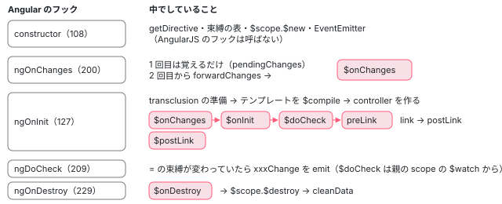

[目次](../README.md) › [@angular/upgrade の内側：AngularJS と 1 つのページを分け合う](README.md) › 第 3 回 / 全 6 回

# UpgradeComponent：Angular の中で AngularJS のディレクティブを動かす

> UpgradeComponent を継承したディレクティブが、UpgradeHelper で AngularJS のディレクティブの定義（name + 'Directive'）とテンプレート（template か $templateCache）を取り、ngOnInit の中で controller を作り $onChanges・$onInit・$doCheck・link・$postLink をこの順に呼ぶこと、$doCheck は $digest から・$onDestroy は ngOnDestroy から呼ばれること、= &lt; @ & の束縛の表と ngDoCheck での = の戻り、require と多スロットの transclusion の扱い。

angular/angular · 読了 約 14 分 · 発展 · [サイトで読む（デモが動きます）](https://angular-deep-dive-cyan.vercel.app/chapter/upg-upgrade-component)

---

`UpgradeComponent` は、AngularJS のコンポーネント（やディレクティブ）を Angular のテンプレートの中で使うための基底クラスです。利用者は `@Directive` を付けたクラスで継承し、`super('ng1Card', elementRef, injector)` と名前を渡します。この章では、**Angular の 5 つのフック（constructor・ngOnChanges・ngOnInit・ngDoCheck・ngOnDestroy）が、`UpgradeHelper` のどの関数を呼び、AngularJS のどのフックをどの順で呼ぶか**を 1 行ずつ追います。ディレクティブの定義の取り方、テンプレートの取り方、`= < @ &` の束縛、`require`、多スロットの transclusion も読みます。

読む対象は `packages/upgrade/static/src/upgrade_component.ts` と `src/common/src/upgrade_helper.ts`、spec は `static/test/integration/upgrade_component_spec.ts` です。`UpgradeComponent` の置き場所は、[第 2 回](02-upg-downgrade-component.md)の downgrade した Angular のコンポーネントの中です（AngularJS の scope をそこから受け取るため）。

1. [1. 全体と起動](01-upg-bootstrap.md)
2. [2. downgradeComponent](02-upg-downgrade-component.md)
3. **3. UpgradeComponent**（この章）
4. [4. 注入器と変更検知](04-upg-injection-cd.md)
5. [5. downgradeModule](05-upg-downgrade-module.md)
6. [6. spec と issue](06-upg-tests-issues.md)



*Angular のフックと、その中で呼ばれる AngularJS の処理。色の付いた箱が AngularJS のフック*

## 1. 持っている状態

📄 `angular/packages/upgrade/static/src/upgrade_component.ts` L23–35 （▶ の行: 23–24, 29–30, 32, 34）

```ts
23 ▶ const NOT_SUPPORTED: any = 'NOT_SUPPORTED';
24 ▶ const INITIAL_VALUE = {
25 │   __UNINITIALIZED__: true,
26 │ };
27 │ 
28 │ class Bindings {
29 ▶   twoWayBoundProperties: string[] = [];
30 ▶   twoWayBoundLastValues: any[] = [];
31 │ 
32 ▶   expressionBoundProperties: string[] = [];
33 │ 
34 ▶   propertyToOutputMap: {[propName: string]: string} = {};
35 │ }
```

`Bindings` は、AngularJS の束縛の定義を 3 つの表にしたものです。29〜30 行目は `=`（双方向）の名前と前回の値、32 行目は `&`（式）の名前、34 行目は「名前 → Angular の output の名前」の表です。`@` と `<` はここに入りません（4 節）。23 行目の `NOT_SUPPORTED` は、link の関数に渡せない引数の代わりに入れる文字列です（3 節）。

📄 `angular/packages/upgrade/static/src/upgrade_component.ts` L78–95 （▶ の行: 79, 82, 84, 87–88, 93, 95）

```ts
78 │ export class UpgradeComponent implements OnInit, OnChanges, DoCheck, OnDestroy {
79 ▶   private helper: ɵupgradeHelper.UpgradeHelper;
80 │ 
81 │   private $element: ɵangular1.IAugmentedJQuery;
82 ▶   private $componentScope: ɵangular1.IScope;
83 │ 
84 ▶   private directive: ɵangular1.IDirective;
85 │   private bindings: Bindings;
86 │ 
87 ▶   private controllerInstance?: ɵupgradeHelper.IControllerInstance;
88 ▶   private bindingDestination?: ɵupgradeHelper.IBindingDestination;
89 │ 
90 │   // We will be instantiating the controller in the `ngOnInit` hook, when the
91 │   // first `ngOnChanges` will have been already triggered. We store the
92 │   // `SimpleChanges` and "play them back" later.
93 ▶   private pendingChanges: SimpleChanges | null = null;
94 │ 
95 ▶   private unregisterDoCheckWatcher?: Function;
```

87〜88 行目の `controllerInstance` と `bindingDestination`（束縛の値を書く先。controller か scope）は、constructor では作らず、`ngOnInit` で作ります。90〜92 行目のコメントのとおり、それより前に来る最初の `ngOnChanges` は 93 行目の `pendingChanges` に取っておき、`ngOnInit` で「再生」します。

## 2. constructor：定義を取り、scope を作り、output を用意する

📄 `angular/packages/upgrade/static/src/upgrade_component.ts` L108–124 （▶ の行: 108–109, 113–114, 118, 121, 123）

```ts
108 ▶   constructor(name: string, elementRef: ElementRef, injector: Injector) {
109 ▶     this.helper = new ɵupgradeHelper.UpgradeHelper(injector, name, elementRef);
110 │ 
111 │     this.$element = this.helper.$element;
112 │ 
113 ▶     this.directive = this.helper.directive;
114 ▶     this.bindings = this.initializeBindings(this.directive, name);
115 │ 
116 │     // We ask for the AngularJS scope from the Angular injector, since
117 │     // we will put the new component scope onto the new injector for each component
118 ▶     const $parentScope = injector.get(ɵconstants.$SCOPE);
119 │     // QUESTION 1: Should we create an isolated scope if the scope is only true?
120 │     // QUESTION 2: Should we make the scope accessible through `$element.scope()/isolateScope()`?
121 ▶     this.$componentScope = $parentScope.$new(!!this.directive.scope);
122 │ 
123 ▶     this.initializeOutputs();
124 │   }
```

1. **UpgradeHelper を作る**

   109 行目。名前・`ElementRef`・`Injector` を渡します。`UpgradeHelper` の constructor が、AngularJS のディレクティブの定義を取ってきます（下の引用）。
2. **束縛の表を作る**

   114 行目の `initializeBindings`（4 節）。
3. **親の scope を Angular の注入器から引き、子の scope を作る**

   118 行目の `injector.get('$scope')` は、[第 2 回](02-upg-downgrade-component.md)の 5 節で `DowngradeComponentAdapter` が子の注入器に置いた `componentScope` を見つけます。downgrade したコンポーネントの外（AngularJS の scope が無い Angular の木）に置くと、ここで見つからずに投げます。121 行目、定義に `scope` があれば（`component()` で登録したものは必ずある）isolate scope を、無ければふつうの子の scope を作ります。
4. **= と & の output を作る**

   123 行目の `initializeOutputs`（5 節）。constructor の中で作るので、Angular がテンプレートの `(valueChange)` を購読する時点で `EventEmitter` がもうあります。DEMO の 1 段目の「super から戻った」の行です。

📄 `angular/packages/upgrade/src/common/src/upgrade_helper.ts` L58–89 （▶ の行: 64–66, 69, 71, 75–76, 84–86）

```ts
58 │   constructor(
59 │     injector: Injector,
60 │     private name: string,
61 │     elementRef: ElementRef,
62 │     directive?: IDirective,
63 │   ) {
64 ▶     this.$injector = injector.get($INJECTOR);
65 ▶     this.$compile = this.$injector.get($COMPILE);
66 ▶     this.$controller = this.$injector.get($CONTROLLER);
67 │ 
68 │     this.element = elementRef.nativeElement;
69 ▶     this.$element = angularElement(this.element);
70 │ 
71 ▶     this.directive = directive ?? UpgradeHelper.getDirective(this.$injector, name);
72 │   }
73 │ 
74 │   static getDirective($injector: IInjectorService, name: string): IDirective {
75 ▶     const directives: IDirective[] = $injector.get(name + 'Directive');
76 ▶     if (directives.length > 1) {
77 │       throw new Error(`Only support single directive definition for: ${name}`);
78 │     }
79 │ 
80 │     const directive = directives[0];
81 │ 
82 │     // AngularJS will transform `link: xyz` to `compile: () => xyz`. So we can only tell there was a
83 │     // user-defined `compile` if there is no `link`. In other cases, we will just ignore `compile`.
84 ▶     if (directive.compile && !directive.link) notSupported(name, 'compile');
85 ▶     if (directive.replace) notSupported(name, 'replace');
86 ▶     if (directive.terminal) notSupported(name, 'terminal');
87 │ 
88 │     return directive;
89 │   }
```

64 行目で Angular の注入器から `'$injector'` を引きます。これは[第 1 回](01-upg-bootstrap.md)の 6 節の provider で、AngularJS の `$injector` そのものです。65〜66 行目で `$compile` と `$controller` を、69 行目で要素の jqLite の包みを作ります。

定義は 75 行目の `$injector.get(name + 'Directive')` で取ります。AngularJS はディレクティブを `ng1CardDirective` という名前のサービスとして登録していて、引くと同じ名前で登録された定義の配列が返ります。76〜78 行目、2 つ以上なら対応しません。84〜86 行目で `compile`（`link` が無いとき）・`replace`・`terminal` を持つ定義を拒みます（DEMO の下の表）。

## 3. ngOnInit：テンプレート・controller・AngularJS のフック

📄 `angular/packages/upgrade/static/src/upgrade_component.ts` L126–162 （▶ の行: 129–130, 133, 135–136, 140–143, 145, 153, 156, 159–160）

```ts
126 │   /** @docs-private */
127 │   ngOnInit() {
128 │     // Collect contents, insert and compile template
129 ▶     const attachChildNodes: ɵangular1.ILinkFn | undefined = this.helper.prepareTransclusion();
130 ▶     const linkFn = this.helper.compileTemplate();
131 │ 
132 │     // Instantiate controller
133 ▶     const controllerType = this.directive.controller;
134 │     const bindToController = this.directive.bindToController;
135 ▶     let controllerInstance = controllerType
136 ▶       ? this.helper.buildController(controllerType, this.$componentScope)
137 │       : undefined;
138 │     let bindingDestination: ɵupgradeHelper.IBindingDestination;
139 │ 
140 ▶     if (!bindToController) {
141 ▶       bindingDestination = this.$componentScope;
142 ▶     } else if (controllerType && controllerInstance) {
143 ▶       bindingDestination = controllerInstance;
144 │     } else {
145 ▶       throw new Error(
146 │         `Upgraded directive '${this.directive.name}' specifies 'bindToController' but no controller.`,
147 │       );
148 │     }
149 │     this.controllerInstance = controllerInstance;
150 │     this.bindingDestination = bindingDestination;
151 │ 
152 │     // Set up outputs
153 ▶     this.bindOutputs(bindingDestination);
154 │ 
155 │     // Require other controllers
156 ▶     const requiredControllers = this.helper.resolveAndBindRequiredControllers(controllerInstance);
157 │ 
158 │     // Hook: $onChanges
159 ▶     if (this.pendingChanges) {
160 ▶       this.forwardChanges(this.pendingChanges, bindingDestination);
161 │       this.pendingChanges = null;
162 │     }
```

1. **子のノードを取り出す（transclusion の準備）**

   129 行目の `prepareTransclusion`（7 節）が、Angular が要素の中に投影したノードを全部外して取っておきます。
2. **テンプレートを入れてコンパイルする**

   130 行目の `compileTemplate`（6 節）が要素の `innerHTML` に AngularJS のテンプレートを入れ、`$compile` して link の関数を返します。まだ link はしません。
3. **controller を作る**

   133〜137 行目。`buildController`（6 節）が AngularJS の `$controller` で作ります。**束縛の値はまだ入っていません**（DEMO の「ng1Card の controller」の行の `title=undefined`）。AngularJS 1.6 以降の素の動きでも controller の constructor の中では束縛は使えず、`$onInit` から使えます。
4. **束縛の書き先を決める**

   140〜148 行目。`bindToController` が無ければ scope、あれば controller。`bindToController` なのに controller が無ければ 145 行目で投げます。
5. **& の関数を置く、require を解決する**

   153 行目の `bindOutputs`（5 節）、156 行目の `resolveAndBindRequiredControllers`（8 節）。
6. **取っておいた最初の変化を再生する**

   159〜162 行目。1 節の `pendingChanges` があれば `forwardChanges`（5 節）で書き先に値を書き、`$onChanges` を呼びます。**AngularJS のフックの 1 つ目は `$onChanges`** です。

📄 `angular/packages/upgrade/static/src/upgrade_component.ts` L164–197 （▶ の行: 165–166, 170–171, 173–174, 179–182, 184, 187, 190, 194–195）

```ts
164 │     // Hook: $onInit
165 ▶     if (this.controllerInstance && ɵutil.isFunction(this.controllerInstance.$onInit)) {
166 ▶       this.controllerInstance.$onInit();
167 │     }
168 │ 
169 │     // Hook: $doCheck
170 ▶     if (controllerInstance && ɵutil.isFunction(controllerInstance.$doCheck)) {
171 ▶       const callDoCheck = () => controllerInstance?.$doCheck?.();
172 │ 
173 ▶       this.unregisterDoCheckWatcher = this.$componentScope.$parent.$watch(callDoCheck);
174 ▶       callDoCheck();
175 │     }
176 │ 
177 │     // Linking
178 │     const link = this.directive.link;
179 ▶     const preLink = typeof link == 'object' && link.pre;
180 ▶     const postLink = typeof link == 'object' ? link.post : link;
181 ▶     const attrs: ɵangular1.IAttributes = NOT_SUPPORTED;
182 ▶     const transcludeFn: ɵangular1.ITranscludeFunction = NOT_SUPPORTED;
183 │     if (preLink) {
184 ▶       preLink(this.$componentScope, this.$element, attrs, requiredControllers, transcludeFn);
185 │     }
186 │ 
187 ▶     linkFn(this.$componentScope, null!, {parentBoundTranscludeFn: attachChildNodes});
188 │ 
189 │     if (postLink) {
190 ▶       postLink(this.$componentScope, this.$element, attrs, requiredControllers, transcludeFn);
191 │     }
192 │ 
193 │     // Hook: $postLink
194 ▶     if (this.controllerInstance && ɵutil.isFunction(this.controllerInstance.$postLink)) {
195 ▶       this.controllerInstance.$postLink();
196 │     }
197 │   }
```

1. **$onInit**

   165〜166 行目。
2. **$doCheck を親の scope の watcher にする**

   170〜174 行目。173 行目で `$componentScope.$parent.$watch(callDoCheck)`（引数 1 つの、毎回呼ばれる watcher）に登録し、174 行目で 1 回呼びます。AngularJS の `$doCheck` は Angular の `ngDoCheck` からではなく、**AngularJS の `$digest` から**呼ばれます。DEMO で `$doCheck` が `$digest` のループの回数だけ並ぶのはこのためです。
3. **pre-link → link → post-link**

   178〜180 行目で `link` がオブジェクトなら `pre` と `post`、関数なら post として扱います。184 行目の pre-link と 190 行目の post-link には、`attrs` と `transcludeFn` の代わりに 181〜182 行目の `'NOT_SUPPORTED'` を渡します。187 行目で 130 行目の link の関数を呼び、テンプレートを `$componentScope` に link します。3 つ目の引数の `parentBoundTranscludeFn` が、7 節の transclusion の関数です。
4. **$postLink**

   194〜195 行目。この時点でテンプレートの補間はまだ評価されていません（DEMO の `$postLink` の行の `h4` の中身が `{{` のまま）。補間は次の `$digest` です。

順番は `$onChanges` → `$onInit` → `$doCheck` → pre-link → link → post-link → `$postLink` です。spec の ``'should be called in order `$onChanges()` > `$onInit()` > `$doCheck()` > `$postLink()`'``（テストの節）がこの順を固めています。

## 4. 束縛の表：= と & だけを覚える

📄 `angular/packages/upgrade/static/src/upgrade_component.ts` L236–253 （▶ の行: 237–239, 244, 248–250）

```ts
236 │   private initializeBindings(directive: ɵangular1.IDirective, name: string) {
237 ▶     const btcIsObject = typeof directive.bindToController === 'object';
238 ▶     if (btcIsObject && Object.keys(directive.scope!).length) {
239 ▶       throw new Error(
240 │         `Binding definitions on scope and controller at the same time is not supported.`,
241 │       );
242 │     }
243 │ 
244 ▶     const context = btcIsObject ? directive.bindToController : directive.scope;
245 │     const bindings = new Bindings();
246 │ 
247 │     if (typeof context == 'object') {
248 ▶       Object.keys(context).forEach((propName) => {
249 ▶         const definition = context[propName];
250 ▶         const bindingType = definition.charAt(0);
251 │ 
252 │         // QUESTION: What about `=*`? Ignore? Throw? Support?
253 │ 
```

237〜242 行目、`bindToController` をオブジェクトで書いたうえに `scope` にも束縛があると投げます。244 行目、束縛の定義は `bindToController`（オブジェクトなら）か `scope` から読みます。`component()` で登録した `bindings` は、AngularJS が `bindToController` に入れます。250 行目で定義の 1 文字目を見ます。

📄 `angular/packages/upgrade/static/src/upgrade_component.ts` L254–280 （▶ の行: 255–256, 260–264, 266–268, 270, 273）

```ts
254 │         switch (bindingType) {
255 ▶           case '@':
256 ▶           case '<':
257 │             // We don't need to do anything special. They will be defined as inputs on the
258 │             // upgraded component facade and the change propagation will be handled by
259 │             // `ngOnChanges()`.
260 ▶             break;
261 ▶           case '=':
262 ▶             bindings.twoWayBoundProperties.push(propName);
263 ▶             bindings.twoWayBoundLastValues.push(INITIAL_VALUE);
264 ▶             bindings.propertyToOutputMap[propName] = propName + 'Change';
265 │             break;
266 ▶           case '&':
267 ▶             bindings.expressionBoundProperties.push(propName);
268 ▶             bindings.propertyToOutputMap[propName] = propName;
269 │             break;
270 ▶           default:
271 │             let json = JSON.stringify(context);
272 │             throw new Error(
273 ▶               `Unexpected mapping '${bindingType}' in '${json}' in '${name}' directive.`,
274 │             );
275 │         }
276 │       });
277 │     }
278 │ 
279 │     return bindings;
280 │   }
```

| AngularJS の束縛 | この表に入るもの | Angular の側で利用者が書くもの | 値が流れる道 |
| --- | --- | --- | --- |
| `@`（文字列）・`<`（片方向） | 何も入らない（255〜260 行目） | `@Input() title` | Angular の `ngOnChanges` → `forwardChanges` |
| `=`（双方向） | 名前・前回の値（`INITIAL_VALUE`）・`valueChange`（261〜265 行目） | `@Input() value` と `@Output() valueChange` | 入りは `ngOnChanges`、戻りは `ngDoCheck` の比較（5 節） |
| `&`（式） | 名前と、同じ名前の output（266〜269 行目） | `@Output() onPick` | AngularJS が呼んだ関数が `emit`（5 節） |

252 行目のコメントのとおり、`=*`（コレクションの浅い監視）は考えられていません。`=*` は 1 文字目が `=` なので `=` と同じ扱いになります。`<?` や `=?` のような省略可能の印も、1 文字目しか見ないので素通りです。270〜274 行目、それ以外の 1 文字目なら投げます。

## 5. 値の行き来：forwardChanges・ngDoCheck・& の関数

📄 `angular/packages/upgrade/static/src/upgrade_component.ts` L282–315 （▶ の行: 284–285, 287–288, 294, 296, 298, 307–308, 311–312）

```ts
282 │   private initializeOutputs() {
283 │     // Initialize the outputs for `=` and `&` bindings
284 ▶     this.bindings.twoWayBoundProperties
285 ▶       .concat(this.bindings.expressionBoundProperties)
286 │       .forEach((propName) => {
287 ▶         const outputName = this.bindings.propertyToOutputMap[propName];
288 ▶         (this as any)[outputName] = new EventEmitter();
289 │       });
290 │   }
291 │ 
292 │   private bindOutputs(bindingDestination: ɵupgradeHelper.IBindingDestination) {
293 │     // Bind `&` bindings to the corresponding outputs
294 ▶     this.bindings.expressionBoundProperties.forEach((propName) => {
295 │       const outputName = this.bindings.propertyToOutputMap[propName];
296 ▶       const emitter: EventEmitter<any> = (this as any)[outputName];
297 │ 
298 ▶       bindingDestination[propName] = (value: any) => emitter.emit(value);
299 │     });
300 │   }
301 │ 
302 │   private forwardChanges(
303 │     changes: SimpleChanges,
304 │     bindingDestination: ɵupgradeHelper.IBindingDestination,
305 │   ) {
306 │     // Forward input changes to `bindingDestination`
307 ▶     Object.keys(changes).forEach(
308 ▶       (propName) => (bindingDestination[propName] = changes[propName].currentValue),
309 │     );
310 │ 
311 ▶     if (ɵutil.isFunction(bindingDestination.$onChanges)) {
312 ▶       bindingDestination.$onChanges(changes);
313 │     }
314 │   }
315 │ }
```

- 284〜289 行目（constructor から）：`=` と `&` の名前ごとに、`this[outputName]` に `new EventEmitter()` を置きます。利用者の `@Output()` のフィールドがこれで埋まります。
- 294〜299 行目（ngOnInit から）：`&` の名前ごとに、書き先に「呼ばれたら `emit` する関数」を置きます。AngularJS のテンプレートで `$ctrl.onPick({x: 1})` と呼ぶと、`$event` は渡したオブジェクト `{x: 1}` そのものです（DEMO の 4 段目）。AngularJS の素の `&` の「locals を式に渡す」動きとは違います。
- 307〜313 行目（ngOnChanges と ngOnInit から）：変わった input を書き先に書き（308 行目）、書き先に `$onChanges` があれば同じ `SimpleChanges` を渡します（311〜312 行目）。

📄 `angular/packages/upgrade/static/src/upgrade_component.ts` L199–234 （▶ の行: 201–202, 204, 214–216, 218, 220, 222–223, 230–231, 233）

```ts
199 │   /** @docs-private */
200 │   ngOnChanges(changes: SimpleChanges) {
201 ▶     if (!this.bindingDestination) {
202 ▶       this.pendingChanges = changes;
203 │     } else {
204 ▶       this.forwardChanges(changes, this.bindingDestination);
205 │     }
206 │   }
207 │ 
208 │   /** @docs-private */
209 │   ngDoCheck() {
210 │     const twoWayBoundProperties = this.bindings.twoWayBoundProperties;
211 │     const twoWayBoundLastValues = this.bindings.twoWayBoundLastValues;
212 │     const propertyToOutputMap = this.bindings.propertyToOutputMap;
213 │ 
214 ▶     twoWayBoundProperties.forEach((propName, idx) => {
215 ▶       const newValue = this.bindingDestination?.[propName];
216 ▶       const oldValue = twoWayBoundLastValues[idx];
217 │ 
218 ▶       if (!Object.is(newValue, oldValue)) {
219 │         const outputName = propertyToOutputMap[propName];
220 ▶         const eventEmitter: EventEmitter<any> = (this as any)[outputName];
221 │ 
222 ▶         eventEmitter.emit(newValue);
223 ▶         twoWayBoundLastValues[idx] = newValue;
224 │       }
225 │     });
226 │   }
227 │ 
228 │   /** @docs-private */
229 │   ngOnDestroy() {
230 ▶     if (ɵutil.isFunction(this.unregisterDoCheckWatcher)) {
231 ▶       this.unregisterDoCheckWatcher();
232 │     }
233 ▶     this.helper.onDestroy(this.$componentScope, this.controllerInstance);
234 │   }
```

`ngOnChanges` は 201〜202 行目で、まだ書き先が無ければ（`ngOnInit` の前なら）覚えるだけです。`ngDoCheck` は Angular の変更検知のたびに、`=` の束縛ごとに書き先の今の値（215 行目）と前回の値（216 行目）を 218 行目の `Object.is` で比べ、違えば 222 行目で `valueChange` を emit して 223 行目で覚え直します。前回の値の初期値は `INITIAL_VALUE` なので、**最初の `ngDoCheck` は必ず emit します**。DEMO の 1 段目で、AngularJS の側は何も変えていないのに `(valueChange)` に `'v1'` が届いているのはこのためです。

`ngOnDestroy` は 230〜231 行目で `$doCheck` の watcher を外し、233 行目で `UpgradeHelper.onDestroy`（6 節）を呼びます。

## 6. テンプレートと controller：UpgradeHelper

📄 `angular/packages/upgrade/src/common/src/upgrade_helper.ts` L91–123 （▶ の行: 97–102, 104–107, 110, 121）

```ts
 91 │   static getTemplate(
 92 │     $injector: IInjectorService,
 93 │     directive: IDirective,
 94 │     fetchRemoteTemplate = false,
 95 │     $element?: IAugmentedJQuery,
 96 │   ): string | TrustedHTML | Promise<string | TrustedHTML> {
 97 ▶     if (directive.template !== undefined) {
 98 ▶       return trustedHTMLFromLegacyTemplate(getOrCall<string>(directive.template, $element));
 99 ▶     } else if (directive.templateUrl) {
100 ▶       const $templateCache = $injector.get($TEMPLATE_CACHE) as ITemplateCacheService;
101 ▶       const url = getOrCall<string>(directive.templateUrl, $element);
102 ▶       const template = $templateCache.get(url);
103 │ 
104 ▶       if (template !== undefined) {
105 ▶         return trustedHTMLFromLegacyTemplate(template);
106 ▶       } else if (!fetchRemoteTemplate) {
107 ▶         throw new Error('loading directive templates asynchronously is not supported');
108 │       }
109 │ 
110 ▶       return new Promise((resolve, reject) => {
111 │         const $httpBackend = $injector.get($HTTP_BACKEND) as IHttpBackendService;
112 │         $httpBackend('GET', url, null, (status: number, response: string) => {
113 │           if (status === 200) {
114 │             resolve(trustedHTMLFromLegacyTemplate($templateCache.put(url, response)));
115 │           } else {
116 │             reject(`GET component template from '${url}' returned '${status}: ${response}'`);
117 │           }
118 │         });
119 │       });
120 │     } else {
121 ▶       throw new Error(`Directive '${directive.name}' is not a component, it is missing template.`);
122 │     }
123 │   }
```

1. **template があればそれ**

   97〜98 行目。関数なら `$element` だけを渡して呼びます（`$attrs` は渡さない。spec の ``'should pass $element to `template` function and not $attrs'``）。
2. **templateUrl なら $templateCache から**

   99〜105 行目。URL（関数なら同じく呼ぶ）で `$templateCache.get` し、あれば使います。
3. **キャッシュに無ければ投げる**

   106〜107 行目。`fetchRemoteTemplate` が `false` なら `'loading directive templates asynchronously is not supported'` です。`UpgradeComponent` からの呼び出しはいつも `false` です（`compileTemplate` の 138 行目）。つまり `templateUrl` のテンプレートは、**AngularJS の起動の後、Angular の側で `ngOnInit` が走る前に `$templateCache` に入っている**必要があります（ビルドでテンプレートを `$templateCache.put` に変える、など）。

> [!TIP]
> **新卒エンジニアへ**
>
> DEMO の記録では、`ng1Card` の `templateUrl: 'card.html'` の中身を AngularJS の `run` で `$templateCache.put` しておきました。`run` は[第 1 回](01-upg-bootstrap.md)の 5.3 節の `angular.bootstrap` の中で走るので、その後に作られる `ng1Card` の `ngOnInit` には間に合います。

110〜119 行目の「`$httpBackend` で取りに行く」枝に `true` で入っていたのは、消えた `UpgradeAdapter` の側でした。今のパッケージの中に `true` で呼ぶ所はありません。

📄 `getTemplate を呼ぶ所（../angular で grep と git show）`

```
$ git show f86846555bb | grep -n "getTemplate\|compileTemplate"
1258:-        UpgradeHelper.getTemplate($injector, exportedComponent.directive, true),
1321:-    const linkFn = this.helper.compileTemplate(trustedHTMLFromLegacyTemplate(this.template));
$ grep -rn "getTemplate\|compileTemplate(" packages/upgrade | grep -v /test/
upgrade/static/src/upgrade_component.ts:130:    const linkFn = this.helper.compileTemplate();
upgrade/src/common/src/upgrade_helper.ts:91:  static getTemplate(
upgrade/src/common/src/upgrade_helper.ts:136:  compileTemplate(template?: string | TrustedHTML): ILinkFn {
upgrade/src/common/src/upgrade_helper.ts:138:      template = UpgradeHelper.getTemplate(this.$injector, this.directive, false, this.$element) as
```

spec の ``'should support `templateUrl` (string) fetched from the server'``（350 行目）と関数版（405 行目）は `xit`（止めてある it）で、この枝は今は spec でも走りません（第 1 回のテストの節の 12 の skipped に入っています）。

📄 `angular/packages/upgrade/src/common/src/upgrade_helper.ts` L125–152 （▶ の行: 126, 128–129, 131, 137–138, 143, 147–148, 150–151）

```ts
125 │   buildController(controllerType: IController, $scope: IScope) {
126 ▶     // TODO: Document that we do not pre-assign bindings on the controller instance.
127 │     // Quoted properties below so that this code can be optimized with Closure Compiler.
128 ▶     const locals = {'$scope': $scope, '$element': this.$element};
129 ▶     const controller = this.$controller(controllerType, locals, null, this.directive.controllerAs);
130 │ 
131 ▶     this.$element.data?.(controllerKey(this.directive.name!), controller);
132 │ 
133 │     return controller;
134 │   }
135 │ 
136 │   compileTemplate(template?: string | TrustedHTML): ILinkFn {
137 ▶     if (template === undefined) {
138 ▶       template = UpgradeHelper.getTemplate(this.$injector, this.directive, false, this.$element) as
139 │         | string
140 │         | TrustedHTML;
141 │     }
142 │ 
143 ▶     return this.compileHtml(template);
144 │   }
145 │ 
146 │   onDestroy($scope: IScope, controllerInstance?: any) {
147 ▶     if (controllerInstance && isFunction(controllerInstance.$onDestroy)) {
148 ▶       controllerInstance.$onDestroy();
149 │     }
150 ▶     $scope.$destroy();
151 ▶     cleanData(this.element);
152 │   }
```

128〜129 行目、`$scope` と `$element` だけを locals にして `$controller` を呼びます。126 行目の TODO のとおり、束縛を前もって controller に入れません。131 行目で要素の `data('$ng1CardController')` に置き、子の `require` から見えるようにします。143 行目の `compileHtml` は下の 8 節の引用です。`getTemplate` が返す値は、`trustedHTMLFromLegacyTemplate` で Trusted Types の印を付けたものです（Trusted Types の扱いは[第 4 回](04-upg-injection-cd.md)、印そのものは [domr-trusted-types](../domr/18-domr-trusted-types.md)）。147〜151 行目の `onDestroy` は、`$onDestroy` → `$scope.$destroy()` → `cleanData` の順です。

## 7. transclusion：Angular が投影したノードを AngularJS のスロットへ

📄 `angular/packages/upgrade/src/common/src/upgrade_helper.ts` L154–186 （▶ の行: 155–157, 162–163, 165, 167, 170–171, 177, 179, 182–184）

```ts
154 │   prepareTransclusion(): ILinkFn | undefined {
155 ▶     const transclude = this.directive.transclude;
156 ▶     const contentChildNodes = this.extractChildNodes();
157 ▶     const attachChildrenFn: ILinkFn = (scope, cloneAttachFn) => {
158 │       // Since AngularJS v1.5.8, `cloneAttachFn` will try to destroy the transclusion scope if
159 │       // `$template` is empty. Since the transcluded content comes from Angular, not AngularJS,
160 │       // there will be no transclusion scope here.
161 │       // Provide a dummy `scope.$destroy()` method to prevent `cloneAttachFn` from throwing.
162 ▶       scope = scope || {$destroy: () => undefined};
163 ▶       return cloneAttachFn!($template, scope);
164 │     };
165 ▶     let $template = contentChildNodes;
166 │ 
167 ▶     if (transclude) {
168 │       const slots = Object.create(null);
169 │ 
170 ▶       if (typeof transclude === 'object') {
171 ▶         $template = [];
172 │ 
173 │         const slotMap = Object.create(null);
174 │         const filledSlots = Object.create(null);
175 │ 
176 │         // Parse the element selectors.
177 ▶         Object.keys(transclude).forEach((slotName) => {
178 │           let selector = transclude[slotName];
179 ▶           const optional = selector.charAt(0) === '?';
180 │           selector = optional ? selector.substring(1) : selector;
181 │ 
182 ▶           slotMap[selector] = slotName;
183 ▶           slots[slotName] = null; // `null`: Defined but not yet filled.
184 ▶           filledSlots[slotName] = optional; // Consider optional slots as filled.
185 │         });
186 │ 
```

1. **子を全部外す**

   156 行目の `extractChildNodes`（8 節の引用の 258〜268 行目）が、要素の子を 1 つずつ `remove()` して配列にします。中身は、Angular が `<ng1-card>…</ng1-card>` の間に書かれたものとして作ったノードです。
2. **AngularJS に渡す transclude の関数を作る**

   157〜164 行目。AngularJS の `ng-transclude` が呼ぶと、取っておいたノード（`$template`）をそのまま `cloneAttachFn` に渡します。**クローンを作らず、Angular のノードをそのまま動かします**。162 行目は AngularJS 1.5.8 以降の `scope.$destroy` の呼び出しに備えた空の scope です。
3. **多スロットなら、スロットの表を作る**

   170 行目、`transclude` がオブジェクトのとき。177〜185 行目で `{head: '?cardHead'}` のような定義を読み、179 行目で先頭の `?`（省略可）を見て、182 行目で「要素名 → スロット名」の表にします。184 行目、省略可のスロットは最初から「埋まった」扱いです。

📄 `angular/packages/upgrade/src/common/src/upgrade_helper.ts` L187–214 （▶ の行: 188–190, 193, 195, 200–202, 210–211）

```ts
187 │         // Add the matching elements into their slot.
188 ▶         contentChildNodes.forEach((node) => {
189 ▶           const slotName = slotMap[directiveNormalize(node.nodeName.toLowerCase())];
190 ▶           if (slotName) {
191 │             filledSlots[slotName] = true;
192 │             slots[slotName] = slots[slotName] || [];
193 ▶             slots[slotName].push(node);
194 │           } else {
195 ▶             $template.push(node);
196 │           }
197 │         });
198 │ 
199 │         // Check for required slots that were not filled.
200 ▶         Object.keys(filledSlots).forEach((slotName) => {
201 ▶           if (!filledSlots[slotName]) {
202 ▶             throw new Error(`Required transclusion slot '${slotName}' on directive: ${this.name}`);
203 │           }
204 │         });
205 │ 
206 │         Object.keys(slots)
207 │           .filter((slotName) => slots[slotName])
208 │           .forEach((slotName) => {
209 │             const nodes = slots[slotName];
210 ▶             slots[slotName] = (scope: IScope, cloneAttach: ICloneAttachFunction) => {
211 ▶               return cloneAttach!(nodes, scope);
212 │             };
213 │           });
214 │       }
```

188〜197 行目で子を 1 つずつ見て、189 行目で要素名を `directiveNormalize`（下の引用）で `cardHead` の形にして表を引きます。当たればそのスロットへ、当たらなければ 195 行目で既定のスロット（`$template`）へ入れます。スロットの照合は**要素名だけ**で、class や属性のセレクタは使えません。200〜204 行目、埋まっていない必須のスロットがあれば投げます。210〜211 行目で、各スロットも「ノードをそのまま渡す」関数にします。

📄 `angular/packages/upgrade/src/common/src/util.ts` L74–83 （▶ の行: 76–77）

```ts
74 │ export function directiveNormalize(name: string): string {
75 │   return name
76 ▶     .replace(DIRECTIVE_PREFIX_REGEXP, '')
77 ▶     .replace(DIRECTIVE_SPECIAL_CHARS_REGEXP, (_, letter) => letter.toUpperCase());
78 │ }
79 │ 
80 │ export function getTypeName(type: Type<any>): string {
81 │   // Return the name of the type or the first line of its stringified version.
82 │   return (type as any).overriddenName || type.name || type.toString().split('\n')[0];
83 │ }
```

76 行目で `x-`・`data-` の接頭辞を落とし、77 行目で `-`・`:`・`_` の次の文字を大文字にします。`card-head` → `cardHead` です。

📄 `angular/packages/upgrade/src/common/src/upgrade_helper.ts` L215–237 （▶ の行: 217, 229–231, 236）

```ts
215 │ 
216 │       // Attach `$$slots` to default slot transclude fn.
217 ▶       attachChildrenFn.$$slots = slots;
218 │ 
219 │       // AngularJS v1.6+ ignores empty or whitespace-only transcluded text nodes. But Angular
220 │       // removes all text content after the first interpolation and updates it later, after
221 │       // evaluating the expressions. This would result in AngularJS failing to recognize text
222 │       // nodes that start with an interpolation as transcluded content and use the fallback
223 │       // content instead.
224 │       // To avoid this issue, we add a
225 │       // [zero-width non-joiner character](https://en.wikipedia.org/wiki/Zero-width_non-joiner)
226 │       // to empty text nodes (which can only be a result of Angular removing their initial content).
227 │       // NOTE: Transcluded text content that starts with whitespace followed by an interpolation
228 │       //       will still fail to be detected by AngularJS v1.6+
229 ▶       $template.forEach((node) => {
230 ▶         if (node.nodeType === Node.TEXT_NODE && !node.nodeValue) {
231 ▶           node.nodeValue = '\u200C';
232 │         }
233 │       });
234 │     }
235 │ 
236 ▶     return attachChildrenFn;
237 │   }
```

217 行目で、スロットの表を AngularJS の内部の名前 `$$slots` で関数に付けます。`ng-transclude="head"` はこれを見ます。229〜233 行目は、Angular が補間で始まるテキストノードを最初は空で作ることへの手当てです。AngularJS 1.6 以降は空のテキストノードだけの transclusion を「中身なし」とみなして予備の中身を出すので、空のテキストにゼロ幅の文字 `‌` を入れます（219〜228 行目のコメント）。

逆向き（AngularJS の子を Angular の `ng-content` に入れる）は[第 2 回](02-upg-downgrade-component.md)の 8 節で、閉じた PR #70494（投影する AngularJS のノードの link を遅らせる）もそちらで読みました。PR は `downgrade_component_adapter.ts` だけを変えるもので、この章の `UpgradeComponent` と `UpgradeHelper` には触れていません。

## 8. require：controller を探す

📄 `angular/packages/upgrade/src/common/src/upgrade_helper.ts` L270–285 （▶ の行: 271, 273, 275–276, 278–279）

```ts
270 │   private getDirectiveRequire(): DirectiveRequireProperty {
271 ▶     const require = this.directive.require || (this.directive.controller && this.directive.name)!;
272 │ 
273 ▶     if (isMap(require)) {
274 │       Object.entries(require).forEach(([key, value]) => {
275 ▶         const match = value.match(REQUIRE_PREFIX_RE)!;
276 ▶         const name = value.substring(match[0].length);
277 │ 
278 ▶         if (!name) {
279 ▶           require[key] = match[0] + key;
280 │         }
281 │       });
282 │     }
283 │ 
284 │     return require;
285 │   }
```

271 行目、`require` が無くても controller があれば、自分の名前（自分の controller）を require します。273〜281 行目、`{box: '?^^'}` のように名前を省いた書き方なら、キーの名前を補います（spec の `'should use the key as name if the required controller name is omitted'`）。

📄 `angular/packages/upgrade/src/common/src/upgrade_helper.ts` L32–47 （▶ の行: 33）

```ts
32 │ // Constants
33 ▶ const REQUIRE_PREFIX_RE = /^(\^\^?)?(\?)?(\^\^?)?/;
34 │ 
35 │ // Interfaces
36 │ export interface IBindingDestination {
37 │   [key: string]: any;
38 │   $onChanges?: (changes: SimpleChanges) => void;
39 │ }
40 │ 
41 │ export interface IControllerInstance extends IBindingDestination {
42 │   $doCheck?: () => void;
43 │   $onDestroy?: () => void;
44 │   $onInit?: () => void;
45 │   $postLink?: () => void;
46 │ }
47 │ 
```

📄 `angular/packages/upgrade/src/common/src/upgrade_helper.ts` L287–323 （▶ の行: 292–294, 296, 299–300, 303–305, 308–309, 311–312）

```ts
287 │   private resolveRequire(
288 │     require: DirectiveRequireProperty,
289 │   ): SingleOrListOrMap<IControllerInstance> | null {
290 │     if (!require) {
291 │       return null;
292 ▶     } else if (Array.isArray(require)) {
293 ▶       return require.map((req) => this.resolveRequire(req));
294 ▶     } else if (typeof require === 'object') {
295 │       const value: {[key: string]: IControllerInstance} = {};
296 ▶       Object.keys(require).forEach((key) => (value[key] = this.resolveRequire(require[key])!));
297 │       return value;
298 │     } else if (typeof require === 'string') {
299 ▶       const match = require.match(REQUIRE_PREFIX_RE)!;
300 ▶       const inheritType = match[1] || match[3];
301 │ 
302 │       const name = require.substring(match[0].length);
303 ▶       const isOptional = !!match[2];
304 ▶       const searchParents = !!inheritType;
305 ▶       const startOnParent = inheritType === '^^';
306 │ 
307 │       const ctrlKey = controllerKey(name);
308 ▶       const elem = startOnParent ? this.$element.parent!() : this.$element;
309 ▶       const value = searchParents ? elem.inheritedData!(ctrlKey) : elem.data!(ctrlKey);
310 │ 
311 ▶       if (!value && !isOptional) {
312 ▶         throw new Error(
313 │           `Unable to find required '${require}' in upgraded directive '${this.name}'.`,
314 │         );
315 │       }
316 │ 
317 │       return value;
318 │     } else {
319 │       throw new Error(
320 │         `Unrecognized 'require' syntax on upgraded directive '${this.name}': ${require}`,
321 │       );
322 │     }
323 │   }
```

配列（292〜293 行目）とオブジェクト（294〜297 行目）は中身ごとに自分を呼び、文字列は 299 行目で 33 行目の正規表現にかけます。`^` は先祖も、`^^` は親から、`?` は無くてもよい、です（300〜305 行目）。308〜309 行目、jqLite の `inheritedData`（先祖をたどる）か `data`（自分だけ）で `'$' + name + 'Controller'` を引きます。6 節の 131 行目と、AngularJS が自分で置いた controller がここで見つかります。無くて `?` も無ければ 311〜313 行目で投げます。

📄 `angular/packages/upgrade/src/common/src/upgrade_helper.ts` L239–268 （▶ の行: 240–241, 243, 246, 254–255, 262–263）

```ts
239 │   resolveAndBindRequiredControllers(controllerInstance: IControllerInstance | null) {
240 ▶     const directiveRequire = this.getDirectiveRequire();
241 ▶     const requiredControllers = this.resolveRequire(directiveRequire);
242 │ 
243 ▶     if (controllerInstance && this.directive.bindToController && isMap(directiveRequire)) {
244 │       const requiredControllersMap = requiredControllers as {[key: string]: IControllerInstance};
245 │       Object.keys(requiredControllersMap).forEach((key) => {
246 ▶         controllerInstance[key] = requiredControllersMap[key];
247 │       });
248 │     }
249 │ 
250 │     return requiredControllers;
251 │   }
252 │ 
253 │   private compileHtml(html: string | TrustedHTML): ILinkFn {
254 ▶     this.element.innerHTML = html;
255 ▶     return this.$compile(this.element.childNodes);
256 │   }
257 │ 
258 │   private extractChildNodes(): Node[] {
259 │     const childNodes: Node[] = [];
260 │     let childNode: Node | null;
261 │ 
262 ▶     while ((childNode = this.element.firstChild)) {
263 ▶       (childNode as Element | Comment | Text).remove();
264 │       childNodes.push(childNode);
265 │     }
266 │ 
267 │     return childNodes;
268 │   }
```

243〜247 行目、`bindToController` で `require` がオブジェクトなら、見つかった controller を自分の controller のフィールドに書きます。3 節の 156 行目は 165 行目の `$onInit` より前なので、`$onInit` の中で `this.box` が使えます（spec の ``'should assign to controller before calling `$onInit()`'``）。DEMO では `?^^ng1Box` の親が無いので、`$onInit` の行で `box=なし` です。254〜255 行目が 6 節の `compileHtml` で、`innerHTML` に入れてから `childNodes` を `$compile` します。262〜263 行目が 7 節の `extractChildNodes` です。

📄 `angular/packages/upgrade/src/common/src/upgrade_helper.ts` L326–337 （▶ の行: 327, 331–332, 336）

```ts
326 │ function getOrCall<T>(property: T | Function, ...args: any[]): T {
327 ▶   return isFunction(property) ? property(...args) : property;
328 │ }
329 │ 
330 │ // NOTE: Only works for `typeof T !== 'object'`.
331 ▶ function isMap<T>(value: SingleOrListOrMap<T>): value is {[key: string]: T} {
332 ▶   return value && !Array.isArray(value) && typeof value === 'object';
333 │ }
334 │ 
335 │ function notSupported(name: string, feature: string) {
336 ▶   throw new Error(`Upgraded directive '${name}' contains unsupported feature: '${feature}'.`);
337 │ }
```

327 行目の `getOrCall` が 6 節の「関数なら呼ぶ」、331〜332 行目の `isMap` が配列でないオブジェクトの判定、336 行目が 2 節の「対応しない」の文言です。

## 9. DEMO：Angular のフックと AngularJS のフックの順

> **🧪 DEMO — UpgradeComponent のフックの順（記録の再生）**
>
> `<scratchpad>/upg-demo/a/record-upgrade.mjs` の記録です（AngularJS 1.8.3・@angular/upgrade 22.1.6・@angular/core 22.1.6・jsdom 26.1.0）。AngularJS の `ng1Card` は `bindings: {title: '<', label: '@', value: '=', onPick: '&'}`・`templateUrl: 'card.html'`（run で `$templateCache` に入れた）・`transclude: {head: '?cardHead'}`・`require: {box: '?^^ng1Box'}` です。Angular の `ng2-host`（downgrade したもの）のテンプレートに `<ng1-card [title]="t" label="L-…" [value]="v" (valueChange)="…" (onPick)="…">` を置き、継承したクラスで 5 つのフックに記録を足しました。左に寄せた行が Angular、右に寄せて線を付けた行が AngularJS のフックです。
>
> ▶ [このデモはサイトで動かせます](https://angular-deep-dive-cyan.vercel.app/chapter/upg-upgrade-component)

記録から読み取れること:

- 1 段目：`constructor` → `ngOnChanges`（覚えるだけ）→ `ngOnInit` の中で controller → `$onChanges`（再生、`previousValue` は `undefined`）→ `$onInit` → `$doCheck` → `$postLink` → `ngOnInit` が戻る → `ngDoCheck` が `(valueChange)` に `'v1'` を出す。
- 2 段目：Angular の側で `t` を変えると、`ngOnChanges` から 307〜313 行目で `$onChanges` まで同期に届きます。`label="L-…"`（`@`）も Angular の補間なので、ただの input と同じ道です。
- 3 段目：AngularJS の側で `=` の値を変えると、次の Angular の変更検知の `ngDoCheck` が気づいて `valueChange` を出し、Angular の側の `v` が変わって、今度は `ngOnChanges` → `$onChanges` で戻ってきます。
- 5 段目：`@if` で消すと `ngOnDestroy` → `$onDestroy` の順です。

angular-main（74961c66242）でも、`upgrade_component.ts` と `upgrade_helper.ts` は 22.2.0-next.7 と同じです（`git diff 8576f161ae4 HEAD` に出てくるのは spec の書き換えだけ）。

## ここまでの呼び出し

- 👤 `class CardDirective extends UpgradeComponent` の constructor — 利用者のコード
  - `new UpgradeHelper(injector, 'ng1Card', elementRef)` — upgrade\_component.ts 109
    - `$injector.get('ng1CardDirective')` — upgrade\_helper.ts 75
  - `initializeBindings` → `$parentScope.$new(!!scope)` → `initializeOutputs` — 114 → 121 → 123
- `ngOnChanges(changes)` — 200 — *pendingChanges に覚える*
- `ngOnInit()` — 127
  - `prepareTransclusion()` → `compileTemplate()` — 129 → 130 — *$templateCache → innerHTML → $compile*
  - `buildController()` — 136 — *$controller（束縛なし）*
  - `bindOutputs()` → `resolveAndBindRequiredControllers()` — 153 → 156
  - `forwardChanges()` → `$onChanges` — 160 → 312
  - `$onInit` → `$doCheck`（親の scope の watcher にも） — 166 → 173
  - `preLink` → `linkFn($componentScope, …)` → `postLink` → `$postLink` — 184 → 187 → 190 → 195
- `ngDoCheck()` — 209 — *= の束縛の比較 → xxxChange.emit*
- `ngOnDestroy()` — 229
  - `helper.onDestroy()` → `$onDestroy` → `$scope.$destroy()` → `cleanData` — 233 → helper 146

## テストと直し方

この章の約束は `static/test/integration/upgrade_component_spec.ts` の `describe('upgrade ng1 component')`（40 行目、4800 行あまり）が固めています。`describe('template/templateUrl')`（44 行目）、`describe('bindings')`（555 行目、`@`・`<`・`=`・`&` の 556・637・718・801 行目）、`describe('linking')`（1215 行目）、`describe('controller')`（1496 行目）、`describe('require')`（1833 行目、pre/post-link の側は 1835 行目の `xdescribe`）、`describe('transclusion')`（2430 行目、多スロットは 2584 行目）、`describe('lifecycle hooks')`（2979 行目）、`describe('destroying the upgraded component')`（4096 行目）です。

📄 `angular/packages/upgrade/static/test/integration/upgrade_component_spec.ts` L4020–4047 （▶ の行: 4020, 4023–4025, 4031, 4035, 4039, 4043）

```ts
4020 ▶       it('should be called in order `$onChanges()` > `$onInit()` > `$doCheck()` > `$postLink()`', waitForAsync(() => {
4021 │         // Define `ng1Component`
4022 │         const ng1Component: angular.IComponent = {
4023 ▶           // `$doCheck()` will keep getting called as long as the interpolated value keeps
4024 ▶           // changing (by appending `> $doCheck`). Only care about the first 4 values.
4025 ▶           template: '{{ $ctrl.calls.slice(0, 4).join(" > ") }}',
4026 │           bindings: {value: '<'},
4027 │           controller: class {
4028 │             calls: string[] = [];
4029 │ 
4030 │             $onChanges() {
4031 ▶               this.calls.push('$onChanges');
4032 │             }
4033 │ 
4034 │             $onInit() {
4035 ▶               this.calls.push('$onInit');
4036 │             }
4037 │ 
4038 │             $doCheck() {
4039 ▶               this.calls.push('$doCheck');
4040 │             }
4041 │ 
4042 │             $postLink() {
4043 ▶               this.calls.push('$postLink');
4044 │             }
4045 │           },
4046 │         };
4047 │ 
```

📄 `angular/packages/upgrade/static/test/integration/upgrade_component_spec.ts` L4084–4091 （▶ の行: 4088–4089）

```ts
4084 │ 
4085 │         // Bootstrap
4086 │         const element = html(`<ng2></ng2>`);
4087 │ 
4088 ▶         bootstrap(platformBrowserDynamic(), Ng2Module, element, ng1Module).then(() => {
4089 ▶           expect(multiTrim(element.textContent)).toBe(
4090 │             '$onChanges > $onInit > $doCheck > $postLink',
4091 │           );
```

4025 行目のテンプレートは、呼ばれた順を補間で出します。4023〜4024 行目のコメントのとおり、`$doCheck` は補間の値が変わるたびに呼ばれ続けるので、先頭の 4 つだけを見ます（3 節の 173 行目が `$digest` の watcher だから）。4088〜4089 行目が 3 節の順を固めています。pre-link と post-link の位置は `describe('linking')` の 5 つの it（1216〜1438 行目）が別に見ています。

📄 `angular/packages/upgrade/static/test/integration/upgrade_component_spec.ts` L2584–2614 （▶ の行: 2590–2591, 2610–2613）

```ts
2584 │       it('should support multi-slot transclusion', waitForAsync(() => {
2585 │         let ng2ComponentInstance: Ng2Component;
2586 │ 
2587 │         // Define `ng1Component`
2588 │         const ng1Component: angular.IComponent = {
2589 │           template:
2590 ▶             'ng1(x(<div ng-transclude="slotX"></div>) | y(<div ng-transclude="slotY"></div>))',
2591 ▶           transclude: {slotX: 'contentX', slotY: 'contentY'},
2592 │         };
2593 │ 
2594 │         // Define `Ng1ComponentFacade`
2595 │         @Directive({
2596 │           selector: 'ng1',
2597 │           standalone: false,
2598 │         })
2599 │         class Ng1ComponentFacade extends UpgradeComponent {
2600 │           constructor(elementRef: ElementRef, injector: Injector) {
2601 │             super('ng1', elementRef, injector);
2602 │           }
2603 │         }
2604 │ 
2605 │         // Define `Ng2Component`
2606 │         @Component({
2607 │           selector: 'ng2',
2608 │           template: ` ng2(
2609 │             <ng1>
2610 ▶               <content-x>{{ x }}1</content-x>
2611 ▶               <content-y>{{ y }}1</content-y>
2612 ▶               <content-x>{{ x }}2</content-x>
2613 ▶               <content-y>{{ y }}2</content-y>
2614 │             </ng1>
```

2591 行目の `{slotX: 'contentX', slotY: 'contentY'}` と、2610〜2613 行目の `<content-x>`・`<content-y>` が、7 節の 189 行目の要素名の照合を通ります。この it の後半は、Angular の側で `x` と `y` を変えて `$digest` し、新しい値が出ることを確かめます。Angular のノードがそのまま動いているからです（7 節の 157〜164 行目）。

📄 `走らせ方（web の suite。--test_arg=--filter は効かない）`

```
cd ~/angular-research/angular
pnpm bazel test //packages/upgrade/static/test:test_chromium --nocache_test_results --test_output=all
```

📄 `結果（2026-11-16、手元の macOS で。第 1 回と同じ 1 回の実行）`

```
Chromium: |██████████████████████████████| 1/1 test files | 614 passed, 0 failed, 12 skipped
//packages/upgrade/static/test:test_chromium                             PASSED in 5.3s
```

614 には、この spec の 62 個の it（そのうち `xit` が 2 個）を AngularJS の 4 つの版で走らせた分が入っています。`xit` と `xdescribe` の中は skipped に数えられます。

### 直すとしたら

- 4 節の束縛の表は 1 文字目しか見ないので（250 行目）、`=*`・`=?`・`<?` の違いは消えます。区別するなら `initializeBindings` の `switch` の前で 2 文字目を読む形で、spec は `describe('bindings')`（555 行目）の `'should bind optional properties'`（975 行目）の隣です。
- 6 節の 110〜119 行目の `$httpBackend` の枝は、パッケージの中から `true` で呼ぶ所が無く、spec も `xit` です。`getTemplate` は `ɵupgradeHelper` から外に見えるので（[第 1 回](01-upg-bootstrap.md)の 1 節）、消すかどうかは外の使い手を調べてからの話です。

## 聞かれそうな質問

**Q. AngularJS の controller の constructor で束縛の値は読めますか？**

読めません。136 行目の `buildController` は束縛を入れずに作り（126 行目の TODO）、値は 160 行目の `forwardChanges` で入ります。`$onInit`（166 行目）からは読めます。DEMO の 1 段目で controller の行は `title=undefined`、`$onInit` の行は `'T1'` です。

**Q. `$doCheck` は Angular の `ngDoCheck` から呼ばれますか？**

呼ばれません。173 行目で親の scope の `$watch` にして、AngularJS の `$digest` のたびに呼ばれます。Angular の `ngDoCheck`（209 行目）は `=` の束縛の戻りを調べるだけです。

**Q. `templateUrl` の AngularJS のコンポーネントはそのまま upgrade できますか？**

テンプレートが `$templateCache` に入っていればできます。無ければ 106〜107 行目で `'loading directive templates asynchronously is not supported'` を投げます（DEMO の下の表の `ng1Remote`）。サーバーから取る枝（110 行目から）は、今のパッケージの中からは呼ばれません。

**Q. `=` の束縛で、AngularJS の側の変更はいつ Angular に届きますか？**

次の Angular の変更検知の `ngDoCheck` です。218 行目の `Object.is` で前回と比べ、違えば 222 行目で `valueChange` を emit します。AngularJS の `$digest` の後に Angular の変更検知が走る経路は[第 4 回](04-upg-injection-cd.md)です。最初の `ngDoCheck` は必ず 1 回 emit します（263 行目の `INITIAL_VALUE`）。

**Q. 多スロットの transclusion で、class のセレクタは使えますか？**

使えません。189 行目は要素名を `directiveNormalize` したものだけで表を引きます。AngularJS の素の多スロットも要素名で照合するので、同じ制約です。

**Q. 使えない AngularJS の機能は何ですか？**

`compile`（`link` が無いとき）・`replace`・`terminal` は 84〜86 行目で投げます。同じ名前の定義が 2 つ以上あるときも 76〜78 行目で投げます。link の関数に `attrs` と `transcludeFn` は渡りません（181〜182 行目の `'NOT_SUPPORTED'`）。`=*` は `=` と同じ扱いです（252 行目）。

## 読み終えて

- `UpgradeComponent` の constructor は定義（`$injector.get(name + 'Directive')`）と束縛の表と scope と output を用意するだけで、AngularJS のフックは呼ばない
- AngularJS の側の仕事は全部 `ngOnInit` の中：transclusion の準備 → `$compile` → controller → `$onChanges`（取っておいた最初の変化）→ `$onInit` → `$doCheck` → link → `$postLink`
- `@` と `<` は Angular の input、`=` は input と `ngDoCheck` の比較、`&` は output。表は定義の 1 文字目だけで作る
- テンプレートは `template` か `$templateCache` の `templateUrl` だけ。transclusion は Angular のノードをそのまま動かし、スロットは要素名で決まる
- `$doCheck` は AngularJS の `$digest` から、`$onDestroy` は `ngOnDestroy` から呼ばれる

---

← 前: [downgradeComponent：AngularJS のディレクティブの中に Angular のコンポーネントを作る](02-upg-downgrade-component.md)  
次: [注入器と変更検知：downgradeInjectable・$digest の橋・zone と zoneless](04-upg-injection-cd.md) →
