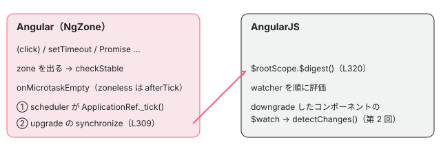

[目次](../README.md) › [@angular/upgrade の内側：AngularJS と 1 つのページを分け合う](README.md) › 第 4 回 / 全 6 回

# 注入器と変更検知：downgradeInjectable・$digest の橋・zone と zoneless

> downgradeInjectable が AngularJS の factory になる行、2 つの注入器が互いを探す順（どちらも相手の注入器を名前で 1 回引くだけ）、UpgradeModule の NgModule が NgZone を provide する行（d9e597f3418）、onMicrotaskEmpty か afterTick から $rootScope.$digest を呼ぶ橋と、AngularJS 側の変化が downgrade したコンポーネントの $watch で Angular に届く仕組み、zoneless の混在アプリ（900cd37f68c）、Testability と $interval の橋、#67368（子の注入器に別の NgZone ができる）、trusted\_types の使われ方。

angular/angular · 読了 約 13 分 · 発展 · [サイトで読む（デモが動きます）](https://angular-deep-dive-cyan.vercel.app/chapter/upg-injection-cd)

---

この章で分かること: AngularJS のサービスとして Angular の injectable を渡す `downgradeInjectable` が、どの行で AngularJS の factory になり、どの順で Angular の注入器に行き着くか。それから、UpgradeModule が 2 つのフレームワークの変更検知をつなぐ「橋」の 30 行ほどで、どちらで値が変わったときに `$rootScope.$digest` と Angular の `tick` がどの順で走るかを、zone.js ありと zoneless の両方で数えます。

読む対象は `packages/upgrade/src/common/src/downgrade_injectable.ts`・`util.ts` の `validateInjectionKey`・`static/src/upgrade_module.ts` の 145〜152 行と 203〜336 行・`src/common/src/security/trusted_types.ts` です。起動の順（`angular.bootstrap` を NgZone の中で呼ぶこと、`$injector` を Angular に渡す 4 つの provider）は[第 1 回](01-upg-bootstrap.md)、downgrade したコンポーネントが `$watch` で自分の変更検知を回す行は[第 2 回](02-upg-downgrade-component.md)にあります。

1. [1. 全体と起動](01-upg-bootstrap.md)
2. [2. downgradeComponent](02-upg-downgrade-component.md)
3. [3. UpgradeComponent](03-upg-upgrade-component.md)
4. **4. 注入器と変更検知**（この章）
5. [5. downgradeModule](05-upg-downgrade-module.md)
6. [6. spec と issue](06-upg-tests-issues.md)

## 1. downgradeInjectable は AngularJS の factory を 1 つ返す

📄 `angular/packages/upgrade/src/common/src/downgrade_injectable.ts` L75–93 （▶ の行: 75–78, 81, 84–85, 87, 90）

```ts
75 ▶ export function downgradeInjectable(token: any, downgradedModule: string = ''): Function {
76 ▶   const factory = function ($injector: IInjectorService) {
77 ▶     const injectorKey = `${INJECTOR_KEY}${downgradedModule}`;
78 ▶     const injectableName = isFunction(token) ? getTypeName(token) : String(token);
79 │     const attemptedAction = `instantiating injectable '${injectableName}'`;
80 │ 
81 ▶     validateInjectionKey($injector, downgradedModule, injectorKey, attemptedAction);
82 │ 
83 │     try {
84 ▶       const injector: Injector = $injector.get(injectorKey);
85 ▶       return injector.get(token);
86 │     } catch (err) {
87 ▶       throw new Error(`Error while ${attemptedAction}: ${(err as Error).message || err}`);
88 │     }
89 │   };
90 ▶   (factory as any)['$inject'] = [$INJECTOR];
91 │ 
92 │   return factory;
93 │ }
```

75 行目の `downgradeInjectable(token, downgradedModule)` は、Angular の注入のトークン（クラスや `InjectionToken`）を受け取り、AngularJS の `.factory('名前', …)` に渡せる関数を返すだけです。AngularJS の factory は「そのサービスが初めて要るときに 1 回だけ呼ばれ、戻り値がその `$injector` の中で使い回される関数」です。

1. **90 行目: 引数の名前を書いておく**

   `factory.$inject = ['$injector']`。AngularJS は `$inject` の配列を見て、factory の 1 つ目の引数に自分の `$injector` を渡します。関数の引数名から推測させないので、圧縮しても strictDi でも動きます。
2. **77 行目: Angular の注入器を置いた名前を作る**

   `INJECTOR_KEY` は `'$$angularInjector'`（constants.ts）。UpgradeModule のアプリでは `downgradedModule` が空なので、名前は `'$$angularInjector'` そのものです。この名前の値は、`UpgradeModule.bootstrap` が作る init モジュールの `.value(INJECTOR_KEY, this.injector)` で入っています（[第 1 回](01-upg-bootstrap.md)）。
3. **81 行目: アプリの種類と名前の組み合わせを検査する**

   次の引用の `validateInjectionKey` です。
4. **84〜85 行目: AngularJS の `$injector` から Angular の注入器を取り、トークンで引く**

   84 行目で得るのは `NgAdapterInjector`（static/src/util.ts、[第 1 回](01-upg-bootstrap.md)）で、85 行目の `get` はそのまま Angular のモジュールの注入器に渡ります。
5. **87 行目: 失敗したら名前を足して投げ直す**

   78 行目の `getTypeName` でクラスの名前を作り、`Error while instantiating injectable 'Store': …` の形にします（0ae00bb1f75 で try / catch が入りました）。

📄 `angular/packages/upgrade/src/common/src/util.ts` L110–130 （▶ の行: 116–117, 121–124）

```ts
110 │ export function validateInjectionKey(
111 │   $injector: IInjectorService,
112 │   downgradedModule: string,
113 │   injectionKey: string,
114 │   attemptedAction: string,
115 │ ): void {
116 ▶   const upgradeAppType = getUpgradeAppType($injector);
117 ▶   const downgradedModuleCount = getDowngradedModuleCount($injector);
118 │ 
119 │   // Check for common errors.
120 │   switch (upgradeAppType) {
121 ▶     case UpgradeAppType.Dynamic:
122 ▶     case UpgradeAppType.Static:
123 ▶       if (downgradedModule) {
124 ▶         throw new Error(
125 │           `Error while ${attemptedAction}: 'downgradedModule' unexpectedly specified.\n` +
126 │             "You should not specify a value for 'downgradedModule', unless you are downgrading " +
127 │             "more than one Angular module (via 'downgradeModule()').",
128 │         );
129 │       }
130 │       break;
```

116 行目の `getUpgradeAppType` は、AngularJS の `$injector` に `'$$angularUpgradeAppType'` の定数があればそれを返します。UpgradeModule は `Static`、downgradeModule は `Lite` を入れます。122〜124 行目のとおり、`Static` のアプリで `downgradedModule` を書くと例外です。続きの `Lite` の枝は[第 5 回](05-upg-downgrade-module.md)で読みます。

### 2 つの注入器が互いを探す順

- 👤 `$injector.get('store')` — AngularJS のコントローラが `['store', …]` で頼む
  - `factory($injector)` — downgrade\_injectable.ts L76 — *初めての 1 回だけ。以後は AngularJS のキャッシュ*
    - `validateInjectionKey(…)` — util.ts L110
    - `$injector.get('$$angularInjector')` — L84 — *bootstrap の init モジュールが置いた値*
    - `NgAdapterInjector.get(Store)` — L85 → static/src/util.ts — *モジュールの注入器へ*
- 👤 `inject('$rootScope')` — Angular のサービスが文字列のトークンで頼む
  - `rootScopeFactory($injector)` — angular1\_providers.ts — *Angular の側にあるのは `$injector`・`$rootScope`・`$compile`・`$parse` の 4 つだけ*
    - `$injector.get('$rootScope')` — AngularJS の注入器

どちらの向きも「相手の注入器を 1 つ持っていて、名前で 1 回引く」だけです。片方で見つからなかったときに、もう片方を自動で探しに行く仕組みはありません。Angular から AngularJS のほかのサービスを使うときは、利用者が `{ provide: 'heroes', useFactory: (i) => i.get('heroes'), deps: ['$injector'] }` の形の provider を書きます（upgrade\_module.ts の説明のコメントの「Upgrading an AngularJS service」）。コンポーネントの中から探すときは、親の downgrade したコンポーネントの注入器を AngularJS の `require` で DOM の上から受け取ります（[第 2 回](02-upg-downgrade-component.md)）。

4 節のデモの記録で、同じものが返ることを確かめました（3 つの変種で同じ）。

| 確かめたこと（zone.js あり） | 結果 |
| --- | --- |
| `AngularJS の $injector.get('store') === Angular の injector.get(Store)` | true |
| `Angular の injector.get('$rootScope') === AngularJS の $rootScope` | true |
| `downgradeInjectable(Store, 'someModule') を UpgradeModule のアプリで引く` | Error while instantiating injectable 'Store': 'downgradedModule' unexpectedly specified. |

## 2. UpgradeModule は NgZone を自分で provide する

📄 `angular/packages/upgrade/static/src/upgrade_module.ts` L145–152 （▶ の行: 149）

```ts
145 │  * {@example upgrade/static/ts/full/module.ts region="use-ng1-upgraded-service"}
146 │  *
147 │  * @publicApi
148 │  */
149 ▶ @NgModule({providers: [angular1Providers, ɵinternalProvideZoneChangeDetection({})]})
150 │ export class UpgradeModule {
151 │   /**
152 │    * The AngularJS `$injector` for the upgrade application.
```

149 行目で、UpgradeModule の NgModule の providers に `ɵinternalProvideZoneChangeDetection({})` が入っています。この関数は `ZONELESS_ENABLED: false` と `new NgZone(…)` の factory と、`NgZoneChangeDetectionScheduler` を初期化する環境の初期化子を返します （中身は[NgZoneChangeDetectionScheduler の章](../zone/11-zone-ngzone-scheduler.md)）。v22 の `bootstrapModule` は既定で zoneless の provider を入れるので、この 1 行が無いと、UpgradeModule のアプリは zoneless で起動します。

入れたのは d9e597f3418（2025-09-15、PR #63814「use zone-based change detection by default」）で、本文は「downgradeModule で使うモジュールのすべてに `provideZoneChangeDetection` を書かなくて済むように」です。同じ PR の 412d5af92cc と 0bb68a81877 は downgradeModule の側の同じ変更で、[第 5 回](05-upg-downgrade-module.md)で読みます。

利用者の AppModule が自分の providers に `provideZonelessChangeDetection()` を書くと、記録では UpgradeModule が受け取る `NgZone` は `NoopNgZone` になりました（4 節の「zone.js あり + provideZonelessChangeDetection()」）。NgModule の注入器は import したモジュールの providers を先に、自分の providers を後に入れ、同じトークンは後が勝つからです（[walkProviderTree と後勝ち](../ngmodule/08-ngmodule-walk-provider-tree.md)）。zone.js を読み込まない「zone.js なし」の変種でも、`new NgZone` の factory は使われないので起動できました。

## 3. 変更検知の橋: $digest をいつ回すか

📄 `angular/packages/upgrade/static/src/upgrade_module.ts` L306–336 （▶ の行: 308–311, 313, 318, 320, 328–332, 334）

```ts
306 │           // Wire up the ng1 rootScope to run a digest cycle whenever the zone settles
307 │           // We need to do this in the next tick so that we don't prevent the bootup stabilizing
308 ▶           setTimeout(() => {
309 ▶             const synchronize = () => {
310 ▶               this.ngZone.run(() => {
311 ▶                 if ($rootScope.$$phase) {
312 │                   if (typeof ngDevMode === 'undefined' || ngDevMode) {
313 ▶                     console.warn(
314 │                       'A digest was triggered while one was already in progress. This may mean that something is triggering digests outside the Angular zone.',
315 │                     );
316 │                   }
317 │ 
318 ▶                   $rootScope.$evalAsync();
319 │                 } else {
320 ▶                   $rootScope.$digest();
321 │                 }
322 │               });
323 │             };
324 │             const subscription =
325 │               // We _DO NOT_ usually want to have any code that does one thing for zoneless and another for ZoneJS.
326 │               // This is only here because there is not enough coverage for hybrid apps anymore so we cannot
327 │               // be confident that making UpgradeModule work with zoneless is a non-breaking change.
328 ▶               this.ngZone instanceof ɵNoopNgZone
329 ▶                 ? (this.applicationRef as any).afterTick.subscribe(() => synchronize())
330 ▶                 : this.ngZone.onMicrotaskEmpty.subscribe(() => synchronize());
331 ▶             $rootScope.$on('$destroy', () => {
332 ▶               subscription.unsubscribe();
333 │             });
334 ▶           }, 0);
335 │         },
336 │       ]);
```

この 31 行は、`UpgradeModule.bootstrap` が AngularJS に足す init モジュールの `.run` の中にあります（run の前半は[第 1 回](01-upg-bootstrap.md)）。

1. **308 行目: 1 回 setTimeout を挟む**

   コメント（306〜307 行目）のとおり、起動の途中で購読を始めると、起動が安定するのを妨げるためです。`setTimeout(…, 0)` の中で購読するので、最初の `$digest` は起動のあとになります。
2. **309〜323 行目: `synchronize` は NgZone の中で `$digest` を 1 回回す**

   310 行目で `ngZone.run` に入り、311 行目で AngularJS がもう digest の途中（`$rootScope.$$phase` が立っている）なら、313 行目で開発モードの警告を出して、318 行目の `$evalAsync()` で「今の digest の最後にもう 1 周」を頼むだけにします。途中でなければ 320 行目で `$rootScope.$digest()` を呼びます。
3. **328〜330 行目: 何をきっかけに `synchronize` を呼ぶか**

   NgZone が `NoopNgZone`（zoneless。[zoneless の既定の章](../zoneless/01-zoneless-default.md)）なら、329 行目で `ApplicationRef` の `afterTick`（`@internal` の Subject なので `as any`）を購読します。そうでなければ 330 行目で `onMicrotaskEmpty` を購読します。`onMicrotaskEmpty` は「NgZone の中の仕事が終わり、microtask も空になった」ときに 1 回出る EventEmitter です（[checkStable の章](../zone/10-zone-ngzone-stability.md)）。
4. **331〜333 行目: AngularJS の `$rootScope` が壊れたら購読をやめる**

   `$destroy` のイベントで `unsubscribe()` します。



*UpgradeModule の橋。Angular の側の仕事が終わると $digest が回り、$digest の中で downgrade したコンポーネントの detectChanges が回る*

図の①と②の順は、購読した順です。`NgZoneChangeDetectionScheduler` は環境の初期化子（起動の途中）で `onMicrotaskEmpty` を購読し（[その章](../zone/11-zone-ngzone-scheduler.md)）、upgrade の購読は 308 行目の setTimeout の中なので、いつも後です。だから zone.js ありでは「tick が終わってから `$digest`」になります。zoneless の `afterTick` は `ApplicationRef` の `tickImpl` の finally で出るので（[zoneless の tick の章](../zoneless/05-zoneless-tick.md)）、`$digest` は tick の「中」、終わる直前に回ります。

逆向き、AngularJS で値が変わったときに Angular の画面が直るのは、橋ではなく downgrade したコンポーネントの側の仕組みです。UpgradeModule のアプリでは、downgrade したコンポーネントのビューは `ApplicationRef` に付けられず、AngularJS のスコープの `$watch` に渡した `detectChanges` が、`$digest` のたびに呼ばれます（[第 2 回](02-upg-downgrade-component.md)の `setupInputs` の後半）。記録で「Angular のテンプレートを評価」が、`ApplicationRef` の tick がビューを回すところではなく、いつも `$digest` の中に出るのはこのためです。

### 入れたコミット: 900cd37f68c（zoneless の混在アプリ）

328〜330 行目の枝は 900cd37f68c（2025-05-23、「fix(upgrade): Make zoneless work with hybrid apps」、#61640 を閉じた。PR は #61660）で入りました。それまでは `onMicrotaskEmpty.subscribe` の 1 本だけで、zoneless では `NoopNgZone` の `onMicrotaskEmpty` が一度も emit しないので、`$digest` が回りませんでした。コミットの本文は「`afterEveryRender` を使うようにする」ですが、入ったコードは `afterTick` です。325〜327 行目のコメントは「zoneless と ZoneJS で別のことをするコードは普通は書かない。混在アプリのテストがもう十分に無いので、zoneless で動かすことが壊す変更でないと言い切れないから、ここだけ分けた」と書いています。このコミットが変えたファイルは upgrade\_module.ts の 1 つだけで、spec は足されていません（6 節で、この枝を消しても spec が全部通ることを確かめます）。

## 4. DEMO — どちらで値を変えると、$digest と tick が何回走るか

> **🧪 DEMO — 記録の再生（@angular/upgrade 22.1.6・AngularJS 1.8.3・jsdom）**
>
> AngularJS のコントローラ `Ctrl` が `v` を持ち、downgrade した Angular のコンポーネント `<ng2-box [n]="c.v">` に渡します。どちらも `downgradeInjectable` で渡した同じ `Store` を表示します。`$rootScope.$digest` と `ApplicationRef._tick` を包んで「開始」「終了」を書き、`onMicrotaskEmpty` と `afterTick` も購読して並べました。黒が AngularJS、赤が Angular、太字が 2 つをつなぐ合図です。変種を選び、段を 1 つずつ進めてください。
>
> NgZone: `NgZone`（UpgradeModule が受け取ったものと同じ: はい）
>
> ▶ [このデモはサイトで動かせます](https://angular-deep-dive-cyan.vercel.app/chapter/upg-injection-cd)

3 つの変種を並べると、次のとおりです（記録から数えた回数）。

| 段 | zone.js あり（既定） | zone.js あり + provideZonelessChangeDetection() | zone.js なし + provideZonelessChangeDetection() |
| --- | --- | --- | --- |
| 起動（bootstrapModule → upgrade.bootstrap） | $digest 2 ／ tick 2 | $digest 2 ／ tick 1 | $digest 2 ／ tick 1 |
| AngularJS の ng-click で値を変える | $digest 2 ／ tick 1 | $digest 2 ／ tick 1 | $digest 2 ／ tick 1 |
| Angular の (click) で値を変える | $digest 1 ／ tick 1 | $digest 1 ／ tick 1 | $digest 1 ／ tick 1 |
| AngularJS の中で素の setTimeout から値を変える | $digest 3 ／ tick 2<br>AngularJS の表示: v=11 store=1 | $digest 1 ／ tick 0<br>AngularJS の表示: v=1 store=1 | $digest 1 ／ tick 0<br>AngularJS の表示: v=1 store=1 |
| AngularJS の whenStable で Angular の側を待つ | $digest 2 ／ tick 2 | $digest 0 ／ tick 0 | $digest 0 ／ tick 0 |

- **AngularJS の ng-click**: 3 つとも `$digest` が 2 回です。1 回目は ng-click 自身の `$apply`、2 回目は橋（zone.js ありは `onMicrotaskEmpty`、zoneless は `afterTick`）です。zoneless で tick が起きるのは、1 回目の `$digest` の中で input の `n` が変わり、input の変化を数える `$watch` が `markForCheck()` を呼んで（[第 2 回](02-upg-downgrade-component.md)）、それが Angular のスケジューラへの知らせになるからです（[notify の章](../zoneless/03-zoneless-notify.md)）。
- **Angular の (click)**: 3 つとも tick 1 回、`$digest` 1 回です。Angular のテンプレートは、tick がビューを回すところでは評価されず、そのあとの `$digest`（zoneless では tick の終わりの `afterTick` から呼ばれる `$digest`）の中で評価されます（3 節の最後の段落）。
- **AngularJS の素の setTimeout**（`$timeout` ではない）: zone.js ありでは、AngularJS の起動が NgZone の中なので setTimeout も NgZone のタスクになり、終わると tick と `$digest` が回って `v=11` が画面に出ます。zoneless では何も回らず、画面は `v=1` のままです。zone.js を読み込んでいても、NgZone が `NoopNgZone` なら同じです。
- **whenStable**: zone.js ありでは、Angular の側の 30ms のタイマーが終わってから AngularJS の callback が呼ばれます。zoneless では、呼んだその場（タイマーより前）で呼ばれます。次の 5 節の行です。

> [!WARNING]
> **ハマりどころ**
>
> 記録スクリプトでは jsdom の 1 行を差し替えています。jsdom は DOM を変えるたびに `Promise.resolve().then` で MutationObserver の microtask を積み、zone.js の下ではそれが NgZone の microtask に数えられて、本物のブラウザに無い `onMicrotaskEmpty`・tick・`$digest` がもう 1 周増えます（差し替える前の記録では、Angular の (click) のあとに 2 周目が出ました）。env.mjs の冒頭で、その 1 行だけを zone.js を読む前の `queueMicrotask` に替えています。

## 5. Testability と $interval の橋

📄 `angular/packages/upgrade/static/src/upgrade_module.ts` L203–230 （▶ の行: 207–208, 211, 214–217, 220, 225）

```ts
203 │       .config([
204 │         ɵconstants.$PROVIDE,
205 │         ɵconstants.$INJECTOR,
206 │         ($provide: ɵangular1.IProvideService, $injector: ɵangular1.IInjectorService) => {
207 ▶           if ($injector.has(ɵconstants.$$TESTABILITY)) {
208 ▶             $provide.decorator(ɵconstants.$$TESTABILITY, [
209 │               ɵconstants.$DELEGATE,
210 │               (testabilityDelegate: ɵangular1.ITestabilityService) => {
211 ▶                 const originalWhenStable: Function = testabilityDelegate.whenStable;
212 │                 const injector = this.injector;
213 │                 // Cannot use arrow function below because we need the context
214 ▶                 const newWhenStable = function (callback: Function) {
215 ▶                   originalWhenStable.call(testabilityDelegate, function () {
216 ▶                     const ng2Testability: Testability = injector.get(Testability);
217 ▶                     if (ng2Testability.isStable()) {
218 │                       callback();
219 │                     } else {
220 ▶                       ng2Testability.whenStable(newWhenStable.bind(testabilityDelegate, callback));
221 │                     }
222 │                   });
223 │                 };
224 │ 
225 ▶                 testabilityDelegate.whenStable = newWhenStable;
226 │                 return testabilityDelegate;
227 │               },
228 │             ]);
229 │           }
230 │ 
```

AngularJS の `$$testability` は、Protractor などの E2E の道具が `angular.getTestability(el).whenStable(cb)` で「AngularJS の側が落ち着くまで待つ」ための内部サービスです。207 行目でそれがあれば、208 行目の `$provide.decorator` で `whenStable` を差し替えます。

1. **215 行目**

   まず元の `whenStable`（AngularJS の側の `$http` などを待つ）を呼びます。
2. **216〜218 行目**

   AngularJS が落ち着いたら、Angular の `Testability` を注入器から取り、`isStable()` なら callback を呼びます。
3. **220 行目**

   まだなら Angular の `whenStable` に「自分自身（`newWhenStable`）をもう一度」渡します。Angular が落ち着いたあとに AngularJS がまた動いていれば、もう一度 AngularJS から待ち直します。

Angular の `Testability` は BrowserModule の providers にあり（platform-browser の browser.ts の `TESTABILITY_PROVIDERS`）、何を「安定」と呼ぶかは[isStable と whenStable の章](../testing/11-testing-when-stable.md)にあります。デモの記録では、zoneless（`NoopNgZone`）のとき、Angular の側の 30ms のタイマーを待たずに callback が呼ばれました。NgZone がタスクを数えないので、`Testability` から見ていつも安定しているからです。

📄 `angular/packages/upgrade/static/src/upgrade_module.ts` L231–262 （▶ の行: 231, 245, 252–253）

```ts
231 ▶           if ($injector.has(ɵconstants.$INTERVAL)) {
232 │             $provide.decorator(ɵconstants.$INTERVAL, [
233 │               ɵconstants.$DELEGATE,
234 │               (intervalDelegate: ɵangular1.IIntervalService) => {
235 │                 // Wrap the $interval service so that setInterval is called outside NgZone,
236 │                 // but the callback is still invoked within it. This is so that $interval
237 │                 // won't block stability, which preserves the behavior from AngularJS.
238 │                 let wrappedInterval = (
239 │                   fn: Function,
240 │                   delay: number,
241 │                   count?: number,
242 │                   invokeApply?: boolean,
243 │                   ...pass: any[]
244 │                 ) => {
245 ▶                   return this.ngZone.runOutsideAngular(() => {
246 │                     return intervalDelegate(
247 │                       (...args: any[]) => {
248 │                         // Run callback in the next VM turn - $interval calls
249 │                         // $rootScope.$apply, and running the callback in NgZone will
250 │                         // cause a '$digest already in progress' error if it's in the
251 │                         // same vm turn.
252 ▶                         setTimeout(() => {
253 ▶                           this.ngZone.run(() => fn(...args));
254 │                         });
255 │                       },
256 │                       delay,
257 │                       count,
258 │                       invokeApply,
259 │                       ...pass,
260 │                     );
261 │                   });
262 │                 };
```

同じ config の後半は AngularJS の `$interval` を包みます。245 行目で `runOutsideAngular` の中で元の `$interval` を呼ぶので、繰り返しのタイマーは NgZone のタスクになりません（Testability がいつまでも安定しない、を避ける）。コールバックだけは 252〜253 行目で `setTimeout` を 1 回挟んでから `ngZone.run` に戻します。コメント（248〜251 行目）のとおり、`$interval` は自分で `$rootScope.$apply` を呼ぶので、同じ VM のターンで NgZone の中で走らせると「$digest already in progress」になるからです。testability\_spec.ts の it「should not wait for $interval」（108 行目）がこの振る舞いを固めています。

## 6. #67368: UpgradeModule を import するとゾーンが 2 つになる

#67368（2026-02-28 に開かれ、同じ日に not planned で閉じた）は「zone を使うアプリで UpgradeModule を import すると、Angular のゾーンが複数できる。`runOutsideAngular()` の外側が Angular のゾーンになり得る」という報告です。再現は standalone のコンポーネントの `imports: [UpgradeModule]` でした。メンバーの返答は「UpgradeModule は根の環境の注入器に入れるもので、コンポーネントの注入器に入れるのは使い方が違う。standalone なら `ApplicationConfig.providers` に `importProvidersFrom(UpgradeModule)`」です。報告者は続けて「遅延読み込みの NgModule が UpgradeModule を import する場合はどうか」と聞き、その問いに返事が付かないまま、自動で閉じられ（lock され）ました。

仕組みは 2 節の 149 行目です。UpgradeModule を import した注入器にはどこでも `NgZone` の factory が入り、子の注入器で `NgZone` を引くと、根とは別の `new NgZone` がその注入器で作られます。記録で、UpgradeModule が受け取る `NgZone` が根のものと同じかを比べました。

| UpgradeModule を置いた場所 | 根（そのアプリ）の NgZone と同じ |
| --- | --- |
| 遅延読み込みの NgModule の imports | いいえ（別の NgZone） |
| standalone コンポーネントの imports | いいえ（別の NgZone） |
| bootstrapApplication の providers に importProvidersFrom(UpgradeModule) | はい |
| 根の NgModule の imports（ふつうの形、別のアプリとして起動） | はい |

遅延読み込みの NgModule（`createNgModule(Lazy, 親)`。注入器の木は[遅延モジュールの章](../ngmodule/15-ngmodule-lazy-module.md)）に置くと、別の NgZone になりました。この形は d9e597f3418 より前（UpgradeModule が NgZone を provide しなかった版）では起きません。

## 7. security/trusted\_types.ts の使われ方

📄 `angular/packages/upgrade/src/common/src/security/trusted_types.ts` L31–61 （▶ の行: 32, 35, 37–38, 40, 59–60）

```ts
31 │ function getPolicy(): TrustedTypePolicy | null {
32 ▶   if (policy === undefined) {
33 │     policy = null;
34 │     const windowWithTrustedTypes = window as unknown as {trustedTypes?: TrustedTypePolicyFactory};
35 ▶     if (windowWithTrustedTypes.trustedTypes) {
36 │       try {
37 ▶         policy = windowWithTrustedTypes.trustedTypes.createPolicy('angular#unsafe-upgrade', {
38 ▶           createHTML: (s: string) => s,
39 │         });
40 ▶       } catch {
41 │         // trustedTypes.createPolicy throws if called with a name that is
42 │         // already registered, even in report-only mode. Until the API changes,
43 │         // catch the error not to break the applications functionally. In such
44 │         // cases, the code will fall back to using strings.
45 │       }
46 │     }
47 │   }
48 │   return policy;
49 │ }
50 │ 
51 │ /**
52 │  * Unsafely promote a legacy AngularJS template to a TrustedHTML, falling back
53 │  * to strings when Trusted Types are not available.
54 │  * @security This is a security-sensitive function; any use of this function
55 │  * must go through security review. In particular, the template string should
56 │  * always be under full control of the application author, as untrusted input
57 │  * can cause an XSS vulnerability.
58 │  */
59 ▶ export function trustedHTMLFromLegacyTemplate(html: string): TrustedHTML | string {
60 ▶   return getPolicy()?.createHTML(html) || html;
61 │ }
```

Trusted Types は、`innerHTML` などに文字列をそのまま入れることをブラウザが拒み、「ポリシーが作った TrustedHTML だけを通す」ようにする仕組みです。AngularJS のテンプレートは AngularJS が `innerHTML` で入れるので、Trusted Types を強制したページでは止まります。この 31 行は、upgrade がその文字列を TrustedHTML にするための専用のポリシーです。

- 32〜33 行目: ポリシーは最初の 1 回だけ作り、無ければ `null` を覚えます。
- 37〜38 行目: 名前は `'angular#unsafe-upgrade'`、`createHTML` は受け取った文字列をそのまま返します。中身を検査しないので、名前に「unsafe」が付き、55〜57 行目のコメントは「テンプレートの文字列は、いつもアプリの作者が完全に管理しているものでなければならない」と書いています。
- 40 行目: 同じ名前のポリシーがもうあると `createPolicy` は投げるので、受けて文字列に戻します（44 行目のコメント）。
- 59〜60 行目: 使うのは `trustedHTMLFromLegacyTemplate` の 1 つだけで、呼ぶのは upgrade\_helper.ts の `getTemplate`（UpgradeComponent が AngularJS のディレクティブの `template` と `templateUrl` を取るところ。[第 3 回](03-upg-upgrade-component.md)）の 3 か所です。

入れたのは c9d90786d0a（2024-08-19、PR #57454「Address Trusted Types violations in @angular/upgrade」）です。downgradeComponent の側の中身のコンパイルの直し（b2d3ba9f5f0、#71441）は[第 2 回](02-upg-downgrade-component.md)にあります。

## テストと直し方

この章の行を固めている spec は次のとおりです（行番号は 8576f161ae4 で `grep -n` したもの）。

| spec | describe / it（行） | 固めていること |
| --- | --- | --- |
| `src/common/test/downgrade_injectable_spec.ts` | `downgradeInjectable`（15）の it 3 つ（32・42・52） | `$inject`・モジュール名つきのキー・エラーの文言。注入器はどちらも jasmine のモック |
| `static/test/integration/injection_spec.ts` | `injection`（27）の it 4 つ（31・55・84・105） | 本物の起動で、Angular → AngularJS と AngularJS → Angular、run ブロックより前に注入器が入っていること |
| `static/test/integration/change_detection_spec.ts` | `change-detection`（33）の it 3 つ（37・99・161） | `$$phase` の枝（311〜318 行目）、式の評価の交互、downgrade したコンポーネントへの伝わり方 |
| `static/test/integration/testability_spec.ts` | `testability`（27）の it 4 つ（36・59・81・108） | resumeBootstrap、Angular の Testability を待つこと、`$interval` を待たないこと |
| `static/test/angular1_providers_spec.ts` | `upgrade angular1_providers`（18）の it 6 つ | Angular の側の 4 つの provider |

📄 `angular/packages/upgrade/src/common/test/downgrade_injectable_spec.ts` L52–62 （▶ の行: 52, 58–60）

```ts
52 ▶   it("should mention the injectable's name in the error thrown when failing to retrieve injectable", () => {
53 │     const factory = downgradeInjectable('someToken');
54 │     expect(factory).toEqual(jasmine.any(Function));
55 │     expect((factory as any).$inject).toEqual([$INJECTOR]);
56 │ 
57 │     const {mockNg1Injector, mockNg2Injector} = setupMockInjectors();
58 ▶     mockNg2Injector.get.and.throwError('Mock failure');
59 ▶     expect(() => factory(mockNg1Injector)).toThrowError(
60 ▶       /^Error while instantiating injectable 'someToken': Mock failure/,
61 │     );
62 │   });
```

📄 `angular/packages/upgrade/static/test/integration/injection_spec.ts` L31–54 （▶ の行: 37–38, 47, 51）

```ts
31 │     it('should downgrade ng2 service to ng1', waitForAsync(() => {
32 │       // Tokens used in ng2 to identify services
33 │       const Ng2Service = new InjectionToken('ng2-service');
34 │ 
35 │       // Sample ng1 NgModule for tests
36 │       @NgModule({
37 ▶         imports: [BrowserModule, UpgradeModule],
38 ▶         providers: [{provide: Ng2Service, useValue: 'ng2 service value'}],
39 │       })
40 │       class Ng2Module {
41 │         ngDoBootstrap() {}
42 │       }
43 │ 
44 │       // create the ng1 module that will import an ng2 service
45 │       const ng1Module = angular
46 │         .module_('ng1Module', [])
47 ▶         .factory('ng2Service', downgradeInjectable(Ng2Service));
48 │ 
49 │       bootstrap(platformBrowserDynamic(), Ng2Module, html('<div>'), ng1Module).then((upgrade) => {
50 │         const ng1Injector = upgrade.$injector;
51 ▶         expect(ng1Injector.get('ng2Service')).toBe('ng2 service value');
52 │       });
53 │     }));
54 │ 
```

downgrade\_injectable\_spec.ts の 58 行目は Angular の注入器のモックに例外を投げさせ、60 行目で 87 行目の文言を見ます。injection\_spec.ts は本物の UpgradeModule を起動し、47 行目の `downgradeInjectable` が 51 行目で値を返すことを見ます。

📄 `angular/packages/upgrade/static/test/integration/change_detection_spec.ts` L61–97 （▶ の行: 71–72, 75–76, 81, 86, 91–92）

```ts
61 │       bootstrap(platformBrowserDynamic(), Ng2Module, element, ng1Module).then((upgrade) => {
62 │         const $rootScope = upgrade.$injector.get('$rootScope') as angular.IRootScopeService;
63 │         const ngZone: NgZone = upgrade.ngZone;
64 │ 
65 │         // Wrap in a setTimeout to ensure all bootstrap operations have completed.
66 │         setTimeout(
67 │           // Run inside the Angular zone, so that operations such as emitting
68 │           // `onMicrotaskEmpty` do not trigger entering/existing the zone (and thus another
69 │           // `$digest`). This also closer simulates what would happen in a real app.
70 │           () =>
71 ▶             ngZone.run(() => {
72 ▶               const digestSpy = spyOn($rootScope, '$digest').and.callThrough();
73 │ 
74 │               // Step 1: Ensure `$digest` is run on `onMicrotaskEmpty`.
75 ▶               ngZone.onMicrotaskEmpty.emit(null);
76 ▶               expect(digestSpy).toHaveBeenCalledTimes(1);
77 │ 
78 │               digestSpy.calls.reset();
79 │ 
80 │               // Step 2: Cause the issue.
81 ▶               $rootScope.$apply(() => ngZone.onMicrotaskEmpty.emit(null));
82 │ 
83 │               // With the fix, `$digest` will only be run once (for `$apply()`).
84 │               // Without the fix, `$digest()` would have been run an extra time
85 │               // (`onMicrotaskEmpty`).
86 ▶               expect(digestSpy).toHaveBeenCalledTimes(1);
87 │ 
88 │               digestSpy.calls.reset();
89 │ 
90 │               // Step 3: Ensure that `$digest()` is still executed on `onMicrotaskEmpty`.
91 ▶               ngZone.onMicrotaskEmpty.emit(null);
92 ▶               expect(digestSpy).toHaveBeenCalledTimes(1);
93 │             }),
94 │           0,
95 │         );
96 │       });
97 │     }));
```

この it は `onMicrotaskEmpty` を手で emit します。75 行目は「emit すれば `$digest` が 1 回」、81 行目は `$apply` の途中で emit して「`$digest` が増えない」（318 行目の `$evalAsync` の枝）を見ます。81 行目は開発モードの警告（313 行目）を出すので、手元で走らせたログには「A digest was triggered while one was already in progress.」が AngularJS の 4 つの版 × 2 つのブラウザで 8 回出ました。この spec の NgModule は自分の providers に `provideZoneChangeDetection()` を書いていて、zoneless の枝（328〜329 行目）を通る it はこのディレクトリにありません。

📄 `走らせたコマンド（../angular、8576f161ae4）`

```
cd ~/angular-research/angular
pnpm bazel test //packages/upgrade/src/common/test:test --nocache_test_results --test_output=all
pnpm bazel test //packages/upgrade/static/test:test //packages/upgrade/static/testing/test:test \
  --nocache_test_results --test_output=all
```

📄 `結果（2026-11-16）`

```
Chromium: 1/1 test files | 38 passed, 0 failed          （src/common/test）
Firefox:  1/1 test files | 38 passed, 0 failed
//packages/upgrade/src/common/test:test_chromium                         PASSED in 1.2s
//packages/upgrade/src/common/test:test_firefox                          PASSED in 2.9s
Chromium: 1/1 test files | 614 passed, 0 failed, 12 skipped   （static/test）
Firefox:  1/1 test files | 614 passed, 0 failed, 12 skipped
Chromium: 1/1 test files | 12 passed, 0 failed           （static/testing/test）
Firefox:  1/1 test files | 12 passed, 0 failed
//packages/upgrade/static/test:test_chromium                             PASSED in 4.8s
//packages/upgrade/static/test:test_firefox                              PASSED in 7.2s
//packages/upgrade/static/testing/test:test_chromium                     PASSED in 1.4s
//packages/upgrade/static/testing/test:test_firefox                      PASSED in 3.2s
```

upgrade の spec はどれもブラウザの suite（`ng_web_test_suite`、web-test-runner）で、Chromium と Firefox の 2 つの target ができます。`--test_arg=--filter` は効かないので、ディレクトリごと全部走らせました。数の内訳は[第 6 回](06-upg-tests-issues.md)にあります。さらに、作業木（../angular-fix から 8576f161ae4 で作り、終わってから消した）で 328 行目を `false && this.ngZone instanceof ɵNoopNgZone` にして zoneless の枝を通らなくしても、`//packages/upgrade/static/test:test_chromium` は 614 passed・0 failed のままでした。

直すとしたら、橋の行は upgrade\_module.ts の `bootstrap` の中の `.run`（306〜334 行目）、注入は downgrade\_injectable.ts と util.ts の `validateInjectionKey` です。zoneless の枝を固める it を足すなら change\_detection\_spec.ts の `change-detection` の describe で、NgModule の providers に `provideZonelessChangeDetection()` を書き、4 節の記録の「Angular の (click) のあとに `$digest` が 1 回」を確かめる形になります。

## 聞かれそうな質問

**Q. downgradeInjectable したサービスは、AngularJS と Angular で同じインスタンスですか？**

はい。85 行目は Angular のモジュールの注入器に `get(token)` するだけなので、Angular の側の singleton がそのまま返ります。AngularJS の側は factory の戻り値をキャッシュするので、2 回目からは factory も呼ばれません。記録でも `===` が true でした。

**Q. Angular のサービスから AngularJS の任意のサービスを inject できますか？**

そのままではできません。Angular の側に最初からあるのは angular1\_providers.ts の 4 つ（`$injector`・`$rootScope`・`$compile`・`$parse`）だけで、ほかは `deps: ['$injector']` の factory の provider を利用者が書きます。注入器が相手を自動で探しに行く仕組みはありません（1 節）。

**Q. Angular の側の (click) のあと、AngularJS の画面はなぜ直るのですか？**

(click) は NgZone の中で走り、終わると `onMicrotaskEmpty` が出て、まず Angular の tick、次に upgrade の 330 行目の購読が `synchronize` を呼び、320 行目で `$digest` が回るからです。zoneless では 329 行目の `afterTick` が同じ役をします。

**Q. zoneless にすると、混在アプリで何が変わりますか？**

`$digest` のきっかけが tick の後（`afterTick`）になり、tick の中で回ります。AngularJS のコードが `$timeout` ではなく素の `setTimeout` や Promise で値を変えたときは、zone.js が拾わないので、どちらの変更検知も回りません（4 節の表）。`whenStable` も Angular の側のタイマーを待たなくなります（5 節）。

**Q. AppModule に provideZonelessChangeDetection() を書くと、UpgradeModule の provideZone… は無視されますか？**

記録では無視されて `NoopNgZone` になりました。149 行目の provider は import した UpgradeModule の分で、AppModule 自身の providers がそれより後に入って勝つからです（2 節）。

**Q. 「A digest was triggered while one was already in progress」はどこで出ますか？**

upgrade\_module.ts の 313 行目です。`synchronize` が呼ばれたとき AngularJS がもう digest の途中（311 行目の `$$phase`）なら、開発モードで警告を出し、318 行目の `$evalAsync()` で済ませます。NgZone の外から digest が始まっていることが多い、という意味の警告です。

## 読み終えて

- `downgradeInjectable` は `$inject = ['$injector']` の factory で、`'$$angularInjector'` の値（Angular の注入器）から `get(token)` するだけ
- UpgradeModule は 149 行目で NgZone を provide する（d9e597f3418）。AppModule 自身の zoneless の指定はそれより後に入って勝つ
- 橋は 306〜334 行目の 1 つの購読。zone.js ありは `onMicrotaskEmpty`、zoneless は `afterTick`（900cd37f68c）で、`$digest` を 1 回回す。逆向きは downgrade したコンポーネントの `$watch`
- zoneless の枝を固める spec は無く、消しても 614 本が通った
- UpgradeModule を子の注入器に import すると、そこに別の NgZone ができる（#67368 の仕組み）

---

← 前: [UpgradeComponent：Angular の中で AngularJS のディレクティブを動かす](03-upg-upgrade-component.md)  
次: [downgradeModule：Angular の側を後から起こす](05-upg-downgrade-module.md) →
