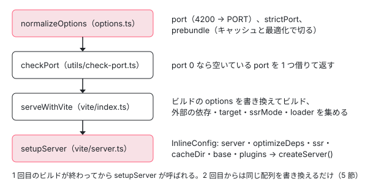

[目次](../README.md) › [ng serve の内側：Vite の middleware と plugin が 1 つの要求をさばくまで](README.md) › 第 1 回 / 全 5 回

# Vite の設定を組み立てる：server.ts と prebundle と外部の依存

> builders/dev-server の options.ts・vite/index.ts・vite/server.ts と tools/vite/utils.ts が、dev-server の options と 1 回目のビルドの結果から Vite の設定（server・optimizeDeps・ssr・cacheDir・base）を作る行。PORT が --port より優先する順（fe720cab64）、port 0 と checkPort と strictPort（5d21812aae、origin/main の 3123cf2e99）、prebundle が esbuild の packages: 'external' と updateExternalMetadata を経て optimizeDeps.include になる流れ（JSON を外す 3124d165de）、Rolldown への移行と target（a583431e14・3e9fed9a6a）、worktree のキャッシュ（dfa7f03a93）。

angular/angular-cli · 読了 約 13 分 · 中核 · [サイトで読む（デモが動きます）](https://angular-deep-dive-cyan.vercel.app/chapter/vds-config)

---

この章で分かること: `ng serve` の options が `normalizeOptions` で直され、`serveWithVite` がビルドの options を書き換え、`setupServer` が Vite に渡す設定（`server`・`optimizeDeps`・`ssr`・`cacheDir` など）を組み立てるまでを、行の順に追います。port が 4200・0・環境変数 `PORT` のどれで決まるか、依存の事前バンドル（prebundle）がビルドの「外部の依存」の一覧からどう作られるかも、本物の `ng serve` が Vite に渡した設定を覗いた記録で確かめます。

読む対象は `packages/angular/build/src/builders/dev-server/` の `options.ts`・`vite/index.ts`・`vite/server.ts`・`vite/utils.ts` と、`tools/vite/utils.ts` です。`ng serve` から Vite の `listen()` までの大きな流れ（`builder.ts`・ビルドの結果をメモリに置く `updateResultRecord`・plugin の並び）は[ng serve の起動の章](../boot/03-boot-dev-server.md)にあるので、ここでは繰り返しません。esbuild での application のビルドそのものは[CLI のビルドの章](../cli/01-cli-overview.md)、キャッシュの場所の決め方は[キャッシュと watch の章](../cli/10-cli-cache-watch.md)にあります。

1. **1. Vite の設定を組み立てる**（この章）
2. [2. アセット・base href・index.html](02-vds-assets-html.md)
3. [3. Host の検査と開発用のヘッダー](03-vds-host-headers.md)
4. [4. HMR と SSR の plugin](04-vds-hmr-ssr.md)
5. [5. spec と issue](05-vds-tests-issues.md)

> [!TIP]
> **新卒エンジニアへ**
>
> **Vite** は開発用の HTTP サーバーと、ブラウザに ES モジュールのまま配る仕組みを持つツールです。Angular CLI は自分で esbuild でビルドした結果を、Vite の上に載せて配ります。**prebundle（依存の事前バンドル）**は、`node_modules` の package（ここでは `@angular/core` など）を 1 回だけまとめてキャッシュに書き、ブラウザにはそのファイルを配ることです。Vite に渡す設定のオブジェクトを **InlineConfig** と呼びます。Angular は `vite.config.ts` を読まず、この章の関数が作るオブジェクトだけを `createServer()` に渡します。

## 1. 全体の流れ



*options から Vite の設定までの 4 つの段。左の箱が関数、右がその段で決まるもの*

1. **options を直す**

   `normalizeOptions` が port・`strictPort`・`prebundle` を決めます（2・3 節）。`builder.ts` の `initialize` がその後で `checkPort` を呼び、戻り値で port を置き換えます。
2. **ビルドの options を書き換えてビルドする**

   `serveWithVite` は application のビルドの options に「package を外部にする」などを書き込んでから、ビルドを回します（3 節）。
3. **1 回目のビルドの結果から集める**

   ビルドが外部に残した import を `updateExternalMetadata` で 4 つの配列に入れ（4 節）、ブラウザの target・SSR の形・loader を決めます（6 節）。
4. **Vite の設定を作って起動する**

   `setupServer` が InlineConfig を作り、`createServer()` と `listen()` を呼びます（5〜7 節）。

## 2. port：4200・0・PORT

📄 `angular-cli/packages/angular/build/src/builders/dev-server/options.ts` L94–103 （▶ の行: 94, 96–97, 100–101）

```ts
 94 ▶   let port = options.port ?? 4200;
 95 │   // Overwrite port, if process.env.PORT is available.
 96 ▶   if (process.env.PORT) {
 97 ▶     const envPort = Number(process.env.PORT);
 98 │ 
 99 │     if (!isNaN(envPort)) {
100 ▶       port = envPort;
101 ▶       logger.info(`Environment variable "PORT" detected. Using port ${envPort}.`);
102 │     }
103 │   }
```

94 行目で options の `port` を取り、無ければ 4200 にします（schema の既定も 4200）。96 行目で環境変数 `PORT` があれば数にし、数になれば 100 行目で上書きして、101 行目でそう記録します。つまり `--port` を明示しても、`PORT` が勝ちます。この 10 行は fe720cab64（2026-03-05、外の人の PR）で入り、コミットメッセージの BREAKING CHANGE に「`PORT` が angular.json と `--port` より優先する」と書かれています。元の要望の #32236 は、Firebase の emulator のように外のツールが `PORT` で port を渡す使い方でした。

📄 `angular-cli/packages/angular/build/src/builders/dev-server/options.ts` L124–131 （▶ の行: 129–130）

```ts
124 │ 
125 │   // Return all the normalized options
126 │   return {
127 │     buildTarget,
128 │     host: host ?? 'localhost',
129 ▶     port,
130 ▶     strictPort: port !== 0,
131 │     poll,
```

130 行目の `strictPort: port !== 0` は、Vite の `server.strictPort`（「その port が使われていたら別の port を探さずに失敗する」）に渡る値です。port が 0 のときだけ `false` になります。ここで大事なのは順番です。`strictPort` はこの時点の port（0）で決まりますが、port そのものは、この後 `builder.ts` の `initialize` が呼ぶ `checkPort` の戻り値に置き換わります（呼ぶ行は[起動の章](../boot/03-boot-dev-server.md)で引用）。

📄 `angular-cli/packages/angular/build/src/utils/check-port.ts` L13–23 （▶ の行: 17–22）

```ts
13 │ function createInUseError(port: number): Error {
14 │   return new Error(`Port ${port} is already in use. Use '--port' to specify a different port.`);
15 │ }
16 │ 
17 ▶ export async function checkPort(port: number, host: string): Promise<number> {
18 ▶   // Disabled due to Vite not handling port 0 and instead always using the default value (5173)
19 ▶   // TODO: Enable this again once Vite is fixed
20 ▶   // if (port === 0) {
21 ▶   //   return 0;
22 ▶   // }
23 │ 
```

18〜22 行目のとおり、「0 ならそのまま 0 を返す」行はコメントにされています。理由は 18 行目のコメントのとおり、Vite が `port: 0` を受け取ると既定の 5173 を使ってしまっていたからです。だから 0 のときも、この関数の続き（[起動の章](../boot/03-boot-dev-server.md)で引用）が `net.createServer().listen(0)` で OS から port を 1 つ借り、閉じてから、その番号を返します。Vite はその番号で改めて listen します。130 行目は 5d21812aae（2026-09-09、#34055）で入りました。コミットメッセージは「0 を頼んだのに `strictPort` が `true` 固定だったので、選ばれた port が再ビルドや素早い再起動で使われていると、Vite がすぐ失敗していた。0 のときは `false` にして、空いている port に移れるようにする」です。`checkPort` が port を閉じてから Vite が同じ番号で listen し直すまでには間があり、`strictPort: false` ならその番号が使われていても Vite は次の番号を試します。

📄 `../angular-cli で git show（出力の抜粋）`

```
$ git show 5d21812aae -- packages/angular/build/src/builders/dev-server   # 2026-09-09（抜粋）
-export type NormalizedDevServerOptions = Awaited<ReturnType<typeof normalizeOptions>>;
+export type NormalizedDevServerOptions = Omit<
+  Awaited<ReturnType<typeof normalizeOptions>>,
+  'strictPort'
+> & {
+  strictPort?: boolean;
+};
 ...
     port,
+    strictPort: port !== 0,
 ...（vite/server.ts）
-    strictPort: true,
+    strictPort: serverOptions.strictPort ?? true,
```

型も変わっています。`NormalizedDevServerOptions`（`private.ts` から外にも出している型）から `strictPort` を外し、`?` 付き（省略できる）で足し直しました。`vite/server.ts` の側は `?? true` で受けます（5 節の 59 行目）。記録に使った `@angular/build` 22.1.7 にはこのコミットが入っておらず、`vite/server.js` は `strictPort: true` のままです（今のサイトの依存の 22.2.7 には v22.2.0 から入っていて、`options.js` が `strictPort: port !== 0` を返します）。8 節の記録の「--port 0」は、借りた port（58466）と `strictPort: true` が Vite に渡った形です。

origin/main（8b26efa1ba）ではさらに 3123cf2e99（2026-11-11、#34686、外の人の PR）が、コメントにされていた 3 行を戻しました。Vite の側が直った（vitejs/vite#23158）ので、0 は借りずにそのまま Vite に渡り、`strictPort` は 130 行目のとおり `false` です。

📄 `../angular-cli で git show（origin/main の続き）`

```
$ git show 3123cf2e99 -- packages/angular/build/src/utils/check-port.ts   # origin/main、2026-11-11（#34686）
 export async function checkPort(port: number, host: string): Promise<number> {
-  // Disabled due to Vite not handling port 0 and instead always using the default value (5173)
-  // TODO: Enable this again once Vite is fixed
-  // if (port === 0) {
-  //   return 0;
-  // }
+  // A port of 0 requests an OS-assigned ephemeral port. Vite now binds this correctly
+  // (https://github.com/vitejs/vite/pull/23158); webpack-dev-server always has.
+  if (port === 0) {
+    return 0;
+  }
```

## 3. prebundle：options からビルドの「外部」へ

📄 `angular-cli/packages/angular/build/src/builders/dev-server/options.ts` L57–69 （▶ の行: 57–58, 63）

```ts
57 ▶   if (options.prebundle) {
58 ▶     if (!cacheOptions.enabled) {
59 │       // Warn if the initial options provided by the user enable prebundling but caching is disabled
60 │       logger.warn(
61 │         'Prebundling has been configured but will not be used because caching has been disabled.',
62 │       );
63 ▶     } else if (optimization.scripts) {
64 │       // Warn if the initial options provided by the user enable prebundling but script optimization is enabled.
65 │       logger.warn(
66 │         'Prebundling has been configured but will not be used because scripts optimization is enabled.',
67 │       );
68 │     }
69 │   }
```

📄 `angular-cli/packages/angular/build/src/builders/dev-server/options.ts` L138–151 （▶ の行: 141, 147–148）

```ts
138 │     headers,
139 │     workspaceRoot,
140 │     projectRoot,
141 ▶     cacheOptions,
142 │     proxyConfig,
143 │     servePath,
144 │     ssl,
145 │     sslCert,
146 │     sslKey,
147 ▶     // Prebundling defaults to true but requires caching to function
148 ▶     prebundle: cacheOptions.enabled && !optimization.scripts && prebundle,
149 │     inspect,
150 │     allowedHosts: allowedHosts ? allowedHosts : [],
151 │   };
```

148 行目が prebundle の最後の値です。`cacheOptions.enabled`（ディスクのキャッシュが有効）で、`optimization.scripts`（スクリプトの最適化）が切れていて、options の `prebundle`（既定は `true`、`{ exclude: [...] }` も書ける）が真のときだけ、その値が残ります。どれかが欠けると `false` です。57〜68 行目は、利用者が `prebundle` を書いたのに使えないときの警告です。キャッシュが切れている（58 行目）、最適化が入っている（63 行目）の 2 つを、この順に見ます。キャッシュが有効かどうか（`CI` の環境変数などで変わる）は[キャッシュの章](../cli/10-cli-cache-watch.md)の `normalizeCacheOptions` です。

📄 `angular-cli/packages/angular/build/src/builders/dev-server/vite/index.ts` L119–134 （▶ の行: 127, 130, 134）

```ts
119 │   // Disable JSON build stats.
120 │   // These are not accessible with the dev server and can cause HMR fallbacks.
121 │   if (browserOptions.statsJson === true) {
122 │     context.logger.warn(
123 │       'Build JSON statistics output (`statsJson` option) has been disabled.' +
124 │         ' The development server does not support this option.',
125 │     );
126 │   }
127 ▶   browserOptions.statsJson = false;
128 │ 
129 │   // Set all packages as external to support Vite's prebundle caching
130 ▶   browserOptions.externalPackages = serverOptions.prebundle;
131 │ 
132 │   // Disable generating a full manifest with routes.
133 │   // This is done during runtime when using the dev-server.
134 ▶   browserOptions.partialSSRBuild = true;
```

`serveWithVite` は、ビルドを回す前に application のビルドの options を書き換えます。130 行目が prebundle の値を、そのままビルドの `externalPackages` に入れる行です。127 行目は `statsJson` を必ず切り、134 行目は SSR の route の一覧を作らせない設定です。`externalPackages` を受け取ったビルドの側は、esbuild の options を次のように決めます。

📄 `angular-cli/packages/angular/build/src/tools/esbuild/application-code-bundle.ts` L608–628 （▶ の行: 608–609, 611–614, 618, 626）

```ts
608 ▶   let packages: BuildOptions['packages'] = 'bundle';
609 ▶   if (options.externalPackages) {
610 │     // Package files affected by a customized loader should not be implicitly marked as external
611 ▶     if (
612 ▶       options.loaderExtensions ||
613 ▶       options.plugins ||
614 ▶       typeof options.externalPackages === 'object'
615 │     ) {
616 │       // Plugin must be added after custom plugins to ensure any added loader options are considered
617 │       plugins.push(
618 ▶         createExternalPackagesPlugin(
619 │           options.externalPackages !== true ? options.externalPackages : undefined,
620 │         ),
621 │       );
622 │ 
623 │       packages = 'bundle';
624 │     } else {
625 │       // Safe to use the packages external option directly
626 ▶       packages = 'external';
627 │     }
628 │   }
```

608 行目の既定は `'bundle'`（package も全部 1 つにまとめる）です。`externalPackages` が真なら、custom の loader も plugin も `exclude` も無いときは 626 行目で esbuild の `packages: 'external'`（bare な import、たとえば `@angular/core` を全部そのまま残す）にします。どれかがあれば 618 行目の `createExternalPackagesPlugin` で 1 つずつ判断します（`exclude` に書いた package はまとめる側に回す）。こうしてビルドの出力の `main.js` には `import … from "@angular/core"` が残り、その package を配るのが Vite の prebundle の仕事になります。

## 4. 外部の依存を集める：updateExternalMetadata

📄 `angular-cli/packages/angular/build/src/builders/dev-server/vite/index.ts` L325–332 （▶ の行: 330–331）

```ts
325 │       default:
326 │         context.logger.warn(`Unknown result kind [${(result as Result).kind}] provided by build.`);
327 │         continue;
328 │     }
329 │ 
330 ▶     // To avoid disconnecting the array objects from the option, these arrays need to be mutated instead of replaced.
331 ▶     updateExternalMetadata(result, externalMetadata, browserOptions.externalDependencies);
332 │ 
```

📄 `angular-cli/packages/angular/build/src/tools/vite/utils.ts` L121–141 （▶ の行: 127, 131–133, 135–136, 138–139）

```ts
121 │ export function updateExternalMetadata(
122 │   result: { detail?: { externalMetadata?: ExternalResultMetadata } },
123 │   externalMetadata: DevServerExternalResultMetadata,
124 │   externalDependencies: string[] | undefined,
125 │   explicitPackagesOnly: boolean = false,
126 │ ): void {
127 ▶   if (!result.detail?.['externalMetadata']) {
128 │     return;
129 │   }
130 │ 
131 ▶   const { implicitBrowser, implicitServer, explicit } = result.detail['externalMetadata'];
132 ▶   const implicitServerFiltered = implicitServer.filter(
133 ▶     (m) => !isBuiltin(m) && !isAbsoluteUrl(m) && !m.endsWith('.json'),
134 │   );
135 ▶   const implicitBrowserFiltered = implicitBrowser.filter(
136 ▶     (m) => !isAbsoluteUrl(m) && !m.endsWith('.json'),
137 │   );
138 ▶   const explicitBrowserFiltered = explicitPackagesOnly
139 ▶     ? explicit.filter((m) => !isAbsoluteUrl(m))
140 │     : explicit;
141 │ 
```

📄 `angular-cli/packages/angular/build/src/tools/vite/utils.ts` L142–164 （▶ の行: 143, 149–150, 153, 155–156, 160）

```ts
142 │   // Empty Arrays to avoid growing unlimited with every re-build.
143 ▶   externalMetadata.explicitBrowser.length = 0;
144 │   externalMetadata.explicitServer.length = 0;
145 │   externalMetadata.implicitServer.length = 0;
146 │   externalMetadata.implicitBrowser.length = 0;
147 │ 
148 │   const externalDeps = externalDependencies ?? [];
149 ▶   externalMetadata.explicitBrowser.push(...explicitBrowserFiltered, ...externalDeps);
150 ▶   externalMetadata.explicitServer.push(
151 │     ...explicitBrowserFiltered,
152 │     ...externalDeps,
153 ▶     ...builtinModules,
154 │   );
155 ▶   externalMetadata.implicitServer.push(...implicitServerFiltered);
156 ▶   externalMetadata.implicitBrowser.push(...implicitBrowserFiltered);
157 │ 
158 │   // The below needs to be sorted as Vite uses these options as part of the hashing invalidation algorithm.
159 │   // See: https://github.com/vitejs/vite/blob/0873bae0cfe0f0718ad2f5743dd34a17e4ab563d/packages/vite/src/node/optimizer/index.ts#L1203-L1239
160 ▶   externalMetadata.explicitBrowser.sort();
161 │   externalMetadata.explicitServer.sort();
162 │   externalMetadata.implicitServer.sort();
163 │   externalMetadata.implicitBrowser.sort();
164 │ }
```

1. **131 行目: ビルドの結果から 3 つを取る**

   `implicitBrowser`・`implicitServer` は esbuild が外部に残した import のうち、利用者が書いた外部（`externalDependencies`）に当たらないもの（3 節の `packages: 'external'` の結果）、`explicit` は当たったものです。分けるのは application の `execute-build.ts` です。
2. **132〜137 行目: Vite に渡せないものを除く**

   サーバー用からは Node の組み込み（`isBuiltin`）を、両方から絶対 URL と `.json` で終わるものを除きます。`.json` の条件は 3124d165de（2026-06-02、#33280 を閉じた）で入りました。`some-pkg/package.json` を import すると、Vite が「Cannot optimize dependency」を出していたためです。
3. **143〜146 行目: 配列を作り直さず空にする**

   330 行目のコメントのとおり、この 4 つの配列は Vite の設定（`optimizeDeps.include` など、5 節）と同じオブジェクトです。新しい配列を入れると Vite の設定とのつながりが切れるので、`length = 0` で空にしてから 149〜156 行目で `push` します。
4. **150〜154 行目: サーバー用の外部には Node の組み込みを全部足す**

   `explicitServer` は、明示の外部と `externalDependencies` に `builtinModules` を足したものです。SSR の Vite の設定の `external` になります（7 節）。
5. **160〜163 行目: 並べ替える**

   158〜159 行目のコメントのとおり、Vite はこの配列を prebundle のキャッシュの hash に使うので、順番が変わるだけで prebundle がやり直しになるのを防ぎます。

この関数は 4cf1aa32cb（2025-11-09）で `vite/index.ts` の中から外に出されました。Vitest の unit-test の builder でも使うためです。そのとき、絶対 URL を見分ける関数も別のものに替わっています。

📄 `angular-cli/packages/angular/build/src/tools/vite/utils.ts` L111–119 （▶ の行: 111, 113, 115）

```ts
111 ▶ export function isAbsoluteUrl(url: string): boolean {
112 │   try {
113 ▶     new URL(url);
114 │ 
115 ▶     return true;
116 │   } catch {
117 │     return false;
118 │   }
119 │ }
```

📄 `angular-cli/packages/angular/build/src/builders/dev-server/vite/utils.ts` L106–116 （▶ の行: 109, 114–115）

```ts
106 │ /**
107 │  * Checks if the given value is an absolute URL.
108 │  *
109 ▶  * This function helps in avoiding Vite's prebundling from processing absolute URLs (http://, https://, //) as files.
110 │  *
111 │  * @param value - The URL or path to check.
112 │  * @returns `true` if the value is not an absolute URL; otherwise, `false`.
113 │  */
114 ▶ export function isAbsoluteUrl(value: string): boolean {
115 ▶   return /^(?:https?:)?\/\//.test(value);
116 │ }
```

移す前の `vite/index.ts` が使っていたのは下の `builders/dev-server/vite/utils.ts` の 114 行目（`http://`・`https://`・`//` で始まるか、109 行目のコメント）でした。今 133・136・139 行目が呼ぶのは上の 111 行目で、`new URL(url)` が throw しなければ絶対 URL と見なします。下の関数は今どこからも import されていません（`grep -rn isAbsoluteUrl packages/` の結果は定義の 2 行と、`tools/vite/utils.ts` の中の 3 か所だけ。origin/main でも同じ）。同じ文字列を 2 つに渡すと、結果が違うものがあります。

📄 `Node 24 で 2 つの関数を写して比べた結果`

```
$ node -e '…'   # 2 つの isAbsoluteUrl に同じ文字列を渡す（本文の 4 節）
"https://cdn.example.com/x.js"   tools: true   dev-server: true
"//cdn.example.com/x.js"         tools: false  dev-server: true
"node:fs"                        tools: true   dev-server: false
"data:text/javascript,1"         tools: true   dev-server: false
"@angular/core"                  tools: false  dev-server: false
```

## 5. Vite の設定：server と InlineConfig

📄 `angular-cli/packages/angular/build/src/builders/dev-server/vite/server.ts` L30–52 （▶ の行: 37–39, 44, 46, 49）

```ts
30 │ async function createServerConfig(
31 │   serverOptions: NormalizedDevServerOptions,
32 │   assets: Map<string, OutputAssetRecord>,
33 │   ssrMode: ServerSsrMode,
34 │   preTransformRequests: boolean,
35 │   cacheDir: string,
36 │ ): Promise<Vite.ServerOptions> {
37 ▶   const proxy = await loadProxyConfiguration(
38 ▶     serverOptions.workspaceRoot,
39 ▶     serverOptions.proxyConfig,
40 │   );
41 │ 
42 │   // Files used for SSR warmup.
43 │   let ssrFiles: string[] | undefined;
44 ▶   switch (ssrMode) {
45 │     case ServerSsrMode.InternalSsrMiddleware:
46 ▶       ssrFiles = ['./main.server.mjs'];
47 │       break;
48 │     case ServerSsrMode.ExternalSsrMiddleware:
49 ▶       ssrFiles = ['./main.server.mjs', './server.mjs'];
50 │       break;
51 │   }
52 │ 
```

`createServerConfig` は Vite の `server` の部分を作ります。37〜40 行目で proxy の設定のファイルを読み、44〜51 行目で SSR のときに起動の直後から変換しておくファイル（`warmup.ssrFiles`）を決めます。proxy の設定の読み方（`utils/load-proxy-config.ts`）は origin/main で 3 回直りました。glob の key の順番を保つ 3871a9da91、配列の形で `context` に文字列を書けるようにした 1e45d4d46a、glob を URL の pathname だけに当てる f9f3864974 で、3 つとも #34257 が挙げた 3 点です（f9f3864974 が issue を閉じた）。

📄 `angular-cli/packages/angular/build/src/builders/dev-server/vite/server.ts` L53–72 （▶ の行: 54, 58–60, 62–63, 65–67, 69, 72）

```ts
53 │   const server: Vite.ServerOptions = {
54 ▶     preTransformRequests,
55 │     warmup: {
56 │       ssrFiles,
57 │     },
58 ▶     port: serverOptions.port,
59 ▶     strictPort: serverOptions.strictPort ?? true,
60 ▶     host: serverOptions.host,
61 │     open: serverOptions.open,
62 ▶     allowedHosts: serverOptions.allowedHosts,
63 ▶     headers: serverOptions.headers,
64 │     // Disable the websocket if live reload is disabled (false/undefined are the only valid values)
65 ▶     ws: serverOptions.liveReload === false && serverOptions.hmr === false ? false : undefined,
66 ▶     proxy,
67 ▶     cors: {
68 │       // Allow preflight requests to be proxied.
69 ▶       preflightContinue: true,
70 │     },
71 │     // File watching is handled by the build directly. `null` disables file watching for Vite.
72 ▶     watch: null,
```

58〜60 行目が 2 節の port・`strictPort`・host です。59 行目の `?? true` は、2 節の型の変更で `strictPort` が省略できるようになったための受け口です。62 行目の `allowedHosts` と 63 行目の `headers` は[第 3 回](03-vds-host-headers.md)で読みます。65 行目は、live reload も HMR も切ったときだけ WebSocket を作らせない行です。67〜70 行目の `cors` は、`preflightContinue: true` で CORS の preflight（`OPTIONS` の要求）を Vite の cors の middleware で終わらせず、後ろの proxy に流します。72 行目の `watch: null` は Vite のファイルの監視を切る行で、監視はビルドの側がします（続きの `fs.allow` は[第 2 回](02-vds-assets-html.md)）。

📄 `angular-cli/packages/angular/build/src/builders/dev-server/vite/server.ts` L184–214 （▶ の行: 190–191, 195, 197, 199, 202–203, 205, 212–213）

```ts
184 │     css: {
185 │       devSourcemap: true,
186 │     },
187 │     // Ensure custom 'file' loader build option entries are handled by Vite in application code that
188 │     // reference third-party libraries. Relative usage is handled directly by the build and not Vite.
189 │     // Only 'file' loader entries are currently supported directly by Vite.
190 ▶     assetsInclude:
191 ▶       prebundleLoaderExtensions &&
192 │       Object.entries(prebundleLoaderExtensions)
193 │         .filter(([, value]) => value === 'asset')
194 │         // Create a file extension glob for each key
195 ▶         .map(([key]) => '*' + key),
196 │     // Vite will normalize the `base` option by adding a leading slash.
197 ▶     base: serverOptions.servePath,
198 │     resolve: {
199 ▶       mainFields: ['es2020', 'browser', 'module', 'main'],
200 │       preserveSymlinks,
201 │     },
202 ▶     dev: {
203 ▶       preTransformRequests,
204 │     },
205 ▶     server: await createServerConfig(
206 │       serverOptions,
207 │       assets,
208 │       ssrMode,
209 │       preTransformRequests,
210 │       cacheDir,
211 │     ),
212 ▶     build: {
213 ▶       target,
214 │     },
```

この引用の前の部分（仮の root・`preTransformRequests`・`cacheDir`・`configFile: false` など）は[起動の章](../boot/03-boot-dev-server.md)で引用しているので、続きから読みます。197 行目の `base` は options の `servePath` です（無ければ base href から作る。[第 2 回](02-vds-assets-html.md)）。199 行目は package の入口を選ぶ順で、`es2020` を最初に見ます。190〜195 行目は、6 節で `'asset'` に変えた loader の拡張子を `*.ext` の glob にして、Vite にも「これはアセット」と教える行です。212〜213 行目の `build.target` は、6 節の Rolldown への移行（a583431e14）で足されました。

`cacheDir` は、その前の部分で `cacheOptions.localPath ?? cacheOptions.path` の下の「project 名 / vite」に決まります。`localPath` を先に見るのは dfa7f03a93（2026-08-31、#33976）からです。Git の worktree の中ではキャッシュを本体のリポジトリの側と共有するので、SSR の prebundle の中の bare な import が、本体の側の `node_modules` から解決されて `Cannot find module` になっていました（#33968）。`localPath` はいつも今の workspace の下を指します。origin/main ではさらに 5ffed3f3b6（#34240）で、キャッシュの path 自体が project 名と builder の名前（`@` を取り、`:` と `/` を `-` にしたもの）で分かれ、ここの project 名は消えました。

📄 `../angular-cli で git show（抜粋）`

```
$ git show dfa7f03a93 -- packages/angular/build/src/builders/dev-server/vite/server.ts   # 2026-08-31（#33976）
-  const cacheDir = join(serverOptions.cacheOptions.path, serverOptions.buildTarget.project, 'vite');
+  const cacheDir = join(
+    serverOptions.cacheOptions.localPath ?? serverOptions.cacheOptions.path,
+    serverOptions.buildTarget.project,
+    'vite',
+  );
$ git show 5ffed3f3b6 -- packages/angular/build/src/builders/dev-server/vite/server.ts   # origin/main、2026-10-02（#34240）
   const cacheDir = join(
     serverOptions.cacheOptions.localPath ?? serverOptions.cacheOptions.path,
-    serverOptions.buildTarget.project,
     'vite',
   );
```

prebundle されたファイルの URL は、この `cacheDir` の場所で決まります（8 節の記録の `/@fs<app>/.angular/cache/22.1.7/demo/vite/deps/@angular_core.js`）。#33874（2026-08-18 に閉じた）は、この URL が `node_modules` を含まないので、ブラウザの DevTools の既定の ignore の規則（`/node_modules/`）に当たらず、大きな依存の source map を DevTools が読んで固まる、という報告でした。メンテナーの返事は「既定のキャッシュの場所は `node_modules` に移さない（install のたびに消えるため）。angular.json の `cli.cache.path` を `node_modules/.cache/angular` にするか、DevTools の ignore に `/\.angular/cache/` を足す。source map を作る側の話は #31331 で追う」でした（gh で読むだけ）。6 節の 87 行目のとおり、source map の設定は Rolldown に渡っていません。

## 6. optimizeDeps と Rolldown

📄 `angular-cli/packages/angular/build/src/builders/dev-server/vite/server.ts` L249–263 （▶ の行: 250, 253, 255, 257–258, 261）

```ts
249 │     // Browser only optimizeDeps. (This does not run for SSR dependencies).
250 ▶     optimizeDeps: getDepOptimizationConfig({
251 │       target,
252 │       // Only enable with caching since it causes prebundle dependencies to be cached
253 ▶       disabled: serverOptions.prebundle === false,
254 │       // Exclude any explicitly defined dependencies (currently build defined externals)
255 ▶       exclude: externalMetadata.explicitBrowser,
256 │       // Include all implict dependencies from the external packages internal option
257 ▶       include: externalMetadata.implicitBrowser,
258 ▶       prebundleTransformer,
259 │       loader: prebundleLoaderExtensions,
260 │       thirdPartySourcemaps,
261 ▶       define,
262 │     }),
263 │   };
```

📄 `angular-cli/packages/angular/build/src/tools/vite/utils.ts` L69–102 （▶ の行: 72, 74–75, 77–79, 81, 83, 87, 89, 91）

```ts
 69 │   const config: DepOptimizationConfig = {
 70 │     // Exclude any explicitly defined dependencies (currently build defined externals)
 71 │     exclude,
 72 ▶     // NB: to disable the deps optimizer, set optimizeDeps.noDiscovery to true and optimizeDeps.include as undefined.
 73 │     // Include all implict dependencies from the external packages internal option
 74 ▶     include: disabled ? undefined : include,
 75 ▶     noDiscovery: disabled,
 76 │     rolldownOptions: {
 77 ▶       transform: {
 78 ▶         target,
 79 ▶         define,
 80 │       },
 81 ▶       moduleTypes: loader,
 82 │       resolve: {
 83 ▶         extensions: ['.mjs', '.js', '.cjs'],
 84 │       },
 85 │       plugins: [
 86 │         {
 87 ▶           name: `angular-vite-optimize-deps${thirdPartySourcemaps ? '-vendor-sourcemap' : ''}`,
 88 │           load: {
 89 ▶             filter: { id: /\.[cm]?js$/ },
 90 │             async handler(id: string) {
 91 ▶               const code = await prebundleTransformer.transformFile(id);
 92 │ 
 93 │               return { code: Buffer.from(code).toString('utf-8') };
 94 │             },
 95 │           },
 96 │         },
 97 │       ],
 98 │     },
 99 │   };
100 │ 
101 │   return config;
102 │ }
```

1. **253 行目 → 74〜75 行目: prebundle を切ると探さない**

   3 節の値が `false` なら `disabled` が真になり、`include` を `undefined`、`noDiscovery` を `true` にします。72 行目のコメントのとおり、Vite の依存の最適化を止める決まった組み合わせです。
2. **255・257 行目: 4 節の配列をそのまま渡す**

   `exclude` に明示の外部、`include` に esbuild が外部に残した import の一覧です。4 節で配列を作り直さないのは、ここで渡したオブジェクトを後から書き換えるためです。
3. **76〜84 行目: Rolldown の options**

   Vite 8 の依存の最適化は Rolldown（Rust で書かれたバンドラー）で動くので、a583431e14（2026-06-23）で `esbuildOptions` から `rolldownOptions` に移りました。`transform` に target と define、`moduleTypes` に loader、`resolve.extensions` に JS の 3 つの拡張子です。
4. **85〜97 行目: 依存の JS を Angular の変換に通す**

   89 行目の filter に当たる `.js`・`.mjs`・`.cjs` を、91 行目で `prebundleTransformer.transformFile`（[JavaScriptTransformer の章](../cli/05-cli-javascript-transformer.md)。partial compile の package の linker もここで走る）に通してから Rolldown に渡します。
5. **87 行目: source map の設定は名前にだけ出る**

   `thirdPartySourcemaps` は plugin の名前を変えるだけです。Rolldown に source map を作るかどうかを渡す行はこの関数にありません。

📄 `angular-cli/packages/angular/build/src/builders/dev-server/vite/index.ts` L369–393 （▶ の行: 371, 378–379, 381, 384, 390, 392）

```ts
369 │       const { root = '' } = await context.getProjectMetadata(projectName);
370 │       const projectRoot = join(context.workspaceRoot, root as string);
371 ▶       const browsers = getSupportedBrowsers(projectRoot, context.logger);
372 │ 
373 │       // Needed for browser-esbuild as polyfills can be a string.
374 │       const polyfills = Array.isArray((browserOptions.polyfills ??= []))
375 │         ? browserOptions.polyfills
376 │         : [browserOptions.polyfills];
377 │ 
378 ▶       const target = transformSupportedBrowsersToTargets(browsers);
379 ▶       if (!isZonelessApp(polyfills)) {
380 │         // Rolldown doesn't have an option to support Zone.js/async-await, so we need to support es2016.
381 ▶         target.push('es2016');
382 │       }
383 │ 
384 ▶       let ssrMode: ServerSsrMode = ServerSsrMode.NoSsr;
385 │       if (
386 │         browserOptions.outputMode &&
387 │         typeof browserOptions.ssr === 'object' &&
388 │         browserOptions.ssr.entry
389 │       ) {
390 ▶         ssrMode = ServerSsrMode.ExternalSsrMiddleware;
391 │       } else if (browserOptions.ssr) {
392 ▶         ssrMode = ServerSsrMode.InternalSsrMiddleware;
393 │       }
```

target は、378 行目で browserslist の結果（`getSupportedBrowsers`）を esbuild の形にし、zone.js を使うアプリなら 379〜382 行目で `es2016` を足します。`es2016` は `async`/`await` を持たない版で、zone.js は native の `await` をまたぐと実行の文脈を見失うため、依存の中の `await` も書き換えさせます。この target を Rolldown に渡していなかったので、prebundle された依存に native の `async`/`await` が残っていたのが #33770 で、3e9fed9a6a（2026-08-05）が直しました。そのときは Rolldown の不具合（同じブラウザの版が複数あると初期化で落ちる）を避けるため 1 つの値にしていましたが、2 日後の 3c7ac1518b が「ブラウザごとに一番低い版だけを返す」ようにして、元の書き方に戻しています。

📄 `../angular-cli で git show（抜粋）`

```
$ git show 3e9fed9a6a -- packages/angular/build/src/builders/dev-server/vite/index.ts   # 2026-08-05（抜粋）
-      const target = transformSupportedBrowsersToTargets(browsers);
-      if (!isZonelessApp(polyfills)) {
-        // Rolldown doesn't have an option to support Zone.js/async-await, so we need to support es2016.
-        target.push('es2016');
-      }
+      // TODO(alanagius): This is a workaround for https://github.com/rolldown/rolldown/issues/10633
+      const target = isZonelessApp(polyfills) ? ['es2022'] : ['es2016'];
$ git show 3c7ac1518b -- packages/angular/build/src/builders/dev-server/vite/index.ts   # 2026-08-07（2 日後に元へ戻した）
-      // TODO(alanagius): This is a workaround for https://github.com/rolldown/rolldown/issues/10633
-      const target = isZonelessApp(polyfills) ? ['es2022'] : ['es2016'];
-
-      // Once the above issue is fixed, uncomment the below code.
-      // const target = transformSupportedBrowsersToTargets(browsers);
-      // if (!isZonelessApp(polyfills)) {
-      //   // Rolldown doesn't have an option to support Zone.js/async-await, so we need to support es2016.
-      //   target.push('es2016');
-      // }
+      const target = transformSupportedBrowsersToTargets(browsers);
+      if (!isZonelessApp(polyfills)) {
+        // Rolldown doesn't have an option to support Zone.js/async-await, so we need to support es2016.
+        target.push('es2016');
+      }
```

384〜393 行目は SSR の形を決めます。`outputMode` があり `ssr.entry`（利用者の `server.ts`）があれば `ExternalSsrMiddleware`、`ssr` だけなら `InternalSsrMiddleware`、無ければ `NoSsr` です。5 節の 44〜51 行目の warmup と、7 節の `ssr` の設定はこれで分かれます。

📄 `angular-cli/packages/angular/build/src/builders/dev-server/vite/index.ts` L402–411 （▶ の行: 403, 406–407）

```ts
402 │       // Copy the loader and modify the file extension to be asset
403 ▶       const loader = browserOptions.loader ? { ...browserOptions.loader } : undefined;
404 │       if (loader) {
405 │         for (const [key, value] of Object.entries(loader)) {
406 ▶           if (value === 'file') {
407 ▶             loader[key] = 'asset';
408 │           }
409 │         }
410 │       }
411 │ 
```

angular.json の `loader` を写し、`'file'` を Rolldown の言い方の `'asset'` に替えます（a583431e14 で足された）。写したものが `moduleTypes` と、5 節の 190〜195 行目の `assetsInclude` に入ります。

## 7. ssr の設定と、外部の依存を Vite に解決させない

📄 `angular-cli/packages/angular/build/src/builders/dev-server/vite/server.ts` L215–226 （▶ の行: 216–218）

```ts
215 │     ssr:
216 ▶       ssrMode === ServerSsrMode.NoSsr
217 ▶         ? undefined
218 ▶         : createSsrConfig(
219 │             externalMetadata,
220 │             serverOptions,
221 │             prebundleTransformer,
222 │             prebundleLoaderExtensions,
223 │             thirdPartySourcemaps,
224 │             define,
225 │             target,
226 │           ),
```

📄 `angular-cli/packages/angular/build/src/builders/dev-server/vite/server.ts` L101–132 （▶ の行: 111–112, 114, 118, 120, 122, 126–128）

```ts
101 │ function createSsrConfig(
102 │   externalMetadata: DevServerExternalResultMetadata,
103 │   serverOptions: NormalizedDevServerOptions,
104 │   prebundleTransformer: JavaScriptTransformer,
105 │   prebundleLoaderExtensions: RolldownLoaderOption | undefined,
106 │   thirdPartySourcemaps: boolean,
107 │   define: ApplicationBuilderInternalOptions['define'],
108 │   target: string[],
109 │ ): Vite.SSROptions {
110 │   return {
111 ▶     // Note: `true` and `/.*/` have different sematics. When true, the `external` option is ignored.
112 ▶     noExternal: /.*/,
113 │     // Exclude any Node.js built in module and provided dependencies (currently build defined externals)
114 ▶     external: externalMetadata.explicitServer,
115 │     optimizeDeps: getDepOptimizationConfig({
116 │       target,
117 │       // Only enable with caching since it causes prebundle dependencies to be cached
118 ▶       disabled: serverOptions.prebundle === false,
119 │       // Exclude any explicitly defined dependencies (currently build defined externals and node.js built-ins)
120 ▶       exclude: externalMetadata.explicitServer,
121 │       // Include all implict dependencies from the external packages internal option
122 ▶       include: externalMetadata.implicitServer,
123 │       prebundleTransformer,
124 │       loader: prebundleLoaderExtensions,
125 │       thirdPartySourcemaps,
126 ▶       define: {
127 ▶         ...define,
128 ▶         'ngServerMode': 'true',
129 │       },
130 │     }),
131 │   };
132 │ }
```

SSR が無ければ 216〜217 行目で `ssr` 自体を `undefined` にします。SSR があるときの設定は 112 行目の `noExternal: /.*/`（Node の上でも全部の module を Vite の変換に通す）と、114 行目の `external`（4 節の `explicitServer`、つまり明示の外部と Node の組み込み）です。111 行目のコメントのとおり、`noExternal: true` にすると `external` が無視されるので、正規表現で書いています。SSR の依存の prebundle は 118〜129 行目で、ブラウザ用と同じ関数を、`implicitServer` と 128 行目の `ngServerMode: 'true'` で呼びます。

📄 `angular-cli/packages/angular/build/src/tools/vite/plugins/angular-memory-plugin.ts` L59–66 （▶ の行: 61–62, 64）

```ts
59 │ 
60 │       // Prevent vite from resolving an explicit external dependency (`externalDependencies` option)
61 ▶       if (external?.includes(source)) {
62 ▶         // This is still not ideal since Vite will still transform the import specifier to
63 │         // `/@id/${source}` but is currently closer to a raw external than a resolved file path.
64 ▶         return source;
65 │       }
66 │ 
```

`externalDependencies` に書いた package は、ブラウザでも外部のままでなければいけません。`angular-memory-plugin` の `resolveId` は、61 行目で明示の外部に当たる import を、64 行目で解決せずにそのまま返します。62〜63 行目のコメントのとおり、Vite はそれでも `/@id/` を前に付けるので、それを外す `createRemoveIdPrefixPlugin` が別にあります（[第 4 回](04-vds-hmr-ssr.md)）。この plugin の残り（`resolveId` の後半と `load`）は[起動の章](../boot/03-boot-dev-server.md)にあります。

## 8. 本物の ng serve で、Vite に渡った設定を覗く

> **🧪 DEMO — 4 通りの ng serve と、Vite に渡った設定（記録の再生）**
>
> `<scratchpad>/vds-demo/a/record.mjs` が、@angular/build 22.1.7・vite 8.1.5・@angular/cli 22.1.7 の `ng serve` を Node v24.22.1 で 127.0.0.1 に起動した記録です。アプリは zoneless の小さな 1 コンポーネント（`<app>`）で、node\_modules はこのサイトのものへの symlink です。`node --import hook.mjs` で `@angular/build` の `require('vite')` だけを包みのモジュールに向け、`createServer()` に渡った設定と listen の後の値を書き出しています。終わるたびにサーバーを止め、port が空いたことを確かめました。
>
> port を決めて起動。prebundle は既定の true、キャッシュは有効。
>
> ▶ [このデモはサイトで動かせます](https://angular-deep-dive-cyan.vercel.app/chapter/vds-config)

記録から読めることを並べます。

- **既定**: `optimizeDeps.include` は `@angular/core` と `@angular/platform-browser` で、`main.js` が import する 2 つと同じです（4 節）。`main.js` の import は `/@fs<app>/.angular/cache/22.1.7/demo/vite/deps/…?v=…` に書き換わり、そこを要求すると Vite の変換の middleware が prebundle 済みの 11 万バイトほどを返します。
- **target**: zoneless のアプリなので、`build.target` と Rolldown の target は browserslist の 5 つだけで、`es2016` はありません（6 節の 379 行目）。define には `vite/index.ts` の `setupServer` の呼び出し（[起動の章](../boot/03-boot-dev-server.md)で引用）で足された `ngServerMode: 'false'` などが入っています。
- **--port 0**: Vite に渡った port はすでに 58466 で、`strictPort` は `true` です。22.1.7 には 2 節の 130 行目が無く、`checkPort` が借りた番号を渡しているからです。
- **PORT と --port**: `--port 4382` を渡しても、ログに `Environment variable "PORT" detected. Using port 4383.` が出て、4383 で listen しました（2 節の 96〜101 行目）。
- **--prebundle=false**: `noDiscovery` が `true`、`include` が無くなり（6 節の 74〜75 行目）、`main.js` に `@angular/core` の import がありません。Angular もまとめてビルドされ、`main.js` は 400 万バイトを超えます（3 節の 608 行目の `'bundle'`）。

## テストと直し方

この章の行を固めている spec は次のとおりです（44129f66a3 で `grep -n` したもの。パスは `packages/angular/build/src/builders/dev-server/tests/` から）。

| spec | describe / it（行） | 固めていること |
| --- | --- | --- |
| `options/port_spec.ts` | `option: "port"`（30）の 4 つの it（38・52・70・83） | 既定の 4200、0 で 4200 でも 5173 でもない port、指定の port、`PORT` の上書き（2 節） |
| `options/prebundle_spec.ts` | `xdescribe('option: "prebundle"')`（17）の 4 つの it（42・54・67・80） | 止められている。14 行目に「キャッシュを有効にするとテストの中の Vite が止まらない件を調べるまで、一時的に無効」とある |
| `behavior/build-external-dependencies_spec.ts` | `Behavior: "browser builder external dependencies"`（15）の it（35・49・68）と xit（88） | `externalDependencies` の import が書き換わらないこと（7 節の 61〜64 行目） |
| `src/utils/normalize-cache_spec.ts`（`tests/` の外） | `normalizeCacheOptions`（14） | `localPath` を含むキャッシュの path（5 節、dfa7f03a93 で足された）。unit の `//packages/angular/build:test` |

📄 `走らせたコマンド`

```
cd ~/angular-research/angular-cli-fix   # 44129f66a3（../angular-cli と同じ版）
pnpm bazel test //packages/angular/build:dev-server_integration_tests --nocache_test_results --test_output=all \
  '--test_arg=--filter=option: "port"'
pnpm bazel test //packages/angular/build:test --nocache_test_results --test_output=all \
  --test_arg=--filter=normalizeCacheOptions
```

📄 `結果（出力から抜き出したもの）`

```
（shard 1 of 10）  ➜  Local:   http://127.0.0.1:8000/    Ran 1 of 74 specs / 1 spec, 0 failures
（shard 2 of 10）  ➜  Local:   http://127.0.0.1:4201/    Ran 1 of 74 specs / 1 spec, 0 failures
（shard 9 of 10）  ➜  Local:   http://127.0.0.1:4200/    Ran 1 of 74 specs / 1 spec, 0 failures
（shard 10 of 10） ➜  Local:   http://127.0.0.1:58636/   Ran 1 of 74 specs / 1 spec, 0 failures
（ほかの 6 つの shard は Ran 0 of 73 specs）
//packages/angular/build:dev-server_integration_tests                    PASSED in 2.5s
（//packages/angular/build:test の 4 つの shard）Ran 1 of 610 specs ×2、Ran 2 of 611 specs ×2 / 0 failures
//packages/angular/build:test                                            PASSED in 0.9s
```

target は `packages/angular/build/BUILD.bazel` の `jasmine_test(name = "dev-server_integration_tests")` で、10 個の shard に分かれた Node の上の jasmine です。`--filter` で `option: "port"` に絞ると、4 つの shard に 1 つずつ it が入り、4 specs が通りました（ほかの 6 つは 0 件で、それでも PASSED になる）。`normalizeCacheOptions` の unit の spec は、`//packages/angular/build:test` を `--test_arg=--filter=normalizeCacheOptions` で走らせ、4 つの shard で合わせて 6 specs が通りました。2 節の 130 行目（`strictPort`）を直接見る spec はありません。52 行目の it は「0 なら 4200 でも 5173 でもない」だけを見ます。

直すとしたら、次の場所になります。

- **PORT と --port の優先**: `options.ts` の `normalizeOptions` の 94〜103 行目。spec は `port_spec.ts` の 83 行目の it の隣に足します（今の it は `PORT` が勝つことを固めているので、変えるならこの it も変わります）。
- **port 0 と strictPort**: `options.ts` の 130 行目と `vite/server.ts` の 59 行目。`strictPort` の値は `port_spec.ts` から見えないので、`setupServer` の戻り値を見る unit の spec が要ります。
- **使われていない `isAbsoluteUrl`**: `builders/dev-server/vite/utils.ts` の 106〜116 行目。`updateExternalMetadata`（`tools/vite/utils.ts`）には spec がないので、`//packages/angular/build:test` に入る `tools/vite/utils_spec.ts` を足す形になります。
- **prebundle の spec**: `options/prebundle_spec.ts` の 17 行目の `xdescribe`。止めた理由（テストの中の Vite が止まらない）を先に直す必要があります。

## ここまでの呼び出し

- 👤 `ng serve --port 0` — 利用者
  - `initialize()` — builders/dev-server/builder.ts
    - `normalizeOptions()` — options.ts 33 — *port・strictPort・prebundle（94〜103・130・148）*
    - `checkPort(0, host)` — utils/check-port.ts 17 — *22.2 系では借りた番号を返す*
  - `serveWithVite()` — vite/index.ts 54 — *externalPackages = prebundle（130）*
    - `buildApplicationInternal()` — builders/application — *packages: 'external'（application-code-bundle.ts 626）*
    - `updateExternalMetadata()` — tools/vite/utils.ts 121 — *4 つの配列を書き換える*
    - `setupServer()` — vite/server.ts 134
      - `createServerConfig()` — vite/server.ts 30 — *server の部分*
      - `getDepOptimizationConfig()` — tools/vite/utils.ts 50 — *optimizeDeps（ブラウザ用と SSR 用）*
      - `createSsrConfig()` — vite/server.ts 101 — *SSR のときだけ*
    - `createServer(configuration)` → `listen()` — vite

## 聞かれそうな質問

**Q. angular.json に `"port": 4300` と書いても 4200 にならないのに、別の環境だと違う port で起動します。なぜですか？**

環境変数 `PORT` が設定されているからです。`options.ts` の 96〜100 行目は、`PORT` が数になれば options の port を上書きします。そのとき 101 行目のログ `Environment variable "PORT" detected.` が出ます。

**Q. `--port 0` で Vite に渡る port は 0 ですか？**

44129f66a3 では 0 ではありません。`checkPort` の 18〜22 行目（0 をそのまま返す行）がコメントなので、OS から借りた番号が渡ります。8 節の記録（22.1.7）でも 58466 でした。origin/main の 3123cf2e99 からは 0 のまま渡ります。22.2.x にも 699ede4535 として移され（v22.2.7 から）、今のサイトの依存の 22.2.7 の `check-port.js` は 0 をそのまま返します。

**Q. prebundle を有効にしたのに効いていない気がします。何を見ればよいですか？**

`options.ts` の 148 行目の 3 つの条件です。キャッシュが無効（`CI=true` のときの既定など）か、`optimization.scripts` が入っていると `false` になります。`prebundle` を明示していれば、58 行目か 63 行目の警告が出ます。

**Q. `optimizeDeps.include` に入る package は誰が決めますか？**

ビルド（esbuild）です。`packages: 'external'`（`application-code-bundle.ts` の 626 行目）で残った bare な import が `implicitBrowser` になり、`updateExternalMetadata` の 135〜137 行目で絶対 URL と `.json` を除いた残りが、6 節の 257 行目で `include` になります。

**Q. zone.js を使うアプリだけ依存の変換が重いのはなぜですか？**

`vite/index.ts` の 379〜382 行目で target に `es2016` が足され、Rolldown が依存の中の `async`/`await` を書き換えるからです。zone.js は native の `await` をまたぐと文脈を失います（#33770）。

**Q. git の worktree で `ng serve` したら、prebundle はどこに置かれますか？**

今の workspace の `.angular/cache` の下です。`vite/server.ts` の `cacheDir` は `cacheOptions.localPath` を先に使います（dfa7f03a93）。`path` の側は worktree の本体と共有されますが、Vite のキャッシュにはそちらを使いません。

## 読み終えて

- port は「options → `PORT` → `checkPort`」の順に決まり、`strictPort` は `checkPort` の前の値（0 かどうか）で決まる。
- prebundle は「キャッシュが有効・スクリプトの最適化なし・options が真」のときだけ有効で、その値がビルドの `externalPackages` になる。
- `optimizeDeps.include` は esbuild が外部に残した import の一覧で、配列を作り直さずに書き換えるので、2 回目以降のビルドの結果も Vite に届く。
- 依存の最適化は Rolldown で、Angular の `JavaScriptTransformer` を load の hook で通し、target は browserslist と zone.js で決まる。
- 2026 年の修正（PORT、port 0、JSON、Rolldown、target、worktree のキャッシュ）は、どれもこの 4 つのファイルの数行に入っている。

---

← 前: [spec と issue を読む：$locationShim を固めているテスト](../lshim/05-lshim-tests-issues.md)  
次: [アセット・base href・index.html：どの URL に何を返すか](02-vds-assets-html.md) →
