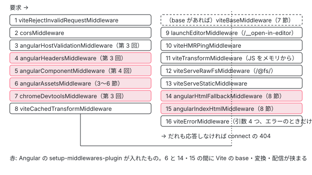

[目次](../README.md) › [ng serve の内側：Vite の middleware と plugin が 1 つの要求をさばくまで](README.md) › 第 2 回 / 全 5 回

# アセット・base href・index.html：どの URL に何を返すか

> setup-middlewares-plugin が並べる middleware の順と、assets-middleware・base-middleware・html-fallback-middleware・angular-memory-plugin の残り（Vite の client の書き換え）が、要求の URL をメモリの上の出力・アセット（/@fs/）・index.html にどう対応させるか。base href の外の要求、拡張子の無いアセット（e2ee6b3e8e）、ETag（origin/main の 0e2799d3a2）、HTML のアセット（099e52f42f）、SSR と base href（f39f7ee952）。

angular/angular-cli · 読了 約 14 分 · 発展 · [サイトで読む（デモが動きます）](https://angular-deep-dive-cyan.vercel.app/chapter/vds-assets-html)

---

この章で分かること: ブラウザからの要求の URL が、Angular と Vite の middleware の並びをどの順に通り、どこで「メモリの上のビルドの出力」「ディスクのアセット」「index.html」のどれかに決まるか。base href があるとき・無いとき、拡張子の無いアセット、存在しないファイル、`Accept` の違いで返るものがどう変わるかを、本物の `ng serve` に要求を送った記録で確かめます。

読む対象は `packages/angular/build/src/tools/vite/` の `middlewares/assets-middleware.ts`・`base-middleware.ts`・`html-fallback-middleware.ts`、`utils.ts` の 2 つの関数、`plugins/setup-middlewares-plugin.ts` と `angular-memory-plugin.ts` の残りです。middleware の並びの全体と `index-html-middleware.ts` は[ng serve の起動の章](../boot/03-boot-dev-server.md)で引用しているので、ここでは並びの中での役目だけを書きます。Vite の設定の作り方は[第 1 回](01-vds-config.md)、ビルドが index.html に何を足すかは[index.html の章](../boot/05-boot-index-html.md)です。

1. [1. Vite の設定を組み立てる](01-vds-config.md)
2. **2. アセット・base href・index.html**（この章）
3. [3. Host の検査と開発用のヘッダー](03-vds-host-headers.md)
4. [4. HMR と SSR の plugin](04-vds-hmr-ssr.md)
5. [5. spec と issue](05-vds-tests-issues.md)

> [!TIP]
> **新卒エンジニアへ**
>
> **middleware** は「要求を受け取り、自分で応答するか、`next()` で次に渡す」関数です。Vite は connect という小さなライブラリの `stack`（配列）に middleware を並べ、前から順に呼びます。誰も応答しないと、connect が最後に 404 を返します。**base href** はアプリを置く URL の接頭辞（`/app/` なら `http://host/app/…`）です。**`/@fs/`** は「ディスクの絶対パスのファイルを返して」という Vite の URL の形で、`/@fs/home/me/proj/public/logo.png` のように使います。

## 1. 要求が通る順番

下の図は、9 節の記録で `server.middlewares.stack` から読んだ、base href が `/` のときの並びです。Angular の plugin の `configureServer` が登録したもの（赤）は、Vite の前処理（不正な要求を落とす・CORS・Host の検査）の後、Vite の変換より前に入ります。`configureServer` が返した関数で登録したもの（後ろの 2 つ）は、Vite の静的ファイルの配信の後に入ります。



*base href が / のときの middleware の並び（@angular/build 22.1.7・vite 8.1.5 の記録）。base href があると viteCachedTransformMiddleware の後ろに viteBaseMiddleware が入る*

📄 `angular-cli/packages/angular/build/src/tools/vite/plugins/setup-middlewares-plugin.ts` L108–121 （▶ の行: 108, 110, 115–116, 118–120）

```ts
108 ▶       middlewares.use(createChromeDevtoolsMiddleware(server.config.cacheDir, options.projectRoot));
109 │ 
110 ▶       extensionMiddleware?.forEach((middleware) => middlewares.use(middleware));
111 │ 
112 │       // Returning a function, installs middleware after the main transform middleware but
113 │       // before the built-in HTML middleware
114 │       // eslint-disable-next-line @typescript-eslint/no-misused-promises
115 ▶       return async () => {
116 ▶         patchHostValidationMiddleware(server.middlewares);
117 │ 
118 ▶         if (ssrMode === ServerSsrMode.ExternalSsrMiddleware) {
119 ▶           patchBaseMiddleware(server.middlewares, server.config.base);
120 ▶           middlewares.use(await createAngularSsrExternalMiddleware(server, indexHtmlTransformer));
121 │ 
```

108 行目の DevTools の middleware と 110 行目の拡張の middleware（`executeDevServerBuilder` を関数として呼ぶ側が `extensions` で渡すもの。`ng serve` からは無い）までが「前」の組です。115 行目で関数を返すと、Vite はそれを自分の middleware を全部並べた後に呼びます（Vite の `_createServer` の `postHooks`）。だから 116 行目以降で `use` したものは、図の 14・15 番の位置に入ります。118〜119 行目は、利用者の `server.ts` で SSR する形のときだけ Vite の base middleware を差し替える行で、7 節で読みます。

この並びから、次の 2 つが決まります。

- `angularAssetsMiddleware`（6 番）は Vite の base middleware より**前**なので、base href が付いたままの URL を受け取ります。だから自分で base を外します（3 節）。
- `angularHtmlFallbackMiddleware` と `angularIndexHtmlMiddleware`（14・15 番）は、Vite の変換と静的ファイルの配信がどれも応答しなかった要求だけを受け取ります。

## 2. メモリの上の出力と、アセットの表

middleware が引く表は 2 つです。ビルドの出力（JS・CSS・index.html など）は `outputFiles`（`Map`、key は `/main.js` のような path）、angular.json の `assets` で写すだけのファイルは `assets`（key は同じ形、値はディスクの元の path）です。どちらに入るかを分ける `updateResultRecord` の前半（`origin === 'disk'` ならアセット）は[起動の章](../boot/03-boot-dev-server.md)で引用しているので、出力の側の続きを読みます。

📄 `angular-cli/packages/angular/build/src/builders/dev-server/vite/utils.ts` L59–91 （▶ の行: 59–60, 63–64, 66, 77–79, 83, 88, 90）

```ts
59 ▶   const servable =
60 ▶     file.type === BuildOutputFileType.Browser || file.type === BuildOutputFileType.Media;
61 │ 
62 │   // Skip analysis of sourcemaps
63 ▶   if (filePath.endsWith('.map')) {
64 ▶     generatedFiles.set(filePath, {
65 │       contents: file.contents,
66 ▶       servable,
67 │       size: file.contents.byteLength,
68 │       hash: file.hash,
69 │       type: file.type,
70 │       updated: false,
71 │     });
72 │ 
73 │     return;
74 │   }
75 │ 
76 │   // Avoid overwriting a servable browser file with a non-servable server file of the same path (e.g. CSS chunks)
77 ▶   const existing = generatedFiles.get(filePath);
78 ▶   if (existing?.servable && !servable) {
79 ▶     return;
80 │   }
81 │ 
82 │   // New or updated file
83 ▶   generatedFiles.set(filePath, {
84 │     contents: file.contents,
85 │     size: file.contents.byteLength,
86 │     hash: file.hash,
87 │     // Consider the files updated except on the initial build result
88 ▶     updated: !initial,
89 │     type: file.type,
90 ▶     servable,
91 │   });
```

59〜60 行目で、ブラウザ用（`Browser`）とメディア（`Media`、loader の `file` で出したもの）だけを `servable`（配ってよい）にします。サーバー用の出力も同じ表に入りますが、`servable` が `false` なので middleware は返しません。63 行目の `.map` は中身を見ずに入れます。77〜78 行目は、同じ path に「配ってよいブラウザ用」が先に入っていたら、後から来たサーバー用で上書きしない行です（76 行目のコメントの例は CSS の chunk）。

📄 `angular-cli/packages/angular/build/src/builders/dev-server/vite/index.ts` L253–259 （▶ の行: 254–255, 257–258）

```ts
253 │         }
254 ▶         if (serverOptions.servePath === undefined && result.detail?.['htmlBaseHref']) {
255 ▶           const baseHref = result.detail['htmlBaseHref'] as string;
256 │           // Remove trailing slash
257 ▶           serverOptions.servePath =
258 ▶             baseHref !== './' && baseHref.at(-1) === '/' ? baseHref.slice(0, -1) : baseHref;
259 │         }
```
*同じ switch の前後は起動の章で引用*

base は 1 回目のビルドの結果で決まります。options の `servePath` が無く、ビルドの結果に `htmlBaseHref`（application の `baseHref` の option の値）があれば、258 行目で末尾の `/` を外して `servePath` にします。`baseHref` の option が `/app/` なら `/app` になり、Vite はこれを `/app/` に直します（9 節の記録の `config.base`）。index.html の中の `<base href>` だけを書いて option を書かないと、`htmlBaseHref` は無いので base は `/` のままです。

## 3. URL から base を外す：pathnameWithoutBasePath

📄 `angular-cli/packages/angular/build/src/tools/vite/utils.ts` L25–43 （▶ の行: 26–27, 30–32, 36, 38–39, 42）

```ts
25 │ export function pathnameWithoutBasePath(url: string, basePath: string): string {
26 ▶   const parsedUrl = new URL(url, 'http://localhost');
27 ▶   const pathname = decodeURIComponent(parsedUrl.pathname);
28 │ 
29 │   // slice(basePath.length - 1) to retain the trailing slash
30 ▶   return basePath !== '/' && pathname.startsWith(basePath)
31 ▶     ? pathname.slice(basePath.length - 1)
32 ▶     : pathname;
33 │ }
34 │ 
35 │ export function lookupMimeTypeFromRequest(url: string): string | undefined {
36 ▶   const extension = extname(url.split('?')[0]);
37 │ 
38 ▶   if (extension === '.ico') {
39 ▶     return 'image/x-icon';
40 │   }
41 │ 
42 ▶   return extension && lookupMimeType(extension);
43 │ }
```

26 行目で query と hash を落とし、27 行目で `%20` などを戻します。30 行目で、base が `/` でなく、pathname が base で始まるときだけ、31 行目で base の長さより 1 文字少なく切ります（29 行目のコメントのとおり、先頭の `/` を残すため）。base で始まらなければ 32 行目でそのまま返します。つまり base の外の URL も、そのまま表を引きに行きます。9 節の記録の「base の外」の行は、これで説明できます。

27 行目の `decodeURIComponent` は、`%` の後ろが 16 進の 2 文字でない URL（`/%` など）で `URIError` を throw します。書きながら同じアプリで `/%`・`/version%` を送ると、並びの中で最初にこの関数を呼ぶ `angularComponentMiddleware`（[第 4 回](04-vds-hmr-ssr.md)）で throw し、`viteErrorMiddleware` が 500 を返して、ログに `[vite] Internal server error: URI malformed` が出ました。

35〜43 行目は拡張子から MIME 型を引く関数で、html-fallback が使います（8 節）。38〜39 行目で `.ico` だけを特別に扱うのは、この関数が使う `mrmime` の表に `.ico` が無いからです（サイトの node\_modules の `mrmime` で `lookup('.ico')` は `undefined`）。

## 4. assets-middleware の前半：アセットを返すか、/@fs/ に書き換えるか

📄 `angular-cli/packages/angular/build/src/tools/vite/middlewares/assets-middleware.ts` L36–74 （▶ の行: 43–44, 48, 51–54, 58–59, 63–64, 69–70）

```ts
36 │   return function angularAssetsMiddleware(req, res, next) {
37 │     if (req.url === undefined || res.writableEnded) {
38 │       return;
39 │     }
40 │ 
41 │     // Parse the incoming request.
42 │     // The base of the URL is unused but required to parse the URL.
43 ▶     const pathname = pathnameWithoutBasePath(req.url, server.config.base);
44 ▶     const extension = extname(pathname);
45 │     const pathnameHasTrailingSlash = pathname.at(-1) === '/';
46 │ 
47 │     // Rewrite all build assets to a vite raw fs URL
48 ▶     const asset = assets.get(pathname);
49 │     if (asset) {
50 │       // This is a workaround to serve extensionless, CSS, JS and TS files without Vite transformations.
51 ▶       if (!extension || JS_TS_REGEXP.test(extension) || CSS_PREPROCESSOR_REGEXP.test(extension)) {
52 ▶         const contents = readFileSync(asset.source);
53 ▶         const etag = `W/${calculateHash(contents)}`;
54 ▶         if (checkAndHandleEtag(req, res, etag)) {
55 │           return;
56 │         }
57 │ 
58 ▶         const mimeType = lookupMimeType(extension);
59 ▶         if (mimeType) {
60 │           res.setHeader('Content-Type', mimeType);
61 │         }
62 │ 
63 ▶         res.setHeader('ETag', etag);
64 ▶         res.setHeader('Cache-Control', 'no-cache');
65 │         res.end(contents);
66 │       } else {
67 │         // The encoding needs to match what happens in the vite static middleware.
68 │         // ref: https://github.com/vitejs/vite/blob/d4f13bd81468961c8c926438e815ab6b1c82735e/packages/vite/src/node/server/middlewares/static.ts#L163
69 ▶         req.url = `${server.config.base}@fs/${encodeURI(asset.source)}`;
70 ▶         next();
71 │       }
72 │ 
73 │       return;
74 │     }
```

1. **43〜48 行目: base を外した pathname でアセットの表を引く**

   当たったら、ここで終わりです（73 行目の `return`）。
2. **51 行目: 拡張子が無い・JS や TS・CSS や Sass なら、自分で読んで返す**

   52 行目で `readFileSync` し、53 行目で中身の hash から ETag を作り、54 行目で `If-None-Match` が同じなら 304 で終わります。58〜59 行目の MIME 型は拡張子から引くので、拡張子の無いファイルには `Content-Type` が付きません。
3. **69〜70 行目: それ以外は `/@fs/` に書き換えて Vite に任せる**

   画像や JSON などは、`req.url` を「base + `@fs/` + 元のファイルの絶対パス」に変えて `next()` します。後ろの Vite の base middleware が base を外し、`viteServeRawFsMiddleware` がディスクから返します。

51 行目が自分で返す拡張子を持っているのは、Vite に渡すと Vite が JS や CSS として変換してしまうからです（50 行目のコメント）。アセットとして写した JS は、変換しないまま返す約束です。拡張子の無いファイルが仲間に入ったのは e2ee6b3e8e（2026-02-24）で、それまでは `/@fs/` に回っていました。同じコミットで `build-assets_spec.ts` に「拡張子の無いアセットを変えずに返す」it が足されています（テストの節）。

📄 `../angular-cli で git show（抜粋）`

```
$ git show e2ee6b3e8e -- packages/angular/build/src/tools/vite/middlewares/assets-middleware.ts   # 2026-02-24
-      // This is a workaround to serve CSS, JS and TS files without Vite transformations.
-      if (JS_TS_REGEXP.test(extension) || CSS_PREPROCESSOR_REGEXP.test(extension)) {
+      // This is a workaround to serve extensionless, CSS, JS and TS files without Vite transformations.
+      if (!extension || JS_TS_REGEXP.test(extension) || CSS_PREPROCESSOR_REGEXP.test(extension)) {
```

53 行目の ETag は `W/` の後ろに hash をそのまま付けていて、引用符がありません。RFC 9110 の ETag は `W/"…"` と引用符で囲む形で、同じファイルのほかの ETag（5 節の 155 行目など）はそうなっています。origin/main の 0e2799d3a2（#34566、外の人の PR）がここを直しました。サイトの依存の 22.1.7 はさらに古く、hash に `createHash('sha256')` の 16 進をそのまま使います（9 節の記録の `/version` の ETag）。

📄 `../angular-cli で git show（origin/main の続き、抜粋）`

```
$ git show 0e2799d3a2 -- packages/angular/build/src/tools/vite/middlewares/assets-middleware.ts   # origin/main、2026-10-28（#34566）
       if (!extension || JS_TS_REGEXP.test(extension) || CSS_PREPROCESSOR_REGEXP.test(extension)) {
         const contents = readFileSync(asset.source);
-        const etag = `W/${calculateHash(contents)}`;
+        const etag = `W/"${calculateHash(contents)}"`;
$ git show a84f9fa9d4 -- packages/angular/build/src/tools/vite/middlewares/assets-middleware.ts   # origin/main、2026-11-03（Vitest 用の createBuildAssetsMiddleware）
+        const hash = outputFile.origin === 'memory' ? outputFile.hash : calculateHash(contents);
-        const etag = `W/"${calculateHash(contents)}"`;
+        const etag = `W/"${hash}"`;
```

Vite が `/@fs/` の要求を返すかどうかは、Vite の設定の `server.fs.allow` で決まります。

📄 `angular-cli/packages/angular/build/src/builders/dev-server/vite/server.ts` L71–84 （▶ の行: 78–81）

```ts
71 │     // File watching is handled by the build directly. `null` disables file watching for Vite.
72 │     watch: null,
73 │     fs: {
74 │       // Ensure cache directory, node modules, and all assets are accessible by the client.
75 │       // The first two are required for Vite to function in prebundling mode (the default) and to load
76 │       // the Vite client-side code for browser reloading. These would be available by default but when
77 │       // the `allow` option is explicitly configured, they must be included manually.
78 ▶       allow: [
79 ▶         cacheDir,
80 ▶         join(serverOptions.workspaceRoot, 'node_modules'),
81 ▶         ...[...assets.values()].map(({ source }) => source),
82 │       ],
83 │     },
84 │   };
```

📄 `angular-cli/packages/angular/build/src/builders/dev-server/vite/index.ts` L333–341 （▶ の行: 335–338）

```ts
333 │     if (server) {
334 │       // Update fs allow list to include any new assets from the build option.
335 ▶       server.config.server.fs.allow = [
336 ▶         ...new Set([
337 ▶           ...server.config.server.fs.allow,
338 ▶           ...[...assetFiles.values()].map(({ source }) => source),
339 │         ]),
340 │       ];
341 │ 
```

`fs.allow` は、79 行目の Vite のキャッシュ（prebundle の置き場所、[第 1 回](01-vds-config.md)）、80 行目の workspace の `node_modules`、81 行目のアセットの元のファイル 1 つずつ、の 3 種類です。2 回目以降のビルドでアセットが増えると、`vite/index.ts` の 335〜339 行目が `Set` で重ねて足します（消えたアセットは外しません）。開いている #31016（2025-08-22）は、monorepo で workspace の外（親のディレクトリ）にある `node_modules` のファイルを `/@fs/` で頼むと 403 になる、という報告です。80 行目が足すのは `workspaceRoot` の下の `node_modules` だけです。

## 5. assets-middleware の後半：HTML のアセットと、メモリの上の出力

📄 `angular-cli/packages/angular/build/src/tools/vite/middlewares/assets-middleware.ts` L76–103 （▶ の行: 79, 81, 83, 85–86, 93, 95, 101–103）

```ts
 76 │     // HTML fallbacking
 77 │     // This matches what happens in the vite html fallback middleware.
 78 │     // ref: https://github.com/vitejs/vite/blob/main/packages/vite/src/node/server/middlewares/htmlFallback.ts#L9
 79 ▶     const htmlAssetSourcePath = pathnameHasTrailingSlash
 80 │       ? // Trailing slash check for `index.html`.
 81 ▶         assets.get(pathname + 'index.html')
 82 │       : // Non-trailing slash check for fallback `.html`
 83 ▶         assets.get(pathname + '.html');
 84 │ 
 85 ▶     if (htmlAssetSourcePath) {
 86 ▶       req.url = `${server.config.base}@fs/${encodeURI(htmlAssetSourcePath.source)}`;
 87 │       next();
 88 │ 
 89 │       return;
 90 │     }
 91 │ 
 92 │     // Support HTTP HEAD requests for the virtual output files from the Angular build
 93 ▶     if (req.method === 'HEAD' && outputFiles.get(pathname)?.servable) {
 94 │       // While a GET will also generate content, the rest of the response is equivalent
 95 ▶       req.method = 'GET';
 96 │     }
 97 │ 
 98 │     // Resource files are handled directly.
 99 │     // Global stylesheets (CSS files) are currently considered resources to workaround
100 │     // dev server sourcemap issues with stylesheets.
101 ▶     if (extension !== '.js' && extension !== '.html') {
102 ▶       const outputFile = outputFiles.get(pathname);
103 ▶       if (outputFile?.servable) {
```

1. **79〜90 行目: `/docs/` → `docs/index.html`、`/help` → `help.html`**

   Vite の html fallback の真似です。末尾が `/` なら 81 行目で `index.html` を、そうでなければ 83 行目で `.html` を足してアセットの表を引き、当たれば 86 行目で `/@fs/` に書き換えます。
2. **93〜96 行目: メモリの上の出力への HEAD を GET にする**

   配ってよい出力への `HEAD` は、`req.method` を `GET` に変えて後ろに渡します。応答の本文は Node の `http` が `HEAD` の要求に対しては送りません（記録の `HEAD /main.js` は 0 バイト）。
3. **101〜103 行目: JS と HTML のほかの出力は、ここで返す**

   CSS などのメモリの上の出力は、Vite を通さずにこの middleware が返します（99〜100 行目のコメントのとおり、グローバルの CSS も source map の都合でここ）。JS は Vite の変換に回し、`angular-memory-plugin` の `load` がメモリから中身を渡します（[起動の章](../boot/03-boot-dev-server.md)）。

101 行目の `extension !== '.html'` は、loader の `file` で出した HTML（`import url from './test.html'`）も配らないので、それが index.html に化けるという報告が #34166 でした。origin/main の 099e52f42f（#34176）が、外すのを `/index.html` と `/index.csr.html` の 2 つだけにしました。

📄 `../angular-cli で git show（origin/main の続き）`

```
$ git show 099e52f42f -- packages/angular/build/src/tools/vite/middlewares/assets-middleware.ts   # origin/main、2026-09-25（#34176、#34166 を閉じた）
-    if (extension !== '.js' && extension !== '.html') {
+    if (extension !== '.js' && pathname !== '/index.html' && pathname !== '/index.csr.html') {
```

この間にあるコンポーネントの CSS（`ngcomp` の query 付き）の部分は HMR の話なので[第 4 回](04-vds-hmr-ssr.md)に回し、ふつうの出力を返す行を読みます。

📄 `angular-cli/packages/angular/build/src/tools/vite/middlewares/assets-middleware.ts` L155–170 （▶ の行: 155–156, 160, 162, 164–166）

```ts
155 ▶         const etag = `W/"${outputFile.contents.byteLength}-${outputFile.hash}"`;
156 ▶         if (checkAndHandleEtag(req, res, etag)) {
157 │           return;
158 │         }
159 │ 
160 ▶         const mimeType = lookupMimeType(extension);
161 │         if (mimeType) {
162 ▶           res.setHeader('Content-Type', mimeType);
163 │         }
164 ▶         res.setHeader('Cache-Control', 'no-cache');
165 ▶         res.setHeader('ETag', etag);
166 ▶         res.end(data);
167 │ 
168 │         return;
169 │       }
170 │     }
```

📄 `angular-cli/packages/angular/build/src/tools/vite/middlewares/assets-middleware.ts` L206–219 （▶ の行: 211–213）

```ts
206 │ function checkAndHandleEtag(
207 │   req: Connect.IncomingMessage,
208 │   res: ServerResponse,
209 │   etag: string,
210 │ ): boolean {
211 ▶   if (req.headers['if-none-match'] === etag) {
212 ▶     res.statusCode = 304;
213 ▶     res.end();
214 │ 
215 │     return true;
216 │   }
217 │ 
218 │   return false;
219 │ }
```

155 行目の ETag は「バイト数 - ビルドが計算した hash」で、中身を読み直さずに作れます。211 行目の比べ方は文字列の `===` だけで、`If-None-Match` に複数の値や `*` が来ても 304 にはしません。164 行目の `Cache-Control: no-cache` は「使う前に必ず確かめ直す」で、ブラウザは毎回 `If-None-Match` を送り、変わっていなければ 304 をもらいます。

## 6. ディレクトリへの要求をリダイレクトする

📄 `angular-cli/packages/angular/build/src/tools/vite/middlewares/assets-middleware.ts` L172–203 （▶ の行: 175–177, 179, 181, 183, 202）

```ts
172 │     // If the path has no trailing slash and it matches a servable directory redirect to the same path with slash.
173 │     // This matches the default express static behaviour.
174 │     // See: https://github.com/expressjs/serve-static/blob/89fc94567fae632718a2157206c52654680e9d01/index.js#L182
175 ▶     if (!pathnameHasTrailingSlash) {
176 ▶       for (const assetPath of assets.keys()) {
177 ▶         if (pathname === assetPath.substring(0, assetPath.lastIndexOf('/'))) {
178 │           const { pathname, search, hash } = new URL(req.url, 'http://localhost');
179 ▶           const location = [pathname, '/', search, hash].join('');
180 │ 
181 ▶           res.statusCode = 301;
182 │           res.setHeader('Content-Type', 'text/html');
183 ▶           res.setHeader('Location', location);
184 │           res.end(`
185 │             <!DOCTYPE html>
186 │             <html lang="en">
187 │               <head>
188 │                 <meta charset="utf-8">
189 │                 <title>Redirecting</title>
190 │               </head>
191 │               <body>
192 │                 <pre>Redirecting to <a href="${location}">${location}</a></pre>
193 │               </body>
194 │             </html>
195 │             `);
196 │ 
197 │           return;
198 │         }
199 │       }
200 │     }
201 │ 
202 ▶     next();
203 │   };
```

末尾に `/` が無い要求（175 行目）で、アセットのどれかの「最後の `/` より前」と同じなら（176〜177 行目）、そこはアセットのディレクトリです。179 行目で `/` を足した URL を作り、181〜183 行目で 301 と `Location` を返します。173〜174 行目のコメントのとおり、express の `serve-static` と同じ動きです。179 行目は `req.url`（base が付いたまま）から作るので、`/app/docs` は `/app/docs/` に飛びます。どれにも当たらなければ 202 行目で次に渡します。

## 7. base の外の要求：Vite の base middleware と patchBaseMiddleware

base が `/` でないとき、Vite は自分の `viteBaseMiddleware` を並べます（Vite 8.1.5 の `baseMiddleware`）。base で始まる要求は base を外して次へ、`/` と `/index.html` は base へ 302、それ以外は 404 で「base の URL を間違えていませんか」という本文を返します（`Accept` に `text/html` があれば HTML、無ければ text）。SSR で利用者の `server.ts` を使う形のときだけ、Angular はこれを差し替えます。

📄 `angular-cli/packages/angular/build/src/tools/vite/middlewares/base-middleware.ts` L23–58 （▶ の行: 24–25, 28, 32, 38, 43, 45, 49–50, 56）

```ts
23 │ export function patchBaseMiddleware(middlewares: Connect.Server, base: string): void {
24 ▶   const entry = middlewares.stack.find(
25 ▶     ({ handle }) => typeof handle === 'function' && handle.name.startsWith('viteBaseMiddleware'),
26 │   );
27 │ 
28 ▶   if (typeof entry?.handle !== 'function') {
29 │     return;
30 │   }
31 │ 
32 ▶   entry.handle = function angularBaseMiddleware(
33 │     req: IncomingMessage,
34 │     res: ServerResponse,
35 │     next: (err?: unknown) => void,
36 │   ) {
37 │     const url = req.url || '/';
38 ▶     if (url.startsWith(base)) {
39 │       // Rewrite the URL to remove the base prefix before passing it to the next middleware.
40 │       // If the URL is exactly the base, it becomes '/'.
41 │       // Otherwise, we slice off the base and ensure there's a leading slash.
42 │       // See: https://github.com/vitejs/vite/blob/e81c183f8c8ccaf7774ef0d0ee125bf63dbf30b4/packages/vite/src/node/server/middlewares/base.ts#L12
43 ▶       req.url = url === base ? '/' : addLeadingSlash(url.slice(base.length - 1));
44 │ 
45 ▶       return next();
46 │     }
47 │ 
48 │     const { pathname, hash, search } = new URL(url, 'http://localhost');
49 ▶     if (pathname === '/' || pathname === '/index.html') {
50 ▶       res.writeHead(302, { Location: `${base}${search}${hash}` });
51 │       res.end();
52 │ 
53 │       return;
54 │     }
55 │ 
56 ▶     next();
57 │   };
58 │ }
```

1. **24〜30 行目: Vite の base middleware を名前で探す**

   `stack` の中から `handle.name` が `viteBaseMiddleware` で始まるものを探し、無ければ（base が `/`）何もしません。
2. **32 行目: 同じ場所の `handle` を入れ替える**

   並びの位置はそのままで、中身だけを `angularBaseMiddleware` にします。Host の検査を差し替える `patchHostValidationMiddleware`（[第 3 回](03-vds-host-headers.md)）と同じやり方です。
3. **38〜45 行目: base で始まれば外して次へ**

   43 行目の切り方は Vite と同じです（42 行目のコメントが Vite の行を指している）。
4. **49〜50 行目: `/` と `/index.html` は base へ 302**

   ここも Vite と同じです。
5. **56 行目: それ以外は 404 にせず、次へ渡す**

   Vite と違うのはここだけです。base の外の `/ping` のような URL を、後ろの SSR の middleware（利用者の express のアプリ）に届けます。

これは f39f7ee952（2025-12-16、#31896 を閉じた）で入りました。本番では `server.ts` の express が base の外の URL（health check など）も受けるのに、`ng serve` では Vite が 404 にしていた、という違いを埋めるためです（コミットメッセージ）。同じコミットの e2e の `tests/legacy-cli/e2e/tests/vite/ssr-base-href.ts` は、`baseHref: '/base'` で `/base` と `/base/main.js` が返り、base の外の `/ping` が express に届くことを確かめます。SSR が無いとき・`InternalSsrMiddleware` のときは差し替えないので、9 節の記録のとおり Vite の 404 が返ります。

📄 `../angular-cli で git show（抜粋）`

```
$ git show f39f7ee952 -- packages/angular/build/src/tools/vite/plugins/setup-middlewares-plugin.ts   # 2025-12-16（#31896 を閉じた、抜粋）
         if (ssrMode === ServerSsrMode.ExternalSsrMiddleware) {
-          server.middlewares.use(
-            await createAngularSsrExternalMiddleware(server, indexHtmlTransformer),
-          );
+          patchBaseMiddleware(server.middlewares, server.config.base);
+          middlewares.use(await createAngularSsrExternalMiddleware(server, indexHtmlTransformer));
```

## 8. HTML への fallback と index.html

📄 `angular-cli/packages/angular/build/src/tools/vite/middlewares/html-fallback-middleware.ts` L15–47 （▶ の行: 15, 24, 32, 34–35, 38–39, 41, 43）

```ts
15 ▶ const ALLOWED_FALLBACK_METHODS = Object.freeze(['GET', 'HEAD']);
16 │ 
17 │ export function angularHtmlFallbackMiddleware(
18 │   req: Connect.IncomingMessage,
19 │   _res: ServerResponse,
20 │   next: Connect.NextFunction,
21 │ ): void {
22 │   // Similar to how it is handled in vite
23 │   // https://github.com/vitejs/vite/blob/main/packages/vite/src/node/server/middlewares/htmlFallback.ts#L15C19-L15C45
24 ▶   if (!req.method || !ALLOWED_FALLBACK_METHODS.includes(req.method)) {
25 │     // No fallback for unsupported request methods
26 │     next();
27 │ 
28 │     return;
29 │   }
30 │ 
31 │   if (req.url) {
32 ▶     const mimeType = lookupMimeTypeFromRequest(req.url);
33 │     if (
34 ▶       (mimeType === 'text/html' || mimeType === 'application/xhtml+xml') &&
35 ▶       !/^\/index\.(?:csr\.)?html/.test(req.url)
36 │     ) {
37 │       // eslint-disable-next-line no-console
38 ▶       console.warn(
39 ▶         `Request for HTML file "${req.url}" was received but no asset found. Asset may be missing from build.`,
40 │       );
41 ▶     } else if (mimeType) {
42 │       // No fallback for request of asset-like files
43 ▶       next();
44 │ 
45 │       return;
46 │     }
47 │   }
```

📄 `angular-cli/packages/angular/build/src/tools/vite/middlewares/html-fallback-middleware.ts` L49–59 （▶ の行: 50–53, 55, 58）

```ts
49 │   if (
50 ▶     !req.headers.accept ||
51 ▶     req.headers.accept.includes('text/html') ||
52 ▶     req.headers.accept.includes('text/*') ||
53 ▶     req.headers.accept.includes('*/*')
54 │   ) {
55 ▶     req.url = '/index.html';
56 │   }
57 │ 
58 ▶   next();
59 │ }
```

1. **24 行目: GET と HEAD だけ**

   15 行目の 2 つのほか（`POST` など）は、何もせずに次へ渡します。
2. **32〜40 行目: `.html` を頼まれたのに見つからなかったら警告する**

   ここまで来た `.html` の要求は、アセットにも出力にも無かったものです。`/index.html`・`/index.csr.html` のほかなら、38〜39 行目で `console.warn` を出します。ただし `return` しないので、そのまま 49 行目に進みます。
3. **41〜45 行目: ほかの拡張子は fallback しない**

   `.png` や `.js` など、MIME 型が引ける要求は次へ渡し、最後に connect の 404 になります。
4. **49〜56 行目: `Accept` が HTML を受けるなら `/index.html` に書き換える**

   `Accept` が無い、または `text/html`・`text/*`・`*/*` を含むときだけです。`fetch` で `Accept: application/json` を付けた要求は書き換わらず、404 になります。

書き換わった `/index.html` を受けるのが次の `angularIndexHtmlMiddleware` です。`pathnameWithoutBasePath` で `.html` を確かめ、`outputFiles` から中身を取り、HMR の溜まった更新を捨ててから、Vite の `transformIndexHtml`（`<script type="module" src="/@vite/client">` を足す）と利用者の `indexHtmlTransformer` を通して返します（行は[起動の章](../boot/03-boot-dev-server.md)）。32 行目の `req.url` は Vite の base middleware が base を外した後の値なので、`/app/deep/route` も `/deep/route` として判定されます。

index.html に足された `/@vite/client` の中身も、Angular が手を入れてから返しています。`angular-memory-plugin` の残りの関数です。

📄 `angular-cli/packages/angular/build/src/tools/vite/plugins/angular-memory-plugin.ts` L115–153 （▶ の行: 117–119, 125–126, 133, 136, 138, 141–142, 145, 150）

```ts
115 │ /**
116 │  * Reads the resolved Vite client code from disk and updates the content to remove
117 ▶  * an unactionable suggestion to update the Vite configuration file to disable the
118 ▶  * error overlay. The Vite configuration file is not present when used in the Angular
119 ▶  * CLI.
120 │  * @param file The absolute path to the Vite client code.
121 │  * @returns
122 │  */
123 │ async function loadViteClientCode(file: string, disableViteTransport = false): Promise<string> {
124 │   const originalContents = await readFile(file, 'utf-8');
125 ▶   let updatedContents = originalContents.replace(
126 ▶     '"You can also disable this overlay by setting ", ' +
127 │       'h("code", { part: "config-option-name" }, "server.hmr.overlay"), ' +
128 │       '" to ", ' +
129 │       'h("code", { part: "config-option-value" }, "false"), ' +
130 │       '" in ", ' +
131 │       'h("code", { part: "config-file-name" }, hmrConfigName), ' +
132 │       '"."',
133 ▶     '',
134 │   );
135 │ 
136 ▶   assert(originalContents !== updatedContents, 'Failed to update Vite client error overlay text.');
137 │ 
138 ▶   if (disableViteTransport) {
139 │     const previousUpdatedContents = updatedContents;
140 │ 
141 ▶     updatedContents = updatedContents.replace(
142 ▶       'transport.connect(createHMRHandler(handleMessage));',
143 │       '',
144 │     );
145 ▶     assert(
146 │       previousUpdatedContents !== updatedContents,
147 │       'Failed to update Vite client WebSocket disable.',
148 │     );
149 │ 
150 ▶     updatedContents = updatedContents.replace('console.debug("[vite] connecting...")', '');
151 │   }
152 │ 
153 │   return updatedContents;
```

`load` の hook は、出力に無い id のうち `/node_modules/vite/dist/client/client.mjs` で終わるものをこの関数に渡します（[起動の章](../boot/03-boot-dev-server.md)の `memoryLoad`）。125〜134 行目は、エラーの overlay に出る「`server.hmr.overlay` を設定ファイルで `false` にすれば消せます」という一文を消します。Angular CLI の利用者には Vite の設定ファイルが無いからです（115〜122 行目のコメント）。138〜151 行目は live reload を切ったとき（`disableViteTransport`）に、WebSocket へつなぐ 1 行と `[vite] connecting...` のログを消します。136・145 行目の `assert` は、Vite の版が上がって置き換える文字列が見つからなければ、`/@vite/client` を返すときに落とします。黙って消し損ねることはありません。

## 9. 本物の ng serve に要求を送る

> **🧪 DEMO — base href / と /app/ で、要求ごとに誰が何を返すか（記録の再生）**
>
> `<scratchpad>/vds-demo/a/record.mjs` が、@angular/build 22.1.7・vite 8.1.5 の `ng serve` を Node v24.22.1 で起動し、`http.request` で要求を送った記録です（スクリプトの全文は下のボタン）。アプリの `public/` には `favicon.ico`・`robots.txt`・拡張子の無い `version`・`data.json`・`help.html`・`docs/index.html` を置きました。「応答した middleware」は、包みのモジュールが `stack` の各 middleware を包み、見出しを書いた時点で動いていたものの名前を記録した値です。
>
> index.html の &lt;base href="/"&gt; のまま。baseHref の option は無い。Vite の config.base: `/`
>
> ▶ [このデモはサイトで動かせます](https://angular-deep-dive-cyan.vercel.app/chapter/vds-assets-html)

記録から読めることを並べます。

- **深い route**: `Accept: text/html` の `/deep/route` は 8 節の 55 行目で `/index.html` になり、`angularIndexHtmlMiddleware` が 200 を返します。同じ URL でも `Accept: application/json` だと書き換わらず、どの middleware も応答せずに connect の 404 です。
- **アセット**: `/version`（拡張子なし）と `/styles.css`（メモリの上の出力）は `angularAssetsMiddleware` が自分で返し、`/favicon.ico`・`/data.json` は `/@fs/` に書き換えられて `viteServeRawFsMiddleware` が返します（4 節）。`/version` には `Content-Type` が無く、ETag は引用符の無い `W/` + 64 文字の 16 進です。2 回目の要求に同じ ETag を `If-None-Match` で付けると 304 です。
- **HTML のアセット**: `/help` は `help.html`、`/docs/` は `docs/index.html` が返り、`/docs` は 301 で `/docs/` へ飛びます（5・6 節）。
- **無いファイル**: `/missing.png` は 404 ですが、`/missing.html`（`Accept: text/html`）はサーバーのログに警告を出したうえで、index.html を 200 で返します（8 節の 38 行目の後に `return` が無い）。
- **baseHref: /app/**: `/app/…` の結果は base が `/` のときと同じです。base の外では、`/` が `/app` への 302、`/deep/route` と `/main.js` が `viteBaseMiddleware` の 404 です。ところが `/version`・`/styles.css`・`/favicon.ico` は base の外でも 200 で返ります。`angularAssetsMiddleware` が Vite の base middleware より前にあり（1 節）、3 節の 32 行目が base で始まらない pathname をそのまま返すからです。

> **🧪 DEMO — html-fallback までの判定を、ページの上で写して試す**
>
> `tools/vite/utils.ts` の 25〜43 行目と `html-fallback-middleware.ts` の 15〜59 行目を写したもの（`vds-assets-html.demo-fallback.ts`）と、Vite 8.1.5 の `viteBaseMiddleware` を同じ規則で書いたものです。`mrmime` は 17 の拡張子だけの表に置き換えたので、表に無い拡張子（たとえば `.woff`）は本物と結果が違うことがあります。アセットの表とメモリの上の出力は見ないので、「アセットにも出力にも無かった要求」として判定します。
>
> ▶ [このデモはサイトで動かせます](https://angular-deep-dive-cyan.vercel.app/chapter/vds-assets-html)

## 10. 開いている issue と origin/main の続き

#27576（2024-05-01 から開いている）は、code-server のような reverse proxy の下で `https://…/proxy/4200/` の形で開くと、base href と `servePath` をどう組み合わせても、`@angular` の package（node の resources）の読み込みだけが合わない、という報告です。コメントには、webpack の時代の `browser` builder にあった `public-host` に当たるもの（配る場所は変えず、ページの中のリンクだけ変える）が欲しい、という声があります（gh で読むだけ）。この章の行でいえば、prebundle された依存の URL は `config.base` の後ろに `@fs/` と `cacheDir` の絶対パスを付けた形で（9 節の記録の `/app/main.js` は `/app/@fs<app>/.angular/cache/22.1.7/demo/vite/deps/@angular_core.js` を import する）、ほかのアセットは 3 節の `pathnameWithoutBasePath` を通ります。

origin/main（8b26efa1ba）でこの章のファイルに入ったのは、4 節の ETag の引用符（0e2799d3a2）、Vitest 用の `createBuildAssetsMiddleware` の hash の使い回し（a84f9fa9d4）、5 節の HTML のアセット（099e52f42f）の 3 つです。`base-middleware.ts`・`html-fallback-middleware.ts`・`index-html-middleware.ts` は変わっていません。

## テストと直し方

この章の行を固めている spec は次のとおりです（44129f66a3 で `grep -n` したもの。パスは `packages/angular/build/src/builders/dev-server/tests/` から）。

| spec | describe / it（行） | 固めていること |
| --- | --- | --- |
| `behavior/build-assets_spec.ts` | `Behavior: "browser builder assets"`（23）の 24・44・64・81・99 行目の it | 拡張子なし・JS・TS・CSS・SCSS のアセットを変えずに返す（4 節の 51 行目） |
| `behavior/build-assets_spec.ts` | 117・135・159・180 行目の it | 無いアセットは 404、末尾 `/` で `index.html`、`.html` を補う、ディレクトリは 301（5・6 節） |
| `behavior/build-assets_spec.ts` | 206・227 行目の it | バンドルと同じ名前の JS のアセット（`test/main.js`）を返す、無い `unknown/main.js` は 404 |
| `behavior/build-base-href_spec.ts` | `Behavior: "buildTarget baseHref"`（15）の it（25・38） | ビルドの `baseHref` が serve の path になる、末尾の `/` 無しでも返る（2 節の 254〜258 行目） |
| `options/serve-path_spec.ts` | `option: "servePath"`（16）の it（26・39・69・84・99）と xit（54） | servePath の下で返す・外は書き換えない・中は fallback する・アセットも servePath の下 |

📄 `走らせたコマンド`

```
cd ~/angular-research/angular-cli-fix   # 44129f66a3（../angular-cli と同じ版）
pnpm bazel test //packages/angular/build:dev-server_integration_tests --nocache_test_results --test_output=all \
  '--test_arg=--filter=browser builder assets|buildTarget baseHref|option: "servePath"'
```

📄 `結果（出力から抜き出したもの）`

```
Ran 1 of 59 specs / 1 spec, 0 failures      （shard 4 つ）
Ran 2 of 60 specs / 2 specs, 0 failures     （shard 3 つ）
Ran 3 of 61 specs / 3 specs, 0 failures     （shard 2 つ）
Ran 3 of 61 specs / 3 specs, 0 failures, 1 pending spec   （shard 1 つ。serve-path_spec.ts 54 行目の xit）
//packages/angular/build:dev-server_integration_tests                    PASSED in 7.0s
```

10 個の shard に散った it を合わせると 18 specs が通り、1 つが pending（`serve-path_spec.ts` の 54 行目の `xit`、「servePath を使うと root からは書き換えない」）でした。8 節の 38 行目の後に進む動き（警告を出して index.html を返す）、base の外のアセットが返ること、ETag の形、`Accept` が HTML を受けないときの 404 を固める spec はありません。

直すとしたら、次の場所になります。

- **ETag の引用符**: `assets-middleware.ts` の 53 行目（origin/main で直った）。spec は origin/main で `tools/vite/middlewares/assets-middleware_spec.ts` ができたので（a84f9fa9d4、`createBuildAssetsMiddleware` の分だけ）、`createAngularAssetsMiddleware` の describe をそこに足せます。
- **拡張子の無いアセットの Content-Type**: 同じファイルの 58〜61 行目。`build-assets_spec.ts` の 24 行目の it は本文だけを見ています。
- **見つからない .html**: `html-fallback-middleware.ts` の 33〜40 行目。警告の後に index.html を返すのを変えるなら、`build-assets_spec.ts` の 117 行目の it（無いアセットは 404）の隣に `.html` の場合を足します。
- **base の外のアセット**: `tools/vite/utils.ts` の 30〜32 行目と、それを呼ぶ `assets-middleware.ts` の 43 行目。`serve-path_spec.ts` の 69 行目の it は、base の外の `/api/` が 404 になることだけを見ていて、base の外のアセットは見ていません。

## ここまでの呼び出し

- 👤 `GET /app/deep/route`（Accept: text/html） — ブラウザ
  - `angularAssetsMiddleware` — assets-middleware.ts 36 — *pathname = /deep/route。表に無いので next()*
    - `pathnameWithoutBasePath(req.url, '/app/')` — tools/vite/utils.ts 25
  - `viteBaseMiddleware` — vite — *req.url = /deep/route*
  - `viteTransformMiddleware` → `viteServeRawFsMiddleware` → `viteServeStaticMiddleware` — vite — *どれも応答しない*
  - `angularHtmlFallbackMiddleware` — html-fallback-middleware.ts 17 — *req.url = /index.html（55 行目）*
    - `lookupMimeTypeFromRequest('/deep/route')` — tools/vite/utils.ts 35 — *undefined*
  - `angularIndexHtmlMiddleware` — index-html-middleware.ts — *outputFiles の /index.html*
    - `server.transformIndexHtml()` — vite — */app/@vite/client を足す*
- 👤 `GET /app/@vite/client` — ブラウザ
  - `load()` → `loadViteClientCode()` — angular-memory-plugin.ts 123 — *overlay の一文を消す*

## 聞かれそうな質問

**Q. Angular の route（`/users/42`）を直接開いても 404 にならないのはなぜですか？**

ブラウザの移動の要求は `Accept` に `text/html` を含むので、`html-fallback-middleware.ts` の 49〜55 行目が `req.url` を `/index.html` に書き換え、次の `angularIndexHtmlMiddleware` が index.html を返すからです。`Accept: application/json` の `fetch` なら 404 です（9 節の記録）。

**Q. `public/` に置いた JS が Vite に変換されないのはなぜですか？**

`assets-middleware.ts` の 51 行目が、アセットのうち JS・TS・CSS・Sass と拡張子の無いものを Vite に渡さず、52〜65 行目で自分で読んで返すからです。画像などは 69 行目で `/@fs/` に書き換えて Vite に渡します。

**Q. index.html に `<base href="/app/">` と書けば、`ng serve` も `/app/` で配りますか？**

配りません。`vite/index.ts` の 254 行目が見るのはビルドの結果の `htmlBaseHref`、つまり angular.json の `baseHref` の option です。index.html だけを書き換えても Vite の base は `/` のままです。`servePath` を書けば、そちらが優先されます。

**Q. baseHref を `/app/` にしたのに、`/favicon.ico` が返ってきます。なぜですか？**

`angularAssetsMiddleware` は Vite の base middleware より前にあり、`pathnameWithoutBasePath` は base で始まらない URL をそのまま返す（30〜32 行目）ので、base の外でもアセットの表に当たるからです。JS の `/main.js` は Vite の変換に回るので、base の外では Vite の 404 です。

**Q. `ng serve` の応答に 304 が多いのはなぜですか？**

Angular が返すものには `Cache-Control: no-cache` と ETag が付くので、ブラウザは毎回 `If-None-Match` で確かめに来ます。`checkAndHandleEtag`（211〜213 行目）が同じ値なら本文なしの 304 を返します。

**Q. SSR で base href を使うと、base の外の `/health` が 404 になりません。**

利用者の `server.ts` を使う形（`ExternalSsrMiddleware`）のときだけ、`setup-middlewares-plugin.ts` の 119 行目が Vite の base middleware を `angularBaseMiddleware` に替え、その 56 行目が 404 にせず次へ渡すからです（f39f7ee952）。

## 読み終えて

- Angular の middleware は Vite の前処理の後と、Vite の配信の後の 2 か所に入る。アセットは前、HTML への fallback は後。
- アセットは「自分で返す（JS・CSS・拡張子なし）」か「`/@fs/` に書き換えて Vite に返させる」かの 2 通りで、後者は `fs.allow` に入っていないと 403 になる。
- base は angular.json の `baseHref` か `servePath` から決まり、アセットの側は自分で base を外す。外せない URL もそのまま表を引く。
- HTML への fallback は拡張子と `Accept` で決まり、見つからない `.html` は警告のうえで index.html になる。
- 2026 年の修正（拡張子なし・ETag・HTML のアセット・SSR の base）は、どれも 1〜2 行の条件で、spec が見ていない形が残っている。

---

← 前: [Vite の設定を組み立てる：server.ts と prebundle と外部の依存](01-vds-config.md)  
次: [Host の検査と開発用のヘッダー：開発サーバーを何から守るか](03-vds-host-headers.md) →
