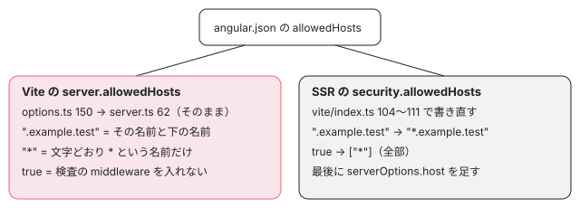

[目次](../README.md) › [ng serve の内側：Vite の middleware と plugin が 1 つの要求をさばくまで](README.md) › 第 3 回 / 全 5 回

# Host の検査と開発用のヘッダー：開発サーバーを何から守るか

> Host の検査と CORS は Vite が plugin より先に入れ（allowedHosts が true か https なら入れない）、Angular の host-check-middleware（30b5d81b4a）は 403 の画面を angular.json の案内に替えるだけ。allowedHosts は Vite と SSR（vite/index.ts の正規化 bfdc7b0abb、true を \['\*'\] に 3b99ee140d）の 2 か所へ行き、\["\*"\] は Vite では何も許さない。headers-middleware と Access-Control-Allow-Origin（b85ec6798b、#32923）、chrome-devtools-middleware が返す JSON、ssr-ssl-plugin（HTTP/1.1 53012c89f3、既定の CA に証明書を足す ad99e00ad7・d0e9e81639）を、本物の ng serve の記録で確かめる。

angular/angular-cli · 読了 約 12 分 · 発展 · [サイトで読む（デモが動きます）](https://angular-deep-dive-cyan.vercel.app/chapter/vds-host-headers)

---

この章で分かること: `ng serve` が「どの名前で届いた要求に答えるか（Host の検査）」と「ほかのサイトのページに応答を読ませるか（CORS）」を、Vite の middleware と Angular が足した middleware のどの行で決めているか。`allowedHosts` の値が Vite と SSR の 2 か所にどう渡るか、Angular が Vite の 403 の画面をどう差し替えるか、`headers` の見出しがどの応答に付くか、Chrome DevTools 向けの JSON と、SSR と HTTPS を一緒に使うときの plugin までを、本物の `ng serve` の記録で確かめます。

読む対象は `packages/angular/build/src/tools/vite/` の `middlewares/host-check-middleware.ts`・`middlewares/headers-middleware.ts`・`middlewares/chrome-devtools-middleware.ts`・`plugins/ssr-ssl-plugin.ts` と、記録したときのサイトの node\_modules の vite 8.1.5 の `dist/node/chunks/node.js` です（版は angular-cli 44129f66a3、記録は @angular/build 22.1.7）。middleware を並べる `setup-middlewares-plugin.ts` の全体は[ng serve の章](../boot/03-boot-dev-server.md)、Vite の設定の組み立ては[第 1 回](01-vds-config.md)、SSR の側の Host の検査は[SSR の Host 検証の章](../ssrx/04-ssrx-host-validation.md)にあります。

1. [1. Vite の設定を組み立てる](01-vds-config.md)
2. [2. アセット・base href・index.html](02-vds-assets-html.md)
3. **3. Host の検査と開発用のヘッダー**（この章）
4. [4. HMR と SSR の plugin](04-vds-hmr-ssr.md)
5. [5. spec と issue](05-vds-tests-issues.md)

> [!TIP]
> **新卒エンジニアへ**
>
> **Host 見出し**は、ブラウザが要求に付ける「どの名前のサーバーに話しかけたか」です。開発サーバーは手元の `127.0.0.1` で動いていても、ブラウザから見た名前は Host に出ます。**CORS**（Cross-Origin Resource Sharing）は、あるサイトのページが別のサイト（origin）の応答を JavaScript で読んでよいかを、応答の `Access-Control-Allow-Origin` 見出しで決める仕組みです。開発サーバーが守るのは、手元で動かしているソースや source map を、ほかの名前・ほかのサイトのページから読まれないことです。この章は、その判断がどの行にあるかだけを書きます。

## 1. 検査を入れるのは Vite

middleware の並び全体（16 個）は[第 2 回](02-vds-assets-html.md)の 1 節にあります。この章が読むのはその前の 3 つと、Angular が「前」の組に入れた headers と Chrome DevTools です。Host の検査と CORS は Angular ではなく Vite が、plugin の `configureServer` を呼ぶ前に入れます。

📄 `vite 8.1.5 の dist/node/chunks/node.js（記録したときのサイトの node_modules、行番号はこのファイル）`

```
// node_modules/vite/dist/node/chunks/node.js（vite 8.1.5）、_createServer の中
26009	if (process.env.DEBUG) middlewares.use(timeMiddleware(root));
26010	middlewares.use(rejectInvalidRequestMiddleware());
26011	const { cors } = serverConfig;
26012	if (cors !== false) middlewares.use((0, import_lib.default)(typeof cors === "boolean" ? {} : cors));
26013	const { allowedHosts } = serverConfig;
26014	if (allowedHosts !== true && !serverConfig.https) middlewares.use(hostValidationMiddleware(allowedHosts, false));
  ...
26019	const postHooks = [];
26020	for (const hook of config.getSortedPluginHooks("configureServer")) postHooks.push(await hook.call(configureServerContext, reflexServer));
```

1. **26012 行目: CORS の middleware**

   `cors` が `false` でなければ入ります。Angular は `{ preflightContinue: true }` を渡します（5 節）。
2. **26014 行目: Host の検査**

   `allowedHosts` が `true` のとき、または `server.https` があるときは、**入れません**。どちらでもなければ `hostValidationMiddleware` を入れます。
3. **26020 行目: plugin の `configureServer`**

   Angular の `vite:angular-setup-middlewares` はここで呼ばれ、headers を先頭に「前」の組を足し、戻り値の関数の最初で Host の検査の中身を差し替えます（3 節）。

この順から分かることが 2 つあります。Host で止められた 403 には、Angular の headers の見出しは付きません（headers の middleware はその後ろ）。そして、差し替えは並びの中の位置を変えず、すでにある項目の関数だけを入れ替えるので、検査は 3 番目のままです。

## 2. allowedHosts は 2 か所へ行く

`angular.json` の `allowedHosts` は、`options.ts` の 150 行目で「書かなければ `[]`」にそろえられ（[第 1 回](01-vds-config.md)）、`server.ts` の 62 行目でそのまま Vite の `server.allowedHosts` になります。もう 1 本の道が `vite/index.ts` の 104〜111 行目で、SSR のアプリ（`@angular/ssr`）が要求の Host を確かめるための `browserOptions.security.allowedHosts` を作ります。この 2026 年の 2 つの修正で今の形になりました。



*angular.json の allowedHosts の 2 つの行き先。同じ値でも、Vite と SSR で読み方が違う*

📄 `bfdc7b0abb・3b99ee140d（vite/index.ts、抜粋）`

```
$ git show bfdc7b0abb -- packages/angular/build/src/builders/dev-server/vite/index.ts   # 2026-02-25
+  // Vite allowedHost syntax doesn't allow `*.` but `.` acts as `*.`
+  // Angular SSR supports `*.`.
   const allowedHosts = Array.isArray(serverOptions.allowedHosts)
-    ? [...serverOptions.allowedHosts]
+    ? serverOptions.allowedHosts.map((host) => (host[0] === '.' ? '*' + host : host))
     : [];

$ git show 3b99ee140d -- packages/angular/build/src/builders/dev-server/vite/index.ts   # 2026-03-25
     ? serverOptions.allowedHosts.map((host) => (host[0] === '.' ? '*' + host : host))
-    : [];
+    : serverOptions.allowedHosts === true
+      ? ['*']
+      : [];

   // Always allow the dev server host
   allowedHosts.push(serverOptions.host);

   browserOptions.security = {
     allowedHosts,
```

Vite の書き方と SSR の書き方は違います。Vite では `.example.test` が「その名前と下の名前」、SSR では `*.example.test` が「下の名前」です（[SSR の章](../ssrx/04-ssrx-host-validation.md)）。bfdc7b0abb は、先頭が `.` の項目に `*` を付けて SSR の側に渡します。3b99ee140d は `allowedHosts: true` を SSR の側では `['*']` にします。どちらの道でも、最後に 111 行目で `serverOptions.host`（既定は `localhost`）を足します。

Vite の側の判定は次の 13 行です。

📄 `vite 8.1.5 の dist/node/chunks/node.js（host-validation-middleware 0.1.4 の同梱）`

```
// 同じファイル。host-validation-middleware 0.1.4 を同梱したもの
16907	function isHostAllowedInternal(hostHeader, allowedHosts) {
16908		if (isFileOrExtensionProtocolRE.test(hostHeader)) return true;
16909		const extracted = extractHostNameFromHostHeader(hostHeader);
16910		if (extracted.type === "invalid") return false;
16911		if (extracted.type === "ipv4" || extracted.type === "ipv6") return true;
16912		const hostname = extracted.value;
16913		if (hostname === "localhost" || hostname.endsWith(".localhost")) return true;
16914		for (const allowedHost of allowedHosts) {
16915			if (allowedHost === hostname) return true;
16916			if (allowedHost[0] === "." && (allowedHost.slice(1) === hostname || hostname.endsWith(allowedHost))) return true;
16917		}
16918		return false;
16919	}
  ...
16947	function hostValidationMiddleware$1(options) {
16948		return async function hostValidationMiddleware(req, res, next) {
16949			const hostHeader = req.headers.host;
16950			if (!isHostAllowed(hostHeader, options.allowedHosts)) {
16951				const hostname = hostHeader?.replace(/:\d+$/, "") ?? "";
16952				const errorMessage = options.generateErrorMessage?.(hostname) ?? generateDefaultErrorMessage(hostname);
16953				res.writeHead(403, { "Content-Type": options.errorResponseContentType ?? "text/plain" });
16954				res.end(errorMessage);
16955				return;
16956			}
16957			next();
16958		};
```

1. **16911 行目: IP アドレスなら通す**

   Host が `127.0.0.1:4200` や `[::1]:4200` なら、一覧を見ずに通します。
2. **16913 行目: localhost と \*.localhost は通す**

   名前の付いた Host で一覧を見なくても通るのはこれだけです。
3. **16915〜16916 行目: 一覧と比べる**

   完全に一致するか、項目が `.` で始まり「その名前」か「その名前で終わる」なら通します。`*` を特別に扱う行はありません。
4. **16950〜16954 行目: 通らなければ 403**

   `generateErrorMessage` の文（`vite.config.js` に足せ、という案内）を `text/plain` で返します。この 2 つの呼び出しを Angular が横取りします（3 節）。

> [!WARNING]
> **ハマりどころ**
>
> 配列に `"*"` を書いても、Vite の 16915 行目は Host の名前が文字どおり `*` のときにしか一致しません。SSR の側（`@angular/ssr` の `isHostAllowed`）は `'*'` を「全部」と読みます。4 節の記録の「`["*"]`」では、名前の付いた Host はすべて Vite の 403 で止まりました。全部の名前を許すのは `allowedHosts: true` で、そのときは 26014 行目で検査そのものが入りません。

CLI から `--allowed-hosts demo.test` と渡す道は、22.1.7 では使えません（#33955）。schema の `allowedHosts` は `oneOf` の中に配列と真偽値を並べていて、CLI の `getSupportedTypes` が `oneOf` の中の配列を見ず、yargs に真偽値だけで登録していたためです。記録では `demo.test` が project 名の位置の引数として読まれ、`Argument: project, Given: "demo.test", Choices: "demo"` で起動の前に止まりました。閉じた PR #34595 は schema を配列だけにする案でしたが、`allowedHosts: true` を書いた既存のプロジェクトを壊す変更なので minor では入れられない、と閉じられ、origin/main の 7ee5f905a8（2026-11-11）が CLI の側で `oneOf` の中の配列を読むように直しました。

## 3. host-check-middleware：Vite の 403 を Angular の文に替える

📄 `angular-cli/packages/angular/build/src/tools/vite/middlewares/host-check-middleware.ts` L14–45 （▶ の行: 15, 17, 20–21, 24, 26, 31, 34–35, 37–39, 42）

```ts
14 │ export function patchHostValidationMiddleware(middlewares: Connect.Server): void {
15 ▶   const entry = middlewares.stack.find(
16 │     ({ handle }) =>
17 ▶       typeof handle === 'function' && handle.name.startsWith('hostValidationMiddleware'),
18 │   );
19 │ 
20 ▶   if (typeof entry?.handle !== 'function') {
21 ▶     return;
22 │   }
23 │ 
24 ▶   const originalHandle = entry.handle as Connect.NextHandleFunction;
25 │ 
26 ▶   entry.handle = function angularHostValidationMiddleware(
27 │     req: IncomingMessage,
28 │     res: ServerResponse,
29 │     next: (err?: unknown) => void,
30 │   ) {
31 ▶     originalHandle(
32 │       req,
33 │       {
34 ▶         writeHead: (code) => {
35 ▶           res.writeHead(code, { 'content-type': 'text/html' });
36 │         },
37 ▶         end: () => {
38 ▶           const hostname = req.headers.host?.toLowerCase().split(':')[0] ?? '';
39 ▶           res.end(html403(hostname));
40 │         },
41 │       } as ServerResponse,
42 ▶       next,
43 │     );
44 │   };
45 │ }
```

1. **15〜18 行目: Vite の項目を名前で探す**

   `middlewares.stack` は connect の並びです。関数の名前が `hostValidationMiddleware` で始まる項目を探します。これは Vite の 16948 行目の内側の関数の名前です。
2. **20〜22 行目: 無ければ何もしない**

   `allowedHosts: true` や HTTPS では Vite が項目を入れないので（1 節の 26014 行目）、ここで終わります。名前が変わったときも黙ってここで終わります。
3. **24・26 行目: 元の関数を取っておき、handle を入れ替える**

   並びの位置は同じまま、中身だけ `angularHostValidationMiddleware` になります。
4. **31〜43 行目: 元の関数に「偽の res」を渡す**

   判定は元の関数（Vite の 16950 行目）にそのまま任せます。通るときは元の関数が 42 行目の `next` を呼ぶので、偽の res は使われません。
5. **34〜36 行目: writeHead の見出しを替える**

   Vite が `writeHead(403, { "Content-Type": "text/plain" })` と呼ぶと、状態の番号だけ受け取り、`text/html` で本物の res に書きます。
6. **37〜40 行目: end の本文を替える**

   Vite が渡す文は捨て、38 行目で Host を小文字にして `:` の前だけを取り、次の `html403` の HTML を返します。

📄 `angular-cli/packages/angular/build/src/tools/vite/middlewares/host-check-middleware.ts` L47–77 （▶ の行: 53, 66–67, 71）

```ts
47 │ function html403(hostname: string): string {
48 │   return `<!doctype html>
49 │ <html>
50 │   <head>
51 │     <meta charset="utf-8" />
52 │     <meta name="viewport" content="width=device-width, initial-scale=1" />
53 ▶     <title>Blocked request</title>
54 │     <style>
55 │       body{font-family:system-ui,-apple-system,Segoe UI,Roboto,Ubuntu,Cantarell,Noto Sans,sans-serif;
56 │       line-height:1.4;margin:2rem;color:#1f2937}
57 │       code{background:#f3f4f6;padding:.15rem .35rem;border-radius:.25rem}
58 │       main{max-width:760px;margin:0 auto}
59 │       h1{font-size:1.5rem;margin-bottom:.75rem}
60 │       p{margin:.5rem 0}
61 │       pre{background:#f9fafb;border:1px solid #e5e7eb;padding:.75rem;border-radius:.5rem;overflow:auto}
62 │     </style>
63 │   </head>
64 │   <body>
65 │     <main>
66 ▶       <h1>Blocked request. This host ("${hostname}") is not allowed.</h1>
67 ▶       <p>To allow this host, add it to <code>allowedHosts</code> under the <code>serve</code> target in <code>angular.json</code>.</p>
68 │       <pre><code>{
69 │   "serve": {
70 │     "options": {
71 ▶       "allowedHosts": ["${hostname}"]
72 │     }
73 │   }
74 │ }</code></pre>
75 │     </main>
76 │   </body>
77 │   </html>`;
```

66 行目で止めた名前を見せ、67 行目と 71 行目で「`angular.json` の `serve` の `allowedHosts` に足す」書き方を、その名前を入れた JSON で見せます。Vite の文は `vite.config.js` を案内しますが、Angular の利用者は `vite.config.js` を書かないためです。この差し替えは 2025-12 の 30b5d81b4a（外の人の PR）で入り、spec は `allowed-hosts_spec.ts` の 2 つの it に「本文に `angular.json` を含む」を足しただけです（テストの節）。

## 4. DEMO：Host を変えた要求の記録

> **🧪 DEMO — allowedHosts の 4 通りと Host（記録の再生）**
>
> `<scratchpad>/vds-demo/b/record-host.mjs` が、@angular/build 22.1.7・vite 8.1.5・Node v24.22.1 で本物の `ng serve` を設定ごとに起動し、`node:http` で Host を指定して `/` を取った結果です（Host には `:port` を付けた）。このページの中ではサーバーを動かしません。「次の要求へ」で 1 件ずつ進めてください。赤い状態は 403 です。
>
> ▶ [このデモはサイトで動かせます](https://angular-deep-dive-cyan.vercel.app/chapter/vds-host-headers)

- **既定**: `127.0.0.1` と `localhost` だけ 200（16911・16913 行目）。ほかは 403 で、本文は 3 節の 66 行目の `Blocked request. This host ("…") is not allowed.` と `text/html`。
- **名前の配列**: `.example.test` は `a.example.test` と `example.test` の両方を通す（16916 行目の 2 つの条件）。一覧に無い `other.test` だけ 403。
- **`["*"]`**: 既定と同じ結果。2 節の注意のとおり、Vite は `*` を特別に扱いません。
- **`true`**: すべて 200。26014 行目で検査が入らず、3 節の 20 行目で差し替えも何もしません。

### 判定を写した関数で試す

> **🧪 DEMO — Vite の Host の判定（ページの上で動く写し）**
>
> `vds-host-headers.demo-hosts.ts` は、上の 16891〜16919 行目と 26014 行目の条件を写した関数です。変えたのは Node の `net.isIP` を簡単な判定に置き換えた所だけです。入力はこのページの中だけで使い、どこにも送りません。
>
> ▶ [このデモはサイトで動かせます](https://angular-deep-dive-cyan.vercel.app/chapter/vds-host-headers)

## 5. headers-middleware と CORS

📄 `angular-cli/packages/angular/build/src/tools/vite/middlewares/headers-middleware.ts` L24–43 （▶ の行: 30–32, 35–37, 41）

```ts
24 │ export function createAngularHeadersMiddleware(server: ViteDevServer): Connect.NextHandleFunction {
25 │   return function angularHeadersMiddleware(
26 │     _req: Connect.IncomingMessage,
27 │     res: ServerResponse,
28 │     next: Connect.NextFunction,
29 │   ) {
30 ▶     const headers = server.config.server.headers;
31 ▶     if (!headers) {
32 ▶       return next();
33 │     }
34 │ 
35 ▶     for (const [name, value] of Object.entries(headers)) {
36 ▶       if (value !== undefined) {
37 ▶         res.setHeader(name, value);
38 │       }
39 │     }
40 │ 
41 ▶     next();
42 │   };
43 │ }
```

30 行目は要求のたびに `server.config.server.headers`（`server.ts` の 63 行目で `angular.json` の `headers` を入れたもの）を読みます。31〜33 行目で無ければ何もせず、35〜39 行目で値が `undefined` でない見出しを `res.setHeader` し、41 行目で次へ渡します。書くのは見出しだけで、応答を返すのは後ろの middleware です。だから後ろの assets・index.html・Vite の 404 のどれが返しても見出しが付き、前にある Host の 403 には付きません。

CORS の判定は Vite の 26012 行目です。Angular が渡す `cors` は `preflightContinue: true` だけで、Vite の `resolveServerOptions` が既定値と混ぜるので、`origin` は既定の正規表現（localhost・`127.0.0.1`・`[::1]` だけ）になります。

📄 `vite 8.1.5 の dist/node/chunks/node.js（既定値）`

```
// 同じファイル。server の既定値と、Angular の設定との合わせ方
  689	const defaultAllowedOrigins = /^https?:\/\/(?:(?:[^:]+\.)?localhost|127\.0\.0\.1|\[::1\])(?::\d+)?$/;
  ...
26115	const _serverConfigDefaults = Object.freeze({
  ...
26119		allowedHosts: [],
  ...
26123		cors: { origin: defaultAllowedOrigins },
  ...
26148	async function resolveServerOptions(root, raw, logger) {
26149		const _server = mergeWithDefaults({
26150			..._serverConfigDefaults,
```

2026-04 までは Angular が `origin: true`（要求の Origin をそのまま返す）を渡していました。#32923 は、これだとほかのサイトのページが手元の開発サーバーの応答を読める、という報告で、b85ec6798b がこの 3 行を消して Vite の既定に戻しました。コミットの題は「`headers` で `Access-Control-Allow-Origin` を設定できるように」で、別の origin に読ませたいときは利用者が `headers` に明示します。

📄 `b85ec6798b（server.ts）`

```
$ git show b85ec6798b -- packages/angular/build/src/builders/dev-server/vite/server.ts   # 2026-04-10（#32923）
     proxy,
     cors: {
-      // This will add the header `Access-Control-Allow-Origin: http://example.com`,
-      // where `http://example.com` is the requesting origin.
-      origin: true,
       // Allow preflight requests to be proxied.
       preflightContinue: true,
     },
```

> **🧪 DEMO — headers と Origin（記録の再生）**
>
> 同じ記録スクリプトの 3 つ目の部分です。`headers` を書かない起動と書いた起動で、Origin を変えて要求しました。
>
> ▶ [このデモはサイトで動かせます](https://angular-deep-dive-cyan.vercel.app/chapter/vds-host-headers)

- **headers を書かない**: `Access-Control-Allow-Origin` が付くのは Origin が `http://localhost:5000` のときだけ（689 行目の正規表現に合う）。`http://other.test` には付かないので、そのページの JavaScript は応答を読めません。`Vary: Origin` は cors の middleware が毎回付けます。
- **headers を書いた**: Origin に関係なく、設定した値が全部の応答に付きます。存在しないファイルの 404（Vite の最後の middleware が返す）にも付きます。cors が先に付けた値は、後ろの 37 行目の `setHeader` が上書きします。

## 6. chrome-devtools-middleware：何を返すか

📄 `angular-cli/packages/angular/build/src/tools/vite/middlewares/chrome-devtools-middleware.ts` L17–39 （▶ の行: 24, 30–31, 34–35）

```ts
17 │ type DevToolsJson = {
18 │   workspace: {
19 │     root: string;
20 │     uuid: string;
21 │   };
22 │ };
23 │ 
24 ▶ const CHROME_DEVTOOLS_ROUTE = '/.well-known/appspecific/com.chrome.devtools.json';
25 │ 
26 │ export function createChromeDevtoolsMiddleware(
27 │   cacheDir: string,
28 │   projectRoot: string,
29 │ ): Connect.NextHandleFunction {
30 ▶   let devtoolsConfig: string | undefined;
31 ▶   const devtoolsConfigPath = join(cacheDir, 'com.chrome.devtools.json');
32 │ 
33 │   return function chromeDevtoolsMiddleware(req, res, next) {
34 ▶     if (req.url !== CHROME_DEVTOOLS_ROUTE) {
35 ▶       next();
36 │ 
37 │       return;
38 │     }
39 │ 
```

📄 `angular-cli/packages/angular/build/src/tools/vite/middlewares/chrome-devtools-middleware.ts` L40–67 （▶ の行: 40, 43, 45–47, 51, 55, 58–60, 64–65）

```ts
40 ▶     if (!devtoolsConfig) {
41 │       // We store the UUID and re-use it to ensure Chrome does not repeatedly ask for permissions when restarting the dev server.
42 │       try {
43 ▶         devtoolsConfig = readFileSync(devtoolsConfigPath, 'utf-8');
44 │ 
45 ▶         const devtoolsConfigJson: DevToolsJson = JSON.parse(devtoolsConfig);
46 ▶         assert.equal(projectRoot, devtoolsConfigJson?.workspace.root);
47 ▶       } catch {
48 │         const devtoolsConfigJson: DevToolsJson = {
49 │           workspace: {
50 │             root: projectRoot,
51 ▶             uuid: randomUUID(),
52 │           },
53 │         };
54 │ 
55 ▶         devtoolsConfig = JSON.stringify(devtoolsConfigJson, undefined, 2);
56 │ 
57 │         try {
58 ▶           mkdirSync(cacheDir, { recursive: true });
59 ▶           writeFileSync(devtoolsConfigPath, devtoolsConfig);
60 ▶         } catch {}
61 │       }
62 │     }
63 │ 
64 ▶     res.setHeader('Content-Type', 'application/json');
65 ▶     res.end(devtoolsConfig);
66 │   };
67 │ }
```

1. **24・34 行目: 決まった 1 つの URL だけ**

   Chrome の DevTools が「このページのソースは手元のどのフォルダか」を聞きに来る `/.well-known/appspecific/com.chrome.devtools.json` と `req.url` が完全に一致するときだけ答えます。query が付くと一致せず、後ろの middleware に渡ります（記録では 404）。
2. **30・31 行目: 中身は閉包に、ファイルは cacheDir に**

   1 回作った JSON の文字列は 30 行目の変数に残します。ファイルは Vite の `cacheDir`（記録では `.angular/cache/22.1.7/demo/vite/com.chrome.devtools.json`）に置きます。
3. **43〜46 行目: 前の起動のファイルを使う**

   読めて、`workspace.root` が今の `projectRoot` と同じなら、その uuid を使い続けます。41 行目のコメントのとおり、uuid が変わると Chrome がフォルダの許可をもう一度聞くためです。プロジェクトを動かした（root が違う）ときは 46 行目の `assert` が投げ、作り直します（5bea3de4cb）。
4. **47〜61 行目: 作り直す**

   51 行目で新しい uuid、55 行目で 2 字下げの JSON、58〜59 行目で書きます。書けなくても 60 行目で黙って続けます。
5. **64〜65 行目: application/json で返す**

   状態の番号は既定の 200 です。

| 起動 | 状態 | Content-Type | 本文 | Host: other.test | ?x=1 を付ける |
| --- | --- | --- | --- | --- | --- |
| 1 回目 | 200 | application/json | { "workspace": { "root": "&lt;scratchpad&gt;/vds-demo/b/app", "uuid": "a1a51303-78ab-4940-a838-053f4185af08" } } | 403 | 404（text/html; charset=utf-8） |
| 2 回目 | 200 | application/json | { "workspace": { "root": "&lt;scratchpad&gt;/vds-demo/b/app", "uuid": "a1a51303-78ab-4940-a838-053f4185af08" } } | 403 | 404（text/html; charset=utf-8） |

2 回起動しても uuid は同じで、cacheDir のファイルから読んだことが分かります。この 2 回目の動きは 05485ede7b（2025-04）で直ったもので、それまでは 43 行目が `const devtoolsConfig = …` と同じ名前の変数を中で作っていたため、外の 30 行目の変数が `undefined` のまま 65 行目に渡り、2 回目以降の起動では中身が返りませんでした。この middleware を通る spec は今もありません（テストの節で確かめます）。また、1 節の順のとおり Host の検査の後ろにあるので、許していない Host には 403 です。

📄 `chrome-devtools-middleware.ts の履歴`

```
$ git log --format='%h %ad %s' --date=short -- packages/angular/build/src/tools/vite/middlewares/chrome-devtools-middleware.ts
b9681c0cda 2026-06-22 build: upgrade Vite to v8.0.16
05485ede7b 2025-04-25 fix(@angular/build): ensure `com.chrome.devtools.json` is consistently served after initial run
5bea3de4cb 2025-03-11 fix(@angular/build): invalidate `com.chrome.devtools.json` if project is moved
3c9172159c 2025-03-05 feat(@angular/build): integrate Chrome automatic  workspace folders

$ git show 05485ede7b -- packages/angular/build/src/tools/vite/middlewares/chrome-devtools-middleware.ts
       try {
-        const devtoolsConfig = readFileSync(devtoolsConfigPath, 'utf-8');
+        devtoolsConfig = readFileSync(devtoolsConfigPath, 'utf-8');
+
         const devtoolsConfigJson: DevToolsJson = JSON.parse(devtoolsConfig);
```

## 7. ssr-ssl-plugin：SSR と HTTPS を一緒に使うとき

📄 `angular-cli/packages/angular/build/src/tools/vite/plugins/ssr-ssl-plugin.ts` L14–47 （▶ の行: 17–18, 24, 28, 37, 40–41, 43–44）

```ts
14 │ export function createAngularServerSideSSLPlugin(): Plugin {
15 │   return {
16 │     name: 'angular-ssr-ssl-plugin',
17 ▶     apply: 'serve',
18 ▶     async configureServer({ config, httpServer }) {
19 │       const {
20 │         ssr,
21 │         server: { https },
22 │       } = config;
23 │ 
24 ▶       if (!ssr || !https?.cert) {
25 │         return;
26 │       }
27 │ 
28 ▶       if (httpServer && 'ALPNProtocols' in httpServer) {
29 │         // Force Vite to use HTTP/1.1 when SSR and SSL are enabled.
30 │         // This is required because the Express server used for SSR does not support HTTP/2.
31 │         // See: https://github.com/vitejs/vite/blob/46d3077f2b63771cc50230bc907c48f5773c00fb/packages/vite/src/node/http.ts#L126
32 │ 
33 │         // We directly set the `ALPNProtocols` on the HTTP server to override the default behavior.
34 │         // Passing `ALPNProtocols` in the TLS options would cause Node.js to automatically include `h2`.
35 │         // Additionally, using `ALPNCallback` is not an option as it is mutually exclusive with `ALPNProtocols`.
36 │         // See: https://github.com/nodejs/node/blob/b8b4350ed3b73d225eb9e628d69151df56eaf298/lib/internal/http2/core.js#L3351
37 ▶         httpServer.ALPNProtocols = ['http/1.1'];
38 │       }
39 │ 
40 ▶       const { cert } = https;
41 ▶       const additionalCerts = Array.isArray(cert) ? cert : [cert];
42 │ 
43 ▶       const currentCerts = getCACertificates('default');
44 ▶       setDefaultCACertificates([...currentCerts, ...additionalCerts]);
45 │     },
46 │   };
47 │ }
```

この plugin は `server.ts` の 272〜274 行目で「`ssl` が真で、SSR がある」ときだけ足されます（[第 1 回](01-vds-config.md)）。17 行目で `ng serve` のときだけ、18 行目の `configureServer` で動き、24 行目で SSR か証明書が無ければ何もしません。

1. **28〜37 行目: HTTP/2 を切る（53012c89f3、#31894）**

   Vite は HTTPS のとき HTTP/2 で待ち受けます。SSR の `server.ts` に使われる Express は HTTP/2 の要求を扱えないので、37 行目で TLS の ALPN（接続のはじめに使う protocol を決める交渉）の候補を `http/1.1` だけにします。
2. **40〜44 行目: 自分の証明書を Node の既定の CA に足す（ad99e00ad7、#31710）**

   SSR のアプリが `HttpClient`（`withFetch`）などで同じ開発サーバーに https で要求するとき、自己署名の証明書でも通るようにします。それまでは利用者が `NODE_TLS_REJECT_UNAUTHORIZED` などを設定していました。43 行目の `getCACertificates('default')` は Node の既定の集合で、`NODE_EXTRA_CA_CERTS` の証明書もここに入ります（下の記録）。6d212206fd（#31983）はこの環境変数を古い undici の道に足した修正で、Node の最低版を上げた d0e9e81639 がその道ごと消しました。

📄 `ssr-ssl-plugin.ts の履歴と 2 つの修正（抜粋）`

```
$ git log --format='%h %ad %s' --date=short -- packages/angular/build/src/tools/vite/plugins/ssr-ssl-plugin.ts
b9681c0cda 2026-06-22 build: upgrade Vite to v8.0.16
d0e9e81639 2026-02-24 build: update minimum supported Node.js versions
6d212206fd 2025-12-08 fix(@angular/build): support NODE_EXTRA_CA_CERTS in SSR SSL plugin
53012c89f3 2025-11-21 fix(@angular/build): force dev-server to use HTTP/1.1 when using SSR with SSL
ad99e00ad7 2025-11-08 fix(@angular/build): simplify SSL handling for `ng serve` with SSR (#31722)

$ git show 6d212206fd -- …/ssr-ssl-plugin.ts   # undici の道に NODE_EXTRA_CA_CERTS を足し、Node の API がある版では先に使う
+      if (getCACertificates && setDefaultCACertificates) {
+        const currentCerts = getCACertificates('default');
+        setDefaultCACertificates([...currentCerts, ...additionalCerts]);
+        return;
+      }
       …
+      const extraNodeCerts = process.env['NODE_EXTRA_CA_CERTS'];
+      if (extraNodeCerts) {
+        ca.push(await readFile(extraNodeCerts));
+      }

$ git show d0e9e81639 -- …/ssr-ssl-plugin.ts   # Node 22.22 / 24.13 未満を切り、undici の道ごと消す
-      // TODO(alanagius): Remove the `if` check once we only support Node.js 22.18.0+ and 24.5.0+.
-      if (getCACertificates && setDefaultCACertificates) {
…
-      const { getGlobalDispatcher, setGlobalDispatcher, Agent } = await import('undici');
…
+      const currentCerts = getCACertificates('default');
+      setDefaultCACertificates([...currentCerts, ...additionalCerts]);
```

| 起動 | ALPN で決まった protocol | Host: localhost | Host: other.test |
| --- | --- | --- | --- |
| --ssl（SSR なし） | h2 | 200 | 200 |
| --ssl -c ssr（SSR あり） | http/1.1 | 200 | 200 |

| 環境変数 | bundled | extra | default | default に入ったか |
| --- | --- | --- | --- | --- |
| (なし) | 118 | 0 | 118 | いいえ |
| NODE\_EXTRA\_CA\_CERTS=ca/extra.pem | 118 | 1 | 119 | はい |

ALPN は、`h2` と `http/1.1` の両方を出して接続したとき、SSR なしは `h2`、SSR ありは 37 行目のとおり `http/1.1` に決まりました。同じ表の右の列のとおり、`--ssl` では許していない Host にも 200 が返ります。1 節の 26014 行目が `server.https` のとき Host の検査を入れないためで、3 節の差し替えも 20 行目で何もしません。SSR ありの行も 200 です。この記録は内部の SSR middleware（`server.ts` を書かない形）で、Host を確かめる `AngularAppEngine` を通らないためです（[第 4 回](04-vds-hmr-ssr.md)）。なお、HMR の WebSocket の受け付け（同じファイルの 17014 行目）は、HTTPS かどうかを見ずに同じ `isHostAllowed` を使います。

origin/main では fe60e27105（#34399、2026-10-19）が `sslKey`・`sslCert` を workspace の root から解決するようにし、サブフォルダから `ng serve` したときの `ENOENT` を直しました。この修正では `tests/options/ssl_spec.ts` も足されています。

📄 `origin/main（8b26efa1ba）の続き`

```
$ git -C ~/angular-research/angular-cli log --format='%h %ad %s' --date=short 44129f66a3..origin/main -- packages/angular/cli/src/command-builder/utilities/json-schema.ts
7ee5f905a8 2026-11-11 fix(@angular/cli): support array options defined in oneOf schemas   # Fixes #33955

$ git show fe60e27105 -- packages/angular/build/src/builders/dev-server/options.ts   # 2026-10-19（#34399）
-    sslCert,
-    sslKey,
+    sslCert: sslCert && path.resolve(workspaceRoot, sslCert),
+    sslKey: sslKey && path.resolve(workspaceRoot, sslKey),
```

## テストと直し方

この章の行を固めている spec は次のとおりです（44129f66a3 で `grep -n` したもの）。

| spec | describe / it（行） | 固めていること |
| --- | --- | --- |
| `tests/options/allowed-hosts_spec.ts` | `option: "allowedHosts"`（18）の it 4 つ（26・40・55・69） | 既定と `[]` で 403 と本文の `angular.json`（3 節）、名前の配列と `true` で 200 |
| `tests/options/headers_spec.ts` | `option: "headers"`（15）の it 4 つ（26・40・54・65） | index.html とメディアに見出しが付く、`Access-Control-Allow-Origin` を設定できる・既定では付かない（5 節） |

📄 `angular-cli/packages/angular/build/src/builders/dev-server/tests/options/allowed-hosts_spec.ts` L15–53 （▶ の行: 15, 31–32, 36–37, 43, 52）

```ts
15 ▶ const FETCH_HEADERS = Object.freeze({ Host: 'example.com' });
16 │ 
17 │ describeServeBuilder(executeDevServer, DEV_SERVER_BUILDER_INFO, (harness, setupTarget) => {
18 │   describe('option: "allowedHosts"', () => {
19 │     beforeEach(async () => {
20 │       setupTarget(harness);
21 │ 
22 │       // Application code is not needed for these tests
23 │       await harness.writeFile('src/main.ts', '');
24 │     });
25 │ 
26 │     it('does not allow an invalid host when option is not present', async () => {
27 │       harness.useTarget('serve', {
28 │         ...BASE_OPTIONS,
29 │       });
30 │ 
31 ▶       const { result, response } = await executeOnceAndGet(harness, '/', {
32 ▶         request: { headers: FETCH_HEADERS },
33 │       });
34 │ 
35 │       expect(result?.success).toBeTrue();
36 ▶       expect(response?.statusCode).toBe(403);
37 ▶       expect(response && (await text(response))).toContain('angular.json');
38 │     });
39 │ 
40 │     it('does not allow an invalid host when option is an empty array', async () => {
41 │       harness.useTarget('serve', {
42 │         ...BASE_OPTIONS,
43 ▶         allowedHosts: [],
44 │       });
45 │ 
46 │       const { result, response } = await executeOnceAndGet(harness, '/', {
47 │         request: { headers: FETCH_HEADERS },
48 │       });
49 │ 
50 │       expect(result?.success).toBeTrue();
51 │       expect(response?.statusCode).toBe(403);
52 ▶       expect(response && (await text(response))).toContain('angular.json');
53 │     });
```

15 行目で Host を `example.com` に固定し、31〜32 行目の `executeOnceAndGet`（`fetch` では Host を変えられないので `node:http` の `get`、[第 5 回](05-vds-tests-issues.md)）で取り、37 行目で本文に `angular.json` があること、つまり 3 節の差し替えが効いたことを見ます。先頭が `.` の項目、`["*"]`、HTTPS の it はありません。

📄 `angular-cli/packages/angular/build/src/builders/dev-server/tests/options/headers_spec.ts` L40–63 （▶ の行: 44, 48, 51, 59, 62）

```ts
40 │     it('should include configured Access-Control-Allow-Origin header', async () => {
41 │       harness.useTarget('serve', {
42 │         ...BASE_OPTIONS,
43 │         headers: {
44 ▶           'Access-Control-Allow-Origin': 'http://example.com',
45 │         },
46 │       });
47 │ 
48 ▶       const { result, response } = await executeOnceAndFetch(harness, '/main.js');
49 │ 
50 │       expect(result?.success).toBeTrue();
51 ▶       expect(await response?.headers.get('access-control-allow-origin')).toBe('http://example.com');
52 │     });
53 │ 
54 │     it('should not include Access-Control-Allow-Origin header by default', async () => {
55 │       harness.useTarget('serve', {
56 │         ...BASE_OPTIONS,
57 │       });
58 │ 
59 ▶       const { result, response } = await executeOnceAndFetch(harness, '/main.js');
60 │ 
61 │       expect(result?.success).toBeTrue();
62 ▶       expect(await response?.headers.has('access-control-allow-origin')).toBeFalse();
63 │     });
```

b85ec6798b が足した 2 つの it です。59 行目の要求には Origin が無いので、62 行目の「既定では付かない」は、Origin の正規表現に合わない要求で付かないことまでは見ていません（記録の `http://other.test` の行がそれです）。

📄 `走らせたコマンドと結果`

```
cd ~/angular-research/angular-cli-fix          # 44129f66a3 と同じ版
pnpm bazel test //packages/angular/build:dev-server_integration_tests --nocache_test_results --test_output=all
# → 10 shard の合計 77 specs, 0 failures, 12 pending / PASSED（1 回目、約 91 秒）
#   もう 1 回走らせると shard 10 の build-errors_spec が 1 度 Timeout で落ち、再試行で通った（FLAKY）
```

次に、作業木でこの章の行を 1 行ずつ壊し、どの spec が落ちるかを見ました。

📄 `作業木の作り方（../angular-cli-fix から。../angular-cli は触らない）`

```
git -C ~/angular-research/angular-cli-fix worktree add <scratchpad>/vds-wt-b 44129f66a3
cd <scratchpad>/vds-wt-b && ln -s ~/angular-research/angular-cli-fix/node_modules node_modules
# 4 か所を 1 行ずつ壊して、dev-server の spec を全部走らせる
pnpm bazel test //packages/angular/build:dev-server_integration_tests --nocache_test_results --test_output=all --flaky_test_attempts=1
git -C ~/angular-research/angular-cli-fix worktree remove --force <scratchpad>/vds-wt-b
```

📄 `壊した 4 か所（1 回の実行でまとめて）`

```
--- a/packages/angular/build/src/tools/vite/middlewares/host-check-middleware.ts
-      typeof handle === 'function' && handle.name.startsWith('hostValidationMiddleware'),
+      typeof handle === 'function' && handle.name.startsWith('noSuchMiddleware'),
--- a/packages/angular/build/src/tools/vite/middlewares/chrome-devtools-middleware.ts
-const CHROME_DEVTOOLS_ROUTE = '/.well-known/appspecific/com.chrome.devtools.json';
+const CHROME_DEVTOOLS_ROUTE = '/.well-known/appspecific/com.chrome.devtools.mutated.json';
--- a/packages/angular/build/src/builders/dev-server/vite/index.ts
-    ? serverOptions.allowedHosts.map((host) => (host[0] === '.' ? '*' + host : host))
+    ? serverOptions.allowedHosts.map((host) => host)
--- a/packages/angular/build/src/builders/dev-server/vite/hmr.ts
-    if (updatedFiles.every((f) => f.endsWith('.css'))) {
+    if (updatedFiles.some((f) => f.endsWith('.css'))) {
```

📄 `結果`

```
Failures:
1) @angular/build:dev-server (12) option: "allowedHosts" does not allow an invalid host when option is an empty array
  Message:
    Expected 'Blocked request. This host ("example.com") is not allowed.
    To allow this host, add "example.com" to `server.allowedHosts` in vite.config.js.' to contain 'angular.json'.
1) @angular/build:dev-server (12) option: "allowedHosts" does not allow an invalid host when option is not present
  （同じ Message）
# ほかに shard 1 つで build-errors_spec が Timeout（壊していない時にも出た FLAKY と同じ）
# 残りの 3 か所（devtools・allowedHosts の正規化・css の判定）では、落ちる spec は 1 つも無い
//packages/angular/build:dev-server_integration_tests                    FAILED in 3 out of 10
```

落ちたのは 3 節の差し替えを外した 2 つの it だけでした。6 節の Chrome DevTools の URL を変えても、2 節の `.` → `*.` の正規化を外しても、落ちる spec はありません（hmr.ts の行は[第 4 回](04-vds-hmr-ssr.md)）。直すとしたら、次の場所になります。

- **Chrome DevTools の JSON**: `tests/behavior/` に、`executeOnceAndFetch` で `/.well-known/appspecific/com.chrome.devtools.json` を取り、`application/json` と `workspace.root`・uuid の形を見る it。[第 5 回](05-vds-tests-issues.md)で、作業木でこの it を書いて、URL を壊すと落ち、戻すと通ることを確かめます。
- **allowedHosts の正規化**: `vite/index.ts` の 104〜111 行目は SSR の側にしか効かないので、`allowed-hosts_spec.ts` では見えません。`browserOptions.security.allowedHosts` を受け取る側（SSR のアプリ）まで通す spec か、104〜111 行目を関数に分けて単体の spec にする形になります。
- **`["*"]` の扱い**: Vite と SSR で読み方が違うことを固める it は、`allowed-hosts_spec.ts` に Host を名前にした要求で 403 を見る形で足せます。

## ここまでの呼び出し

- 👤 `ng serve` — angular.json の allowedHosts・headers・ssl
  - `normalizeOptions` → `allowedHosts ?? []` — options.ts 150
  - `browserOptions.security.allowedHosts` — vite/index.ts 104〜111 — *SSR の側*
  - `createServerConfig` → `server.allowedHosts`・`headers`・`cors` — vite/server.ts 62〜70 — *Vite の側*
    - `_createServer`: `cors` → `hostValidationMiddleware` — vite 26012・26014
    - `configureServer`: `createAngularHeadersMiddleware` … `createChromeDevtoolsMiddleware` — setup-middlewares-plugin.ts 96〜108
    - `patchHostValidationMiddleware(server.middlewares)` — host-check-middleware.ts 14
    - `createAngularServerSideSSLPlugin().configureServer` — ssr-ssl-plugin.ts 18 — *ssl と SSR のとき*
- 👤 `GET /`（Host: other.test） — ブラウザ
  - `angularHostValidationMiddleware` → Vite の `hostValidationMiddleware` — host-check-middleware.ts 26・31
    - `isHostAllowed` → `isHostAllowedInternal` — vite 16950・16907
    - `res.writeHead(403)` → `html403(hostname)` — host-check-middleware.ts 35・39

## 聞かれそうな質問

**Q. Host の検査は Angular が書いたコードですか？**

判定は Vite です（vite 8.1.5 の 16907〜16919 行目、middleware を入れるのは 26014 行目）。Angular の `host-check-middleware.ts` は 15〜18 行目でその項目を探し、34〜40 行目で 403 の見出しと本文だけを `angular.json` の案内に替えます。判定は 31 行目で元の関数に任せます。

**Q. `allowedHosts: ["*"]` で全部許されますか？**

Vite の側では許されません。16915 行目は文字どおりの一致で、`*` を特別に読む行がありません。記録の `["*"]` は既定と同じ結果でした。全部許すのは `allowedHosts: true` で、26014 行目で検査そのものが入りません。SSR の側だけは 3b99ee140d で `'*'` を「全部」と読みます。

**Q. `--ssl` を付けると Host の検査はどうなりますか？**

Vite が入れません（26014 行目の `!serverConfig.https`）。記録では `Host: other.test` も 200 でした。HMR の WebSocket の受け付けだけは 17014 行目で https を見ずに同じ判定をします。

**Q. `headers` に書いた見出しは 403 にも付きますか？**

付きません。headers の middleware は `configureServer` で足され（setup-middlewares-plugin.ts の 96 行目）、Vite が先に入れた Host の検査の後ろにあります。後ろの middleware が返す 200 と 404 には、30〜39 行目で付きます。

**Q. 2026-04 の CORS の修正で何が変わりましたか？**

b85ec6798b が `server.ts` の `origin: true` を消し、Vite の既定（689 行目の正規表現、localhost と loopback のアドレスだけ）になりました。記録では Origin が `http://other.test` の要求に `Access-Control-Allow-Origin` が付きませんでした。別の origin に読ませたいときは `headers` で明示します。

**Q. `com.chrome.devtools.json` の uuid は起動のたびに変わりますか？**

変わりません。43〜46 行目で cacheDir のファイルを読み、root が同じならその uuid を使います。記録の 2 回の起動で同じでした。root が違えば 46 行目の `assert` が投げて作り直します。

## 読み終えて

- Host の検査と CORS は Vite が plugin より先に入れ、Angular は 403 の画面（host-check-middleware）と見出し（headers-middleware）を足すだけ。
- `allowedHosts` は Vite（`server.allowedHosts`）と SSR（`security.allowedHosts`）の 2 か所へ行き、`.` と `*` の読み方が違う。`["*"]` は Vite では何も許さない。
- `true` と `--ssl` では Vite が検査を入れず、差し替えも何もしない。
- b85ec6798b で CORS は Vite の既定（localhost だけ）に戻り、ほかの origin は `headers` で明示する。
- Chrome DevTools の JSON・allowedHosts の正規化には spec が無く、行を壊しても落ちる it が無い。

---

← 前: [アセット・base href・index.html：どの URL に何を返すか](02-vds-assets-html.md)  
次: [HMR と SSR の plugin：変更をどう届け、サーバーの側でどう読み込むか](04-vds-hmr-ssr.md) →
