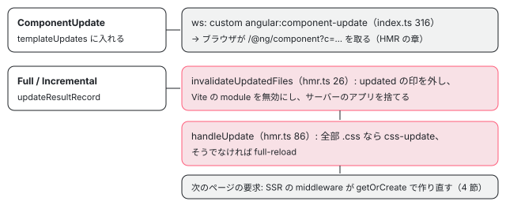

[目次](../README.md) › [ng serve の内側：Vite の middleware と plugin が 1 つの要求をさばくまで](README.md) › 第 4 回 / 全 5 回

# HMR と SSR の plugin：変更をどう届け、サーバーの側でどう読み込むか

> builders/dev-server/vite/hmr.ts が再ビルドの結果から css-update と full-reload のどちらを送り、SSR のアプリをいつ捨てるか（80f9082df4）、ssr-middleware が要求ごとに ɵgetOrCreateAngularServerApp で取り直す行、id-prefix-plugin（004cc41048）と ssr-transform-plugin。22.1.7 で #34163（SSR で古いテンプレートの更新が残る、de91345c13）を再現し、NG\_HMR\_CSTYLES=1 の link の残りも記録で見る。

angular/angular-cli · 読了 約 13 分 · 発展 · [サイトで読む（デモが動きます）](https://angular-deep-dive-cyan.vercel.app/chapter/vds-hmr-ssr)

---

この章で分かること: 再ビルドが終わったあと、`builders/dev-server/vite/hmr.ts` の 2 つの関数が、どのファイルを「更新された」とみなし、ブラウザに CSS の差し替え（`css-update`）と全体の再読み込み（`full-reload`）のどちらを送るか。SSR を使うとき、サーバーの側の Angular アプリ（`AngularServerApp`）をいつ作り直し、`ssr-middleware.ts` がそれをどう呼ぶか、外部の依存の `/@id/` を外す plugin と、SSR の source map を直す plugin までを、本物の `ng serve` とヘッドレス Chrome の記録で確かめます。

読む対象は `packages/angular/build/src/builders/dev-server/vite/hmr.ts`・`tools/vite/middlewares/ssr-middleware.ts`・`tools/vite/plugins/id-prefix-plugin.ts`・`tools/vite/plugins/ssr-transform-plugin.ts` です（angular-cli 44129f66a3、記録は @angular/build 22.1.7）。テンプレートの差し替え（`angular:component-update` と `/@ng/component`）がどう作られ、ブラウザでどう当てはまるかは[HMR の章](../cli/11-cli-hmr.md)にあり、この章では再説明しません。SSR のアプリの `handle` の中は[AngularAppEngine の章](../platform/04-ssr-app-engine.md)にあります。

1. [1. Vite の設定を組み立てる](01-vds-config.md)
2. [2. アセット・base href・index.html](02-vds-assets-html.md)
3. [3. Host の検査と開発用のヘッダー](03-vds-host-headers.md)
4. **4. HMR と SSR の plugin**（この章）
5. [5. spec と issue](05-vds-tests-issues.md)

> [!TIP]
> **新卒エンジニアへ**
>
> **HMR**（Hot Module Replacement）は、ページを読み直さずに変わった部分だけを差し替える仕組みです。Vite はブラウザの中の `/@vite/client` と WebSocket でつながり、サーバーから `{"type":"update"}` や `{"type":"full-reload"}` の JSON を送ります。この章の記録の「枠」は、この WebSocket でブラウザに届いた JSON 1 つずつのことです。

## 1. 再ビルドの結果から、どこへ行くか

`vite/index.ts` の再ビルドの loop は、結果の種類で 3 つに分かれます（行は[ng serve の章](../boot/03-boot-dev-server.md)と[HMR の章](../cli/11-cli-hmr.md)）。`ComponentUpdate`（テンプレートやコンポーネントの CSS だけが変わった）は 316 行目で `angular:component-update` を送って終わり、この章の関数には来ません。`Full` と `Incremental` は出力のファイルを `updateResultRecord` で表に入れ直してから、342 行目で `invalidateUpdatedFiles`、350 行目で `handleUpdate` を呼びます。



*再ビルドの結果の 3 つの行き先。この章は下の 2 つの関数と、SSR の middleware が次の要求でアプリを作り直すところ*

## 2. invalidateUpdatedFiles：更新の印と、サーバーのアプリ

📄 `angular-cli/packages/angular/build/src/builders/dev-server/vite/hmr.ts` L26–59 （▶ の行: 35–36, 40–41, 46–47, 51–53, 55–56, 58）

```ts
26 │ export async function invalidateUpdatedFiles(
27 │   normalizePath: (id: string) => string,
28 │   generatedFiles: Map<string, OutputFileRecord>,
29 │   assetFiles: Map<string, OutputAssetRecord>,
30 │   server: ViteDevServer,
31 │ ): Promise<string[]> {
32 │   const updatedFiles: string[] = [];
33 │ 
34 │   // Invalidate any updated asset
35 ▶   for (const [file, record] of assetFiles) {
36 ▶     if (!record.updated) {
37 │       continue;
38 │     }
39 │ 
40 ▶     record.updated = false;
41 ▶     updatedFiles.push(file);
42 │   }
43 │ 
44 │   // Invalidate any updated files
45 │   let serverApplicationChanged = false;
46 ▶   for (const [file, record] of generatedFiles) {
47 ▶     if (!record.updated) {
48 │       continue;
49 │     }
50 │ 
51 ▶     record.updated = false;
52 ▶     updatedFiles.push(file);
53 ▶     serverApplicationChanged ||= record.type === BuildOutputFileType.ServerApplication;
54 │ 
55 ▶     const updatedModules = server.moduleGraph.getModulesByFile(
56 ▶       normalizePath(join(server.config.root, file)),
57 │     );
58 ▶     updatedModules?.forEach((m) => server.moduleGraph.invalidateModule(m));
59 │   }
```

1. **35〜42 行目: アセット**

   `assetFiles`（ディスクの上のファイル）のうち `updated` の印が付いたものを、印を外して `updatedFiles` に積みます。Vite の module は触りません。
2. **46〜52 行目: 出力のファイル**

   `generatedFiles`（メモリの上の esbuild の出力）も同じです。印は `vite/utils.ts` の `updateResultRecord` が、最初のビルド以外の結果に入っていたファイルに付けます（[第 1 回](01-vds-config.md)）。
3. **53 行目: サーバーのアプリが変わったか**

   出力の種類が `ServerApplication`（`main.server.mjs` とその chunk）なら真にします。
4. **55〜58 行目: Vite の module graph を無効にする**

   Vite は一度変換した module を graph に覚えています。`server.config.root`（メモリの上の仮のフォルダ）と出力の名前から module を引き、`invalidateModule` で次の要求のときに変換し直させます。

📄 `angular-cli/packages/angular/build/src/builders/dev-server/vite/hmr.ts` L61–79 （▶ の行: 61, 65–67, 72–74, 78）

```ts
61 ▶   if (serverApplicationChanged) {
62 │     // Clear the server app cache and trigger module evaluation before reload to initiate dependency optimization.
63 │     // The querystring is needed as a workaround for:
64 │     // `ɵgetOrCreateAngularServerApp` can be undefined right after an error.
65 ▶     try {
66 ▶       const { ɵdestroyAngularServerApp } = (await server.ssrLoadModule(
67 ▶         `/main.server.mjs?timestamp=${Date.now()}`,
68 │       )) as {
69 │         ɵdestroyAngularServerApp: typeof destroyAngularServerApp;
70 │       };
71 │ 
72 ▶       ɵdestroyAngularServerApp();
73 ▶     } catch {
74 ▶       // Ignored as the next SSR request will resolve compile errors and outdated pre-bundles.
75 │     }
76 │   }
77 │ 
78 ▶   return updatedFiles;
79 │ }
```

サーバーのアプリが変わったら、66〜67 行目で `main.server.mjs` を Vite の SSR の読み込み（`ssrLoadModule`）で読み、72 行目で `ɵdestroyAngularServerApp()` を呼びます。読む URL に `?timestamp=` を付けるのは 80f9082df4（#31671）で、エラーのすぐ後に読んだ module で `ɵgetOrCreateAngularServerApp` が `undefined` になり、ページの更新が止まる問題を、毎回新しい module として読み直して避けます。65 行目と 73〜75 行目の `try` / `catch` は 2026-07 の 59264222ef（依存の更新の PR の中）で入り、コンパイルのエラーや古い prebundle でここが投げても、次の SSR の要求に任せます。

📄 `80f9082df4・59264222ef（抜粋）`

```
$ git show 80f9082df4 -- packages/angular/build/src   # 2025-11-11（#31671）
--- a/packages/angular/build/src/builders/dev-server/vite/hmr.ts
-    const { ɵdestroyAngularServerApp } = (await server.ssrLoadModule('/main.server.mjs')) as {
+    const { ɵdestroyAngularServerApp } = (await server.ssrLoadModule(
+      `/main.server.mjs?timestamp=${Date.now()}`,
+    )) as {
--- a/packages/angular/build/src/tools/vite/middlewares/ssr-middleware.ts
-      // `ɵgetOrCreateAngularServerApp` can be undefined right after an error.
-      // See: https://github.com/angular/angular-cli/issues/29907
-      if (!ɵgetOrCreateAngularServerApp) {
-        return next();
-      }

$ git show 59264222ef -- packages/angular/build/src/builders/dev-server/vite/hmr.ts   # 2026-07-10（依存の更新の PR の中）
+    try {
       const { ɵdestroyAngularServerApp } = (await server.ssrLoadModule(
 …
+    } catch {
+      // Ignored as the next SSR request will resolve compile errors and outdated pre-bundles.
+    }
```

この 2 つの関数は、`main.server.mjs` の入口を作る行で `@angular/ssr` から出し直したものです。

📄 `angular-cli/packages/angular/build/src/tools/esbuild/application-code-bundle.ts` L352–370 （▶ の行: 357–358, 360, 364）

```ts
352 │           const contents: string[] = [
353 │             // Inject manifest
354 │             `import '${mainServerInjectManifestNamespace}';`,
355 │ 
356 │             // Add @angular/ssr exports
357 ▶             `export {
358 ▶               ɵdestroyAngularServerApp,
359 │               ɵextractRoutesAndCreateRouteTree,
360 ▶               ɵgetOrCreateAngularServerApp,
361 │             } from '@angular/ssr';`,
362 │ 
363 │             // Need for HMR
364 ▶             `export { ɵresetCompiledComponents } from '@angular/core';`,
365 │ 
366 │             // Re-export all symbols including default export from 'main.server.ts'
367 │             `export { default } from '${mainServerEntryPointJsImport}';`,
368 │             `export * from '${mainServerEntryPointJsImport}';`,
369 │           ];
370 │ 
```

📄 `angular-cli/packages/angular/ssr/src/app.ts` L471–487 （▶ の行: 479, 483, 486）

```ts
471 │ /**
472 │  * Destroys the existing `AngularServerApp` instance, releasing associated resources and resetting the
473 │  * reference to `undefined`.
474 │  *
475 │  * This function is primarily used to enable the recreation of the `AngularServerApp` instance,
476 │  * typically when server configuration or application state needs to be refreshed.
477 │  */
478 │ export function destroyAngularServerApp(): void {
479 ▶   if (typeof ngDevMode === 'undefined' || ngDevMode) {
480 │     // Need to clean up GENERATED_COMP_IDS map in `@angular/core`.
481 │     // Otherwise an incorrect component ID generation collision detected warning will be displayed in development.
482 │     // See: https://github.com/angular/angular-cli/issues/25924
483 ▶     ɵresetCompiledComponents();
484 │   }
485 │ 
486 ▶   angularServerApp = undefined;
487 │ }
```

`destroyAngularServerApp` は 486 行目でモジュールの中の 1 つの変数を `undefined` に戻すだけです。開発のときは 483 行目で core のコンポーネント ID の表も空にし、作り直したときに「ID が衝突した」の警告が出ないようにします。作り直すのは次の要求で `getOrCreateAngularServerApp`（[AngularAppEngine の章](../platform/04-ssr-app-engine.md)の 468 行目の `??=`）が呼ばれたときです。

## 3. handleUpdate：css-update か full-reload か

📄 `angular-cli/packages/angular/build/src/builders/dev-server/vite/hmr.ts` L86–124 （▶ の行: 93, 97–98, 100, 107–109, 112, 117, 119, 121–122）

```ts
 86 │ export function handleUpdate(
 87 │   server: ViteDevServer,
 88 │   serverOptions: NormalizedDevServerOptions,
 89 │   logger: BuilderContext['logger'],
 90 │   componentStyles: Map<string, ComponentStyleRecord>,
 91 │   updatedFiles: string[],
 92 │ ): void {
 93 ▶   if (!updatedFiles.length) {
 94 │     return;
 95 │   }
 96 │ 
 97 ▶   if (serverOptions.hmr) {
 98 ▶     if (updatedFiles.every((f) => f.endsWith('.css'))) {
 99 │       let requiresReload = false;
100 ▶       const timestamp = Date.now();
101 │       const updates = updatedFiles.flatMap((filePath) => {
102 │         // For component styles, an HMR update must be sent for each one with the corresponding
103 │         // component identifier search parameter (`ngcomp`). The Vite client code will not keep
104 │         // the existing search parameters when it performs an update and each one must be
105 │         // specified explicitly. Typically, there is only one each though as specific style files
106 │         // are not typically reused across components.
107 ▶         const record = componentStyles.get(filePath);
108 ▶         if (record) {
109 ▶           if (record.reload) {
110 │             // Shadow DOM components currently require a full reload.
111 │             // Vite's CSS hot replacement does not support shadow root searching.
112 ▶             requiresReload = true;
113 │ 
114 │             return [];
115 │           }
116 │ 
117 ▶           return Array.from(record.used ?? []).map((id) => {
118 │             return {
119 ▶               type: 'css-update' as const,
120 │               timestamp,
121 ▶               path: `${filePath}?ngcomp` + (typeof id === 'string' ? `=${id}` : ''),
122 ▶               acceptedPath: filePath,
123 │             };
124 │           });
```

📄 `angular-cli/packages/angular/build/src/builders/dev-server/vite/hmr.ts` L125–159 （▶ の行: 127, 130, 135–136, 140, 148, 150, 152–154, 157）

```ts
125 │         }
126 │ 
127 ▶         return {
128 │           type: 'css-update' as const,
129 │           timestamp,
130 ▶           path: filePath,
131 │           acceptedPath: filePath,
132 │         };
133 │       });
134 │ 
135 ▶       if (!requiresReload) {
136 ▶         server.ws.send({
137 │           type: 'update',
138 │           updates,
139 │         });
140 ▶         logger.info('Stylesheet update sent to client(s).');
141 │ 
142 │         return;
143 │       }
144 │     }
145 │   }
146 │ 
147 │   // Send reload command to clients
148 ▶   if (serverOptions.liveReload) {
149 │     // Clear used component tracking on full reload
150 ▶     componentStyles.forEach((record) => record.used?.clear());
151 │ 
152 ▶     server.ws.send({
153 ▶       type: 'full-reload',
154 ▶       path: '*',
155 │     });
156 │ 
157 ▶     logger.info('Page reload sent to client(s).');
158 │   }
159 │ }
```

1. **93 行目: 何も変わっていなければ送らない**

   再ビルドしても出力が同じなら `updatedFiles` は空です。
2. **97〜98 行目: HMR が有効で、変わったのが全部 .css なら**

   1 つでも .js や .html が混ざれば、この枝には入らず 148 行目へ進みます。
3. **107〜124 行目: コンポーネントの CSS の場合**

   `componentStyles` に記録がある（ファイル名が 64 桁の hash の .css、`vite/utils.ts` の 94 行目）なら、ブラウザが実際に取った ID（`used`）ごとに `?ngcomp=<ID>` を付けた更新を作ります。102〜106 行目のコメントのとおり、Vite のブラウザの側は path の query をそのまま使うので、ID を明示します。Shadow DOM の部品は 112 行目で再読み込みに回します。
4. **127〜132 行目: グローバルの CSS**

   `/styles.css` のような普通の CSS は path をそのまま使います。
5. **135〜142 行目: 送る**

   `{ type: 'update', updates }` を送り、140 行目のログを出して終わります。
6. **148〜157 行目: それ以外は全体の再読み込み**

   `liveReload` が有効なら、150 行目で `used` を空にしてから `{ type: 'full-reload', path: '*' }` を送ります。

> [!NOTE]
> **ポイント**
>
> 107 行目の記録があるのは、コンポーネントの CSS を外部のファイルとして配る設定のときだけです。`vite/index.ts` の 177 行目は `externalRuntimeStyles` を `useComponentStyleHmr`（環境変数 `NG_HMR_CSTYLES` が真のときだけ真）にするので、既定ではコンポーネントの CSS の変更は `ComponentUpdate` になり、この関数には来ません。5 節の記録の 3 つの設定は、この違いを見るためのものです。

## 4. ssr-middleware：要求ごとにアプリを取り直す

📄 `angular-cli/packages/angular/build/src/tools/vite/middlewares/ssr-middleware.ts` L22–51 （▶ の行: 26, 33, 40–41, 45, 49–50）

```ts
22 │ export function createAngularSsrInternalMiddleware(
23 │   server: ViteDevServer,
24 │   indexHtmlTransformer?: (content: string) => Promise<string>,
25 │ ): Connect.NextHandleFunction {
26 ▶   let cachedAngularServerApp: ReturnType<typeof getOrCreateAngularServerApp> | undefined;
27 │ 
28 │   return function angularSsrMiddleware(
29 │     req: Connect.IncomingMessage,
30 │     res: ServerResponse,
31 │     next: Connect.NextFunction,
32 │   ) {
33 ▶     if (req.url === undefined) {
34 │       return next();
35 │     }
36 │ 
37 │     (async () => {
38 │       // Load the compiler because `@angular/ssr/node` depends on `@angular/` packages,
39 │       // which must be processed by the runtime linker, even if they are not used.
40 ▶       await import('@angular/compiler');
41 ▶       const { writeResponseToNodeResponse, createWebRequestFromNodeRequest } = (await import(
42 │         '@angular/ssr/node' as string
43 │       )) as typeof import('@angular/ssr/node', { with: { 'resolution-mode': 'import' } });
44 │ 
45 ▶       const { ɵgetOrCreateAngularServerApp } = (await server.ssrLoadModule('/main.server.mjs')) as {
46 │         ɵgetOrCreateAngularServerApp: typeof getOrCreateAngularServerApp;
47 │       };
48 │ 
49 ▶       const angularServerApp = ɵgetOrCreateAngularServerApp({
50 ▶         allowStaticRouteRender: true,
51 │       });
```

1. **40〜43 行目: compiler と `@angular/ssr/node`**

   39 行目のコメントのとおり、`@angular/ssr/node` が読む `@angular/*` は linker で処理する必要があるので、先に compiler を読みます。
2. **45 行目: `main.server.mjs` を Vite で読む**

   要求のたびに呼びますが、Vite は module を覚えているので、2 節の 55〜58 行目で無効にされるまでは同じ module が返ります。
3. **49〜51 行目: アプリを取る**

   2 節で捨てられていれば、ここで新しい `AngularServerApp` が作られます。`allowStaticRouteRender` が偽だと、`RenderMode.Prerender` の経路では `render` が `null` を返します（[AngularAppEngine の章](../platform/04-ssr-app-engine.md)の 259 行目）。開発中は prerender をしない（`vite/index.ts` の 95〜99 行目）ので、真にして要求のたびに描きます。

📄 `angular-cli/packages/angular/build/src/tools/vite/middlewares/ssr-middleware.ts` L52–75 （▶ の行: 54–56, 58, 61, 64–65, 67–69, 72–73）

```ts
52 │ 
53 │       // Only Add the transform hook only if it's a different instance.
54 ▶       if (cachedAngularServerApp !== angularServerApp) {
55 ▶         angularServerApp.hooks.on('html:transform:pre', async ({ html, url }) => {
56 ▶           const processedHtml = await server.transformIndexHtml(url.pathname, html);
57 │ 
58 ▶           return indexHtmlTransformer?.(processedHtml) ?? processedHtml;
59 │         });
60 │ 
61 ▶         cachedAngularServerApp = angularServerApp;
62 │       }
63 │ 
64 ▶       const webReq = new Request(createWebRequestFromNodeRequest(req), {
65 ▶         signal: AbortSignal.timeout(30_000),
66 │       });
67 ▶       const webRes = await angularServerApp.handle(webReq);
68 ▶       if (!webRes) {
69 ▶         return next();
70 │       }
71 │ 
72 ▶       return writeResponseToNodeResponse(webRes, res);
73 ▶     })().catch(next);
74 │   };
75 │ }
```

1. **54〜62 行目: 新しいアプリにだけ hook を付ける**

   26 行目の変数と比べ、違うインスタンスなら `html:transform:pre` の hook を付けます。hook は描いた HTML を 56 行目の `server.transformIndexHtml`（`/@vite/client` の script を足す）と、58 行目の Angular の index.html の変換に通します。
2. **64〜67 行目: Web の Request にして渡す**

   30 秒で止める `AbortSignal` を付け、`angularServerApp.handle` に渡します。
3. **68〜72 行目: 応答が無ければ次へ**

   経路に当たらなければ `null` で、後ろの HTML の fallback と index.html の middleware に渡ります（[第 2 回](02-vds-assets-html.md)）。

この middleware は `AngularServerApp` を直接呼ぶので、`AngularAppEngine` が持つ Host の検査（[SSR の Host 検証の章](../ssrx/04-ssrx-host-validation.md)）は通りません。[第 3 回](03-vds-host-headers.md)の SSL の記録で、内部の SSR でも許していない Host に 200 が返ったのはこのためです。

もう 1 つ、この middleware は `resetComponentUpdates` を受け取りません。index.html の middleware はページを返すたびにそれを呼び、溜まったテンプレートの更新を捨てますが、SSR があるとページはこの middleware が先に返すので、捨てる人がいません。これが #34163 で、5 節の記録で再現します。

利用者が `server.ts` を書いたときの middleware は次のとおりです。

📄 `angular-cli/packages/angular/build/src/tools/vite/middlewares/ssr-middleware.ts` L77–94 （▶ の行: 81–82, 89, 91）

```ts
77 │ export async function createAngularSsrExternalMiddleware(
78 │   server: ViteDevServer,
79 │   indexHtmlTransformer?: (content: string) => Promise<string>,
80 │ ): Promise<Connect.NextHandleFunction> {
81 ▶   let fallbackWarningShown = false;
82 ▶   let cachedAngularAppEngine: typeof SSRAngularAppEngine | undefined;
83 │   let angularSsrInternalMiddleware:
84 │     | ReturnType<typeof createAngularSsrInternalMiddleware>
85 │     | undefined;
86 │ 
87 │   // Load the compiler because `@angular/ssr/node` depends on `@angular/` packages,
88 │   // which must be processed by the runtime linker, even if they are not used.
89 ▶   await import('@angular/compiler');
90 │ 
91 ▶   const { createWebRequestFromNodeRequest, writeResponseToNodeResponse } = (await import(
92 │     '@angular/ssr/node' as string
93 │   )) as typeof import('@angular/ssr/node', { with: { 'resolution-mode': 'import' } });
94 │ 
```

📄 `angular-cli/packages/angular/build/src/tools/vite/middlewares/ssr-middleware.ts` L99–130 （▶ の行: 105, 110–111, 113, 118, 121, 126）

```ts
 99 │   return function angularSsrExternalMiddleware(
100 │     req: Connect.IncomingMessage,
101 │     res: ServerResponse,
102 │     next: Connect.NextFunction,
103 │   ) {
104 │     (async () => {
105 ▶       const { reqHandler, AngularAppEngine } = (await server.ssrLoadModule('./server.mjs')) as {
106 │         reqHandler?: unknown;
107 │         AngularAppEngine: typeof SSRAngularAppEngine;
108 │       };
109 │ 
110 ▶       if (!isSsrNodeRequestHandler(reqHandler) && !isSsrRequestHandler(reqHandler)) {
111 ▶         if (!fallbackWarningShown) {
112 │           // eslint-disable-next-line no-console
113 ▶           console.warn(
114 │             `The 'reqHandler' export in 'server.ts' is either undefined or does not provide a recognized request handler. ` +
115 │               'Using the internal SSR middleware instead.',
116 │           );
117 │ 
118 ▶           fallbackWarningShown = true;
119 │         }
120 │ 
121 ▶         angularSsrInternalMiddleware ??= createAngularSsrInternalMiddleware(
122 │           server,
123 │           indexHtmlTransformer,
124 │         );
125 │ 
126 ▶         angularSsrInternalMiddleware(req, res, next);
127 │ 
128 │         return;
129 │       }
130 │ 
```

📄 `angular-cli/packages/angular/build/src/tools/vite/middlewares/ssr-middleware.ts` L142–157 （▶ の行: 144–145, 147–148, 154）

```ts
142 │ 
143 │       // Forward the request to the middleware in server.ts
144 ▶       if (isSsrNodeRequestHandler(reqHandler)) {
145 ▶         await reqHandler(req, res, next);
146 │       } else {
147 ▶         const webRes = await reqHandler(createWebRequestFromNodeRequest(req));
148 ▶         if (!webRes) {
149 │           next();
150 │ 
151 │           return;
152 │         }
153 │ 
154 ▶         await writeResponseToNodeResponse(webRes, res);
155 │       }
156 │     })().catch(next);
157 │   };
```

105 行目で `server.mjs` から `reqHandler` と `AngularAppEngine` を取り、110 行目で `reqHandler` が Node の形でも Web の形でもなければ、113 行目の警告を 1 回だけ出して 121〜126 行目で内部の middleware に任せます。途中の 95〜97 行目と 131〜141 行目（`allowedHosts` が `true` なら Host の検査を切る・hook を付ける）は[SSR の Host 検証の章](../ssrx/04-ssrx-host-validation.md)と[SSR のアセットと CSS の章](../ssrx/09-ssrx-assets-css.md)にあります。144〜145 行目は Express などの `(req, res, next)` の形、147〜154 行目は `Request` を受けて `Response` を返す形です。

📄 `de91345c13（origin/main、抜粋）`

```
$ git show de91345c13 -- packages/angular/build/src/tools/vite   # origin/main、2026-09-25（#34163）
 export function createAngularSsrInternalMiddleware(
   server: ViteDevServer,
+  resetComponentUpdates: () => void,
   indexHtmlTransformer?: (content: string) => Promise<string>,
 …
         angularServerApp.hooks.on('html:transform:pre', async ({ html, url }) => {
+          resetComponentUpdates();
           const processedHtml = await server.transformIndexHtml(url.pathname, html);
 …
         AngularAppEngine.ɵhooks.on('html:transform:pre', async ({ html, url }) => {
+          resetComponentUpdates();
 …（setup-middlewares-plugin.ts で resetComponentUpdates を 2 つの SSR middleware にも渡す）
 create mode 100644 packages/angular/build/src/tools/vite/middlewares/ssr-middleware_spec.ts
```

origin/main の de91345c13（2026-09-25）が、両方の middleware に `resetComponentUpdates` を渡し、`html:transform:pre` の hook の最初で呼ぶようにしました。新しい `ssr-middleware_spec.ts` が、hook を呼ぶと 1 回だけ reset されることを固めます（テストの節で走らせます）。

## 5. DEMO：書き換えるたびに届いた枠

> **🧪 DEMO — HMR の枠とページの状態（記録の再生）**
>
> `<scratchpad>/vds-demo/b/record-hmr.mjs` が、@angular/build 22.1.7・vite 8.1.5 の `ng serve` を起動したまま、ヘッドレス Chrome でページを開き、ファイルを 1 つずつ書き換えた記録です。枠は Chrome DevTools Protocol の `Network.webSocketFrameReceived` で取りました（`connected` と `ping` は省いた）。書き換えたファイルは最後に元に戻しています。赤い値は「SSR なし（既定）」の同じ段と違うところです。
>
> ▶ [このデモはサイトで動かせます](https://angular-deep-dive-cyan.vercel.app/chapter/vds-hmr-ssr)

「SSR なし（既定）」の段を、ここまでの行と結び付けます。

- **グローバルの CSS**: 出力で変わったのは `/styles.css` だけなので、3 節の 98 行目の枝 → 127〜132 行目 → 136 行目で `css-update`。ボタンの数（`count 2`）はそのまま。
- **コンポーネントの CSS・テンプレート**: どちらも `ComponentUpdate` なので、この章の関数を通らず `angular:component-update` の枠だけが届き、ブラウザが `/@ng/component` を取って当てはめます（[HMR の章](../cli/11-cli-hmr.md)）。ここでも `count 2` が残ります。
- **`@import` された CSS**: `tokens.css` はコンポーネントのファイルではないので HMR の候補にならず、普通の再ビルドになります。既定ではコンポーネントの CSS は `main.js` の中に入るので .css 以外の出力も変わり、148 行目の `full-reload`。読み直したページは `margin-top: 40px` で、`/@ng/component` は 0 バイト（index.html の middleware が溜まった更新を捨てた）です。
- **TypeScript**: `full-reload` で、ボタンは新しい初期値の `count 10`。

「SSR あり」に切り替えると、`@import` の段から違いが出ます。

1. **full-reload の後も margin-top が 10px**

   Node から直接取ると、SSR が描いた `/` と `main.js` はどちらも新しい 40px を含みます。それでも、読み込んだ後のブラウザが `/@ng/component?c=…` を取ると 6758 バイトの古い更新（10px を含む）が返り、それが当てはめられます。
2. **手で再読み込みしても、TS を書き換えても同じ**

   4 節のとおり、SSR の middleware は `resetComponentUpdates` を呼ばず、`templateUpdates` を空にするのは `vite/index.ts` の 279 行目の `Full` のときだけです。`ng serve` の再ビルドは 2 回目から `Incremental` なので、サーバーを止めるまで古い更新が残ります。Node から直接 `/@ng/component` を取っても同じ 6758 バイトでした。

これは #34163（2026-09-24 の報告、Sass の partial で再現）と同じ形で、22.1.7 では素の CSS の `@import` でも起きます。直したのは origin/main の de91345c13 と、それを 22.2.x に移した 37cf399d95（v22.2.1 から）で、22.1.x の枝には入っていません（`git branch -r --contains` と `git tag --contains` で確かめた）。

「NG\_HMR\_CSTYLES=1」に切り替えると、コンポーネントの CSS の 2 つの段が 3 節の 107〜124 行目を通ります。

1. **コンポーネントの CSS**

   枠は `css-update` で、path は `/0a592043….css?ngcomp=ng-c3710873533` です。121 行目の `?ngcomp=` と、ブラウザが取ったときに記録された ID（`used`）がそのまま出ています。
2. **テンプレートの後、link が 2 本になる**

   テンプレートの更新でコンポーネントが描き直されると、`?ngcomp=…&e=0` の link がもう 1 本足され、前の段の `…&t=<時刻>` の link は残ります。
3. **`@import` の段で 40px が効かない**

   枠は `css-update` で、ブラウザは 40px を含む CSS を取りましたが、margin-top は 10px のままでした。Vite のブラウザの側は path に合う最初の link だけを差し替え（`vite/dist/client/client.mjs` の 970 行目の `find`）、後ろに残った `e=0` の link の 10px が勝つためです。手で読み直すと link は 1 本に戻り、40px になりました。

## 6. id-prefix-plugin：外部の依存の /@id/ を外す

📄 `angular-cli/packages/angular/build/src/tools/vite/plugins/id-prefix-plugin.ts` L16–45 （▶ の行: 16, 22, 25–26, 28, 32, 39–41）

```ts
16 ▶ const VITE_ID_PREFIX = '@id/';
17 │ 
18 │ const escapeRegexSpecialChars = (inputString: string): string => {
19 │   return inputString.replace(/[.*+?^${}()|[\]\\]/g, '\\$&'); // $& means the whole matched string
20 │ };
21 │ 
22 ▶ export function createRemoveIdPrefixPlugin(externals: string[]): Plugin {
23 │   return {
24 │     name: 'angular-plugin-remove-id-prefix',
25 ▶     apply: 'serve',
26 ▶     configResolved: (resolvedConfig) => {
27 │       // don't do anything when the list of externals is empty
28 ▶       if (externals.length === 0) {
29 │         return;
30 │       }
31 │ 
32 ▶       const transformFn = createTransformer(resolvedConfig.base, externals);
33 │ 
34 │       // @ts-expect-error: Property 'push' does not exist on type 'readonly Plugin<any>[]'
35 │       // Reasoning:
36 │       //  since the /@id/ prefix is added by Vite's import-analysis plugin,
37 │       //  we must add our actual plugin dynamically, to ensure that it will run
38 │       //  AFTER the import-analysis.
39 ▶       resolvedConfig.plugins.push({
40 ▶         name: 'angular-plugin-remove-id-prefix-transform',
41 ▶         transform: transformFn,
42 │       });
43 │     },
44 │   };
45 │ }
```

📄 `angular-cli/packages/angular/build/src/tools/vite/plugins/id-prefix-plugin.ts` L47–71 （▶ の行: 58, 60–61, 66–67）

```ts
47 │ /**
48 │  * Creates a transform function that removes the Vite ID prefix from externals.
49 │  * @param base The base path of the application.
50 │  * @param externals The external package names.
51 │  * @returns A function that transforms code by removing the Vite ID prefix.
52 │  */
53 │ export function createTransformer(base: string, externals: string[]): (code: string) => string {
54 │   // The path suffix is bounded so that a match can never extend past the end of an
55 │   // import specifier string literal. With a greedy `.+`, minified (single-line) code
56 │   // would let the first match consume the remainder of the line, leaving all later
57 │   // `/@id/` occurrences on that line unstripped.
58 ▶   const escapedExternals = externals.map((e) => escapeRegexSpecialChars(e) + '(?:/[^\'"`\\s]+)?');
59 │ 
60 ▶   const prefixedExternalRegex = new RegExp(
61 ▶     `${base}${VITE_ID_PREFIX}(${escapedExternals.join('|')})`,
62 │     'g',
63 │   );
64 │ 
65 │   return (code: string) => {
66 ▶     return code.includes(VITE_ID_PREFIX)
67 ▶       ? code.replace(prefixedExternalRegex, (_, externalName) => externalName)
68 │       : // don't do anything when code does not contain the Vite prefix
69 │         code;
70 │   };
71 │ }
```

1. **22 行目: 受け取るのは外部の依存の名前**

   `server.ts` の 239 行目が `externalMetadata.explicitBrowser`（`externalDependencies` に書いた名前）を渡します。
2. **26〜32 行目: 設定が決まってから作る**

   名前が無ければ何もしません。`base` が決まった後の `configResolved` で正規表現を作ります。
3. **39〜42 行目: plugin を後ろに足す**

   Vite の import-analysis は、解決できない bare な import に `/@id/` を付けます。35〜38 行目のコメントのとおり、その後で外すために、解決済みの plugin の並びの最後に変換の plugin を push します。
4. **58〜67 行目: 外す**

   名前の後ろに続く深い path は、58 行目で「引用符・バッククォート・空白以外」に限ります。61 行目の正規表現は `base` の後ろの `@id/名前` に合い、67 行目で名前だけに置き換えます。

58 行目は 004cc41048（2026-07-08、外の人の PR）で変わりました。前は `(?:/.+)?` で、1 行に詰めた（minify した）コードでは最初の一致が行の終わりまで食べ、後ろの `/@id/` が残って、ブラウザで「Unsupported Content-Type」のエラーになりました。この修正で関数が `createTransformer` に分けられ、単体の spec（テストの節）が付きました。

📄 `004cc41048（抜粋）`

```
$ git show 004cc41048 -- packages/angular/build/src/tools/vite/plugins/id-prefix-plugin.ts   # 2026-07-08
-      const escapedExternals = externals.map((e) => escapeRegexSpecialChars(e) + '(?:/.+)?');
-      const prefixedExternalRegex = new RegExp(
-        `${resolvedConfig.base}${VITE_ID_PREFIX}(${escapedExternals.join('|')})`,
-        'g',
-      );
+      const transformFn = createTransformer(resolvedConfig.base, externals);
 …
+ create mode 100644 packages/angular/build/src/tools/vite/plugins/id-prefix-plugin_spec.ts
```

> **🧪 DEMO — /@id/ を外す正規表現（ページの上で動く写し）**
>
> `vds-hmr-ssr.demo-idprefix.ts` は 18〜20 行目と 53〜71 行目を写したもので、今の 58 行目と 004cc41048 より前の `(?:/.+)?` の 2 つで同じ文字列を置き換えます。
>
> ▶ [このデモはサイトで動かせます](https://angular-deep-dive-cyan.vercel.app/chapter/vds-hmr-ssr)

初めの入力は spec の 1 つ目の it と同じ形です。前の正規表現では、最初の `@angular/common` の一致が `/http";import…` から行の終わりまでを「深い path」として食べ、残りの 2 つの `/@id/` が残ります。なお、61 行目は `base` を正規表現に入れるときに escape しません（名前の方は 58 行目で escape する）。`base` に `.` があると「任意の 1 文字」として読まれます。

## 7. ssr-transform-plugin：SSR の source map の root

📄 `angular-cli/packages/angular/build/src/tools/vite/plugins/ssr-transform-plugin.ts` L14–36 （▶ の行: 19, 21, 25, 27, 30, 32）

```ts
14 │ export async function createAngularSsrTransformPlugin(workspaceRoot: string): Promise<Vite.Plugin> {
15 │   const { normalizePath } = (await import('vite' as string)) as typeof Vite;
16 │ 
17 │   return {
18 │     name: 'vite:angular-ssr-transform',
19 ▶     enforce: 'post',
20 │     transform(code, _id, { ssr, inMap }: { ssr?: boolean; inMap?: SourceMapInput } = {}) {
21 ▶       if (!ssr || !inMap) {
22 │         return null;
23 │       }
24 │ 
25 ▶       const remappedMap = remapping([inMap], () => null);
26 │       // Set the sourcemap root to the workspace root. This is needed since we set a virtual path as root.
27 ▶       remappedMap.sourceRoot = normalizePath(workspaceRoot) + '/';
28 │ 
29 │       return {
30 ▶         code,
31 │         // eslint-disable-next-line @typescript-eslint/no-explicit-any
32 ▶         map: remappedMap as any,
33 │       };
34 │     },
35 │   };
36 │ }
```

19 行目の `enforce: 'post'` で、ほかの変換の後に動きます。21 行目で SSR の変換で、入ってきた source map がある時だけ動き、25 行目で `@ampproject/remapping` に通して 1 枚にし、27 行目で `sourceRoot` を workspace の root にします。26 行目のコメントのとおり、dev-server は Vite の `root` をメモリの上の仮のフォルダにしている（[第 1 回](01-vds-config.md)）ので、そのままでは SSR のエラーの stack や debugger が実際のソースの場所を指さないためです。この plugin を通る spec はありません。

## 8. origin/main の続きと、読むだけの issue

- **de91345c13**（#34163）: 4 節。
- **adcdcc6688**（PR #34381、2026-10-17、外の人の PR）: hash の付いた chunk は名前が変わると `result.removed` に入り、dev-server の表からは消えていましたが、Vite の module graph には変換の結果が残り、メモリが増え、古い URL が古いコードを返し続けました。2 節の 55〜58 行目と同じ無効化を、消えたファイルにも行います。`tests/behavior/serve-renamed-chunks_spec.ts` も足されました。
- **#30321**（開いている、2025-05）: 別々の Angular アプリがそれぞれ固有の base path を持ち、互いに proxy し合う構成（webpack の dev-server では動いていた）で、Vite の dev-server に移ると、ほかのアプリの port から開いたページで HMR が効かない、という報告です。コメントはまだありません（2026-11-17）。

📄 `adcdcc6688（origin/main、vite/index.ts）`

```
$ git show adcdcc6688 -- packages/angular/build/src/builders/dev-server/vite/index.ts   # origin/main、2026-10-17（#34381）
           generatedFiles.delete(filePath);
           assetFiles.delete(filePath);
+
+          // Release Vite's cached transform result for output files that no longer exist,
+          // such as content-hashed chunks that were renamed by the rebuild.
+          const moduleGraph = server.moduleGraph;
+          moduleGraph
+            .getModulesByFile(normalizePath(join(server.config.root, filePath)))
+            ?.forEach((m) => moduleGraph.invalidateModule(m));
```

## テストと直し方

この章の行を通る spec は次のとおりです（44129f66a3 で `grep -n` したもの）。

| spec | describe / it（行） | 固めていること |
| --- | --- | --- |
| `tests/behavior/component-updates_spec.ts` | `Behavior: "Component updates"`（15）の it 4 つ（23・34・51・68） | `/@ng/component` の 400 と空の JS、`ngHmrMode` の define |
| `tools/vite/plugins/id-prefix-plugin_spec.ts` | `createTransformer`（11）の it 5 つ（12・32・40・48・61） | 6 節の 1 行のコード・深い path・`/app/` の base・複数行・外部でない名前は触らない |

📄 `angular-cli/packages/angular/build/src/builders/dev-server/tests/behavior/component-updates_spec.ts` L15–50 （▶ の行: 20, 28, 31, 40, 44, 46–48）

```ts
15 │   describe('Behavior: "Component updates"', () => {
16 │     beforeEach(async () => {
17 │       setupTarget(harness, {});
18 │ 
19 │       // Application code is not needed for these tests
20 ▶       await harness.writeFile('src/main.ts', 'console.log("foo");');
21 │     });
22 │ 
23 │     it('responds with a 400 status if no request component query is present', async () => {
24 │       harness.useTarget('serve', {
25 │         ...BASE_OPTIONS,
26 │       });
27 │ 
28 ▶       const { result, response } = await executeOnceAndFetch(harness, '/@ng/component');
29 │ 
30 │       expect(result?.success).toBeTrue();
31 ▶       expect(response?.status).toBe(400);
32 │     });
33 │ 
34 │     it('responds with an empty JS file when no component update is available', async () => {
35 │       harness.useTarget('serve', {
36 │         ...BASE_OPTIONS,
37 │       });
38 │       const { result, response } = await executeOnceAndFetch(
39 │         harness,
40 ▶         '/@ng/component?c=src%2Fapp%2Fapp.component.ts%40AppComponent',
41 │       );
42 │ 
43 │       expect(result?.success).toBeTrue();
44 ▶       expect(response?.status).toBe(200);
45 │       const output = await response?.text();
46 ▶       expect(response?.headers.get('Content-Type')).toEqual('text/javascript');
47 ▶       expect(response?.headers.get('Cache-Control')).toEqual('no-cache');
48 ▶       expect(output).toBe('');
49 │     });
50 │ 
```

20 行目で `main.ts` を 1 行の JS にし、コンポーネントを作らずに `/@ng/component` を叩きます。31 行目の 400 と 48 行目の空の本文は、[HMR の章](../cli/11-cli-hmr.md)の middleware の 34〜38 行目と 41 行目です。更新が入った後に何を返すか、ページを返したら空に戻るか、の it はありません。`handleUpdate` と `invalidateUpdatedFiles` を通る it もなく、WebSocket に何が送られたかを見る spec は dev-server の tests にありません。

📄 `angular-cli/packages/angular/build/src/tools/vite/plugins/id-prefix-plugin_spec.ts` L11–31 （▶ の行: 12, 14, 20–21, 25）

```ts
11 │ describe('createTransformer', () => {
12 ▶   it('should strip the prefix from every occurrence on a single (minified) line', () => {
13 │     const transform = createTransformer('/', [
14 ▶       '@angular/common',
15 │       '@angular/common/http',
16 │       '@angular/core',
17 │       '@angular/router',
18 │     ]);
19 │ 
20 ▶     const minified =
21 ▶       'import{a}from"/@id/@angular/common/http";' +
22 │       'import{b}from"/@id/@angular/router";' +
23 │       'import{c}from"/@id/@angular/core";';
24 │ 
25 ▶     expect(transform(minified)).toBe(
26 │       'import{a}from"@angular/common/http";' +
27 │         'import{b}from"@angular/router";' +
28 │         'import{c}from"@angular/core";',
29 │     );
30 │   });
31 │ 
```

📄 `走らせたコマンドと結果`

```
cd ~/angular-research/angular-cli-fix          # 44129f66a3 と同じ版
pnpm bazel test //packages/angular/build:dev-server_integration_tests --nocache_test_results --test_output=all
# → 77 specs, 0 failures, 12 pending（component-updates_spec の 4 つを含む）/ PASSED
pnpm bazel test //packages/angular/build:test --nocache_test_results --test_output=all --test_arg=--filter=createTransformer
# → 4 shard の Ran 1 + 2 + 1 + 1 = 5 specs, 0 failures / PASSED in 1.2s
```

#34163 の修正の spec を、修正の前の版で走らせると何が起きるかを作業木で確かめました。

📄 `作業木（../angular-cli-fix から作り、使い終えて消した）`

```
# 作業木（<scratchpad>/vds-wt-b、44129f66a3）に、origin/main の de91345c13 の spec だけを入れる
git -C ~/angular-research/angular-cli show de91345c13 -- packages/angular/build/src/tools/vite/middlewares/ssr-middleware_spec.ts | git apply
pnpm bazel test //packages/angular/build:test --nocache_test_results --test_output=all "--test_arg=--filter=SSR dev-server middleware"
packages/angular/build/src/tools/vite/middlewares/ssr-middleware_spec.ts:66:7 - error TS2554: Expected 1-2 arguments, but got 3.
//packages/angular/build:test                                   FAILED TO BUILD

# 同じコミットの ssr-middleware.ts・setup-middlewares-plugin.ts・BUILD.bazel も入れる
git -C ~/angular-research/angular-cli show de91345c13 -- packages/angular/build/BUILD.bazel \
  packages/angular/build/src/tools/vite/middlewares/ssr-middleware.ts \
  packages/angular/build/src/tools/vite/plugins/setup-middlewares-plugin.ts | git apply
pnpm bazel test //packages/angular/build:test --nocache_test_results --test_output=all "--test_arg=--filter=SSR dev-server middleware"
Ran 1 of 616 specs  （2 つの shard で 1 本ずつ、合計 2 specs, 0 failures）
//packages/angular/build:test                                            PASSED in 1.5s
```

修正の前は、spec が 3 つ目の引数を渡すので TypeScript のコンパイルで落ちます（関数の引数の数そのものが変わる修正）。修正を入れると 2 つの it が通ります。hmr.ts の 98 行目を `every` から `some` に変えても、落ちる spec はありませんでした。

📄 `作業木で壊した 1 行`

```
--- a/packages/angular/build/src/builders/dev-server/vite/hmr.ts
-    if (updatedFiles.every((f) => f.endsWith('.css'))) {
+    if (updatedFiles.some((f) => f.endsWith('.css'))) {
# dev-server_integration_tests を全部走らせても、この行で落ちる it は 0（第 3 回の 4 か所の実験の 1 つ）
```

直すとしたら、次の場所になります。

- **#34163（22.1.x）**: `ssr-middleware.ts` の 2 つの関数に `resetComponentUpdates` を渡し、55 行目と 134 行目の hook の最初で呼ぶ（de91345c13 と同じ）。spec は origin/main の `ssr-middleware_spec.ts`。
- **handleUpdate**: `hmr.ts` の関数は `server.ws.send` を呼ぶだけなので、`ws` を偽物にした単体の spec（`hmr_spec.ts`）で、全部 .css・混ざる・Shadow DOM・`liveReload: false` の 4 通りの枠を見られます。
- **NG\_HMR\_CSTYLES の link が 2 本残る**: link を足すのはブラウザの側の Angular（コンポーネントを描き直すときの外部の stylesheet）で、この章のファイルではありません。記録の手順（テンプレート → `@import` の CSS）がそのまま再現になります。

## ここまでの呼び出し

- 👤 `src/app/tokens.css` を保存 — 利用者
  - `serveWithVite` の loop: `ResultKind.Incremental` → `updateResultRecord` — vite/index.ts 282・294
  - `invalidateUpdatedFiles(normalizePath, generatedFiles, assetFiles, server)` — hmr.ts 26
    - `server.moduleGraph.invalidateModule(m)` — hmr.ts 58
    - `ssrLoadModule('/main.server.mjs?timestamp=…')` → `ɵdestroyAngularServerApp()` — hmr.ts 66・72 — *SSR のとき*
  - `handleUpdate(server, serverOptions, logger, componentStyles, updatedFiles)` — hmr.ts 86
    - `server.ws.send({ type: 'full-reload', path: '*' })` — hmr.ts 152
- 👤 `GET /`（ブラウザが読み直す） — ブラウザ
  - `angularSsrMiddleware` → `ssrLoadModule('/main.server.mjs')` — ssr-middleware.ts 28・45
    - `ɵgetOrCreateAngularServerApp({ allowStaticRouteRender: true })` — ssr-middleware.ts 49
    - `angularServerApp.handle(webReq)` → `html:transform:pre` — ssr-middleware.ts 67・55
- 👤 `GET /@ng/component?c=…`（読み込んだページの HMR の初期化） — ブラウザ
  - `angularComponentMiddleware` → `templateUpdates.get(…)` — component-middleware.ts 20・41 — *22.1.7 + SSR では古い更新が返る*

## 聞かれそうな質問

**Q. CSS を保存するとページは読み直されますか？**

出力で変わったのが全部 .css なら読み直しません。`hmr.ts` の 98 行目の枝で `css-update` を作り、136 行目で送ります。記録の「グローバルの CSS」では `count 2` が残りました。1 つでも .css 以外が変われば 152 行目の `full-reload` です。

**Q. コンポーネントの CSS は css-update で届きますか？**

既定では届きません。`vite/index.ts` の 177 行目で外部の stylesheet は `NG_HMR_CSTYLES` のときだけなので、既定ではテンプレートと同じ `angular:component-update` です。`NG_HMR_CSTYLES=1` のときだけ 107〜124 行目で `?ngcomp=` 付きの `css-update` になります。

**Q. SSR のとき、サーバーの側のアプリはいつ作り直されますか？**

サーバーの出力（`ServerApplication`）が変わった再ビルドで、`hmr.ts` の 72 行目が `ɵdestroyAngularServerApp()` で捨て、次の要求で `ssr-middleware.ts` の 49 行目の `ɵgetOrCreateAngularServerApp` が新しく作ります。新しいインスタンスには 54〜62 行目で hook を付け直します。

**Q. #34163 は何が原因ですか？**

溜まったテンプレートの更新（`templateUpdates`）を捨てるのは、`Full` の結果と index.html の middleware の `resetComponentUpdates` だけで、SSR があるとページは SSR の middleware（22.1.7 の 22〜75 行目は reset を受け取らない）が返すからです。記録では `@import` の変更の後、読み直しても 10px のままでした。直しは origin/main の de91345c13 です。

**Q. `/@id/` はなぜ付き、なぜ外すのですか？**

Vite の import-analysis が、解決できない外部の依存の import に付けます。`externalDependencies` にした名前は、ブラウザの側で import map などで解決させたいので、`id-prefix-plugin.ts` の 39〜42 行目で後ろに足した変換が 67 行目で外します。58 行目の上限は 004cc41048 で付きました。

## 読み終えて

- `ComponentUpdate` は `angular:component-update` だけ。それ以外の再ビルドは `invalidateUpdatedFiles` で印を外し、`handleUpdate` が「全部 .css なら css-update、そうでなければ full-reload」を決める。
- SSR のアプリは hmr.ts が `?timestamp=` 付きで読んで捨て、次の要求で ssr-middleware が `getOrCreate` で作り直す。
- 内部の SSR middleware は `AngularServerApp` を直接呼ぶので、`AngularAppEngine` の Host の検査も、22.1.7 では `resetComponentUpdates` も通らない（#34163、記録で再現）。
- `NG_HMR_CSTYLES=1` では、テンプレートの更新の後に link が 2 本残り、次の css-update が効かない場合がある（記録で再現）。
- WebSocket に何を送るかを固める spec は無く、hmr.ts の行を壊しても落ちる it が無い。

---

← 前: [Host の検査と開発用のヘッダー：開発サーバーを何から守るか](03-vds-host-headers.md)  
次: [spec と issue を読む：dev-server を固めているテスト](05-vds-tests-issues.md) →
