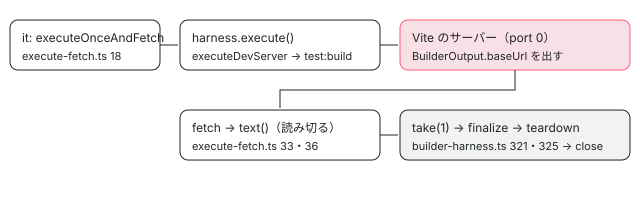

[目次](../README.md) › [ng serve の内側：Vite の middleware と plugin が 1 つの要求をさばくまで](README.md) › 第 5 回 / 全 5 回

# spec と issue を読む：dev-server を固めているテスト

> builders/dev-server/tests の harness（setup.ts・jasmine-helpers.ts・execute-fetch.ts と BuilderHarness）が本物のビルドと Vite を port 0 で起動して止める仕組み、20 の spec が各章の約束をどこで固めているかの地図、bazel での走らせ方と結果（77 specs）、作業木で行を壊して見つけた spec の無い行、dev-server の issue と PR の表、このシリーズで見つけたもの。

angular/angular-cli · 読了 約 10 分 · 基礎 · [サイトで読む（デモが動きます）](https://angular-deep-dive-cyan.vercel.app/chapter/vds-tests-issues)

---

シリーズの最後に、`ng serve` の spec がどのファイルのどの describe にあり、第 1〜4 回のどの約束を固めているかを地図にし、spec の土台（`setup.ts`・`jasmine-helpers.ts`・`execute-fetch.ts` と、その下の `BuilderHarness`）が本物の dev-server をどう起動して止めるかを読みます。手元で走らせた数と、作業木で行を壊して「どの spec が落ちるか」を確かめた結果、spec の無い行に it を 1 つ足してみた結果、dev-server の issue と PR の表、このシリーズで見つけたものの表を並べます。

読む対象は `packages/angular/build/BUILD.bazel`、`packages/angular/build/src/builders/dev-server/tests/` の 3 つの土台と 20 の spec、`tools/vite/plugins/id-prefix-plugin_spec.ts`、`modules/testing/builder/src/builder-harness.ts` です（angular-cli 44129f66a3）。BUILD.bazel の読み方の一般論は[Bazel の読み方](../contrib/04-contrib-bazel.md)、1 本だけ走らせる一般論は[テストを 1 本走らせる](../contrib/05-contrib-run-tests.md)にあります。

1. [1. Vite の設定を組み立てる](01-vds-config.md)
2. [2. アセット・base href・index.html](02-vds-assets-html.md)
3. [3. Host の検査と開発用のヘッダー](03-vds-host-headers.md)
4. [4. HMR と SSR の plugin](04-vds-hmr-ssr.md)
5. **5. spec と issue**（この章）

> [!TIP]
> **新卒エンジニアへ**
>
> **shard** は、1 つの test の target の spec を何個かのプロセスに分けて並べて走らせる単位です。**pending** は jasmine が「数えたが走らせなかった」spec で、`xdescribe`・`xit` で止めたものがこれになります。**harness** は、builder を `ng` のコマンドを通さずに関数として呼び、仮の作業場所と結果を用意するテスト用の道具です。

## 1. 2 つの target

📄 `angular-cli/packages/angular/build/BUILD.bazel` L191–206 （▶ の行: 192, 194, 196, 198, 205–206）

```python
191 │ ts_project(
192 ▶     name = "dev-server_integration_test_lib",
193 │     testonly = True,
194 ▶     srcs = glob(include = ["src/builders/dev-server/tests/**/*.ts"]),
195 │     deps = [
196 ▶         ":build",
197 │         "//packages/angular/build/private",
198 ▶         "//modules/testing/builder",
199 │         ":node_modules/@angular-devkit/architect",
200 │         ":node_modules/@angular-devkit/core",
201 │ 
202 │         # dev server only test deps
203 │         "//:node_modules/@types/http-proxy",
204 │         "//:node_modules/@types/node",
205 ▶         "//:node_modules/http-proxy",
206 ▶         "//:node_modules/puppeteer",
```

📄 `angular-cli/packages/angular/build/BUILD.bazel` L297–307 （▶ の行: 298–299, 303, 305–306）

```python
297 │ jasmine_test(
298 ▶     name = "dev-server_integration_tests",
299 ▶     size = "medium",
300 │     data = [":dev-server_integration_test_lib"],
301 │     env = {
302 │         # Force IPv4 to resolve RBE resolution issues
303 ▶         "NODE_OPTIONS": "--dns-result-order=ipv4first",
304 │     },
305 ▶     flaky = True,
306 ▶     shard_count = 10,
307 │ )
```

194 行目の `glob` で `tests/` の下の .ts を全部 1 つの `ts_project` にまとめ、198 行目で土台の `//modules/testing/builder` を、205〜206 行目で proxy の spec に使う `http-proxy` と `puppeteer` を足します。298 行目の `dev-server_integration_tests` は Node の上の jasmine で、306 行目で 10 個の shard に分かれ、303 行目で `localhost` を IPv4 で引くようにします。305 行目の `flaky = True` は「落ちたら合わせて 3 回まで走らせる」で、2 節の結果の `FLAKY` はこれです。

📄 `angular-cli/packages/angular/build/BUILD.bazel` L138–163 （▶ の行: 142–143, 160, 162）

```python
138 │ ts_project(
139 │     name = "unit_test_lib",
140 │     testonly = True,
141 │     srcs = glob(
142 ▶         include = ["src/**/*_spec.ts"],
143 ▶         exclude = ["src/builders/**/tests/**"],
144 │     ),
145 │     deps = [
146 │         ":build",
147 │         ":node_modules/@angular-devkit/core",
148 │         ":node_modules/@babel/core",
149 │         ":node_modules/oxc-parser",
150 │         "//:node_modules/@angular/compiler-cli",
151 │         "//:node_modules/@types/jasmine",
152 │         "//:node_modules/esbuild",
153 │         "//:node_modules/prettier",
154 │         "//:node_modules/typescript",
155 │         "//packages/angular/build/private",
156 │     ],
157 │ )
158 │ 
159 │ jasmine_test(
160 ▶     name = "test",
161 │     data = [":unit_test_lib"],
162 ▶     shard_count = 4,
163 │ )
```

`tools/vite/` の下の `*_spec.ts`（44129f66a3 では `id-prefix-plugin_spec.ts` の 1 つだけ）は、142〜143 行目のとおり `builders/**/tests/**` を除いた unit の target `//packages/angular/build:test` に入ります。こちらはサーバーを起動しない単体の spec です。

## 2. 走らせた結果

📄 `走らせたコマンド`

```
cd ~/angular-research/angular-cli-fix          # 44129f66a3 と同じ版（../angular-cli は触らない）
pnpm bazel test //packages/angular/build:dev-server_integration_tests --nocache_test_results --test_output=all
pnpm bazel test //packages/angular/build:test --nocache_test_results --test_output=all --test_arg=--filter=createTransformer
```

📄 `結果（出力から抜き出したもの）`

```
# dev-server_integration_tests（10 shard の合計）
shard  1: 8 specs, 0 failures, 1 pending spec      shard  6: 8 specs, 0 failures, 1 pending spec
shard  2: 8 specs, 0 failures, 1 pending spec      shard  7: 8 specs, 0 failures, 2 pending specs
shard  3: 8 specs, 0 failures, 2 pending specs     shard  8: 7 specs, 0 failures
shard  4: 8 specs, 0 failures, 4 pending specs     shard  9: 7 specs, 0 failures
shard  5: 8 specs, 0 failures, 1 pending spec      shard 10: 7 specs, 0 failures
→ 77 specs, 0 failures, 12 pending
//packages/angular/build:dev-server_integration_tests                    PASSED in 53.4s
  Stats over 10 runs: max = 53.4s, min = 15.7s, avg = 25.3s, dev = 9.7s
INFO: Elapsed time: 90.875s

# 同じコマンドの 2 回目（ほかのビルドと重なった時間）
1) @angular/build:dev-server (4) Behavior: "Rebuild Error Detection" Emits full build result with incremental enabled and initial build has errors
  Message:
    TimeoutError: Timeout has occurred
//packages/angular/build:dev-server_integration_tests                     FLAKY, failed in 1 out of 11 in 75.7s

# unit（id-prefix-plugin_spec.ts）
Ran 1 of 611 specs / Ran 2 of 612 specs / Ran 1 of 611 specs / Ran 1 of 611 specs   → 5 specs, 0 failures
//packages/angular/build:test                                            PASSED in 1.2s
```

10 個の shard の合計は 77 specs、うち 12 が pending（`xdescribe` と `xit`）です。2 回目は、別の作業のビルドと重なった時間に `build-errors_spec.ts` の 1 つの it が 30 秒の timeout で落ち、305 行目の再試行で通りました（壊していないときにも出る、時間に左右される落ち方）。jasmine の `--filter` は効きますが、一致が 0 件の shard も PASSED になるので、各 shard の `Ran N of M specs` を足して数えます。

## 3. spec の地図

> **🧪 DEMO — spec の地図を章でふるい分ける**
>
> 行は 44129f66a3 で `grep -n` したもの、「it」は jasmine が数える spec の数です（`build-conditions_spec.ts` は 5 つの testCase で 1 つの it を 5 回作る）。パスは `tests/` から。
>
> ▶ [このデモはサイトで動かせます](https://angular-deep-dive-cyan.vercel.app/chapter/vds-tests-issues)

地図から分かる穴は、[第 3 回](03-vds-host-headers.md)の Chrome DevTools の JSON・SSL・`allowedHosts` の SSR の側と、[第 4 回](04-vds-hmr-ssr.md)の `hmr.ts`・`ssr-middleware.ts`・`ssr-transform-plugin.ts` を通る spec が無いことです。SSR と SSL の組み合わせは、bazel の dev-server の spec ではなく、`tests/e2e/tests/vite/ssr-with-ssl.ts` などの e2e のテストが見ています。また `prebundle_spec.ts`（14 行目のコメント: キャッシュを有効にするとテストの中の Vite が止まらない）と `serve-live-reload-proxies_spec.ts` は丸ごと止められています（[第 1 回](01-vds-config.md)）。

## 4. 土台：setup.ts

📄 `angular-cli/packages/angular/build/src/builders/dev-server/tests/setup.ts` L56–73 （▶ の行: 61–63, 65–66, 73）

```ts
56 │ /**
57 │  * Contains all required dev-server builder fields.
58 │  * The port is also set to zero to ensure a free port is used for each test which
59 │  * supports parallel test execution.
60 │  */
61 ▶ export const BASE_OPTIONS = Object.freeze<Schema>({
62 ▶   buildTarget: 'test:build',
63 ▶   port: 0,
64 │ 
65 ▶   // Watch is not supported for testing in vite as currently there is no teardown logic to stop the watchers.
66 ▶   watch: false,
67 │ });
68 │ 
69 │ /**
70 │  * Maximum time for single build/rebuild
71 │  * This accounts for CI variability.
72 │  */
73 ▶ export const BUILD_TIMEOUT = 25_000;
```

1. **62 行目: build の target は `test:build`**

   dev-server の builder は、この名前の target を自分で起動して application のビルドを走らせます（[ng serve の章](../boot/03-boot-dev-server.md)）。
2. **63 行目: port は 0**

   57〜59 行目のコメントのとおり、shard が並んで走っても port がぶつからないように、空いている port を OS に選ばせます。
3. **65〜66 行目: watch は切る**

   テストの中の Vite には、ファイルの監視を止める後片付けが無いからです。watch の spec は自分で `watch: true` を渡します。

📄 `angular-cli/packages/angular/build/src/builders/dev-server/tests/setup.ts` L80–107 （▶ の行: 87, 91, 95–97, 99–100）

```ts
 80 │ /**
 81 │  * Adds a `build` target to a builder test harness for the application builder with the base options
 82 │  * used by the application builder tests.
 83 │  *
 84 │  * @param harness The builder harness to use when setting up the application builder target
 85 │  * @param extraOptions The additional options that should be used when executing the target.
 86 │  */
 87 ▶ export function setupApplicationTarget<T>(
 88 │   harness: BuilderHarness<T>,
 89 │   extraOptions?: Partial<AppilicationSchema>,
 90 │ ): void {
 91 ▶   applicationSchema ??= JSON.parse(
 92 │     readFileSync(APPLICATION_BUILDER_INFO.schemaPath, 'utf8'),
 93 │   ) as json.schema.JsonSchema;
 94 │ 
 95 ▶   harness.withBuilderTarget(
 96 ▶     'build',
 97 ▶     buildApplication,
 98 │     {
 99 ▶       ...APPLICATION_BASE_OPTIONS,
100 ▶       ...extraOptions,
101 │     },
102 │     {
103 │       builderName: APPLICATION_BUILDER_INFO.name,
104 │       optionSchema: applicationSchema,
105 │     },
106 │   );
107 │ }
```

95〜106 行目の `withBuilderTarget` は、`build` の target に本物の `buildApplication` を、同じプロセスの関数として登録します。だから dev-server の spec は、偽物ではなく本物の esbuild のビルドと本物の Vite のサーバーを動かします。1 本の it が数秒かかり、shard に分ける理由です。

## 5. 土台：describeServeBuilder と execute-fetch

📄 `angular-cli/packages/angular/build/src/builders/dev-server/tests/jasmine-helpers.ts` L14–42 （▶ の行: 17, 25, 27, 30, 36–38, 40）

```ts
14 │ const optionSchemaCache = new Map<string, json.schema.JsonSchema>();
15 │ let counter = 0;
16 │ 
17 ▶ export function describeServeBuilder<T>(
18 │   builderHandler: BuilderHandlerFn<T & json.JsonObject>,
19 │   options: { name?: string; schemaPath: string },
20 │   specDefinitions: (
21 │     harness: JasmineBuilderHarness<T>,
22 │     setupTarget: typeof setupApplicationTarget,
23 │   ) => void,
24 │ ): void {
25 ▶   let optionSchema = optionSchemaCache.get(options.schemaPath);
26 │   if (optionSchema === undefined) {
27 ▶     optionSchema = JSON.parse(readFileSync(options.schemaPath, 'utf8')) as json.schema.JsonSchema;
28 │     optionSchemaCache.set(options.schemaPath, optionSchema);
29 │   }
30 ▶   const harness = new JasmineBuilderHarness<T>(builderHandler, host, {
31 │     builderName: options.name,
32 │     optionSchema,
33 │   });
34 │ 
35 │   // The counter is needed to avoid duplicate describe names as they are not allowed.
36 ▶   describe((options.name || builderHandler.name) + ` (${counter++})`, () => {
37 ▶     beforeEach(() => host.initialize().toPromise());
38 ▶     afterEach(() => host.restore().toPromise());
39 │ 
40 ▶     specDefinitions(harness, setupApplicationTarget);
41 │   });
42 │ }
```

30 行目で、12 行目の `host`（`modules/testing/builder/projects/hello-world-app/` を土台にした仮の作業場所）を使う harness を 1 つ作り、37〜38 行目で it のたびに作業場所を初めの状態に戻します。36 行目の describe の名前に数を付けるのは、同じ名前の describe が 2 つあると jasmine が受け付けないためで、2 節の失敗の名前にある `@angular/build:dev-server (4)` の `(4)` がこの数です。

📄 `angular-cli/packages/angular/build/src/builders/dev-server/tests/execute-fetch.ts` L18–44 （▶ の行: 24–25, 29–31, 33–34, 36, 41）

```ts
18 │ export async function executeOnceAndFetch<T>(
19 │   harness: BuilderHarness<T>,
20 │   url: string,
21 │   options?: Partial<BuilderHarnessExecutionOptions> & { request?: RequestInit },
22 │ ): Promise<BuilderHarnessExecutionResult & { response?: Response; content?: string }> {
23 │   return lastValueFrom(
24 ▶     harness.execute().pipe(
25 ▶       timeout(30000),
26 │       mergeMap(async (executionResult) => {
27 │         let response = undefined;
28 │         let content = undefined;
29 ▶         if (executionResult.result?.success) {
30 ▶           let baseUrl = `${executionResult.result.baseUrl}`;
31 ▶           baseUrl = baseUrl.at(-1) === '/' ? baseUrl : `${baseUrl}/`;
32 │           const resolvedUrl = new URL(url, baseUrl);
33 ▶           const originalResponse = await fetch(resolvedUrl, options?.request);
34 ▶           response = originalResponse.clone();
35 │           // Ensure all data is available before stopping server
36 ▶           content = await originalResponse.text();
37 │         }
38 │ 
39 │         return { ...executionResult, response, content };
40 │       }),
41 ▶       take(1),
42 │     ),
43 │   );
44 │ }
```

📄 `angular-cli/packages/angular/build/src/builders/dev-server/tests/execute-fetch.ts` L58–90 （▶ の行: 75, 78–79, 82）

```ts
58 │ export async function executeOnceAndGet<T>(
59 │   harness: BuilderHarness<T>,
60 │   url: string,
61 │   options?: Partial<BuilderHarnessExecutionOptions> & { request?: RequestOptions },
62 │ ): Promise<BuilderHarnessExecutionResult & { response?: IncomingMessage; content?: string }> {
63 │   return lastValueFrom(
64 │     harness.execute().pipe(
65 │       timeout(30000),
66 │       mergeMap(async (executionResult) => {
67 │         let response = undefined;
68 │         let content = undefined;
69 │         if (executionResult.result?.success) {
70 │           let baseUrl = `${executionResult.result.baseUrl}`;
71 │           baseUrl = baseUrl.at(-1) === '/' ? baseUrl : `${baseUrl}/`;
72 │           const resolvedUrl = new URL(url, baseUrl);
73 │ 
74 │           response = await new Promise<IncomingMessage>((resolve) =>
75 ▶             get(resolvedUrl, options?.request ?? {}, resolve),
76 │           );
77 │ 
78 ▶           if (response.statusCode === 200) {
79 ▶             content = await text(response);
80 │           }
81 │ 
82 ▶           response.resume();
83 │         }
84 │ 
85 │         return { ...executionResult, response, content };
86 │       }),
87 │       take(1),
88 │     ),
89 │   );
90 │ }
```

1. **24〜25 行目: builder を起動し、30 秒で諦める**

   `harness.execute()` は builder の出力（`BuilderOutput`）の Observable です。dev-server は起動するたびに 1 つ出し、`baseUrl` に `http://localhost:<port>/` を入れます。
2. **29〜36 行目: 成功したら fetch する**

   33 行目で fetch し、36 行目で本文を全部読んでから次へ進みます。35 行目のコメントのとおり、サーバーを止める前に読み切るためです。
3. **41 行目: 1 つ目の出力で購読を終える**

   `take(1)` で終えると、6 節の `finalize` が動いてサーバーが止まります。
4. **58〜90 行目: Host を変えたいときは node:http**

   49〜50 行目のコメントのとおり、`fetch` は Host を変えられないので、75 行目で `node:http` の `get` に見出しを渡します。78 行目で 200 のときだけ本文を読み、82 行目で残りを捨てます。[第 3 回](03-vds-host-headers.md)の `allowed-hosts_spec.ts` がこちらを使います。

## 6. 土台の下：BuilderHarness.execute とサーバーの止め方

📄 `angular-cli/modules/testing/builder/src/builder-harness.ts` L283–308 （▶ の行: 286–287, 289–292, 298–299）

```ts
283 │     const logs: logging.LogEntry[] = [];
284 │     const logger$ = context.logger.subscribe((e) => logs.push(e));
285 │ 
286 ▶     return observableFrom(this.schemaRegistry.compile(this.builderInfo.optionSchema)).pipe(
287 ▶       mergeMap((validator) => validator(targetOptions)),
288 │       map((validationResult) => validationResult.data),
289 ▶       mergeMap((data) =>
290 ▶         convertBuilderOutputToObservable(
291 ▶           (this.builderHandler as BuilderHandlerFnWithVarArgs<T>)(
292 ▶             data as T & json.JsonObject,
293 │             context,
294 │             ...(options.additionalExecuteArguments ?? []),
295 │           ),
296 │         ),
297 │       ),
298 ▶       map((buildResult) => ({ result: buildResult, error: undefined })),
299 ▶       catchError((error) => {
300 │         if (outputLogsOnException) {
301 │           // eslint-disable-next-line no-console
302 │           console.error(logs.map((entry) => entry.message).join('\n'));
303 │           // eslint-disable-next-line no-console
304 │           console.error(error);
305 │         }
306 │ 
307 │         return observableOf({ result: undefined, error });
308 │       }),
```

📄 `angular-cli/modules/testing/builder/src/builder-harness.ts` L309–330 （▶ の行: 316–317, 321–322, 325, 327）

```ts
309 │       map(({ result, error }) => {
310 │         if (outputLogsOnFailure && result?.success === false && logs.length > 0) {
311 │           // eslint-disable-next-line no-console
312 │           console.error(logs.map((entry) => entry.message).join('\n'));
313 │         }
314 │ 
315 │         // Capture current logs and clear for next
316 ▶         const currentLogs = logs.slice();
317 ▶         logs.length = 0;
318 │ 
319 │         return { result, error, logs: currentLogs };
320 │       }),
321 ▶       finalize(() => {
322 ▶         this.watcherNotifier = undefined;
323 │         logger$.unsubscribe();
324 │ 
325 ▶         for (const teardown of context.teardowns) {
326 │           // eslint-disable-next-line @typescript-eslint/no-floating-promises
327 ▶           teardown();
328 │         }
329 │       }),
330 │     );
```

286〜288 行目で options を schema で検査して既定値を入れ、289〜297 行目で builder の関数（`executeDevServer`）を `context` と一緒に呼び、戻り値の async iterable を `convertBuilderOutputToObservable` で Observable にします。購読が終わると 321 行目の `finalize` が、builder が `context.addTeardown` で登録した関数を 325〜328 行目で呼びます。dev-server はここで Vite のサーバーを `close` する関数を登録している（`vite/index.ts` の 214〜215 行目）ので、5 節の `take(1)` がそのままサーバーの停止になります。



*1 本の it の中で起きること。take(1) で購読が終わると finalize が teardown を呼び、Vite のサーバーが閉じる*

## 7. spec の無い行を確かめる

作業木（`git -C ~/angular-research/angular-cli-fix worktree add <scratchpad>/vds-wt-b 44129f66a3`）で、第 3〜4 回の行を 1 行ずつ壊し、dev-server の spec を全部走らせました（1 回の実行で 4 か所まとめて）。

| 壊した行 | 変更 | 結果 | 章 |
| --- | --- | --- | --- |
| host-check-middleware.ts 17 | 'hostValidationMiddleware' → 'noSuchMiddleware'（差し替えを外す） | allowed-hosts\_spec の 2 つの it が落ちる | 第 3 回 |
| chrome-devtools-middleware.ts 24 | URL を別の名前に | 落ちる it なし | 第 3 回 |
| vite/index.ts 105 | '.' → '\*.' の書き直しを外す | 落ちる it なし | 第 3 回 |
| vite/hmr.ts 98 | every → some | 落ちる it なし | 第 4 回 |

Chrome DevTools の JSON には、2025-04 に「2 回目の起動から返らない」不具合（05485ede7b）があったのに、spec がありません（[第 3 回](03-vds-host-headers.md)の 6 節）。そこで、作業木に it を 1 つ足しました。

📄 `足した spec（作業木だけ。本家には出していない）`

```
// <scratchpad>/vds-wt-b に足したファイル: tests/behavior/serve-chrome-devtools_spec.ts（ライセンスの見出しは省略）
import { executeDevServer } from '../../index';
import { executeOnceAndFetch } from '../execute-fetch';
import { describeServeBuilder } from '../jasmine-helpers';
import { BASE_OPTIONS, DEV_SERVER_BUILDER_INFO } from '../setup';

const DEVTOOLS_JSON = '/.well-known/appspecific/com.chrome.devtools.json';

describeServeBuilder(executeDevServer, DEV_SERVER_BUILDER_INFO, (harness, setupTarget) => {
  describe('Behavior: "Chrome DevTools workspace"', () => {
    beforeEach(async () => {
      setupTarget(harness);

      // Application code is not needed for these tests
      await harness.writeFile('src/main.ts', '');
    });

    it('serves the workspace folder JSON for Chrome DevTools', async () => {
      harness.useTarget('serve', {
        ...BASE_OPTIONS,
      });

      const { result, response, content } = await executeOnceAndFetch(harness, DEVTOOLS_JSON);

      expect(result?.success).toBeTrue();
      expect(response?.headers.get('content-type')).toBe('application/json');
      const json = JSON.parse(content ?? '{}');
      expect(typeof json.workspace?.root).toBe('string');
      expect(json.workspace?.uuid).toMatch(/^[0-9a-f]{8}-[0-9a-f]{4}-[0-9a-f]{4}-[0-9a-f]{4}-[0-9a-f]{12}$/);
    });
  });
});
```

📄 `URL を壊したまま走らせた結果と、戻して走らせた結果`

```
# 1) chrome-devtools-middleware.ts の 24 行目の URL を変えた（壊した）まま
pnpm bazel test //packages/angular/build:dev-server_integration_tests --nocache_test_results --test_output=all \
  --flaky_test_attempts=1 "--test_arg=--filter=Chrome DevTools"
Failures:
1) @angular/build:dev-server (10) Behavior: "Chrome DevTools workspace" serves the workspace folder JSON for Chrome DevTools
  Message:
    Expected 'text/html; charset=utf-8' to be 'application/json'.
  Message:
    SyntaxError: Unexpected token '<', "<!DOCTYPE "... is not valid JSON
Ran 1 of 78 specs
1 spec, 1 failure

# 2) 24 行目を戻して、同じコマンド
Ran 1 of 78 specs
1 spec, 0 failures
//packages/angular/build:dev-server_integration_tests                    PASSED in 2.4s
（ほかの 9 shard は Ran 0 of 77 specs で、それでも PASSED になる）
```

壊したままだと、URL がどの middleware にも当たらず、後ろの HTML の fallback が index.html を返す（[第 2 回](02-vds-assets-html.md)の 8 節）ので、`text/html` と `<!DOCTYPE` で落ちます。戻すと通ります。この it は 05485ede7b の不具合（2 回目の起動）までは見ません。それには同じ cacheDir のまま 2 回起動して、2 回目の本文を見る it が要ります。

[第 4 回](04-vds-hmr-ssr.md)のテストの節では、origin/main の `ssr-middleware_spec.ts` を修正の前の版に入れると TypeScript のコンパイルで落ち、修正を入れると 2 specs が通ることを確かめました。作業木は使い終えて `git worktree remove --force` で消しました。

## 8. dev-server の issue と PR

> **🧪 DEMO — issue と PR を章でふるい分ける**
>
> 2026-11-17 に gh で読んだもの（読むだけ）。日付は開いた日です。
>
> ▶ [このデモはサイトで動かせます](https://angular-deep-dive-cyan.vercel.app/chapter/vds-tests-issues)

閉じた PR #34595 と #34399 は、どちらも外の人の PR です。#34595 は「schema を配列だけにする」という直し方が既存の `allowedHosts: true` を壊すので閉じられ、別の場所（CLI の `json-schema.ts`）で直りました。#34399 は、コミットメッセージの末尾が `PR Close #34399` の fe60e27105 として入り、GitHub の上は閉じた PR のままです。開いている issue のうち #27576・#31016・#30321 は、どれも 1 年以上開いたままです。

## 9. origin/main の続き

44129f66a3 から origin/main（8b26efa1ba、2026-11-13）までに `tools/vite` と `builders/dev-server` に入ったものです（`git log 44129f66a3..origin/main -- …`）。

| コミット | 中身 | spec | 章 |
| --- | --- | --- | --- |
| de91345c13 | SSR のページの要求でも component の更新を捨てる（#34163） | `tools/vite/middlewares/ssr-middleware_spec.ts`（新規） | [第 4 回](04-vds-hmr-ssr.md) |
| adcdcc6688 | 消えた出力のファイルの Vite の module も無効にする | `tests/behavior/serve-renamed-chunks_spec.ts`（新規） | [第 4 回](04-vds-hmr-ssr.md) |
| fe60e27105 | `sslKey`・`sslCert` を workspace の root から解決（#34399） | `tests/options/ssl_spec.ts`（新規） | [第 3 回](03-vds-host-headers.md) |
| 0e2799d3a2・a84f9fa9d4 | アセットの弱い ETag に引用符・hash の使い回し | `tools/vite/middlewares/assets-middleware_spec.ts`（新規） | [第 2 回](02-vds-assets-html.md) |
| 099e52f42f | 出力された HTML のアセットを返す | `build-assets_spec.ts` に追加 | [第 2 回](02-vds-assets-html.md) |
| f9f3864974・3871a9da91・1e45d4d46a | proxy の glob の順・文字列の `context`・query 付きの URL（#34257） | `proxy-config_spec.ts` に追加 | [第 1 回](01-vds-config.md) |
| 5ffed3f3b6・dc79270a8d | cache の場所を project と builder で分ける・chokidar の準備を待つ | — | [第 1 回](01-vds-config.md) |
| 5844a54619 | tests の自己署名の証明書を新しくした（期限切れ） | spec の材料 | — |

origin/main では `tools/vite/middlewares/` に初めて 2 つの単体の spec（`ssr-middleware_spec.ts`・`assets-middleware_spec.ts`）ができ、middleware を偽物の `server`・`req`・`res` で直接呼ぶ形が入りました。7 節の穴（Chrome DevTools・`hmr.ts`）にも、この形が使えます。

## このシリーズで見つけたもの

書きながら作業木と記録で見つけたものです。本家の行と、再現に使った記録を書きます。「既存の issue / PR」は 2026-11-17 に gh で検索した結果（読むだけ）です。

| ソースの行 | 再現 | 既存の issue / PR | 章 |
| --- | --- | --- | --- |
| vite 8.1.5 の `isHostAllowedInternal`（16915 行目）と `vite/index.ts` の 104〜108 行目 | `allowedHosts: ["*"]` で起動すると、名前の付いた Host は全部 Vite の 403。SSR の側（`security.allowedHosts`）は `'*'` を「全部」と読む | 「allowedHosts "\*" vite」「allowedHosts wildcard dev-server」で見つからず | [第 3 回](03-vds-host-headers.md) |
| CLI の `json-schema.ts` の `getSupportedTypes`（22.1.7） | `ng serve --allowed-hosts demo.test` が `Argument: project, Given: "demo.test"` で止まる | #33955（閉じた）。7ee5f905a8（PR #34607）は main と 22.3.x だけ | [第 3 回](03-vds-host-headers.md) |
| `chrome-devtools-middleware.ts` の 24〜65 行目 | 24 行目を壊しても dev-server の 77 specs が全部通る。足した it は壊すと落ち、戻すと通る | #30482 は機能の要望（閉じた）。spec の不足の issue は見つからず | [第 3 回](03-vds-host-headers.md) |
| vite の 26014 行目と `ssr-middleware.ts` の 22〜75 行目 | `--ssl -c ssr`（内部の SSR）で、許していない Host にも 200（Vite は https で Host を見ず、内部の SSR は `AngularAppEngine` を通らない） | Vite の判断による動き。Angular の側の issue は見つからず | [第 3 回](03-vds-host-headers.md) |
| `ssr-middleware.ts` の 22〜75 行目（`resetComponentUpdates` が無い） | 22.1.7 で `-c ssr`、コンポーネントの CSS → テンプレート → `@import` の CSS の順に変えると、読み直しても 10px のまま。`/@ng/component` が 6758 バイトの古い更新を返す | #34163（閉じた）。de91345c13（main）・37cf399d95（22.2.x、v22.2.1 から）。22.1.x には無い | [第 4 回](04-vds-hmr-ssr.md) |
| `hmr.ts` の 107〜124 行目と、vite の `client.mjs` の 970 行目 | `NG_HMR_CSTYLES=1` で、テンプレートの更新の後に同じ CSS の link が 2 本残り、次の `css-update`（40px）が効かない | #34248（同じ設定の別の症状、開いている）。この形は見つからず | [第 4 回](04-vds-hmr-ssr.md) |
| `hmr.ts` の 86〜159 行目 | 98 行目を `some` に壊しても落ちる spec が無い。WebSocket に送る枠を見る spec が無い | 見つからず | [第 4 回](04-vds-hmr-ssr.md) |
| `id-prefix-plugin.ts` の 61 行目 | `base` を escape せずに正規表現に入れる（名前は 58 行目で escape する） | 見つからず（実害の報告も無い） | [第 4 回](04-vds-hmr-ssr.md) |
| `options.ts` の 130 行目（22.1.7 には無い） | `--port 0` で Vite に渡る `strictPort` が `true` | PR #34055（strictPort）・#34686（port 0 をそのまま渡す） | [第 1 回](01-vds-config.md) |
| `builders/dev-server/vite/utils.ts` の 106〜116 行目 | `isAbsoluteUrl` はどこからも呼ばれない | 見つからず | [第 1 回](01-vds-config.md) |
| `assets-middleware.ts` の 53 行目 | 拡張子の無いアセットなどの ETag が `W/` + 引用符の無い hash | PR #34566（0e2799d3a2、main と 22.3.x） | [第 2 回](02-vds-assets-html.md) |
| `assets-middleware.ts` の 58〜61 行目 | 拡張子の無いアセット（`/version`）に `Content-Type` が付かない | 見つからず | [第 2 回](02-vds-assets-html.md) |
| `tools/vite/utils.ts` の 30〜32 行目と `assets-middleware.ts` の 43 行目 | `baseHref: /app/` でも、base の外の `/version`・`/styles.css`・`/favicon.ico` が 200 | 見つからず（#27576 は base と proxy の別の話） | [第 2 回](02-vds-assets-html.md) |

どれも、本文に書いたのは行と再現だけです。第 1〜2 回の行は、それぞれの章の記録とテストの節にあります。

## 聞かれそうな質問

**Q. dev-server の spec は Vite を偽物にしていますか？**

していません。`setup.ts` の 95〜106 行目で本物の `buildApplication` を build の target に登録し、`executeDevServer` が本物の Vite のサーバーを port 0 で起動します（63 行目）。偽物の `server` を使う単体の spec は、origin/main で `tools/vite/middlewares/` に初めてできました。

**Q. it が終わるとき、サーバーは誰が止めますか？**

`execute-fetch.ts` の 41 行目の `take(1)` で購読が終わると、`builder-harness.ts` の 321 行目の `finalize` が 325〜328 行目で teardown を呼び、dev-server が登録した `server.close()` が動きます。

**Q. Host を変える spec はなぜ fetch を使わないのですか？**

`fetch` は Host 見出しを変えられないからです（`execute-fetch.ts` の 49〜50 行目のコメント）。`executeOnceAndGet` が 75 行目で `node:http` の `get` に見出しを渡します。

**Q. 1 つの spec だけを走らせるには？**

`--test_arg=--filter=<describe か it の名前>` を付けます。10 個の shard のうち一致が 0 件のものも PASSED になるので、`Ran N of M specs` を足して確かめます。7 節の Chrome DevTools の it は 1 つの shard だけが `Ran 1 of 78` でした。

**Q. このシリーズの章で、spec が一番足りないのはどこですか？**

第 4 回の `hmr.ts` と第 3 回の Chrome DevTools の JSON です。作業木でそれぞれ 1 行を壊しても、dev-server の 77 specs は全部通りました（7 節の表）。

## 読み終えて

- dev-server の spec は 1 つの target（10 shard、77 specs、pending 12）で、本物のビルドと本物の Vite を port 0 で動かす。
- `executeOnceAndFetch` / `Get` は「起動 → 1 回要求 → `take(1)` で止める」で、止めるのは harness の `finalize` と builder の teardown。
- Host・見出し・アセット・component の 400 は spec がある。Chrome DevTools・`hmr.ts`・SSR の middleware・SSL は bazel の spec が無く、行を壊しても通る。
- 22.1.7 では #33955 と #34163 が再現し、どちらの直しも 22.1.x の枝には無い。
- origin/main で middleware の単体の spec の形ができ、穴を埋める入口になっている。

---

← 前: [HMR と SSR の plugin：変更をどう届け、サーバーの側でどう読み込むか](04-vds-hmr-ssr.md)
