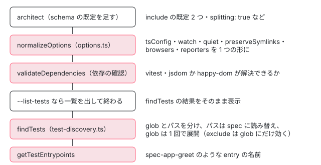

[目次](../README.md) › [ng test と Vitest の内側：テストを束ねて走らせるまで](README.md) › 第 1 回 / 全 5 回

# テストを探す：options の正規化・依存の確認・test-discovery

> schema.json の既定（include は \*\*/\*.spec.ts と \*\*/\*.test.ts、splitting は true）が architect で足されてから、options.ts の normalizeOptions が reporters・browsers・quiet・setupFiles・runnerConfig を正規化し、preserveSymlinks を build の target から継ぐ（dc27e17fc2 → 4187e5e277 → 6c6bb21485、#34162 の watcher の 4 本）。dependency-checker.ts と createProjectResolver（0010b922f8）が jsdom などを確かめ、--list-tests はその後で一覧だけを出す。test-discovery.ts の findTests が glob とパスを分け（exclude は glob にだけ効く）、getTestEntrypoints が entry の名前を付ける（-2 の重なり、128 文字の短縮と SHA-256 から xxhash への変更 cda8830710）。#34089（--include でも全部をコンパイル、origin/main の 5e05373507）と #34335（見つけた順、01afbf418c）も、本物の ng test の 10 通りの記録で確かめる。

angular/angular-cli · 読了 約 12 分 · 中核 · [サイトで読む（デモが動きます）](https://angular-deep-dive-cyan.vercel.app/chapter/vit-discovery)

---

この章で分かること: `ng test` を打ってから、ビルドが始まる前までに `@angular/build:unit-test` がしていることです。angular.json と端末の引数が `normalizeOptions` で 1 つのオブジェクトになり、runner の依存のパッケージ（jsdom など）を確かめ、`include` / `exclude` の glob からテストのファイルを探し、ファイルごとに esbuild の entry の名前を決めるまでを、行の順に追います。最後に本物の `ng test` を 10 通りの引数で走らせ、関数の引数と戻り値を覗いた記録で確かめます。

読む対象は `packages/angular/build/src/builders/unit-test/` の `schema.json`・`options.ts`・`builder.ts`・`test-discovery.ts`・`runners/dependency-checker.ts` と、`utils/resolve-project.ts` です。`execute` から Vitest の起動までの大きな流れ（runner の読み込み、`findTests` の glob の 1 回の呼び出し、spec でないパスの扱い、entry の名前の付け方の骨組み）は[CLI シリーズの unit-test の章](../cli/12-cli-unit-test.md)で読んだので、ここではその章が引用していない行を読みます。

1. **1. テストを探す**（この章）
2. [2. テスト用のビルド](02-vit-build.md)
3. [3. Vitest の plugin](03-vit-plugins.md)
4. [4. executor とブラウザ](04-vit-executor.md)
5. [5. spec と issue](05-vit-tests-issues.md)

> [!TIP]
> **新卒エンジニアへ**
>
> **glob** は `**/*.spec.ts` のような「ファイルの名前の型」です。`**` は何段のフォルダでも、`*` は 1 段の中の何文字でもを表します。**entry（entry point）**は esbuild に「ここから束ねて 1 つの出力のファイルにする」と渡す入口です。unit-test の builder はテストのファイル 1 つを 1 つの entry にします。**正規化（normalize）**は、書き方がいろいろある options を、後の処理が迷わない 1 つの形に直すことです。

## 1. 全体の流れ



*ng test からビルドの直前まで。左が関数、右がその段で決まるもの。赤い箱がこの章の中心*

1. **architect が schema の既定を足す**

   angular.json の `test` の options と端末の引数に、`schema.json` の `default` を足したものが `execute` に届きます（2 節）。
2. **options を正規化する**

   `normalizeOptions` が、build の target・tsconfig・watch に加えて、この章で読む残りの項目（browsers・quiet・setupFiles・preserveSymlinks など）を決めます（2・3 節）。
3. **runner の依存を確かめる**

   Vitest の runner の `validateDependencies` が `DependencyChecker` で package を 1 つずつ解決し、足りなければ一覧のメッセージで止めます（4 節）。
4. **テストのファイルを探す**

   `--list-tests` ならここで一覧を出して終わります（5 節）。そうでなければ runner の `getBuildOptions` の中で `findTests` が呼ばれます（6 節）。
5. **entry の名前を決める**

   `getTestEntrypoints` が、ファイルのパスから `spec-app-greet` のような名前を作ります。長すぎれば hash で縮めます（7 節）。この名前が次の章のビルドの `entryPoints` の key になります。

## 2. schema の既定と options の正規化

📄 `angular-cli/packages/angular/build/src/builders/unit-test/schema.json` L40–54 （▶ の行: 45–46, 53）

```json
40 │     "include": {
41 │       "type": "array",
42 │       "items": {
43 │         "type": "string"
44 │       },
45 ▶       "default": ["**/*.spec.ts", "**/*.test.ts"],
46 ▶       "description": "Specifies glob patterns of files to include for testing, relative to the project root. This option also has special handling for directory paths (includes all test files within) and file paths (includes the corresponding test file if one exists)."
47 │     },
48 │     "exclude": {
49 │       "type": "array",
50 │       "items": {
51 │         "type": "string"
52 │       },
53 ▶       "description": "Specifies glob patterns of files to exclude from testing, relative to the project root."
54 │     },
```

45 行目が `include` の既定で、`**/*.spec.ts` と `**/*.test.ts` の 2 つです。architect（builder を起動する仕組み、[CLI の概観の章](../cli/01-cli-overview.md)）は options を builder に渡す前に schema の `default` を埋めるので、angular.json に `include` を書かなければ、`execute` にはこの 2 つが届きます。[CLI の章](../cli/12-cli-unit-test.md)で読んだ `options.ts` の 122 行目の `options.include ?? ['**/*.spec.ts']` は、architect を通らずに `execute` を直に呼んだときだけ効く予備の値です。10 節の記録の「既定」でも、builder に届いた `include` は 2 つでした。`.test.ts` が既定に入ったのは a90bea5b51（2025-10-10）です。

📄 `../angular-cli で git show（抜粋）`

```
$ git show a90bea5b51 -- packages/angular/build/src/builders/unit-test/schema.json   # 2025-10-10（抜粋）
       "items": {
         "type": "string"
       },
-      "default": ["**/*.spec.ts"],
+      "default": ["**/*.spec.ts", "**/*.test.ts"],
```

📄 `angular-cli/packages/angular/build/src/builders/unit-test/options.ts` L69–91 （▶ の行: 79, 82–83, 86–87, 90）

```ts
69 │ 
70 │   const {
71 │     runner,
72 │     browsers,
73 │     progress,
74 │     filter,
75 │     browserViewport,
76 │     ui,
77 │     runnerConfig,
78 │     isolate,
79 ▶     splitting = true,
80 │   } = options;
81 │ 
82 ▶   if (ui && runner !== Runner.Vitest) {
83 ▶     throw new Error('The "ui" option is only available for the "vitest" runner.');
84 │   }
85 │ 
86 ▶   if (isolate && runner !== Runner.Vitest) {
87 ▶     throw new Error('The "isolate" option is only available for the "vitest" runner.');
88 │   }
89 │ 
90 ▶   const [width, height] = browserViewport?.split('x').map(Number) ?? [];
91 │ 
```

79 行目の `splitting = true` も同じ形の予備の値です（schema の既定も `true`、下の引用の 83 行目）。82〜88 行目は、Vitest でしか意味のない `ui` と `isolate` を Karma の runner と一緒に指定したら、例外で止める行です。90 行目は `browserViewport` の `"1280x720"` を `x` で割って数にします（ブラウザのモードで使う。[第 4 回](04-vit-executor.md)）。

📄 `angular-cli/packages/angular/build/src/builders/unit-test/schema.json` L76–89 （▶ の行: 78, 83–84）

```json
76 │     "isolate": {
77 │       "type": "boolean",
78 ▶       "description": "Enables isolation for test execution. When true, Vitest runs tests in separate threads or processes. This option is only available for the Vitest runner. Defaults to false to align with the Karma/Jasmine experience."
79 │     },
80 │     "splitting": {
81 │       "type": "boolean",
82 │       "description": "Enables code splitting for test execution. When enabled, shared code between test files is split into separate chunks. Issues with live ESM bindings in Node.js environments (such as uninitialized exports or mocking failures) can be resolved by disabling splitting. This option is only available for the Vitest runner.",
83 ▶       "default": true,
84 ▶       "x-deprecated": "No longer needed with Vitest 5."
85 │     },
86 │     "quiet": {
87 │       "type": "boolean",
88 │       "description": "Suppresses the verbose build summary and stats table on each rebuild. Defaults to `true` locally and `false` in CI environments."
89 │     },
```

`splitting` は 4b8c62a8f1（2026-08-28）で足され、10 日後の 66bd6bd1ea（2026-09-07）で 84 行目の `x-deprecated`（非推奨の印。CLI はこれを option の `deprecated` にして、`ng test --help` に表示する）が付きました。理由は「Vitest 5 ではもう要らない」です。この値がビルドの何を変えるか、なぜ足して、なぜすぐ非推奨にしたかは[次の章](02-vit-build.md)で読みます。78 行目のとおり `isolate` の既定は schema では書かれておらず、説明に「既定は false」とあります（何が false にするかは[第 4 回](04-vit-executor.md)）。

📄 `angular-cli/packages/angular/build/src/builders/unit-test/options.ts` L30–38 （▶ の行: 33–36）

```ts
30 │ function normalizeReporterOption(
31 │   reporters: unknown[] | undefined,
32 │ ): [string, Record<string, unknown>][] | undefined {
33 ▶   return reporters?.map((entry) =>
34 ▶     typeof entry === 'string'
35 ▶       ? ([entry, {}] as [string, Record<string, unknown>])
36 ▶       : (entry as [string, Record<string, unknown>]),
37 │   );
38 │ }
```

📄 `angular-cli/packages/angular/build/src/builders/unit-test/options.ts` L142–167 （▶ の行: 144, 146, 150, 153–156, 160–161, 163–165）

```ts
142 │     tsConfig,
143 │     buildProgress: progress,
144 ▶     reporters: normalizeReporterOption(options.reporters),
145 │     outputFile: options.outputFile,
146 ▶     browsers: browsers?.length ? browsers : undefined,
147 │     browserViewport: width && height ? { width, height } : undefined,
148 │     watch,
149 │     debug: options.debug ?? false,
150 ▶     ui: process.env['CI'] ? false : ui,
151 │     isolate,
152 │     splitting,
153 ▶     quiet: options.quiet ?? (process.env['CI'] ? false : true),
154 ▶     providersFile: options.providersFile && path.join(workspaceRoot, options.providersFile),
155 ▶     setupFiles: options.setupFiles
156 ▶       ? options.setupFiles.map((setupFile) => toPosixPath(path.join(workspaceRoot, setupFile)))
157 │       : [],
158 │     dumpVirtualFiles: options.dumpVirtualFiles,
159 │     listTests: options.listTests,
160 ▶     preserveSymlinks,
161 ▶     runnerConfig:
162 │       typeof runnerConfig === 'string'
163 ▶         ? runnerConfig.length === 0
164 ▶           ? true
165 ▶           : path.resolve(workspaceRoot, runnerConfig)
166 │         : runnerConfig,
167 │   };
```

1. **144 行目: reporters を \[名前, options\] の組にそろえる**

   33〜36 行目のとおり、文字列なら `[entry, {}]` に、すでに組ならそのまま返します。10 節の記録で `--reporters=verbose` は `[["verbose", {}]]` になっています。
2. **146 行目: 空の browsers は「無し」**

   `browsers: []` を `undefined` にします。f17ed308bf（2026-03-04、#32652）で入りました。空の配列が残るとブラウザのモードに進んでしまい、jsdom に戻れなかったためです。
3. **150・153 行目: 環境変数 CI で既定が変わる**

   `CI` があれば `ui` は切られ、`quiet`（再ビルドのたびのビルドの表を出さない）の既定が `false` になります。手元では `quiet` の既定は `true` です（記録でも `true`）。
4. **154〜157 行目: パスは workspace の root からの絶対パスに**

   `providersFile` と `setupFiles` を `path.join(workspaceRoot, …)` で絶対パスにします。`setupFiles` だけは `toPosixPath` で `/` 区切りにします（2274babb66、Windows で Vitest がパスを照合できなかったため）。
5. **160 行目: preserveSymlinks**

   3 節で読みます。
6. **161〜166 行目: runnerConfig**

   文字列なら、空文字は `true`（設定のファイルを探す）、それ以外は workspace の root からの絶対パスにします。`true` のときにどこを探すかは[次の章](02-vit-build.md)の `configuration.ts` です。

## 3. preserveSymlinks を build の target から継ぐ

**symlink**（シンボリックリンク）は、別の場所のファイルやフォルダを指す「別名」のファイルです。`npm link` で手元のライブラリを `node_modules` に入れると symlink になります。`preserveSymlinks` は「symlink を実体のパスに読み替えずに、symlink のパスのまま module を解決する」という Node と esbuild の設定です。application builder の options にはありますが、unit-test の schema にはありません。そこで unit-test の builder は、build の target の値を自分で読みに行きます。その行（`options.ts` の 49〜58 行目）は[CLI の章](../cli/12-cli-unit-test.md)の 2 節の引用の中にあるので、ここでは入った順に `git show` で読みます。

📄 `../angular-cli で git show（3 本の抜粋）`

```
$ git show dc27e17fc2 -- packages/angular/build/src/builders/unit-test/builder.ts   # 2026-06-24（抜粋）
+  // Resolve final preserveSymlinks option
+  normalizedOptions.preserveSymlinks =
+    buildTargetOptions.preserveSymlinks ?? process.execArgv.includes('--preserve-symlinks');
 ...
       ...(normalizedOptions.tsConfig ? { tsConfig: normalizedOptions.tsConfig } : {}),
+      preserveSymlinks: normalizedOptions.preserveSymlinks,
     } satisfies ApplicationBuilderInternalOptions;
$ git show 4187e5e277 -- packages/angular/build/src/builders/unit-test/options.ts   # 2026-07-14（抜粋。builder.ts の 3 行は消した）
+  // Load target options to determine preserveSymlinks setting
+  let buildTargetOptions: Record<string, unknown> | undefined;
+  try {
+    buildTargetOptions = await context.getTargetOptions(buildTarget);
+  } catch {}
+
+  const preserveSymlinks =
+    typeof buildTargetOptions?.preserveSymlinks === 'boolean'
+      ? buildTargetOptions.preserveSymlinks
+      : process.execArgv.includes('--preserve-symlinks');
+
   // Setup base paths based on workspace root and project information
-  const workspaceRoot = context.workspaceRoot;
+  const workspaceRoot = canonicalizePath(context.workspaceRoot, preserveSymlinks);
$ git show 6c6bb21485 -- packages/angular/build/src/builders/unit-test/options.ts   # 2026-07-27
-  const workspaceRoot = canonicalizePath(context.workspaceRoot, preserveSymlinks);
+  const workspaceRoot = canonicalizePath(context.workspaceRoot);
```

1. **dc27e17fc2（2026-06-24）: build の target から継ぐ**

   それまで Vitest の runner には `preserveSymlinks` が渡っておらず、symlink の package の module が解決できませんでした。`builder.ts` で build の target の options（`validateOptions` の後）を見て、無ければ Node の起動の引数 `--preserve-symlinks` を見ます。決めた値は application builder に渡す options（[CLI の章](../cli/12-cli-unit-test.md)の 5 節の 330 行目）に入ります。
2. **4187e5e277（2026-07-14）: 決める場所を options.ts に移す**

   Windows で workspace の root のドライブ文字の大小をそろえる `canonicalizePath` が、symlink を実体に読み替えるかどうかに `preserveSymlinks` を使うようになったので、root を決めるより前（`normalizeOptions` の頭）で決める必要が出ました。build の target の options は `getTargetOptions` の生の値（schema の既定を足す前）なので、`typeof … === 'boolean'` で確かめます。
3. **6c6bb21485（2026-07-27）: root は読み替えない**

   `canonicalizePath` から実体への読み替え自体を消したので、`preserveSymlinks` は root には使われなくなりました。値を決める 49〜58 行目は残り、160 行目で返す値だけに使われます。

10 節の記録の「preserveSymlinks」は、build の target の configuration に `preserveSymlinks: true` を書いて `ng test --configuration symlinks` を走らせたものです。正規化の後の値も、application builder に渡った値も `true` でした。

この値が watch で問題になったのが #34162（2026-09-24 に報告、翌日に閉じた）です。`preserveSymlinks: true` の workspace で、22.2.0 の `ng test`（と `ng serve`）が「Watch mode enabled」のまま止まる、という報告でした。application builder の watcher の 4 本の変更を並べると、何が重なったかが分かります。

📄 `../angular-cli の git log と git tag --contains`

```
$ git log --format='%h %ad %s' --date=short（../angular-cli、watcher の 4 本。tag は git tag --contains）
b423bc39cd 2026-09-09 fix(@angular/build): use chokidar watcher when followSymlinks is enabled      # 22.2.0
ee3041325c 2026-09-18 fix(@angular/build): ensure chokidar watcher is ready before returning         # 22.2.0（main では dc79270a8d）
5194b41531 2026-09-24 fix(@angular/build): prevent chokidar from scanning unimported node_modules…   # 22.2.1（main では 91b0947898、Fixes #34162）
972302ac3d 2026-10-15 fix(@angular/build): watch only explicitly added paths in chokidar watcher     # origin/main（Closes #34312）
```

b423bc39cd は「`followSymlinks`（= `preserveSymlinks`）なら、symlink をたどれる chokidar（ファイルの監視の package）を使う」変更です。ee3041325c は「chokidar の最初の走査が終わる（`ready`）まで待ってから返す」変更です。コミットメッセージと issue の説明によれば、chokidar は workspace の root 全体を見ていて、`preserveSymlinks` のときは `node_modules` を除く規則も入らないので、最初の走査が `node_modules` の全部をたどり終わるまで、最初のビルドの結果がテストの側に渡りませんでした。22.2.1 の 5194b41531 が import された package 以外の `node_modules` を走査から外し、origin/main の 972302ac3d はさらに「足されたパスだけを見る」形にしています。サイトの依存の 22.1.7 にはこの 4 本のどれも入っていないので、この章の記録では再現しません。

## 4. 依存を確かめる：DependencyChecker

Vitest の runner の `validateDependencies`（[CLI の章](../cli/12-cli-unit-test.md)の 7 節で引用）は、`vitest` を必ず、`browsers` が無ければ `jsdom` か `happy-dom` のどちらか、coverage なら `@vitest/coverage-v8` か `@vitest/coverage-istanbul` のどちらかを求めます。確かめ方の中身がこのクラスです。

📄 `angular-cli/packages/angular/build/src/builders/unit-test/runners/dependency-checker.ts` L11–45 （▶ の行: 15, 18, 26, 29, 37, 39, 41, 43）

```ts
11 │ /**
12 │  * A custom error class to represent missing dependency errors.
13 │  * This is used to avoid printing a stack trace for this expected error.
14 │  */
15 ▶ export class MissingDependenciesError extends Error {
16 │   constructor(message: string) {
17 │     super(message);
18 ▶     this.name = 'MissingDependenciesError';
19 │   }
20 │ }
21 │ 
22 │ type Resolver = (packageName: string) => string;
23 │ 
24 │ export class DependencyChecker {
25 │   private readonly resolver: Resolver;
26 ▶   private readonly missingDependencies = new Set<string>();
27 │ 
28 │   constructor(projectSourceRoot: string) {
29 ▶     this.resolver = createProjectResolver(projectSourceRoot);
30 │   }
31 │ 
32 │   /**
33 │    * Checks if a package is installed.
34 │    * @param packageName The name of the package to check.
35 │    * @returns True if the package is found, false otherwise.
36 │    */
37 ▶   private isInstalled(packageName: string): boolean {
38 │     try {
39 ▶       this.resolver(packageName);
40 │ 
41 ▶       return true;
42 │     } catch {
43 ▶       return false;
44 │     }
45 │   }
```

📄 `angular-cli/packages/angular/build/src/builders/unit-test/runners/dependency-checker.ts` L52–88 （▶ の行: 53–54, 65, 68, 77, 81, 83, 85, 87）

```ts
52 │   check(packageName: string): void {
53 ▶     if (!this.isInstalled(packageName)) {
54 ▶       this.missingDependencies.add(packageName);
55 │     }
56 │   }
57 │ 
58 │   /**
59 │    * Verifies that at least one of a list of packages is installed. If none are
60 │    * installed, a custom error message is added to the list of errors.
61 │    * @param packageNames An array of package names to check.
62 │    * @param customErrorMessage The error message to use if none of the packages are found.
63 │    */
64 │   checkAny(packageNames: string[], customErrorMessage: string): void {
65 ▶     if (packageNames.every((name) => !this.isInstalled(name))) {
66 │       // This is a custom error, so we add it directly.
67 │       // Using a Set avoids duplicate custom messages.
68 ▶       this.missingDependencies.add(customErrorMessage);
69 │     }
70 │   }
71 │ 
72 │   /**
73 │    * Throws a `MissingDependenciesError` if any dependencies were found to be missing.
74 │    * The error message is a formatted list of all missing packages.
75 │    */
76 │   report(): void {
77 ▶     if (this.missingDependencies.size === 0) {
78 │       return;
79 │     }
80 │ 
81 ▶     let message = 'The following packages are required but were not found:\n';
82 │     for (const name of this.missingDependencies) {
83 ▶       message += `  - ${name}\n`;
84 │     }
85 ▶     message += 'Please install the missing packages and rerun the test command.';
86 │ 
87 ▶     throw new MissingDependenciesError(message);
88 │   }
```

1. **37〜44 行目: 解決できれば「入っている」**

   実際に `require.resolve` して、例外が出なければ入っているとみなします。package.json の `dependencies` は見ません。
2. **53〜54 行目と 65〜68 行目: 足りないものを Set に積む**

   `check` は package の名前を、`checkAny`（どれか 1 つあればよい）は、どれも無いときに呼び出し側が渡した文の全体を積みます。だから jsdom が無いときの一覧には、package の名前ではなく「A DOM environment is required…」という文が並びます。
3. **76〜87 行目: 最後にまとめて投げる**

   1 つ目が足りなくても止まらず、全部を確かめてから 1 つの `MissingDependenciesError` にします。15〜19 行目のとおり、これは名前を付けただけの `Error` で、`execute` の側はこの型のときだけスタックを出さずにメッセージだけを出します（[CLI の章](../cli/12-cli-unit-test.md)の 2 節の 195〜196 行目）。

📄 `angular-cli/packages/angular/build/src/utils/resolve-project.ts` L12–23 （▶ の行: 20, 22）

```ts
12 │ /**
13 │  * Creates a module resolver function that is strictly scoped to the project root.
14 │  * This prevents module resolution from leaking the parent module context when executing inside virtual stores (like pnpm).
15 │  *
16 │  * @param projectRoot The root directory of the project.
17 │  * @returns A resolver function that takes a package name/path and returns its resolved path.
18 │  */
19 │ export function createProjectResolver(projectRoot: string): (packageName: string) => string {
20 ▶   const projectRequire = createRequire(join(projectRoot, 'package.json'));
21 │ 
22 ▶   return (packageName: string) => projectRequire.resolve(packageName, { paths: [projectRoot] });
23 │ }
```

29 行目が使う resolver です。20 行目で「project の src にある package.json」を起点にした `require` を作り、22 行目で `paths: [projectRoot]` を付けて解決します。この `paths` は 0010b922f8（2026-06-29）で足されました。コミットメッセージによれば、付けないと Node が `require` を作った module の場所（pnpm の `.pnpm` の中）からも探してしまい、project が直に依存していない package を「入っている」と判断していました。同じ関数は次の章の zone.js と `@angular/localize` の判定にも使われます。

10 節の記録の「jsdom なし」は、デモのアプリの `node_modules`（package ごとにサイトの `node_modules` を指す symlink を並べたフォルダ）から jsdom の symlink だけを外して走らせたものです。ビルドは始まらず、`MissingDependenciesError` のメッセージだけが出て、終了コードは 1 でした。

## 5. --list-tests：探すだけで終わる

📄 `angular-cli/packages/angular/build/src/builders/unit-test/builder.ts` L206–224 （▶ の行: 207–208, 210, 215, 217, 220）

```ts
206 │ 
207 ▶   if (normalizedOptions.listTests) {
208 ▶     const testFiles = await findTests(
209 │       normalizedOptions.include,
210 ▶       normalizedOptions.exclude ?? [],
211 │       normalizedOptions.workspaceRoot,
212 │       normalizedOptions.projectSourceRoot,
213 │     );
214 │ 
215 ▶     context.logger.info('Discovered test files:');
216 │     for (const file of testFiles) {
217 ▶       context.logger.info(`  ${path.relative(normalizedOptions.workspaceRoot, file)}`);
218 │     }
219 │ 
220 ▶     yield { success: true };
221 │ 
222 │     return;
223 │   }
224 │ 
```

207 行目の `listTests` が真なら、208 行目でビルドの外から `findTests` を呼び、217 行目で workspace の root からの相対パスを 1 行ずつ出して、220 行目で成功として終わります。application builder も Vitest も動きません。この `if` は依存の確認（[CLI の章](../cli/12-cli-unit-test.md)の 2 節の 192 行目）の後にあるので、jsdom が無ければ一覧も出ません。出る順は `findTests` の戻り値の順で、記録では `app/app.spec.ts`・`app/broken.spec.ts`・`app/greet.spec.ts`・`app/feature/counter.spec.ts`・`app/feature/counter.test.ts` でした。名前の順ではありません（9 節）。

## 6. glob の展開：パスをそろえ、exclude は glob にだけ効く

📄 `angular-cli/packages/angular/build/src/builders/unit-test/test-discovery.ts` L32–50 （▶ の行: 38, 44, 48–49）

```ts
32 │  * @param include Glob patterns of files to include.
33 │  * @param exclude Glob patterns of files to exclude.
34 │  * @param workspaceRoot The absolute path to the workspace root.
35 │  * @param projectSourceRoot The absolute path to the project's source root.
36 │  * @returns A unique set of absolute paths to all test files.
37 │  */
38 ▶ export async function findTests(
39 │   include: string[],
40 │   exclude: string[],
41 │   workspaceRoot: string,
42 │   projectSourceRoot: string,
43 │ ): Promise<string[]> {
44 ▶   await initializeHash();
45 │   const resolvedTestFiles = new Set<string>();
46 │   const dynamicPatterns: string[] = [];
47 │ 
48 ▶   const projectRootPrefix = toPosixPath(relative(workspaceRoot, projectSourceRoot) + '/');
49 ▶   const normalizedExcludes = exclude.map((p) => normalizePattern(p, projectRootPrefix));
50 │ 
```

44 行目の `initializeHash` は、7 節の名前の短縮で使う hash（xxhash の WebAssembly）を先に読み込む行です（cda8830710 で足された）。48 行目は「workspace の root から project の src までの相対パス + `/`」で、記録のアプリでは `src/` です。49 行目で `exclude` を include と同じ関数で直します。この後の、glob とそれ以外に分けて 1 回の glob にまとめる行（52〜75 行目）は[CLI の章](../cli/12-cli-unit-test.md)の 4 節の引用にあります。そこでは `exclude` が 69 行目の glob の `ignore` にだけ渡り、glob でないパスを `resolveStaticPattern` で解決した結果は 58 行目で直に結果の Set に入ります。

📄 `angular-cli/packages/angular/build/src/builders/unit-test/test-discovery.ts` L253–274 （▶ の行: 262, 265–266, 271）

```ts
253 │ /**
254 │  * Normalizes a glob pattern by converting it to a POSIX path, removing leading
255 │  * slashes, and making it relative to the project source root.
256 │  *
257 │  * @param pattern The glob pattern to normalize.
258 │  * @param projectRootPrefix The POSIX-formatted prefix of the project's source root relative to the workspace root.
259 │  * @returns A normalized glob pattern.
260 │  */
261 │ function normalizePattern(pattern: string, projectRootPrefix: string): string {
262 ▶   const posixPattern = toPosixPath(pattern);
263 │ 
264 │   // Do not modify absolute paths. The globber will handle them correctly.
265 ▶   if (isAbsolute(posixPattern)) {
266 ▶     return posixPattern;
267 │   }
268 │ 
269 │   // For relative paths, ensure they are correctly relative to the project source root.
270 │   // This involves removing the project root prefix if the user provided a workspace-relative path.
271 ▶   const normalizedRelative = removePrefix(posixPattern, projectRootPrefix);
272 │ 
273 │   return normalizedRelative;
274 │ }
```

📄 `angular-cli/packages/angular/build/src/builders/unit-test/test-discovery.ts` L206–231 （▶ の行: 209, 220–222, 225）

```ts
206 │ /**
207 │  * Whether the current operating system's filesystem is case-insensitive.
208 │  */
209 ▶ const isCaseInsensitiveFilesystem = os.platform() === 'win32' || os.platform() === 'darwin';
210 │ 
211 │ /**
212 │  * Removes a prefix from the beginning of a string, with conditional case-insensitivity
213 │  * based on the operating system's filesystem characteristics.
214 │  *
215 │  * @param text The string to remove the prefix from.
216 │  * @param prefix The prefix to remove.
217 │  * @returns The string with the prefix removed, or the original string if the prefix was not found.
218 │  */
219 │ function removePrefix(text: string, prefix: string): string {
220 ▶   if (isCaseInsensitiveFilesystem) {
221 ▶     if (text.toLowerCase().startsWith(prefix.toLowerCase())) {
222 ▶       return text.substring(prefix.length);
223 │     }
224 │   } else {
225 ▶     if (text.startsWith(prefix)) {
226 │       return text.substring(prefix.length);
227 │     }
228 │   }
229 │ 
230 │   return text;
231 │ }
```

1. **262 行目: Windows の \\ を / に**

   d5b4d0303a（2025-11-18）で入りました。glob の package（tinyglobby）は `/` 区切りしか読みません。
2. **265〜267 行目: 絶対パスはそのまま**

   683d0e09e5（2025-11-06）より前は先頭の `/` を落としていて、絶対パスの include が何にも当たりませんでした。
3. **271 行目: workspace からの書き方を src からの書き方に**

   `src/app/greet.ts` も `app/greet.ts` も、ここで `app/greet.ts` になります。glob は 66 行目（CLI の章の引用）で project の src を基準に走るからです。
4. **209・220〜222 行目: macOS と Windows では大文字と小文字を区別しない**

   ファイルシステムが区別しない OS では、`SRC/app/x.spec.ts` と打っても `src/` を外します（683d0e09e5）。

記録で `exclude` の効き方を比べると、違いがはっきり出ます。

| 引数 | findTests の戻り値 | 結果 |
| --- | --- | --- |
| `--include src/app/feature --exclude '**/*.test.ts'` | `app/feature/counter.spec.ts` だけ | フォルダは `app/feature/**/*.@(spec\|test).@(ts\|tsx)` の glob に読み替わるので、exclude が効く |
| `--include '**/greet.spec.ts' --exclude '**/greet.spec.ts'` | 空 | 「No tests found matching the following patterns」で終了コード 1 |
| `--include src/app/greet.spec.ts --exclude '**/greet.spec.ts'` | `app/greet.spec.ts` | exclude に当たるのに 2 つのテストが走り、終了コード 0 |

3 行目は、spec のファイルのパスを直に書くと `exclude` が当てられないことを示しています。schema の説明（2 節の 53 行目）は「テストから除くファイルの glob」で、spec のパスとの組み合わせについては書いていません。同じ形を固める spec もありません（テストと直し方の節）。origin/main（8b26efa1ba）の `findTests` もこの部分は同じです。

## 7. entry の名前：接頭辞・重なり・長さ

📄 `angular-cli/packages/angular/build/src/builders/unit-test/test-discovery.ts` L16–23 （▶ の行: 20, 22–23）

```ts
16 │ /**
17 │  * An array of file infix notations that identify a file as a test file.
18 │  * For example, `.spec` in `app.component.spec.ts`.
19 │  */
20 ▶ const TEST_FILE_INFIXES = ['.spec', '.test'];
21 │ 
22 ▶ /** Maximum length for a generated test entrypoint name. */
23 ▶ const MAX_FILENAME_LENGTH = 128;
```

📄 `angular-cli/packages/angular/build/src/builders/unit-test/test-discovery.ts` L96–120 （▶ の行: 102, 107–110, 112, 117, 120）

```ts
 96 │ export function getTestEntrypoints(
 97 │   testFiles: string[],
 98 │   {
 99 │     projectSourceRoot,
100 │     workspaceRoot,
101 │     removeTestExtension,
102 ▶     prefix = 'spec',
103 │   }: TestEntrypointsOptions,
104 │ ): Map<string, string> {
105 │   const seen = new Set<string>();
106 │   const counters = new Map<string, number>();
107 ▶   const roots = [projectSourceRoot, workspaceRoot];
108 ▶   const infixes = TEST_FILE_INFIXES.map((i) => i.slice(1));
109 ▶   if (!infixes.includes(prefix)) {
110 ▶     infixes.push(prefix);
111 │   }
112 ▶   const infixesPattern = infixes.join('|');
113 │ 
114 │   return new Map(
115 │     Array.from(testFiles, (testFile) => {
116 │       const fileName = generateNameFromPath(testFile, roots, !!removeTestExtension);
117 ▶       const baseName = fileName === prefix ? prefix : `${prefix}-${fileName}`;
118 │       let uniqueName = baseName;
119 │       // Start at 2 for collisions as the first instance remains suffix-less.
120 ▶       let suffix = counters.get(baseName) ?? 2;
```

102 行目の接頭辞の既定は `spec` で、`setupFiles` のときだけ次の章の呼び出し側が `setup` を渡します。107 行目の `roots` は「project の src、なければ workspace の root」の順で、7 節の後半の `removeRoots` が前から試します。108〜112 行目は、20 行目の `.spec`・`.test` から点を取った `spec|test` に接頭辞を足した正規表現の部品です。名前が重なったときに付ける `-2` を、`.spec` の前へ動かすために使います（重なりを数える 120〜128 行目と置き換えの正規表現は[CLI の章](../cli/12-cli-unit-test.md)の 4 節）。Vitest の runner は `removeTestExtension: true` で呼ぶので、テストのファイルの名前は `.spec.ts` ごと落ち、重なりの `-2` は最後に付きます。記録では `feature/counter.spec.ts` と `feature/counter.test.ts` が同じ `spec-app-feature-counter` になり、2 つ目が `spec-app-feature-counter-2` でした。

📄 `angular-cli/packages/angular/build/src/builders/unit-test/test-discovery.ts` L233–251 （▶ の行: 242–243, 245–246, 250）

```ts
233 │ /**
234 │  * Removes potential root paths from a file path, returning a relative path.
235 │  * If no root path matches, it returns the file's basename.
236 │  *
237 │  * @param path The file path to process.
238 │  * @param roots An array of root paths to attempt to remove.
239 │  * @returns A relative path.
240 │  */
241 │ function removeRoots(path: string, roots: string[]): string {
242 ▶   for (const root of roots) {
243 ▶     const result = removePrefix(path, root);
244 │     // If the prefix was removed, the result will be a different string.
245 ▶     if (result !== path) {
246 ▶       return result;
247 │     }
248 │   }
249 │ 
250 ▶   return basename(path);
251 │ }
```

どの root にも当たらないファイル（workspace の外を指す `setupFiles` など）は、250 行目でファイルの名前だけになります。そのときはフォルダの違いが消えるので、重なりの数字が付く場面が増えます。

📄 `angular-cli/packages/angular/build/src/builders/unit-test/test-discovery.ts` L184–204 （▶ の行: 187, 194, 198–200, 203）

```ts
184 │ /**
185 │  * Truncates a generated name if it exceeds the maximum allowed filename length.
186 │  * If truncation occurs, the name will be shortened by replacing a middle segment
187 ▶  * with an 8-character SHA256 hash of the original full path to maintain uniqueness.
188 │  *
189 │  * @param name The generated name to potentially truncate.
190 │  * @param originalPath The original full path from which the name was derived. Used for hashing.
191 │  * @returns The original name if within limits, or a truncated name with a hash.
192 │  */
193 │ function truncateName(name: string, originalPath: string): string {
194 ▶   if (name.length <= MAX_FILENAME_LENGTH) {
195 │     return name;
196 │   }
197 │ 
198 ▶   const hash = calculateHash(originalPath).substring(0, 8);
199 ▶   const availableLength = MAX_FILENAME_LENGTH - hash.length - 2; // 2 for '-' separators
200 ▶   const prefixLength = Math.floor(availableLength / 2);
201 │   const suffixLength = availableLength - prefixLength;
202 │ 
203 ▶   return `${name.substring(0, prefixLength)}-${hash}-${name.substring(name.length - suffixLength)}`;
204 │ }
```

名前が 23 行目の 128 文字を超えると、194 行目から先で、前半と後半を残して真ん中を hash の 8 文字に置き換えます。199 行目の `- 2` は、間に入れる 2 つの `-` の分です。記録の「長いパス」では、202 文字の名前が 128 文字に縮み、接頭辞の `spec-` が付いて 133 文字になりました。`truncateName` は `generateNameFromPath` の中（181 行目、CLI の章の引用）で呼ばれ、接頭辞は 117 行目でその後に付くので、entry の名前は 128 + 接頭辞と区切りの `-` の文字数まで伸びます。22 行目のコメント（entry の名前の最大の長さ）とはずれています。

📄 `../angular-cli で git diff（サイトの依存の版と 44129f66a3）`

```
$ git diff v22.1.7 44129f66a3 -- packages/angular/build/src/builders/unit-test/test-discovery.ts
-import { createHash } from 'node:crypto';
+import { calculateHash, initializeHash } from '../../utils/hash';
 ...
+  await initializeHash();
 ...
-  const hash = createHash('sha256').update(originalPath).digest('hex').substring(0, 8);
+  const hash = calculateHash(originalPath).substring(0, 8);
```

もう 1 つのずれは hash の種類です。187 行目のコメントは「SHA256 の 8 文字」ですが、44129f66a3 の 198 行目の `calculateHash` は xxhash の 64 ビットの hash（`utils/hash.ts`）で、cda8830710（2026-08-06）で SHA-256 から替わりました。サイトの依存の 22.1.7 はまだ SHA-256 で、記録の短縮した名前の真ん中の `114e2e3b` は、Node で `createHash('sha256')` に同じ相対パスを渡した先頭の 8 文字と一致しました。版が上がると、同じパスでも縮めた名前が変わります。

## 8. --include で 1 つだけ選んでも、全部をコンパイルしていた（#34089）

#34089（2026-09-13 に報告）は「`--include` で 1 つの spec を選んでも、tsconfig.spec.json に当たる全部の spec をコンパイルするので遅く、関係ない spec の型の誤りで止まる」という報告でした。`findTests` が選ぶのは esbuild の entry だけで、TypeScript の program の root のファイル（型を調べる範囲）は tsconfig の `include` のままだったからです。記録の「別の spec に型の誤り」は、`src/app/typo.spec.ts` に `const n: number = 'not a number';` を置いて `--include src/app/greet.ts` で走らせたものです。`findTests` の戻り値は `greet.spec.ts` だけなのに、ビルドは `typo.spec.ts` の TS2322 で失敗し、テストは 1 つも走りませんでした。

📄 `../angular-cli で git show（origin/main の続き）`

```
$ git show 5e05373507 -- packages/angular/build/src/builders/unit-test/runners/vitest/build-options.ts   # origin/main、2026-09-22（抜粋、Fixes #34089）
+  const rootFiles = [...testFiles];
+  if (providersFile) {
+    rootFiles.push(providersFile);
+  }
+
+  if (setupFiles?.length) {
+    rootFiles.push(...setupFiles);
 ...
     entryPoints,
+    rootFiles,
$ git show 5e05373507 -- packages/angular/build/src/tools/angular/compilation/typescript-compilation.ts   # （抜粋）
+    let rootNames = originalRootNames;
+    if (compilerOptionOverrides?.rootFiles?.length) {
+      const rootFilesSet = new Set(
+        compilerOptionOverrides.rootFiles.map((file) => canonicalizePath(toPosixPath(file))),
+      );
+      for (const file of originalRootNames) {
+        if (/\.d\.[cm]?ts$/i.test(file)) {
+          rootFilesSet.add(canonicalizePath(toPosixPath(file)));
+        }
+      }
+      rootNames = [...rootFilesSet];
+    }
```

5e05373507（2026-09-22。release の枝では f47f77f5f6 で、22.2.0 に入った）は、見つけたテストのファイルと `providersFile`・`setupFiles` を application builder の内部の option `rootFiles` にして、TypeScript の program の root をそれだけに絞ります。ただし `.d.ts` は tsconfig の分を残します。その後 7714a85375（2026-10-13）が、絞ったために standalone でないコンポーネントの `NgModule` が program に入らない場合を見つけたら、tsconfig の全部の root で作り直す道を足しました。

## 9. 見つけたファイルの順番（#34335）

44129f66a3 の `findTests` は Set を配列にして返すだけ（[CLI の章](../cli/12-cli-unit-test.md)の 4 節の 78 行目）で、並べ替えません。順は glob の package がフォルダをたどった順です。この順がそのまま entry の順になり、esbuild の共有の chunk の中身と名前（中身の hash）に響きます。#34335（2026-10-13 に報告）は「同じ入力で 2 回ビルドすると出力のファイルの名前が変わり、Vitest 5 の `fsModuleCache`（変換の結果をディスクに残すキャッシュ）が効かない」という報告でした。

📄 `../angular-cli で git show（origin/main の続き）`

```
$ git show 01afbf418c -- packages/angular/build/src/builders/unit-test/test-discovery.ts   # origin/main、2026-10-13
-  // 3. Combine and de-duplicate results
-  return [...resolvedTestFiles];
+  // 3. Combine, de-duplicate and sort the results. The glob crawls directories asynchronously and
+  // returns matches in a varying order; the order feeds the build entry points, so an unsorted list
+  // makes the output (chunk contents and names) differ between two builds of the same sources.
+  return [...resolvedTestFiles].sort();
```

01afbf418c は 1 行の `.sort()` で、次の日に issue を閉じました。7 節の重なりの数字も順に左右されます。`counter.spec.ts` と `counter.test.ts` のどちらが `-2` になるかは、並べ替えた後は名前の順（`.spec` が先）で決まります。出力が実際にどう変わるか（この記録のアプリでは 2 回とも同じだった）は[次の章](02-vit-build.md)で見ます。

## 10. 本物の ng test で、探したファイルと名前を覗く

> **🧪 DEMO — 10 通りの ng test と、findTests・getTestEntrypoints の記録（記録の再生）**
>
> `<scratchpad>/vit-demo/a/record.mjs` が、@angular/build 22.1.7・@angular/cli 22.1.7・vitest 4.1.11・jsdom 28.1.0 の `ng test --watch=false` を Node v24.22.1 で走らせた記録です。アプリ（`<app>`）はコンポーネント 2 つ・spec 4 つ・`.test.ts` 1 つで、`broken.spec.ts` はわざと落ちます。`node --require hook.cjs` で `@angular/build` の関数を包み、引数と戻り値を書き出しました（この章で使うのは `normalizeOptions`・`validateDependencies`・`findTests`・`getTestEntrypoints` の 4 つ）。1 回ごとにプロセスの group を止め、`.angular` のキャッシュを消してから次を走らせています。読みやすさのため、全部の回に `--reporters=verbose` を付けました。
>
> include を書かない
>
> ▶ [このデモはサイトで動かせます](https://angular-deep-dive-cyan.vercel.app/chapter/vit-discovery)

記録から読めることを並べます。

- **既定**: execute に届いた `include` は schema の 2 つで、`splitting: true`・`runner: "vitest"`・`runnerConfig: false` も schema から入っています（2 節）。`tsConfig` は project の root にある `tsconfig.spec.json` に、`quiet` は `true` になりました。
- **--include ファイル**: `src/app/greet.ts` は 271 行目で `app/greet.ts` になり、同じ場所の `greet.spec.ts` に読み替わりました。
- **exclude**: glob とフォルダには効き、spec のパスを直に書いたときは効きません（6 節の表）。
- **長いパス**: 133 文字の entry の名前になり、真ん中が SHA-256 の 8 文字です（7 節）。
- **jsdom なし・型の誤り**: 前者はビルドの前に止まり、後者は `findTests` が 1 つしか選ばなくてもビルドで止まります（4・8 節）。

## テストと直し方

この章の行を固めている spec は次のとおりです（44129f66a3 で `grep -n` したもの。パスは `packages/angular/build/src/builders/unit-test/` から）。

| spec | describe / it（行） | 固めていること |
| --- | --- | --- |
| `test-discovery_spec.ts` | `getTestEntrypoints`（12）の 5 つの it（21・30・43・57・72）、`generateNameFromPath`（88）の 9 つの it（95〜166） | 重なりの数字の位置、`setup` の接頭辞、Windows のパス、root に当たらないときのファイルの名前、128 文字の短縮（7 節）。unit の `//packages/angular/build:test` |
| `tests/options/include_spec.ts` | `Option: "include"`（18）の it（23）と、5 通りの入力で回す it（55） | 当たらなければ失敗、workspace からと src からのパス、フォルダ、glob（6 節） |
| `tests/options/exclude_spec.ts` | `Option: "exclude"`（18）の 3 つの it（35・44・53） | glob と `src/app/…` の書き方の exclude。どちらも include は既定の glob で、spec のパスの include と組み合わせる it は無い |
| `tests/options/list-tests_spec.ts` | `Option: "listTests"`（18）の 2 つの it（30・65） | 一覧を出して終わること（5 節） |
| `tests/options/tsconfig_spec.ts` | `Option: "tsConfig"`（19）の 3 つの it（24・39・48） | `tsconfig.spec.json` の既定と、無いファイルの指定で失敗すること |
| `tests/options/runner_spec.ts`・`build-target_spec.ts` | どちらも `xdescribe`（18） | 止められている |

📄 `走らせたコマンド`

```
cd ~/angular-research/angular-cli-fix   # 44129f66a3（../angular-cli と同じ版）
pnpm bazel test //packages/angular/build:test --nocache_test_results --test_output=all \
  '--test_arg=--filter=getTestEntrypoints|generateNameFromPath'
pnpm bazel test //packages/angular/build:unit-test_integration_tests --nocache_test_results --test_output=all \
  '--test_arg=--filter=Option: "(include|exclude|listTests|tsConfig)"'
```

📄 `結果（出力から抜き出したもの）`

```
（//packages/angular/build:test の 4 つの shard）Ran 3 of 604 specs ×2、Ran 4 of 605 specs ×2 / 0 failures
//packages/angular/build:test                                            PASSED in 2.0s
（//packages/angular/build:unit-test_integration_tests の 5 つの shard）
  Ran 2 of 92 specs ×3、Ran 3 of 93 specs、Ran 5 of 95 specs / 0 failures
//packages/angular/build:unit-test_integration_tests                     PASSED in 20.1s
```

unit の target は 4 つの shard に分かれ、`--filter` で 2 つの describe に絞ると、合わせて 14 specs（test-discovery\_spec.ts の it の数と同じ）が通りました。統合の target（`BUILD.bazel` の `jasmine_test(name = "unit-test_integration_tests")`、5 つの shard）は、4 つの describe に絞って 14 specs が通りました（include 6・exclude 3・listTests 2・tsConfig 3）。統合の spec は本物の application builder と Vitest を動かすので、20 秒かかります。`DependencyChecker` と `removePrefix` の大文字と小文字の扱い、`preserveSymlinks` を継ぐ行を直に見る spec はありません。

直すとしたら、次の場所になります。

- **spec のパスと exclude**: `test-discovery.ts` の `findTests` の 57〜58 行目（`resolveStaticPattern` の結果をそのまま足す行）。`normalizedExcludes` を同じ glob の照合で当てる形になります。spec は `exclude_spec.ts` に「spec のパスを include し、同じファイルを exclude する」it を足し、unit の `findTests` の describe（origin/main の 01afbf418c で `test-discovery_spec.ts` に足された）にも同じ組を足せます。
- **entry の名前の長さ**: `getTestEntrypoints` の 117 行目（接頭辞を付ける行）と `truncateName` の 194 行目。接頭辞を含めて 128 文字にするなら、`generateNameFromPath` に残りの長さを渡す形になります。spec は `test-discovery_spec.ts` の 131 行目の it の隣です。
- **hash のコメント**: `test-discovery.ts` の 187 行目（SHA256 と書いてある）。
- **見つけた順**: 44129f66a3 では 78 行目。origin/main では 01afbf418c で直っています。

## ここまでの呼び出し

- 👤 `ng test --include src/app/greet.ts` — 利用者
  - `execute()` — builder.ts 173 — *architect が schema の既定を足した options*
    - `normalizeOptions()` — options.ts 40 — *preserveSymlinks（49〜58）・reporters（144）・browsers（146）・quiet（153）*
    - `runner.validateDependencies()` — runners/vitest/index.ts 22
      - `DependencyChecker.check / checkAny / report` — runners/dependency-checker.ts — *createProjectResolver（utils/resolve-project.ts 19）*
    - `findTests()`（`--list-tests` のとき） — builder.ts 208 — *一覧を出して終わり*
    - `runner.getBuildOptions()` — builder.ts 298 — *次の章*
      - `findTests()` — test-discovery.ts 38 — *normalizePattern（261）→ glob（ignore = exclude）／ resolveStaticPattern*
      - `getTestEntrypoints()` — test-discovery.ts 96 — *generateNameFromPath → removeRoots（241）→ truncateName（193）*

## 聞かれそうな質問

**Q. angular.json に include を書いていないのに、`.test.ts` も走るのはなぜですか？**

schema の 45 行目の既定が `**/*.spec.ts` と `**/*.test.ts` の 2 つで、architect がそれを options に足してから `execute` に渡すからです。`options.ts` の 122 行目の 1 つだけの既定は、architect を通らないときの予備です。

**Q. `--exclude` を付けたのに、その spec が走りました。なぜですか？**

`--include` に spec のファイルのパスを直に書いたからです。`findTests` は glob でないパスを `resolveStaticPattern` で解決して直に結果に入れ、`exclude`（49 行目で直したもの）は glob の `ignore` にだけ渡します。include を glob かフォルダで書けば効きます（6 節の表）。

**Q. jsdom が入っていないと何が起きますか？どの時点で分かりますか？**

ビルドの前、`validateDependencies` で分かります。`checkAny`（64〜69 行目）が渡された文を積み、`report`（76〜87 行目）が `MissingDependenciesError` を投げ、`execute` はメッセージだけを出して失敗で終わります。`--list-tests` もこの後なので一覧は出ません。

**Q. 出力の `spec-app-feature-counter-2.js` は何ですか？**

`feature/counter.test.ts` の出力です。`.spec.ts` と `.test.ts` は拡張子ごと落ちるので、同じフォルダの同じ名前は同じ entry の名前になり、2 つ目に `-2` が付きます（CLI の章の 122〜128 行目）。どちらが 2 つ目になるかは `findTests` の順で、44129f66a3 では並べ替えていません（9 節）。

**Q. `preserveSymlinks` を unit-test の options に書けないのに、どこから来ますか？**

build の target です。`normalizeOptions` が `getTargetOptions` で build の target の生の options を読み、真偽値ならそれを、無ければ Node の `--preserve-symlinks` の有無を使います（4187e5e277 からこの形）。記録でも build の configuration に書いた `true` が application builder まで届きました。

**Q. `--include` で 1 つに絞ると速くなりますか？**

esbuild の entry は 1 つになりますが、44129f66a3 では TypeScript の program は tsconfig の全部の spec を含むので、型の誤りも全部から出ます（10 節の記録）。origin/main の 5e05373507 で `rootFiles` に絞るようになりました。

## 読み終えて

- `execute` に届く options は schema の既定が足された後のもので、`options.ts` の `??` の既定は予備にすぎない。
- 依存の確認は「解決できるか」を全部確かめてからまとめて 1 つのエラーにし、解決の起点は project の src に固定されている。
- `findTests` は glob とパスで扱いが違い、`exclude` は glob の側にしか効かない。
- entry の名前は「接頭辞 + src からのパスを - でつないだもの」で、重なりは `-2`、長ければ hash で縮める（hash は版によって SHA-256 か xxhash）。
- 2026 年の修正（preserveSymlinks を継ぐ、`--include` だけをコンパイル、見つけた順を並べ替える）は、どれも「探す」と「ビルドする」のつなぎ目に入っている。

---

← 前: [spec と issue を読む：dev-server を固めているテスト](../vds/05-vds-tests-issues.md)  
次: [テスト用のビルド：3 つの層の options と、TestBed を初期化する仮想のファイル](02-vit-build.md) →
