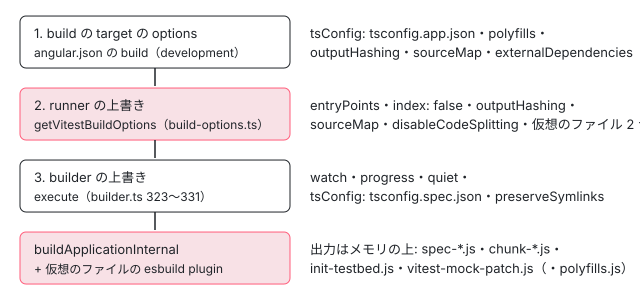

[目次](../README.md) › [ng test と Vitest の内側：テストを束ねて走らせるまで](README.md) › 第 2 回 / 全 5 回

# テスト用のビルド：3 つの層の options と、TestBed を初期化する仮想のファイル

> application builder に渡る options を、build の target → runner（runners/vitest/build-options.ts）→ builder.ts の 3 つの層で重ねる行。outputHashing を media に落とす adjustOutputHashing、code splitting の行き来（0ffe2d27f2 → 4d0be683b7 の ignoreAnnotations → 51565d4bcb → 4b8c62a8f1 → 66bd6bd1ea）、polyfills の既定 \[\] と library の target で分かれる zone.js の 4 通りの読み方（61e25fb1db、origin/main の d09f98ee70）、@angular/localize の自動の読み込み（75c1dce387）、TestBed を初期化する仮想のファイルと DynamicDOMTestComponentRenderer（edfa782d52）、--dump-virtual-files、configuration.ts の vitest-base.config の探索。zoneless・zone.js あり・library・--no-splitting の本物の ng test の記録で、options・仮想のファイルの全文・出力のファイルを並べる。

angular/angular-cli · 読了 約 13 分 · 発展 · [サイトで読む（デモが動きます）](https://angular-deep-dive-cyan.vercel.app/chapter/vit-build)

---

この章で分かること: 前の章で見つけたテストのファイルを、unit-test の builder が application builder でどうビルドさせるかです。build の target の options に Vitest の runner が何を上書きし、builder がさらに何を上書きするか、TestBed を初期化する「ディスクに無いファイル」（仮想のファイル）に何が書かれるか、zone.js と `@angular/localize` をどう読み込むかを、行の順に追います。最後に本物の `ng test` を zoneless・zone.js あり・library・`--no-splitting` などの 6 通りで走らせ、作られた options と仮想のファイルの全文、出力のファイルの一覧を記録で並べます。

読む対象は `packages/angular/build/src/builders/unit-test/` の `runners/api.ts`・`runners/vitest/build-options.ts`・`runners/vitest/configuration.ts`・`builder.ts` と、application builder の側の `tools/esbuild/application-code-bundle.ts`・`builders/application/schema.json` です。entry の組み立て（242〜269 行目の上書きの表）、zone.js の読み方を決める `getZoneTestingStrategy`、`initTestEnvironment` を呼ぶ行、`vi.mock` を止める仮想のファイルは[CLI シリーズの unit-test の章](../cli/12-cli-unit-test.md)の 5 節で読んだので、ここではその章が引用していない行と、2026 年の変更を読みます。esbuild でのビルドそのものは[application builder の章](../boot/04-boot-application-build.md)、共有の chunk の作られ方は[遅延チャンクの章](../cli/07-cli-code-splitting.md)にあります。

1. [1. テストを探す](01-vit-discovery.md)
2. **2. テスト用のビルド**（この章）
3. [3. Vitest の plugin](03-vit-plugins.md)
4. [4. executor とブラウザ](04-vit-executor.md)
5. [5. spec と issue](05-vit-tests-issues.md)

> [!TIP]
> **新卒エンジニアへ**
>
> **仮想のファイル（virtual file）**は、ディスクに置かずに文字列だけで作り、esbuild の plugin が「このパスの中身はこれ」と答えるファイルです。ここでは `angular:test-bed-init` と `angular:vitest-mock-patch` の 2 つです。**code splitting** は、複数の entry から使われる module を 1 つの共有の chunk（`chunk-XXXXXXXX.js`）に出して、entry の側から import させる esbuild の機能です。**polyfills** は、アプリの本体より先に読み込むスクリプトの一覧で、zone.js はここに書きます。

## 1. 全体の流れ：3 つの層で options を重ねる



*application builder に渡る options は 3 つの層を順に重ねたもの。下の層ほど強い*

📄 `angular-cli/packages/angular/build/src/builders/unit-test/runners/api.ts` L14–35 （▶ の行: 22, 28, 34）

```ts
14 │ /**
15 │  * Represents the options for a test runner.
16 │  */
17 │ export interface RunnerOptions {
18 │   /**
19 │    * Partial options for the application builder.
20 │    * These will be merged with the options from the build target.
21 │    */
22 ▶   buildOptions: Partial<ApplicationBuilderInternalOptions>;
23 │ 
24 │   /**
25 │    * A record of virtual files to be added to the build.
26 │    * The key is the file path and the value is the file content.
27 │    */
28 ▶   virtualFiles?: Record<string, string>;
29 │ 
30 │   /**
31 │    * A map of test entry points to their corresponding test files.
32 │    * This is used to avoid re-discovering the test files in the executor.
33 │    */
34 ▶   testEntryPointMappings?: Map<string, string>;
35 │ }
```

📄 `angular-cli/packages/angular/build/src/builders/unit-test/builder.ts` L289–307 （▶ の行: 294–298, 302, 304）

```ts
289 │   // Get runner-specific build options
290 │   let runnerBuildOptions;
291 │   let virtualFiles;
292 │   let testEntryPointMappings;
293 │   try {
294 ▶     ({
295 ▶       buildOptions: runnerBuildOptions,
296 ▶       virtualFiles,
297 ▶       testEntryPointMappings,
298 ▶     } = await runner.getBuildOptions(normalizedOptions, buildTargetOptions));
299 │   } catch (e) {
300 │     assertIsError(e);
301 │     context.logger.error(
302 ▶       `An exception occurred while getting runner-specific build options:\n${e.stack ?? e.message}`,
303 │     );
304 ▶     yield { success: false };
305 │ 
306 │     return;
307 │   }
```

1. **298 行目: runner に 1 の層を渡し、3 つを受け取る**

   戻り値の形が `api.ts` の `RunnerOptions` です。22 行目の `buildOptions` は 1 の層に重ねる差分（ただし Vitest の runner は 1 の層を広げた上に書くので、実際は全部）、28 行目の `virtualFiles` は「名前 → 中身の文字列」、34 行目の `testEntryPointMappings` は「entry の名前 → 元のファイル」です。
2. **302・304 行目: 失敗はスタックごと出して終わる**

   前の章の「No tests found」はここに来ます（記録の「glob と exclude」の端末の出力は `An exception occurred while getting runner-specific build options:` で始まっていました）。
3. **その後: 3 の層を重ねてビルドへ**

   executor を作り、`virtualFiles` を esbuild の plugin に変え（`prepareBuildExtensions`）、3 の層を重ねて `buildApplicationInternal` に渡します。この 3 つの行は[CLI の章](../cli/12-cli-unit-test.md)の 5 節の引用（309〜343 行目）です。`testEntryPointMappings` は executor に渡り、出力の `spec-app-greet.js` を元の `greet.spec.ts` として Vitest に見せるのに使われます（[第 3 回](03-vit-plugins.md)）。

10 節の記録の「options の 3 つの層」の段で、同じ項目を 1・2・3 の層で並べています。たとえば `tsConfig` は 1 で `tsconfig.app.json`、2 でもそのまま、3 で `tsconfig.spec.json` に替わります（`options.ts` の 99〜103 行目で見つけた値。[CLI の章](../cli/12-cli-unit-test.md)の 2 節）。

## 2. 出力の名前と source map

📄 `angular-cli/packages/angular/build/src/builders/unit-test/runners/vitest/build-options.ts` L134–150 （▶ の行: 143–144, 146–148）

```ts
134 │ /**
135 │  * Adjusts output hashing settings for testing purposes. For example, ensuring media
136 │  * is continued to be hashed to avoid overwriting assets, but turning off JavaScript hashing.
137 │  *
138 │  * @param hashing The original OutputHashing configuration.
139 │  * @returns The adjusted OutputHashing configuration.
140 │  */
141 │ function adjustOutputHashing(hashing?: OutputHashing): OutputHashing {
142 │   switch (hashing) {
143 ▶     case OutputHashing.All:
144 ▶     case OutputHashing.Media:
145 │       // Ensure media is continued to be hashed to avoid overwriting of output media files
146 ▶       return OutputHashing.Media;
147 ▶     default:
148 ▶       return OutputHashing.None;
149 │   }
150 │ }
```

`outputHashing` は出力のファイルの名前に中身の hash を入れるかどうかです。build の target が `all`（`ng new` が production の configuration に書く値）でも `media` でも、146 行目で `media` に落とし、JavaScript の名前には hash を入れません。145 行目のコメントのとおり、画像などのファイルは同じ名前で上書きし合わないように hash を残します。JavaScript に hash を入れないのは、`spec-app-greet.js` の名前を 1 つに決めて、entry の名前から元のファイルを引けるようにするためです。同じ上書きの表（[CLI の章](../cli/12-cli-unit-test.md)の 5 節）では、`sourceMap` を `{ scripts: true, vendor: false, styles: false }` に、`optimization` を `false` に、`namedChunks` を `false` に固定します。`namedChunks: false` は 51565d4bcb（2026-08-27）で足され、共有の chunk の名前は `chunk-[hash]` になります（記録の esbuild の `chunkNames`）。共有の chunk の名前に入るのは中身の hash なので、中身が同じなら名前も同じです。9 節の決定性はこの性質に乗っています。

## 3. code splitting の行き来

📄 `angular-cli/packages/angular/build/src/tools/esbuild/application-code-bundle.ts` L66–81 （▶ の行: 67–68, 70, 73, 76, 79）

```ts
66 │       mainFields: ['es2020', 'es2015', 'browser', 'module', 'main'],
67 ▶       entryNames: outputNames.bundles,
68 ▶       entryPoints,
69 │       target,
70 ▶       supported: getFeatureSupport(zoneless),
71 │     };
72 │ 
73 ▶     if (options.disableCodeSplitting) {
74 │       // Splitting emits shared chunks that are read across chunk boundaries as live ESM bindings,
75 │       // which the unit-test runners' module loading does not reliably preserve.
76 ▶       buildOptions.splitting = false;
77 │       // In unit test builds, package.json "sideEffects": false annotations can cause esbuild
78 │       // to incorrectly elide statically-referenced barrel module bodies across multiple entry points.
79 ▶       buildOptions.ignoreAnnotations = true;
80 │     }
81 │ 
```

runner が `disableCodeSplitting` を真にすると、application builder の側では 76 行目で esbuild の `splitting` を切り、79 行目で `ignoreAnnotations`（`/* @__PURE__ */` の印と package.json の `"sideEffects": false` を無視する）を入れます。67 行目の `entryNames` は `[name]` で、前の章の entry の名前がそのまま出力の名前になります。70 行目の `supported` は、zone.js を使うかどうかで `async`/`await` を書き換えるかを決めます（4 節の zone.js ありの記録で、spec が `__async` を import しているのはこのため）。この真偽値を決める行は、1 か月で 4 回変わりました。

📄 `../angular-cli の git log と git tag --contains`

```
$ git log --format='%h %ad %s' --date=short（../angular-cli、disableCodeSplitting を変えた 5 本。tag は git tag --contains）
0ffe2d27f2 2026-08-02 fix(@angular/build): disable code splitting for unit test builds          # 22.1.5
4d0be683b7 2026-08-25 fix(@angular/build): ignore side-effect annotations in unit test builds   # Closes #33910、22.1.6
51565d4bcb 2026-08-27 fix(@angular/build): enable code splitting for vitest browser tests       # 22.1.7
4b8c62a8f1 2026-08-28 fix(@angular/build): add splitting option to unit-test builder            # Closes #33960・#33948、22.1.7
66bd6bd1ea 2026-09-07 refactor(@angular/build): deprecate splitting option in unit-test builder # vitest 5 への更新（93c5bc8868）と同じ日
```

📄 `../angular-cli で git show（4 本の抜粋）`

```
$ git show 0ffe2d27f2 -- …/runners/vitest/build-options.ts   # 2026-08-02（抜粋）
+    disableCodeSplitting: true,
$ git show 51565d4bcb -- …/runners/vitest/build-options.ts   # 2026-08-27（抜粋）
-    disableCodeSplitting: true,
+    namedChunks: false,
 ...
+    disableCodeSplitting: options.browsers?.length ? false : true,
$ git show 4b8c62a8f1 -- …/runners/vitest/build-options.ts   # 2026-08-28（抜粋）
-    disableCodeSplitting: options.browsers?.length ? false : true,
+    disableCodeSplitting: !options.splitting,
$ git show 66bd6bd1ea -- …/unit-test/schema.json   # 2026-09-07（抜粋）
-      "default": true
+      "default": true,
+      "x-deprecated": "No longer needed with Vitest 5."
```

1. **0ffe2d27f2: いつも切る**

   コミットメッセージによれば、spec ごとに entry なので、2 つ以上の spec から使われる module は共有の chunk に出され、esbuild はその module を遅れて初期化する関数（`__esm`）で包みます。Vitest の module の読み込み（ブラウザの ESM ではない module runner）は、chunk をまたぐ live binding（export した変数の後からの変化が import の側に見えること）を守らないので、クラスのフィールドの初期化で読んだ `const` が `undefined` になっていました。テストの出力はブラウザが download するものではないので、分けても得はない、という判断です。
2. **4d0be683b7: 切るなら annotation も無視する（#33910）**

   分けずに複数の entry を束ねると、ng-packagr で作るライブラリの `"sideEffects": false` を esbuild が信じて、`export *` を何段も重ねた barrel（まとめて export するファイル）の中の component の定義を落とし、`ɵcmp` を読めない `TypeError` になっていました。79 行目がその修正です。
3. **51565d4bcb: ブラウザのモードでは分ける**

   本物のブラウザは ESM の仕様どおりに live binding を守るので、`browsers` があるときだけ分けるようにしました。
4. **4b8c62a8f1: 既定で分け、option で切れるようにする（#33960・#33948）**

   コミットメッセージは「既定で有効にしてテストのビルドの速さとメモリを良くし、coverage を集めるときの問題を避ける」です。切りたい人は `--no-splitting`（前の章の 2 節の 79 行目と schema の 83 行目）。
5. **66bd6bd1ea: option を非推奨に**

   Vitest 5 で、JSDOM のクラスのフィールドの初期化で共有の module の export が未初期化になる問題が直ったので、切る必要が無くなった、という説明です。同じ日に vitest 5 への更新（93c5bc8868）が入っています。

44129f66a3 の 264 行目（[CLI の章](../cli/12-cli-unit-test.md)の 5 節の引用）は `disableCodeSplitting: !options.splitting` で、既定では分けます。すると 79 行目の `ignoreAnnotations` も既定では入りません。#33910 を固める `vitest-barrel-side-effects_spec.ts`（15 行目の it）は `splitting` を指定せずに走るので、分けた状態で barrel が残ることを確かめていることになります。10 節の記録では、既定（zoneless）の出力は spec 5 つ・共有の chunk 3 つ・`init-testbed.js`・`vitest-mock-patch.js` で、`--no-splitting` では chunk が 0 になり、`spec-app-app.js` が 2,122 バイトから 3,860 バイトに、`init-testbed.js` が 2,305 バイトから 6,159 バイトに増えました（共有の部分をそれぞれが抱える）。サイトの依存は vitest 4.1.11 ですが、この記録のアプリでは分けても分けなくても全部のテストが同じ結果でした（落ちるのはわざと落とした 1 つだけ）。

## 4. zone.js をどう読み込むか

📄 `angular-cli/packages/angular/build/src/builders/application/schema.json` L33–41 （▶ の行: 33, 40）

```json
33 ▶     "polyfills": {
34 │       "description": "A list of polyfills to include in the build. Can be a full path for a file, relative to the current workspace or module specifier. Example: 'zone.js'.",
35 │       "type": "array",
36 │       "items": {
37 │         "type": "string",
38 │         "uniqueItems": true
39 │       },
40 ▶       "default": []
41 │     },
```

zone.js の読み方は、build の target の `polyfills` と、zone.js が project から解決できるか（前の章の 4 節の `createProjectResolver`）で 4 通りに分かれます。分け方の関数 `getZoneTestingStrategy` は[CLI の章](../cli/12-cli-unit-test.md)の 5 節の引用（159〜185 行目）にあります。大事なのは application の schema の 40 行目で、`polyfills` の既定が `[]` だということです。zoneless で作った application の angular.json には `polyfills` が書かれていませんが、architect が `[]` を足すので、「`undefined` なら zone.js を読み込む」道（177〜179 行目）には入りません。`undefined` になるのは、application の schema を通らない library の target です。

📄 `angular-cli/packages/angular/build/src/builders/unit-test/builder.ts` L353–391 （▶ の行: 358, 365, 367, 372, 380, 386–389）

```ts
353 │ async function transformNgPackagrOptions(
354 │   context: BuilderContext,
355 │   options: Record<string, unknown>,
356 │   projectRoot: string,
357 │ ): Promise<ApplicationBuilderInternalOptions> {
358 ▶   const projectPath = options['project'];
359 │ 
360 │   let ngPackagePath: string;
361 │   if (projectPath) {
362 │     if (typeof projectPath !== 'string') {
363 │       throw new Error('ng-packagr builder options "project" property must be a string.');
364 │     }
365 ▶     ngPackagePath = path.join(context.workspaceRoot, projectPath);
366 │   } else {
367 ▶     ngPackagePath = path.join(projectRoot, 'ng-package.json');
368 │   }
369 │ 
370 │   let ngPackageJson;
371 │   try {
372 ▶     ngPackageJson = JSON.parse(await readFile(ngPackagePath, 'utf-8'));
373 │   } catch (e) {
374 │     assertIsError(e);
375 │     throw new Error(`Could not read ng-package.json at ${ngPackagePath}`, {
376 │       cause: e,
377 │     });
378 │   }
379 │ 
380 ▶   const { lib: { styleIncludePaths = [] } = {}, assets = [], inlineStyleLanguage } = ngPackageJson;
381 │ 
382 │   const includePaths = styleIncludePaths.map((includePath: string) =>
383 │     path.resolve(path.dirname(ngPackagePath), includePath),
384 │   );
385 │ 
386 ▶   return {
387 ▶     stylePreprocessorOptions: includePaths.length ? { includePaths } : undefined,
388 ▶     assets: assets.length ? assets : undefined,
389 ▶     inlineStyleLanguage,
390 │   } as ApplicationBuilderInternalOptions;
391 │ }
```

build の target が ng-packagr なら、`ng-package.json`（358 行目の `project`、無ければ 367 行目で project の root から）を読み、386〜390 行目でスタイルの include のパスとアセットと `inlineStyleLanguage` だけを application builder の options にします。`polyfills` はありません。記録の「library・zone.js あり」で 1 の層は空のオブジェクトで、zone.js が解決できたので `dynamic-zone` になり、テストの中の `globalThis.Zone` は `function` でした。これが 61e25fb1db（2026-06-26、#33477）で足された道で、それまでは `dynamic`（Zone が既にあるときだけ `zone.js/testing` を読む）に入って、zone.js 本体が読まれず `fakeAsync` が使えませんでした。

📄 `angular-cli/packages/angular/build/src/builders/unit-test/runners/vitest/build-options.ts` L32–53 （▶ の行: 36, 39, 41, 43–44, 48–51）

```ts
32 │ function createTestBedInitVirtualFile(
33 │   providersFile: string | undefined,
34 │   projectSourceRoot: string,
35 │   teardown: boolean,
36 ▶   zoneTestingStrategy: 'none' | 'static' | 'dynamic' | 'dynamic-zone',
37 │   hasLocalize: boolean,
38 │ ): string {
39 ▶   let providersImport = 'const providers = [];';
40 │   if (providersFile) {
41 ▶     const relativePath = path.relative(projectSourceRoot, providersFile);
42 │     const { dir, name } = path.parse(relativePath);
43 ▶     const importPath = toPosixPath(path.join(dir, name));
44 ▶     providersImport = `import providers from './${importPath}';`;
45 │   }
46 │ 
47 │   let zoneTestingSnippet = '';
48 ▶   if (zoneTestingStrategy === 'static') {
49 ▶     zoneTestingSnippet = `import 'zone.js/testing';`;
50 ▶   } else if (zoneTestingStrategy === 'dynamic') {
51 ▶     zoneTestingSnippet = `if (typeof Zone !== 'undefined') {
52 │       // 'zone.js/testing' is used to initialize the ZoneJS testing environment.
53 │       // It must be imported dynamically to avoid a static dependency on 'zone.js'.
```

| 記録 | polyfills（3 の層の後） | zone.js | 読み方 | 仮想の init に入る行 | テストの中の Zone |
| --- | --- | --- | --- | --- | --- |
| zoneless | `[]` | 無い | `none` | （なし） | `undefined` |
| polyfills: \['zone.js'\] | `["zone.js"]` | ある | `static` | `import 'zone.js/testing';` | `function` |
| polyfills なし・zone.js あり | `[]` | ある | `dynamic` | `if (typeof Zone !== 'undefined') { await import('zone.js/testing'); }` | `undefined` |
| library・zone.js あり | （なし） | ある | `dynamic-zone` | `await import('zone.js'); await import('zone.js/testing');` | `function` |

`static` のとき zone.js 本体は polyfills の bundle から来ます。記録の `polyfills.js` は 144 バイトで、中身は `import "zone.js";` の 1 行でした。package は外部のまま残す設定（`externalPackages: true`）なので、zone.js そのものは Vitest の側が読み込みます。読み込む順（`polyfills.js` → `init-testbed.js` → `vitest-mock-patch.js` → 利用者の `setupFiles`）は executor が決めます（[第 4 回](04-vit-executor.md)）。

> [!WARNING]
> **ハマりどころ**
>
> 記録の「polyfills: \['zone.js'\]」では、`TestBed.createComponent` の後に `await fixture.whenStable()` だけで画面を読む 2 つの spec が落ちました（`textContent` が空）。同じ spec は zoneless では通ります。zone.js があると fixture の自動の変更検知（autoDetect）が既定で切れるからで、ビルドの違いではありません。仕組みは[autoDetect の章](../testing/10-testing-auto-detect.md)にあります。

origin/main（8b26efa1ba）では、この 4 通りの分け方そのものが無くなりました。d09f98ee70（2026-09-24、#33324）のコミットメッセージは、`dynamic` と `dynamic-zone` の 3 つの欠点を挙げています。polyfills に zone.js が無いので esbuild が `async`/`await` を書き換えず、後から読んだ zone.js が native の `await` をまたぐ文脈を追えないこと、仮想のファイルの top-level の `await` が古い target では esbuild に拒まれること、などです。今は zone.js と `zone.js/testing` を仮想のファイルではなく `polyfills` に足し、`polyfills` が `undefined` のとき（library）は非推奨の警告を出してから足します。その前日の feb41cc934 で、unit-test の builder に自分の `polyfills` の option も入りました。

📄 `../angular-cli で git show（origin/main の続き）`

```
$ git show d09f98ee70 -- …/runners/vitest/build-options.ts   # origin/main、2026-09-24（抜粋、Fixes #33324）
-function getZoneTestingStrategy(
-  buildOptions: Partial<ApplicationBuilderInternalOptions>,
+function injectZoneJsTestingPolyfills(
+  polyfills: string[] | undefined,
   projectSourceRoot: string,
-): 'none' | 'static' | 'dynamic' | 'dynamic-zone' {
+  logger: BuilderContext['logger'],
+): string[] {
+  if (polyfills) {
+    return injectTestingPolyfills(polyfills);
+  }
 ...
+    logger.warn(
+      'Zone.js polyfills are being automatically injected because "zone.js" was detected in the project dependencies. ' +
+        'This behavior is deprecated. If your project is zoneless, set the "polyfills" option to an empty array ("[]") in the ' +
+        'test configuration. Otherwise, explicitly add "zone.js" to the "polyfills" option.',
+    );
+
+    return ['zone.js', 'zone.js/testing'];
```

## 5. @angular/localize を自動で読み込む

📄 `angular-cli/packages/angular/build/src/builders/unit-test/runners/vitest/build-options.ts` L270–288 （▶ の行: 272, 274, 276–278, 284, 286）

```ts
270 │ 
271 │   // Inject the zone.js testing polyfill if Zone.js is installed.
272 ▶   const zoneTestingStrategy = getZoneTestingStrategy(buildOptions, projectSourceRoot);
273 │ 
274 ▶   let hasLocalize = false;
275 │   try {
276 ▶     const projectResolve = createProjectResolver(projectSourceRoot);
277 ▶     projectResolve('@angular/localize');
278 ▶     hasLocalize = true;
279 │   } catch {}
280 │ 
281 │   const testBedInitContents = createTestBedInitVirtualFile(
282 │     providersFile,
283 │     projectSourceRoot,
284 ▶     !options.debug,
285 │     zoneTestingStrategy,
286 ▶     hasLocalize,
287 │   );
288 │ 
```

276〜278 行目で、project から `@angular/localize` が解決できれば `hasLocalize` を真にします。真なら仮想の init の先頭（次の節の 66 行目）に `import '@angular/localize/init';` が入り、`$localize`（翻訳の印の付いた文字列を組み立てる関数、[i18n の章](../cli/09-cli-i18n.md)）が globalThis に置かれます。75c1dce387（2026-06-24）で入りました。`$localize` を使うライブラリのテストで `ReferenceError` になっていたためです。サイトの `node_modules` には `@angular/localize` 22.1.6 が入っているので、記録の 6 通りの全部で、仮想の init の 1 行目がこの import でした。284 行目の `!options.debug` は teardown（各テストの後に TestBed の module を壊すか）で、`--debug` のときだけ `destroyAfterEach: false` になります（[後片付けの章](../testing/03-testing-reset-teardown.md)）。

## 6. 仮想の init のファイルの中身

📄 `angular-cli/packages/angular/build/src/builders/unit-test/runners/vitest/build-options.ts` L61–82 （▶ の行: 66, 68–73, 75, 80–81）

```ts
61 │ 
62 │   // The DynamicDOMTestComponentRenderer is used to avoid stale document references
63 │   // when running Vitest in non-isolated mode with JSDOM. It looks up the
64 │   // document dynamically on every operation instead of caching it.
65 │   return `
66 ▶     ${hasLocalize ? "import '@angular/localize/init';" : ''}
67 │     // Initialize the Angular testing environment
68 ▶     import { NgModule, provideZoneChangeDetection } from '@angular/core';
69 ▶     import { getTestBed, ɵgetCleanupHook as getCleanupHook, TestComponentRenderer } from '@angular/core/testing';
70 ▶     import { BrowserTestingModule, platformBrowserTesting } from '@angular/platform-browser/testing';
71 ▶     import { ɵgetDOM } from '@angular/common';
72 ▶     import { afterEach, beforeEach } from 'vitest';
73 ▶     ${providersImport}
74 │ 
75 ▶     ${zoneTestingSnippet}
76 │ 
77 │     // The beforeEach and afterEach hooks are registered outside the globalThis guard.
78 │     // This ensures that the hooks are always applied, even in non-isolated browser environments.
79 │     // Same as https://github.com/angular/angular/blob/05a03d3f975771bb59c7eefd37c01fa127ee2229/packages/core/testing/srcs/test_hooks.ts#L21-L29
80 ▶     beforeEach(getCleanupHook(false));
81 ▶     afterEach(getCleanupHook(true));
82 │ 
```

1. **66 行目: localize**

   5 節の `hasLocalize` が真のときだけ。
2. **68〜72 行目: import**

   TestBed（`@angular/core/testing`）、ブラウザ用のテストの platform（`@angular/platform-browser/testing`）、DOM を触る内部の関数 `ɵgetDOM`、Vitest の `beforeEach` / `afterEach` です。これらは bare な import のまま出力に残り、Vitest が node\_modules から読みます。
3. **73 行目: providers**

   `providersFile` があれば 44 行目で作った `import providers from './…'`（project の src からの相対パス、拡張子なし）、無ければ空の配列です。
4. **75 行目: zone.js**

   4 節の表の行がここに入ります。
5. **80〜81 行目: 後片付けの hook**

   `@angular/core/testing` が jasmine の globals に対してしていること（[テストの全体像の章](../testing/01-testing-overview.md)の `test_hooks.ts`）を、Vitest の `beforeEach` / `afterEach` で同じようにします。77〜78 行目のコメントのとおり、次の `globalThis` の印の外に置くので、同じ環境でこのファイルが何度読まれても毎回登録されます。

📄 `angular-cli/packages/angular/build/src/builders/unit-test/runners/vitest/build-options.ts` L83–107 （▶ の行: 83–85, 87–88, 90, 92, 97, 100, 102）

```ts
 83 ▶     class DynamicDOMTestComponentRenderer extends TestComponentRenderer {
 84 ▶       insertRootElement(rootElId, tagName = 'div') {
 85 ▶         this.removeAllRootElements();
 86 │ 
 87 ▶         const dom = ɵgetDOM();
 88 ▶         const doc = dom.getDefaultDocument();
 89 │         if (doc && doc.body) {
 90 ▶           const rootElement = doc.createElement(tagName);
 91 │           rootElement.setAttribute('id', rootElId);
 92 ▶           doc.body.appendChild(rootElement);
 93 │         }
 94 │       }
 95 │ 
 96 │       removeAllRootElements() {
 97 ▶         const dom = ɵgetDOM();
 98 │         const doc = dom.getDefaultDocument();
 99 │         if (doc && typeof doc.querySelectorAll === 'function') {
100 ▶           const oldRoots = doc.querySelectorAll('[id^=root]');
101 │           for (let i = 0; i < oldRoots.length; i++) {
102 ▶             dom.remove(oldRoots[i]);
103 │           }
104 │         }
105 │       }
106 │     }
107 │ 
```

`TestComponentRenderer` は、`TestBed.createComponent` が根の要素（`<div id="root0">`）を置くときに使うクラスです（[createComponent の章](../testing/05-testing-create-component.md)）。`BrowserTestingModule` は既定で `DOMTestComponentRenderer` を使います。この仮想のファイルは、それを `DynamicDOMTestComponentRenderer` に替えます（edfa782d52、2026-04-24）。違いは 87〜88 行目と 97〜98 行目で、操作のたびに `ɵgetDOM().getDefaultDocument()` で今の `document` を引き直します。62〜64 行目のコメントとコミットメッセージによれば、Vitest の `isolate: false`（spec のファイルごとに module のキャッシュを捨てない）と JSDOM の組み合わせでは、spec のファイルごとに新しい `document` ができるのに module は使い回されるので、最初の `document` を覚えた renderer が古いものを触り、`setAttribute is not a function` になっていました。100 行目の `[id^=root]` は前の根の要素を外す選び方で、`DOMTestComponentRenderer` と同じです。差し替えは、[CLI の章](../cli/12-cli-unit-test.md)の 5 節の引用の 116〜123 行目の `TestModule` の providers（`{ provide: TestComponentRenderer, useClass: DynamicDOMTestComponentRenderer }`）で行います。

## 7. 仮想のファイルを返し、出力を書き出す

📄 `angular-cli/packages/angular/build/src/builders/unit-test/runners/vitest/build-options.ts` L322–332 （▶ の行: 325–328, 330）

```ts
322 │   `;
323 │ 
324 │   return {
325 ▶     buildOptions,
326 ▶     virtualFiles: {
327 ▶       'angular:test-bed-init': testBedInitContents,
328 ▶       'angular:vitest-mock-patch': mockPatchContents,
329 │     },
330 ▶     testEntryPointMappings: entryPoints,
331 │   };
332 │ }
```

327〜328 行目の key（`angular:test-bed-init`）は、entry の側（`entryPoints.set('init-testbed', 'angular:test-bed-init')`、CLI の章の 233 行目）と同じ文字列です。builder はこの key を esbuild の namespace（パスの種類）にした plugin を作るので、esbuild が `angular:test-bed-init` を開こうとすると、この文字列が JavaScript として返ります（`resolveDir` は project の src。CLI の章の 81〜94 行目）。出力の名前は entry の名前の `init-testbed.js` です。記録の esbuild の plugin の並びの最後の 2 つ、`angular-test-bed-init` と `angular-vitest-mock-patch` がこの 2 つの plugin です。

📄 `angular-cli/packages/angular/build/src/builders/unit-test/builder.ts` L124–139 （▶ の行: 126–127, 129–130, 132–133, 136–137）

```ts
124 │     assert(buildResult.files, 'Builder did not provide result files.');
125 │ 
126 ▶     if (dumpDirectory) {
127 ▶       if (buildResult.kind === ResultKind.Full) {
128 │         // Full build, so clean the directory
129 ▶         await rm(dumpDirectory, { recursive: true, force: true });
130 ▶       } else {
131 │         // Incremental build, so delete removed files
132 ▶         for (const file of buildResult.removed) {
133 ▶           await rm(path.join(dumpDirectory, file.path), { force: true });
134 │         }
135 │       }
136 ▶       await writeTestFiles(buildResult.files, dumpDirectory);
137 ▶       context.logger.info(`Build output files successfully dumped to '${dumpDirectory}'.`);
138 │     }
139 │ 
```

ビルドの出力はメモリの上にあり、ディスクには書きません。`--dump-virtual-files` を付けたときだけ、126〜138 行目で `.angular/cache/<版>/<project>/unit-test/output-files` に書き出します。全体のビルド（Full）なら 129 行目でフォルダを消してから、差分のビルド（Incremental、watch のとき）なら 132〜134 行目で消えたファイルだけを消してから、136 行目で書きます。記録の「zoneless」はこの option 付きで、書き出されたのは 20 個（JS 10 個と source map 10 個）でした。メモリの上の出力にはもう 1 つ `prerendered-routes.json`（18 バイト）がありますが、`writeTestFiles`（`utils/test-files.ts`）は種類が Browser か Media のファイルしか書かないので、書き出されません。なお 44129f66a3 では、この JSON は SSR の entry があるときだけ作られます（fcb06aa4e6、22.2.0）。22.1.7 では SSR が無くても作られていました。origin/main では書き出す場所が `unit-test` の段を除いた `…/output-files` に変わりました（5ffed3f3b6 でキャッシュの path 自体が builder の名前で分かれたため）。

## 8. vitest-base.config を探す：configuration.ts

📄 `angular-cli/packages/angular/build/src/builders/unit-test/runners/vitest/configuration.ts` L17–55 （▶ の行: 21–22, 27, 37–38, 41–42, 44–46, 49, 54）

```ts
17 │ /**
18 │  * A list of potential Vitest configuration filenames.
19 │  * The order of the files is important as the first one found will be used.
20 │  */
21 ▶ const POTENTIAL_CONFIGS = [
22 ▶   'vitest-base.config.ts',
23 │   'vitest-base.config.mts',
24 │   'vitest-base.config.cts',
25 │   'vitest-base.config.js',
26 │   'vitest-base.config.mjs',
27 ▶   'vitest-base.config.cjs',
28 │ ];
29 │ 
30 │ /**
31 │  * Finds the Vitest configuration file in the given search directories.
32 │  *
33 │  * @param searchDirs An array of directories to search for the configuration file.
34 │  * @returns The path to the configuration file, or `false` if no file is found.
35 │  * Returning `false` is used to disable Vitest's default configuration file search.
36 │  */
37 ▶ export async function findVitestBaseConfig(searchDirs: string[]): Promise<string | false> {
38 ▶   const uniqueDirs = new Set(searchDirs);
39 │   for (const dir of uniqueDirs) {
40 │     try {
41 ▶       const entries = await readdir(dir, { withFileTypes: true });
42 ▶       const files = new Set(entries.filter((e) => e.isFile()).map((e) => e.name));
43 │ 
44 ▶       for (const potential of POTENTIAL_CONFIGS) {
45 ▶         if (files.has(potential)) {
46 ▶           return path.join(dir, potential);
47 │         }
48 │       }
49 ▶     } catch {
50 │       // Ignore directories that cannot be read
51 │     }
52 │   }
53 │ 
54 ▶   return false;
55 │ }
```

前の章の 2 節で、`runnerConfig` が `true`（または空文字）なら「設定のファイルを探す」になりました。探すのがこの関数で、executor が `[projectRoot, workspaceRoot]` を渡して呼びます（[第 4 回](04-vit-executor.md)）。38 行目の Set で同じフォルダを 2 回見ないようにし（project の root が workspace の root と同じアプリでは 1 回）、41〜42 行目でフォルダの中のファイルの名前を 1 回だけ読み、44〜46 行目で 21〜28 行目の順に照らします。`vitest.config.ts` ではなく `vitest-base.config.*` を探すことに注意してください。54 行目の `false` は、35 行目のコメントのとおり「Vitest 自身の設定のファイルの探索も止める」意味で渡されます。読んだ設定が Angular の設定とどう混ざるかは[第 3 回](03-vit-plugins.md)です。

## 9. 出力は決定的か（#34335）

#34335（2026-10-13）の報告では、同じ project を 2 回ビルドすると、593 個の JS のうち 79〜89 個の名前が変わり、Vitest 5 の `fsModuleCache` の 2 割ほどが毎回使えなくなっていました。差は import の行の順だけで、共有の chunk の名前が中身の hash なので、1 つの chunk の順の違いがそれを import する全部に連鎖します。報告者は「`splitting` を切ると安定するが、非推奨で、遅い」とも書いています（3 節）。原因の 1 つは前の章の 9 節の `findTests` の順で、origin/main の 01afbf418c で並べ替えるようになりました。`fsModuleCache` の側は f0a74e8f0e（2026-10-12）で一度切られ、70c2143c33（2026-10-20）で「配った出力の中身」を key にして戻されています（[第 3 回](03-vit-plugins.md)）。この章の記録の小さなアプリでは、zoneless を 2 回走らせた出力の名前と中身の hash はすべて同じでした（10 節の「zoneless をもう 1 回」と、6 通りを並べた表の上の比べた結果）。ファイルが 5 つでは、glob の順の揺れも出ませんでした。

origin/main ではもう 1 つ、ce57763985（2026-09-29）で 3 つ目の仮想のファイル `angular:compiler-init`（中身は `import '@angular/compiler';`）が `init-testbed` の前に足されています。コミットメッセージによれば、`providersFile` などが共有の chunk に入ったとき、TestBed の初期化より前に JIT のコンパイラの facade が要る場面があったためです。

📄 `../angular-cli で git show（origin/main の続き）`

```
$ git show ce57763985 -- …/runners/vitest/build-options.ts   # origin/main、2026-09-29（抜粋）
+  // The Angular compiler facade must be loaded in a dedicated setup file before TestBed initialization.
+  // This ensures the compiler facade is published before 'init-testbed' or any shared code-split chunks
+  // (such as those from a configured 'providersFile') are evaluated.
+  entryPoints.set('init-compiler', 'angular:compiler-init');
 ...
+      'angular:compiler-init': "import '@angular/compiler';",
```

## 10. 本物の ng test で、作られた options と仮想のファイルを覗く

> **🧪 DEMO — 6 通りの ng test と、ビルドの options・仮想のファイル・出力（記録の再生）**
>
> `<scratchpad>/vit-demo/a/record.mjs` が、@angular/build 22.1.7・vitest 4.1.11・jsdom 28.1.0・@angular/core 22.1.6 の `ng test --watch=false` を Node v24.22.1 で走らせた記録です（前の章と同じアプリ。library の project を 1 つ足した）。zone.js（0.16.2）は、アプリの `node_modules` に symlink を足すか外すかで出し入れしました。`hook.cjs` が `getVitestBuildOptions`・`buildApplicationInternal`・esbuild の options を作る 2 つの関数を包み、引数と戻り値と出力のファイルの一覧を書き出しています。
>
> polyfills なし・zone.js なし
>
> ▶ [このデモはサイトで動かせます](https://angular-deep-dive-cyan.vercel.app/chapter/vit-build)

記録から読めることを並べます。

- **3 つの層**: 1 の層は build の target の `development` の値で、2 の層で `sourceMap`・`externalDependencies`（`vitest` を足す）・`index`・`localize` などが替わり、3 の層で `tsConfig` が `tsconfig.spec.json` に、`preserveSymlinks` と `quiet` が足されます。
- **zone.js**: 4 節の表のとおり 4 通りに分かれ、`polyfills` の `[]` と「無い」の違いで `dynamic` と `dynamic-zone` が分かれます。zone.js ありの spec は `__async` を共有の chunk から import しています（3 節の 70 行目）。
- **--no-splitting**: esbuild の `splitting` が `false`、`ignoreAnnotations` が `true` になり、chunk が無くなる代わりに spec と init のファイルが大きくなります。
- **仮想の init**: 6 通りの全部で 1 行目が `import '@angular/localize/init';` で、違うのは zone.js の行だけです。

## テストと直し方

この章の行を固めている spec は次のとおりです（44129f66a3 で `grep -n` したもの。パスは `packages/angular/build/src/builders/unit-test/tests/` から）。

| spec | describe / it（行） | 固めていること |
| --- | --- | --- |
| `options/splitting_spec.ts` | `Option: "splitting"`（20）の 5 つの it（25・34・44・54・93） | 既定が真、真と偽のどちらでも通る、真なら共有の chunk ができ、偽ならできない（3 節） |
| `behavior/vitest-shared-chunk-init_spec.ts` | `Behavior: "Vitest shared chunk initialization"`（18）の it（19） | クラスのフィールドの初期化で共有の module の export が読めること（0ffe2d27f2 の再現） |
| `behavior/vitest-barrel-side-effects_spec.ts` | `Behavior: "Vitest barrel sideEffects"`（13）の it（15） | `"sideEffects": false` の barrel の component が残ること（#33910） |
| `behavior/vitest-zone-init_spec.ts` | `Behavior: "Vitest Zone initialization"`（10）の xit（12）と it（44・71） | zoneless で Zone が無いこと、library で zone.js が読まれること（4 節）。12 行目は 11 行目のコメント（zone.js が Vitest の fakeAsync をまだ支えていない）とともに止められている。44 行目は zone.js を入れた環境で `polyfills: []` なので `dynamic` の道 |
| `behavior/vitest-mock-unsupported_spec.ts` | `Behavior: "Vitest mocking unsupported"`（10）の 2 つの it（15・41） | 相対パスの `vi.mock` が失敗し、package の名前なら通ること（もう 1 つの仮想のファイル） |
| `options/providers-file_spec.ts` | `Option: "providersFile"`（18）の 2 つの it（23・38） | 無いファイルで失敗し、あれば providers が TestBed に入ること（6 節の 73 行目） |

📄 `走らせたコマンド`

```
cd ~/angular-research/angular-cli-fix   # 44129f66a3（../angular-cli と同じ版）
pnpm bazel test //packages/angular/build:unit-test_integration_tests --nocache_test_results --test_output=all \
  '--test_arg=--filter=Option: "(splitting|providersFile)"|Behavior: "Vitest (Zone initialization|barrel sideEffects|shared chunk initialization|mocking unsupported)"'
```

📄 `結果（出力から抜き出したもの）`

```
（5 つの shard）Ran 2 of 92 specs（2 specs, 0 failures, 1 pending spec）、Ran 3 of 93 specs ×4（3 specs, 0 failures）
Pending: Behavior: "Vitest Zone initialization" should load Zone and Zone testing support by default — Temporarily disabled with xit
//packages/angular/build:unit-test_integration_tests                     PASSED in 11.3s
```

target は `BUILD.bazel` の `jasmine_test(name = "unit-test_integration_tests")` で、5 つの shard に分かれます。6 つの describe に絞ると、13 specs が通り、1 つ（zone-init の 12 行目の xit）が pending でした。`adjustOutputHashing`・`DynamicDOMTestComponentRenderer`・`hasLocalize`・`findVitestBaseConfig`・`transformNgPackagrOptions` を直に見る unit の spec はありません（`build-options.ts` にも `configuration.ts` にも `_spec.ts` が無い）。zone.js の 4 通りのうち `static`（`polyfills: ['zone.js']`）を確かめる it は 12 行目の xit だけで、`static` の仮想の init が通る it は走っていません。

直すとしたら、次の場所になります。

- **出力の名前の決め方**: `build-options.ts` の `adjustOutputHashing`（141〜150 行目）。spec は `tests/options/` に `outputHashing: 'all'` の build の target で JS の名前に hash が入らないことを見る it を足す形になります。
- **zone.js の読み方**: 44129f66a3 では `getZoneTestingStrategy`（159〜185 行目）と `createTestBedInitVirtualFile` の 47〜60 行目。origin/main ではどちらも d09f98ee70 で `polyfills` に足す形に替わったので、直すならそちらの `injectZoneJsTestingPolyfills` です。spec は `vitest-zone-init_spec.ts`。
- **renderer**: 83〜107 行目の文字列。`isolate: false` と JSDOM で 2 つの spec のファイルから `createComponent` する it を `tests/options/isolate_spec.ts` に足すと、edfa782d52 の再現になります。
- **設定のファイルの探索**: `configuration.ts` の 21〜28 行目。`configuration_spec.ts` を足し、`//packages/angular/build:test` に入れる形になります。

## ここまでの呼び出し

- 👤 `ng test` — 利用者
  - `execute()` — builder.ts 173
    - `transformNgPackagrOptions()`（library のとき） — builder.ts 353 — *polyfills を持たない*
    - `runner.getBuildOptions()` — builder.ts 298
      - `getVitestBuildOptions()` — runners/vitest/build-options.ts 197 — *findTests・getTestEntrypoints（前の章）*
        - `adjustOutputHashing()` — build-options.ts 141
        - `getZoneTestingStrategy()` — build-options.ts 159 — *none / static / dynamic / dynamic-zone*
        - `createProjectResolver()('@angular/localize')` — build-options.ts 276
        - `createTestBedInitVirtualFile()` — build-options.ts 32 — *localize・providers・zone・hook・renderer・initTestEnvironment*
    - `prepareBuildExtensions()` — builder.ts 70 — *virtualFiles → esbuild の plugin*
    - `runBuildAndTest()` — builder.ts 99
      - `buildApplicationInternal()` — builders/application
        - `createBrowserCodeBundleOptions()` — tools/esbuild/application-code-bundle.ts 40 — *splitting・ignoreAnnotations（73〜80）*
      - `writeTestFiles()`（--dump-virtual-files のとき） — builder.ts 136
      - `executor.execute(buildResult)` — builder.ts 142 — *第 3・4 回*

## 聞かれそうな質問

**Q. production の build の target を使っても、テストの出力の名前に hash が付かないのはなぜですか？**

`adjustOutputHashing` が `all` を `media` に落とすからです（146 行目）。JavaScript の名前は entry の名前のまま（`entryNames: '[name]'`）になり、画像などにだけ hash が残ります。

**Q. zoneless のアプリなのに、zone.js が node\_modules にあるとテストで読み込まれますか？**

application の target なら読み込まれません。schema の既定で `polyfills` は `[]` になり、`dynamic` の道に入るので、仮想の init は「Zone がもうあれば `zone.js/testing` を読む」だけです。記録でも `globalThis.Zone` は `undefined` でした。library の target は `polyfills` が無いので `dynamic-zone` で読み込まれます。

**Q. `--no-splitting` にすると何が変わりますか？**

runner が `disableCodeSplitting: true` を渡し、application builder が esbuild の `splitting` を切って `ignoreAnnotations` を入れます（76・79 行目）。共有の chunk が無くなり、各 spec が共有の部分を抱えて大きくなります。44129f66a3 ではこの option は非推奨です（66bd6bd1ea）。

**Q. テストで `$localize is not defined` にならないのはなぜですか？**

`@angular/localize` が project から解決できれば、仮想の init の先頭に `import '@angular/localize/init'` が入るからです（274〜279 行目と 66 行目、75c1dce387）。入っていなければこの行も入りません。

**Q. TestBed の初期化のファイル（昔の `test.ts`）を自分で書く必要はありますか？**

ありません。`angular:test-bed-init` の仮想のファイルが、`initTestEnvironment`・後片付けの hook・`DynamicDOMTestComponentRenderer` を書き、出力の `init-testbed.js` が setup のファイルとして各 spec の前に読まれます。足したい providers は `providersFile` に書けば 73 行目で import されます。

**Q. `vitest.config.ts` を置いたのに読まれません。**

`runnerConfig` の既定は `false` で、`true` にしても探す名前は `vitest-base.config.*`（`configuration.ts` の 21〜28 行目）です。それ以外の名前はパスを `runnerConfig` に直に書きます。

## 読み終えて

- application builder に渡る options は、build の target → runner の上書き → builder の上書きの 3 つの層で、テストのための値は 2 の層に集まっている。
- code splitting は 1 か月で「いつも切る → ブラウザでは分ける → 既定で分けて option で切る → option は非推奨」と動き、切るときだけ `ignoreAnnotations` が入る。
- zone.js の読み方は `polyfills` が `[]` か `undefined` か、zone.js が解決できるかで 4 通りに分かれ、origin/main ではこの分け方が `polyfills` に足す形に替わった。
- TestBed の初期化は文字列で作る仮想のファイルで、localize・providers・zone.js・後片付けの hook・document を引き直す renderer が入っている。
- 出力はメモリの上にあり、`--dump-virtual-files` で `.angular/cache` の下に書き出して中身を確かめられる。

---

← 前: [テストを探す：options の正規化・依存の確認・test-discovery](01-vit-discovery.md)  
次: [Vitest の plugin：メモリの上の出力を Vitest に読ませる](03-vit-plugins.md) →
