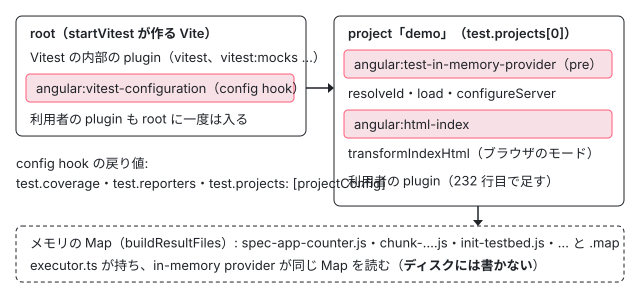

[目次](../README.md) › [ng test と Vitest の内側：テストを束ねて走らせるまで](README.md) › 第 3 回 / 全 5 回

# Vitest の plugin：メモリの上の出力を Vitest に読ませる

> runners/vitest/plugins.ts の 3 つの plugin が、ビルドの出力を Vitest の module の解決と読み込みにつなぎ、利用者の vitest の設定を消す・警告する・混ぜる行（355ebe8c54・a203dcf1d9・ec10eb3652・8504cfffcf、executor 側の 80edac58b3）、coverage の provider と設定（73233dc5f4・9a3c34bd16・01bd5d0641）、setupFiles の POSIX 化（2274babb66）。

angular/angular-cli · 読了 約 14 分 · 発展 · [サイトで読む（デモが動きます）](https://angular-deep-dive-cyan.vercel.app/chapter/vit-plugins)

---

この章で分かること: unit-test builder が Vitest に渡す 3 つの Vite plugin（`angular:vitest-configuration`・`angular:test-in-memory-provider`・`angular:html-index`）が、それぞれどの hook で何をするかを行の順に追います。とくに、利用者が書いた Vitest の設定（`runnerConfig`）のどの項目を消し、どれに警告を出し、どの順で混ぜるか、coverage の provider（V8 か Istanbul か）をどう選ぶかを、2026 年の修正のコミットと一緒に読みます。最後に、本物の `ng test` を 5 通りに起動して、hook に入った設定と返した設定を覗いた記録を再生します。

読む対象は angular-cli（44129f66a3）の `packages/angular/build/src/builders/unit-test/runners/vitest/plugins.ts` です。builder 全体の流れと、`load` hook がメモリの Map からビルドの出力を返す部分、`globals: true`・`isolate: false` の既定（`projectDefaults`）は[unit-test と Vitest の章](../cli/12-cli-unit-test.md)で読んだので、ここでは繰り返しません。plugin を作って `startVitest` に渡す側（`executor.ts`）は[次の章](04-vit-executor.md)、メモリに置かれる出力を作るビルドは[前の章](02-vit-build.md)です。

1. [1. テストを探す](01-vit-discovery.md)
2. [2. テスト用のビルド](02-vit-build.md)
3. **3. Vitest の plugin**（この章）
4. [4. executor とブラウザ](04-vit-executor.md)
5. [5. spec と issue](05-vit-tests-issues.md)

> [!TIP]
> **新卒エンジニアへ**
>
> **Vite plugin** は、Vite（Vitest の土台）がモジュールを探す・読む・変換するときに呼ぶ関数（**hook**）を集めたオブジェクトです。`resolveId` は「この import の名前はどのファイルか」、`load` は「そのファイルの中身」、`config` は「起動の前に設定を書き換える」を受け持ちます。**project** は Vitest の中の「同じ設定で走るテストの組」です。Vitest は root の設定の `test.projects` に並んだ設定ごとに Vite のサーバーを 1 つずつ作ります。**runnerConfig** は `angular.json` の unit-test の option で、`vitest.config.ts` のような利用者の設定ファイルを読ませます（既定は `false` で読まない）。

## 1. 3 つの plugin と置き場所



*root の Vite には設定を作る plugin が 1 つだけ入る。その plugin の config hook が project の設定を返し、project の Vite にメモリから読む 2 つの plugin と利用者の plugin が入る*

`executor.ts` の `initializeVitest` は、先に `createVitestPlugins` で project 用の 2 つを作り、次に `createVitestConfigPlugin` の戻り値を `startVitest` の 4 つ目の引数（Vite の設定の上書き）の `plugins` に入れます（[unit-test の章](../cli/12-cli-unit-test.md)の 6 節の、`startVitest` を呼ぶ引用）。つまり root の Vite に入る Angular の plugin は 1 つだけで、残りの 2 つは config hook の戻り値の中の project の設定に入って、project の Vite で動きます。10 節の記録（runnerConfig なし）では、project の Vite の plugin は 42 個で、`angular:test-in-memory-provider` は 5 番目、`angular:html-index` は 24 番目でした。root の Vite は 38 個で、Angular の plugin は 23 番目の `angular:vitest-configuration` だけです。

## 2. resolveId：どの名前をメモリの出力に向けるか

📄 `angular-cli/packages/angular/build/src/builders/unit-test/runners/vitest/plugins.ts` L315–353 （▶ の行: 316–317, 322–325, 329–330, 337–340, 346, 349, 352）

```ts
315 │ export function createVitestPlugins(pluginOptions: PluginOptions): Vite.Plugin[] {
316 ▶   const { workspaceRoot, buildResultFiles, testFileToEntryPoint } = pluginOptions;
317 ▶   const isWindows = platform() === 'win32';
318 │   let vitestConfig: ResolvedConfig;
319 │ 
320 │   return [
321 │     {
322 ▶       name: 'angular:test-in-memory-provider',
323 ▶       enforce: 'pre',
324 ▶       configureVitest(context: VitestPluginContext) {
325 ▶         vitestConfig = context.vitest.config;
326 │       },
327 │       resolveId: (id: string, importer: string | undefined) => {
328 │         // Fast path for test entry points.
329 ▶         if (testFileToEntryPoint.has(id)) {
330 ▶           return id;
331 │         }
332 │ 
333 │         // Workaround for Vitest in Windows when a fully qualified absolute path is provided with
334 │         // a superfluous leading slash. This can currently occur with the `@vitest/coverage-v8` provider
335 │         // when it uses `removeStartsWith(url, FILE_PROTOCOL)` to convert a file URL resulting in
336 │         // `/D:/tmp_dir/...` instead of `D:/tmp_dir/...`.
337 ▶         if (id[0] === '/' && isWindows) {
338 ▶           const slicedId = id.slice(1);
339 ▶           if (path.isAbsolute(slicedId)) {
340 ▶             return slicedId;
341 │           }
342 │         }
343 │ 
344 │         // Determine the base directory for resolution.
345 │         let baseDir: string;
346 ▶         if (importer) {
347 │           // If the importer is a test entry point, resolve relative to the workspace root.
348 │           // Otherwise, resolve relative to the importer's directory.
349 ▶           baseDir = testFileToEntryPoint.has(importer) ? workspaceRoot : path.dirname(importer);
350 │         } else {
351 │           // If there's no importer, assume the id is relative to the workspace root.
352 ▶           baseDir = workspaceRoot;
353 │         }
```

📄 `angular-cli/packages/angular/build/src/builders/unit-test/runners/vitest/plugins.ts` L354–380 （▶ の行: 357–360, 362, 364, 366, 368–369, 373–375, 379）

```ts
354 │ 
355 │         // Construct the full, absolute path and normalize it to POSIX format.
356 │         let fullPath: string;
357 ▶         if (path.isAbsolute(id)) {
358 ▶           const relativeId = path.relative(baseDir, id);
359 ▶           fullPath =
360 ▶             !relativeId.startsWith('..') && !path.isAbsolute(relativeId)
361 │               ? id
362 ▶               : path.join(baseDir, id);
363 │         } else {
364 ▶           fullPath = path.join(baseDir, id);
365 │         }
366 ▶         fullPath = toPosixPath(fullPath);
367 │ 
368 ▶         if (testFileToEntryPoint.has(fullPath)) {
369 ▶           return fullPath;
370 │         }
371 │ 
372 │         // Check if the resolved path corresponds to a known build artifact.
373 ▶         const relativePath = path.relative(workspaceRoot, fullPath);
374 ▶         if (buildResultFiles.has(toPosixPath(relativePath))) {
375 ▶           return fullPath;
376 │         }
377 │ 
378 │         // If the module cannot be resolved from the build artifacts, let other plugins handle it.
379 ▶         return undefined;
380 │       },
```

1. **テストファイルの名前はそのまま返す**

   329〜330 行目。`testFileToEntryPoint` は「テストファイルの絶対パス → 入口の名前（`spec-app-counter`）」の Map で、executor が持っています。Vitest は `test.include` に並んだ絶対パスをそのまま id にして読むので、ここで当たります。
2. **Windows の余分な `/` を外す**

   337〜341 行目。`@vitest/coverage-v8` が file URL から `/D:/…` の形を作ることがあり、先頭の `/` を外すと絶対パスになるならそれを返します（3020b5066a、2025-11）。
3. **相対の名前の基準を決める**

   346〜353 行目。import した側（importer）が**テストファイル**なら基準はワークスペースのルート、それ以外なら importer のフォルダです。テストファイルの中身は、ワークスペースのルートに置かれた `spec-*.js` だからです（出力の `chunk-*.js` を `./chunk-….js` で import する）。
4. **絶対パスに直して POSIX の形にする**

   357〜366 行目。id がすでに基準の下の絶対パスなら（359〜361 行目）そのまま、そうでなければ基準とつなぎます（8ae7f59e6f、2026-02）。366 行目で `\` を `/` に直します。
5. **テストファイルか、ビルドの出力か**

   368〜369 行目でテストファイルの Map をもう一度引き（164e7dbbc2、C ドライブ以外の Windows）、373〜375 行目で「ルートからの相対パス」がメモリの出力にあれば絶対パスを返します。どちらでもなければ 379 行目で `undefined` を返し、Vite のふつうの解決（`node_modules` など）に任せます。

322〜323 行目の `enforce: 'pre'` で、この plugin は Vite 自身の解決（`vite:resolve`）より前に呼ばれます。記録の並びでも `vite:pre-alias`・`alias` の直後でした。324〜326 行目の `configureVitest` は Vitest が project を作ったときに呼ぶ hook で、解決済みの設定を取っておき、`load` で coverage が有効かを見るのに使います。

> [!WARNING]
> **ハマりどころ**
>
> 366 行目で POSIX の形に直したパスを、368 行目で Map のキーと比べます。キーの側が `\` のままだと、同じファイルでも当たりません。angular.json の `setupFiles` は、テストファイルと同じ Map に入る（入口の名前が付く）ので、Windows では `path.join` の `\` のままのキーが当たらず、import が失敗していました。2274babb66（2026-08-11、#33749）は、それを options の正規化の段で直しています。

📄 `setupFiles を POSIX の形にした修正`

```
$ git show 2274babb66 -- packages/angular/build/src/builders/unit-test/options.ts   # 2026-08-11（#33749）
     setupFiles: options.setupFiles
-      ? options.setupFiles.map((setupFile) => path.join(workspaceRoot, setupFile))
+      ? options.setupFiles.map((setupFile) => toPosixPath(path.join(workspaceRoot, setupFile)))
       : [],
```

## 3. load の前後：中身の取り出し、source map、index.html

📄 `angular-cli/packages/angular/build/src/builders/unit-test/runners/vitest/plugins.ts` L306–313 （▶ の行: 308–309, 312）

```ts
306 │ const textDecoder = new TextDecoder('utf-8');
307 │ async function loadResultFile(file: ResultFile): Promise<string> {
308 ▶   if (file.origin === 'memory') {
309 ▶     return textDecoder.decode(file.contents);
310 │   }
311 │ 
312 ▶   return readFile(file.inputPath, 'utf-8');
313 │ }
```

`load` hook（[unit-test の章](../cli/12-cli-unit-test.md)の 6 節）は、出力の中身をこの関数で文字列にします。ふつうは 308〜309 行目のとおりメモリの `Uint8Array` を UTF-8 で読むだけで、ディスクにある出力（`origin` が `memory` でないもの）だけ 312 行目で読み込みます。

📄 `angular-cli/packages/angular/build/src/builders/unit-test/runners/vitest/plugins.ts` L454–478 （▶ の行: 460, 465–466, 468–469, 473, 475）

```ts
454 │ function adjustSourcemapSources(
455 │   map: ExistingRawSourceMap,
456 │   rebaseSources: boolean,
457 │   workspaceRoot: string,
458 │   id: string,
459 │ ): void {
460 ▶   if (!map.sources?.length && !map.sourcesContent?.length && !map.mappings) {
461 │     // Vitest will include files in the coverage report if the sourcemap contains no sources.
462 │     // For builder-internal generated code chunks, which are typically helper functions,
463 │     // a virtual source is added to the sourcemap to prevent them from being incorrectly
464 │     // included in the final coverage report.
465 ▶     map.sources = ['virtual:builder'];
466 ▶   } else if (rebaseSources && map.sources) {
467 │     map.sources = map.sources.map((source) => {
468 ▶       if (!source || source.startsWith('angular:')) {
469 ▶         return source;
470 │       }
471 │ 
472 │       // source is relative to the workspace root because the output file is at the root of the output.
473 ▶       const absoluteSource = path.join(workspaceRoot, source);
474 │ 
475 ▶       return toPosixPath(path.relative(path.dirname(id), absoluteSource));
476 │     });
477 │   }
478 │ }
```

source map の `sources` は、出力（ワークスペースのルートにある `spec-*.js`）からの相対パスで書かれています。ところが Vitest はそれをテストファイル（`src/app/counter.spec.ts`）の位置から読むので、473〜475 行目で「ルート + source → テストファイルのフォルダからの相対」に書き直します（0b4982720e、2026-01）。460〜465 行目、中身の無い map（builder が作った helper のチャンク）には `virtual:builder` という架空の source を入れます。source が空の map のファイルを、Vitest は coverage の表に入れてしまうからです。468 行目、`angular:` で始まる仮想のファイルは書き直しません。

📄 `angular-cli/packages/angular/build/src/builders/unit-test/runners/vitest/plugins.ts` L422–443 （▶ の行: 422–423, 427–428, 430, 434）

```ts
422 ▶       configureServer: (server: Vite.ViteDevServer) => {
423 ▶         server.middlewares.use(createBuildAssetsMiddleware(server.config.base, buildResultFiles));
424 │       },
425 │     },
426 │     {
427 ▶       name: 'angular:html-index',
428 ▶       transformIndexHtml: () => {
429 │         // Add all global stylesheets
430 ▶         if (buildResultFiles.has('styles.css')) {
431 │           return [
432 │             {
433 │               tag: 'link',
434 ▶               attrs: { href: 'styles.css', rel: 'stylesheet' },
435 │               injectTo: 'head',
436 │             },
437 │           ];
438 │         }
439 │ 
440 │         return [];
441 │       },
442 │     },
443 │   ];
```

423 行目、project の Vite のサーバーに、dev-server と同じアセットの middleware（[vds の第 2 回](../vds/02-vds-assets-html.md)）を足し、テストからの `fetch('/assets/…')` にメモリの出力で答えます。427〜441 行目の `transformIndexHtml` は Vite が HTML を返すときの hook で、ブラウザのモードで Vitest が返すテストのページに、グローバルの `styles.css` の `<link>` を足します（430 行目、出力に `styles.css` があるときだけ）。

## 4. config hook：利用者の設定から消すもの・警告するもの

📄 `angular-cli/packages/angular/build/src/builders/unit-test/runners/vitest/plugins.ts` L162–194 （▶ の行: 162, 165–167, 169, 176–177, 180–183, 185, 188–189, 193）

```ts
162 ▶   const { mergeConfig } = await import('vitest/config');
163 │ 
164 │   return {
165 ▶     name: 'angular:vitest-configuration',
166 ▶     async config(config: UserWorkspaceConfig & Vite.UserConfig) {
167 ▶       const testConfig = config.test;
168 │ 
169 ▶       const determinedProvider = determineCoverageProvider(
170 │         browser,
171 │         testConfig,
172 │         options.coverage.enabled,
173 │         projectSourceRoot,
174 │       );
175 │ 
176 ▶       if (reporters !== undefined) {
177 ▶         delete testConfig?.reporters;
178 │       }
179 │ 
180 ▶       if (
181 ▶         options.coverage.reporters !== undefined &&
182 ▶         testConfig?.coverage &&
183 ▶         'reporter' in testConfig.coverage
184 │       ) {
185 ▶         delete testConfig.coverage.reporter;
186 │       }
187 │ 
188 ▶       if (testConfig?.projects?.length) {
189 ▶         this.warn(
190 │           'The "test.projects" option in the Vitest configuration file is not supported. ' +
191 │             'The Angular CLI Test system will construct its own project configuration.',
192 │         );
193 ▶         delete testConfig.projects;
194 │       }
```

📄 `angular-cli/packages/angular/build/src/builders/unit-test/runners/vitest/plugins.ts` L196–218 （▶ の行: 196–197, 201, 204–205, 209, 212–213）

```ts
196 ▶       if (testConfig?.include) {
197 ▶         this.warn(
198 │           'The "test.include" option in the Vitest configuration file is not supported. ' +
199 │             'The Angular CLI Test system will manage test file discovery.',
200 │         );
201 ▶         delete testConfig.include;
202 │       }
203 │ 
204 ▶       if (testConfig?.watch !== undefined && testConfig.watch !== options.watch) {
205 ▶         this.warn(
206 │           `The "test.watch" option in the Vitest configuration file is overridden by the builder's ` +
207 │             `watch option. Please use the Angular CLI "--watch" option to enable or disable watch mode.`,
208 │         );
209 ▶         delete testConfig.watch;
210 │       }
211 │ 
212 ▶       if (testConfig?.exclude) {
213 ▶         this.warn(
214 │           'The "test.exclude" option in the Vitest configuration file is evaluated after ' +
215 │             'tests are compiled. For better build performance, please use the Angular CLI ' +
216 │             '"exclude" option instead.',
217 │         );
218 │       }
```

📄 `angular-cli/packages/angular/build/src/builders/unit-test/runners/vitest/plugins.ts` L220–243 （▶ の行: 221–222, 227–228, 231–232, 234, 238–240, 242）

```ts
220 │       // Merge user-defined plugins from the Vitest config with the CLI's internal plugins.
221 ▶       if (config.plugins) {
222 ▶         const userPlugins = config.plugins.filter(
223 │           (plugin: Vite.PluginOption) =>
224 │             // Only inspect objects with a `name` property as these would be the internal injected plugins
225 │             !plugin ||
226 │             typeof plugin !== 'object' ||
227 ▶             !('name' in plugin) ||
228 ▶             (!plugin.name.startsWith('angular:') && !plugin.name.startsWith('vitest')),
229 │         );
230 │ 
231 ▶         if (userPlugins.length > 0) {
232 ▶           projectPlugins.push(...userPlugins);
233 │         }
234 ▶         delete config.plugins;
235 │       }
236 │ 
237 │       // Validate browser coverage support if coverage is enabled
238 ▶       if (
239 ▶         (browser || testConfig?.browser?.enabled) &&
240 ▶         (options.coverage.enabled || testConfig?.coverage?.enabled)
241 │       ) {
242 ▶         validateBrowserCoverage(browser, testConfig?.browser, determinedProvider);
243 │       }
```

166 行目の `config(config)` の引数は、Vitest が読んだ root の設定です。`runnerConfig` を書けば、そのファイルの中身がここに入っています。167 行目の `config.test` を、次の表のとおり書き換えてから混ぜます（5 節）。

| 行 | 利用者の設定 | すること | 入れたコミット |
| --- | --- | --- | --- |
| 176〜178 | `test.reporters` | CLI の `--reporters` があれば消す | 355ebe8c54（2026-03-20） |
| 180〜186 | `test.coverage.reporter` | CLI の `--coverage-reporters` があれば消す | 355ebe8c54 |
| 188〜194 | `test.projects` | 警告して消す | 0aab1158d6（2025-11-08） |
| 196〜202 | `test.include` | 警告して消す（テストを探すのは builder） | 0aab1158d6 |
| 204〜210 | `test.watch` | CLI の `watch` と違えば警告して消す | ec10eb3652（2026-03-19） |
| 212〜218 | `test.exclude` | 警告だけ（消さない） | a203dcf1d9（2026-03-20） |
| 221〜235 | `plugins` | `angular:`・`vitest` で始まらないものを project の plugin に移し、root からは消す | 0aab1158d6 |
| 238〜243 | `test.browser` と `test.coverage` | ブラウザ + coverage なら provider を確かめる（6 節） | 74e7dbe56c（2026-04-10） |

reporters を消す理由は、Vitest の `mergeConfig` が配列を**つなぐ**からです。355ebe8c54 のコミットメッセージには「CLI の `--reporters` と `vitest.config.ts` の reporters がつながって、`default` が 2 回動いた」とあります。CLI に書いたものだけを残すため、混ぜる前に利用者の側を消します。212〜218 行目の `test.exclude` は消しません。Vitest の側では効くのですが、builder はその前に esbuild で全部のテストをビルドしてしまうので、CLI の `--exclude` を使うように促すだけです。

📄 `reporters を消すようにした修正`

```
$ git show 355ebe8c54 -- …/runners/vitest/plugins.ts   # 2026-03-20（抜粋）
+      if (reporters !== undefined) {
+        delete testConfig?.reporters;
+      }
+
+      if (
+        options.coverage.reporters !== undefined &&
+        testConfig?.coverage &&
+        'reporter' in testConfig.coverage
+      ) {
+        delete testConfig.coverage.reporter;
+      }
```

221〜235 行目、root の設定の `plugins` には、Vitest 自身の plugin（`vitest`・`vitest:mocks` …）とこの plugin（`angular:vitest-configuration`）も入っています。228 行目の名前の条件でそれを除き、残った利用者の plugin だけを 232 行目で `projectPlugins`（executor が作った 2 つの配列）に足し、234 行目で root の配列を消します。記録（10 節）では、利用者の `demo-user-plugin` は project の Vite の plugin に 1 回入りました。ただし root の Vite の plugin の並びにも残っていました（21 番目）。vite 8.1.5 の `resolveConfig`（`dist/node/chunks/node.js`）は、`config.plugins` を `sortUserPlugins` で並べ終えてから、`runConfigHook` で config hook を順に呼ぶので、234 行目で `config.plugins` を消しても、もう並べた root の plugin は変わらないからです。

## 5. 混ぜ方：projectDefaults → 利用者の test → projectOverrides

📄 `angular-cli/packages/angular/build/src/builders/unit-test/runners/vitest/plugins.ts` L286–303 （▶ の行: 287–288, 290–292, 298–299）

```ts
286 │ 
287 ▶       const projectBase = mergeConfig(projectDefaults, testConfig ? { test: testConfig } : {});
288 ▶       const projectConfig = mergeConfig(projectBase, projectOverrides);
289 │ 
290 ▶       return {
291 ▶         test: {
292 ▶           coverage: await generateCoverageOption(
293 │             options.coverage,
294 │             testConfig?.coverage,
295 │             projectName,
296 │             determinedProvider,
297 │           ),
298 ▶           ...(reporters ? { reporters } : {}),
299 ▶           projects: [projectConfig],
300 │         },
301 │       };
302 │     },
303 │   };
```

1. **Angular の既定**

   `projectDefaults`（[unit-test の章](../cli/12-cli-unit-test.md)の 7 節の引用）。`setupFiles`・`globals: true`・`isolate: false`・`sequence.setupFiles: 'list'`、`optimizeDeps`、`resolve`。
2. **その上に利用者の `test`**

   287 行目。4 節で消した残りです。利用者が `globals: false` や `environment: 'node'` を書けば、ここで既定に勝ちます。
3. **最後に Angular が必ず決めるもの**

   288 行目の `projectOverrides`（同じ引用の後半）。`name`・`include`（builder が見つけたテスト）・CLI の `browsers` と `isolate`・`environment` の既定・plugins・`optimizeDeps`・`resolve`。
4. **root に返すもの**

   290〜299 行目。root の `test` には `coverage`（7 節）、CLI の `reporters`、`projects: [projectConfig]` の 3 つだけを返します。Vite は hook の戻り値を root の設定に `mergeConfig` します（vite の `runConfigHook`）。

この順なので、`setupFiles` は「Angular の 2 つ（`init-testbed.js`・`vitest-mock-patch.js`）→ 利用者の分」とつながり、Angular の初期化が先に走ります。reporters は 298 行目で CLI の値を root に置くので、CLI に書けばそれだけが残ります（4 節）。

`projectDefaults` と `projectOverrides` の 2 つのオブジェクトには、どちらにも先頭に `extends: false` があります。vitest 5 では、`test.projects` に書いた project は既定で root の設定を引き継ぐ（`extends: true`）ようになり、287 行目で利用者の設定をすでに混ぜているのに、root からもう一度引き継いで、`browser.instances` や plugin が 2 回つながりました。8504cfffcf はそれを止めます。テストと直し方の節で、この 2 行に spec が無いことと、足した it で 2 回目の適用を捕まえられることを確かめます。

📄 `vitest 5 で inline の project が root を引き継がないようにした修正`

```
$ git show 8504cfffcf -- …/runners/vitest/plugins.ts   # 2026-09-07（vitest 5 への更新 93c5bc8868 と同じ日）
       const projectDefaults: Vite.UserConfig & UserWorkspaceConfig = {
+        extends: false,
         test: {
           setupFiles,
 ...
       const projectOverrides: Vite.UserConfig & UserWorkspaceConfig = {
+        extends: false,
         test: {
           name: projectName,
```

もう 1 つ、Vitest の `mergeConfig` は `undefined` の値でも上書きします。executor が `startVitest` に渡す 1 つ目の設定に `outputFile: undefined` を書いていたため、`vitest.config.ts` の `outputFile` が消えていました。80edac58b3 は「値があるときだけ書く」形に直しています。

📄 `undefined で利用者の値を消さないようにした修正`

```
$ git show 80edac58b3 -- …/runners/vitest/executor.ts   # 2026-07-16
       config: externalConfigPath,
       root: workspaceRoot,
       project,
-      outputFile,
-      cache: cacheOptions.enabled ? undefined : (false as const),
-      testNamePattern: this.options.filter,
       watch,
+      ...(outputFile !== undefined ? { outputFile } : {}),
+      ...(cacheOptions.enabled ? {} : { cache: false as const }),
+      ...(this.options.filter !== undefined ? { testNamePattern: this.options.filter } : {}),
```

## 6. coverage の provider：V8 か Istanbul か

📄 `angular-cli/packages/angular/build/src/builders/unit-test/runners/vitest/plugins.ts` L78–112 （▶ の行: 78–80, 82–83, 86–87, 89, 99–100, 104–105, 107）

```ts
 78 ▶   let determinedProvider = testConfig?.coverage?.provider;
 79 ▶   if (!determinedProvider && (optionsCoverageEnabled || testConfig?.coverage?.enabled)) {
 80 ▶     const browsersToCheck = getBrowsersToCheck(browser, testConfig?.browser);
 81 │ 
 82 ▶     const hasNonChromium = browsersToCheck.some(
 83 ▶       (b) => !['chrome', 'chromium', 'edge'].includes(normalizeBrowserName(b).browser),
 84 │     );
 85 │ 
 86 ▶     if (hasNonChromium) {
 87 ▶       determinedProvider = 'istanbul';
 88 │     } else {
 89 ▶       const projectResolve = createProjectResolver(projectSourceRoot);
 90 │       const checkInstalled = (pkg: string) => {
 91 │         try {
 92 │           projectResolve(pkg);
 93 │ 
 94 │           return true;
 95 │         } catch {
 96 │           return false;
 97 │         }
 98 │       };
 99 ▶       const hasIstanbul = checkInstalled('@vitest/coverage-istanbul');
100 ▶       const hasV8 = checkInstalled('@vitest/coverage-v8');
101 │ 
102 │       // Favor istanbul when browser testing is enabled (to avoid slow CDP V8 HTTP sourcemap remapping)
103 │       // or when only istanbul is installed.
104 ▶       if (hasIstanbul && (browsersToCheck.length > 0 || !hasV8)) {
105 ▶         determinedProvider = 'istanbul';
106 │       } else {
107 ▶         determinedProvider = 'v8';
108 │       }
109 │     }
110 │   }
111 │ 
112 │   return determinedProvider;
```

📄 `angular-cli/packages/angular/build/src/builders/unit-test/runners/vitest/plugins.ts` L119–146 （▶ の行: 125–127, 133, 137–138, 141）

```ts
119 │   const browsersToCheck: string[] = [];
120 │ 
121 │   const cliBrowser = browser as CustomBrowserConfigOptions | undefined;
122 │   const userBrowser = testConfigBrowser as CustomBrowserConfigOptions | undefined;
123 │ 
124 │   // 1. CLI options override the Vitest configuration completely.
125 ▶   if (cliBrowser) {
126 ▶     if (cliBrowser.instances) {
127 ▶       browsersToCheck.push(...cliBrowser.instances.map((i) => i.browser));
128 │     }
129 │     if (cliBrowser.name) {
130 │       browsersToCheck.push(cliBrowser.name);
131 │     }
132 │ 
133 ▶     return browsersToCheck;
134 │   }
135 │ 
136 │   // 2. Fall back to Vitest configuration ONLY if browser testing is enabled.
137 ▶   if (userBrowser && userBrowser.enabled !== false) {
138 ▶     if (userBrowser.instances) {
139 │       browsersToCheck.push(...userBrowser.instances.map((i) => i.browser));
140 │     }
141 ▶     if (userBrowser.name) {
142 │       browsersToCheck.push(userBrowser.name);
143 │     }
144 │   }
145 │ 
146 │   return browsersToCheck;
```

1. **利用者が書いていればそれ**

   78 行目。`vitest.config.ts` の `coverage.provider` を最優先にします。
2. **coverage が有効なときだけ選ぶ**

   79 行目。CLI の `--coverage` か、設定の `coverage.enabled`。
3. **Chromium でないブラウザがあれば Istanbul**

   80〜87 行目。V8 の coverage は Chromium の DevTools の仕組みで取るので、Firefox・WebKit では取れません。調べるブラウザは 125〜133 行目のとおり CLI の `browsers` が最優先で、無ければ設定の `browser` を、`enabled` が `false` でないときだけ見ます（137 行目）。
4. **入っている package で決める**

   99〜100 行目でプロジェクトから `@vitest/coverage-istanbul` と `@vitest/coverage-v8` を探し、104 行目、Istanbul があって「ブラウザのモード」か「V8 が無い」なら Istanbul、それ以外は 107 行目で V8 です。

104 行目の `browsersToCheck.length > 0 ||` は 9a3c34bd16（2026-07-22、#31724 の関連）で足されました。コミットメッセージによると、ブラウザの V8 coverage はスクリプトごとに source map を CDP（DevTools のプロトコル）で取り直すので、大きなプロジェクトで報告に数分かかりました。Istanbul はビルドの時に計測のコードを入れるので、`window.__coverage__` から即座に読めます。この行は 73233dc5f4（2026-04-21、Istanbul の対応）のときは `hasIstanbul && !hasV8` でした。

📄 `angular-cli/packages/angular/build/src/builders/unit-test/runners/vitest/plugins.ts` L495–512 （▶ の行: 495–496, 501–503, 505–506, 510）

```ts
495 ▶   if (provider === 'istanbul') {
496 ▶     return;
497 │   }
498 │   const browsersToCheck = getBrowsersToCheck(browser, testConfigBrowser);
499 │ 
500 │   // Normalize and filter unsupported browsers
501 ▶   const unsupportedBrowsers = browsersToCheck
502 ▶     .map((b) => normalizeBrowserName(b).browser)
503 ▶     .filter((b) => !['chrome', 'chromium', 'edge'].includes(b));
504 │ 
505 ▶   if (unsupportedBrowsers.length > 0) {
506 ▶     throw new Error(
507 │       `Code coverage is enabled, but the following configured browsers do not support the V8 coverage provider: ` +
508 │         `${unsupportedBrowsers.join(', ')}. ` +
509 │         `V8 coverage is only supported on Chromium-based browsers (e.g., Chrome, Chromium, Edge). ` +
510 ▶         `Please disable coverage or remove the unsupported browsers.`,
511 │     );
512 │   }
```

ブラウザのモードで coverage を有効にすると、4 節の 238〜243 行目からこの関数が呼ばれます。Istanbul なら 495〜497 行目で何もしません。V8 のまま Chromium でないブラウザがあれば、506 行目で例外にします（74e7dbe56c）。510 行目の文言は「coverage を切るか、ブラウザを外す」だけで、origin/main の eb38ef3904（2026-10-22）で「Istanbul を使う」が最初の選択肢として足されました。

> [!NOTE]
> **ポイント**
>
> provider の package が 1 つも入っていないとき、99〜100 行目はどちらも `false` なので、107 行目で `v8` になります。ふつうは builder の依存の確認（`runners/vitest/index.ts`、[第 1 回](01-vit-discovery.md)）が先に止めますが、`runnerConfig` を書くとその確認は `vitest` だけになります。10 節の「--coverage + runnerConfig」の記録は、その道を通ったときに Vitest が何を出すかです。

## 7. coverage の設定を作る

📄 `angular-cli/packages/angular/build/src/builders/unit-test/runners/vitest/plugins.ts` L515–543 （▶ の行: 525, 527–528, 533–534, 536–537, 541–542）

```ts
515 │ async function generateCoverageOption(
516 │   optionsCoverage: NormalizedUnitTestBuilderOptions['coverage'],
517 │   configCoverage: VitestCoverageOption | undefined,
518 │   projectName: string,
519 │   provider?: 'istanbul' | 'v8' | 'custom',
520 │ ): Promise<VitestCoverageOption> {
521 │   let defaultExcludes: string[] = [];
522 │   // When a coverage exclude option is provided, Vitest's default coverage excludes
523 │   // will be overridden. To retain them, we manually fetch the defaults to append to the
524 │   // user's provided exclusions.
525 ▶   if (optionsCoverage.exclude) {
526 │     try {
527 ▶       const vitestConfig = await import('vitest/config');
528 ▶       defaultExcludes = vitestConfig.coverageConfigDefaults.exclude;
529 │     } catch {}
530 │   }
531 │ 
532 │   return {
533 ▶     provider,
534 ▶     excludeAfterRemap: true,
535 │     reportsDirectory:
536 ▶       configCoverage?.reportsDirectory ?? toPosixPath(path.join('coverage', projectName)),
537 ▶     ...(optionsCoverage.enabled !== undefined ? { enabled: optionsCoverage.enabled } : {}),
538 │     // Vitest performs a pre-check and a post-check for sourcemaps.
539 │     // The pre-check uses the bundled files, so specific bundled entry points and chunks need to be included.
540 │     // The post-check uses the original source files, so the user's include is used.
541 ▶     ...(optionsCoverage.include
542 ▶       ? { include: ['spec-*.js', 'chunk-*.js', ...optionsCoverage.include] }
543 │       : {}),
```

📄 `angular-cli/packages/angular/build/src/builders/unit-test/runners/vitest/plugins.ts` L544–571 （▶ の行: 546–548, 555, 557–558, 561–563, 568–569）

```ts
544 │     // The 'in' operator is used here because 'configCoverage' is a union type and
545 │     // not all coverage providers support thresholds or watermarks.
546 ▶     thresholds: mergeCoverageObjects(
547 ▶       configCoverage && 'thresholds' in configCoverage ? configCoverage.thresholds : undefined,
548 ▶       optionsCoverage.thresholds,
549 │     ),
550 │     watermarks: mergeCoverageObjects(
551 │       configCoverage && 'watermarks' in configCoverage ? configCoverage.watermarks : undefined,
552 │       optionsCoverage.watermarks,
553 │     ),
554 │     // Special handling for `exclude`/`reporters` due to an undefined value causing upstream failures
555 ▶     ...(optionsCoverage.exclude
556 │       ? {
557 ▶           exclude: Array.from(
558 ▶             new Set([
559 │               // Augment the default exclude https://vitest.dev/config/#coverage-exclude
560 │               // with the user defined exclusions
561 ▶               ...(configCoverage?.exclude || []),
562 ▶               ...optionsCoverage.exclude,
563 ▶               ...defaultExcludes,
564 │             ]),
565 │           ),
566 │         }
567 │       : {}),
568 ▶     ...(optionsCoverage.reporters
569 ▶       ? ({ reporter: optionsCoverage.reporters } satisfies VitestCoverageOption)
570 │       : {}),
571 │   };
```

📄 `angular-cli/packages/angular/build/src/builders/unit-test/runners/vitest/plugins.ts` L579–595 （▶ の行: 583–584, 587–590, 594）

```ts
579 │ function mergeCoverageObjects<T extends object>(
580 │   configValue: T | undefined,
581 │   optionsValue: T | undefined,
582 │ ): T | undefined {
583 ▶   if (optionsValue === undefined) {
584 ▶     return configValue;
585 │   }
586 │ 
587 ▶   const result: Record<string, unknown> = { ...(configValue ?? {}) };
588 ▶   for (const [key, value] of Object.entries(optionsValue)) {
589 ▶     if (value !== undefined) {
590 ▶       result[key] = value;
591 │     }
592 │   }
593 │ 
594 ▶   return Object.keys(result).length > 0 ? (result as T) : undefined;
595 │ }
```

| 行 | 項目 | 値の決め方 |
| --- | --- | --- |
| 533 | `provider` | 6 節で決めたもの（利用者の値があればそれ） |
| 534 | `excludeAfterRemap: true` | source map で元の `.ts` に戻してから exclude を当てる。出力は `spec-*.js` なので、戻す前に当てると何も外れない |
| 535〜536 | `reportsDirectory` | 利用者の値、無ければ `coverage/<プロジェクト名>` |
| 541〜543 | `include` | CLI の `--coverage-include` があれば `spec-*.js`・`chunk-*.js` を前に足す（538〜540 行目のコメント: 前の検査は束ねた出力、後の検査は元のファイル） |
| 546〜553 | `thresholds`・`watermarks` | 579〜595 行目で、利用者の値に CLI の値を**項目ごとに**上書き（1f1b21dab4、2026-01） |
| 555〜567 | `exclude` | CLI の `--coverage-exclude` があれば「利用者の値 + CLI の値 + Vitest の既定」を `Set` で重複なしに（01bd5d0641、2026-03-20） |
| 568〜570 | `reporter` | CLI の `--coverage-reporters` があればそれ（利用者の値は 4 節で消してある） |

525〜529 行目は、CLI で exclude を書いたときだけ Vitest の既定の exclude（`coverageConfigDefaults.exclude`）を読みます。exclude を渡すと Vitest の既定が置き換わってしまうので、自分で足し戻すためです。01bd5d0641 の前は 561 行目が無く、CLI の `--coverage-exclude` が `vitest.config.ts` の exclude を消していました。587〜590 行目、`mergeCoverageObjects` は CLI の値のうち `undefined` でないものだけで上書きするので、`--coverage-thresholds` に `lines` だけ書けば、設定の `branches` は残ります。

10 節の「--coverage + runnerConfig」の記録では、hook が返した `exclude` は `src/app/label.ts`（設定）と `src/app/format.ts`（CLI）の 2 つでした。この版の Vitest 4 の `coverageConfigDefaults.exclude` は空の配列なので、557〜565 行目で足されるものはありません。その後 Vite が root の設定と混ぜ、Vitest が既定を足すので、解決済みの `exclude` は 40 個になり、`src/app/label.ts` が 2 回入っていました。565 行目の `Set` は hook の戻り値の中の重複しか消しません。

## 8. setupFiles と、mock の patch が 1 回で済むまで

`project.test.setupFiles` の先頭の `init-testbed.js`・`vitest-mock-patch.js` は、ビルドで作った仮想のファイルの出力です（中身は[前の章](02-vit-build.md)）。どちらも 2 節の `resolveId` でメモリの出力に向きます。`vitest-mock-patch.js` は相対パスの `vi.mock` を例外にする patch で、`isolate: false` では同じ worker の中で何度も読み込まれます。e558117b74（2026-03-27、#32871）は `Symbol.for` の印で「2 回目からは何もしない」ようにしました。

📄 `mock の patch を 1 回だけにした修正`

```
$ git show e558117b74 -- …/runners/vitest/build-options.ts   # 2026-03-27（#32871、抜粋）
-    const error = new Error(
+    const ANGULAR_VITEST_MOCK_PATCH = Symbol.for('@angular/cli/vitest-mock-patch');
+    if (!globalThis[ANGULAR_VITEST_MOCK_PATCH]) {
+      globalThis[ANGULAR_VITEST_MOCK_PATCH] = true;
+
+      const error = new Error(
 ...
-    vi.mock = patch(mock);
+      vi.mock = patch(mock);
 ...
+    }
```

## 9. origin/main の続き（2026-09-10 から 11-13）

44129f66a3 から origin/main（8b26efa1ba）までに、`plugins.ts` は 7 回変わりました（1 本は出力の書き出しをまとめる refactor の 4951994f64）。引用はしないので、diff を抜き出して並べます。

- **fsModuleCache**: vitest 5.0.4 が既定で有効にした「変換済みのモジュールのディスクのキャッシュ」は、キーにディスクの `.spec.ts` の中身を使います。builder はテストファイルの代わりに束ねた出力を返すので、spec を変えずに import 先だけを変えると古い束が返りました。f0a74e8f0e（PR #34311）で一度切り、70c2143c33（#34443 / PR #34444）で `defineCacheKeyGenerator` を使って「返した出力のハッシュ」をキーにして、再び有効にしました。これが効くのは、出力が毎回同じになった（#34335 の 01afbf418c、[第 1 回](01-vit-discovery.md)）からです。
- **coverage の時の setupFiles**: coverage が有効だと `load` はテストファイルの代わりに 1 行の `import "./spec-….js";` を返します。setupFiles も同じ Map にあるので 1 行になり、Vitest が setupFiles を毎回読み直しても中の束はキャッシュのままで、`beforeEach` が worker の最初のファイルにしか効きませんでした（#34142・#34137）。cea7febe52 で setupFiles を外しました。
- **server.watch**: vitest 5 の内部の plugin が watch のときに `server.watch ??= {}` と戻すので、executor の `watch: null` が効かず、Vite の監視が二重になりました。39d230e186 でこの plugin に `enforce: 'post'` と `configResolved` を足し、`null` に戻します（[次の章](04-vit-executor.md)）。
- **ルートの別名**: vitest 5.1 の `root` は symlink や Windows の `subst` を解いた実のパスになるので、2 節の Map のキー（ワークスペースのルートのまま）と合わなくなりました。be517539f4（PR #34714）は `configureVitest` でキーを付け替えます。

📄 `fsModuleCache を切り、出力のハッシュで戻した 2 つの修正（抜粋）`

```
$ git show f0a74e8f0e -- …/runners/vitest/plugins.ts   # origin/main、2026-10-12（PR #34311、22.2.3）
           name: projectName,
           include,
+          fsModuleCache: false,
 ...
         test: {
+          fsModuleCache: false,
           coverage: await generateCoverageOption(
$ git show 70c2143c33 -- …/runners/vitest/plugins.ts   # origin/main、2026-10-20（#34443 / PR #34444、抜粋）
+      const fsModuleCache = testConfig?.fsModuleCache ?? options.cacheOptions.enabled;
+      const fsModuleCachePath =
+        testConfig?.fsModuleCachePath ??
+        path.join(options.cacheOptions.path, 'vitest-module-cache');
 ...
+        defineCacheKeyGenerator?.(({ id }) => {
+          const outputPath = getOutputPath(id);
+          if (isCoverageRedirect(id)) {
+            return `coverage-redirect:${outputPath}`;
+          }
+          const outputFile = buildResultFiles.get(outputPath);
 ...
+          return `${outputFile.hash}:${sourceMapFile?.origin === 'memory' ? sourceMapFile.hash : ''}`;
+        });
```

📄 `coverage の時に setupFiles を 1 行の import にしない修正`

```
$ git show cea7febe52 -- …/runners/vitest/plugins.ts   # origin/main、2026-09-22（#34137・#34142）
-          if (vitestConfig?.coverage?.enabled) {
+          // Setup files must not be wrapped in a virtual import stub because Vitest only invalidates
+          // the setup file itself between test files; wrapping it would cause the underlying bundle
+          // to be cached, preventing per-test hooks from running on subsequent test files.
+          const isSetupFile = setupFileSet.has(id);
+          if (vitestConfig?.coverage?.enabled && !isSetupFile) {
             // To support coverage exclusion of the actual test file, the virtual
             // test entry point only references the built and bundled intermediate file.
```

📄 `Vitest の root が実のパスになったときにキーを付け替える修正（抜粋）`

```
$ git show be517539f4 -- …/runners/vitest/plugins.ts   # origin/main、2026-11-13（PR #34714、抜粋）
       configureVitest(context: VitestPluginContext) {
         vitestConfig = context.vitest.config;
+        if (vitestConfig.root && vitestConfig.root !== toPosixPath(workspaceRoot)) {
+          const previousRoot = workspaceRoot;
+          workspaceRoot = vitestConfig.root;
+          testFileToEntryPoint = new Map(
 ...
```

## 10. 記録：5 通りの ng test と、hook を通った設定

> **🧪 DEMO — runnerConfig と coverage を変えた ng test（記録の再生）**
>
> `<scratchpad>/vit-demo/b/record.mjs` が、@angular/build 22.1.7・vitest 4.1.11・jsdom 28.1.0 の `ng test --watch=false` を Node v24.22.1 で起動した記録です。アプリは zoneless の小さなもの（`<app>`）で、コンポーネント 1 つと spec 3 本（`broken.spec.ts` はわざと落ちる）。node\_modules はこのサイトのものへの symlink です。`node --import hook.mjs` で `@angular/build` の `import('vitest/node')` だけを包みのモジュールに向け、`startVitest` の引数、`angular:vitest-configuration` の config hook の入口と出口、`this.warn`、project の Vite の plugin の並びを書き出しました。読んでいるソース（vitest 5 向けの 44129f66a3）との違いは、5 節の `extends: false` の 2 行が 22.1.7 に無いことだけです（`git diff v22.1.7 44129f66a3` で確かめた）。
>
> runnerConfig なし。angular.json の test は builder の名前だけ。
>
> ▶ [このデモはサイトで動かせます](https://angular-deep-dive-cyan.vercel.app/chapter/vit-plugins)

記録から読めることを並べます。

- **runnerConfig なし**: `startVitest` の `config` は `false`（Vitest は `vitest.config.*` を探さない）。hook に入った `config.test` は空で、返した project の `include` は builder が見つけた 3 本の絶対パス、`setupFiles` は Angular の 2 つ、`environment` は jsdom でした（このサイトには happy-dom が無い）。
- **runnerConfig あり**: `include`・`watch`・`exclude` の 3 つの警告が出て、hook の後の `config.test` から `include` と `watch` が消え、`exclude` と `reporters` は残りました。`broken.spec.ts` は project の `include` に入ったまま、Vitest の exclude で外れ、走ったのは 2 本です（ビルドはされている）。reporters は設定の `verbose` でした。
- **+ --reporters=dot**: hook の後の `config.test` から `reporters` が消え（176〜178 行目）、root に `dot` だけが返りました。解決済みの reporters も `dot` 1 つです。
- **--coverage（runnerConfig なし）**: 依存の確認が `@vitest/coverage-v8` か `@vitest/coverage-istanbul` を求めて止まり、ビルドもしません。
- **--coverage + runnerConfig**: 依存の確認を通り抜け、6 節の 107 行目で provider が `v8` になりました。Vitest は `MISSING DEPENDENCY Cannot find dependency '@vitest/coverage-v8'` を出してテストを 1 本も走らせずに戻り、`process.exitCode` は 1 でした。その後の builder の判定は[次の章](04-vit-executor.md)の記録で見ます。

## テストと直し方

この章の行を固めている spec は次のとおりです（44129f66a3 で `grep -n` したもの。パスは `packages/angular/build/src/builders/unit-test/tests/` から）。

| spec | describe / it（行） | 固めていること |
| --- | --- | --- |
| `behavior/runner-config-vitest_spec.ts` | `Behavior: "runnerConfig with Vitest runner"`（27）の 19 の it（32〜578） | reporters の上書き（102）、coverage の exclude の混ぜ方（239）、globals を `false` にできる（292）、projects / include / watch / exclude の警告（379・411・443・476）、setupFiles をつなぐ（508・542）、利用者の plugin（578） |
| `options/runner-config-coverage_spec.ts` | `Option: "runnerConfig" Coverage Merging`（18）の 3 つの it（24・53・85） | thresholds を項目ごとに混ぜる（7 節の 579〜595 行目） |
| `options/code-coverage*_spec.ts`（4 本） | `coverage`・`coverageExclude`・`coverageInclude`・`coverageReporters` の 9 つの it | V8 での報告の有無と、include / exclude / reporters |
| `behavior/coverage-ignore-comments_spec.ts` | `Behavior: "coverage ignore comments"`（18） | `/* v8 ignore */` などが source map の後でも効く |
| `options/setup-files_spec.ts` | `Option: "setupFiles"`（19）の it（24・37） | setupFiles が無いと失敗、あれば読まれる |

📄 `走らせたコマンド`

```
cd ~/angular-research/angular-cli-fix   # 44129f66a3（../angular-cli と同じ版）
pnpm bazel test //packages/angular/build:unit-test_integration_tests --nocache_test_results --test_output=all
```

📄 `結果（出力から抜き出したもの）`

```
（shard 1）21 specs, 0 failures, 3 pending specs
（shard 2）21 specs, 0 failures, 2 pending specs
（shard 3）21 specs, 0 failures, 1 pending spec
（shard 4）21 specs, 1 failure, 1 pending spec   ← 1 回目。runner-config-vitest_spec.ts 167 行目の it
（shard 4）21 specs, 0 failures, 1 pending spec   ← flaky = True なので 2 回目を走らせ、通った
（shard 5）20 specs, 0 failures, 2 pending specs
//packages/angular/build:unit-test_integration_tests                     PASSED（合わせて 104 specs、pending 9）
```

target は `packages/angular/build/BUILD.bazel` の `jasmine_test(name = "unit-test_integration_tests")`（`shard_count = 5`、`flaky = True`）で、中身の Vitest は 5.0.0、coverage は `@vitest/coverage-v8` だけが deps に入っています。1 回目の実行で shard 4 の `should enable coverage when set in runnerConfig file without builder option`（167 行目）が `Expected false to be true.` で落ち、`flaky = True` のため bazel が 2 回目を走らせて通りました。

この 4 つの警告の it（379・411・443・476 行目）は、どれも警告の文言を確かめる `expect(logs)` がコメントになっていて、「`TODO: Re-enable once Vite logs are remapped through build system`」とあります（0aab1158d6 から）。`this.warn` は Vite のログに出るので、harness の `logs` に届かないからです。そこで作業木（`git -C ~/angular-research/angular-cli-fix worktree add <scratchpad>/vit-wt-b 44129f66a3`）で行を消して、同じ target を走らせました。

📄 `作業木で行を消して走らせた結果`

```
# 作業木で plugins.ts の 176〜178 行目（reporters を消す 3 行）を消し、--flaky_test_attempts=1 で走らせた
Failures:
1) … Behavior: "runnerConfig with Vitest runner" should override reporters defined in runnerConfig file when CLI option is present
  Message:
    Expected file to exist: vitest-results.xml: Expected true to be false.
# 同じ実行で 209 行目（delete testConfig.watch）も消したが、落ちる it は無かった
# 248 行目と 269 行目の extends: false を消し、104 行目を hasIstanbul && !hasV8 に戻した実行では、104 specs が全部通った
```

5 節の `extends: false` は spec がありません。578 行目の it は利用者の plugin で文字列を置き換えるだけで、2 回適用されても 2 回目は置き換えるものが無いので通ります。そこで、2 回目の適用で結果が変わる it を作業木に足しました。

📄 `足した it（作業木の runner-config-vitest_spec.ts の末尾。本家には出していない）`

```
    it('should apply a custom Vite plugin from runnerConfig only once', async () => {
      harness.useTarget('test', {
        ...BASE_OPTIONS,
        runnerConfig: 'vitest.config.mts',
      });

      harness.writeFile(
        'vitest.config.mts',
        `
        import { defineConfig } from 'vitest/config';
        export default defineConfig({
          plugins: [
            {
              name: 'count-transform-plugin',
              transform(code) {
                if (code.includes('__MARK__')) {
                  return code.replace('__MARK__', '__MARK__+');
                }
              },
            },
          ],
        });
        `,
      );

      harness.writeFile(
        'src/app/app.component.spec.ts',
        `
        import { test, expect } from 'vitest';
        test('is transformed once', () => {
          const marker = '__MARK__';
          expect(marker.split('+').length - 1).toBe(1);
        });
        `,
      );

      const { result } = await harness.executeOnce();
      expect(result?.success).toBeTrue();
    });
```

📄 `足した it を、extends: false のありとなしで走らせた結果`

```
# 1) 44129f66a3 のまま（extends: false あり）
pnpm bazel test //packages/angular/build:unit-test_integration_tests --nocache_test_results --test_output=all \
  --flaky_test_attempts=1 '--test_arg=--filter=only once'
 ✓  test  src/app/app.component.spec.ts (1 test) 1ms
Ran 1 of 105 specs
1 spec, 0 failures

# 2) plugins.ts の 248 行目と 269 行目の extends: false を消して、同じコマンド
AssertionError: expected 2 to be 1 // Object.is equality
      Tests  1 failed (1)
    Expected false to be true.
Ran 1 of 105 specs
//packages/angular/build:unit-test_integration_tests                     FAILED in 1 out of 5
```

直すとしたら、次の場所になります。

- **警告が spec で見えない**: `plugins.ts` の 188〜218 行目の 4 つの `this.warn`。`runner-config-vitest_spec.ts` の 400・432・465・497 行目のコメントを戻すには、Vite のログを builder の logger に流す必要があります。
- **`extends: false`**: `projectDefaults` と `projectOverrides` の先頭の 1 行ずつ。上の it を `runner-config-vitest_spec.ts` の 578 行目の it の隣に足す形になります。
- **Istanbul を選ぶ条件**: 6 節の 104 行目。bazel の deps に `@vitest/coverage-istanbul` が無いので、Istanbul の道は `tests/e2e/tests/vitest/` の e2e だけが見ています。`determineCoverageProvider` は export されていないので、unit の spec を書くなら export が要ります。
- **root に残る利用者の plugin**: 4 節の 234 行目。消しても root の Vite には残る（記録）ので、利用者の plugin の `config` hook は root でも動きます。spec は無く、確かめるなら 578 行目の it に root での呼ばれ方を数える plugin を足します。

## ここまでの呼び出し

- `VitestExecutor.initializeVitest()` — runners/vitest/executor.ts
  - `createVitestPlugins(…)` — plugins.ts 315 — *in-memory provider と html-index*
  - `createVitestConfigPlugin(…)` — plugins.ts 149 — *root に入る 1 つ*
  - `startVitest('test', undefined, vitestConfig, vitestServerConfig)` — vitest/node
    - `angular:vitest-configuration の config(config)` — plugins.ts 166 — *消す・警告（176〜243）*
      - `determineCoverageProvider()` — plugins.ts 72
      - `mergeConfig(projectDefaults, test) → mergeConfig(…, projectOverrides)` — plugins.ts 287〜288
      - `generateCoverageOption()` — plugins.ts 515 — *mergeCoverageObjects（579）*
    - `configureVitest(context)` — plugins.ts 324 — *project ができた後*
    - `resolveId(id, importer)` — plugins.ts 327 — *テストファイルとメモリの出力*
    - `load(id)` → `loadResultFile` → `adjustSourcemapSources` — plugins.ts 381・307・454

## 聞かれそうな質問

**Q. `vitest.config.ts` に書いた `test.include` が効きません。**

196〜202 行目で警告して消しているからです。テストを探すのは builder の `include` option（[第 1 回](01-vit-discovery.md)）で、見つけた絶対パスが 5 節の `projectOverrides`（288 行目）で必ず入ります。警告は Vite のログに `The "test.include" option … is not supported.` と出ます（10 節の記録）。

**Q. CLI の `--reporters` と設定の reporters は、両方動きますか？**

CLI に書けば CLI の分だけです。176〜178 行目で設定の側を消し、298 行目で CLI の値を root に返します（355ebe8c54）。CLI に書かなければ設定の reporters が残ります。10 節の記録で `verbose` と `dot` の違いが見えます。

**Q. coverage の provider を指定しないと、どちらになりますか？**

78 行目で設定の値が最優先です。無ければ、Chromium でないブラウザがあれば Istanbul（86〜87 行目）、そうでなければ Istanbul が入っていて「ブラウザのモードか V8 が無い」とき Istanbul、ほかは V8 です（104〜107 行目）。どちらも入っていなければ `v8` になり、Vitest が package の不足を出します（10 節の記録）。

**Q. `--coverage-exclude` を付けたら、`vitest.config.ts` の exclude が消えますか？**

44129f66a3 では消えません。561 行目で設定の値を先に入れ、562 行目で CLI の値、563 行目で Vitest の既定を足して、558 行目の `Set` で重複を除きます（01bd5d0641）。その前の版では CLI の値と既定だけでした。

**Q. テストファイルを読むとき、ディスクの `.spec.ts` は読まれますか？**

読まれません。329〜330 行目で id を返し、`load` がその id から入口の名前を引いてメモリの出力を返します（[unit-test の章](../cli/12-cli-unit-test.md)の 6 節）。だから vitest 5 のディスクのキャッシュがディスクの中身をキーにすると古い束が返り、origin/main の 70c2143c33 で「返した出力のハッシュ」をキーにしました（9 節）。

**Q. vitest 5 にしたら、ブラウザのテストが 2 回走るようになりました。**

inline の project が root の設定を引き継ぐ既定（`extends: true`）で、`browser.instances` が 2 回つながったためです。8504cfffcf（2026-09-07）で `projectDefaults` と `projectOverrides` に `extends: false` を入れて止めています（5 節の diff）。22.1.7 にはこの 2 行がありませんが、22.1.7 が使う vitest 4 の project は引き継がないので問題は出ません。

## 読み終えて

- Angular の plugin は 3 つ。root には設定を作る 1 つだけが入り、その config hook が project の設定を返して、メモリから読む 2 つと利用者の plugin を project の Vite に入れる。
- `resolveId` は「テストファイル → そのまま」「出力 → 絶対パス」「ほか → Vite に任せる」の 3 通り。テストファイルからの import はワークスペースのルートを基準にする。
- 利用者の設定は「消す（reporters・projects・include・watch）」「警告だけ（exclude）」「移す（plugins）」のどれかを通ってから、Angular の既定と Angular が必ず決める値の間に挟まる。
- coverage の provider は設定 → ブラウザ → 入っている package の順で決まり、exclude と thresholds は設定と CLI を混ぜる。
- 4 つの警告と `extends: false` と Istanbul を選ぶ条件は、行を消しても bazel の spec が落ちない。

---

← 前: [テスト用のビルド：3 つの層の options と、TestBed を初期化する仮想のファイル](02-vit-build.md)  
次: [executor とブラウザ：Vitest を起動し、watch し、後片付けする](04-vit-executor.md) →
