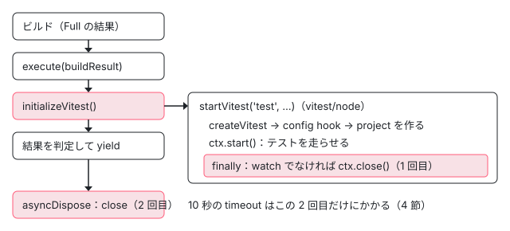

[目次](../README.md) › [ng test と Vitest の内側：テストを束ねて走らせるまで](README.md) › 第 4 回 / 全 5 回

# executor とブラウザ：Vitest を起動し、watch し、後片付けする

> runners/vitest/executor.ts と browser-provider.ts が、Vitest を作り、再ビルドのたびに変わった出力から spec を選んで走らせ直し、終わるときに後片付けする行（95510511d9）、ブラウザのモードの provider と headless・CHROME\_BIN（f190263a40・8dd341e21b）、isolate（e9aa7967ba・2d0a1c598c）と quiet、Karma の runner との違い。

angular/angular-cli · 読了 約 13 分 · 発展 · [サイトで読む（デモが動きます）](https://angular-deep-dive-cyan.vercel.app/chapter/vit-executor)

---

この章で分かること: `VitestExecutor` が、最初のビルドの結果を受けて Vitest を作るまでに何を確かめるか（vitest の読み込み・ブラウザの設定・setupFiles・include）、2 回目からのビルドでどのテストを選んで走らせ直すか、終わるときにどう後片付けするかを、行の順に追います。isolate・quiet・ブラウザのモードの provider と headless・`CHROME_BIN` の 2026 年の修正、Karma の runner との違いも読みます。最後に、本物の `ng test` の 1 回と watch で 3 回書き換えた記録を、出た順に再生します。

読む対象は angular-cli（44129f66a3）の `packages/angular/build/src/builders/unit-test/runners/vitest/executor.ts`・`browser-provider.ts` と `runners/karma/` です。`execute` が出力の Map を入れ替える行、watch で `rerunTestSpecifications` を呼ぶ行、`startVitest` に渡す設定、provider を探す順は[unit-test と Vitest の章](../cli/12-cli-unit-test.md)（6〜9 節）で読んだので、ここでは繰り返しません。executor が作る plugin の中身は[前の章](03-vit-plugins.md)です。

1. [1. テストを探す](01-vit-discovery.md)
2. [2. テスト用のビルド](02-vit-build.md)
3. [3. Vitest の plugin](03-vit-plugins.md)
4. **4. executor とブラウザ**（この章）
5. [5. spec と issue](05-vit-tests-issues.md)

> [!TIP]
> **新卒エンジニアへ**
>
> **executor**（実行役）は、builder がビルドの結果を 1 つ受けるたびに呼ばれるオブジェクトです（`runners/api.ts` の `TestExecutor`）。`execute(buildResult)` が結果を 1 つずつ返し、builder が終わるときに `Symbol.asyncDispose` が呼ばれます。**isolate** は Vitest の設定で、`true` ならテストファイルごとに worker のモジュールを作り直し、`false` なら同じ worker の中でモジュールを使い回します。**provider** は、ブラウザのモードで本物のブラウザを動かす package（`@vitest/browser-playwright` など）です。

## 1. 全体の順番



*--watch=false の 1 回。startVitest がテストを走らせ、自分の finally で Vitest を閉じてから戻る。builder の後片付けの close は 2 回目になる*

1. **executor を作る**

   `runners/vitest/index.ts` の `createExecutor` が `new VitestExecutor(…)` を返します（2 節）。
2. **最初のビルドの結果で Vitest を作る**

   `execute` が出力を Map に入れ、まだ Vitest が無ければ `initializeVitest` を呼びます（3 節）。`startVitest` はテストを 1 回走らせてから戻ります。
3. **2 回目からは走らせ直すだけ**

   watch のときは、変わった出力からテストファイルを逆に引き、そのテストだけを `rerunTestSpecifications` に渡します（5 節）。
4. **判定して、後片付け**

   全部のテストのモジュールが `ok()` か、`process.exitCode` が 1 でないかで成否を決め（6 節）、builder が終わるときに Vitest を閉じます（4 節）。

## 2. constructor：2 つの Map と NG\_TEST\_LOG

📄 `angular-cli/packages/angular/build/src/builders/unit-test/runners/vitest/executor.ts` L54–88 （▶ の行: 58–59, 67–68, 77–80）

```ts
54 │   // This is a reverse map of the entry points created in `build-options.ts`.
55 │   // It is used by the in-memory provider plugin to map the requested test file
56 │   // path back to its bundled output path.
57 │   // Example: `Map<'/path/to/src/app.spec.ts', 'spec-src-app-spec'>`
58 ▶   private readonly testFileToEntryPoint = new Map<string, string>();
59 ▶   private readonly entryPointToTestFile = new Map<string, string>();
60 │ 
61 │   constructor(
62 │     projectName: string,
63 │     options: NormalizedUnitTestBuilderOptions,
64 │     testEntryPointMappings: Map<string, string> | undefined,
65 │     logger: BuilderContext['logger'],
66 │   ) {
67 ▶     const level = parseInt(process.env['NG_TEST_LOG'] ?? '0', 10);
68 ▶     this.debugLevel = isNaN(level) ? 0 : level;
69 │ 
70 │     this.projectName = projectName;
71 │     this.options = options;
72 │     this.logger = logger;
73 │ 
74 │     this.debugLog(DebugLogLevel.Info, 'VitestExecutor instantiated.');
75 │     this.debugLog(DebugLogLevel.Verbose, 'NormalizedUnitTestBuilderOptions:', options);
76 │ 
77 ▶     if (testEntryPointMappings) {
78 ▶       for (const [entryPoint, testFile] of testEntryPointMappings) {
79 ▶         this.testFileToEntryPoint.set(testFile, entryPoint);
80 ▶         this.entryPointToTestFile.set(entryPoint + '.js', testFile);
81 │       }
82 │       this.debugLog(
83 │         DebugLogLevel.Verbose,
84 │         'Test entry point mappings:',
85 │         Object.fromEntries(testEntryPointMappings),
86 │       );
87 │     }
88 │   }
```

`testEntryPointMappings` は、[第 1 回](01-vit-discovery.md)の `getTestEntrypoints` が作った「入口の名前 → テストファイル」の Map です。79 行目でその逆の `testFileToEntryPoint`（plugin の `resolveId` と `load` が使う）、80 行目で「出力のファイル名 → テストファイル」の `entryPointToTestFile`（5 節の走らせ直しで使う）を作ります。80 行目は名前に `.js` を足すので、`spec-app-counter.js.map` は当たりません（記録の「Could not map output file 'spec-app-counter.js.map'」）。67〜68 行目、環境変数 `NG_TEST_LOG` が 1 なら Info、2 なら Verbose の debug のログを出します（2887d84986、2026-02-26）。この章の記録は、このログを使っています。

## 3. initializeVitest：startVitest を呼ぶまで

📄 `angular-cli/packages/angular/build/src/builders/unit-test/runners/vitest/executor.ts` L277–294 （▶ の行: 279, 286–287, 289–290, 294）

```ts
277 │     let vitestNodeModule;
278 │     try {
279 ▶       vitestNodeModule = await import('vitest/node');
280 │     } catch (error: unknown) {
281 │       assertIsError(error);
282 │       this.debugLog(
283 │         DebugLogLevel.Info,
284 │         `Failed to import 'vitest/node'. Error code: ${error.code}`,
285 │       );
286 ▶       if (error.code !== 'ERR_MODULE_NOT_FOUND') {
287 ▶         throw error;
288 │       }
289 ▶       throw new Error(
290 ▶         'The `vitest` package was not found. Please install the package and rerun the test command.',
291 │         { cause: error },
292 │       );
293 │     }
294 ▶     const { startVitest } = vitestNodeModule;
```

279 行目で `vitest/node` を動的に読みます。286〜292 行目、package が無い（`ERR_MODULE_NOT_FOUND`）ときだけ、分かりやすい文言の例外に変えます。ふつうは依存の確認（[第 1 回](01-vit-discovery.md)）が先に止めるので、ここに来るのは確認を飛ばした場合です。

📄 `angular-cli/packages/angular/build/src/builders/unit-test/runners/vitest/executor.ts` L296–318 （▶ の行: 297–299, 304, 308, 311–313）

```ts
296 │     // Setup vitest browser options if configured
297 ▶     const browserOptions = await setupBrowserConfiguration(
298 ▶       browsers,
299 ▶       this.options.headless,
300 │       debug,
301 │       projectSourceRoot,
302 │       browserViewport,
303 │     );
304 ▶     if (browserOptions.errors?.length) {
305 │       this.debugLog(DebugLogLevel.Info, 'Browser configuration errors found.', {
306 │         errors: browserOptions.errors,
307 │       });
308 ▶       throw new Error(browserOptions.errors.join('\n'));
309 │     }
310 │ 
311 ▶     if (browserOptions.messages?.length) {
312 ▶       for (const message of browserOptions.messages) {
313 ▶         this.logger.info(message);
314 │       }
315 │     }
316 │     this.debugLog(DebugLogLevel.Info, 'Browser configuration complete.', {
317 │       config: browserOptions.browser,
318 │     });
```

297〜303 行目で 8 節の `setupBrowserConfiguration` を呼びます。エラーがあれば 308 行目でまとめて 1 つの例外にし、情報の文言は 312〜313 行目で logger に出します。記録の「--headless（browsers なし）」で出た `The "headless" option is ignored when no browsers are configured.` は、この 313 行目から出ています。

📄 `angular-cli/packages/angular/build/src/builders/unit-test/runners/vitest/executor.ts` L243–256 （▶ の行: 246, 249–250）

```ts
243 │   private prepareSetupFiles(): string[] {
244 │     const { setupFiles } = this.options;
245 │     // Add setup file entries for TestBed initialization and project polyfills
246 ▶     const testSetupFiles = ['init-testbed.js', 'vitest-mock-patch.js', ...setupFiles];
247 │ 
248 │     // TODO: Provide additional result metadata to avoid needing to extract based on filename
249 ▶     if (this.buildResultFiles.has('polyfills.js')) {
250 ▶       testSetupFiles.unshift('polyfills.js');
251 │     }
252 │ 
253 │     this.debugLog(DebugLogLevel.Info, 'Prepared setup files:', testSetupFiles);
254 │ 
255 │     return testSetupFiles;
256 │   }
```

📄 `angular-cli/packages/angular/build/src/builders/unit-test/runners/vitest/executor.ts` L320–344 （▶ の行: 324–325, 329–330, 334–335, 338, 340–342）

```ts
320 │     this.debugLog(
321 │       DebugLogLevel.Info,
322 │       `Verifying build results. File count: ${this.buildResultFiles.size}.`,
323 │     );
324 ▶     assert(
325 ▶       this.buildResultFiles.size > 0,
326 │       'buildResult must be available before initializing vitest',
327 │     );
328 │ 
329 ▶     const testSetupFiles = this.prepareSetupFiles();
330 ▶     const projectPlugins = createVitestPlugins({
331 │       workspaceRoot,
332 │       projectSourceRoot,
333 │       projectName,
334 ▶       buildResultFiles: this.buildResultFiles,
335 ▶       testFileToEntryPoint: this.testFileToEntryPoint,
336 │     });
337 │ 
338 ▶     const debugOptions = debug
339 │       ? {
340 ▶           inspectBrk: true,
341 ▶           isolate: false,
342 ▶           fileParallelism: false,
343 │         }
344 │       : {};
```

246 行目、setupFiles は「`init-testbed.js`・`vitest-mock-patch.js`・利用者の setupFiles」の順で、出力に `polyfills.js` があれば 250 行目で先頭に足します（zone.js を polyfills に書いたとき。[前の章](02-vit-build.md)）。248 行目の TODO のとおり、ファイル名で見分けています。324〜327 行目、ビルドの結果が 1 つも無ければ assert で止まります。330〜336 行目で[前の章](03-vit-plugins.md)の 2 つの plugin を作り、338〜344 行目、`--debug` なら `inspectBrk` とともに `isolate: false`・`fileParallelism: false` にして、1 つの worker でデバッガを待ちます。

📄 `angular-cli/packages/angular/build/src/builders/unit-test/runners/vitest/executor.ts` L346–379 （▶ の行: 346–349, 356–357, 365, 372–374, 376）

```ts
346 ▶     const externalConfigPath =
347 ▶       runnerConfig === true
348 ▶         ? await findVitestBaseConfig([projectRoot, workspaceRoot])
349 ▶         : runnerConfig;
350 │ 
351 │     this.debugLog(DebugLogLevel.Info, 'External Vitest configuration path:', {
352 │       externalConfigPath,
353 │     });
354 │ 
355 │     let project = projectName;
356 ▶     if (debug && browserOptions.browser?.instances) {
357 ▶       if (browserOptions.browser.instances.length > 1) {
358 │         this.logger.warn(
359 │           'Multiple browsers are configured, but only the first browser will be used for debugging.',
360 │         );
361 │       }
362 │ 
363 │       // When running browser tests, Vitest appends the browser name to the project identifier.
364 │       // The project name must match this augmented name to ensure the correct project is targeted.
365 ▶       project = `${projectName} (${browserOptions.browser.instances[0].browser})`;
366 │       this.debugLog(DebugLogLevel.Info, 'Adjusted project name for debugging with browser:', {
367 │         project,
368 │       });
369 │     }
370 │ 
371 │     // Filter internal entries and setup files from the include list
372 ▶     const internalEntries = ['angular:'];
373 ▶     const setupFileSet = new Set(testSetupFiles);
374 ▶     const include = [...this.testFileToEntryPoint.keys()].filter((entry) => {
375 │       return (
376 ▶         !internalEntries.some((internal) => entry.startsWith(internal)) && !setupFileSet.has(entry)
377 │       );
378 │     });
379 │     this.debugLog(DebugLogLevel.Verbose, 'Included test files (after filtering):', include);
```

346〜349 行目、`runnerConfig: true` なら `vitest-base.config.*` を探し（`configuration.ts`、[前の章](02-vit-build.md)）、文字列ならそのパス、`false`（既定）ならそのまま `false` を渡して Vitest に設定ファイルを探させません。356〜369 行目、`--debug` でブラウザのモードなら、Vitest は project の名前にブラウザの名前を足す（`demo (chromium)`）ので、365 行目でそれに合わせます（32adc3a757、2026-01）。372〜378 行目、Vitest の `include` は Map のキーから `angular:` で始まる仮想の入口と setupFiles を除いたものです。setupFiles もビルドの入口なので、同じ Map に入っているからです。この先の `vitestConfig` と `startVitest` の呼び出しは[unit-test の章](../cli/12-cli-unit-test.md)の 6 節にあります。

## 4. 後片付け：10 秒の timeout と、その前の close

📄 `angular-cli/packages/angular/build/src/builders/unit-test/runners/vitest/executor.ts` L210–241 （▶ の行: 211–212, 217–218, 221–223, 225–226, 229–230, 233, 235, 237）

```ts
210 │   async [Symbol.asyncDispose](): Promise<void> {
211 ▶     if (!this.vitest) {
212 ▶       return;
213 │     }
214 │ 
215 │     this.debugLog(DebugLogLevel.Info, 'Disposing VitestExecutor: Closing Vitest instance.');
216 │ 
217 ▶     const controller = new AbortController();
218 ▶     const timeoutMs = 10_000;
219 │ 
220 │     try {
221 ▶       await Promise.race([
222 ▶         this.vitest.close(),
223 ▶         setTimeout(timeoutMs, undefined, { signal: controller.signal, ref: false })
224 │           .then(() => {
225 ▶             this.logger.warn(
226 ▶               `Vitest instance failed to close cleanly within ${timeoutMs}ms. Continuing teardown...`,
227 │             );
228 │           })
229 ▶           .catch(() => {
230 ▶             // Suppress AbortError triggered by controller.abort() when close() resolves first
231 │           }),
232 │       ]);
233 ▶     } catch (error: unknown) {
234 │       assertIsError(error);
235 ▶       this.logger.error(`An error occurred while closing Vitest instance: ${error.message}`);
236 │     } finally {
237 ▶       controller.abort();
238 │     }
239 │ 
240 │     this.debugLog(DebugLogLevel.Info, 'Vitest instance closed.');
241 │   }
```

1. **Vitest が無ければ何もしない**

   211〜213 行目。依存の確認やブラウザの設定で止まったときです。
2. **close と 10 秒の timer を競わせる**

   221〜232 行目の `Promise.race`。`close()` が 10 秒で終わらなければ 225 行目で警告を出して先へ進みます。223 行目の `ref: false` で、timer だけが残ってもプロセスの終了を止めません。
3. **timer を止める**

   237 行目、`close()` が先に終わったら `abort()` で timer を消します。そのときの `AbortError` は 229〜231 行目で捨てます。

95510511d9（2026-07-21）は #32832「`--no-watch` で全部のテストが終わってもプロセスが終わらない」を閉じた修正です。issue には、Vitest の pool の worker が止まらないと `close()` が返らないこと、Vitest の CLI は `exit()`（`teardownTimeout` の後に `process.exit()`）を使うことが書かれていました。コミットメッセージは「builder の中で `process.exit()` を呼ぶと、ホストのプロセスと後に続く architect の仕事を殺すので避けた」と説明しています。

📄 `後片付けに timeout を足した修正`

```
$ git show 95510511d9 -- …/runners/vitest/executor.ts   # 2026-07-21（#32832、抜粋）
   async [Symbol.asyncDispose](): Promise<void> {
+    if (!this.vitest) {
+      return;
+    }
+
     this.debugLog(DebugLogLevel.Info, 'Disposing VitestExecutor: Closing Vitest instance.');
-    await this.vitest?.close();
+
+    const controller = new AbortController();
+    const timeoutMs = 10_000;
 ...
```

ただ、`--watch=false` のとき `close()` が最初に呼ばれるのはここではありません。Vitest の `startVitest` は、watch でなければ自分の `finally` で `ctx.close()` を待ってから戻ります。

📄 `Vitest の startVitest の finally`

```
// vitest 4.1.11 の dist/chunks/cli-api.*.js の startVitest（vitest 5.0.0 も同じ形）
	try {
		…
		else await ctx.start(cliFilters);
		return ctx;
	} catch (e) {
		…
	} finally {
		if (!ctx?.shouldKeepServer()) {
			stdinCleanup?.();
			await ctx.close();
		}
	}
```

記録（10 節）でも、`close-start`・`close-end` が `startVitest` の戻る前（`[vit-wrap] ready` の前）に 1 回（5〜6 ms）、後片付けの `Disposing VitestExecutor` の行と同じ ms にもう 1 回出ました。2 回目は 1 ms 以内に終わっています（閉じ終わった Vitest を閉じるだけ）。#32832 の issue も、この `finally` の `close()` を「timeout が無い」と挙げていました。95510511d9 の timeout は 2 回目にしかかからないので、1 回目で止まると、`execute` の中の `this.vitest ??= await this.initializeVitest()`（[unit-test の章](../cli/12-cli-unit-test.md)の 6 節の引用）から先に進みません。作業木で 223 行目の timeout を 1 ms にしても bazel の 104 specs は全部通り、警告も 1 回も出ませんでした（テストと直し方）。

> [!WARNING]
> **ハマりどころ**
>
> watch のときは、`Ctrl+C`（SIGINT）でも `asyncDispose` まで行きません。Vitest の logger が SIGINT を受けて、1 ms 後に `process.exit()` を呼ぶからです。その時の終了コードは、`process.exitCode` がまだ決まっていなければ 130 ですが、executor が走らせるたびに 138 行目（5 節）で `0` を入れているので、テストが落ちたままでも 0 で終わります。記録では SIGINT から 41 ms で終了コード 0、`Disposing` の行は出ませんでした。

📄 `Vitest の SIGINT の扱い`

```
// vitest 4.1.11 の Logger.addCleanupListeners（dist/chunks/cli-api.*.js）
		const onExit = (signal, exitCode) => {
			cleanup();
			// Interrupted signals don't set exit code automatically.
			// Use same exit code as node: https://nodejs.org/api/process.html#signal-events
			if (process.exitCode === void 0) process.exitCode = exitCode !== void 0 ? 128 + exitCode : Number(signal);
			// Timeout to flush stderr
			setTimeout(() => process.exit(), 1);
		};
		process.once("SIGINT", onExit);
		process.once("SIGTERM", onExit);
```

## 5. 2 回目からのビルド：どのテストを走らせ直すか

📄 `angular-cli/packages/angular/build/src/builders/unit-test/runners/vitest/executor.ts` L132–138 （▶ の行: 132, 136, 138）

```ts
132 ▶     updateExternalMetadata(buildResult, this.externalMetadata, undefined, true);
133 │     this.debugLog(DebugLogLevel.Verbose, 'Updated external metadata:', this.externalMetadata);
134 │ 
135 │     // Reset the exit code to allow for a clean state.
136 ▶     // This is necessary because Vitest may set the exit code on failure, which can
137 │     // affect subsequent runs in watch mode or when running multiple builders.
138 ▶     process.exitCode = 0;
```

📄 `angular-cli/packages/angular/build/src/builders/unit-test/runners/vitest/executor.ts` L147–153 （▶ の行: 148, 151–153）

```ts
147 │       const modifiedSourceFiles = new Set<string>();
148 ▶       for (const modifiedFile of [...buildResult.modified, ...buildResult.added]) {
149 │         // The `modified` files in the build result are the output paths.
150 │         // We need to find the original source file path to pass to Vitest.
151 ▶         const source = this.entryPointToTestFile.get(modifiedFile);
152 ▶         if (source) {
153 ▶           this.debugLog(
```

📄 `angular-cli/packages/angular/build/src/builders/unit-test/runners/vitest/executor.ts` L169–175 （▶ の行: 169–172, 174）

```ts
169 ▶       const specsToRerun = [];
170 ▶       for (const file of modifiedSourceFiles) {
171 ▶         vitest.invalidateFile(file);
172 ▶         const specs = vitest.getModuleSpecifications(file);
173 │         if (specs) {
174 ▶           specsToRerun.push(...specs);
175 │         }
```

132 行目で外部の依存の一覧（`optimizeDeps.include` になる）を更新し、138 行目で `process.exitCode` を 0 に戻します。Vitest は失敗や threshold の不足を `process.exitCode` に書くので、前の回の値が残らないようにするためです。148 行目は、ビルドの `Incremental` の結果の `modified` と `added` のファイル名を 1 つずつ回し、151 行目で 2 節の `entryPointToTestFile` を引きます。当たったテストファイルだけを、171 行目で Vitest のモジュールの記録から消し、172 行目でそのファイルのテストの一覧（`TestSpecification`）を取ります。

記録（watch で 3 回書き換えた）では次のとおりでした。

| 書き換えたファイル | ビルドの差分 | 151 行目で当たったもの | 走ったテスト |
| --- | --- | --- | --- |
| `format.spec.ts` | Modified 2（`spec-app-format.js` と `.map`） | `spec-app-format.js` → `format.spec.ts` | format.spec.ts の 1 本 |
| `label.ts`（`counter.ts` だけが import） | Modified 2（`spec-app-counter.js` と `.map`） | `spec-app-counter.js` → `counter.spec.ts` | counter.spec.ts の 2 本 |
| `format.ts`（`counter.ts` と `format.spec.ts` が import） | Added 2・Modified 2・Removed 2（共有のチャンクの名前が変わった） | `spec-app-counter.js`・`spec-app-format.js` | counter.spec.ts の 2 本と format.spec.ts の 1 本 |

3 回目は、`format.ts` が共有のチャンク（`chunk-….js`）に入っていました。チャンクの名前は中身のハッシュなので、中身が変わると名前が変わり、それを import する 2 つの spec の出力も書き換わって、両方が走りました。チャンクそのもの（`chunk-N4GINQOS.js`）は 151 行目で当たらず、「Could not map」のログになります。落ちたままの `broken.spec.ts` は 3 回とも走っていません（記録の各テストの開始時刻で確かめた）。

> [!NOTE]
> **ポイント**
>
> 開いている #32159（2025-12-17）は「spec でないファイルを変えても走り直さない」です。報告の例は Storybook の stories のファイルで、builder の `include` から外したため esbuild のビルドに入らず、Vitest が自分で読んでいました。148〜151 行目が見るのはビルドの差分だけで、Vite のファイルの監視は `server.watch: null`（[unit-test の章](../cli/12-cli-unit-test.md)の 6 節）で切ってあるので、ビルドに入らないファイルの変更は executor に届きません。ビルドに入るファイルなら、上の記録のとおり、出力が変わった spec が走ります。

## 6. 結果の判定

📄 `angular-cli/packages/angular/build/src/builders/unit-test/runners/vitest/executor.ts` L187–208 （▶ の行: 188, 190–191, 196–198, 200, 203, 205, 207）

```ts
187 │     // Check if all the tests pass to calculate the result
188 ▶     const testModules = testResults?.testModules ?? this.vitest.state.getTestModules();
189 │ 
190 ▶     let success = testModules.every((testModule) => testModule.ok());
191 ▶     let finalResultReason = 'All tests passed.';
192 │ 
193 │     // Vitest does not return a failure result when coverage thresholds are not met.
194 │     // Instead, it sets the process exit code to 1.
195 │     // We check this exit code to determine if the test run should be considered a failure.
196 ▶     if (success && process.exitCode === 1) {
197 ▶       success = false;
198 ▶       finalResultReason = 'Test run failed due to unmet coverage thresholds.';
199 │       // Reset the exit code to prevent it from carrying over to subsequent runs/builds
200 ▶       process.exitCode = 0;
201 │     }
202 │ 
203 ▶     this.debugLog(
204 │       DebugLogLevel.Info,
205 ▶       `Test run finished with success: ${success}. Reason: ${finalResultReason}`,
206 │     );
207 ▶     yield { success };
208 │   }
```

188 行目、走らせ直したときはその戻り値の `testModules`、最初の 1 回は Vitest の状態から全部のモジュールを取り、190 行目ですべてが `ok()` なら成功です。記録の戻り値の `testModules` には、走らせ直さなかった `broken.spec.ts` も入っていたので、watch の 3 回とも `success: false` でした。196〜201 行目は、threshold の不足を Vitest が `process.exitCode = 1` でしか知らせないための判定です（1f1b21dab4、2026-01）。

この判定には、記録で見えた 2 つの癖があります。1 つ目は、テストが落ちて 190 行目で `false` になっても 191 行目の `'All tests passed.'` が書き換わらず、203〜206 行目の debug のログが `Test run finished with success: false. Reason: All tests passed.` になることです（`NG_TEST_LOG` のときだけ見える）。2 つ目は、`process.exitCode` の 1 を全部「threshold の不足」と読むことです。「--coverage + runnerConfig」の記録では、Vitest は provider の package が無くて 1 本も走らせずに `exitCode` を 1 にして戻り、`testModules` が空なので 190 行目は `true`、198 行目の理由は `Test run failed due to unmet coverage thresholds.` でした。

## 7. isolate と quiet

isolate は e9aa7967ba（2026-04-23）で option になり、Karma で `true` を書くと例外にしました。最初は `isolate ?? false` と正規化していたので `--no-isolate` と「書かない」が区別できず、`vitest-base.config.ts` の `isolate: true` を CLI で消せませんでした。2d0a1c598c（2026-06-03、外の人の PR）が `undefined` のまま渡すようにし、plugin の側も「`undefined` でなければ上書き」にしています（[前の章](03-vit-plugins.md)の 5 節の `projectOverrides`）。記録の `--isolate` では、hook が返した project の `isolate` と Vitest が解決した値がどちらも `true` になりました（ほかの記録は `false`）。

📄 `isolate を足した修正と、false を渡せるようにした修正`

```
$ git show e9aa7967ba -- …/unit-test/options.ts   # 2026-04-23（isolate を足した）
+  if (isolate && runner !== Runner.Vitest) {
+    throw new Error('The "isolate" option is only available for the "vitest" runner.');
+  }
 ...
+    isolate: isolate ?? false,
$ git show 2d0a1c598c -- …/unit-test/options.ts …/runners/vitest/plugins.ts   # 2026-06-03（外の人の PR）
-    isolate: isolate ?? false,
+    isolate,
 ...
-          // Only override if the user explicitly enabled it via CLI
-          ...(options.isolate ? { isolate: true } : {}),
+          // Only override if the user explicitly set it via CLI
+          ...(options.isolate !== undefined ? { isolate: options.isolate } : {}),
```

閉じた #33570（2026-08-13）は、既定の `isolate: false` と共有のチャンクの組み合わせで、別々の spec の `vi.mock('some-pkg')` のうち、同じ worker で先に走ったほうの mock が共有のチャンクに残る、という報告です。worker の数は CPU の数で決まるので、CI の小さなマシンでだけ落ちました。`--isolate` がその回避になります。

quiet は 0781f74986（2026-04-21）で入りました。watch で再ビルドのたびに出る出力のファイルの表を消す option で、既定は「環境変数 `CI` が無ければ `true`」です。executor ではなく、builder が application builder の option に渡します。記録は `CI` を空にしたので、表は 1 回も出ていません。

📄 `quiet を足した修正（抜粋）`

```
$ git show 0781f74986   # 2026-04-21（抜粋）
--- a/packages/angular/build/src/builders/unit-test/options.ts
+    quiet: options.quiet ?? (process.env['CI'] ? false : true),
--- a/packages/angular/build/src/builders/unit-test/builder.ts
       progress: normalizedOptions.buildProgress ?? buildTargetOptions.progress,
+      quiet: normalizedOptions.quiet,
--- a/packages/angular/build/src/builders/application/execute-build.ts
-  if (!jsonLogs) {
+  if (!jsonLogs && !options.quiet) {
     const changedFiles =
```

## 8. ブラウザのモード：provider・headless・CHROME\_BIN

📄 `angular-cli/packages/angular/build/src/builders/unit-test/runners/vitest/browser-provider.ts` L124–153 （▶ の行: 131–132, 134, 138, 141, 144–145, 148, 153）

```ts
124 │ export async function setupBrowserConfiguration(
125 │   browsers: string[] | undefined,
126 │   headless: boolean | undefined,
127 │   debug: boolean,
128 │   projectSourceRoot: string,
129 │   viewport: { width: number; height: number } | undefined,
130 │ ): Promise<BrowserConfiguration> {
131 ▶   if (browsers === undefined) {
132 ▶     if (headless !== undefined) {
133 │       return {
134 ▶         messages: ['The "headless" option is ignored when no browsers are configured.'],
135 │       };
136 │     }
137 │ 
138 ▶     return {};
139 │   }
140 │ 
141 ▶   const projectResolver = createProjectResolver(projectSourceRoot);
142 │   let errors: string[] | undefined;
143 │ 
144 ▶   const providerName = findBrowserProvider(projectResolver);
145 ▶   if (!providerName) {
146 │     errors ??= [];
147 │     errors.push(
148 ▶       'The "browsers" option requires either "playwright" or "webdriverio" to be installed within the project.' +
149 │         ' Please install one of these packages and rerun the test command.',
150 │     );
151 │   }
152 │ 
153 ▶   const instances = browsers.map(normalizeBrowserName);
```

131〜139 行目、`browsers` が無ければブラウザのモードではありません。`headless` だけを書いていれば、それが無視されることを 134 行目の文言で知らせます（3 節の 313 行目から出る）。144 行目で provider を探し（playwright → webdriverio → preview の順。[unit-test の章](../cli/12-cli-unit-test.md)の 7 節）、無ければ 148 行目の文言をエラーに積みます。153 行目で `ChromeHeadless` のような名前を `{ browser: 'chrome', headless: true }` に直します。

📄 `angular-cli/packages/angular/build/src/builders/unit-test/runners/vitest/browser-provider.ts` L155–187 （▶ の行: 159, 162, 164–165, 169, 173, 175, 177–178, 180, 186）

```ts
155 │   let provider: import('vitest/node').BrowserProviderOption | undefined;
156 │   if (providerName) {
157 │     const providerPackage = `@vitest/browser-${providerName}`;
158 │     try {
159 ▶       const providerModule = await import(projectResolver(providerPackage));
160 │ 
161 │       // Validate that the imported module has the expected structure
162 ▶       const providerFactory = providerModule[providerName];
163 │       if (typeof providerFactory === 'function') {
164 ▶         if (providerName === 'playwright') {
165 ▶           const executablePath = process.env['CHROME_BIN'];
166 │           const baseOptions = {
167 │             contextOptions: {
168 │               // Enables `prefer-color-scheme` for Vitest browser instead of `light`
169 ▶               colorScheme: null,
170 │             },
171 │           };
172 │ 
173 ▶           provider = providerFactory(baseOptions);
174 │ 
175 ▶           if (executablePath) {
176 │             for (const instance of instances) {
177 ▶               if (instance.browser === 'chrome' || instance.browser === 'chromium') {
178 ▶                 instance.provider = providerFactory({
179 │                   ...baseOptions,
180 ▶                   launchOptions: { executablePath },
181 │                 });
182 │               }
183 │             }
184 │           }
185 │         } else {
186 ▶           provider = providerFactory();
187 │         }
```

1. **provider の package を読む**

   159 行目。プロジェクトから解決したパスを `import()` し、162 行目で package 名と同じ名前の export（`playwright` など）を取ります。
2. **playwright は色のテーマを OS に合わせる**

   169 行目の `colorScheme: null` で、`prefers-color-scheme` を Playwright の既定の `light` に固定しません（cad7a7c0ff、2026-02-10）。
3. **`CHROME_BIN` は Chrome と Chromium の instance だけ**

   175〜183 行目。環境変数 `CHROME_BIN` があれば、177 行目で `chrome` と `chromium` の instance にだけ、その実行ファイルを使う provider を付けます。

`CHROME_BIN` は、はじめ「パスに `rules_browsers` を含むときだけ」（Angular の bazel のテスト用）使われていました。f190263a40（2026-03-05、#32697）がその条件を外し、次に 8dd341e21b（2026-03-30）が「provider 全体」から「instance ごと」に移しました。全体に付けると、Firefox を一緒に指定したときに Firefox の instance も Chrome の実行ファイルで起動しようとして落ちたからです。同じ日の 3663f80f07 は headless の扱いを `applyHeadlessConfiguration` に切り出す refactor です。

📄 `CHROME_BIN の条件を外した修正（抜粋）`

```
$ git show f190263a40 -- …/runners/vitest/browser-provider.ts   # 2026-03-05（#32697、抜粋）
-        if (
-          providerName === 'playwright' &&
-          process.env['CHROME_BIN']?.includes('rules_browsers')
-        ) {
 ...
+        if (providerName === 'playwright') {
+          const executablePath = process.env['CHROME_BIN'];
           provider = providerFactory({
+            launchOptions: executablePath
+              ? {
+                  executablePath,
+                }
+              : undefined,
```

📄 `angular-cli/packages/angular/build/src/builders/unit-test/runners/vitest/browser-provider.ts` L188–210 （▶ の行: 189, 191, 198–200, 205–206）

```ts
188 │       } else {
189 ▶         errors ??= [];
190 │         errors.push(
191 ▶           `The "${providerPackage}" package does not have a valid browser provider export.`,
192 │         );
193 │       }
194 │     } catch (e) {
195 │       assertIsError(e);
196 │       errors ??= [];
197 │       // Check for a module not found error to provide a more specific message
198 ▶       if (e.code === 'ERR_MODULE_NOT_FOUND') {
199 ▶         errors.push(
200 ▶           `The "browsers" option with "${providerName}" requires the "${providerPackage}" package.` +
201 │             ' Please install this package and rerun the test command.',
202 │         );
203 │       } else {
204 │         // Handle other potential errors during import
205 ▶         errors.push(
206 ▶           `An error occurred while loading the "${providerPackage}" browser provider:\n  ${e.message}`,
207 │         );
208 │       }
209 │     }
210 │   }
```

📄 `angular-cli/packages/angular/build/src/builders/unit-test/runners/vitest/browser-provider.ts` L73–110 （▶ の行: 81, 84, 87–88, 90, 92, 94–95, 101, 103, 105）

```ts
 73 │ export function applyHeadlessConfiguration(
 74 │   instances: BrowserInstanceConfiguration[],
 75 │   providerName: BrowserBuiltinProvider | undefined,
 76 │   headless: boolean | undefined,
 77 │   isCI: boolean,
 78 │ ): string[] {
 79 │   const messages: string[] = [];
 80 │ 
 81 ▶   if (providerName === 'preview') {
 82 │     instances.forEach((instance) => {
 83 │       // Preview mode only supports headed execution
 84 ▶       instance.headless = false;
 85 │     });
 86 │ 
 87 ▶     if (headless) {
 88 ▶       messages.push('The "headless" option is ignored when using the "preview" provider.');
 89 │     }
 90 ▶   } else if (headless !== undefined) {
 91 │     if (headless) {
 92 ▶       const allHeadlessByDefault = isCI || instances.every((i) => i.headless);
 93 │       if (allHeadlessByDefault) {
 94 ▶         messages.push(
 95 ▶           'The "headless" option is unnecessary as all browsers are already configured to run in headless mode.',
 96 │         );
 97 │       }
 98 │     }
 99 │ 
100 │     instances.forEach((instance) => {
101 ▶       instance.headless = headless;
102 │     });
103 ▶   } else if (isCI) {
104 │     instances.forEach((instance) => {
105 ▶       instance.headless = true;
106 │     });
107 │   }
108 │ 
109 │   return messages;
110 │ }
```

| 場合 | 行 | headless | 出る文言 |
| --- | --- | --- | --- |
| provider が `preview` | 81〜89 | いつも `false` | `headless` を書けば「無視する」 |
| `headless` を書いた | 90〜102 | 書いた値（全部の instance） | `true` で、CI か全部がすでに `…Headless` なら「要らない」 |
| 書かず、`CI` がある | 103〜107 | `true` | なし |
| 書かず、`CI` も無い | — | 名前のまま（`ChromeHeadless` なら `true`） | なし |

このサイトの node\_modules には provider が無いので、ブラウザのモードは起動していません。記録の `--browsers=chromium` は依存の確認（`runners/vitest/index.ts`）が `The "browsers" option requires either "@vitest/browser-playwright", …` で止めました。`runnerConfig` を足すと依存の確認は `vitest` だけになり、ビルドの後に 148 行目の `requires either "playwright" or "webdriverio"` が例外になりました。実際に要るのは `@vitest/browser-*` なので、この文言は依存の確認の文言と食い違います。origin/main の f9325ab02d（2026-10-21、PR #34442）が依存の確認と同じ文言に直しました。

## 9. Karma の runner との違い（短く）

📄 `angular-cli/packages/angular/build/src/builders/unit-test/runners/karma/executor.ts` L23–55 （▶ の行: 26, 32, 38, 44, 50）

```ts
23 │   async *execute(): AsyncIterable<BuilderOutput> {
24 │     const { context, options: unitTestOptions } = this;
25 │ 
26 ▶     if (unitTestOptions.browserViewport) {
27 │       context.logger.warn(
28 │         'The "karma" test runner does not support the "browserViewport" option. The option will be ignored.',
29 │       );
30 │     }
31 │ 
32 ▶     if (unitTestOptions.debug) {
33 │       context.logger.warn(
34 │         'The "karma" test runner does not support the "debug" option. The option will be ignored.',
35 │       );
36 │     }
37 │ 
38 ▶     if (unitTestOptions.setupFiles.length) {
39 │       context.logger.warn(
40 │         'The "karma" test runner does not support the "setupFiles" option. The option will be ignored.',
41 │       );
42 │     }
43 │ 
44 ▶     if (unitTestOptions.coverage?.include) {
45 │       context.logger.warn(
46 │         'The "karma" test runner does not support the "coverageInclude" option. The option will be ignored.',
47 │       );
48 │     }
49 │ 
50 ▶     if (unitTestOptions.headless !== undefined) {
51 │       context.logger.warn(
52 │         'The "karma" test runner does not support the "headless" option. The option will be ignored.',
53 │       );
54 │     }
55 │ 
```

📄 `angular-cli/packages/angular/build/src/builders/unit-test/runners/karma/index.ts` L29–35 （▶ の行: 33–34）

```ts
29 │         checker.check(launcherName);
30 │       }
31 │     }
32 │ 
33 ▶     if (options.coverage) {
34 ▶       checker.check('karma-coverage');
35 │     }
```

Karma の executor は自分で Vitest のような後片付けを持たず、`execute` の最初で、Karma に無い option（`browserViewport`・`debug`・`setupFiles`・`coverageInclude`・`headless`）を 1 つずつ警告してから、以前からある karma builder に渡します（[unit-test の章](../cli/12-cli-unit-test.md)の 9 節）。33 行目の `options.coverage` は、正規化の後はいつもオブジェクト（`{ enabled, exclude, … }`）なので、coverage を有効にしなくても `karma-coverage` を要求します。origin/main の 77fb7fa0f2（2026-10-28）が `options.coverage.enabled` に直し、`runners/karma/index_spec.ts` を足しました。その spec を 44129f66a3 に置くと落ちることを、テストと直し方で確かめます。同じ時期に、ブラウザの名前から launcher の package 名を作る行（`ChromiumHeadless` から実在しない `karma-chromium-launcher` を求めた）も e6c29bde19 で直り、`providersFile`・`outputFile`・`coverageReporters` の警告も cd3d30c6b6 で足されました。

## 10. 記録：1 回の実行と watch の順番

> **🧪 DEMO — ng test の出来事を出た順に（記録の再生）**
>
> `<work>/vit-demo/b/record.mjs` が、@angular/build 22.1.7・vitest 4.1.11・jsdom 28.1.0 の `ng test` を Node v24.22.1 で起動した記録です（[前の章](03-vit-plugins.md)と同じアプリ）。`NG_TEST_LOG=1`（watch は 2）で executor の debug のログを出し、包んだ `vitest/node` が `[vit-wrap] startVitest`・`configureVitest`・`close-start` などの印を同じ stdout に書いたので、出た順に並んでいます。ms は起動からの時間です。builder のログは architect の logger を通って出るので、同じ ms の中では包みの印と前後することがあります（たとえば 215 行目の `Disposing` は 222 行目の `close()` より先に呼ばれますが、印のほうが先に出ています）。watch の記録では `src/app/` の 3 つのファイルを 1 つずつ書き換え、終わったら元に戻し、SIGINT で止めました。ほかの場合も含めて、起動したプロセスは終わったことを確かめています。
>
> 3 本の spec（1 本はわざと落ちる）を 1 回だけ走らせる。
>
> ▶ [このデモはサイトで動かせます](https://angular-deep-dive-cyan.vercel.app/chapter/vit-executor)

記録から読めることを並べます。

- **--watch=false**: ビルド → `Executing test run (kind: 1)`（`Full`）→ `Initializing Vitest.` → `startVitest` → テスト → `close`（1 回目）→ `startVitest` が戻る → 判定 → 後片付け（`Disposing` と `close` の 2 回目）の順で、終了コードは 1 でした（`broken.spec.ts`）。
- **watch**: 書き換えるたびに `kind: 2`（`Incremental`）で呼ばれ、5 節の表のとおりのテストだけが走りました。書き換えた 1 回目と 2 回目は `.map` のほうが「Could not map」になります。
- **--isolate**: project の `isolate` が `true`。ほかの場合は既定の `false` です。
- **--browsers**: provider が無いので、ビルドの前（依存の確認）か、ビルドの後の `initializeVitest`（`runnerConfig` あり）で止まり、`startVitest` は呼ばれません。close も 0 回です。
- **--coverage + runnerConfig**: `startVitest` の中でテストを走らせずに戻ったので、close は builder の後片付けの 1 回だけでした。

## テストと直し方

この章の行を固めている spec は次のとおりです（44129f66a3 で `grep -n` したもの）。

| spec | describe / it（行） | 固めていること |
| --- | --- | --- |
| `runners/vitest/browser-provider_spec.ts` | `setupBrowserConfiguration`（14）の 8 つの it（39〜205）、`CHROME_BIN usage`（219）の 2 つ（235・259）、`applyHeadlessConfiguration`（283）の 4 つ（284〜312） | 8 節の headless・CI・ui・colorScheme・preview・`CHROME_BIN` を instance ごとに（8dd341e21b）。unit の `//packages/angular/build:test` |
| `tests/options/watch_spec.ts` | `Option: "watch"`（18）の it（23・33） | 1 回で終わる、ファイルを変えると走り直す |
| `tests/behavior/watch_rebuild_spec.ts` | `Watch Mode Behavior`（18）の it（23） | コンパイルのエラーを直すと同時にテストを落としたとき、走り直して失敗になる |
| `tests/options/isolate_spec.ts` | `Option: "isolate"`（19）の 4 つの it（24・36・47・58） | Karma で `true` は例外、`true` / `false` で走る、設定の `isolate` を `false` で上書き（2d0a1c598c） |
| `tests/options/quiet_spec.ts` | `Option: "quiet"`（20）の 4 つの it（36・49・62・75） | CI の有無での既定と、明示した値 |
| `tests/options/browsers_spec.ts` | `Option: "browsers"`（19）の it（24・34） | DOM の模造品で走る、provider が無ければ失敗 |
| `tests/options/debug_spec.ts` | `xdescribe('Option: "debug"')`（20） | 止められている（3 節の 338〜344 行目） |

📄 `走らせたコマンド`

```
cd ~/angular-research/angular-cli-fix   # 44129f66a3
pnpm bazel test //packages/angular/build:unit-test_integration_tests --nocache_test_results --test_output=all
pnpm bazel test //packages/angular/build:test --nocache_test_results --test_output=all \
  '--test_arg=--filter=setupBrowserConfiguration|getTestEntrypoints|generateNameFromPath'
```

📄 `結果（出力から抜き出したもの）`

```
//packages/angular/build:unit-test_integration_tests   PASSED（5 shard で 104 specs、pending 9。shard 4 は 1 回目に 1 つ落ち、2 回目で通った）
（//packages/angular/build:test の 4 つの shard）Ran 7 of 594 specs ×4 / 0 failures
//packages/angular/build:test                                            PASSED in 0.8s
```

unit の target の `--filter` は 3 つの describe の名前の正規表現で、4 つの shard に 7 本ずつ、合わせて 28 本（browser-provider の 14 本と test-discovery の 14 本）が通りました。次に、作業木（`git -C ~/angular-research/angular-cli-fix worktree add <work>/vit-wt-b 44129f66a3`）で行を変えて走らせました。

📄 `作業木で executor.ts を変えて走らせた結果`

```
# 作業木で executor.ts を変えて unit-test_integration_tests を走らせた（--flaky_test_attempts=1）
# (a) 223 行目の timeoutMs を 1 ms にした: 104 specs が全部通り、「failed to close cleanly」の警告は 1 回も出なかった
# (b) 196 行目を if (false && …) にした（threshold の判定を外した）:
Failures:
1) … Option: "runnerConfig" Coverage Merging Vitest Runner should preserve thresholds from Vitest config when not overridden by CLI
  Message:
    Expected true to be false.
1) … Option: "runnerConfig" Coverage Merging Vitest Runner should merge partial CLI thresholds with Vitest config thresholds
  Message:
    Expected true to be false.
```

4 節の timeout には spec がありません。harness の実行は `--watch=false` なので、後片付けの `close()` はいつも 2 回目で、すぐ終わるからです。6 節の threshold の判定は `runner-config-coverage_spec.ts` の 2 つの it（24・85 行目）が守っています。191 行目の理由の文言はログにしか出ないので、spec はありません。

📄 `origin/main の Karma の spec を 44129f66a3 に置いて走らせた結果`

```
# 作業木に、origin/main の 77fb7fa0f2 が足した runners/karma/index_spec.ts を置いて、44129f66a3 の index.ts のまま走らせた
pnpm bazel test //packages/angular/build:test --nocache_test_results --test_output=all \
  --flaky_test_attempts=1 --test_arg=--filter=KarmaTestRunner
1) KarmaTestRunner validateDependencies does not require karma-coverage when coverage is disabled
  Message:
    Expected function to throw an exception with a message matching /^(?!.*karma-coverage)/s, but it threw an exception with message 'The following packages are required but were not found:
      - karma
      - karma-jasmine
      - karma-coverage
    Please install the missing packages and rerun the test command.'.
//packages/angular/build:test                                            FAILED in 1 out of 4

# index.ts の 33 行目を if (options.coverage.enabled) にして、同じコマンド
//packages/angular/build:test                                            PASSED in 0.7s（2 specs）
```

直すとしたら、次の場所になります。

- **1 回目の close に timeout が無い**: 4 節。`startVitest` の `finally` は Vitest の中なので、builder の側で直すなら `initializeVitest` で watch でないときの閉じ方を変えることになります。spec は harness では再現しにくく（worker が止まらない状態を作る必要がある）、`executor.ts` の unit の spec（今は無い）が要ります。
- **理由の文言**: 6 節の 191 行目。190 行目で `false` になったときに理由を変える 1 行です。
- **exitCode の 1 を threshold と読む**: 6 節の 196〜201 行目。provider の package が無いときは、依存の確認（`runners/vitest/index.ts`）が `runnerConfig` のときも coverage の provider を確かめれば、ここまで来ません。
- **SIGINT の終了コード**: 5 節の 138 行目。走らせるたびに 0 を入れるので、Vitest の SIGINT の扱い（130 にする）が効きません。
- **Karma の coverage**: `runners/karma/index.ts` の 33 行目（origin/main で修正済み）。

## ここまでの呼び出し

- 👤 `ng test --watch` — 利用者
  - `VitestTestRunner.createExecutor()` — runners/vitest/index.ts 67
    - `new VitestExecutor(…)` — executor.ts 61 — *2 つの Map（79・80）*
  - `executor.execute(Full)` — executor.ts 101
    - `initializeVitest()` — executor.ts 258
      - `import('vitest/node')` — 279
      - `setupBrowserConfiguration()` — browser-provider.ts 124 — *applyHeadlessConfiguration（73）*
      - `prepareSetupFiles()` → `createVitestPlugins()` — 243・330
      - `startVitest('test', …)` — vitest/node — *watch でなければ finally で close*
  - `executor.execute(Incremental)` — executor.ts 101 — *2 回目から*
    - `entryPointToTestFile.get()` → `invalidateFile()` → `getModuleSpecifications()` — 151・171・172
    - `rerunTestSpecifications()` — vitest
  - `[Symbol.asyncDispose]()` — executor.ts 210 — *close と 10 秒の race*

## 聞かれそうな質問

**Q. コンポーネントの `.ts` を変えたとき、どの spec が走りますか？**

そのコンポーネントを（共有のチャンク越しも含めて）import していて、出力のファイルの中身が変わった spec です。148 行目でビルドの差分を回し、151 行目で出力の名前から spec を引きます。共有のチャンクだけが変わっても、チャンクの名前（中身のハッシュ）が変わるので、それを import する spec の出力も変わります（5 節の記録の 3 回目）。

**Q. `--no-watch` のテストが終わってもプロセスが終わりません。10 秒で抜けるのではなかったのですか？**

10 秒の timeout（221〜232 行目）は builder の後片付けの `close()` にかかります。`--watch=false` では、その前に Vitest の `startVitest` が自分の `finally` で `close()` を待つので、そちらで止まると後片付けまで来ません（4 節と記録の close の回数）。

**Q. `--no-isolate` を付けたら、`vitest-base.config.ts` の `isolate: true` に勝ちますか？**

2d0a1c598c 以降は勝ちます。`undefined` でない値を、利用者の設定より後の `projectOverrides` で上書きします（7 節）。その前は `false` と「書かない」が同じに扱われ、設定の `true` が残りました。

**Q. CI でブラウザのテストが headless になるのはなぜですか？**

`headless` を書かず、環境変数 `CI` があると、103〜107 行目で全部の instance を `true` にするからです。書いた値は 90〜102 行目で全部の instance に入り、`preview` の provider だけは 81〜89 行目でいつも `false` です。

**Q. `CHROME_BIN` を設定したら、Firefox のテストまで Chrome で起動しようとします。**

8dd341e21b（2026-03-30）より前の版です。今は 175〜183 行目で `chrome` と `chromium` の instance にだけ実行ファイルを付けます。

**Q. テストが落ちたのに、Ctrl+C で止めた `ng test` の終了コードが 0 です。**

Vitest の logger が SIGINT で `process.exit()` を呼び、そのとき `process.exitCode` がすでに決まっていればそれを使うからです。executor は走らせるたびに 138 行目で 0 を入れています。記録でも 0 でした（4 節）。

## 読み終えて

- executor は「出力の名前 → テストファイル」の Map を 2 つ持ち、最初のビルドで Vitest を作り、2 回目からはビルドの差分から spec を逆に引いて走らせ直す。
- Vitest を作る前に、vitest の読み込み・ブラウザの設定・setupFiles の順（polyfills → TestBed → mock の patch → 利用者）・include（仮想の入口と setupFiles を除く）を決める。
- 成否は「全部の module が ok」と「`process.exitCode` が 1 でない」の 2 つで決まり、理由の文言と exitCode の読み方に癖がある。
- 後片付けの 10 秒の timeout は 2 回目の close にしかかからない。`--watch=false` の 1 回目は Vitest の `startVitest` の中にある。
- ブラウザのモードの provider は package の有無で選び、headless は preview → 明示 → CI の順、`CHROME_BIN` は Chrome と Chromium の instance だけに付く。

---

← 前: [Vitest の plugin：メモリの上の出力を Vitest に読ませる](03-vit-plugins.md)  
次: [spec と issue を読む：unit-test builder を固めているテスト](05-vit-tests-issues.md) →
