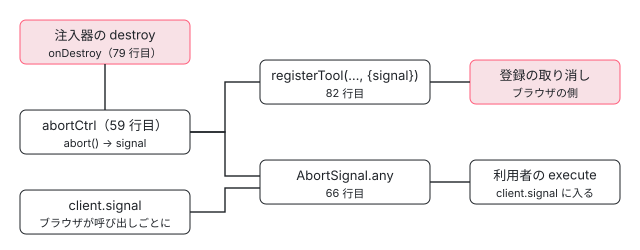

[目次](../README.md) › [WebMCP の内側：Angular のアプリが AI のエージェントにツールを渡す](README.md) › 第 1 回 / 全 4 回

# declareExperimentalWebMcpTool：1 つのツールを登録して取り消すまで

> types.ts の ToolDescriptor と vendor した @mcp-b/webmcp-types（5387e13b10d、API Extractor のため）の JSON Schema からの型推論、declare\_tool.ts が document.modelContext（683172b39a6 で navigator から移った）を探し、registerTool が関数かを確かめ（8cf7731468f）、execute を注入コンテキストで包み（77ec83782f2）、注入器の destroy とブラウザの取り消しを AbortSignal.any で合わせる（e041f9483e5）までを 1 行ずつ。非同期になった登録（f908140d718）と、登録の途中で壊れたときの AbortError を飲む枝（98960556a6d、spec なし）、素通しの annotations（91a2bf84250）、angular-main の公式 webmcp-types（38afab7a244）。ページの上で本物の 22.2.6 の関数を、作り物の modelContext につないで動かす。

angular/angular · 読了 約 13 分 · 中核 · [サイトで読む（デモが動きます）](https://angular-deep-dive-cyan.vercel.app/chapter/wmcp-declare)

---

WebMCP は、ページが `document.modelContext.registerTool()` を呼んで、ブラウザの中の AI のエージェントに「呼べる道具（ツール）」を渡す、提案中の仕組みです。この章では、Angular がその上にかぶせた `declareExperimentalWebMcpTool` が、**1 つのツールを登録してから取り消すまでに、どの行で何をしているか**を 1 行ずつ追います。ツールの形（`ToolDescriptor`）と、JSON Schema から `execute` の引数の型を作る仕組み（vendor した `@mcp-b/webmcp-types`）も読み、ページの上で本物の 22.2.6 の関数を作り物の `modelContext` につないで動かします。

読む対象は `packages/core/src/webmcp/types.ts`・`declare_tool.ts`、`packages/core/third_party/@mcp-b/webmcp-types/`、公開 API の golden（`goldens/public-api/core/index.api.md`）、spec は `packages/core/test/webmcp/declare_tool_spec.ts` です。注入器が壊れたときに `onDestroy` のコールバックが呼ばれる仕組みは [di-destroy](../di/14-di-destroy.md)、注入コンテキストそのものは [di-injection-context](../di/03-di-injection-context.md) で読みました。ここでは再説明しません。

1. **1. declareExperimentalWebMcpTool**（この章）
2. [2. provide とアプリの寿命](02-wmcp-provide.md)
3. [3. Signal Forms のフォームをツールにする](03-wmcp-forms.md)
4. [4. spec と issue](04-wmcp-tests-issues.md)

## 1. ツールの形：types.ts

まず、利用者が渡す値の型です。`@angular/core` からは `WebMcpToolDescriptor`・`WebMcpClient`・`WebMcpToolExecute` という名前で出ています（index.ts で別名を付けて export。[第 2 回](02-wmcp-provide.md)で引用します）。

📄 `angular/packages/core/src/webmcp/types.ts` L22–57 （▶ の行: 27, 34, 48–51, 54, 56）

```ts
22 │ /**
23 │  * The client context of a given WebMCP tool execution.
24 │  *
25 │  * @experimental 22.0
26 │  */
27 ▶ export interface Client {
28 │   // Mostly empty for now until we have more clarity of what this will contain.
29 │ 
30 │   /**
31 │    * A signal which notifies the tool when the operation is aborted. When triggered, the
32 │    * current operation should be canceled and all allocated resources should be cleaned up.
33 │    */
34 ▶   signal: AbortSignal;
35 │ }
36 │ 
37 │ /**
38 │  * The execute function of a WebMCP tool. Takes in arguments matching the associated
39 │  * `inputSchema` and returns content for the agent. The returned result is typically a
40 │  * `string`.
41 │  *
42 │  * @param args The arguments of the tool provided by the agent.
43 │  * @param client The client context invoking the tool.
44 │  * @returns The result of executing the tool which will be serialized and provided back
45 │  *     to the connected agent. This is typically just a raw `string`.
46 │  * @experimental 22.0
47 │  */
48 ▶ export type Execute<InputSchema extends JsonSchemaForInference> = (
49 ▶   args: InferArgsFromInputSchema<InputSchema>,
50 ▶   client: Client,
51 ▶ ) => unknown;
52 │ 
53 │ /** Options for registering a WebMCP tool. */
54 ▶ export interface ToolRegistrationOptions {
55 │   /** The signal to use for unregistering the tool. */
56 ▶   signal?: AbortSignal;
57 │ }
```

27〜35 行目の `Client` は、エージェントがツールを呼ぶたびに `execute` の第 2 引数として渡ってくる値です。中身は 34 行目の `signal`（`AbortSignal`）だけです。28 行目のコメントのとおり、仕様が固まるまで最小にしてあります。48〜51 行目の `Execute` は `execute` の型で、49 行目の `args` の型が `InferArgsFromInputSchema<InputSchema>`、つまり **`inputSchema` に書いた JSON Schema から作られた型**です（2 節）。戻り値は 51 行目のとおり `unknown` で、Angular は中身を見ずにブラウザへ返します。54〜57 行目の `ToolRegistrationOptions` は `registerTool` の第 2 引数で、56 行目の `signal` が abort されると登録が取り消されます。

📄 `angular/packages/core/src/webmcp/types.ts` L80–117 （▶ の行: 85, 87, 90, 96, 99, 102, 106, 113, 116）

```ts
 80 │ /**
 81 │  * Describes and implements a specific WebMCP tool for an agent to invoke.
 82 │  *
 83 │  * @experimental 22.0
 84 │  */
 85 ▶ export interface ToolDescriptor<InputSchema extends JsonSchemaForInference> {
 86 │   /** The unique name of this tool. */
 87 ▶   name: string;
 88 │ 
 89 │   /** A description of what the tool does and how the agent should consider using it. */
 90 ▶   description: string;
 91 │ 
 92 │   /**
 93 │    * A schema which describes the input arguments expected by the {@link execute} function
 94 │    * which the agent must provide.
 95 │    */
 96 ▶   inputSchema: InputSchema;
 97 │ 
 98 │   /** The callback function which implements this tool. */
 99 ▶   execute: Execute<InputSchema>;
100 │ 
101 │   /** Optional annotations describing the tool's behavior and safety properties. */
102 ▶   annotations?: Annotations;
103 │ }
104 │ 
105 │ /** The `window.document.modelContext` object for imperatively registering WebMCP tools. */
106 ▶ export interface ModelContext {
107 │   /**
108 │    * Register a WebMCP tool for the agent to invoke.
109 │    *
110 │    * @param tool The tool to register.
111 │    * @param options Configuration for the registration.
112 │    */
113 ▶   registerTool<const InputSchema extends JsonSchemaForInference>(
114 │     tool: ToolDescriptor<InputSchema>,
115 │     options?: ToolRegistrationOptions,
116 ▶   ): Promise<void>;
117 │ }
```

85〜103 行目の `ToolDescriptor` が、利用者が書くオブジェクトの形です。87 行目の `name` は登録先の中で一意な名前、90 行目の `description` はエージェントが「いつ使うか」を判断するための説明です。90 行目はもともと `description?: string`（省略可）でしたが、c121407c0da（2026-06-03）で WebMCP の仕様の `ModelContextTool` の辞書に合わせて必須になりました（[第 2 回](02-wmcp-provide.md)の 4 節）。96 行目の `inputSchema` の型が、そのまま型引数 `InputSchema` になります。102 行目の `annotations` は 4 節で読みます。

106〜117 行目の `ModelContext` は、ブラウザが `document.modelContext` に置くオブジェクトのうち、Angular が使う部分だけを書いた型です。116 行目のとおり `registerTool` は `Promise<void>` を返します。この型は **index.ts から export されていません**。Angular の中で、ブラウザの値を読むときの型としてだけ使います。

## 2. JSON Schema から引数の型を作る：vendor した webmcp-types

📄 `angular/packages/core/src/webmcp/types.ts` L9–20 （▶ の行: 9–10, 13–16, 19–20）

```ts
 9 ▶ // g3-only-start
10 ▶ // import type {
11 │ //   InferArgsFromInputSchema,
12 │ //   JsonSchemaForInference,
13 ▶ // } from '@mcp-b/webmcp-types';
14 ▶ // g3-only-end
15 ▶ // 3p-only-start
16 ▶ import type {
17 │   InferArgsFromInputSchema,
18 │   JsonSchemaForInference,
19 ▶ } from '../../third_party/@mcp-b/webmcp-types';
20 ▶ // 3p-only-end
```

型推論の部品 `JsonSchemaForInference` と `InferArgsFromInputSchema` は、`@mcp-b/webmcp-types` という外部のパッケージのものです。16〜19 行目は、それを npm の依存としてではなく、**`packages/core/third_party/` の下にコピーしたもの**から読んでいます。9〜14 行目の `g3-only` と 15・20 行目の `3p-only` は、Google の社内のリポジトリ（google3）に同期するときの印です。社内では 16〜19 行目が消え、10〜13 行目のコメントが外れてパッケージ名で直接読みます（4f9ee3c056a で入った印。印の一覧は [fgn-contract-history](../fgn/01-fgn-contract-history.md) で読みました）。

📄 `angular/packages/core/third_party/@mcp-b/webmcp-types/index.d.ts` L1–9 （▶ の行: 9）

```ts
1 │ /**
2 │  * @license
3 │  * Copyright Google LLC All Rights Reserved.
4 │  *
5 │  * Use of this source code is governed by an MIT-style license that can be
6 │  * found in the LICENSE file at https://angular.dev/license
7 │  */
8 │ 
9 ▶ export {InferArgsFromInputSchema, JsonSchemaForInference} from './dist/json-schema.js';
```

📄 `angular/packages/core/third_party/@mcp-b/webmcp-types/BUILD.bazel` L3–30 （▶ の行: 5, 8, 16–18, 26–27）

```python
 3 │ genrule(
 4 │     name = "sources",
 5 ▶     srcs = ["//packages/core:node_modules/@mcp-b/webmcp-types/dir"],
 6 │     outs = [
 7 │         "dist/common.d.ts",
 8 ▶         "dist/json-schema.d.ts",
 9 │         "LICENSE",
10 │     ],
11 │     cmd = """
12 │         readonly SRC_DIR="$(location //packages/core:node_modules/@mcp-b/webmcp-types/dir)"
13 │         mkdir -p "$$(dirname "$(location dist/common.d.ts)")"
14 │         cp "$${SRC_DIR}/dist/common.d.ts" "$(location dist/common.d.ts)"
15 │         # Rewrite bare imports of @modelcontextprotocol/server to use the vendored relative path
16 ▶         sed -i 's|@modelcontextprotocol/server|../../../@modelcontextprotocol/server/index.js|g' "$(location dist/common.d.ts)" || true
17 ▶         cp "$${SRC_DIR}/dist/json-schema.d.ts" "$(location dist/json-schema.d.ts)"
18 ▶         sed -i 's|@modelcontextprotocol/server|../../../@modelcontextprotocol/server/index.js|g' "$(location dist/json-schema.d.ts)" || true
19 │         cp "$${SRC_DIR}/LICENSE" "$(location LICENSE)"
20 │     """,
21 │ )
22 │ 
23 │ js_library(
24 │     name = "webmcp-types",
25 │     srcs = [
26 ▶         "index.d.ts",
27 ▶         ":sources",
28 │     ],
29 │     visibility = ["//packages/core:__subpackages__"],
30 │ )
```

third\_party の中にリポジトリとして置いてあるのは index.d.ts の 1 行（9 行目）だけで、9 行目が読む `./dist/json-schema.js` はリポジトリにありません。BUILD.bazel の 3〜21 行目の genrule が、5 行目の `packages/core` の node\_modules にある `@mcp-b/webmcp-types` から、17 行目で `dist/json-schema.d.ts` をビルドのたびにコピーします。16・18 行目は、コピーした .d.ts の中の `@modelcontextprotocol/server` の import を、同じく third\_party に置いたスタブ（`packages/core/third_party/@modelcontextprotocol/server/index.d.ts`）に書き換えています。

📄 `git show 5387e13b10d（vendor した理由）`

```
$ git show 5387e13b10d -- packages/core/package.json packages/core/third_party/@mcp-b/webmcp-types/README.md
5387e13b10d 2026-04-07 Douglas Parker
refactor(core): vendor `@mcp-b/webmcp-types`

This copies WebMCP types into `@angular/core` and redistributes them. Ideally this would just be a regular dependency, but we need to do this vendoring for API extractor to properly process the types, since they will inform `@angular/core` public API.

One downside of this approach is that the dependency is not visible in Intellisense, breaking type inference.

diff --git a/packages/core/package.json b/packages/core/package.json
index 11e452904a9..89f99044469 100644
--- a/packages/core/package.json
+++ b/packages/core/package.json
@@ -18,6 +18,9 @@
   "dependencies": {
     "tslib": "^2.3.0"
   },
+  "devDependencies": {
+    "@mcp-b/webmcp-types": "^2.2.0"
+  },
   "peerDependencies": {
     "@angular/compiler": "0.0.0-PLACEHOLDER",
     "rxjs": "^6.5.3 || ^7.4.0",
diff --git a/packages/core/third_party/@mcp-b/webmcp-types/README.md b/packages/core/third_party/@mcp-b/webmcp-types/README.md
new file mode 100644
index 00000000000..fb36d098e83
--- /dev/null
+++ b/packages/core/third_party/@mcp-b/webmcp-types/README.md
@@ -0,0 +1,4 @@
+# WebMCP Types
+
+This directory contains types vendored from `@mcp-b/webmcp-types` to
+address API extractor issues.
```

コミットの本文のとおり、理由は API Extractor（公開 API の golden を作る道具）です。`execute` の引数の型は公開 API の一部になるので、Extractor が型の中身までたどれるように、型を `@angular/core` の中に取り込んで一緒に配っています。本文の最後の段落は「その代わり、エディタからこの依存が見えず、型推論が壊れる」と書いています。

📄 `@mcp-b/webmcp-types 5.1.0 dist/json-schema.d.ts（genrule がコピーする元）`

```
@mcp-b/webmcp-types 5.1.0 の dist/json-schema.d.ts（packages/core/node_modules から。bazel の genrule がこれを third_party にコピーする）

  1  import type { InputSchema, WebMcpToolInput } from './common.js';
  2  import type { JsonSchemaType as McpJsonSchema } from '@modelcontextprotocol/server';
  3  /** JSON Schema Draft 2020-12 accepted by the inference helpers. */
  4  export type JsonSchemaForInference = McpJsonSchema;
  5  type JsonSchemaType = 'string' | 'number' | 'integer' | 'boolean' | 'null' | 'object' | 'array';
  6  type Simplify<T> = {
  7      [K in keyof T]: T[K];
  8  } & {};
  9  type EmptyObject = Record<never, never>;
 10  type ConstValue<TSchema> = TSchema extends {
 11      const: infer TValue;
 12  } ? TValue : never;
 13  type EnumValue<TSchema> = TSchema extends {
 14      enum: readonly (infer TValue)[];
 15  } ? TValue : never;
 16  type Properties<TSchema> = TSchema extends {
 17      properties: infer TProperties extends Readonly<Record<string, unknown>>;
 18  } ? TProperties : EmptyObject;
 19  type RequiredKeys<TSchema> = TSchema extends {
 20      required: readonly (infer TKey extends string)[];
 21  } ? string extends TKey ? never : Extract<TKey, keyof Properties<TSchema>> : never;
 22  type AdditionalProperties<TSchema> = TSchema extends {
 23      additionalProperties: false;
 24  } ? keyof Properties<TSchema> extends never ? Record<string, never> : EmptyObject : keyof Properties<TSchema> extends never ? TSchema extends {
 25      additionalProperties: infer TAdditional extends object;
 26  } ? Record<string, InferJsonSchema<TAdditional>> : Record<string, unknown> : Record<string, unknown>;
 27  type InferObject<TSchema> = Simplify<{
 28      -readonly [K in keyof Properties<TSchema> as K extends RequiredKeys<TSchema> ? K : never]-?: InferJsonSchema<Properties<TSchema>[K]>;
 29  } & {
 30      -readonly [K in keyof Properties<TSchema> as K extends RequiredKeys<TSchema> ? never : K]?: InferJsonSchema<Properties<TSchema>[K]>;
 31  } & AdditionalProperties<TSchema>>;
 32  type TypeKeyword<TSchema> = TSchema extends {
 33      type: infer TType;
 34  } ? TType : TSchema extends {
 35      properties: unknown;
 36  } | {
 37      required: unknown;
 38  } | {
 39      additionalProperties: unknown;
 40  } ? 'object' : never;
 41  type TypeOptions<TSchema> = TypeKeyword<TSchema> extends readonly unknown[] ? Extract<TypeKeyword<TSchema>[number], JsonSchemaType> : Extract<TypeKeyword<TSchema>, JsonSchemaType>;
 42  type InferType<TSchema, TType extends JsonSchemaType> = TType extends 'object' ? InferObject<TSchema> : TType extends 'array' ? TSchema extends {
 43      items: infer TItems;
 44  } ? InferJsonSchema<TItems>[] : unknown[] : TType extends 'string' ? string : TType extends 'number' | 'integer' ? number : TType extends 'boolean' ? boolean : TType extends 'null' ? null : unknown;
 45  /** Infers a TypeScript value from the supported JSON Schema keywords. */
 46  export type InferJsonSchema<TSchema> = TSchema extends false ? never : TSchema extends true ? unknown : [InputSchema] extends [TSchema] ? unknown : [ConstValue<TSchema>] extends [never] ? [EnumValue<TSchema>] extends [never] ? TypeOptions<TSchema> extends never ? unknown : InferType<TSchema, TypeOptions<TSchema>> : EnumValue<TSchema> : ConstValue<TSchema>;
 47  /** Infers the object or array passed to a WebMCP tool callback. */
 48  export type InferArgsFromInputSchema<TSchema> = [
 49      Extract<Exclude<InferJsonSchema<TSchema>, null | undefined>, WebMcpToolInput>
 50  ] extends [never] ? WebMcpToolInput : Extract<Exclude<InferJsonSchema<TSchema>, null | undefined>, WebMcpToolInput>;
 51  export {};
```

推論の中心は 48〜50 行目の `InferArgsFromInputSchema` で、46 行目の `InferJsonSchema` にスキーマを渡し、その結果からオブジェクトか配列（`WebMcpToolInput`）の部分を取り出します。`type: 'object'` なら 42 行目から 27〜31 行目の `InferObject` に進み、19〜21 行目の `RequiredKeys`（`required` の配列に書いた名前）は必須のプロパティ、残りは `?` 付きのプロパティになります。22〜26 行目は `additionalProperties: false` のときに余分なキーを許さない部分です。4 行目の `JsonSchemaForInference` は `@modelcontextprotocol/server` の `JsonSchemaType` の別名ですが、Angular のリポジトリでは 16・18 行目の書き換えでスタブ（`{ [key: string]: any }`）を指すので、型引数の制約としては「どんなオブジェクトでもよい」になっています。

📄 `angular/goldens/public-api/core/index.api.md` L2150–2166 （▶ の行: 2151, 2156–2157, 2160, 2165）

```md
2150 │ // @public
2151 ▶ export interface WebMcpClient {
2152 │     signal: AbortSignal;
2153 │ }
2154 │ 
2155 │ // @public
2156 ▶ export interface WebMcpToolDescriptor<InputSchema extends JsonSchemaForInference> {
2157 ▶     annotations?: Annotations;
2158 │     description: string;
2159 │     execute: WebMcpToolExecute<InputSchema>;
2160 ▶     inputSchema: InputSchema;
2161 │     name: string;
2162 │ }
2163 │ 
2164 │ // @public
2165 ▶ export type WebMcpToolExecute<InputSchema extends JsonSchemaForInference> = (args: InferArgsFromInputSchema<InputSchema>, client: WebMcpClient) => unknown;
2166 │ 
```

golden の 2157 行目の `Annotations` と 2165 行目の `InferArgsFromInputSchema` は、golden のどこにも `export` として出てきません。`@angular/core` の利用者はこれらの型に名前で触れず、`annotations: { … }` のようにその場のオブジェクトで書くことになります。

手元で `tsc` に推論の結果を表示させた記録です（わざと型エラーにして、エラーの文に型を出させています）。

📄 `<scratchpad>/wmcp-demo/a/types/infer.ts（22.1.6 用。8576f161ae4 用は同じ形を 5.1.0 の型で組み立てたもの）`

```
import {Injector, declareExperimentalWebMcpTool, provideExperimentalWebMcpTools} from '@angular/core';

const injector = Injector.create({providers: []});

// 1. 1 つのツール：inputSchema から args の型が決まる
declareExperimentalWebMcpTool(
  {
    name: 'search',
    description: '本を探す',
    inputSchema: {
      type: 'object',
      properties: {q: {type: 'string'}, limit: {type: 'integer'}},
      required: ['q'],
      additionalProperties: false,
    },
    execute: (args) => {
      const probe: 'show-type' = args; // わざと型エラーにして args の型を表示させる
      return probe;
    },
  },
  injector,
);

// 2. 型の違う 2 つのツールを 1 回の provideExperimentalWebMcpTools に渡す（#70125）
provideExperimentalWebMcpTools([
  {
    name: 'tool1',
    description: 'Tool #1',
    inputSchema: {type: 'object', properties: {arg1: {type: 'number'}}, required: ['arg1']},
    execute: (args) => args.arg1.toFixed(),
  },
  {
    name: 'tool2',
    description: 'Tool #2',
    inputSchema: {type: 'object', properties: {arg2: {type: 'string'}}, required: ['arg2']},
    execute: (args) => args.arg2.trim(),
  },
]);
```

📄 `tsc 6.0.3 の出力（3 つの版）`

```
## 22.1.6
infer.ts(17,13): error TS2322: Type '{ readonly q: string; readonly limit?: number | undefined; }' is not assignable to type '"show-type"'.
infer.ts(30,24): error TS18046: 'args.arg1' is of type 'unknown'.
infer.ts(36,24): error TS18046: 'args.arg2' is of type 'unknown'.
## repo 8576f161ae4 (@mcp-b/webmcp-types 5.1.0)
infer-repo.ts(23,11): error TS2322: Type '{ q: string; limit?: number | undefined; }' is not assignable to type '"show-type"'.
infer-repo.ts(33,24): error TS18046: 'args.arg1' is of type 'unknown'.
infer-repo.ts(39,24): error TS18046: 'args.arg2' is of type 'unknown'.
## 22.2.6
infer-222.ts(17,13): error TS2322: Type '{ q: string; limit?: number | undefined; }' is not assignable to type '"show-type"'.
infer-222.ts(30,24): error TS18046: 'args.arg1' is of type 'unknown'.
infer-222.ts(36,24): error TS18046: 'args.arg2' is of type 'unknown'.
```

17 行目のエラーの文に出ている型が、`required: ['q']` の `q` は必須の `string`、`limit` は `number | undefined` の省略可、という推論の結果です。22.1.6 だけ `readonly` が付くのは、22.1.6 が持っている webmcp-types が 5.1.0 より前の版（MVP と書かれた部分集合の推論）だからです。5.1.0 の 28・30 行目は `-readonly` で外しています。30・36 行目の 2 つは[第 2 回](02-wmcp-provide.md)で読む #70125 です。

| 版 | 型の出どころ | InputSchema の制約 |
| --- | --- | --- |
| 22.1.6（書いたときのサイト） | vendor した `@mcp-b/webmcp-types`（5.1.0 より前） | JSON Schema の部分集合のユニオン（`type` が必須） |
| 8576f161ae4（22.2.0-next.7） | vendor した `@mcp-b/webmcp-types` 5.1.0（98960556a6d で v5 に） | `@modelcontextprotocol/server` のスタブ＝どんなオブジェクトでも |
| angular-main・22.2.6（今のサイト） | 公式の `webmcp-types` 0.1.10（38afab7a244、#71268） | `object`。`inputSchema` は省略可に |

📄 `git show 38afab7a244（angular-main、2026-10-28。types.ts と third_party/webmcp-types/index.d.ts）`

```
$ git show 38afab7a244 -- packages/core/src/webmcp/types.ts packages/core/third_party/webmcp-types/index.d.ts
38afab7a244 2026-10-28 Georgi Serev
refactor(core): use official webmcp-types

Vendor the official `webmcp-types` instead of `@mcp-b/webmcp-types`.

diff --git a/packages/core/src/webmcp/types.ts b/packages/core/src/webmcp/types.ts
index d3255744659..bdab6dfabfc 100644
--- a/packages/core/src/webmcp/types.ts
+++ b/packages/core/src/webmcp/types.ts
@@ -7,16 +7,17 @@
  */
 
 // g3-only-start
-// import type {
-//   InferArgsFromInputSchema,
-//   JsonSchemaForInference,
-// } from '@mcp-b/webmcp-types';
+// import type {WebMCP} from 'webmcp-types';
+// type ModelContextTool = WebMCP.ModelContextTool;
+// type ModelContextToolFromSchema<T extends object> = WebMCP.ModelContextToolFromSchema<T>;
+// type ToolExecuteCallbackOptions = WebMCP.ToolExecuteCallbackOptions;
 // g3-only-end
 // 3p-only-start
 import type {
-  InferArgsFromInputSchema,
-  JsonSchemaForInference,
-} from '../../third_party/@mcp-b/webmcp-types';
+  ModelContextTool,
+  ModelContextToolFromSchema,
+  ToolExecuteCallbackOptions,
+} from '../../third_party/webmcp-types';
 // 3p-only-end
 
 /**
@@ -24,106 +25,32 @@ import type {
  *
  * @experimental 22.0
  */
-export interface Client {
-  // Mostly empty for now until we have more clarity of what this will contain.
-
-  /**
-   * A signal which notifies the tool when the operation is aborted. When triggered, the
-   * current operation should be canceled and all allocated resources should be cleaned up.
-   */
-  signal: AbortSignal;
-}
+export type Client = ToolExecuteCallbackOptions;
 
 /**
  * The execute function of a WebMCP tool. Takes in arguments matching the associated
- * `inputSchema` and returns content for the agent. The returned result is typically a
- * `string`.
+ * to the connected agent. This is typically just a raw `string`.
  *
- * @param args The arguments of the tool provided by the agent.
- * @param client The client context invoking the tool.
- * @returns The result of executing the tool which will be serialized and provided back
- *     to the connected agent. This is typically just a raw `string`.
  * @experimental 22.0
  */
-export type Execute<InputSchema extends JsonSchemaForInference> = (
-  args: InferArgsFromInputSchema<InputSchema>,
-  client: Client,
-) => unknown;
-
-/** Options for registering a WebMCP tool. */
-export interface ToolRegistrationOptions {
-  /** The signal to use for unregistering the tool. */
-  signal?: AbortSignal;
-}
-
-/**
- * Annotations for a WebMCP tool which describe its behavior.
- *
- * @experimental 22.2
- */
-export interface Annotations {
-  /**
-   * A hint that the tool will not modify user-visible state (e.g. it will not trigger
-   * a navigation, mutate the DOM, or alter data stored on a backend). Agents may be
-   * more likely to use tools which are explicitly declared read-only as they are
-   * safer against potential misuse.
-   */
-  readOnlyHint?: boolean;
-
-  /**
-   * A hint that the tool will return untrusted content from the perspective of the
-   * author of the tool.
-   */
-  untrustedContentHint?: boolean;
-
-  /**
-   * A hint that the tool will have consequential effects like mutating state or interacting
-   * with the external world.
-   */
-  consequentialHint?: boolean;
-
-  /**
-   * Whether the tool is intended for debugging and development purposes rather than end-user
-   * agent interaction.
-   */
-  debugging?: boolean;
-}
+export type Execute<InputSchema extends object = object> =
+  ModelContextToolFromSchema<InputSchema>['execute'];
 
 /**
  * Describes and implements a specific WebMCP tool for an agent to invoke.
  *
  * @experimental 22.0
  */
-export interface ToolDescriptor<InputSchema extends JsonSchemaForInference> {
-  /** The unique name of this tool. */
-  name: string;
-
-  /** A description of what the tool does and how the agent should consider using it. */
-  description: string;
-
+export interface ToolDescriptor<InputSchema extends object = object> extends Omit<
+  ModelContextTool,
+  'execute'
+> {
   /**
    * A schema which describes the input arguments expected by the {@link execute} function
    * which the agent must provide.
    */
-  inputSchema: InputSchema;
+  inputSchema?: InputSchema;
 
   /** The callback function which implements this tool. */
   execute: Execute<InputSchema>;
-
-  /** Optional annotations describing the tool's behavior and safety properties. */
-  annotations?: Annotations;
-}
-
-/** The `window.document.modelContext` object for imperatively registering WebMCP tools. */
-export interface ModelContext {
-  /**
-   * Register a WebMCP tool for the agent to invoke.
-   *
-   * @param tool The tool to register.
-   * @param options Configuration for the registration.
-   */
-  registerTool<const InputSchema extends JsonSchemaForInference>(
-    tool: ToolDescriptor<InputSchema>,
-    options?: ToolRegistrationOptions,
-  ): Promise<void>;
 }
diff --git a/packages/core/third_party/webmcp-types/index.d.ts b/packages/core/third_party/webmcp-types/index.d.ts
new file mode 100644
index 00000000000..8413a251d7e
--- /dev/null
+++ b/packages/core/third_party/webmcp-types/index.d.ts
@@ -0,0 +1,18 @@
+/**
+ * @license
+ * Copyright Google LLC All Rights Reserved.
+ *
+ * Use of this source code is governed by an MIT-style license that can be
+ * found in the LICENSE file at https://angular.dev/license
+ */
+
+// Loads the global `WebMCP` namespace
+import './dist/index.js';
+
+// API extractor cannot analyze a re-export of the global namespace itself,
+// so only aliases of its members are exported.
+export type ModelContext = WebMCP.ModelContext;
+export type ModelContextTool = WebMCP.ModelContextTool;
+export type ModelContextToolFromSchema<TInputSchema extends object> =
+  WebMCP.ModelContextToolFromSchema<TInputSchema>;
+export type ToolExecuteCallbackOptions = WebMCP.ToolExecuteCallbackOptions;
```

angular-main の 38afab7a244 で、vendor する先が W3C の Web Machine Learning Community Group の公式の `webmcp-types` に変わり、types.ts はほとんど公式の型の別名になりました。`ToolDescriptor` は `ModelContextTool` から `execute` を除いたものに Angular の `execute` を足す形になり、`inputSchema` は省略可（`inputSchema?`）になっています。`Annotations` と `ModelContext` は Angular の側から消え、公式の型のものを使います。22.2.x にも #71719 で入り、サイトの記録に使った 22.2.6 はこの形です。

## 3. declare\_tool.ts を 1 行ずつ

### 3-1. 32〜42 行目：async の関数と、modelContext の探し方

📄 `angular/packages/core/src/webmcp/declare_tool.ts` L32–42 （▶ の行: 32–34, 36, 39–41）

```ts
32 ▶ export async function declareExperimentalWebMcpTool<
33 ▶   const InputSchema extends JsonSchemaForInference,
34 ▶ >(tool: ToolDescriptor<InputSchema>, injector?: Injector): Promise<void> {
35 │   // SSR may not have a document yet, so we abort before checking it.
36 ▶   if (typeof ngServerMode !== 'undefined' && ngServerMode) return;
37 │ 
38 │   // modelContext was moved from `navigator` to `document` in the spec, but we check both for compatibility with different environments.
39 ▶   const modelContext =
40 ▶     (globalThis.document as {modelContext?: ModelContext}).modelContext ??
41 ▶     (globalThis.navigator as unknown as {modelContext?: ModelContext}).modelContext;
42 │ 
```

32 行目のとおり、関数は `async` で `Promise<void>` を返します（f908140d718 から。3-4）。33 行目の `const` の型引数は、`inputSchema` に書いたオブジェクトのリテラルを、`'object'` や `['q']` のような文字どおりの型のまま推論させるためのものです。これが無いと `type` が `string` に広がり、2 節の推論が働きません。36 行目の SSR の判定は[第 2 回](02-wmcp-provide.md)の 3 節で読みます。

39〜41 行目は、まず `document.modelContext` を、無ければ `navigator.modelContext` を読みます。最初の実装は `navigator` だけを見ていました。

📄 `git show 683172b39a6（2026-05-27、fixes #68947）`

```
$ git show 683172b39a6 -- packages/core/src/webmcp/declare_tool.ts
683172b39a6 2026-05-27 Matthieu Riegler
refactor(core): Update webmcp support to use `document.modelContext`

The implementation in Chrome 150 moved `modelContext` from the navigator to the document (see webmachinelearning/webmcp/pull/184)

We're also removing the calls to the deprecated `unregisterTool` method.

fixes #68947

diff --git a/packages/core/src/webmcp/declare_tool.ts b/packages/core/src/webmcp/declare_tool.ts
index ad940bd8ed0..62d43aea844 100644
--- a/packages/core/src/webmcp/declare_tool.ts
+++ b/packages/core/src/webmcp/declare_tool.ts
@@ -9,8 +9,8 @@
 // g3-only import type {JsonSchemaForInference} from '@mcp-b/webmcp-types';
 import type {JsonSchemaForInference} from '../../third_party/@mcp-b/webmcp-types'; // 3p-only
 import {assertInInjectionContext, inject, Injector, runInInjectionContext} from '../di';
-import type {ModelContext, ToolDescriptor} from './types';
 import {DestroyRef} from '../linker';
+import type {ModelContext, ToolDescriptor} from './types';
 
 /**
  * Declares a WebMCP tool.
@@ -33,9 +33,10 @@ export function declareExperimentalWebMcpTool<const InputSchema extends JsonSche
   tool: ToolDescriptor<InputSchema>,
   injector?: Injector,
 ): void {
-  const {modelContext} = globalThis.navigator as typeof globalThis.navigator & {
-    modelContext?: ModelContext;
-  };
+  // modelContext was moved from `navigator` to `document` in the spec, but we check both for compatibility with different environments.
+  const modelContext =
+    (globalThis.document as {modelContext?: ModelContext}).modelContext ??
+    (globalThis.navigator as unknown as {modelContext?: ModelContext}).modelContext;
 
   // Verify WebMCP is supported in this client.
   if (!modelContext) return;
@@ -66,11 +67,5 @@ export function declareExperimentalWebMcpTool<const InputSchema extends JsonSche
   modelContext.registerTool(wrappedTool, {signal: abortCtrl.signal});
 
   // Unregister when the associated `Injector` is destroyed.
-  destroyRef.onDestroy(() => {
-    abortCtrl.abort();
-
-    // `unregisterTool` has been removed from the spec, but we continue to
-    // call it because `@mcp-b/webmcp-polyfill` still relies on it for tests.
-    modelContext.unregisterTool?.({name: tool.name});
-  });
+  destroyRef.onDestroy(() => void abortCtrl.abort());
 }
```

Chrome 150 で `modelContext` の置き場所が `navigator` から `document` に移ったためです（本文の webmachinelearning/webmcp#184）。古い版のブラウザや polyfill のために `navigator` も残しています。同じコミットで、取り消しのときに呼んでいた `unregisterTool` もやめ、`abortCtrl.abort()` だけになりました（3-3 の 79 行目）。

### 3-2. 46〜55 行目：副作用の前に、失敗しうるものを全部済ませる

📄 `angular/packages/core/src/webmcp/declare_tool.ts` L46–55 （▶ の行: 46, 48–49, 54–55）

```ts
46 ▶   if (!modelContext || typeof modelContext.registerTool !== 'function') return;
47 │ 
48 ▶   if (typeof ngDevMode !== 'undefined' && ngDevMode) {
49 ▶     if (!injector) assertInInjectionContext(declareExperimentalWebMcpTool);
50 │   }
51 │ 
52 │   // Inject the `DestroyRef` and `Injector` immediately, so if it fails we abort
53 │   // before causing any side effects.
54 ▶   const currentInjector = injector ?? inject(Injector);
55 ▶   const destroyRef = currentInjector.get(DestroyRef);
```

46 行目は「WebMCP が使えない環境なら何もせずに終わる」判定です。前半の `!modelContext` は、ブラウザが WebMCP を持たない普通の場合です。後半の `typeof modelContext.registerTool !== 'function'` は 8cf7731468f（2026-06-17）で足されました。それまでは前半だけで、`modelContext` という名前で `registerTool` を持たない値が見えると、判定を通り抜けて 82 行目で例外になっていました。コミットはその例として DOM clobbering（HTML の要素の `id` や `name` が `document` の同じ名前のプロパティとして見えてしまう、ブラウザの古い仕組み）を挙げています。後半の判定は「中身が何であれ、`registerTool` が関数でなければ使わない」という形で、その値を通しません。

48〜50 行目は開発モードだけの確認です。`injector` を渡されていないのに注入コンテキストの外で呼ばれたら、49 行目の `assertInInjectionContext` が NG0203 を投げます。本番では 48 行目で飛ばされますが、54 行目の `inject(Injector)` が同じ NG0203 を投げるので、結果は同じです。52〜53 行目のコメントのとおり、54・55 行目で `Injector` と `DestroyRef` を**最初に**取ります。ここで失敗すれば、まだ何も登録していません。

> [!NOTE]
> **ポイント**
>
> 関数は `async` ですが、**最初の `await`（82 行目）までは呼び出し元と同じ同期の流れで走ります**。だから 54 行目の `inject(Injector)` は、呼び出し元の注入コンテキストの中で動きます。もし 54 行目より前に `await` を置くと、続きはマイクロタスク（いまの処理が終わった直後に走る小さな続きの処理）になり、注入コンテキストの外で `inject` を呼ぶことになります。DEMO の 2 で「await の前に registerTool が 1 回呼ばれた」と出るのは、この同期の部分が 82 行目の呼び出しまで進んでいるからです。

### 3-3. 56〜79 行目：execute を包み、取り消しの線をつなぐ

📄 `angular/packages/core/src/webmcp/declare_tool.ts` L56–79 （▶ の行: 59–62, 65–67, 69–72, 79）

```ts
56 │ 
57 │   // Wrap the input tool with an `AbortSignal` which aborts when the
58 │   // injection context is destroyed.
59 ▶   const abortCtrl = new AbortController();
60 ▶   const wrappedTool: ToolDescriptor<InputSchema> = {
61 ▶     ...tool,
62 ▶     execute: (args, client) => {
63 │       // TODO: `@mcp-b/webmcp-polyfill` currently lacks `AbortSignal` in its mock client.
64 │       // Remove the optional chaining when it is updated to match Chrome 153 spec.
65 ▶       const signal = client?.signal
66 ▶         ? AbortSignal.any([abortCtrl.signal, client.signal])
67 ▶         : abortCtrl.signal;
68 │ 
69 ▶       return runInInjectionContext(currentInjector, () =>
70 ▶         tool.execute(args, {
71 ▶           ...client,
72 ▶           signal,
73 │         }),
74 │       );
75 │     },
76 │   };
77 │ 
78 │   // Unregister when the associated `Injector` is destroyed.
79 ▶   destroyRef.onDestroy(() => void abortCtrl.abort());
```

1. **59 行目：このツール専用の AbortController**

   1 回の `declareExperimentalWebMcpTool` に 1 つです。この `abortCtrl.signal` を、82 行目で `registerTool` の `{signal}` に、66〜67 行目で `execute` に渡す signal の材料に、2 か所で使います。
2. **60〜61 行目：利用者のオブジェクトを写す**

   `...tool` で `name`・`description`・`inputSchema`・`annotations` をそのまま写し、`execute` だけを 62 行目の関数に差し替えます。`annotations` を足した 91a2bf84250 が declare\_tool.ts を 1 行も変えていないのは、この 61 行目で素通しになるからです（4 節）。
3. **65〜67 行目：2 つの取り消しを 1 つの signal に**

   ブラウザがツールを呼ぶときに渡す `client.signal`（エージェントや利用者が呼び出しを取り消すと abort される）と、59 行目の `abortCtrl.signal`（注入器が壊れると abort される）を、66 行目の `AbortSignal.any` で合わせます。どちらかが abort されれば、合わせた signal も abort されます。`client?.signal` の `?.` は、63〜64 行目のコメントのとおり、spec が使う polyfill が `client` に signal を入れてこないための備えです。
4. **69〜74 行目：注入コンテキストの中で、利用者の execute を呼ぶ**

   `runInInjectionContext(currentInjector, …)` の中で呼ぶので、利用者の `execute` は `inject()` を使えます。70〜73 行目で `client` を写し、`signal` だけを 67 行目で作ったものに差し替えます。
5. **79 行目：注入器が壊れたら abort**

   `destroyRef.onDestroy` に「`abortCtrl.abort()` を呼ぶ」を登録します。注入器が壊れると、`registerTool` に渡した signal が abort されて登録が取り消され、実行中の `execute` に渡した signal も abort されます。`void` は、アロー関数が `abort()` の戻り値を返さないようにするためです。

📄 `git show 77ec83782f2（2026-05-01。execute を注入コンテキストで）`

```
$ git show 77ec83782f2 -- packages/core/src/webmcp/declare_tool.ts
77ec83782f2 2026-05-01 Douglas Parker
refactor(core): run `declareWebMcpTool` callback in an injection context

This uses the injection context the tool is registered in for the `execute` callback and makes it a little more ergonomic to inject and use services in this context.

diff --git a/packages/core/src/webmcp/declare_tool.ts b/packages/core/src/webmcp/declare_tool.ts
index a7edcc4ecfc..a74d3b78599 100644
--- a/packages/core/src/webmcp/declare_tool.ts
+++ b/packages/core/src/webmcp/declare_tool.ts
@@ -7,7 +7,7 @@
  */
 
 import type {JsonSchemaForInference} from '../../third_party/@mcp-b/webmcp-types';
-import {assertInInjectionContext, inject, Injector} from '../di';
+import {assertInInjectionContext, inject, Injector, runInInjectionContext} from '../di';
 import type {ModelContext, ToolDescriptor} from './types';
 import {DestroyRef} from '../linker';
 
@@ -17,6 +17,9 @@ import {DestroyRef} from '../linker';
  * The tool is immediately registered and automatically unregistered when
  * the associated injection context is destroyed.
  *
+ * The `tool.execute` function is invoked in the injection context of the provided
+ * {@link Injector}, or the injection context of `declareWebMcpTool` itself.
+ *
  * @param tool The tool to register and execute when invoked by an AI agent.
  * @param injector Optional {@link Injector} which will automatically
  *     unregister the tool when destroyed. Defaults to the current injection
@@ -40,9 +43,10 @@ export function declareWebMcpTool<const InputSchema extends JsonSchemaForInferen
     if (!injector) assertInInjectionContext(declareWebMcpTool);
   }
 
-  // Inject the `DestroyRef` immediately, so if it fails we abort before
-  // causing any side effects.
-  const destroyRef = injector ? injector.get(DestroyRef) : inject(DestroyRef);
+  // Inject the `DestroyRef` and `Injector` immediately, so if it fails we abort
+  // before causing any side effects.
+  const currentInjector = injector ?? inject(Injector);
+  const destroyRef = currentInjector.get(DestroyRef);
 
   // Wrap the input tool with an `AbortSignal` which aborts when the
   // injection context is destroyed.
@@ -50,10 +54,12 @@ export function declareWebMcpTool<const InputSchema extends JsonSchemaForInferen
   const wrappedTool: ToolDescriptor<InputSchema> = {
     ...tool,
     execute: (args, client) =>
-      tool.execute(args, {
-        ...client,
-        signal: abortCtrl.signal,
-      }),
+      runInInjectionContext(currentInjector, () =>
+        tool.execute(args, {
+          ...client,
+          signal: abortCtrl.signal,
+        }),
+      ),
   };
 
   modelContext.registerTool(wrappedTool, {signal: abortCtrl.signal});
```

📄 `git show e041f9483e5（2026-08-18。client.signal と合わせる）`

```
$ git show e041f9483e5 -- packages/core/src/webmcp/declare_tool.ts
e041f9483e5 2026-08-18 Doug Parker
refactor(core): pass AbortSignal to WebMCP tools to handle cancellation

This forwards the `AbortSignal` natively supplied by Chrome 153.0.8009.0's update to `registerTool` executions down into the Angular context. This helps tools gracefully handle execution cancellations initiated by agents or users, preventing unnecessary background work and leaking resources.

We combine the injector/component destruction abort signals with the native WebMCP execution cancellation signals so the underlying tools correctly cancel long-running requests without producing invalid states.

Justification:
https://groups.google.com/a/chromium.org/g/chrome-ai-dev-preview/c/9291sjhIRz0/m/RFuyRrs5AAAJ

diff --git a/packages/core/src/webmcp/declare_tool.ts b/packages/core/src/webmcp/declare_tool.ts
index 7a4fe5ebc6f..08e84fcd008 100644
--- a/packages/core/src/webmcp/declare_tool.ts
+++ b/packages/core/src/webmcp/declare_tool.ts
@@ -59,13 +59,20 @@ export async function declareExperimentalWebMcpTool<
   const abortCtrl = new AbortController();
   const wrappedTool: ToolDescriptor<InputSchema> = {
     ...tool,
-    execute: (args, client) =>
-      runInInjectionContext(currentInjector, () =>
+    execute: (args, client) => {
+      // TODO: `@mcp-b/webmcp-polyfill` currently lacks `AbortSignal` in its mock client.
+      // Remove the optional chaining when it is updated to match Chrome 153 spec.
+      const signal = client?.signal
+        ? AbortSignal.any([abortCtrl.signal, client.signal])
+        : abortCtrl.signal;
+
+      return runInInjectionContext(currentInjector, () =>
         tool.execute(args, {
           ...client,
-          signal: abortCtrl.signal,
+          signal,
         }),
-      ),
+      );
+    },
   };
 
   // Unregister when the associated `Injector` is destroyed.
```

77ec83782f2 の前は、54〜55 行目にあたる行が `DestroyRef` しか取っておらず、`execute` は素のまま呼ばれていました。e041f9483e5 の前は、`execute` に渡す signal が 59 行目の `abortCtrl.signal` だけで、ブラウザが渡す `client.signal` は 70〜73 行目の `...client` の後で上書きされて捨てられていました。本文のとおり、Chrome 153.0.8009.0 から `registerTool` の実行に signal が渡るようになったのに合わせた変更です。



*1 回の declare で作る signal の線。abortCtrl は登録の取り消しと execute の取り消しの両方に使われる*

### 3-4. 81〜92 行目：非同期になった登録と、登録が終わる前に壊れたとき

📄 `angular/packages/core/src/webmcp/declare_tool.ts` L81–92 （▶ の行: 82, 84–85, 88, 90）

```ts
81 │   try {
82 ▶     await modelContext.registerTool(wrappedTool, {signal: abortCtrl.signal});
83 │   } catch (error: unknown) {
84 ▶     if (error instanceof DOMException && error.name === 'AbortError') {
85 ▶       // This happens when an Injector is created and then immediately destroyed
86 │       // such that the onDestroy above gets called before registerTool resolves
87 │       // We don't mind swallowing the error in this case.
88 ▶       return;
89 │     }
90 ▶     throw error;
91 │   }
92 │ }
```

📄 `git show f908140d718（2026-07-09。declare_tool.ts と types.ts の部分）`

```
$ git show f908140d718 -- packages/core/src/webmcp/declare_tool.ts packages/core/src/webmcp/types.ts
f908140d718 2026-07-09 Doug Parker
refactor(core): update WebMCP tool registration to be asynchronous

In the latest WebMCP specification and Chromium preview builds, `document.modelContext.registerTool` was updated to be asynchronous and return a `Promise`: https://groups.google.com/a/chromium.org/g/chrome-ai-dev-preview/c/xQWt0b1sZIE/m/UJznbNCIAwAJ?utm_medium=email&utm_source=footer

This commit update adjusts Angular's experimental WebMCP implementation (`declareExperimentalWebMcpTool` and form registration) to be async as well, returning `Promise<void>`.

diff --git a/packages/core/src/webmcp/declare_tool.ts b/packages/core/src/webmcp/declare_tool.ts
index a32d28f5d3b..7a4fe5ebc6f 100644
--- a/packages/core/src/webmcp/declare_tool.ts
+++ b/packages/core/src/webmcp/declare_tool.ts
@@ -29,10 +29,9 @@ import type {ModelContext, ToolDescriptor} from './types';
  *     `injector` argument provided.
  * @experimental
  */
-export function declareExperimentalWebMcpTool<const InputSchema extends JsonSchemaForInference>(
-  tool: ToolDescriptor<InputSchema>,
-  injector?: Injector,
-): void {
+export async function declareExperimentalWebMcpTool<
+  const InputSchema extends JsonSchemaForInference,
+>(tool: ToolDescriptor<InputSchema>, injector?: Injector): Promise<void> {
   // SSR may not have a document yet, so we abort before checking it.
   if (typeof ngServerMode !== 'undefined' && ngServerMode) return;
 
@@ -69,8 +68,8 @@ export function declareExperimentalWebMcpTool<const InputSchema extends JsonSche
       ),
   };
 
-  modelContext.registerTool(wrappedTool, {signal: abortCtrl.signal});
-
   // Unregister when the associated `Injector` is destroyed.
   destroyRef.onDestroy(() => void abortCtrl.abort());
+
+  await modelContext.registerTool(wrappedTool, {signal: abortCtrl.signal});
 }
diff --git a/packages/core/src/webmcp/types.ts b/packages/core/src/webmcp/types.ts
index b587f805229..9268ffa87d2 100644
--- a/packages/core/src/webmcp/types.ts
+++ b/packages/core/src/webmcp/types.ts
@@ -89,7 +89,7 @@ export interface ModelContext {
   registerTool<const InputSchema extends JsonSchemaForInference>(
     tool: ToolDescriptor<InputSchema>,
     options?: ToolRegistrationOptions,
-  ): void;
+  ): Promise<void>;
 
   /**
    * Unregister a tool.
```

f908140d718 の本文のとおり、仕様と Chromium のプレビュー版で `registerTool` が `Promise` を返すようになったのに合わせて、関数を `async` にし、82 行目で `await` しています。差分の後半で、`registerTool` の呼び出しを `onDestroy` の登録（79 行目）の**後ろ**に移しています。`await` の後ろに `onDestroy` を置くと、登録を待っている間に注入器が壊れたときに取り消しの線がつながらないからです。同じ日の ce4f7adc951 で、types.ts の `ModelContext` から `unregisterTool` も消えました。取り消しは signal だけです。

📄 `git show ce4f7adc951（2026-07-09）`

```
$ git show ce4f7adc951 -- packages/core/src/webmcp/types.ts
ce4f7adc951 2026-07-09 Doug Parker
refactor(core): remove deprecated `unregisterTool` from `ModelContext`

In the WebMCP specification, tools are unregistered by aborting the `AbortSignal` provided in `registerTool(tool, {signal})`. The deprecated `unregisterTool` method on `ModelContext` is no longer needed or part of the standard, and is now removed from the TypeScript interface definition.

diff --git a/packages/core/src/webmcp/types.ts b/packages/core/src/webmcp/types.ts
index 9268ffa87d2..d5f72bddf5f 100644
--- a/packages/core/src/webmcp/types.ts
+++ b/packages/core/src/webmcp/types.ts
@@ -90,11 +90,4 @@ export interface ModelContext {
     tool: ToolDescriptor<InputSchema>,
     options?: ToolRegistrationOptions,
   ): Promise<void>;
-
-  /**
-   * Unregister a tool.
-   *
-   * @deprecated Only exists for out-of-date `@mcp-b/webmcp-polyfill` testing tool.
-   */
-  unregisterTool(tool: {name: string}): void;
 }
```

84〜89 行目は、`registerTool` の Promise が `AbortError` で reject されたときだけ、例外を飲み込んで普通に終わる枝です。85〜87 行目のコメントのとおり、注入器を作ってすぐ壊すと、79 行目の `abort()` が `registerTool` の resolve より先に走り、ブラウザ（と polyfill）が登録を `AbortError` で終わらせるからです。それ以外の失敗（同じ名前がすでにある、など）は 90 行目でそのまま投げ直します。

📄 `git show 98960556a6d（2026-08-26。build: update mcp-b webmcp dependencies to v5 の中の declare_tool.ts）`

```
$ git show 98960556a6d -- packages/core/src/webmcp/declare_tool.ts
98960556a6d 2026-08-26 Angular Robot
build: update mcp-b webmcp dependencies to v5

See associated pull request for more information.

diff --git a/packages/core/src/webmcp/declare_tool.ts b/packages/core/src/webmcp/declare_tool.ts
index 08e84fcd008..10b740a6ecf 100644
--- a/packages/core/src/webmcp/declare_tool.ts
+++ b/packages/core/src/webmcp/declare_tool.ts
@@ -78,5 +78,15 @@ export async function declareExperimentalWebMcpTool<
   // Unregister when the associated `Injector` is destroyed.
   destroyRef.onDestroy(() => void abortCtrl.abort());
 
-  await modelContext.registerTool(wrappedTool, {signal: abortCtrl.signal});
+  try {
+    await modelContext.registerTool(wrappedTool, {signal: abortCtrl.signal});
+  } catch (error: unknown) {
+    if (error instanceof DOMException && error.name === 'AbortError') {
+      // This happens when an Injector is created and then immediately destroyed
+      // such that the onDestroy above gets called before registerTool resolves
+      // We don't mind swallowing the error in this case.
+      return;
+    }
+    throw error;
+  }
 }
```

> [!WARNING]
> **ハマりどころ**
>
> この catch は、依存の更新のコミット（コミットの作者は Angular Robot。同じ件名の自動の PR #70399 は閉じられ、メンテナーが開いた PR #70400 でマージされた）の中で入りました。コミットの件名からは見えない変更で、**この枝を確かめる spec はありません**（「テストと直し方」で、外しても既存の 13 個の spec が通ることを確かめました）。22.1.6 にはこの枝がまだ無く、「登録の途中で destroy する」と `declareExperimentalWebMcpTool` の Promise が `AbortError` で reject されていました。サイトの 22.2.6 にはこの枝が入っている（v22.2.0 から）ので、DEMO では Promise が resolve し、表のツールは 0 個です。

比べるために、最初の実装（b2c0c91f8f6）を置いておきます。

📄 `git show b2c0c91f8f6:packages/core/src/webmcp/declare_tool.ts（2026-04-10）`

```
$ git show b2c0c91f8f6:packages/core/src/webmcp/declare_tool.ts（2026-04-10、最初の形。27〜69 行目）
 */
export function declareWebMcpTool<const InputSchema extends JsonSchemaForInference>(
  tool: ToolDescriptor<InputSchema>,
  injector?: Injector,
): void {
  const {modelContext} = globalThis.navigator as typeof globalThis.navigator & {
    modelContext?: ModelContext;
  };

  // Verify WebMCP is supported in this client.
  if (!modelContext) return;

  if (typeof ngDevMode !== 'undefined' && ngDevMode) {
    if (!injector) assertInInjectionContext(declareWebMcpTool);
  }

  // Inject the `DestroyRef` immediately, so if it fails we abort before
  // causing any side effects.
  const destroyRef = injector ? injector.get(DestroyRef) : inject(DestroyRef);

  // Wrap the input tool with an `AbortSignal` which aborts when the
  // injection context is destroyed.
  const abortCtrl = new AbortController();
  const wrappedTool: ToolDescriptor<InputSchema> = {
    ...tool,
    execute: (args, client) =>
      tool.execute(args, {
        ...client,
        signal: abortCtrl.signal,
      }),
  };

  modelContext.registerTool(wrappedTool, {signal: abortCtrl.signal});

  // Unregister when the associated `Injector` is destroyed.
  destroyRef.onDestroy(() => {
    abortCtrl.abort();

    // `unregisterTool` has been removed from the spec, but we continue to
    // call it because `@mcp-b/webmcp-polyfill` still relies on it for tests.
    modelContext.unregisterTool?.({name: tool.name});
  });
}
```

名前は `declareWebMcpTool`（38e26f07597 で `Experimental` が入った）、戻り値は `void`、`navigator` だけを見て、取り消しは `abort()` と `unregisterTool` の両方でした。いまの 92 行の中で、この時から残っているのは 59〜61 行目の包み方と 48〜50 行目の確認です。

## 4. annotations：Angular は素通しするだけ

📄 `angular/packages/core/src/webmcp/types.ts` L59–78 （▶ の行: 62, 64, 71, 77）

```ts
59 │ /**
60 │  * Annotations for a WebMCP tool which describe its behavior.
61 │  *
62 ▶  * @experimental 22.2
63 │  */
64 ▶ export interface Annotations {
65 │   /**
66 │    * A hint that the tool will not modify user-visible state (e.g. it will not trigger
67 │    * a navigation, mutate the DOM, or alter data stored on a backend). Agents may be
68 │    * more likely to use tools which are explicitly declared read-only as they are
69 │    * safer against potential misuse.
70 │    */
71 ▶   readOnlyHint?: boolean;
72 │ 
73 │   /**
74 │    * A hint that the tool will return untrusted content from the perspective of the
75 │    * author of the tool.
76 │    */
77 ▶   untrustedContentHint?: boolean;
78 │ }
```

91a2bf84250（2026-08-31、PR #70496）で入った `Annotations` は、ツールの性質をエージェントに伝える印です。71 行目の `readOnlyHint` は「ユーザーに見える状態を変えない」、77 行目の `untrustedContentHint` は「ツールの作者から見て信用できない内容（利用者が書いた文など）を返すことがある」という印です。62 行目のとおり `@experimental 22.2` で、ほかの型（`@experimental 22.0`）より後から入りました。22.1.6 の `ToolDescriptor` にはまだ `annotations` が無く、付けると型エラーの TS2353 になりました。サイトの 22.2.6 では公式の webmcp-types の `ModelContextTool` が `annotations?: ToolAnnotations` を持つので付けられますが、DEMO のツールには付けていません。Angular はこれを解釈せず、3-3 の 61 行目の `...tool` で `registerTool` に渡すだけです。どう使うかはブラウザとエージェントが決めます。

📄 `angular/packages/core/test/webmcp/declare_tool_spec.ts` L68–96 （▶ の行: 71, 79–81, 87, 89）

```ts
68 │   it('should pass tool annotations to registerTool', async () => {
69 │     const execute = jasmine.createSpy<Execute<JsonSchemaForInference>>('execute');
70 │     const modelContext = (globalThis.document as any).modelContext;
71 ▶     const registerSpy = spyOn(modelContext, 'registerTool').and.callThrough();
72 │ 
73 │     await declareExperimentalWebMcpTool(
74 │       {
75 │         name: 'annotatedTool',
76 │         description: 'A tool with annotations',
77 │         inputSchema: {type: 'object', properties: {}},
78 │         execute,
79 ▶         annotations: {
80 ▶           readOnlyHint: true,
81 ▶           untrustedContentHint: true,
82 │         },
83 │       },
84 │       Injector.create({providers: []}),
85 │     );
86 │ 
87 ▶     expect(registerSpy).toHaveBeenCalledWith(
88 │       jasmine.objectContaining({
89 ▶         annotations: {
90 │           readOnlyHint: true,
91 │           untrustedContentHint: true,
92 │         },
93 │       }),
94 │       jasmine.anything(),
95 │     );
96 │   });
```

spec も「`registerTool` に同じ `annotations` が渡る」だけを確かめています（71 行目で `registerTool` を spy し、87〜95 行目）。angular-main では、この素通しの上に 96dbae53bbf（PR #70654、2026-09-09）で `consequentialHint`（外の世界に影響する操作をする）、fe9c0d77975（2026-10-01）で `debugging`（開発者が自分のアプリを調べるためのツール）が足され、どちらもコミットの本文に「Angular から見ればただの素通し」とあります。38afab7a244 の後は `Annotations` の型そのものが公式の `webmcp-types` のものになりました（2 節）。

## 5. DEMO：登録 → 呼ぶ → destroy

> **🧪 DEMO — 本物の declareExperimentalWebMcpTool（22.2.6）と作り物の modelContext**
>
> ボタンを押したときだけ `document.modelContext` に作り物（`registerTool` を記録し、signal の abort で表から消す小さなオブジェクト）を置き、呼び終えたら消します。ブラウザに本物の `modelContext` があるときは動かしません。「3. execute を呼ぶ」は、エージェントの代わりに作り物の表から登録されたツールを取り出して `execute` を呼びます。ツールの `execute` は `inject()` で注入器の値（`'こんにちは'`）を読みます。
>
> ▶ [このデモはサイトで動かせます](https://angular-deep-dive-cyan.vercel.app/chapter/wmcp-declare)

手元の Chrome で 1 から順に押し、続けて下の段を押した結果です。

| 操作 | 結果 | 理由（行） |
| --- | --- | --- |
| 2. ツールを登録する | `await` の前に `registerTool` が 1 回。渡ったキーは `name, description, inputSchema, execute`。`options.signal.aborted=false` | 3-2 の注意（82 行目まで同期）。60〜62 行目の写し方 |
| 3. execute を呼ぶ | `"こんにちは、Ada（signal.aborted=false）"` | 69 行目の `runInInjectionContext` で `inject` が動く |
| 4. 終わらない execute | ツールが受け取った signal はクライアントのものと別物（`false`） | 66 行目の `AbortSignal.any` |
| 5. クライアントが取り消す | ツールの `signal.aborted=true`、表のツールは残る | 66 行目。登録の signal（59 行目）は abort されない |
| 6. 注入器を destroy | `registerTool` に渡した signal が `aborted=true`、表のツール 0 個 | 79 行目 → 82 行目で渡した signal |
| 登録の途中で destroy | resolve、表 0 個 | 84〜89 行目で `AbortError` を飲む（98960556a6d より前の 22.1.6 では `AbortError` で reject） |
| 注入コンテキストの外 | NG0203 で reject、`registerTool` 0 回 | 49 行目（開発）/ 54 行目（本番）。82 行目より前 |
| modelContext が無い・registerTool が無い | どちらも何もせず resolve（`undefined`） | 46 行目 |

## ここまでの呼び出し

- 👤 `declareExperimentalWebMcpTool(tool, injector)` — *利用者のコード*
  - `ngServerMode` の確認 — declare\_tool.ts 36 — *第 2 回*
  - `document.modelContext ?? navigator.modelContext` — declare\_tool.ts 39–41
  - `typeof modelContext.registerTool !== 'function'` なら終わる — declare\_tool.ts 46
  - `inject(Injector)` → `get(DestroyRef)` — declare\_tool.ts 54–55 — *失敗するならここで*
  - `{...tool, execute: 包んだ関数}` — declare\_tool.ts 60–76
  - `destroyRef.onDestroy(() => abortCtrl.abort())` — declare\_tool.ts 79
  - `await modelContext.registerTool(wrappedTool, {signal})` — declare\_tool.ts 82 — *ここまで同期*
- 👤 エージェントがツールを呼ぶ
  - 包んだ `execute(args, client)` — declare\_tool.ts 62
    - `AbortSignal.any([abortCtrl.signal, client.signal])` — declare\_tool.ts 66
    - `runInInjectionContext(currentInjector, () => tool.execute(…))` — declare\_tool.ts 69–74
- 👤 注入器の `destroy()`
  - `abortCtrl.abort()` — declare\_tool.ts 79 — *登録の取り消しと execute の取り消し*

## テストと直し方

この章の約束を固めているのは `declare_tool_spec.ts` の `describe('declareExperimentalWebMcpTool')`（23 行目）です。it は `'should register a tool'`（37 行目）・`'should pass tool annotations to registerTool'`（68 行目）・`'should throw if the tool is already registered'`（98 行目）・``'should unregister the tool when its `Injector` is destroyed'``（124 行目）・``'… no `injector` is provided'``（146 行目）・`'should throw when called outside an injection context …'`（167 行目）・ ``'should pass an `AbortSignal` to the tool and abort it when the injector is destroyed'``（180 行目）・`'… when the client signal aborts'`（221 行目）・``'should run `execute` in an injection context'``（252 行目）・`'should infer correct types from schema'`（281 行目）の 10 個です。24〜35 行目で毎回 `@mcp-b/webmcp-polyfill` を入れて片付けます（作り方は[第 4 回](04-wmcp-tests-issues.md)）。

📄 `angular/packages/core/test/webmcp/declare_tool_spec.ts` L180–219 （▶ の行: 182, 186, 202, 204–205, 207–208, 215）

```ts
180 │   it('should pass an `AbortSignal` to the tool and abort it when the injector is destroyed', async () => {
181 │     const injector = Injector.create({providers: []});
182 ▶     const {promise: executePromise, resolve: executeResolve} =
183 │       Promise.withResolvers<JsonSchemaForInference>();
184 │     const execute = jasmine
185 │       .createSpy<Execute<JsonSchemaForInference>>('execute')
186 ▶       .and.returnValue(executePromise);
187 │ 
188 │     await declareExperimentalWebMcpTool(
189 │       {
190 │         name: 'testTool',
191 │         description: 'A test tool',
192 │         inputSchema: {type: 'object', properties: {}},
193 │         execute,
194 │       },
195 │       injector,
196 │     );
197 │ 
198 │     const tools = await getModelContext()!.getTools();
199 │     const testTool = tools.find((t: any) => t.name === 'testTool')!;
200 │ 
201 │     // Start execution but don't await it yet
202 ▶     const executeToolPromise = getModelContext().executeTool!(testTool, '{}');
203 │ 
204 ▶     const [, {signal}] = execute.calls.first().args;
205 ▶     expect(signal.aborted).toBeFalse();
206 │ 
207 ▶     injector.destroy();
208 ▶     expect(signal.aborted).toBeTrue();
209 │ 
210 │     // Clean up
211 │     executeResolve({content: []});
212 │     try {
213 │       await executeToolPromise;
214 │     } catch (e: any) {
215 ▶       if (e.name !== 'UnknownError' || e.message !== 'Tool unregistered') {
216 │         throw e;
217 │       }
218 │     }
219 │   });
```

182〜186 行目で `execute` を終わらない Promise にし、202 行目で呼び出しだけ始め、204 行目で `execute` が受け取った signal を取り出します。207〜208 行目が「注入器の destroy で abort される」（79 行目）の確認です。215 行目の `'Tool unregistered'` は、polyfill が「登録が取り消されたツールの実行」を終わらせるときの例外で、それだけは許しています。

📄 `angular/packages/core/test/webmcp/declare_tool_spec.ts` L221–250 （▶ の行: 227, 239, 242–243, 248–249）

```ts
221 │   it('should pass an `AbortSignal` to the tool and abort it when the client signal aborts', async () => {
222 │     const injector = Injector.create({providers: []});
223 │     const execute = jasmine
224 │       .createSpy<Execute<JsonSchemaForInference>>('execute')
225 │       .and.returnValue({content: []});
226 │ 
227 ▶     const registerToolSpy = spyOn(getModelContext(), 'registerTool').and.callThrough();
228 │ 
229 │     await declareExperimentalWebMcpTool(
230 │       {
231 │         name: 'testTool',
232 │         description: 'A test tool',
233 │         inputSchema: {type: 'object', properties: {}},
234 │         execute,
235 │       },
236 │       injector,
237 │     );
238 │ 
239 ▶     const wrappedTool = registerToolSpy.calls.first()
240 │       .args[0] as unknown as ToolDescriptor<JsonSchemaForInference>;
241 │ 
242 ▶     const clientAbortCtrl = new AbortController();
243 ▶     await wrappedTool.execute({}, {signal: clientAbortCtrl.signal});
244 │ 
245 │     const [, {signal}] = execute.calls.first().args;
246 │     expect(signal.aborted).toBeFalse();
247 │ 
248 ▶     clientAbortCtrl.abort();
249 ▶     expect(signal.aborted).toBeTrue();
250 │   });
```

こちらは 63〜64 行目のコメントにある polyfill の事情（`client` に signal を入れてこない）を避けるため、227 行目で `registerTool` を spy して包んだツールを直接取り出し、243 行目で自分で作った `client.signal` を渡しています。248〜249 行目が 66 行目の `AbortSignal.any` の確認です。

📄 `angular/packages/core/test/webmcp/declare_tool_spec.ts` L281–318 （▶ の行: 283, 299–300, 303–304, 307–308）

```ts
281 │   it('should infer correct types from schema', () => {
282 │     // Type-only test, only needs to compile, not execute.
283 ▶     () => {
284 │       declareExperimentalWebMcpTool(
285 │         {
286 │           name: 'testTool',
287 │           description: 'A test tool',
288 │           inputSchema: {
289 │             type: 'object',
290 │             properties: {
291 │               foo: {type: 'string'},
292 │               bar: {type: 'number'},
293 │             },
294 │             required: ['foo'],
295 │             additionalProperties: false,
296 │           },
297 │           execute: (args) => {
298 │             // Verify assignability.
299 ▶             const _assignable: {foo?: string; bar?: number} = args;
300 ▶             const _assignFromHardCoded: typeof args = {foo: '', bar: 0};
301 │ 
302 │             // Explicitly reject `any`.
303 ▶             const _fooNotAny: IsAny<typeof args.foo> = false;
304 ▶             const _barNotAny: IsAny<typeof args.bar> = false;
305 │ 
306 │             // Explicitly reject index signature. (`{[x: string]: unknown}`)
307 ▶             // @ts-ignore: This evaluation changed in recent schema updates
308 ▶             const _noIndexSignature: HasIndexSignature<typeof args> = false;
309 │ 
310 │             return {content: []};
311 │           },
312 │         },
313 │         Injector.create({providers: []}),
314 │       );
315 │     };
316 │ 
317 │     expect().nothing();
318 │   });
```

281 行目の it は型だけの確認で、283 行目の関数は呼ばれません（コンパイルが通ることが確認）。299〜300 行目が代入できること、303〜304 行目が `any` でないことを確かめます。307 行目の `@ts-ignore` は 98960556a6d（v5 への更新）で足されたもので、308 行目の「索引シグネチャ（`[x: string]: unknown`）が無い」の確認は、いまは型エラーになっても通る状態です。

📄 `走らせ方（web の suite。ng_web_test_suite が chromium・firefox・debug の 3 つを作る）`

```
$ cd ~/angular-research/angular
$ pnpm bazel query 'tests(//packages/core/test/webmcp:all)'
js_test rule //packages/core/test/webmcp:webmcp_chromium
js_test rule //packages/core/test/webmcp:webmcp_debug
js_test rule //packages/core/test/webmcp:webmcp_firefox
$ pnpm bazel test //packages/core/test/webmcp:webmcp_chromium --nocache_test_results --test_output=all
```

📄 `結果（2026-11-16、手元の 8576f161ae4）`

```
[5,161 / 5,162] Testing //packages/core/test/webmcp:webmcp_chromium; 1s local
INFO: From Testing //packages/core/test/webmcp:webmcp_chromium:
Chromium: |██████████████████████████████| 0/1 test files | 0 passed, 0 failed
Running tests...
Running 1 test files...
Chromium: |██████████████████████████████| 1/1 test files | 13 passed, 0 failed
Finished running tests in 0.5s, all tests passed! 🎉
//packages/core/test/webmcp:webmcp_chromium                              PASSED in 1.2s
Executed 1 out of 1 test: 1 test passes.
```

13 個は、この spec の 10 個と `provide_tools_spec.ts` の 3 個（[第 2 回](02-wmcp-provide.md)）です。

作業木（`angular-fix` から 8576f161ae4 で作ったもの）で、3-4 の catch が spec で固められているかを試しました。84〜89 行目を消して f908140d718 の時の 1 行（`await modelContext.registerTool(…)`）に戻しても、既存の 13 個はすべて通ります。下の it を 1 つ足すと、それだけが落ちます。

📄 `足した it（作業木だけ。作業木はもう消した）`

```
// 作業木で declare_tool_spec.ts の 252 行目の it の前に足した it（手元の実験。本家には無い）
  it('wmcp-a: should resolve when the injector is destroyed before registerTool resolves', async () => {
    const injector = Injector.create({providers: []});
    const promise = declareExperimentalWebMcpTool(
      {
        name: 'testTool',
        description: 'A test tool',
        inputSchema: {type: 'object', properties: {}},
        execute: async () => ({content: []}),
      },
      injector,
    );
    injector.destroy();
    await expectAsync(promise).toBeResolved();
    expect(await getModelContext()!.getTools()).toEqual([]);
  });
```

📄 `catch を消して走らせた結果`

```
Chromium: |██████████████████████████████| 0/1 test files | 0 passed, 0 failed
 ❌ declareExperimentalWebMcpTool > wmcp-a: should resolve when the injector is destroyed before registerTool resolves
      Expected a promise to be resolved but it was rejected with AbortError: signal is aborted without reason.
Chromium: |██████████████████████████████| 1/1 test files | 13 passed, 1 failed
INFO: Build completed, 1 test FAILED, 5 total actions
//packages/core/test/webmcp:webmcp_chromium                              FAILED in 1.3s
```

同じ作業木で、36 行目（SSR）と 46 行目の後半（`typeof` の判定）を消しても、13 個はすべて通りました。この 2 つの守りを確かめる spec もありません。

### 直すとしたら

- 84〜89 行目の枝を固めるなら、`declare_tool_spec.ts` の 124 行目の it（destroy で取り消す）の隣に、上の it（destroy を `await` の前に呼び、Promise が resolve し、`getTools()` が空）を足す形です。直すのは `declareExperimentalWebMcpTool` の 81〜91 行目です。
- 46 行目の後半を固めるなら、`document.modelContext` に `registerTool` を持たない値を置いて呼び、Promise が resolve して何も起きないことを確かめる it です。polyfill を入れる 30 行目の `beforeEach` の後に置くので、その it の中では polyfill の `modelContext` を一時的に別の値で覆い、終わったら戻す必要があります。

## 聞かれそうな質問

**Q. declareExperimentalWebMcpTool を await しないと、登録はされないのですか？**

されます。82 行目の `registerTool` の呼び出しまでは同期で走るので、関数を呼んだ時点でブラウザに登録の依頼は出ています。`await` するのは「登録が終わったこと」と「失敗（同じ名前など、90 行目で投げ直す例外）」を受け取るためです。DEMO の 2 で、`await` の前に `registerTool` が 1 回呼ばれているのが見えます。

**Q. execute の中で inject() を使えるのはなぜですか？async の execute でも使えますか？**

69 行目で `runInInjectionContext(currentInjector, …)` の中で呼ぶからです（77ec83782f2）。ただし注入コンテキストは同期の間だけなので、`async` の `execute` なら、最初の `await` より前で `inject()` を呼ぶ必要があります。

**Q. ツールを取り消すにはどうしますか？unregisterTool はありますか？**

ありません。取り消しは `registerTool` に渡した signal の abort だけで、Angular は 79 行目で注入器の destroy に結び付けています。`unregisterTool` の呼び出しは 683172b39a6、型からは ce4f7adc951 で消えました。早く取り消したいなら、専用の注入器を `createEnvironmentInjector` で作って `injector` に渡し、その注入器を destroy します（DEMO の 6）。

**Q. execute に渡ってくる signal は、いつ abort されますか？**

2 つの場合です。注入器が destroy されたとき（79 行目 → 59 行目の signal）と、ブラウザがその呼び出しを取り消したとき（`client.signal`）。66 行目の `AbortSignal.any` で 1 つにしているので、`execute` から見ると区別はありません。後者は e041f9483e5（Chrome 153 から）です。

**Q. WebMCP の無いブラウザで呼ぶと例外になりますか？**

なりません。46 行目で何もせずに終わり、Promise は `undefined` で resolve します。ただし 46 行目は 48〜55 行目より前なので、WebMCP の無いブラウザでは「注入コンテキストの外で呼んだ」誤りも NG0203 になりません（DEMO の「modelContext が無い」の行と「注入コンテキストの外」の行は、作り物の有無だけが違います）。

**Q. inputSchema から引数の型が付くのは、どの型のおかげですか？**

types.ts の 49 行目の `InferArgsFromInputSchema<InputSchema>` と、declare\_tool.ts の 33 行目の `const` の型引数です。前者は vendor した `@mcp-b/webmcp-types`（json-schema.d.ts の 48〜50 行目）、angular-main では公式の `webmcp-types` の `ModelContextToolFromSchema` に変わりました（38afab7a244）。

## 読み終えて

- `ToolDescriptor` は name・description（必須、c121407c0da）・inputSchema・execute・annotations。execute の引数の型は inputSchema から推論し、その型は API Extractor のために vendor している
- declare\_tool.ts は、副作用の前に失敗しうるもの（modelContext の有無、`registerTool` が関数か、`Injector` と `DestroyRef`）を済ませ、最初の `await` の前に `registerTool` まで同期で進む
- 1 つの `AbortController` が、注入器の destroy を「登録の取り消し」と「実行中の execute の取り消し」の両方につなぐ。ブラウザの `client.signal` とは `AbortSignal.any` で合わせる
- 登録の途中で壊れたときの `AbortError` を飲む枝（98960556a6d）は依存の更新のコミットで入り、spec で固められていない。22.1.6 には無く、サイトの 22.2.6 にはある
- annotations は Angular から見れば素通し。angular-main では consequentialHint・debugging が足され、型は公式の webmcp-types に移った

---

← 前: [spec と issue を読む：\[formField\] を固めているテスト](../sfd/06-sfd-tests-issues.md)  
次: [provideExperimentalWebMcpTools とアプリの寿命：いつ登録され、いつ消えるか](02-wmcp-provide.md) →
