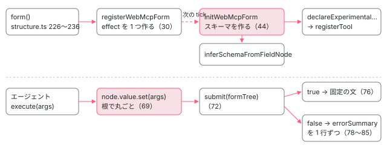

[目次](../README.md) › [WebMCP の内側：Angular のアプリが AI のエージェントにツールを渡す](README.md) › 第 3 回 / 全 4 回

# Signal Forms のフォームをツールにする：スキーマから JSON Schema へ

> forms/signals の webmcp/registration.ts と tokens.ts、provideExperimentalWebMcpForms（1963a0eb181）がトークンを置き、form() がそれを引いて呼ぶ行、追跡の無い effect でモデルを読むのを 1 tick 遅らせる修正（9604ecfd8b5、#69262）、フィールドの木から入力の JSON Schema を作る再帰と additionalProperties: false（df77e42327c）、readOnlyHint と untrustedContentHint（6e299da8cfc）、execute がモデルを丸ごと置き換えて送信し、検証のエラーをエージェントに返す形。開いている #71271 と閉じた #70819・#70820 の指摘を今のコードで確かめ、22.2.6 を Node で動かした記録を再生する。

angular/angular · 読了 約 13 分 · 発展 · [サイトで読む（デモが動きます）](https://angular-deep-dive-cyan.vercel.app/chapter/wmcp-forms)

---

この章で分かること：Signal Forms の `form()` に `experimentalWebMcpTool` を渡すと、フォームのモデルの初期値から入力の JSON Schema が作られ、1 つの WebMCP のツールとして登録されます。その入口（`provideExperimentalWebMcpForms` と `REGISTER_WEBMCP_FORM`）、登録を 1 tick 遅らせる仕組み、フィールドの木から JSON Schema を作る再帰、エージェントの値をモデルに書いて送信の結果を返す `execute` を 1 行ずつ読みます。最後に、開いている PR #71271 と閉じた PR #70819・#70820 が何を指摘したかを、今のコードと Node で動かした記録で確かめます。

読む対象は `packages/forms/signals/src/webmcp/registration.ts`（162 行）・`tokens.ts`（26 行）・`index.ts`（9 行）と、`src/api/structure.ts` の WebMCP に関係する行、`test/web/webmcp.spec.ts` です。登録の本体の `declareExperimentalWebMcpTool` が注入器の寿命とどう結び付くかは[第 1 回](01-wmcp-declare.md)、`form()` がフィールドの木を作る流れは[スキーマとフィールドの木の章](../forms/16-forms-sf-schema.md)にあります。

1. [1. declareExperimentalWebMcpTool](01-wmcp-declare.md)
2. [2. provide とアプリの寿命](02-wmcp-provide.md)
3. **3. Signal Forms のフォームをツールにする**（この章）
4. [4. spec と issue](04-wmcp-tests-issues.md)

> [!TIP]
> **新卒エンジニアへ**
>
> JSON Schema は、「この JSON はこういう形でなければならない」を JSON で書いたものです。`{"type": "object", "properties": {…}, "required": […]}` のように書きます。WebMCP では、ツールが受け取る引数の形を `inputSchema` としてエージェントに見せます。エージェントはそれを読んで、引数の JSON を作ります。

## 1. 入口：provideExperimentalWebMcpForms とトークン

📄 `angular/packages/forms/signals/src/webmcp/registration.ts` L147–162 （▶ の行: 153, 155–156, 158–159）

```ts
147 │ /**
148 │  * Creates a provider that configures all signal forms with `experimentalWebMcpTool`
149 │  * to be registered as WebMCP tools.
150 │  *
151 │  * @see [Implicit tools in Signal Forms](ai/webmcp#implicit-tools-in-signal-forms)
152 │  *
153 ▶  * @experimental
154 │  */
155 ▶ export function provideExperimentalWebMcpForms(): EnvironmentProviders {
156 ▶   return makeEnvironmentProviders([
157 │     {
158 ▶       provide: REGISTER_WEBMCP_FORM,
159 ▶       useValue: registerWebMcpForm,
160 │     },
161 │   ]);
162 │ }
```

155 行目の `provideExperimentalWebMcpForms()` は、156 行目の `makeEnvironmentProviders` で 1 つの provider だけを返します。158〜159 行目で、トークン `REGISTER_WEBMCP_FORM` に関数 `registerWebMcpForm` をそのまま値として置きます。153 行目の `@experimental` は JSDoc の印で、名前にも `Experimental` が入っています（core の側で名前を変えた経緯は[第 1 回](01-wmcp-declare.md)）。これは 1963a0eb181（2026-05-04、PR #68565）で入りました。`index.ts` は 9 行目で `provideExperimentalWebMcpForms` だけを export し、`public_api.ts` の 26 行目が `export * from './src/webmcp'` で `@angular/forms/signals` に出します。

📄 `angular/packages/forms/signals/src/webmcp/tokens.ts` L12–26 （▶ の行: 13–14, 23–26）

```ts
12 │ /** A function to register a signal form as a WebMCP tool. */
13 ▶ export const REGISTER_WEBMCP_FORM = new InjectionToken<RegisterWebMcpForm>(
14 ▶   typeof ngDevMode !== 'undefined' && ngDevMode ? 'REGISTER_WEBMCP_FORM' : '',
15 │ );
16 │ 
17 │ /**
18 │  * Registers a Signal Form as a WebMCP tool.
19 │  *
20 │  * @param formTree The form to register.
21 │  * @param options Configuration options for the tool.
22 │  */
23 ▶ export type RegisterWebMcpForm = (
24 ▶   form: FieldTree<unknown>,
25 ▶   options: {name: string; description: string},
26 ▶ ) => Promise<void>;
```

13〜15 行目のトークンの型は、23〜26 行目の `RegisterWebMcpForm` です。フォームの根の `FieldTree` と `{name, description}` を受け、`Promise<void>` を返します。14 行目は、開発モードのときだけトークンに名前を付ける、Angular の中でよく使う書き方です（[InjectionToken の章](../di/06-di-injection-token.md)）。

> [!NOTE]
> **ポイント**
>
> トークンを間に挟んでいるのは、`form()` の本体（`structure.ts`）が `registration.ts` を import しないためです。`structure.ts` の 22 行目が import するのは `../webmcp/tokens` だけです。`provideExperimentalWebMcpForms()` を呼ばないアプリでは、`registration.ts`（JSON Schema を作る関数と `declareExperimentalWebMcpTool` の呼び出し）がどこからも参照されず、bundle から落とせます。

📄 `angular/goldens/public-api/forms/signals/index.api.md` L211–221 （▶ の行: 214–217）

```md
211 │ // @public
212 │ export interface FormOptions<TModel> {
213 │     experimentalWebMcpTool?: {
214 ▶         name: string;
215 ▶         description: string;
216 ▶     };
217 ▶     injector?: Injector;
218 │     name?: string;
219 │     submission?: FormSubmitOptions<TModel, unknown>;
220 │ }
221 │ 
```

公開 API の golden（`goldens/public-api/forms/signals/index.api.md`）では、`FormOptions` の 214〜217 行目に `experimentalWebMcpTool` が載り、562 行目に `export function provideExperimentalWebMcpForms(): EnvironmentProviders;` が載っています。golden が何を固めるかは[公開 API の章](../contrib/08-contrib-public-api.md)にあります。

## 2. form() の側：トークンを引いて呼ぶ

📄 `angular/packages/forms/signals/src/api/structure.ts` L61–76 （▶ の行: 64, 66, 68, 71）

```ts
61 │   /**
62 │    * Configuration options to expose this form as an experimental WebMCP AI agent tool.
63 │    *
64 ▶    * @experimental
65 │    */
66 ▶   experimentalWebMcpTool?: {
67 │     /** The unique name of the WebMCP tool to create from this form. */
68 ▶     name: string;
69 │ 
70 │     /** A description of the tool's purpose and usage information. */
71 ▶     description: string;
72 │   };
73 │ 
74 │   /** Options that define how to handle form submission. */
75 │   submission?: FormSubmitOptions<TModel, unknown>;
76 │ }
```

`FormOptions` の 66〜72 行目が、利用者が書く `experimentalWebMcpTool` です。68 行目の `name` と 71 行目の `description` の 2 つだけで、どちらも必須です。71 行目の `description` は 1963a0eb181 の最初から必須でしたが、中で受け渡す型（`tokens.ts` の `RegisterWebMcpForm`）は省略できる `description?` でした。core の c121407c0da（2026-06-03、ツールの説明を必須にした）が `tokens.ts` を必須に直し、その後に入った 9604ecfd8b5 の `initWebMcpForm` の引数の型が省略できるままだったので、a7e7a2cf05c（2026-06-10）がそれを直しています。

📄 `angular/packages/forms/signals/src/api/structure.ts` L224–248 （▶ の行: 226–228, 231–232, 238–239, 247）

```ts
224 │   // Register a WebMCP tool for the form if configured.
225 │   const {experimentalWebMcpTool} = options ?? {};
226 ▶   if (experimentalWebMcpTool) {
227 ▶     const registerWebMcpForm = runInInjectionContext(injector, () =>
228 ▶       inject(REGISTER_WEBMCP_FORM, {optional: true}),
229 │     );
230 │     if (registerWebMcpForm) {
231 ▶       runInInjectionContext(injector, () =>
232 ▶         registerWebMcpForm(fieldRoot.fieldTree, {
233 │           name: experimentalWebMcpTool.name,
234 │           description: experimentalWebMcpTool.description,
235 │         }),
236 │       );
237 │     } else {
238 ▶       if (typeof ngDevMode !== 'undefined' && ngDevMode) {
239 ▶         throw new Error(
240 │           `Cannot register form "${experimentalWebMcpTool.name}" as a WebMCP tool. ` +
241 │             `Make sure to use \`provideExperimentalWebMcpForms()\` in your application bootstrap configuration.`,
242 │         );
243 │       }
244 │     }
245 │   }
246 │ 
247 ▶   return fieldRoot.fieldTree as FieldTree<TModel>;
248 │ }
```

1. **226 行目：options に experimentalWebMcpTool があるときだけ**

   無ければ WebMCP の行は 1 つも走りません。フィールドの木は、この行より前ですでにできています（[Signal Forms の章](../signals/17-signal-forms.md)）。
2. **227〜229 行目：トークンを optional で引く**

   `form()` に渡された注入器（無ければ呼んだ場所の注入器）の注入コンテキストで、`inject(REGISTER_WEBMCP_FORM, {optional: true})` を呼びます。`provideExperimentalWebMcpForms()` が無ければ `null` です。
3. **231〜236 行目：注入コンテキストの中で registerWebMcpForm を呼ぶ**

   232 行目で根の `fieldTree` と `name`・`description` を渡します。注入コンテキストの中で呼ぶのは、次の節の `registerWebMcpForm` が最初に `inject(Injector)` を呼ぶためです。**返ってくる Promise は、231 行目で受け取られずに捨てられます**（6 節の最後と DEMO の「null を含むモデル」）。
4. **238〜243 行目：provider が無ければ、開発モードだけ例外**

   本番のビルドでは何もせずに進み、ツールは登録されません。
5. **247 行目：フィールドの木を返す**

   この時点では、まだツールは登録されていません。

## 3. 登録を 1 tick 遅らせる：effect の中で 1 回だけ

📄 `angular/packages/forms/signals/src/webmcp/registration.ts` L24–36 （▶ の行: 25, 29–32）

```ts
24 │ const registerWebMcpForm: RegisterWebMcpForm = (formTree, options) => {
25 ▶   const injector = inject(Injector);
26 │ 
27 │   // we want to defer the registration until the context is fully initialized,
28 │   // This is especially useful if the form model is a derivation of a required input
29 ▶   return new Promise<void>((resolve, reject) => {
30 ▶     effect(() => {
31 ▶       untracked(() => {
32 ▶         initWebMcpForm(formTree, options, injector).then(resolve, reject);
33 │       });
34 │     });
35 │   });
36 │ };
```

25 行目で、今の注入器（前の節の 231 行目で入った注入コンテキストのもの）を取っておきます。29 行目で Promise を作り、30 行目で `effect` を 1 つ作ります。31 行目の `untracked` の中で 32 行目の `initWebMcpForm` を呼ぶので、この effect は signal を 1 つも追跡しません。追跡するものが無い effect は、最初の 1 回だけ走り、そのあと二度と走りません。つまり「次に effect が流されるときに 1 回だけ `initWebMcpForm` を呼ぶ」ための書き方です。effect がいつ流されるか（コンポーネントの中なら変更検知の途中、注入器の根なら `ApplicationRef.tick()` の中）は[effect の章](../cd/09-cd-effects.md)にあります。

この形は 2 つのコミットでできました。

- **9604ecfd8b5（2026-06-09、#69262 を閉じた）**：それまでは `registerWebMcpForm` の中で、すぐに `formTree()` を読んでスキーマを作っていました。モデルが `input.required()` から作った `linkedSignal` だと、コンポーネントのフィールドの初期化の時点ではまだ input に値が無く、`NG0950`（required の input にまだ値が無い）が投げられていました。effect に入れて、input が入った後の変更検知まで読むのを遅らせました。
- **f908140d718（2026-07-09）**：`document.modelContext.registerTool` が Promise を返すようになったのに合わせて、`declareExperimentalWebMcpTool` と一緒に、29 行目の Promise と 32 行目の `.then(resolve, reject)` を足しました。トークンの型（`tokens.ts` 26 行目）も `void` から `Promise<void>` になりました。

## 4. initWebMcpForm：スキーマを作って declareExperimentalWebMcpTool に渡す

📄 `angular/packages/forms/signals/src/webmcp/registration.ts` L38–66 （▶ の行: 43–44, 46–47, 53, 57, 61, 65）

```ts
38 │ async function initWebMcpForm(
39 │   formTree: FieldTree<unknown>,
40 │   options: {name: string; description: string},
41 │   injector: Injector,
42 │ ) {
43 ▶   const node = formTree() as FieldNode;
44 ▶   const inputSchema = inferSchemaFromFieldNode(node);
45 │ 
46 ▶   if (!inputSchema) {
47 ▶     throw new Error(
48 │       `Could not accurately infer WebMCP schema for form "${options.name}". ` +
49 │         `Ensure that the form model does not contain null, undefined, empty arrays, or unsupported types.`,
50 │     );
51 │   }
52 │ 
53 ▶   await declareExperimentalWebMcpTool(
54 │     {
55 │       name: options.name,
56 │       description: options.description,
57 ▶       inputSchema,
58 │       annotations: {
59 │         // Forms are assumed to implicitly mutate the DOM (otherwise how would a user interact with them?)
60 │         // and therefore are _never_ read-only.
61 ▶         readOnlyHint: false,
62 │ 
63 │         // Response text is currently hard-coded by the framework and trusted or derived from application
64 │         // errors which are considered trusted.
65 ▶         untrustedContentHint: false,
66 │       },
```

1. **43 行目：根の FieldNode を取る**

   `formTree()` は、フィールドの木の根を呼んで、その状態（`FieldNode`）を返します。
2. **44 行目：その時点のモデルの値から JSON Schema を作る**

   中身は次の節です。スキーマは **ここで 1 回だけ**作られ、あとでモデルの値が変わっても作り直されません。
3. **46〜51 行目：作れなければ例外**

   `async` 関数の中の `throw` なので、`initWebMcpForm` の Promise が reject され、前の節の 32 行目の `reject` へ流れます。
4. **53〜66 行目：core の declareExperimentalWebMcpTool に渡す**

   57 行目で作ったスキーマを渡し、58〜66 行目の `annotations` は固定です。61 行目の `readOnlyHint: false` は「このツールは状態を変える」、65 行目の `untrustedContentHint: false` は「返す文は信頼できる」をエージェントに伝えます。

annotations の 2 つは 6e299da8cfc（2026-08-31）で入りました。コミットの説明は、フォームは DOM を変えるものなので読み取り専用ではあり得ない（59〜60 行目のコメント）、返す文はフレームワークが決めた文か、アプリの検証のエラーから作った文なので信頼できる（63〜64 行目のコメント）、です。アプリが返す文を自分で決められるようになったら untrusted の場合を考える、とも書いています。`untrustedContentHint` が core でどう扱われるかは[第 1 回](01-wmcp-declare.md)にあります。

89 行目（次の次の節の引用の最後）で、`declareExperimentalWebMcpTool` の第 2 引数に 25 行目の注入器を渡します。そのため、ツールはフォームを作った注入器（コンポーネントの中ならそのコンポーネント）が壊れるときに取り消されます。取り消しの行は[第 1 回](01-wmcp-declare.md)です。

## 5. フィールドの木から JSON Schema へ

📄 `angular/packages/forms/signals/src/webmcp/registration.ts` L93–119 （▶ の行: 95, 98–100, 103, 107, 109, 112, 115–117）

```ts
 93 │ /** Infers the JSON schema from a specific form field. */
 94 │ function inferSchemaFromFieldNode(node: FieldNode): JsonSchemaForInference | undefined {
 95 ▶   const value = node.value();
 96 │ 
 97 │   // Primitive types.
 98 ▶   if (typeof value === 'string') return {type: 'string'};
 99 ▶   if (typeof value === 'number') return {type: 'number'};
100 ▶   if (typeof value === 'boolean') return {type: 'boolean'};
101 │ 
102 │   // `null` or `undefined` does not hint at the underlying type.
103 ▶   if (value === null || value === undefined) return undefined;
104 │ 
105 │   // Use the type of the first value of an array.
106 │   if (Array.isArray(value)) {
107 ▶     if (value.length === 0) return undefined;
108 │ 
109 ▶     const firstChild = node.structure.getChild('0');
110 │     if (!firstChild) return undefined;
111 │ 
112 ▶     const itemSchema = inferSchemaFromFieldNode(firstChild);
113 │     if (!itemSchema) return undefined;
114 │ 
115 ▶     return {
116 ▶       type: 'array',
117 ▶       items: itemSchema,
118 │     };
119 │   }
```

95 行目で、そのフィールドの今の値を読みます。98〜100 行目は、値の `typeof` で `string`・`number`・`boolean` を返します。103 行目の `null` と `undefined` は、型が分からないので `undefined`（作れない）です。

配列は、107 行目で空なら作れません。109 行目で **添字 `'0'` の子のフィールドだけ**を取り、112 行目でその子のスキーマを再帰で作って、115〜118 行目で `{type: 'array', items}` にします。2 番目より後の要素は見ないので、要素の型が混ざった配列でも、最初の要素の型の配列として載ります。

📄 `angular/packages/forms/signals/src/webmcp/registration.ts` L121–145 （▶ の行: 122, 125–129, 133, 136, 139–140, 144）

```ts
121 │   // Recursively infer the types of all object properties.
122 ▶   if (typeof value === 'object') {
123 │     const properties: Record<string, JsonSchemaForInference> = {};
124 │     const required: string[] = [];
125 ▶     const children = node.structure.children();
126 ▶     for (const child of children) {
127 ▶       const key = child.keyInParent();
128 ▶       const childSchema = inferSchemaFromFieldNode(child);
129 ▶       if (!childSchema) return undefined;
130 │ 
131 │       properties[key] = childSchema;
132 │ 
133 ▶       if (child.required()) required.push(key.toString());
134 │     }
135 │ 
136 ▶     return {
137 │       type: 'object',
138 │       properties,
139 ▶       required,
140 ▶       additionalProperties: false,
141 │     };
142 │   }
143 │ 
144 ▶   return undefined; // Unknown type.
145 │ }
```

1. **125〜126 行目：子のフィールドを順に**

   モデルの値のキーではなく、`node.structure.children()`（フィールドの木の子）を回します。
2. **127〜129 行目：子のスキーマを再帰で作る。1 つでも作れなければ全体が作れない**

   入れ子のどこかに `null` が 1 つあれば、129 行目で根まで `undefined` が戻り、前の節の 46 行目の例外になります。
3. **133 行目：required() の metadata が真なら required に足す**

   `child.required()` は `FieldNode` の `required`（`REQUIRED` の metadata、[ルールと metadata の章](../forms/18-forms-sf-rules-metadata.md)）です。`keyInParent` は `string | number` なので、133 行目で `toString()` します。
4. **136〜141 行目：object のスキーマ**

   140 行目の `additionalProperties: false` は、df77e42327c（2026-06-01）が足した 1 行です。「ここに書いたプロパティで全部。知らない名前の引数を足さないで」をエージェントに伝えます。
5. **144 行目：それ以外（symbol・関数・bigint）は作れない**

   spec の 313 行目が `Symbol('test')` で確かめています（「テストと直し方」の表の 280 行目の it）。

| モデルの値 | 作られるスキーマ | 行 |
| --- | --- | --- |
| `'John'`・`30`・`true` | `{type: 'string'}`・`'number'`・`'boolean'` | 98〜100 |
| `null`・`undefined` | 作れない（登録しない） | 103 |
| `[]` | 作れない | 107 |
| `['a', 'b']` | `{type: 'array', items: {type: 'string'}}`（items は先頭の要素から） | 109〜118 |
| `{city: 'x'}` | `{type: 'object', properties, required, additionalProperties: false}` | 122〜141 |
| `Symbol()`・関数 | 作れない | 144 |

> [!WARNING]
> **ハマりどころ**
>
> この再帰が読むのは、95 行目の値と 133 行目の `required()` の 2 つだけです。`readonly()`・`disabled()`・`hidden()` の状態は読まないので、そういうフィールドも `properties` に載ります。`readonly()` のフィールドに `required()` を付けると `required` の配列にも載りますが、readonly のフィールドの検証は飛ばされます（`shouldSkipValidation`、[ルールと metadata の章](../forms/18-forms-sf-rules-metadata.md)）。DEMO の「readonly・disabled・hidden」で確かめられます。

## 6. execute：エージェントの値をモデルに書いて、送信の結果を返す

📄 `angular/packages/forms/signals/src/webmcp/registration.ts` L67–91 （▶ の行: 67, 69, 72, 75–76, 78–79, 81–82, 85, 89）

```ts
67 ▶       execute: async (args: Record<string, unknown> | unknown[]) => {
68 │         // Populate the form with changes from the agent.
69 ▶         node.value.set(args);
70 │ 
71 │         // Trigger form submission.
72 ▶         const success = await submit(formTree);
73 │ 
74 │         // Report the result to the agent.
75 ▶         if (success) {
76 ▶           return {content: [{type: 'text', text: 'Form submitted successfully.'}]};
77 │         } else {
78 ▶           const errorMessages = node
79 ▶             .errorSummary()
80 │             .map((err) => {
81 ▶               const fieldName = (err.fieldTree() as FieldNode).structure.pathKeys().join('.');
82 ▶               return `${fieldName ? `${fieldName}: ` : ''}${err.message || err.kind}`;
83 │             })
84 │             .join('\n');
85 ▶           return {content: [{type: 'text', text: `Form submission failed:\n${errorMessages}`}]};
86 │         }
87 │       },
88 │     },
89 ▶     injector,
90 │   );
91 │ }
```

1. **67 行目：引数の型**

   `Record<string, unknown> | unknown[]` です。`| unknown[]` は、依存の `@mcp-b/webmcp-types` を v5 にした 98960556a6d（2026-08-26）で足されました。
2. **69 行目：根の value に、引数をそのまま set する**

   モデルの signal が、エージェントの渡したオブジェクトに置き換わります。フィールドごとに書くのではなく、**根で 1 回**です。引数がスキーマに合っているかは、ここでは確かめません（adev の WebMCP のガイドの「Validate tool inputs」も、Angular は引数を検証しないと書いています）。
3. **72 行目：submit(formTree)**

   第 2 引数が無いので、`form()` の `submission` の `action` が使われます。根から子孫までを touched にし（hidden・disabled・readonly のフィールドは飛ばす）、無効なら action を呼ばずに `false`、action がエラーを返せば `false`、それ以外は `true` です（[送信の章](../forms/19-forms-sf-submit-compat.md)）。action が無ければ `submit` が `NG01915` を投げ、`execute` の Promise が reject されます。
4. **75〜76 行目：成功なら固定の文**

   `{content: [{type: 'text', text: 'Form submitted successfully.'}]}` です。
5. **78〜85 行目：失敗なら、errorSummary を 1 行ずつ**

   79 行目の `errorSummary()` は、根と子孫のフィールドのエラーを集めたものです（[検証の章](../forms/17-forms-sf-validation.md)）。81 行目でエラーのフィールドの `pathKeys` を `.` でつなぎ、82 行目で `message` が無ければ `kind`（`required` など）を使います。送信の action が返したエラーも `errorSummary` に入るので、同じ形で返ります。

この返り値を読んだエージェントは、どのフィールドで何が足りないかを知って、引数を直してもう一度呼べます。spec の 190〜222 行目がこの形を固めています（「テストと直し方」）。

### 開いている PR #71271 と閉じた PR #70819・#70820 が指摘したこと

3 つの PR は、どれも 69 行目の `node.value.set(args)` を指しています。今のコード（8576f161ae4）と、下の DEMO の記録で、指摘どおりの動きをすることを確かめました。

| PR | 指摘 | 今のコードのどこ | 状態 |
| --- | --- | --- | --- |
| #71271 | エージェントが省いたプロパティ（`required` に無いものは省いてよい）が、モデルから消える。送信の action が、モデルの型に合わないオブジェクトを受け取る。直し方の案は、今の値に引数を重ねる（オブジェクトはキーごと、配列と primitive は丸ごと） | 69 行目（丸ごと set）と 133 行目（required は `required()` の付いたものだけ） | 開いている（2026-10-09 から）。DEMO の「入れ子と required」の 4 段目 |
| #70819・#70820 | `hidden()`・`disabled()`・`readonly()` のフィールドも引数で書き換わる。そういうフィールドは検証が飛ばされるので、書かれた値は検証されずに送信に届く | 69 行目と、5 節の再帰が状態を読まないこと | 2026-09-19 と 10-03 に閉じた（マージされていない）。DEMO の「readonly・disabled・hidden」 |

#70820 には、6e299da8cfc の作者からの長い返信があり、そのあと PR の作者が自分で閉じています。返信の要点は次の 3 つです。

- `hidden` は特別扱いしない。`isPublic` と `publicUrl` のように、同じ 1 回の更新で「隠れていたフィールドが見えるようになる」のは正しい使い方で、人が UI で操作しても同じ状態は作れる。送信の action が「編集中の状態」を正規化する役目を持つ。
- `readonly`・`disabled` は、`when` の無い（いつも書けない）ものなら塞ぐ余地はあるが、`when` の有無でエージェントのできることが変わるのは分かりにくい。エージェントにだけ見せる設定を足す方向も考えられる。
- 塞ぐなら、`execute` で黙って捨てるのではなく、**生成する JSON Schema から外す**べき（書けない引数は、そもそも引数にしない）。

#71271 は、この方針に合わせて「スキーマと、hidden・disabled・readonly の扱いは変えない」と PR の本文に書いています。

### form() を通した登録が失敗したとき

4 節の 46〜51 行目の例外は、3 節の 32 行目の `reject` を通って `registerWebMcpForm` の Promise を reject します。ところが 2 節の 231 行目はその Promise を受け取らないので、`form()` から登録したときは、この reject を待つ人がいません。Node の記録（DEMO の「null を含むモデル」）では、`ErrorHandler` には届かず、`process` の `unhandledRejection` として出ました。Chromium でも、Jasmine が `Unhandled promise rejection` として拾いました（「テストと直し方」の作業木の spec で確かめた）。spec の 280〜322 行目は、トークンから `registerWebMcpForm` を直接呼び、返った Promise を `expectAsync(…).toBeRejectedWithError` で待つので、この経路を通りません。

## 7. 全体の流れ



*form() からツールの登録まで（上）と、エージェントが execute を呼んだとき（下）。登録は effect が流れる次の機会まで遅れる*

- 👤 `form(model, schema, {experimentalWebMcpTool})` — 利用者のコード
  - `inject(REGISTER_WEBMCP_FORM, {optional: true})` — api/structure.ts 227〜229
  - `registerWebMcpForm(fieldTree, {name, description})` — webmcp/registration.ts 24 — *Promise は捨てられる（structure.ts 231）*
    - `effect(() => untracked(…))` — registration.ts 30〜31
- `（次に effect が流れるとき）` — 変更検知 / ApplicationRef.tick
  - `initWebMcpForm(formTree, options, injector)` — registration.ts 38
    - `inferSchemaFromFieldNode(node)` — registration.ts 94 — *子へ再帰（112・128）*
    - `declareExperimentalWebMcpTool({…, annotations, execute}, injector)` — registration.ts 53 — *第 1 回*
      - `modelContext.registerTool(wrappedTool, {signal})` — core/src/webmcp/declare\_tool.ts
- `execute(args)` — エージェント
  - `node.value.set(args)` — registration.ts 69
  - `submit(formTree)` — api/structure.ts 448
  - `node.errorSummary()` — registration.ts 79 — *失敗のときだけ*

## 8. DEMO：登録されたスキーマと execute の記録

> **🧪 DEMO — フォームをツールにする（記録の再生）**
>
> `<scratchpad>/wmcp-demo/b/record-forms.mjs` が、@angular/core・forms・platform-browser 22.2.6 を jsdom 26.1.0（Node v24.22.1）の上で動かした記録です。`document.modelContext` に `registerTool` を覚えるだけの作り物を置き、`createApplication({providers: [provideExperimentalWebMcpForms()]})` の注入器で `form()` を呼び、登録されたツールの `execute` を直接呼びました。ブラウザの中では何も登録しません。場面を選び、「次の段へ」で 1 段ずつ進めてください。
>
> ▶ [このデモはサイトで動かせます](https://angular-deep-dive-cyan.vercel.app/chapter/wmcp-forms)

- どの場面も、1 段目（`form()` が戻った直後）にはまだ `registerTool` が呼ばれず、2 段目（`whenStable` の後）で呼ばれます。3 節の effect です。
- 「入れ子と required」の 2 段目：`address` も `additionalProperties: false` と自分の `required: ["city"]` を持ちます（5 節の 136〜141 行目が入れ子ごとに走る）。3 段目の失敗の文は `name: Name is required` と `address.city: required`（後者は message が無いので kind、82 行目）。
- 「入れ子と required」の 4 段目：`age` を省いて呼ぶと、モデルから `age` が消え、`valid()` は `true` のまま送信が成功します（#71271 の指摘）。
- 「配列」：`items` の `items` は先頭の要素 `{sku, qty}` から作られ、execute で長さを 1 から 2 に変えられます。
- 「readonly・disabled・hidden」：4 つとも `properties` に載り、`required` は `["id"]`。execute のあと、4 つとも引数の値になっています（#70819・#70820 の指摘）。
- 「submission なし」：登録はされますが、execute は `NG01915` で reject されます。モデルには引数がもう書かれています（69 行目は 72 行目より前）。
- 「null を含むモデル」：ツールは登録されず、例外は `ErrorHandler` に届かずに unhandledRejection になります（6 節の最後）。

## テストと直し方

`packages/forms/signals/test/web/webmcp.spec.ts` の describe `Signal Forms WebMCP Integration`（16 行目）の 9 本です。

| 行 | it | この章の節 |
| --- | --- | --- |
| 37 | should infer schema and register form as a tool（annotations の 2 つ、入れ子・配列のスキーマ） | 4・5 |
| 100 | should infer required validators in schema | 5（133 行目） |
| 149 | should fill out and submit the form successfully | 6 |
| 190 | should return a failure message if form validation fails | 6（78〜85 行目） |
| 224 | should return a failure message if the submit action fails | 6 |
| 257 | should throw an error if the submit action throws an error | 6 |
| 280 | should throw an error if schema cannot be inferred accurately（null・空の配列・symbol） | 4・5 |
| 324 | should not throw an error when reading the model（#69262） | 3 |
| 343 | should throw an error if `experimentalWebMcpTool` is configured but `provideWebMcpForms` was not | 2（238〜243 行目） |

📄 `angular/packages/forms/signals/test/web/webmcp.spec.ts` L190–222 （▶ の行: 191, 197, 212, 218）

```ts
190 │     it('should return a failure message if form validation fails', async () => {
191 ▶       const model = signal({name: {first: ''}});
192 │ 
193 │       TestBed.runInInjectionContext(() => {
194 │         form(
195 │           model,
196 │           (p) => {
197 ▶             required(p.name.first, {message: 'First name is required'});
198 │           },
199 │           {
200 │             experimentalWebMcpTool: {
201 │               name: 'testFormInvalidTool',
202 │               description: 'A validation test tool',
203 │             },
204 │             submission: {
205 │               action: async () => undefined,
206 │             },
207 │           },
208 │         );
209 │       });
210 │       await TestBed.inject(ApplicationRef).whenStable();
211 │ 
212 ▶       const result = await executeTool('testFormInvalidTool', JSON.stringify({name: {first: ''}}));
213 │ 
214 │       expect(JSON.parse(result!)).toEqual({
215 │         content: [
216 │           {
217 │             type: 'text',
218 ▶             text: jasmine.stringContaining('name.first: First name is required'),
219 │           },
220 │         ],
221 │       });
222 │     });
```

197 行目で `name.first` に message 付きの `required` を置き、212 行目で空のまま execute を呼びます。218 行目の `'name.first: First name is required'` は、6 節の 81 行目の `pathKeys().join('.')` と 82 行目の `message` がそのまま現れたものです。

📄 `angular/packages/forms/signals/test/web/webmcp.spec.ts` L324–340 （▶ の行: 330–331, 333, 339）

```ts
324 │     it('should not throw an error when reading the model', async () => {
325 │       @Component({
326 │         selector: 'app-root',
327 │         template: ``,
328 │       })
329 │       class App {
330 ▶         id = input.required<string>();
331 ▶         model = linkedSignal(() => ({id: this.id()}));
332 │ 
333 ▶         form = form(this.model, () => {}, {
334 │           experimentalWebMcpTool: {description: 'foo', name: 'foo'},
335 │         });
336 │       }
337 │ 
338 │       await TestBed.inject(ApplicationRef).whenStable();
339 ▶       expect(() => TestBed.createComponent(App)).not.toThrow();
340 │     });
```

#69262 の再現をそのまま it にしたものです。330 行目の required の input から 331 行目の `linkedSignal` でモデルを作り、333 行目のフィールドの初期化子で `form()` を呼びます。339 行目の `createComponent` が投げないことを確かめます。9604ecfd8b5 の前は、ここで `NG0950` が投げられていました。

走らせたコマンドと結果です（8576f161ae4、2026-11-16）。

📄 `走らせたコマンド`

```
cd ~/angular-research/angular
pnpm bazel test //packages/forms/signals/test/web:test_chromium --nocache_test_results --test_output=all
```

- `//packages/forms/signals/test/web:test_chromium`：350 passed, 0 failed（1.6 秒）。web の suite は 1 つの bundle なので絞れず、webmcp.spec.ts の 9 本は 350 本の中に入っています（[Signal Forms の \[formField\] のシリーズの最終回](../sfd/06-sfd-tests-issues.md)）。
- 作業木（8576f161ae4 から作り、終わってから消した）の `test/web` に確かめの spec を 1 つ足して同じ target を走らせ、「省いたプロパティがモデルから消える」「readonly・disabled のフィールドがスキーマに載り、書き換わる」「`form()` から登録したときのスキーマの例外が、Jasmine の `jasmine.spyOnGlobalErrorsAsync` に 1 回だけ捕まる（受け取る人のいない reject になる）」の 3 本が、今のコードのまま通ることを確かめました（353 passed, 0 failed）。

直すとしたら、次の場所です。

- エージェントの引数の書き方（省いたプロパティ・書けないフィールド）：`registration.ts` の `initWebMcpForm` の中の `execute`（69 行目）。書けないフィールドをスキーマから外すなら `inferSchemaFromFieldNode`（94 行目）。spec は `webmcp.spec.ts` の `with provideWebMcpForms() provided` の describe（30 行目）に足します。
- `form()` から登録したときの失敗の行き先：`structure.ts` の 231〜236 行目（Promise を受け取っていない）。spec は同じ describe に、`form()` を通して null のモデルを登録する it を足します（今の 280 行目の it はトークンを直接呼ぶ）。

## 聞かれそうな質問

**Q. provideExperimentalWebMcpForms() を入れ忘れると、どうなりますか？**

開発モードでは、`form()` が `Cannot register form "…" as a WebMCP tool.` を投げます（`structure.ts` 238〜243 行目）。本番のビルドでは何も起きず、ツールは登録されません。トークンは `{optional: true}` で引くので（228 行目）、DI のエラーにはなりません。

**Q. モデルの値をあとで変えたら、スキーマも変わりますか？**

変わりません。スキーマは `initWebMcpForm` の 44 行目で 1 回だけ作られ、登録した後は作り直しません。配列も、登録した時点の先頭の要素の型で `items` が決まります（109 行目）。そのため、初期値に `null` や空の配列を置けません（103・107 行目、adev のガイドの Constraints）。

**Q. なぜ form() の中ですぐ登録せず、effect を使うのですか？**

モデルが required の input から作られていると、`form()` を呼ぶフィールドの初期化の時点ではまだ値を読めないからです（#69262、`NG0950`）。`registration.ts` の 30〜32 行目で、追跡の無い effect に入れて、input が入った後に 1 回だけ読みます。spec の 324〜340 行目が固めています。

**Q. エージェントに返す失敗の文は、どう作られますか？**

`submit` が `false` を返したとき、根の `errorSummary()` を 1 つずつ `フィールドのパス: message`（message が無ければ kind）にして、改行でつなぎます（78〜85 行目）。先頭に `Form submission failed:` が付きます。送信の action が返したエラーも同じ形で入ります。

**Q. readonly のフィールドは、エージェントから書けないのですか？**

今のコードでは書けます。`inferSchemaFromFieldNode` は readonly・disabled・hidden を読まず（94〜145 行目）、`execute` は 69 行目で根の値を丸ごと置き換えます。これを塞ぐ PR（#70819・#70820）は閉じられ、塞ぐならスキーマから外す方向、という返信が残っています。

**Q. このツールはいつ取り消されますか？**

`declareExperimentalWebMcpTool` の第 2 引数に、`form()` の注入コンテキストの注入器（25 行目）を渡しているので（89 行目）、その注入器が壊れるときです。コンポーネントの中で作ったフォームなら、そのコンポーネントが壊れるとき。DEMO の最後の段で、`ApplicationRef.destroy()` のあと作り物の modelContext からツールが消えています。

## 読み終えて

- `provideExperimentalWebMcpForms()` はトークン `REGISTER_WEBMCP_FORM` に関数を置くだけで、`form()` はトークンを optional で引いて呼びます。
- 登録は、追跡の無い effect で次の機会まで遅れ（9604ecfd8b5）、そのとき 1 回だけモデルの値から JSON Schema を作ります。
- スキーマは値の型・先頭の要素・`required()` から作られ、object には `additionalProperties: false` が付きます。readonly・disabled・hidden は読みません。
- `execute` は根の値を丸ごと置き換えて `submit` し、成功なら固定の文、失敗なら `errorSummary` の 1 行ずつを返します。annotations は `readOnlyHint: false` と `untrustedContentHint: false` の固定です。
- angular-main では、cdc2ea085e2 で `debugging: false` が固定の annotations に足され、8ca879e2d86 で利用者が `consequentialHint` だけを渡せるようになりました（固定の 3 つより前に広げるので、固定の値は上書きできません）。

---

← 前: [provideExperimentalWebMcpTools とアプリの寿命：いつ登録され、いつ消えるか](02-wmcp-provide.md)  
次: [spec と issue を読む：WebMCP を固めているテスト](04-wmcp-tests-issues.md) →
