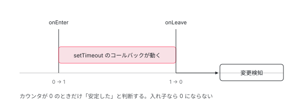

[目次](../README.md) › [zone.js の内側](README.md) › 第 1 回 / 全 13 回

# zone.js は何をしていたのか（概観）

> 中心にあるのは入れ子カウンタ 1 つだけ。非同期処理を onEnter と onLeave で挟み、0 に戻ったら変更検知。zoneless で外せた理由も分かる。

angular/angular · 読了 約 10 分 · 中核 · [サイトで読む（デモが動きます）](https://angular-deep-dive-cyan.vercel.app/chapter/ngzone)

---

> [!NOTE]
> **ポイント**
>
> この章はシリーズ「zone.js の内側」の概観です。ここで見る入れ子カウンタと onEnter / onLeave は、次の章から zone.js 本体（Zone・Task・モンキーパッチ）と NgZone の統合を 1 つずつ掘り下げます。[シリーズの構成を見る](README.md)

zoneless が既定になりつつある今、あえて **「zone.js が何をしていたのか」**を読みます。無くなったものを知ると、いま何が起きているかも分かります。読む対象は `packages/core/src/zone/ng_zone.ts` です。

## 1. 中心にあるのは 12 行

📄 `angular/packages/core/src/zone/ng_zone.ts` L538–549 （▶ の行: 539–540, 547–548）

```ts
538 │ function onEnter(zone: NgZonePrivate) {
539 ▶   zone._nesting++;
540 ▶   if (zone.isStable) {
541 │     zone.isStable = false;
542 │     zone.onUnstable.emit(null);
543 │   }
544 │ }
545 │ 
546 │ function onLeave(zone: NgZonePrivate) {
547 ▶   zone._nesting--;
548 ▶   checkStable(zone);
549 │ }
```

539 行目で数を増やし、547 行目で減らす。**ただの入れ子カウンタ**です。0 から 1 に上がった瞬間に「不安定になった」と通知し、548 行目で 0 に戻ったかどうかを確かめます。



*非同期の処理を onEnter と onLeave で挟む。カウンタが 0 に戻った瞬間が「もう待つものがない」で、そこで変更検知が走る。*

> **🧪 DEMO — 入れ子カウンタ**
>
> onEnter / onLeave と同じ動きです。0 に戻ったときだけ変更検知が起きます。
>
> ▶ [このデモはサイトで動かせます](https://angular-deep-dive-cyan.vercel.app/chapter/ngzone)

## 2. すべてのタスクを挟む

📄 `angular/packages/core/src/zone/ng_zone.ts` L438–463 （▶ の行: 446–447, 452–453, 461）

```ts
438 │     onInvokeTask: (
439 │       delegate: ZoneDelegate,
440 │       current: Zone,
441 │       target: Zone,
442 │       task: Task,
443 │       applyThis: any,
444 │       applyArgs: any,
445 │     ): any => {
446 ▶       // Prevent triggering change detection when the flag is detected.
447 ▶       if (shouldBeIgnoredByZone(applyArgs)) {
448 │         return delegate.invokeTask(target, task, applyThis, applyArgs);
449 │       }
450 │ 
451 │       try {
452 ▶         onEnter(zone);
453 ▶         return delegate.invokeTask(target, task, applyThis, applyArgs);
454 │       } finally {
455 │         if (
456 │           (zone.shouldCoalesceEventChangeDetection && task.type === 'eventTask') ||
457 │           zone.shouldCoalesceRunChangeDetection
458 │         ) {
459 │           delayChangeDetectionForEventsDelegate();
460 │         }
461 ▶         onLeave(zone);
462 │       }
463 │     },
```

452 行目から 461 行目。**実際の処理を `onEnter` と `onLeave` で挟んでいる**だけです。`finally` なので、例外が出ても必ず数が戻ります。

これが「zone.js が `setTimeout` をパッチする」の中身です。書き換えた `setTimeout` は、元の関数を呼ぶ前後にこの処理を挟みます。だから**非同期の処理が終わるたびに、Angular が気づけた**わけです。

> [!NOTE]
> **さらに深く**
>
> 446 行目に `shouldBeIgnoredByZone` という抜け道があります。特定の印が付いた呼び出しは、挟まずにそのまま通します。「全部を捕まえる」方式にすると、どうしても例外を作る必要が出てくる、という現実が見えます。

## 3. 安定したかの判定

📄 `angular/packages/core/src/zone/ng_zone.ts` L370–385 （▶ の行: 370, 380）

```ts
370 ▶   if (zone._nesting == 0 && !zone.hasPendingMicrotasks && !zone.isStable) {
371 │     try {
372 │       zone._nesting++;
373 │       zone.onMicrotaskEmpty.emit(null);
374 │     } finally {
375 │       zone._nesting--;
376 │       if (!zone.hasPendingMicrotasks) {
377 │         try {
378 │           zone.runOutsideAngular(() => zone.onStable.emit(null));
379 │         } finally {
380 ▶           zone.isStable = true;
381 │         }
382 │       }
383 │     }
384 │   }
385 │ }
```

370 行目の条件が 3 つあります。**入れ子が 0 で、マイクロタスクが残っておらず、まだ安定と言っていない**。すべて満たしたとき 380 行目で安定になり、変更検知が走ります。

## 4. 外に出るという逃げ道

📄 `angular/packages/core/src/zone/ng_zone.ts` L270–284 （▶ の行: 281–282）

```ts
270 │    * the function.
271 │    *
272 │    * Running functions via {@link #runOutsideAngular} allows you to escape Angular's zone and do
273 │    * work that
274 │    * doesn't trigger Angular change-detection or is subject to Angular's error handling.
275 │    *
276 │    * Any future tasks or microtasks scheduled from within this function will continue executing from
277 │    * outside of the Angular zone.
278 │    *
279 │    * Use {@link #run} to reenter the Angular zone and do work that updates the application model.
280 │    */
281 ▶   runOutsideAngular<T>(fn: (...args: any[]) => T): T {
282 ▶     return (this as any as NgZonePrivate)._outer.run(fn);
283 │   }
284 │ }
```

282 行目、**`_outer` で実行する**。外側の zone で動かすので、`onEnter` も `onLeave` も通りません。つまり**何をしても変更検知が起きません**。

CDK の章で見た `@defer` の `IntersectionObserver` が これを使っていました。スクロールのたびに変更検知が走ると重いので、監視は外に出し、必要なときだけ中に戻る、という使い方です。

## 5. zoneless では何が変わったか

|   | zone.js あり | zoneless |
| --- | --- | --- |
| きっかけ | 非同期処理が終わるたび | signal の更新や markForCheck のとき |
| 捕まえ方 | ブラウザ API を書き換える | 書き換えない |
| 無駄な実行 | 関係ない処理でも走る | 変わったものだけ |
| 読み込むもの | zone.js（約 40KB） | 不要 |

変更検知の章で「zone.js は一度も出てこなかった」と書きました。それが答えです。zone.js の役割は **「いつ始めるか」を決めることだけ**で、「何を更新するか」には一切関与していません。

だから差し替えられました。Signal が「変わった」と自分で言えるなら、**ブラウザ API を書き換えて全部を見張る必要がなくなります**。

## 読み終えて

- zone.js の中心は入れ子カウンタ 1 つ
- 非同期処理を `onEnter` / `onLeave` で挟み、0 に戻ったら変更検知
- `runOutsideAngular` は外側の zone で動かすので、挟まれない
- zoneless はこの仕組みごと外した。signal が自分で申告するようになったから

---

← 前: [ビューの破棄：destroyLView → cleanUpView → executeOnDestroys](../ivy/17-ivy-destroy.md)  
次: [Zone とは何か：非同期をまたいで引き継がれる実行文脈](02-zone-what.md) →
