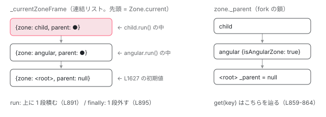

[目次](../README.md) › [zone.js の内側](README.md) › 第 2 回 / 全 13 回

# Zone とは何か：非同期をまたいで引き継がれる実行文脈

> ZoneImpl のフィールドは parent / name / \_properties / \_zoneDelegate。fork で子を作り、run で「今の zone」を切り替える。Zone.current の正体は 1 本のスタック。

angular/angular · 読了 約 12 分 · 中核 · [サイトで読む（デモが動きます）](https://angular-deep-dive-cyan.vercel.app/chapter/zone-what)

---

[概観](01-ngzone.md)では「zone.js は非同期処理を `onEnter` / `onLeave` で挟む」と書きました。その「挟む」を実現している土台が `Zone` です。この章では `Zone` というオブジェクトが**何を持っていて、`Zone.current` がどこに保存されていて、`run()` がそれをどう切り替えるのか**を、クラスのフィールドと 1 本のスタックで確認します。

読む対象は `packages/zone.js/lib/zone-impl.ts`（1635 行。`initZone()` の中にクラス実装がある）と `packages/zone.js/lib/zone.ts` です。

1. 概観
2. **Zone とは**（この章）
3. モンキーパッチ
4. Task のライフサイクル
5. ZoneDelegate
6. マイクロタスクキュー
7. addEventListener
8. hasTask
9. NgZone の fork
10. onEnter・onLeave・checkStable
11. NgZoneChangeDetectionScheduler
12. coalescing と runOutsideAngular
13. 1 クリックの全行程

## 1. Zone の契約は interface で先に決まっている

`zone-impl.ts` の前半 760 行は型定義です。まず `Zone` interface の最初の 3 つを見ます。

📄 `angular/packages/zone.js/lib/zone-impl.ts` L136–156 （▶ の行: 141, 145, 156）

```ts
136 │ export declare interface Zone {
137 │   /**
138 │    *
139 │    * @returns {Zone} The parent Zone.
140 │    */
141 ▶   parent: Zone | null;
142 │   /**
143 │    * @returns {string} The Zone name (useful for debugging)
144 │    */
145 ▶   name: string;
146 │ 
147 │   /**
148 │    * Returns a value associated with the `key`.
149 │    *
150 │    * If the current zone does not have a key, the request is delegated to the parent zone. Use
151 │    * [ZoneSpec.properties] to configure the set of properties associated with the current zone.
152 │    *
153 │    * @param key The key to retrieve.
154 │    * @returns {any} The value for the key, or `undefined` if not found.
155 │    */
156 ▶   get(key: string): any;
```

141 行目 `parent`、145 行目 `name`、156 行目 `get(key)`。**Zone は「親を 1 つ持つ、名前付きの入れ物」**です。`get` のコメント（150〜151 行目）に「自分に無ければ親に委ねる」とあります。これが後で見る `getZoneWith` の中身です。

📄 `angular/packages/zone.js/lib/zone-impl.ts` L168–174 （▶ の行: 174）

```ts
168 │   /**
169 │    * Used to create a child zone.
170 │    *
171 │    * @param zoneSpec A set of rules which the child zone should follow.
172 │    * @returns {Zone} A new child zone.
173 │    */
174 ▶   fork(zoneSpec: ZoneSpec): Zone;
```

174 行目 `fork(zoneSpec)`。子 zone を作る唯一の方法です。`new Zone()` という書き方は公開されていません。`ZoneSpec`（434 行目から定義。`name` と任意のフック関数の集まり）は [ZoneDelegate の章](05-zone-delegate.md)で読みます。

## 2. グローバルの Zone はどこで生まれるか

📄 `angular/packages/zone.js/lib/zone.ts` L70–89 （▶ の行: 82–83, 87–88）

```ts
70 │ export function loadZone(): ZoneType {
71 │   // if global['Zone'] already exists (maybe zone.js was already loaded or
72 │   // some other lib also registered a global object named Zone), we may need
73 │   // to throw an error, but sometimes user may not want this error.
74 │   // For example,
75 │   // we have two web pages, page1 includes zone.js, page2 doesn't.
76 │   // and the 1st time user load page1 and page2, everything work fine,
77 │   // but when user load page2 again, error occurs because global['Zone'] already exists.
78 │   // so we add a flag to let user choose whether to throw this error or not.
79 │   // By default, if existing Zone is from zone.js, we will not throw the error.
80 │   const global = globalThis as any;
81 │   const checkDuplicate = global[__symbol__('forceDuplicateZoneCheck')] === true;
82 ▶   if (global['Zone'] && (checkDuplicate || typeof global['Zone'].__symbol__ !== 'function')) {
83 ▶     throw new Error('Zone already loaded.');
84 │   }
85 │ 
86 │   // Initialize global `Zone` constant.
87 ▶   global['Zone'] ??= initZone();
88 ▶   return global['Zone'];
89 │ }
```

87 行目 `global['Zone'] ??= initZone()`。**グローバル変数 `Zone` の正体は、`initZone()` が返したクラス `ZoneImpl`** です（1634 行目の `return ZoneImpl`）。82〜83 行目、既に `Zone` があって、それが zone.js 由来でない（`__symbol__` が関数でない）場合はエラーになります。「Zone already loaded.」というエラーを見たことがあれば、ここです。

📄 `angular/packages/zone.js/lib/zone-impl.ts` L761–767 （▶ の行: 765–766）

```ts
761 │ export function __symbol__(name: string) {
762 │   const rawPrefix = global['__Zone_symbol_prefix'];
763 │   // Guard against DOM clobbering: an attacker can set __Zone_symbol_prefix to an HTMLElement
764 │   // via e.g. <input name="__Zone_symbol_prefix">, so we only trust it if it's actually a string.
765 ▶   const symbolPrefix = typeof rawPrefix === 'string' ? rawPrefix : '__zone_symbol__';
766 ▶   return symbolPrefix + name;
767 │ }
```

765〜766 行目。`__symbol__('setTimeout')` は文字列 `'__zone_symbol__setTimeout'` を返すだけの関数です。zone.js が「元の関数を退避する場所」「要素にタスク配列を隠す場所」など、自分用のプロパティ名を作るときに必ずこれを通します。[次章](03-zone-patching.md)以降で何度も出てきます。

## 3. ZoneImpl のフィールドは 4 つ

📄 `angular/packages/zone.js/lib/zone-impl.ts` L828–850 （▶ の行: 836–839, 842–845）

```ts
828 │     public get parent(): AmbientZone | null {
829 │       return this._parent;
830 │     }
831 │ 
832 │     public get name(): string {
833 │       return this._name;
834 │     }
835 │ 
836 ▶     private _parent: ZoneImpl | null;
837 ▶     private _name: string;
838 ▶     private _properties: {[key: string]: any};
839 ▶     private _zoneDelegate: _ZoneDelegate;
840 │ 
841 │     constructor(parent: ZoneImpl | null, zoneSpec: ZoneSpec | null) {
842 ▶       this._parent = parent as ZoneImpl;
843 ▶       this._name = zoneSpec ? zoneSpec.name || 'unnamed' : '<root>';
844 ▶       this._properties = (zoneSpec && zoneSpec.properties) || {};
845 ▶       this._zoneDelegate = new _ZoneDelegate(
846 │         this,
847 │         this._parent && this._parent._zoneDelegate,
848 │         zoneSpec,
849 │       );
850 │     }
```

836〜839 行目、インスタンスのフィールドは `_parent` / `_name` / `_properties` / `_zoneDelegate` の 4 つだけです。

1. **842 行目：`_parent`**

   コンストラクタ引数の親をそのまま持ちます。root zone だけ `null` です。
2. **843 行目：`_name`**

   `zoneSpec.name`。spec が無いとき（root zone を作るとき）は `'<root>'`、名前が空文字なら `'unnamed'`。デバッグ以外では使われません。
3. **844 行目：`_properties`**

   `zoneSpec.properties` をそのまま持ちます。無ければ空オブジェクト。`Zone.current.get('isAngularZone')` のような問い合わせはここを見ます。
4. **845〜849 行目：`_zoneDelegate`**

   `new _ZoneDelegate(this, 親の _zoneDelegate, zoneSpec)`。**フック関数の鎖**です。zone 本体は「どのフックをいつ呼ぶか」を知らず、全部この delegate に任せます。中身は [ZoneDelegate の章](05-zone-delegate.md)で読みます。

### get は親へ向かって探す

📄 `angular/packages/zone.js/lib/zone-impl.ts` L852–866 （▶ の行: 853–854, 859–860, 863）

```ts
852 │     public get(key: string): any {
853 ▶       const zone: ZoneImpl = this.getZoneWith(key) as ZoneImpl;
854 ▶       if (zone) return zone._properties[key];
855 │     }
856 │ 
857 │     public getZoneWith(key: string): AmbientZone | null {
858 │       let current: ZoneImpl | null = this;
859 ▶       while (current) {
860 ▶         if (Object.hasOwn(current._properties, key)) {
861 │           return current;
862 │         }
863 ▶         current = current._parent;
864 │       }
865 │       return null;
866 │     }
```

859〜864 行目、`while` で `_parent` を辿り、860 行目で `Object.hasOwn(current._properties, key)` が真になった zone を返します。853〜854 行目、`get` はその zone の `_properties[key]` を返します。どの zone にも無ければ `getZoneWith` は `null`、`get` は `undefined` です。

Angular は `NgZone.isInAngularZone()` でこれを使っています （`Zone.current.get('isAngularZone') === true`）。angular zone の**子** zone にいても、親に向かって探すので `true` になります。

## 4. fork は new ZoneImpl(親, spec) に行き着く

📄 `angular/packages/zone.js/lib/zone-impl.ts` L868–871 （▶ の行: 870）

```ts
868 │     public fork(zoneSpec: ZoneSpec): AmbientZone {
869 │       if (!zoneSpec) throw new Error('ZoneSpec required!');
870 ▶       return this._zoneDelegate.fork(this, zoneSpec);
871 │     }
```

📄 `angular/packages/zone.js/lib/zone-impl.ts` L1245–1249 （▶ の行: 1246–1248）

```ts
1245 │     fork(targetZone: ZoneImpl, zoneSpec: ZoneSpec): AmbientZone {
1246 ▶       return this._forkZS
1247 ▶         ? this._forkZS.onFork!(this._forkDlgt!, this.zone, targetZone, zoneSpec)
1248 ▶         : new ZoneImpl(targetZone, zoneSpec);
1249 │     }
```

870 行目で delegate の `fork` に委ね、1246〜1248 行目で分岐します。鎖のどこかに `onFork` フックを持つ zone があればそれを呼び、無ければ **1248 行目で `new ZoneImpl(targetZone, zoneSpec)`**。つまり `fork` は「自分を親にして、spec を渡して new する」だけです。`fork` された側（子）は親を知っていますが、**親は子のリストを持ちません**。木ではなく、子から親への一方向の鎖です。

## 5. Zone.current の正体は 1 本のスタック

📄 `angular/packages/zone.js/lib/zone-impl.ts` L409–415 （▶ の行: 413–414）

```ts
409 │ /**
410 │  * ZoneFrame represents zone stack frame information
411 │  */
412 │ export declare interface ZoneFrame {
413 ▶   parent: ZoneFrame | null;
414 ▶   zone: Zone;
415 │ }
```

📄 `angular/packages/zone.js/lib/zone-impl.ts` L1627–1629 （▶ の行: 1627）

```ts
1627 ▶   let _currentZoneFrame: ZoneFrame = {parent: null, zone: new ZoneImpl(null, null)};
1628 │   let _currentTask: Task | null = null;
1629 │   let _numberOfNestedTaskFrames = 0;
```

📄 `angular/packages/zone.js/lib/zone-impl.ts` L795–809 （▶ の行: 796–798, 804）

```ts
795 │     static get root(): AmbientZone {
796 ▶       let zone = ZoneImpl.current;
797 ▶       while (zone.parent) {
798 ▶         zone = zone.parent;
799 │       }
800 │       return zone;
801 │     }
802 │ 
803 │     static get current(): AmbientZone {
804 ▶       return _currentZoneFrame.zone;
805 │     }
806 │ 
807 │     static get currentTask(): Task | null {
808 │       return _currentTask;
809 │     }
```

1627 行目、`initZone()` の中にモジュール変数 `_currentZoneFrame` が 1 つあります。初期値は `{parent: null, zone: new ZoneImpl(null, null)}`。この `new ZoneImpl(null, null)` が root zone です（843 行目で名前が `'<root>'` になる）。

804 行目、**`Zone.current` は `_currentZoneFrame.zone` を返すだけの getter** です。どこかに「現在の zone」を記録するフィールドがあるわけではなく、`ZoneFrame`（413〜414 行目。`parent` と `zone` の 2 つ）を連結リストで積んだ**先頭**が現在です。

796〜800 行目、`Zone.root` はフレームではなく `zone.parent` を辿ります。フレームのスタックがどう積まれていても、root は常に同じ 1 つの zone です。

### run がフレームを積み、finally で戻す

📄 `angular/packages/zone.js/lib/zone-impl.ts` L884–897 （▶ の行: 891, 893, 895）

```ts
884 │     public run(callback: Function, applyThis?: any, applyArgs?: any[], source?: string): any;
885 │     public run<T>(
886 │       callback: (...args: any[]) => T,
887 │       applyThis?: any,
888 │       applyArgs?: any[],
889 │       source?: string,
890 │     ): T {
891 ▶       _currentZoneFrame = {parent: _currentZoneFrame, zone: this};
892 │       try {
893 ▶         return this._zoneDelegate.invoke(this, callback, applyThis, applyArgs, source);
894 │       } finally {
895 ▶         _currentZoneFrame = _currentZoneFrame.parent!;
896 │       }
897 │     }
```

1. **891 行目：フレームを積む**

   `_currentZoneFrame = {parent: _currentZoneFrame, zone: this}`。今のフレームを `parent` に入れた新しいフレームを作り、それを現在にします。この瞬間から `Zone.current === this` です。
2. **893 行目：delegate に実行を任せる**

   `this._zoneDelegate.invoke(this, callback, ...)`。鎖のどこかに `onInvoke` フックがあればそれが呼ばれ、無ければ `callback.apply` です。Angular の `onEnter` / `onLeave` はこの `onInvoke` の中にいます。
3. **895 行目：`finally` で戻す**

   `_currentZoneFrame = _currentZoneFrame.parent`。callback が例外を投げても必ず戻ります。これが「`run` の中だけ `Zone.current` が変わる」の実装です。



*run() は \_currentZoneFrame に 1 段積み、finally で 1 段戻す。Zone.current は常にスタックの先頭。zone.parent の鎖（右）はフレームとは別物。*

> **🧪 DEMO — \_currentZoneFrame を積んで戻す**
>
> root → angular → child の 3 つの zone があるとします（angular は `properties: {isAngularZone: true}` で fork）。ボタンは `zone.run(fn)` の 891 行目、「fn が return」は 895 行目の finally です。
>
> ▶ [このデモはサイトで動かせます](https://angular-deep-dive-cyan.vercel.app/chapter/zone-what)

### runGuarded は run + エラー処理

📄 `angular/packages/zone.js/lib/zone-impl.ts` L899–918 （▶ の行: 906, 909, 911, 916）

```ts
899 │     public runGuarded(callback: Function, applyThis?: any, applyArgs?: any[], source?: string): any;
900 │     public runGuarded<T>(
901 │       callback: (...args: any[]) => T,
902 │       applyThis: any = null,
903 │       applyArgs?: any[],
904 │       source?: string,
905 │     ) {
906 ▶       _currentZoneFrame = {parent: _currentZoneFrame, zone: this};
907 │       try {
908 │         try {
909 ▶           return this._zoneDelegate.invoke(this, callback, applyThis, applyArgs, source);
910 │         } catch (error) {
911 ▶           if (this._zoneDelegate.handleError(this, error)) {
912 │             throw error;
913 │           }
914 │         }
915 │       } finally {
916 ▶         _currentZoneFrame = _currentZoneFrame.parent!;
917 │       }
918 │     }
```

906 行目と 916 行目は `run` と同じフレーム操作です。違いは 910〜913 行目、例外を `this._zoneDelegate.handleError` に渡し、それが `true` を返したときだけ再 throw すること。Angular は `onHandleError` フックで `false` を返すので、例外は `NgZone.onError` に流れて止まります。

### wrap は「後で runGuarded する関数」を返す

📄 `angular/packages/zone.js/lib/zone-impl.ts` L873–882 （▶ の行: 877–878, 880）

```ts
873 │     public wrap<T extends Function>(callback: T, source: string): T {
874 │       if (typeof callback !== 'function') {
875 │         throw new Error('Expecting function got: ' + callback);
876 │       }
877 ▶       const _callback = this._zoneDelegate.intercept(this, callback, source);
878 ▶       const zone: ZoneImpl = this;
879 │       return function (this: unknown) {
880 ▶         return zone.runGuarded(_callback, this, <any>arguments, source);
881 │       } as any as T;
882 │     }
```

878 行目で `this`（wrap した時点の zone）を閉じ込め、880 行目で「呼ばれたらその zone の `runGuarded` で実行する関数」を返します。これが**「非同期をまたいで引き継がれる実行文脈」**の最小単位です。コールバックが何秒後にどこから呼ばれても、作ったときの zone に戻って実行されます。[次章](03-zone-patching.md)で、`setTimeout` に渡した関数がこの `wrap` の親戚（`Task`）に包まれる手順を追います。

> [!TIP]
> **新卒エンジニアへ**
>
> 「zone = スレッド」「zone = async\_hooks」のような比喩を聞くことがありますが、実物は `_parent` / `_name` / `_properties` / `_zoneDelegate` の 4 フィールドと、`_currentZoneFrame` という 1 本の連結リストだけです。JavaScript のシングルスレッド上で、**「今どの入れ物の中にいるか」を自前で記録しているだけ**です。

## ここまでの呼び出し

- `loadZone()` — zone.js/lib/zone.ts L70 — *global\['Zone'\] ??= initZone()*
  - `initZone()` — zone-impl.ts L769 — *class ZoneImpl / \_ZoneDelegate / ZoneTask を定義し、L1627 で root フレームを作る*
    - `new ZoneImpl(null, null)` — zone-impl.ts L1627 — *\_name = '&lt;root&gt;'、\_parent = null*
- 👤 `Zone.current.fork({name: 'angular', properties: ...})` — 利用者（Angular の NgZone）
  - `_zoneDelegate.fork(this, zoneSpec)` — zone-impl.ts L870 → L1245 — *onFork が無ければ new ZoneImpl(targetZone, zoneSpec)*
- 👤 `angularZone.run(fn)` — 利用者
  - `_currentZoneFrame = {parent, zone: this}` — zone-impl.ts L891 — *この行以降 Zone.current === angularZone*
  - `_zoneDelegate.invoke(this, fn, ...)` — zone-impl.ts L893 — *onInvoke フックがあればそれ経由で fn を呼ぶ*
  - `_currentZoneFrame = _currentZoneFrame.parent` — zone-impl.ts L895 — *finally。例外が出ても戻る*

## 聞かれそうな質問

**Q. Zone.current はどこに保存されていますか？**

どこにも「保存」されていません。`initZone()` 内のモジュール変数 `_currentZoneFrame`（zone-impl.ts 1627 行目）の `.zone` を返す getter です（804 行目）。`run()` が 891 行目でフレームを積み、895 行目で戻すので、`run` の中だけ値が変わります。

**Q. Zone オブジェクトは何を持っていますか？**

`_parent` / `_name` / `_properties` / `_zoneDelegate` の 4 つです（836〜839 行目）。コンストラクタ（841〜850 行目）で全部決まり、以後変わりません。フック関数は zone 本体ではなく `_zoneDelegate` が持ちます。

**Q. fork すると何が起きますか？親は子を知っていますか？**

`fork`（868〜871 行目）→ `_ZoneDelegate.fork`（1245〜1249 行目）→ `new ZoneImpl(targetZone, zoneSpec)`（1248 行目）です。子は `_parent` で親を指しますが、親に子のリストはありません。`Zone.root`（795〜801 行目）も `Zone.current` から `parent` を辿って求めます。

**Q. Zone.current.get('isAngularZone') はどう動きますか？**

`getZoneWith`（857〜866 行目）が `_parent` を辿り、860 行目の `Object.hasOwn(current._properties, key)` が真の zone を探します。見つかった zone の `_properties[key]` を返し（854 行目）、見つからなければ `undefined` です。angular zone の子 zone にいても `true` になります。

**Q. run と runGuarded と wrap の違いは？**

`run`（884〜897 行目）はフレームを積んで `invoke` するだけ。`runGuarded`（899〜918 行目）は加えて例外を `handleError`（911 行目）に通し、`true` が返ったときだけ再 throw します。`wrap`（873〜882 行目）はすぐ実行せず、「呼ばれたら 878 行目で閉じ込めた zone の `runGuarded` で実行する関数」を返します。

## 読み終えて

- グローバルの `Zone` は `loadZone()` が `initZone()` で作った `ZoneImpl` クラスそのもの
- `ZoneImpl` のフィールドは `_parent` / `_name` / `_properties` / `_zoneDelegate` の 4 つ
- `fork` は `new ZoneImpl(親, spec)`。子→親の一方向の鎖で、`get` はそれを辿る
- `Zone.current` は `_currentZoneFrame.zone`。`run` が 891 行目で積み、895 行目の finally で戻す
- `wrap` は「作ったときの zone で後から `runGuarded` する関数」を返す。これが実行文脈の引き継ぎ

---

← 前: [zone.js は何をしていたのか（概観）](01-ngzone.md)  
次: [モンキーパッチの実際：setTimeout が差し替わる手順](03-zone-patching.md) →
