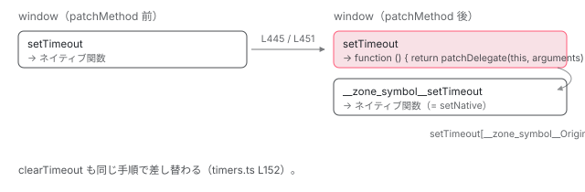

[目次](../README.md) › [zone.js の内側](README.md) › 第 3 回 / 全 13 回

# モンキーパッチの実際：setTimeout が差し替わる手順

> patchBrowser → patchTimer → patchMethod。window.setTimeout が別の関数に置き換わり、元の関数は \_\_zone\_symbol\_\_setTimeout に退避される。

angular/angular · 読了 約 13 分 · 中核 · [サイトで読む（デモが動きます）](https://angular-deep-dive-cyan.vercel.app/chapter/zone-patching)

---

「zone.js はブラウザ API をモンキーパッチする」と一言で済まされがちですが、**どの関数が、どの順で、`window.setTimeout` を何に差し替え、元の関数をどこに置くのか**は意外と知られていません。この章では zone.js のエントリから `patchBrowser` → `patchTimer` → `patchMethod` の 3 段を追い、`setTimeout(fn, 0)` を呼んだ瞬間に zone.js の中で起きることを 1 行ずつ確認します。

読む対象は `packages/zone.js/lib/browser/rollup-main.ts`、`browser/browser.ts`、`common/timers.ts`、`common/utils.ts` です。

1. 概観
2. Zone とは
3. **モンキーパッチ**（この章）
4. Task のライフサイクル
5. ZoneDelegate
6. マイクロタスクキュー
7. addEventListener
8. hasTask
9. NgZone の fork
10. onEnter・onLeave・checkStable
11. NgZoneChangeDetectionScheduler
12. coalescing と runOutsideAngular
13. 1 クリックの全行程

## 1. エントリは 3 行

`polyfills` に `zone.js` と書いたとき読み込まれるバンドルの入口です。

📄 `angular/packages/zone.js/lib/browser/rollup-main.ts` L9–16 （▶ の行: 14–16）

```ts
 9 │ import {loadZone} from '../zone';
10 │ 
11 │ import {patchBrowser} from './browser';
12 │ import {patchCommon} from './rollup-common';
13 │ 
14 ▶ const Zone = loadZone();
15 ▶ patchCommon(Zone);
16 ▶ patchBrowser(Zone);
```

📄 `angular/packages/zone.js/lib/browser/rollup-common.ts` L15–19 （▶ の行: 16, 18）

```ts
15 │ export function patchCommon(Zone: ZoneType): void {
16 ▶   patchPromise(Zone);
17 │   patchToString(Zone);
18 ▶   patchUtil(Zone);
19 │ }
```

14 行目で `Zone` を作り（[前章](02-zone-what.md)の `loadZone`）、15 行目で環境に依らない共通パッチ、16 行目でブラウザ用パッチ。`patchCommon` の中身は `Promise`（16 行目。[6 章](06-zone-microtask.md)）、`Function.prototype.toString`、そして 18 行目の `patchUtil` です。`patchUtil` は `_api` という内部オブジェクトに `patchMethod` などのヘルパーを登録するだけで、ここではまだ何も差し替えません。

## 2. \_\_load\_patch は「名前付きで 1 回だけ実行する」

📄 `angular/packages/zone.js/lib/zone-impl.ts` L811–826 （▶ の行: 812, 820, 823）

```ts
811 │     static __load_patch(name: string, fn: PatchFn, ignoreDuplicate = false): void {
812 ▶       if (Object.hasOwn(patches, name)) {
813 │         // `checkDuplicate` option is defined from global variable
814 │         // so it works for all modules.
815 │         // `ignoreDuplicate` can work for the specified module
816 │         const checkDuplicate = global[__symbol__('forceDuplicateZoneCheck')] === true;
817 │         if (!ignoreDuplicate && checkDuplicate) {
818 │           throw Error('Already loaded patch: ' + name);
819 │         }
820 ▶       } else if (!global['__Zone_disable_' + name]) {
821 │         const perfName = 'Zone:' + name;
822 │         mark(perfName);
823 ▶         patches[name] = fn(global, ZoneImpl, _api);
824 │         performanceMeasure(perfName, perfName);
825 │       }
826 │     }
```

すべてのパッチは `Zone.__load_patch(name, fn)` 経由で登録されます。812 行目、同じ名前が既にあれば（既定では）何もしません。820 行目、`window.__Zone_disable_timers = true` のようなグローバル変数があればスキップします。これが「`zone-flags.ts` で特定のパッチを無効化できる」の仕組みです。823 行目で `fn(global, ZoneImpl, _api)` を実行し、戻り値を `patches[name]` に残します。

## 3. patchBrowser が timers パッチを登録する

📄 `angular/packages/zone.js/lib/browser/browser.ts` L31–44 （▶ の行: 32, 35–37, 41）

```ts
31 │ export function patchBrowser(Zone: ZoneType): void {
32 ▶   Zone.__load_patch('timers', (global: any) => {
33 │     const set = 'set';
34 │     const clear = 'clear';
35 ▶     patchTimer(global, set, clear, 'Timeout');
36 ▶     patchTimer(global, set, clear, 'Interval');
37 ▶     patchTimer(global, set, clear, 'Immediate');
38 │   });
39 │ 
40 │   Zone.__load_patch('requestAnimationFrame', (global: any) => {
41 ▶     patchTimer(global, 'request', 'cancel', 'AnimationFrame');
42 │     patchTimer(global, 'mozRequest', 'mozCancel', 'AnimationFrame');
43 │     patchTimer(global, 'webkitRequest', 'webkitCancel', 'AnimationFrame');
44 │   });
```

32 行目、名前 `'timers'` で登録。35〜37 行目で `setTimeout` / `setInterval` / `setImmediate`（と対応する `clear*`）を、41 行目で `requestAnimationFrame` / `cancelAnimationFrame` を、同じ `patchTimer` に渡しています。`patchBrowser` の残り（46〜330 行目）は `alert`、`EventTarget`、`MutationObserver`、`XMLHttpRequest`、`queueMicrotask` などへの同様の登録です。

📄 `angular/packages/zone.js/lib/common/timers.ts` L28–34 （▶ の行: 28, 31–32, 34）

```ts
28 ▶ export function patchTimer(window: any, setName: string, cancelName: string, nameSuffix: string) {
29 │   let setNative: Function | null = null;
30 │   let clearNative: Function | null = null;
31 ▶   setName += nameSuffix;
32 ▶   cancelName += nameSuffix;
33 │ 
34 ▶   const tasksByHandleId: {[id: number]: Task} = {};
```

31〜32 行目で `'set' + 'Timeout'` → `'setTimeout'`、`'clear' + 'Timeout'` → `'clearTimeout'` と名前を組み立てます。34 行目の `tasksByHandleId` は、**ブラウザが返したタイマー ID → Task** の対応表です。`clearTimeout(id)` が呼ばれたとき、ID から Task を見つけるために使います（6 節）。

## 4. patchMethod：差し替えの核心

📄 `angular/packages/zone.js/lib/common/timers.ts` L64–78 （▶ の行: 64–66, 69–70, 72–73, 77）

```ts
64 ▶   setNative = patchMethod(
65 ▶     window,
66 ▶     setName,
67 │     (delegate: Function) =>
68 │       function (self: any, args: any[]) {
69 ▶         if (isFunction(args[0])) {
70 ▶           const options: TimerOptions = {
71 │             isRefreshable: false,
72 ▶             isPeriodic: nameSuffix === 'Interval',
73 ▶             delay: nameSuffix === 'Timeout' || nameSuffix === 'Interval' ? args[1] || 0 : undefined,
74 │             args: args,
75 │           };
76 │ 
77 ▶           const callback = args[0];
78 │           args[0] = function timer(this: unknown) {
```

64〜66 行目、`patchMethod(window, 'setTimeout', 差し替え関数を作る関数)`。戻り値 `setNative` が元の `setTimeout` です。第 3 引数の中身（69〜150 行目）は後で読みます。まず `patchMethod` 本体を見ます。

📄 `angular/packages/zone.js/lib/common/utils.ts` L424–461 （▶ の行: 434–435, 442, 444–445, 449–452, 454, 460）

```ts
424 │ export function patchMethod(
425 │   target: any,
426 │   name: string,
427 │   patchFn: (
428 │     delegate: Function,
429 │     delegateName: string,
430 │     name: string,
431 │   ) => (self: any, args: any[]) => any,
432 │ ): Function | null {
433 │   let proto = target;
434 ▶   while (proto && !Object.hasOwn(proto, name)) {
435 ▶     proto = ObjectGetPrototypeOf(proto);
436 │   }
437 │   if (!proto && target[name]) {
438 │     // somehow we did not find it, but we can see it. This happens on IE for Window properties.
439 │     proto = target;
440 │   }
441 │ 
442 ▶   const delegateName = zoneSymbol(name);
443 │   let delegate: Function | null = null;
444 ▶   if (proto && (!(delegate = proto[delegateName]) || !Object.hasOwn(proto, delegateName))) {
445 ▶     delegate = proto[delegateName] = proto[name];
446 │     // check whether proto[name] is writable
447 │     // some property is readonly in safari, such as HtmlCanvasElement.prototype.toBlob
448 │     const desc = proto && ObjectGetOwnPropertyDescriptor(proto, name);
449 ▶     if (isPropertyWritable(desc)) {
450 ▶       const patchDelegate = patchFn(delegate!, delegateName, name);
451 ▶       proto[name] = function () {
452 ▶         return patchDelegate(this, arguments as any);
453 │       };
454 ▶       attachOriginToPatched(proto[name], delegate);
455 │       if (shouldCopySymbolProperties) {
456 │         copySymbolProperties(delegate, proto[name]);
457 │       }
458 │     }
459 │   }
460 ▶   return delegate;
461 │ }
```

1. **434〜435 行目：プロトタイプを遡って「本当に持っている」オブジェクトを探す**

   `Object.hasOwn(proto, name)` が真になるまで `getPrototypeOf` で上がります。`window.setTimeout` は `Window.prototype` ではなく `window` 自身が持つのでそのまま、`EventTarget.prototype.addEventListener` のような場合はプロトタイプ側が対象になります。
2. **442 行目：退避先の名前を作る**

   `zoneSymbol('setTimeout')` → `'__zone_symbol__setTimeout'`（前章の `__symbol__`）。
3. **444〜445 行目：元の関数を退避する**

   `proto['__zone_symbol__setTimeout'] = proto['setTimeout']`。444 行目の条件は「まだ退避していなければ」。二重パッチを防ぎます。**`window.__zone_symbol__setTimeout` がネイティブの `setTimeout` です**。DevTools で確認できます。
4. **449〜453 行目：差し替える**

   449 行目で書き込み可能か確認し（Safari の `HTMLCanvasElement.prototype.toBlob` のような読み取り専用を避ける）、450 行目で `patchFn(delegate, delegateName, name)` を 1 回だけ呼んで差し替え関数 `patchDelegate` を得ます。451〜453 行目、`proto['setTimeout'] = function () { return patchDelegate(this, arguments) }`。**この瞬間から `window.setTimeout` は別の関数です。**
5. **454 行目：元への参照を付ける**

   `attachOriginToPatched(proto[name], delegate)`。次の引用です。
6. **460 行目：元の関数を返す**

   呼び出し側（`patchTimer` の 64 行目）はこれを `setNative` として受け取り、本物を呼ぶときに使います。

📄 `angular/packages/zone.js/lib/common/utils.ts` L542–544 （▶ の行: 543）

```ts
542 │ export function attachOriginToPatched(patched: Function, original: any) {
543 ▶   (patched as any)[zoneSymbol('OriginalDelegate')] = original;
544 │ }
```

543 行目、差し替え後の関数に `__zone_symbol__OriginalDelegate` という名前で元の関数を付けます。`patchCommon` の `patchToString` はこれを見て、`setTimeout.toString()` が `'function setTimeout() { [native code] }'` を返すようにします。ライブラリが `toString` でネイティブ判定をしていても壊れないための配慮です。



*patchMethod の前後。元の関数は \_\_zone\_symbol\_\_setTimeout に退避され、setTimeout の名前には patchDelegate を呼ぶ関数が入る。両者は OriginalDelegate でもつながる。*

> **🧪 DEMO — zone.js を読み込む前後の window**
>
> `patchMethod` と `attachOriginToPatched` の結果だけを並べています。このサイト自身は zone.js を読み込んでいないので、実機では「前」の状態です。
>
> ▶ [このデモはサイトで動かせます](https://angular-deep-dive-cyan.vercel.app/chapter/zone-patching)

## 5. setTimeout(fn, 0) を呼んだ瞬間

ここからが `patchTimer` の第 3 引数、つまり差し替え後の `setTimeout` の中身です。4 節の引用で、69 行目 `isFunction(args[0])`（第 1 引数が関数なら）、70〜75 行目で `options` を組みます。`isPeriodic` は `setInterval` のときだけ `true`（72 行目）、`delay` は第 2 引数（73 行目）。77 行目で元の `fn` を `callback` に取っておき、`args[0]` を次の関数で**上書き**します。

📄 `angular/packages/zone.js/lib/common/timers.ts` L78–115 （▶ の行: 78, 80, 92, 96, 105–110）

```ts
 78 ▶           args[0] = function timer(this: unknown) {
 79 │             try {
 80 ▶               return callback.apply(this, arguments);
 81 │             } finally {
 82 │               // issue-934, task will be cancelled
 83 │               // even it is a periodic task such as
 84 │               // setInterval
 85 │ 
 86 │               // https://github.com/angular/angular/issues/40387
 87 │               // Cleanup tasksByHandleId should be handled before scheduleTask
 88 │               // Since some zoneSpec may intercept and doesn't trigger
 89 │               // scheduleFn(scheduleTask) provided here.
 90 │               const {handle, handleId, isPeriodic, isRefreshable} = options;
 91 │ 
 92 ▶               if (!isPeriodic && !isRefreshable) {
 93 │                 if (handleId) {
 94 │                   // in non-nodejs env, we remove timerId
 95 │                   // from local cache
 96 ▶                   delete tasksByHandleId[handleId];
 97 │                 } else if (handle) {
 98 │                   // Node returns complex objects as handleIds
 99 │                   // we remove task reference from timer object
100 │                   handle[taskSymbol] = null;
101 │                 }
102 │               }
103 │             }
104 │           };
105 ▶           const task = scheduleMacroTaskWithCurrentZone(
106 ▶             setName,
107 ▶             args[0],
108 ▶             options,
109 ▶             scheduleTask,
110 ▶             clearTask,
111 │           );
112 │ 
113 │           if (!task) {
114 │             return task;
115 │           }
```

1. **78〜104 行目：1 枚目の包み `timer`**

   80 行目で元の `fn` を呼び、`finally`（92〜96 行目）で `tasksByHandleId` から自分の ID を消します。`setInterval`（`isPeriodic`）は何度も呼ばれるので消しません。
2. **105〜111 行目：Task を作って予約する**

   `scheduleMacroTaskWithCurrentZone('setTimeout', timer, options, scheduleTask, clearTask)`。ここで初めて `Zone` が登場します。次の引用です。

📄 `angular/packages/zone.js/lib/common/utils.ts` L48–56 （▶ の行: 55）

```ts
48 │ export function scheduleMacroTaskWithCurrentZone(
49 │   source: string,
50 │   callback: Function,
51 │   data?: TaskData,
52 │   customSchedule?: (task: Task) => void,
53 │   customCancel?: (task: Task) => void,
54 │ ): MacroTask {
55 ▶   return Zone.current.scheduleMacroTask(source, callback, data, customSchedule, customCancel);
56 │ }
```

55 行目、**`Zone.current.scheduleMacroTask(...)`**。`setTimeout` を呼んだ瞬間の `Zone.current`（前章のスタック先頭）が Task の持ち主になります。angular zone の中で呼べば angular zone の Task、`runOutsideAngular` の中で呼べば root zone の Task です。`scheduleMacroTask` → `scheduleTask` の中身（状態遷移、カウンタ）は [次章](04-zone-task.md)で読みます。ここでは「最終的に第 4 引数の `scheduleTask`（timers.ts 側）が呼ばれる」ことだけ押さえます。

📄 `angular/packages/zone.js/lib/common/timers.ts` L36–56 （▶ の行: 38–39, 42, 48, 55）

```ts
36 │   function scheduleTask(task: Task) {
37 │     const data = <TimerOptions>task.data;
38 ▶     data.args[0] = function () {
39 ▶       return task.invoke.apply(this, arguments);
40 │     };
41 │ 
42 ▶     const handleOrId = setNative!.apply(window, data.args);
43 │ 
44 │     // Whlist on Node.js when get can the ID by using `[Symbol.toPrimitive]()` we do
45 │     // to this so that we do not cause potentally leaks when using `setTimeout`
46 │     // since this can be periodic when using `.refresh`.
47 │     if (isNumber(handleOrId)) {
48 ▶       data.handleId = handleOrId;
49 │     } else {
50 │       data.handle = handleOrId;
51 │       // On Node.js a timeout and interval can be restarted over and over again by using the `.refresh` method.
52 │       data.isRefreshable = isFunction(handleOrId?.refresh);
53 │     }
54 │ 
55 ▶     return task;
56 │   }
```

1. **38〜40 行目：2 枚目の包み**

   `data.args[0]`（さっき `timer` に上書きした場所）を、さらに `task.invoke` を呼ぶ関数で上書きします。`task.invoke` は `ZoneTask` のコンストラクタが作る「`zone.runTask(task)` を呼ぶ関数」です（次章）。
2. **42 行目：ここで初めて本物を呼ぶ**

   `setNative.apply(window, data.args)`。`__zone_symbol__setTimeout` に、**あなたの `fn` ではなく 2 枚包んだ関数**と、元の `delay` が渡ります。ブラウザから見ると、普通に `setTimeout(何かの関数, 0)` が呼ばれただけです。
3. **48 行目：ID を Task に記録**

   ブラウザが返した数値 ID を `task.data.handleId` に入れます。

📄 `angular/packages/zone.js/lib/common/timers.ts` L118–122 （▶ の行: 122）

```ts
118 │           const {handleId, handle, isRefreshable, isPeriodic} = <TimerOptions>task.data;
119 │           if (handleId) {
120 │             // for non nodejs env, we save handleId: task
121 │             // mapping in local cache for clearTimeout
122 ▶             tasksByHandleId[handleId] = task;
```

📄 `angular/packages/zone.js/lib/common/timers.ts` L144–150 （▶ の行: 144, 147）

```ts
144 ▶           return handle ?? handleId ?? task;
145 │         } else {
146 │           // cause an error by calling it directly.
147 ▶           return delegate.apply(window, args);
148 │         }
149 │       },
150 │   );
```

122 行目で `tasksByHandleId[handleId] = task` と対応表に登録し、144 行目で `handleId` を返します。**あなたの手元に返ってくる値は、ブラウザが返したネイティブの ID そのまま**です。だから `setTimeout` の戻り値を `clearTimeout` に渡す普通のコードが壊れません。

147 行目、第 1 引数が関数でない場合（文字列を渡すなど）は何も包まず `delegate`（ネイティブ）に丸投げします。

> [!NOTE]
> **ポイント**
>
> `fn` が実行される瞬間は、ブラウザが 2 枚包んだ関数を呼ぶ → `task.invoke` → `ZoneTask.invokeTask` → `zone.runTask` → `_zoneDelegate.invokeTask`（Angular の `onInvokeTask` がここで `onEnter`）→ `task.callback` = `timer` → `fn`、という順です。この実行側は[次章](04-zone-task.md)の `runTask` で追います。

## 6. clearTimeout(id) はどう対応するか

📄 `angular/packages/zone.js/lib/common/timers.ts` L152–184 （▶ の行: 157, 162–163, 175, 177, 181）

```ts
152 │   clearNative = patchMethod(
153 │     window,
154 │     cancelName,
155 │     (delegate: Function) =>
156 │       function (self: any, args: any[]) {
157 ▶         const id = args[0];
158 │         let task: Task;
159 │ 
160 │         if (isNumber(id)) {
161 │           // non nodejs env.
162 ▶           task = tasksByHandleId[id];
163 ▶           delete tasksByHandleId[id];
164 │         } else {
165 │           // nodejs env ?? other environments.
166 │           task = id?.[taskSymbol];
167 │           if (task) {
168 │             id[taskSymbol] = null;
169 │           } else {
170 │             task = id;
171 │           }
172 │         }
173 │ 
174 │         if (task?.type) {
175 ▶           if (task.cancelFn) {
176 │             // Do not cancel already canceled functions
177 ▶             task.zone.cancelTask(task);
178 │           }
179 │         } else {
180 │           // cause an error by calling it directly.
181 ▶           delegate.apply(window, args);
182 │         }
183 │       },
184 │   );
```

📄 `angular/packages/zone.js/lib/common/timers.ts` L58–62 （▶ の行: 61）

```ts
58 │   function clearTask(task: Task) {
59 │     const {handle, handleId} = task.data!;
60 │ 
61 ▶     return clearNative!.call(window, handle ?? handleId);
62 │   }
```

157 行目で受け取った `id`、162 行目で `tasksByHandleId[id]` から Task を取り出し、163 行目で表から消します。175〜177 行目、Task に `cancelFn` が残っていれば `task.zone.cancelTask(task)`。その中で第 5 引数に渡した `clearTask` が呼ばれ、61 行目で `__zone_symbol__clearTimeout`（ネイティブ）に ID を渡します。181 行目、Task が見つからない（zone.js 読み込み前に作られた ID など）ならネイティブに丸投げです。

## 7. もう 2 つの包み方

`patchTimer` は「Task を作る」包み方でした。zone.js には他に 2 種類あります。

📄 `angular/packages/zone.js/lib/common/utils.ts` L44–46 （▶ の行: 45）

```ts
44 │ export function wrapWithCurrentZone<T extends Function>(callback: T, source: string): T {
45 ▶   return Zone.current.wrap(callback, source);
46 │ }
```

📄 `angular/packages/zone.js/lib/common/utils.ts` L68–75 （▶ の行: 70–71）

```ts
68 │ export function bindArguments(args: any[], source: string): any[] {
69 │   for (let i = args.length - 1; i >= 0; i--) {
70 ▶     if (typeof args[i] === 'function') {
71 ▶       args[i] = wrapWithCurrentZone(args[i], source + '_' + i);
72 │     }
73 │   }
74 │   return args;
75 │ }
```

45 行目、`Zone.current.wrap(callback, source)`。前章で読んだ `wrap` です。Task を作らず「呼ばれたら今の zone の `runGuarded` で実行する関数」に包むだけなので、`hasTask` のカウンタには数えられません。70〜71 行目の `bindArguments` は引数の中の関数を全部これで包みます。`navigator.geolocation.getCurrentPosition` などの `patchPrototype`（utils.ts 77 行目）がこれを使います。

📄 `angular/packages/zone.js/lib/common/utils.ts` L323–330 （▶ の行: 327, 329）

```ts
323 │ export function patchClass(className: string) {
324 │   const OriginalClass = _global[className];
325 │   if (!OriginalClass) return;
326 │   // keep original class in global
327 ▶   _global[zoneSymbol(className)] = OriginalClass;
328 │ 
329 ▶   _global[className] = function () {
330 │     const a = bindArguments(<any>arguments, className);
```

`patchClass` はクラスごと差し替えます。327 行目で元のクラスを `__zone_symbol__MutationObserver` に退避し、329 行目で `window.MutationObserver` をラッパークラスにします。`MutationObserver` / `IntersectionObserver` / `FileReader` がこの方式です（browser.ts 68〜79 行目）。

## ここまでの呼び出し

- `patchBrowser(Zone)` — browser/browser.ts L31
  - `Zone.__load_patch('timers', fn)` — browser.ts L32 → zone-impl.ts L811 — *\_\_Zone\_disable\_timers が無ければ fn を実行*
    - `patchTimer(global, 'set', 'clear', 'Timeout')` — common/timers.ts L28
      - `patchMethod(window, 'setTimeout', patchFn)` — common/utils.ts L424 — *L445 退避 → L451 差し替え → L454 OriginalDelegate → L460 元を返す*
      - `patchMethod(window, 'clearTimeout', patchFn)` — timers.ts L152
- 👤 `setTimeout(fn, 0)` — あなたのコード（angular zone の中）
  - `patchDelegate(this, arguments)` — utils.ts L452 → timers.ts L68 — *args\[0\] を timer に上書き（L78）*
    - `scheduleMacroTaskWithCurrentZone('setTimeout', timer, options, scheduleTask, clearTask)` — timers.ts L105 → utils.ts L55 — *Zone.current = angular zone*
      - `Zone.current.scheduleMacroTask(...)` — zone-impl.ts L1029 — *次章*
        - `scheduleTask(task)` — timers.ts L36 — *args\[0\] を task.invoke 呼び出しに上書き（L38）*
          - `setNative.apply(window, [包んだ関数, 0])` — timers.ts L42 — *= window.\_\_zone\_symbol\_\_setTimeout。ここで初めてブラウザに届く*
  - `return handleId` — timers.ts L144 — *ネイティブの ID がそのまま返る*

## 聞かれそうな質問

**Q. zone.js を読み込むと window.setTimeout は別の関数になりますか？元の関数はどこですか？**

なります。`patchMethod`（utils.ts 451 行目）が `proto['setTimeout']` を `function () { return patchDelegate(this, arguments) }` に置き換えます。元の関数は 445 行目で `window.__zone_symbol__setTimeout` に退避され、さらに 454 行目（`attachOriginToPatched`、543 行目）で `window.setTimeout.__zone_symbol__OriginalDelegate` からも参照できます。

**Q. setTimeout(fn, 0) を呼ぶと、fn はそのままブラウザに渡りますか？**

渡りません。timers.ts 78 行目で `args[0]` が `timer` 関数に、36〜40 行目の `scheduleTask` でさらに `task.invoke` を呼ぶ関数に上書きされ、42 行目で `setNative.apply(window, data.args)` として 2 枚包んだ関数がブラウザに渡ります。`fn` 自身は `task.callback`（= `timer`）の中の `callback` として閉じ込められています（77・80 行目）。

**Q. setTimeout の戻り値は変わりますか？**

変わりません。144 行目で `handle ?? handleId ?? task` を返し、ブラウザでは `handleId`（ネイティブの数値 ID）です。その ID は 122 行目で `tasksByHandleId[handleId] = task` として Task と紐付けられ、`clearTimeout(id)`（162 行目）で Task を見つけるのに使われます。

**Q. どの zone の Task になりますか？**

`scheduleMacroTaskWithCurrentZone`（utils.ts 55 行目）が `Zone.current.scheduleMacroTask` を呼ぶので、**`setTimeout` を呼んだ瞬間の `Zone.current`** です。`runOutsideAngular` の中なら root zone になり、Angular の `onInvokeTask` は通りません。

**Q. 特定の API だけパッチを止められますか？**

止められます。`__load_patch`（zone-impl.ts 820 行目）が `global['__Zone_disable_' + name]` を見るので、zone.js より前に `window.__Zone_disable_timers = true` と書けば `'timers'` パッチ全体がスキップされます。名前の一覧は browser.ts の `__load_patch` の第 1 引数です。

## 読み終えて

- 入口は `loadZone()` → `patchCommon` → `patchBrowser` の 3 行。すべてのパッチは `__load_patch(name, fn)` で名前付き登録
- `patchMethod` が核心。`__zone_symbol__setTimeout` に退避（445 行目）、`setTimeout` を差し替え（451 行目）、元を返す（460 行目）
- 差し替え後の `setTimeout` は `fn` を 2 枚包み、`Zone.current.scheduleMacroTask` で Task を作り、`setNative` に包んだ関数を渡す
- 戻り値はネイティブ ID のまま。`tasksByHandleId` が ID → Task を覚え、`clearTimeout` が `cancelTask` につなぐ
- 包み方は 3 種類：Task を作る（`patchTimer`）、`wrap` だけ（`bindArguments`）、クラスごと（`patchClass`）

---

← 前: [Zone とは何か：非同期をまたいで引き継がれる実行文脈](02-zone-what.md)  
次: [Task のライフサイクル：scheduleTask → invokeTask → cancelTask](04-zone-task.md) →
