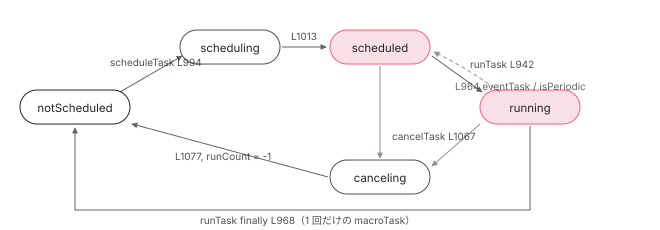

[目次](../README.md) › [zone.js の内側](README.md) › 第 4 回 / 全 13 回

# Task のライフサイクル：scheduleTask → invokeTask → cancelTask

> ZoneTask の state は notScheduled / scheduling / scheduled / running / canceling。\_transitionTo が遷移を検査し、runCount が実行回数を数える。

angular/angular · 読了 約 13 分 · 中核 · [サイトで読む（デモが動きます）](https://angular-deep-dive-cyan.vercel.app/chapter/zone-task)

---

[前章](03-zone-patching.md)で、差し替え後の `setTimeout` が `Zone.current.scheduleMacroTask(...)` を呼ぶところまで追いました。その先にいるのが `ZoneTask` です。この章では Task が持つフィールド、`notScheduled → scheduling → scheduled → running → notScheduled` という状態遷移、それを検査する `_transitionTo`、そして `scheduleTask` / `runTask` / `cancelTask` の 3 つの入口を読みます。

読む対象は `packages/zone.js/lib/zone-impl.ts` だけです（型定義 L622-742、実装 L920-1090 と L1385-1492）。

1. 概観
2. Zone とは
3. モンキーパッチ
4. **Task のライフサイクル**（この章）
5. ZoneDelegate
6. マイクロタスクキュー
7. addEventListener
8. hasTask
9. NgZone の fork
10. onEnter・onLeave・checkStable
11. NgZoneChangeDetectionScheduler
12. coalescing と runOutsideAngular
13. 1 クリックの全行程

## 1. 3 種類の type と 6 つの state

📄 `angular/packages/zone.js/lib/zone-impl.ts` L622–631 （▶ の行: 625, 630–631）

```ts
622 │ /**
623 │  * Task type: `microTask`, `macroTask`, `eventTask`.
624 │  */
625 ▶ export type TaskType = 'microTask' | 'macroTask' | 'eventTask';
626 │ 
627 │ /**
628 │  * Task type: `notScheduled`, `scheduling`, `scheduled`, `running`, `canceling`, 'unknown'.
629 │  */
630 ▶ export type TaskState =
631 ▶   'notScheduled' | 'scheduling' | 'scheduled' | 'running' | 'canceling' | 'unknown';
```

625 行目、`TaskType` は `microTask`（`Promise.then`、`queueMicrotask`）、`macroTask`（`setTimeout`、`XMLHttpRequest.send`）、`eventTask`（`addEventListener`）の 3 つ。630〜631 行目、`TaskState` は 6 つです。`unknown` は予約やキャンセルの途中で例外が出たときだけ入る状態です。

📄 `angular/packages/zone.js/lib/zone-impl.ts` L677–703 （▶ の行: 681, 686, 691, 697, 703）

```ts
677 │ export declare interface Task {
678 │   /**
679 │    * Task type: `microTask`, `macroTask`, `eventTask`.
680 │    */
681 ▶   type: TaskType;
682 │ 
683 │   /**
684 │    * Task state: `notScheduled`, `scheduling`, `scheduled`, `running`, `canceling`, `unknown`.
685 │    */
686 ▶   state: TaskState;
687 │ 
688 │   /**
689 │    * Debug string representing the API which requested the scheduling of the task.
690 │    */
691 ▶   source: string;
692 │ 
693 │   /**
694 │    * The Function to be used by the VM upon entering the [Task]. This function will delegate to
695 │    * [Zone.runTask] and delegate to `callback`.
696 │    */
697 ▶   invoke: Function;
698 │ 
699 │   /**
700 │    * Function which needs to be executed by the Task after the [Zone.currentTask] has been set to
701 │    * the current task.
702 │    */
703 ▶   callback: Function;
```

📄 `angular/packages/zone.js/lib/zone-impl.ts` L710–742 （▶ の行: 715, 723, 729, 734）

```ts
710 │   /**
711 │    * Represents the default work which needs to be done to schedule the Task by the VM.
712 │    *
713 │    * A zone may choose to intercept this function and perform its own scheduling.
714 │    */
715 ▶   scheduleFn?: (task: Task) => void;
716 │ 
717 │   /**
718 │    * Represents the default work which needs to be done to un-schedule the Task from the VM. Not
719 │    * all Tasks are cancelable, and therefore this method is optional.
720 │    *
721 │    * A zone may chose to intercept this function and perform its own un-scheduling.
722 │    */
723 ▶   cancelFn?: (task: Task) => void;
724 │ 
725 │   /**
726 │    * @type {Zone} The zone which will be used to invoke the `callback`. The Zone is captured
727 │    * at the time of Task creation.
728 │    */
729 ▶   readonly zone: Zone;
730 │ 
731 │   /**
732 │    * Number of times the task has been executed, or -1 if canceled.
733 │    */
734 ▶   runCount: number;
735 │ 
736 │   /**
737 │    * Cancel the scheduling request. This method can be called from `ZoneSpec.onScheduleTask` to
738 │    * cancel the current scheduling interception. Once canceled the task can be discarded or
739 │    * rescheduled using `Zone.scheduleTask` on a different zone.
740 │    */
741 │   cancelScheduleRequest(): void;
742 │ }
```

フィールドを役割で分けると 3 組です。

| フィールド | 行 | 何か | setTimeout(fn, 0) の場合 |
| --- | --- | --- | --- |
| `type` / `state` / `source` | 681 / 686 / 691 | 種類、現在の状態、デバッグ用の由来文字列 | `'macroTask'` / 遷移する / `'setTimeout'` |
| `invoke` / `callback` | 697 / 703 | `invoke` はブラウザに渡す側、`callback` はあなたの関数側 | `invoke` = runTask を呼ぶ関数、`callback` = 前章の `timer` |
| `scheduleFn` / `cancelFn` | 715 / 723 | ネイティブ API を実際に呼ぶ／取り消す関数 | timers.ts の `scheduleTask` / `clearTask` |
| `zone` / `runCount` | 729 / 734 | 作られたときの zone、実行回数（キャンセルで -1） | angular zone / 0 → 1 |

## 2. ZoneTask のコンストラクタ

📄 `angular/packages/zone.js/lib/zone-impl.ts` L1385–1424 （▶ の行: 1393–1396, 1417–1418, 1420–1421）

```ts
1385 │   class ZoneTask<T extends TaskType> implements Task {
1386 │     public type: T;
1387 │     public source: string;
1388 │     public invoke: Function;
1389 │     public callback: Function;
1390 │     public data: TaskData | undefined;
1391 │     public scheduleFn: ((task: Task) => void) | undefined;
1392 │     public cancelFn: ((task: Task) => void) | undefined;
1393 ▶     _zone: ZoneImpl | null = null;
1394 ▶     public runCount: number = 0;
1395 ▶     _zoneDelegates: _ZoneDelegate[] | null = null;
1396 ▶     _state: TaskState = 'notScheduled';
1397 │ 
1398 │     constructor(
1399 │       type: T,
1400 │       source: string,
1401 │       callback: Function,
1402 │       options: TaskData | undefined,
1403 │       scheduleFn: ((task: Task) => void) | undefined,
1404 │       cancelFn: ((task: Task) => void) | undefined,
1405 │     ) {
1406 │       this.type = type;
1407 │       this.source = source;
1408 │       this.data = options;
1409 │       this.scheduleFn = scheduleFn;
1410 │       this.cancelFn = cancelFn;
1411 │       if (!callback) {
1412 │         throw new Error('callback is not defined');
1413 │       }
1414 │       this.callback = callback;
1415 │       const self = this;
1416 │       // TODO: @JiaLiPassion options should have interface
1417 ▶       if (type === eventTask && options && (options as any).useG) {
1418 ▶         this.invoke = ZoneTask.invokeTask;
1419 │       } else {
1420 ▶         this.invoke = function () {
1421 ▶           return ZoneTask.invokeTask.call(global, self, this, <any>arguments);
1422 │         };
1423 │       }
1424 │     }
```

1393〜1396 行目、interface に無い内部フィールドが 3 つあります。`_zone`（`scheduleTask` の中で設定される）、`_zoneDelegates`（[hasTask の章](08-zone-hastask.md)で読む「数えてほしい delegate の一覧」）、`_state`（初期値 `'notScheduled'`）。

1420〜1422 行目が `invoke` の正体です。**`ZoneTask.invokeTask.call(global, self, this, arguments)` を呼ぶだけの関数**。前章の timers.ts 38 行目で `data.args[0]` に入れられ、ブラウザが呼ぶのはこれです。1417〜1418 行目、`eventTask` で `useG` が立っているときだけクロージャを作らず static 関数そのものを使います （[addEventListener の章](07-zone-events.md)）。

📄 `angular/packages/zone.js/lib/zone-impl.ts` L1589–1597 （▶ の行: 1589–1594）

```ts
1589 ▶   const notScheduled: 'notScheduled' = 'notScheduled',
1590 ▶     scheduling: 'scheduling' = 'scheduling',
1591 ▶     scheduled: 'scheduled' = 'scheduled',
1592 ▶     running: 'running' = 'running',
1593 ▶     canceling: 'canceling' = 'canceling',
1594 ▶     unknown: 'unknown' = 'unknown';
1595 │   const microTask: 'microTask' = 'microTask',
1596 │     macroTask: 'macroTask' = 'macroTask',
1597 │     eventTask: 'eventTask' = 'eventTask';
```

実装では状態名を 1589〜1594 行目の定数で参照します。以下の引用に出てくる `notScheduled` や `running` は、この文字列のことです。

## 3. \_transitionTo：遷移を検査する唯一の関数

📄 `angular/packages/zone.js/lib/zone-impl.ts` L1457–1472 （▶ の行: 1458–1461, 1464）

```ts
1457 │     _transitionTo(toState: TaskState, fromState1: TaskState, fromState2?: TaskState) {
1458 ▶       if (this._state === fromState1 || this._state === fromState2) {
1459 ▶         this._state = toState;
1460 ▶         if (toState == notScheduled) {
1461 ▶           this._zoneDelegates = null;
1462 │         }
1463 │       } else {
1464 ▶         throw new Error(
1465 │           `${this.type} '${
1466 │             this.source
1467 │           }': can not transition to '${toState}', expecting state '${fromState1}'${
1468 │             fromState2 ? " or '" + fromState2 + "'" : ''
1469 │           }, was '${this._state}'.`,
1470 │         );
1471 │       }
1472 │     }
```

`_state` を書き換えるのはこの関数だけです。1458 行目、現在の状態が `fromState1` か `fromState2` のどちらかであることを確認し、1459 行目で `toState` に変えます。1460〜1461 行目、`notScheduled` に戻るときは `_zoneDelegates` を捨てます。合わない状態なら 1464 行目で `Error` です。`"macroTask 'setTimeout': can not transition to 'running', expecting state 'scheduled', was 'notScheduled'."` というメッセージを見たことがあれば、ここから出ています。



*状態遷移図。矢印の根元の関数が \_transitionTo を呼ぶ。eventTask と isPeriodic は running から scheduled に戻る。*

## 4. scheduleTask：予約

📄 `angular/packages/zone.js/lib/zone-impl.ts` L1029–1039 （▶ の行: 1036–1037）

```ts
1029 │     scheduleMacroTask(
1030 │       source: string,
1031 │       callback: Function,
1032 │       data?: TaskData,
1033 │       customSchedule?: (task: Task) => void,
1034 │       customCancel?: (task: Task) => void,
1035 │     ): MacroTask {
1036 ▶       return this.scheduleTask(
1037 ▶         new ZoneTask(macroTask, source, callback, data, customSchedule, customCancel),
1038 │       );
1039 │     }
```

前章の 55 行目から来るのがここです。1037 行目で `new ZoneTask(macroTask, 'setTimeout', timer, options, scheduleTask, clearTask)` を作り、1036 行目で `this.scheduleTask` に渡します。`scheduleMicroTask`（1018 行目）と `scheduleEventTask`（1041 行目）も `type` が違うだけで同じです。

📄 `angular/packages/zone.js/lib/zone-impl.ts` L980–1016 （▶ の行: 994–997, 999, 1003, 1010, 1013）

```ts
 980 │     scheduleTask<T extends Task>(task: T): T {
 981 │       if (task.zone && task.zone !== this) {
 982 │         // check if the task was rescheduled, the newZone
 983 │         // should not be the children of the original zone
 984 │         let newZone: any = this;
 985 │         while (newZone) {
 986 │           if (newZone === task.zone) {
 987 │             throw Error(
 988 │               `can not reschedule task to ${this.name} which is descendants of the original zone ${task.zone.name}`,
 989 │             );
 990 │           }
 991 │           newZone = newZone.parent;
 992 │         }
 993 │       }
 994 ▶       (task as any as ZoneTask<any>)._transitionTo(scheduling, notScheduled);
 995 ▶       const zoneDelegates: _ZoneDelegate[] = [];
 996 ▶       (task as any as ZoneTask<any>)._zoneDelegates = zoneDelegates;
 997 ▶       (task as any as ZoneTask<any>)._zone = this;
 998 │       try {
 999 ▶         task = this._zoneDelegate.scheduleTask(this, task) as T;
1000 │       } catch (err) {
1001 │         // should set task's state to unknown when scheduleTask throw error
1002 │         // because the err may from reschedule, so the fromState maybe notScheduled
1003 ▶         (task as any as ZoneTask<any>)._transitionTo(unknown, scheduling, notScheduled);
1004 │         // TODO: @JiaLiPassion, should we check the result from handleError?
1005 │         this._zoneDelegate.handleError(this, err);
1006 │         throw err;
1007 │       }
1008 │       if ((task as any as ZoneTask<any>)._zoneDelegates === zoneDelegates) {
1009 │         // we have to check because internally the delegate can reschedule the task.
1010 ▶         this._updateTaskCount(task as any as ZoneTask<any>, 1);
1011 │       }
1012 │       if ((task as any as ZoneTask<any>).state == scheduling) {
1013 ▶         (task as any as ZoneTask<any>)._transitionTo(scheduled, scheduling);
1014 │       }
1015 │       return task;
1016 │     }
```

1. **994 行目：`notScheduled → scheduling`**

   最初の遷移です。他の状態から呼ばれると 1464 行目のエラーになります。
2. **995〜997 行目：`_zoneDelegates` を空配列にし、`_zone` を自分にする**

   ここで初めて Task の持ち主（`task.zone`）が決まります。`_zoneDelegates` には次の delegate 鎖の中で「数えてほしい」delegate が push されていきます。
3. **999 行目：delegate に任せる**

   `this._zoneDelegate.scheduleTask(this, task)`。鎖に `onScheduleTask` フックがあればそれ経由、無ければ `task.scheduleFn(task)`（次の引用）。
4. **1003 行目：例外なら `unknown`**

   予約中に例外が出た Task は `unknown` になり、二度と使われません。
5. **1010 行目：数を +1**

   `_updateTaskCount(task, 1)`。1008 行目の条件は「delegate が別の Task に差し替えなかったら」。カウンタの中身は [hasTask の章](08-zone-hastask.md)です。
6. **1013 行目：`scheduling → scheduled`**

   1012 行目の条件は、途中で `cancelScheduleRequest`（1453 行目）が呼ばれていなければ、という意味です。

📄 `angular/packages/zone.js/lib/zone-impl.ts` L1294–1317 （▶ の行: 1296, 1298, 1300, 1308–1309, 1311）

```ts
1294 │     scheduleTask(targetZone: ZoneImpl, task: Task): Task {
1295 │       let returnTask: ZoneTask<any> = task as ZoneTask<any>;
1296 ▶       if (this._scheduleTaskZS) {
1297 │         if (this._hasTaskZS) {
1298 ▶           returnTask._zoneDelegates!.push(this._hasTaskDlgtOwner!);
1299 │         }
1300 ▶         returnTask = this._scheduleTaskZS.onScheduleTask!(
1301 │           this._scheduleTaskDlgt!,
1302 │           this._scheduleTaskCurrZone!,
1303 │           targetZone,
1304 │           task,
1305 │         ) as ZoneTask<any>;
1306 │         if (!returnTask) returnTask = task as ZoneTask<any>;
1307 │       } else {
1308 ▶         if (task.scheduleFn) {
1309 ▶           task.scheduleFn(task);
1310 │         } else if (task.type == microTask) {
1311 ▶           scheduleMicroTask(<MicroTask>task);
1312 │         } else {
1313 │           throw new Error('Task is missing scheduleFn.');
1314 │         }
1315 │       }
1316 │       return returnTask;
1317 │     }
```

1296 行目、鎖に `onScheduleTask` があるか（Angular の zone には無いが、`hasTask` を使うので 1227〜1231 行目で `DELEGATE_ZS` が入る。[次章](05-zone-delegate.md)）。1298 行目で自分を `_zoneDelegates` に push し、1300 行目でフックを呼びます。フックが無い末端では 1308〜1309 行目、**`task.scheduleFn(task)`**。`setTimeout` なら前章 timers.ts 36 行目の `scheduleTask` で、ここで `setNative` が呼ばれます。1311 行目、`microTask` には `scheduleFn` が無く、zone.js 内部のキューに入ります（[6 章](06-zone-microtask.md)）。

## 5. runTask：実行

📄 `angular/packages/zone.js/lib/zone-impl.ts` L1426–1443 （▶ の行: 1430, 1432–1433, 1436–1437, 1440）

```ts
1426 │     static invokeTask(task: any, target: any, args: any): any {
1427 │       if (!task) {
1428 │         task = this;
1429 │       }
1430 ▶       _numberOfNestedTaskFrames++;
1431 │       try {
1432 ▶         task.runCount++;
1433 ▶         return task.zone.runTask(task, target, args);
1434 │       } finally {
1435 │         try {
1436 ▶           if (_numberOfNestedTaskFrames === 1 && !global[enableNativeMicrotaskDraining]) {
1437 ▶             drainMicroTaskQueueSynchronously();
1438 │           }
1439 │         } finally {
1440 ▶           _numberOfNestedTaskFrames--;
1441 │         }
1442 │       }
1443 │     }
```

ブラウザがタイマーを発火し、2 節の `invoke` が呼ばれ、ここに来ます。1430 行目で入れ子の深さを +1、1432 行目で **`runCount++`**、1433 行目で `task.zone.runTask(task, target, args)`。1436〜1437 行目、`finally` で最外（深さ 1）の Task が終わったときだけマイクロタスクキューを流します。これが「`setTimeout` のコールバックの直後に `Promise.then` が走る」順序の実装です（[6 章](06-zone-microtask.md)）。

📄 `angular/packages/zone.js/lib/zone-impl.ts` L920–946 （▶ の行: 921, 937, 941–945）

```ts
920 │     runTask(task: Task, applyThis?: any, applyArgs?: any): any {
921 ▶       if (task.zone != this) {
922 │         throw new Error(
923 │           'A task can only be run in the zone of creation! (Creation: ' +
924 │             (task.zone || NO_ZONE).name +
925 │             '; Execution: ' +
926 │             this.name +
927 │             ')',
928 │         );
929 │       }
930 │ 
931 │       const zoneTask = task as ZoneTask<any>;
932 │       // https://github.com/angular/zone.js/issues/778, sometimes eventTask
933 │       // will run in notScheduled(canceled) state, we should not try to
934 │       // run such kind of task but just return
935 │       const {type, data: {isPeriodic = false, isRefreshable = false} = {}} = task;
936 │ 
937 ▶       if (task.state === notScheduled && (type === eventTask || type === macroTask)) {
938 │         return;
939 │       }
940 │ 
941 ▶       const reEntryGuard = task.state != running;
942 ▶       reEntryGuard && zoneTask._transitionTo(running, scheduled);
943 ▶       const previousTask = _currentTask;
944 ▶       _currentTask = zoneTask;
945 ▶       _currentZoneFrame = {parent: _currentZoneFrame, zone: this};
946 │ 
```

1. **921 行目：持ち主でなければエラー**

   Task は作られた zone でしか実行できません。
2. **937〜939 行目：キャンセル済みなら何もしない**

   `removeEventListener` された直後にイベントが届くことがあります（コメントの issue 778）。`notScheduled` の `eventTask` / `macroTask` はここで黙って return します。
3. **941〜942 行目：`scheduled → running`**

   `reEntryGuard` は「既に running でなければ」。同じ eventTask が入れ子で発火したとき（click の中で `dispatchEvent`）に二重遷移しないためです。
4. **943〜945 行目：`_currentTask` と `_currentZoneFrame` を積む**

   945 行目は[2 章](02-zone-what.md)の `run` と同じフレーム操作です。これで `Zone.current` が Task の zone になります。944 行目の `_currentTask` は `Zone.currentTask`（807 行目）の実体です。

📄 `angular/packages/zone.js/lib/zone-impl.ts` L947–978 （▶ の行: 948–949, 952, 954, 962–964, 967–968, 975–976）

```ts
947 │       try {
948 ▶         if (type == macroTask && task.data && !isPeriodic && !isRefreshable) {
949 ▶           task.cancelFn = undefined;
950 │         }
951 │         try {
952 ▶           return this._zoneDelegate.invokeTask(this, zoneTask, applyThis, applyArgs);
953 │         } catch (error) {
954 ▶           if (this._zoneDelegate.handleError(this, error)) {
955 │             throw error;
956 │           }
957 │         }
958 │       } finally {
959 │         // if the task's state is notScheduled or unknown, then it has already been cancelled
960 │         // we should not reset the state to scheduled
961 │         const state = task.state;
962 ▶         if (state !== notScheduled && state !== unknown) {
963 ▶           if (type == eventTask || isPeriodic || (isRefreshable && state === scheduling)) {
964 ▶             reEntryGuard && zoneTask._transitionTo(scheduled, running, scheduling);
965 │           } else {
966 │             const zoneDelegates = zoneTask._zoneDelegates;
967 ▶             this._updateTaskCount(zoneTask, -1);
968 ▶             reEntryGuard && zoneTask._transitionTo(notScheduled, running, notScheduled);
969 │ 
970 │             if (isRefreshable) {
971 │               zoneTask._zoneDelegates = zoneDelegates;
972 │             }
973 │           }
974 │         }
975 ▶         _currentZoneFrame = _currentZoneFrame.parent!;
976 ▶         _currentTask = previousTask;
977 │       }
978 │     }
```

1. **948〜949 行目：1 回きりの macroTask は `cancelFn` を捨てる**

   実行が始まった `setTimeout` はもう `clearTimeout` できないので、`cancelFn = undefined`。前章 timers.ts 175 行目の `if (task.cancelFn)` はこれを見ていました。
2. **952 行目：delegate に実行を任せる**

   `this._zoneDelegate.invokeTask(this, zoneTask, applyThis, applyArgs)`。**Angular の `onInvokeTask`（`onEnter` / `onLeave`）が呼ばれるのはここ**です。末端で `task.callback.apply(...)`、つまり前章の `timer` → あなたの `fn`。
3. **954 行目：例外は `handleError`**

   `runGuarded` と同じ扱いです。
4. **962〜973 行目：`finally` で状態を戻す**

   962 行目、callback の中で `cancelTask` されて `notScheduled` になっていたら触りません。963〜964 行目、`eventTask` か `isPeriodic`（`setInterval`）なら **`running → scheduled`**。また呼ばれるからです。それ以外（1 回きりの `setTimeout`）は 967 行目で数を -1 し、968 行目で **`running → notScheduled`**。
5. **975〜976 行目：フレームと `_currentTask` を戻す**

## 6. cancelTask：取り消し

📄 `angular/packages/zone.js/lib/zone-impl.ts` L1053–1080 （▶ の行: 1063, 1067, 1069, 1072, 1076–1078）

```ts
1053 │     cancelTask(task: Task): any {
1054 │       if (task.zone != this)
1055 │         throw new Error(
1056 │           'A task can only be cancelled in the zone of creation! (Creation: ' +
1057 │             (task.zone || NO_ZONE).name +
1058 │             '; Execution: ' +
1059 │             this.name +
1060 │             ')',
1061 │         );
1062 │ 
1063 ▶       if (task.state !== scheduled && task.state !== running) {
1064 │         return;
1065 │       }
1066 │ 
1067 ▶       (task as ZoneTask<any>)._transitionTo(canceling, scheduled, running);
1068 │       try {
1069 ▶         this._zoneDelegate.cancelTask(this, task);
1070 │       } catch (err) {
1071 │         // if error occurs when cancelTask, transit the state to unknown
1072 ▶         (task as ZoneTask<any>)._transitionTo(unknown, canceling);
1073 │         this._zoneDelegate.handleError(this, err);
1074 │         throw err;
1075 │       }
1076 ▶       this._updateTaskCount(task as ZoneTask<any>, -1);
1077 ▶       (task as ZoneTask<any>)._transitionTo(notScheduled, canceling);
1078 ▶       task.runCount = -1;
1079 │       return task;
1080 │     }
```

1063 行目、`scheduled` か `running` 以外なら何もしません（二重 `clearTimeout` は無害）。1067 行目で `canceling` に遷移し、1069 行目で delegate 経由で `task.cancelFn(task)`（`clearTimeout` なら timers.ts 58 行目の `clearTask`）。1072 行目、例外なら `unknown`。1076 行目で数を -1、1077 行目で `canceling → notScheduled`、1078 行目で **`runCount = -1`**。interface のコメント（732 行目）にあった「-1 if canceled」はここです。

📄 `angular/packages/zone.js/lib/zone-impl.ts` L1484–1492 （▶ の行: 1486–1487, 1489–1490）

```ts
1484 │     public toJSON() {
1485 │       return {
1486 ▶         type: this.type,
1487 ▶         state: this.state,
1488 │         source: this.source,
1489 ▶         zone: this.zone.name,
1490 ▶         runCount: this.runCount,
1491 │       };
1492 │     }
```

`JSON.stringify(task)` すると出てくる 5 項目です。次のデモはこの形で Task を表示します。

> **🧪 DEMO — Task の状態遷移**
>
> `scheduleTask`（L980）、ブラウザからの発火（L1426 → L920）、`cancelTask`（L1053）を押して、`_transitionTo` がどう動くかを見ます。不正な順で押すと L1464 のエラー文がそのまま出ます。
>
> ▶ [このデモはサイトで動かせます](https://angular-deep-dive-cyan.vercel.app/chapter/zone-task)

> [!WARNING]
> **ハマりどころ**
>
> `eventTask` は `invoke` しても `scheduled` に戻る（964 行目）ので、`runCount` は増え続け、カウンタは減りません。`removeEventListener`（= `cancelTask`）で初めて `notScheduled` になります。つまり**リスナーが 1 つでも残っている限り、その zone の `eventTask` の数は 0 になりません**。Angular が「安定した」の判定に `eventTask` を含めない理由がここにあります（[hasTask の章](08-zone-hastask.md)）。

## ここまでの呼び出し（setTimeout(fn, 0) の予約から実行まで）

- 👤 `setTimeout(fn, 0)` — あなたのコード
  - `Zone.current.scheduleMacroTask('setTimeout', timer, options, scheduleTask, clearTask)` — zone-impl.ts L1029
    - `new ZoneTask(macroTask, ...)` — L1385 — *\_state = 'notScheduled'、invoke = runTask を呼ぶ関数（L1420）*
    - `scheduleTask(task)` — L980 — *L994 → scheduling、L997 \_zone = this*
      - `_zoneDelegate.scheduleTask(this, task)` — L1294 — *末端で task.scheduleFn(task)（L1309）→ setNative*
    - `_updateTaskCount(task, 1)` — L1010 — *macroTask の数 +1*
    - `_transitionTo(scheduled, scheduling)` — L1013
- `（ブラウザがタイマーを発火）task.invoke()` — timers.ts L39 → zone-impl.ts L1421
  - `ZoneTask.invokeTask(task, this, arguments)` — L1426 — *runCount++（L1432）*
    - `task.zone.runTask(task, target, args)` — L920 — *L942 → running、L945 フレームを積む*
      - `_zoneDelegate.invokeTask(this, task, ...)` — L952 → L1319 — *Angular の onInvokeTask → onEnter*
        - `task.callback.apply(...)` — L1329 — *= timer（timers.ts L78）→ fn*
    - `finally: _updateTaskCount(-1); _transitionTo(notScheduled, running)` — L967-968
  - `finally: drainMicroTaskQueueSynchronously()` — L1437 — *深さ 1 のときだけ。6 章*

## 聞かれそうな質問

**Q. Task の state は何種類で、誰が変えますか？**

`notScheduled` / `scheduling` / `scheduled` / `running` / `canceling` / `unknown` の 6 つ（zone-impl.ts 630〜631 行目）。変えるのは `_transitionTo`（1457〜1472 行目）だけで、1458 行目で「今の状態が期待どおりか」を検査し、違えば 1464 行目で例外を投げます。

**Q. setTimeout(fn, 0) を呼んだ瞬間に zone.js の中で何が起きますか？**

`scheduleMacroTask`（1029 行目）が `new ZoneTask`（1037 行目）し、`scheduleTask`（980 行目）が 994 行目で `scheduling`、997 行目で `_zone` を設定、999 行目で delegate 経由 `task.scheduleFn`（= ネイティブ `setTimeout` 呼び出し）、1010 行目でカウンタ +1、1013 行目で `scheduled`。ここまでが同期的に終わり、ネイティブの ID が返ります。

**Q. fn が実行される瞬間は？**

ブラウザが `task.invoke`（1420〜1422 行目の関数）を呼び、`ZoneTask.invokeTask`（1426 行目）で `runCount++`、`runTask`（920 行目）で 942 行目 `running`、945 行目でフレームを積み、952 行目の `_zoneDelegate.invokeTask` で Angular の `onInvokeTask` を通って `task.callback`（1329 行目）、つまり `fn` です。終わると 967〜968 行目で数を減らして `notScheduled`。

**Q. setInterval はなぜ 1 回の実行で消えないのですか？**

timers.ts 72 行目で `isPeriodic: true` になり、`runTask` の 963〜964 行目で `running → scheduled` に戻るからです。カウンタも減りません（967 行目を通らない）。`clearInterval` → `cancelTask`（1053 行目）で初めて `notScheduled` になり、`runCount = -1`（1078 行目）です。

**Q. runCount が -1 の Task は何ですか？**

キャンセルされた Task です。`cancelTask` の 1078 行目で `task.runCount = -1` と上書きされます。それまでに何回実行されたかは失われます。

## 読み終えて

- Task は `type` / `state` / `source`、`invoke` / `callback`、`scheduleFn` / `cancelFn`、`zone` / `runCount` を持つ
- `_transitionTo`（1457 行目）だけが `_state` を変え、期待と違えば例外。遷移図のとおりにしか動かない
- `scheduleTask`：`scheduling` → `scheduleFn`（ネイティブ呼び出し）→ カウンタ +1 → `scheduled`
- `runTask`：`running` → フレームを積む → delegate の `invokeTask`（Angular のフックはここ）→ `callback` → finally で `notScheduled`（周期・イベントは `scheduled` に戻る）
- `cancelTask`：`canceling` → `cancelFn` → カウンタ -1 → `notScheduled`、`runCount = -1`

---

← 前: [モンキーパッチの実際：setTimeout が差し替わる手順](03-zone-patching.md)  
次: [ZoneDelegate：親子の鎖で割り込む](05-zone-delegate.md) →
