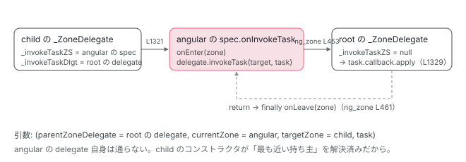

[目次](../README.md) › [zone.js の内側](README.md) › 第 5 回 / 全 13 回

# ZoneDelegate：親子の鎖で割り込む

> fork したときに渡した onInvokeTask などの ZoneSpec は、ZoneDelegate の鎖に組み込まれる。自分にないフックは親の delegate に委ねる。Angular はこの鎖の 1 段。

angular/angular · 読了 約 12 分 · 発展 · [サイトで読む（デモが動きます）](https://angular-deep-dive-cyan.vercel.app/chapter/zone-delegate)

---

[2 章](02-zone-what.md)で `ZoneImpl` の 4 つ目のフィールド `_zoneDelegate` を「フック関数の鎖」と呼び、[前章](04-zone-task.md)では `runTask` が `_zoneDelegate.invokeTask` に実行を任せるところを見ました。この章ではその `_ZoneDelegate` クラスを読みます。**`fork` に渡した `ZoneSpec` のフックが、どうやって鎖に組み込まれ、自分に無いフックがどうやって親に委ねられるのか**。コンストラクタの 80 行がすべてです。

読む対象は `packages/zone.js/lib/zone-impl.ts` の L430-564（`ZoneSpec`）、L597-613（`ZoneDelegate`）、L1093-1364（`_ZoneDelegate` の実装）です。

1. 概観
2. Zone とは
3. モンキーパッチ
4. Task のライフサイクル
5. **ZoneDelegate**（この章）
6. マイクロタスクキュー
7. addEventListener
8. hasTask
9. NgZone の fork
10. onEnter・onLeave・checkStable
11. NgZoneChangeDetectionScheduler
12. coalescing と runOutsideAngular
13. 1 クリックの全行程

## 1. ZoneSpec：fork に渡す「フックの集まり」

📄 `angular/packages/zone.js/lib/zone-impl.ts` L430–439 （▶ の行: 434, 439）

```ts
430 │ export declare interface ZoneSpec {
431 │   /**
432 │    * The name of the zone. Useful when debugging Zones.
433 │    */
434 ▶   name: string;
435 │ 
436 │   /**
437 │    * A set of properties to be associated with Zone. Use [Zone.get] to retrieve them.
438 │    */
439 ▶   properties?: {[key: string]: any};
```

必須は 434 行目の `name` だけ。439 行目の `properties` は前々章の `_properties` になります。残りは全部任意のフックで、`onFork` / `onIntercept` / `onInvoke` / `onHandleError` / `onScheduleTask` / `onInvokeTask` / `onCancelTask` / `onHasTask` の 8 つです。Angular が使う 2 つを見ます。

📄 `angular/packages/zone.js/lib/zone-impl.ts` L486–494 （▶ の行: 486–489）

```ts
486 ▶   onInvoke?: (
487 ▶     parentZoneDelegate: ZoneDelegate,
488 ▶     currentZone: Zone,
489 ▶     targetZone: Zone,
490 │     delegate: Function,
491 │     applyThis: any,
492 │     applyArgs?: any[],
493 │     source?: string,
494 │   ) => any;
```

📄 `angular/packages/zone.js/lib/zone-impl.ts` L526–533 （▶ の行: 526–529）

```ts
526 ▶   onInvokeTask?: (
527 ▶     parentZoneDelegate: ZoneDelegate,
528 ▶     currentZone: Zone,
529 ▶     targetZone: Zone,
530 │     task: Task,
531 │     applyThis: any,
532 │     applyArgs?: any[],
533 │   ) => any;
```

どのフックも最初の 3 引数は同じです。

1. **`parentZoneDelegate`（487 行目）**

   親側の `ZoneDelegate`。フックは「自分の処理をして、あとはこれに委ねる」のが基本形です。Angular の `onInvokeTask` は `onEnter(zone); delegate.invokeTask(...); onLeave(zone)` と書いています（ng\_zone.ts 452〜461 行目）。
2. **`currentZone`（488 行目）**

   このフックを宣言した zone。
3. **`targetZone`（489 行目）**

   最初にリクエストを受け取った zone。子 zone で `run` されたとき、親のフックには `currentZone = 親`、`targetZone = 子` が渡ります。Angular の `onHasTask` が `if (current === target)` で「自分の zone の話だけ聞く」のはこの区別です。

## 2. ZoneDelegate interface と内部クラス

📄 `angular/packages/zone.js/lib/zone-impl.ts` L597–613 （▶ の行: 598–599, 601, 609–610, 612）

```ts
597 │ export declare interface ZoneDelegate {
598 ▶   zone: Zone;
599 ▶   fork(targetZone: Zone, zoneSpec: ZoneSpec): Zone;
600 │   intercept(targetZone: Zone, callback: Function, source: string): Function;
601 ▶   invoke(
602 │     targetZone: Zone,
603 │     callback: Function,
604 │     applyThis?: any,
605 │     applyArgs?: any[],
606 │     source?: string,
607 │   ): any;
608 │   handleError(targetZone: Zone, error: any): boolean;
609 ▶   scheduleTask(targetZone: Zone, task: Task): Task;
610 ▶   invokeTask(targetZone: Zone, task: Task, applyThis?: any, applyArgs?: any[]): any;
611 │   cancelTask(targetZone: Zone, task: Task): any;
612 ▶   hasTask(targetZone: Zone, isEmpty: HasTaskState): void;
613 │ }
```

599〜612 行目、`Zone` のメソッドと 1 対 1 で対応するメソッドが並びます（`wrap` → `intercept`、`run` → `invoke` と名前が変わる）。どれも第 1 引数に `targetZone` を取ります。

📄 `angular/packages/zone.js/lib/zone-impl.ts` L1119–1141 （▶ の行: 1123, 1125, 1131–1133, 1139–1141）

```ts
1119 │   class _ZoneDelegate implements ZoneDelegate {
1120 │     public get zone(): Zone {
1121 │       return this._zone;
1122 │     }
1123 ▶     private _zone: ZoneImpl;
1124 │ 
1125 ▶     private _taskCounts: {[key in TaskType]: number} = {
1126 │       'microTask': 0,
1127 │       'macroTask': 0,
1128 │       'eventTask': 0,
1129 │     };
1130 │ 
1131 ▶     private _forkDlgt: _ZoneDelegate | null;
1132 ▶     private _forkZS: ZoneSpec | null;
1133 ▶     private _forkCurrZone: Zone | null;
1134 │ 
1135 │     private _interceptDlgt: _ZoneDelegate | null;
1136 │     private _interceptZS: ZoneSpec | null;
1137 │     private _interceptCurrZone: Zone | null;
1138 │ 
1139 ▶     private _invokeDlgt: _ZoneDelegate | null;
1140 ▶     private _invokeZS: ZoneSpec | null;
1141 ▶     private _invokeCurrZone: ZoneImpl | null;
```

1123 行目で自分の zone、1125〜1129 行目で Task の数（[hasTask の章](08-zone-hastask.md)）。その下、1131〜1162 行目は**8 つのフック × 3 つ組**です。1131〜1133 行目の `fork` を例にすると、

| フィールド | 意味 |
| --- | --- |
| `_forkZS` | このフックを**実際に持っている**`ZoneSpec`。自分か、先祖のどれか。無ければ `null` |
| `_forkDlgt` | そのフックに `parentZoneDelegate` として渡す delegate |
| `_forkCurrZone` | そのフックに `currentZone` として渡す zone |

**鎖を毎回辿るのではなく、コンストラクタで「最も近い持ち主」を解決してフィールドに固定します。** これが `_ZoneDelegate` の設計の中心です。

## 3. コンストラクタ：3 項演算子が 8 回

📄 `angular/packages/zone.js/lib/zone-impl.ts` L1164–1183 （▶ の行: 1167–1170, 1179–1183）

```ts
1164 │     constructor(zone: Zone, parentDelegate: _ZoneDelegate | null, zoneSpec: ZoneSpec | null) {
1165 │       this._zone = zone as ZoneImpl;
1166 │ 
1167 ▶       this._forkZS = zoneSpec && (zoneSpec && zoneSpec.onFork ? zoneSpec : parentDelegate!._forkZS);
1168 ▶       this._forkDlgt = zoneSpec && (zoneSpec.onFork ? parentDelegate : parentDelegate!._forkDlgt);
1169 ▶       this._forkCurrZone =
1170 ▶         zoneSpec && (zoneSpec.onFork ? this._zone : parentDelegate!._forkCurrZone);
1171 │ 
1172 │       this._interceptZS =
1173 │         zoneSpec && (zoneSpec.onIntercept ? zoneSpec : parentDelegate!._interceptZS);
1174 │       this._interceptDlgt =
1175 │         zoneSpec && (zoneSpec.onIntercept ? parentDelegate : parentDelegate!._interceptDlgt);
1176 │       this._interceptCurrZone =
1177 │         zoneSpec && (zoneSpec.onIntercept ? this._zone : parentDelegate!._interceptCurrZone);
1178 │ 
1179 ▶       this._invokeZS = zoneSpec && (zoneSpec.onInvoke ? zoneSpec : parentDelegate!._invokeZS);
1180 ▶       this._invokeDlgt =
1181 ▶         zoneSpec && (zoneSpec.onInvoke ? parentDelegate! : parentDelegate!._invokeDlgt);
1182 ▶       this._invokeCurrZone =
1183 ▶         zoneSpec && (zoneSpec.onInvoke ? this._zone : parentDelegate!._invokeCurrZone);
```

1167〜1170 行目の `fork` を読み解きます。`zoneSpec && (...)` なので、root zone（spec が `null`）は全部 `null` です。

1. **1167 行目：`_forkZS`**

   自分の spec に `onFork` があれば**自分の spec**。無ければ**親 delegate の `_forkZS`**（親が解決済みの値をそのままコピー）。
2. **1168 行目：`_forkDlgt`**

   自分の spec に `onFork` があれば**親 delegate**（フックが委ねる先）。無ければ親の `_forkDlgt`。
3. **1169〜1170 行目：`_forkCurrZone`**

   自分の spec に `onFork` があれば**自分の zone**。無ければ親の `_forkCurrZone`。

1179〜1183 行目の `invoke` も、1172〜1177 行目の `intercept` も、以下 `cancelTask`（1211 行目）まで、全部同じ形です。`onInvokeTask` を見ます。

📄 `angular/packages/zone.js/lib/zone-impl.ts` L1199–1204 （▶ の行: 1200, 1202, 1204）

```ts
1199 │       this._invokeTaskZS =
1200 ▶         zoneSpec && (zoneSpec.onInvokeTask ? zoneSpec : parentDelegate!._invokeTaskZS);
1201 │       this._invokeTaskDlgt =
1202 ▶         zoneSpec && (zoneSpec.onInvokeTask ? parentDelegate! : parentDelegate!._invokeTaskDlgt);
1203 │       this._invokeTaskCurrZone =
1204 ▶         zoneSpec && (zoneSpec.onInvokeTask ? this._zone : parentDelegate!._invokeTaskCurrZone);
```

Angular の zone（`onInvokeTask` あり、親は root）なら `_invokeTaskZS = Angular の spec`、`_invokeTaskDlgt = root の delegate`、`_invokeTaskCurrZone = angular zone`。その**子** zone（`onInvokeTask` 無し）なら 3 つとも親からコピーされ、`_invokeTaskZS = Angular の spec`、`_invokeTaskDlgt = root の delegate`、`_invokeTaskCurrZone = angular zone`。子 zone で Task を実行しても、Angular のフックには `currentZone = angular`、`targetZone = 子` で届きます。

### hasTask だけは特別扱い

📄 `angular/packages/zone.js/lib/zone-impl.ts` L1213–1243 （▶ の行: 1218–1220, 1223–1224, 1226–1228, 1232–1233）

```ts
1213 │       this._hasTaskZS = null;
1214 │       this._hasTaskDlgt = null;
1215 │       this._hasTaskDlgtOwner = null;
1216 │       this._hasTaskCurrZone = null;
1217 │ 
1218 ▶       const zoneSpecHasTask = zoneSpec && zoneSpec.onHasTask;
1219 ▶       const parentHasTask = parentDelegate && parentDelegate._hasTaskZS;
1220 ▶       if (zoneSpecHasTask || parentHasTask) {
1221 │         // If we need to report hasTask, than this ZS needs to do ref counting on tasks. In such
1222 │         // a case all task related interceptors must go through this ZD. We can't short circuit it.
1223 ▶         this._hasTaskZS = zoneSpecHasTask ? zoneSpec : DELEGATE_ZS;
1224 ▶         this._hasTaskDlgt = parentDelegate;
1225 │         this._hasTaskDlgtOwner = this;
1226 ▶         this._hasTaskCurrZone = this._zone;
1227 ▶         if (!zoneSpec!.onScheduleTask) {
1228 ▶           this._scheduleTaskZS = DELEGATE_ZS;
1229 │           this._scheduleTaskDlgt = parentDelegate!;
1230 │           this._scheduleTaskCurrZone = this._zone;
1231 │         }
1232 ▶         if (!zoneSpec!.onInvokeTask) {
1233 ▶           this._invokeTaskZS = DELEGATE_ZS;
1234 │           this._invokeTaskDlgt = parentDelegate!;
1235 │           this._invokeTaskCurrZone = this._zone;
1236 │         }
1237 │         if (!zoneSpec!.onCancelTask) {
1238 │           this._cancelTaskZS = DELEGATE_ZS;
1239 │           this._cancelTaskDlgt = parentDelegate!;
1240 │           this._cancelTaskCurrZone = this._zone;
1241 │         }
1242 │       }
1243 │     }
```

1218〜1220 行目、自分に `onHasTask` があるか、**親が `_hasTaskZS` を持っているか**のどちらかなら、この delegate は Task を数える役になります（1221〜1222 行目のコメント）。1223 行目、自分に `onHasTask` があれば自分の spec、無ければ `DELEGATE_ZS`（次の引用）。1227〜1241 行目、Task を数えるためには `scheduleTask` / `invokeTask` / `cancelTask` の呼び出しが **必ずこの delegate を通る**必要があるので、自分に無いフックは `DELEGATE_ZS` で埋めます。「親からコピーして短絡する」を禁止しているわけです。

📄 `angular/packages/zone.js/lib/zone-impl.ts` L1093–1117 （▶ の行: 1094, 1100, 1106, 1114）

```ts
1093 │   const DELEGATE_ZS: ZoneSpec = {
1094 ▶     name: '',
1095 │     onHasTask: (
1096 │       delegate: ZoneDelegate,
1097 │       _: AmbientZone,
1098 │       target: AmbientZone,
1099 │       hasTaskState: HasTaskState,
1100 ▶     ): void => delegate.hasTask(target, hasTaskState),
1101 │     onScheduleTask: (
1102 │       delegate: ZoneDelegate,
1103 │       _: AmbientZone,
1104 │       target: AmbientZone,
1105 │       task: Task,
1106 ▶     ): Task => delegate.scheduleTask(target, task),
1107 │     onInvokeTask: (
1108 │       delegate: ZoneDelegate,
1109 │       _: AmbientZone,
1110 │       target: AmbientZone,
1111 │       task: Task,
1112 │       applyThis: any,
1113 │       applyArgs: any,
1114 ▶     ): any => delegate.invokeTask(target, task, applyThis, applyArgs),
1115 │     onCancelTask: (delegate: ZoneDelegate, _: AmbientZone, target: AmbientZone, task: Task): any =>
1116 │       delegate.cancelTask(target, task),
1117 │   };
```

`DELEGATE_ZS` は「何もせず `parentZoneDelegate` に委ねるだけ」の spec です（1100、1106、1114 行目）。フックが無いのと振る舞いは同じですが、delegate のメソッドを 1 段通るので、その delegate の `_updateTaskCount` が走ります（[hasTask の章](08-zone-hastask.md)）。

> **🧪 DEMO — コンストラクタが解決する 3 つ組**
>
> root → angular → child の 3 段です。angular / child の ZoneSpec に入れるフックを切り替えると、各 delegate のフィールド（`_xxxZS` / `_xxxDlgt` / `_xxxCurrZone`）がどう決まるかを表にします。初期値は Angular の `NgZone` が渡す 4 つ（`onInvoke` / `onInvokeTask` / `onHasTask` / `onHandleError`）。
>
> ▶ [このデモはサイトで動かせます](https://angular-deep-dive-cyan.vercel.app/chapter/zone-delegate)

## 4. メソッド：フックがあれば呼ぶ、無ければ素の処理

📄 `angular/packages/zone.js/lib/zone-impl.ts` L1245–1249 （▶ の行: 1247–1248）

```ts
1245 │     fork(targetZone: ZoneImpl, zoneSpec: ZoneSpec): AmbientZone {
1246 │       return this._forkZS
1247 ▶         ? this._forkZS.onFork!(this._forkDlgt!, this.zone, targetZone, zoneSpec)
1248 ▶         : new ZoneImpl(targetZone, zoneSpec);
1249 │     }
```

📄 `angular/packages/zone.js/lib/zone-impl.ts` L1263–1281 （▶ の行: 1270–1273, 1280）

```ts
1263 │     invoke(
1264 │       targetZone: ZoneImpl,
1265 │       callback: Function,
1266 │       applyThis: any,
1267 │       applyArgs?: any[],
1268 │       source?: string,
1269 │     ): any {
1270 ▶       return this._invokeZS
1271 ▶         ? this._invokeZS.onInvoke!(
1272 ▶             this._invokeDlgt!,
1273 ▶             this._invokeCurrZone!,
1274 │             targetZone,
1275 │             callback,
1276 │             applyThis,
1277 │             applyArgs,
1278 │             source,
1279 │           )
1280 ▶         : callback.apply(applyThis, applyArgs);
1281 │     }
```

📄 `angular/packages/zone.js/lib/zone-impl.ts` L1319–1330 （▶ の行: 1320–1323, 1329）

```ts
1319 │     invokeTask(targetZone: ZoneImpl, task: Task, applyThis: any, applyArgs?: any[]): any {
1320 ▶       return this._invokeTaskZS
1321 ▶         ? this._invokeTaskZS.onInvokeTask!(
1322 ▶             this._invokeTaskDlgt!,
1323 ▶             this._invokeTaskCurrZone!,
1324 │             targetZone,
1325 │             task,
1326 │             applyThis,
1327 │             applyArgs,
1328 │           )
1329 ▶         : task.callback.apply(applyThis, applyArgs);
1330 │     }
```

3 つとも同じ形です。1270 行目、`_invokeZS` があればその `onInvoke` を `(_invokeDlgt, _invokeCurrZone, targetZone, callback, ...)` で呼ぶ（1271〜1279 行目）。無ければ 1280 行目で **`callback.apply(applyThis, applyArgs)`**、ただの関数呼び出しです。`invokeTask` も同じで、末端は 1329 行目の `task.callback.apply`。

ここで前々章の `run`（893 行目）を思い出してください。

📄 `angular/packages/zone.js/lib/zone-impl.ts` L884–897 （▶ の行: 893）

```ts
884 │     public run(callback: Function, applyThis?: any, applyArgs?: any[], source?: string): any;
885 │     public run<T>(
886 │       callback: (...args: any[]) => T,
887 │       applyThis?: any,
888 │       applyArgs?: any[],
889 │       source?: string,
890 │     ): T {
891 │       _currentZoneFrame = {parent: _currentZoneFrame, zone: this};
892 │       try {
893 ▶         return this._zoneDelegate.invoke(this, callback, applyThis, applyArgs, source);
894 │       } finally {
895 │         _currentZoneFrame = _currentZoneFrame.parent!;
896 │       }
897 │     }
```

`angularZone.run(fn)` → 893 行目 `angular の delegate.invoke(angular, fn)` → 1270 行目で `_invokeZS`（Angular の spec）があるので `onInvoke(root の delegate, angular, angular, fn)` → Angular のフックが `onEnter` してから `delegate.invoke(target, fn)` = `root の delegate.invoke(angular, fn)` → root は `_invokeZS` が `null` なので 1280 行目 `fn.apply`。鎖は**フックを持つ zone の数だけ**の深さで、持たない zone は飛ばされます。



*root → angular → child の 3 段で child.runTask を実行したとき。child に onInvokeTask が無いので child の delegate は angular の spec を直接呼ぶ（コンストラクタで解決済み）。angular のフックは root の delegate に委ね、root は task.callback を呼ぶ。*

> [!NOTE]
> **さらに深く**
>
> ただし図の「angular の delegate を通らない」は、`hasTask` を使わない場合の話です。Angular は `onHasTask` を持つので、3 節のとおり子 zone の delegate も `DELEGATE_ZS` で `invokeTask` を必ず自分の delegate に通し、数を数えます。そのとき `_invokeTaskZS` は `DELEGATE_ZS`、`_invokeTaskDlgt` は `angular の delegate` になり、鎖は child → angular → root の 3 段になります。上のデモで child の `onInvokeTask` を外した状態がそれです。

### handleError は true で再 throw

📄 `angular/packages/zone.js/lib/zone-impl.ts` L1283–1292 （▶ の行: 1284, 1291）

```ts
1283 │     handleError(targetZone: ZoneImpl, error: any): boolean {
1284 ▶       return this._handleErrorZS
1285 │         ? this._handleErrorZS.onHandleError!(
1286 │             this._handleErrorDlgt!,
1287 │             this._handleErrorCurrZone!,
1288 │             targetZone,
1289 │             error,
1290 │           )
1291 ▶         : true;
1292 │     }
```

1291 行目、フックが無ければ `true`（= 呼び出し元で再 throw）。Angular の `onHandleError`（ng\_zone.ts 518〜522 行目）は `onError.emit` してから `false` を返すので、例外は `runGuarded` / `runTask` の外には出ません。

## 5. Angular はこの鎖の 1 段

📄 `angular/packages/core/src/zone/ng_zone.ts` L431–437 （▶ の行: 431–432）

```ts
431 ▶   zone._inner = zone._inner.fork({
432 ▶     name: 'angular',
433 │     properties: <any>{
434 │       [isAngularZoneProperty]: true,
435 │       [angularZoneInstanceIdProperty]: instanceId,
436 │       [angularZoneInstanceIdProperty + instanceId]: true,
437 │     },
```

431 行目、`NgZone` は `_inner.fork({ name: 'angular', properties, onInvokeTask, onInvoke, onHasTask, onHandleError })` と、この章で読んだ `ZoneSpec` を 1 つ渡しているだけです。`_inner` はコンストラクタ時点の `Zone.current`（ng\_zone.ts 162 行目。通常は root zone）なので、鎖は root → angular の 2 段です。どのフックを何のために渡しているかは[NgZone の fork の章](09-zone-ngzone-fork.md)で読みます。

## ここまでの呼び出し（angular zone の子 zone で Task を実行）

- 👤 `Zone.current.fork({name: 'angular', onInvokeTask, onInvoke, onHasTask, onHandleError})` — core/src/zone/ng\_zone.ts L431
  - `new ZoneImpl(root, spec)` — zone-impl.ts L1248
    - `new _ZoneDelegate(angular, root の delegate, spec)` — L845 → L1164 — *\_invokeTaskZS = spec、\_invokeTaskDlgt = root の delegate、\_hasTaskZS = spec*
- 👤 `angular.fork({name: 'child'})` — 利用者
  - `new _ZoneDelegate(child, angular の delegate, {name: 'child'})` — L1164 — *親に \_hasTaskZS があるので L1223 DELEGATE\_ZS、L1233 \_invokeTaskZS = DELEGATE\_ZS、\_invokeTaskDlgt = angular の delegate*
- `child.runTask(task)` — L920
  - `child の delegate.invokeTask(child, task)` — L952 → L1319 — *\_invokeTaskZS = DELEGATE\_ZS*
    - `DELEGATE_ZS.onInvokeTask(angular の delegate, child, child, task)` — L1107 — *そのまま delegate.invokeTask*
      - `angular の delegate.invokeTask(child, task)` — L1319 — *\_invokeTaskZS = Angular の spec*
        - `spec.onInvokeTask(root の delegate, angular, child, task)` — ng\_zone.ts L438 — *onEnter → delegate.invokeTask → onLeave*
          - `root の delegate.invokeTask(child, task)` — L1319 — *\_invokeTaskZS = null*
            - `task.callback.apply(applyThis, applyArgs)` — L1329 — *あなたの関数*

## 聞かれそうな質問

**Q. fork に渡した onInvokeTask はどこに保存されますか？**

`ZoneSpec` オブジェクトごと、その zone の `_ZoneDelegate` の `_invokeTaskZS` に入ります（zone-impl.ts 1199〜1200 行目）。同時に `_invokeTaskDlgt` に親の delegate（1201〜1202 行目）、`_invokeTaskCurrZone` に自分の zone（1203〜1204 行目）が入り、`invokeTask`（1319〜1330 行目）がこの 3 つを引数にしてフックを呼びます。

**Q. 自分の zone に無いフックは、毎回親を探しに行くのですか？**

行きません。コンストラクタ（1164〜1243 行目）で `parentDelegate._invokeTaskZS` などを**コピー**します。だから子 zone の delegate は「最も近いフックの持ち主」を直接知っていて、間の zone は飛ばされます。例外は `hasTask` を使う鎖で、1227〜1241 行目の `DELEGATE_ZS` によって Task 系 3 メソッドは必ず各段を通ります。

**Q. currentZone と targetZone の違いは？**

`currentZone` はフックを宣言した zone（`_xxxCurrZone`、自分の spec にフックがあれば自分、無ければ親からコピー）、`targetZone` は最初にリクエストを受けた zone（`invokeTask(targetZone, ...)` の第 1 引数）。子 zone で Task を実行すると、Angular のフックには `currentZone = angular`、`targetZone = 子` が渡ります。Angular の `onHasTask` が `current === target` を見るのはこのためです。

**Q. DELEGATE\_ZS とは何ですか？**

1093〜1117 行目の、「受け取った `parentZoneDelegate` にそのまま委ねる」だけの `ZoneSpec` です。`onHasTask` を持つ鎖で、自分に `onScheduleTask` / `onInvokeTask` / `onCancelTask` が無い delegate に埋められ（1227〜1241 行目）、呼び出しがその delegate を必ず通るようにします。フックが無いときの「親からコピー」による短絡を防ぐためです。

**Q. Angular は zone.js のどこに居るのですか？**

`NgZone` が ng\_zone.ts 431 行目で `fork` に渡す 1 つの `ZoneSpec` です。zone.js 側から見ると、`_invokeTaskZS` / `_invokeZS` / `_hasTaskZS` / `_handleErrorZS` に入っている普通のフックで、特別扱いはありません。

## 読み終えて

- `ZoneSpec` は `name` + 8 つの任意フック。フックの最初の 3 引数は `parentZoneDelegate` / `currentZone` / `targetZone`
- `_ZoneDelegate` はフックごとに `_xxxZS` / `_xxxDlgt` / `_xxxCurrZone` の 3 つ組を持ち、コンストラクタで「最も近い持ち主」を解決して固定する
- 各メソッドは「`_xxxZS` があればフックを呼ぶ、無ければ素の処理（`callback.apply`）」の 2 択
- `onHasTask` を持つ鎖だけは `DELEGATE_ZS` で Task 系メソッドを各段に通す。数えるため
- Angular の `NgZone` は `fork` に 4 つのフックを渡しているだけの、鎖の 1 段

---

← 前: [Task のライフサイクル：scheduleTask → invokeTask → cancelTask](04-zone-task.md)  
次: [マイクロタスクキュー：ZoneAwarePromise と drainMicroTaskQueue](06-zone-microtask.md) →
