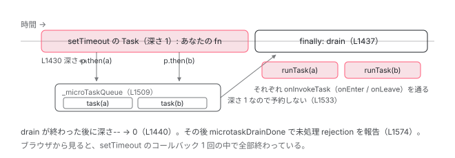

[目次](../README.md) › [zone.js の内側](README.md) › 第 6 回 / 全 13 回

# マイクロタスクキュー：ZoneAwarePromise と drainMicroTaskQueue

> Promise そのものが差し替えられる。then のコールバックは \_microTaskQueue に入り、最外のタスクが終わった瞬間に drainMicroTaskQueue が一気に流す。

angular/angular · 読了 約 13 分 · 発展 · [サイトで読む（デモが動きます）](https://angular-deep-dive-cyan.vercel.app/chapter/zone-microtask)

---

`setTimeout` は「元の関数を退避して差し替える」だけで済みました（[3 章](03-zone-patching.md)）。`Promise` はそれでは足りません。`then` のコールバックはブラウザ内部のマイクロタスクキューから呼ばれ、zone.js が「いつ全部流れ終わったか」を知る手段がないからです。そこで zone.js は **`window.Promise` そのものを `ZoneAwarePromise` に差し替え、`then` のコールバックを自前の `_microTaskQueue` に積み、最外の Task が終わった瞬間に `drainMicroTaskQueueSynchronously` で一気に流します**。この章ではその 3 点を読みます。

読む対象は `packages/zone.js/lib/common/promise.ts`（642 行）と `zone-impl.ts` の L1495-1580（MICROTASK QUEUE）、`common/queue-microtask.ts` です。

1. 概観
2. Zone とは
3. モンキーパッチ
4. Task のライフサイクル
5. ZoneDelegate
6. **マイクロタスクキュー**（この章）
7. addEventListener
8. hasTask
9. NgZone の fork
10. onEnter・onLeave・checkStable
11. NgZoneChangeDetectionScheduler
12. coalescing と runOutsideAngular
13. 1 クリックの全行程

## 1. window.Promise が別のクラスになる

📄 `angular/packages/zone.js/lib/common/promise.ts` L584–585 （▶ の行: 584–585）

```ts
584 ▶     const NativePromise = (global[symbolPromise] = global['Promise']);
585 ▶     global['Promise'] = ZoneAwarePromise;
```

`__load_patch('ZoneAwarePromise', ...)`（12〜13 行目）の中、584 行目でネイティブの `Promise` を `window.__zone_symbol__Promise` に退避し、585 行目で `window.Promise = ZoneAwarePromise`。`ZoneAwarePromise` は 326〜576 行目で定義された、**Promise 仕様を自前で実装したクラス**です。`new Promise(...)`、`Promise.resolve`、`async/await` の `await`（内部で `Promise.resolve` と `then` を使う）はすべてこのクラスを通ります。

[2 章](02-zone-what.md)の `assertZonePatched`（zone-impl.ts 783〜793 行目）は `global['Promise'] !== patches['ZoneAwarePromise']` を検査していました。「Promise polyfill を zone.js の後に読み込むな」というあのエラーは、ここで差し替えた `Promise` が上書きされたときに出ます。

## 2. then は zone を記録してキューに積む

📄 `angular/packages/zone.js/lib/common/promise.ts` L528–552 （▶ の行: 544–547, 549, 551）

```ts
528 │       then<TResult1 = R, TResult2 = never>(
529 │         onFulfilled?: ((value: R) => TResult1 | PromiseLike<TResult1>) | undefined | null,
530 │         onRejected?: ((reason: any) => TResult2 | PromiseLike<TResult2>) | undefined | null,
531 │       ): Promise<TResult1 | TResult2> {
532 │         // We must read `Symbol.species` safely because `this` may be anything. For instance, `this`
533 │         // may be an object without a prototype (created through `Object.create(null)`); thus
534 │         // `this.constructor` will be undefined. One of the use cases is SystemJS creating
535 │         // prototype-less objects (modules) via `Object.create(null)`. The SystemJS creates an empty
536 │         // object and copies promise properties into that object (within the `getOrCreateLoad`
537 │         // function). The zone.js then checks if the resolved value has the `then` method and
538 │         // invokes it with the `value` context. Otherwise, this will throw an error: `TypeError:
539 │         // Cannot read properties of undefined (reading 'Symbol(Symbol.species)')`.
540 │         let C = (this.constructor as any)?.[Symbol.species];
541 │         if (!C || typeof C !== 'function') {
542 │           C = this.constructor || ZoneAwarePromise;
543 │         }
544 ▶         const chainPromise: Promise<TResult1 | TResult2> = new (C as typeof ZoneAwarePromise)(noop);
545 ▶         const zone = Zone.current;
546 ▶         if ((this as any)[symbolState] == UNRESOLVED) {
547 ▶           (<any[]>(this as any)[symbolValue]).push(zone, chainPromise, onFulfilled, onRejected);
548 │         } else {
549 ▶           scheduleResolveOrReject(this, zone, chainPromise as any, onFulfilled, onRejected);
550 │         }
551 ▶         return chainPromise;
552 │       }
```

1. **544 行目：戻り値の Promise を先に作る**

   `chainPromise`。`then` の戻り値です。`noop` を executor にして、まだ未解決のまま作ります。
2. **545 行目：`Zone.current` を捕まえる**

   **`then` を呼んだ瞬間の zone**です。コールバックはあとでこの zone で実行されます。angular zone の中で `await` すれば、続きも angular zone です。
3. **546〜547 行目：未解決なら Promise 自身のキューに積む**

   `symbolValue`（`__zone_symbol__value`）は、未解決のあいだは**配列**として使われ、`[zone, chainPromise, onFulfilled, onRejected]` の 4 つ組を push します。解決後は同じプロパティに値が入ります（181〜184 行目）。
4. **549 行目：既に解決済みなら即スケジュール**

   `scheduleResolveOrReject`（次の引用）を直接呼びます。

📄 `angular/packages/zone.js/lib/common/promise.ts` L181–184 （▶ の行: 182–184）

```ts
181 │         } else {
182 ▶           (promise as any)[symbolState] = state;
183 ▶           const queue = (promise as any)[symbolValue];
184 ▶           (promise as any)[symbolValue] = value;
```

📄 `angular/packages/zone.js/lib/common/promise.ts` L215–217 （▶ の行: 216）

```ts
215 │           for (let i = 0; i < queue.length;) {
216 ▶             scheduleResolveOrReject(promise, queue[i++], queue[i++], queue[i++], queue[i++]);
217 │           }
```

Promise が解決されると（`resolvePromise`）、182 行目で状態を書き、183 行目で積んであった 4 つ組の配列を取り出し、184 行目で値に置き換えます。216 行目、4 つ組ごとに `scheduleResolveOrReject` を呼びます。`then` が先でも後でも、最終的に全部ここに来ます。

📄 `angular/packages/zone.js/lib/common/promise.ts` L274–291 （▶ の行: 282–283, 290）

```ts
274 │     function scheduleResolveOrReject<R, U1, U2>(
275 │       promise: ZoneAwarePromise<any>,
276 │       zone: Zone,
277 │       chainPromise: ZoneAwarePromise<any>,
278 │       onFulfilled?: ((value: R) => U1) | null | undefined,
279 │       onRejected?: ((error: any) => U2) | null | undefined,
280 │     ): void {
281 │       clearRejectedNoCatch(promise);
282 ▶       const promiseState = (promise as any)[symbolState];
283 ▶       const delegate = promiseState
284 │         ? typeof onFulfilled === 'function'
285 │           ? onFulfilled
286 │           : forwardResolution
287 │         : typeof onRejected === 'function'
288 │           ? onRejected
289 │           : forwardRejection;
290 ▶       zone.scheduleMicroTask(
291 │         source,
```

📄 `angular/packages/zone.js/lib/common/promise.ts` L292–318 （▶ の行: 303–304, 310, 313, 316）

```ts
292 │         () => {
293 │           try {
294 │             const parentPromiseValue = (promise as any)[symbolValue];
295 │             const isFinallyPromise =
296 │               !!chainPromise && symbolFinally === (chainPromise as any)[symbolFinally];
297 │             if (isFinallyPromise) {
298 │               // if the promise is generated from finally call, keep parent promise's state and value
299 │               (chainPromise as any)[symbolParentPromiseValue] = parentPromiseValue;
300 │               (chainPromise as any)[symbolParentPromiseState] = promiseState;
301 │             }
302 │             // should not pass value to finally callback
303 ▶             const value = zone.run(
304 ▶               delegate,
305 │               undefined,
306 │               isFinallyPromise && delegate !== forwardRejection && delegate !== forwardResolution
307 │                 ? []
308 │                 : [parentPromiseValue],
309 │             );
310 ▶             resolvePromise(chainPromise, true, value);
311 │           } catch (error) {
312 │             // if error occurs, should always return this error
313 ▶             resolvePromise(chainPromise, false, error);
314 │           }
315 │         },
316 ▶         chainPromise as TaskData,
317 │       );
318 │     }
```

282〜289 行目で、成功なら `onFulfilled`、失敗なら `onRejected`（無ければ値をそのまま流す関数）を `delegate` に選びます。**290 行目、`zone.scheduleMicroTask('Promise.then', コールバック, chainPromise)`**。`then` で捕まえた zone に、`type: 'microTask'`、`source: 'Promise.then'` の Task を予約します。[4 章](04-zone-task.md)の `scheduleTask` がそのまま走るので、`onScheduleTask` フックやカウンタ（`microTask` +1）も動きます。

Task の callback（292〜315 行目）は、303〜304 行目で **`zone.run(delegate, undefined, [値])`** と、もう一度 zone を明示して `onFulfilled` を呼び、310 行目で結果を `chainPromise` に流します。例外なら 313 行目で reject。これが `then` の連鎖の実装です。

## 3. microTask には scheduleFn が無い

📄 `angular/packages/zone.js/lib/zone-impl.ts` L1307–1316 （▶ の行: 1308, 1310–1311）

```ts
1307 │       } else {
1308 ▶         if (task.scheduleFn) {
1309 │           task.scheduleFn(task);
1310 ▶         } else if (task.type == microTask) {
1311 ▶           scheduleMicroTask(<MicroTask>task);
1312 │         } else {
1313 │           throw new Error('Task is missing scheduleFn.');
1314 │         }
1315 │       }
1316 │       return returnTask;
```

4 章で見た `_ZoneDelegate.scheduleTask` の末端です。`setTimeout` なら 1308〜1309 行目でネイティブを呼びました。`Promise.then` の Task は `scheduleFn` を渡していないので（290〜317 行目に第 4 引数が無い）、**1310〜1311 行目、zone.js 内部の `scheduleMicroTask(task)`** に入ります。ブラウザのキューには入りません。

📄 `angular/packages/zone.js/lib/zone-impl.ts` L1508–1511 （▶ の行: 1509–1510）

```ts
1508 │   const enableNativeMicrotaskDraining = __symbol__('enable_native_microtask_draining');
1509 ▶   let _microTaskQueue: Task[] = [];
1510 ▶   let _isDrainingMicrotaskQueue = false;
1511 │   let nativeMicroTaskQueuePromise: any;
```

📄 `angular/packages/zone.js/lib/zone-impl.ts` L1627–1629 （▶ の行: 1629）

```ts
1627 │   let _currentZoneFrame: ZoneFrame = {parent: null, zone: new ZoneImpl(null, null)};
1628 │   let _currentTask: Task | null = null;
1629 ▶   let _numberOfNestedTaskFrames = 0;
```

1509 行目、**`_microTaskQueue` は `initZone()` の中の配列 1 本**です。zone ごとではなく、全 zone 共通です。1629 行目の `_numberOfNestedTaskFrames` は「今いくつの Task の中にいるか」。4 章の `ZoneTask.invokeTask`（1430 行目）が +1、1440 行目が -1 していました。

📄 `angular/packages/zone.js/lib/zone-impl.ts` L1528–1545 （▶ の行: 1532–1533, 1535, 1539, 1543）

```ts
1528 │   function scheduleMicroTask(task?: MicroTask) {
1529 │     const isNativeDrainingEnabled = global[enableNativeMicrotaskDraining];
1530 │     const shouldDrainWithNative =
1531 │       isNativeDrainingEnabled && _microTaskQueue.length === 0 && !_isDrainingMicrotaskQueue;
1532 ▶     const shouldDrainWithoutNative =
1533 ▶       !isNativeDrainingEnabled && _numberOfNestedTaskFrames === 0 && _microTaskQueue.length === 0;
1534 │ 
1535 ▶     if (shouldDrainWithNative || shouldDrainWithoutNative) {
1536 │       // Start draining the microtask queue if:
1537 │       // - Native draining is enabled and not currently in progress, or
1538 │       // - Native draining is disabled, and there are no nested tasks and no queued microtasks.
1539 ▶       nativeScheduleMicroTask(drainMicroTaskQueueSynchronously);
1540 │     }
1541 │ 
1542 │     if (task) {
1543 ▶       _microTaskQueue.push(task);
1544 │     }
1545 │   }
```

1. **1543 行目：キューに push**

   これが本体です。Task を `_microTaskQueue` の末尾に積みます。
2. **1532〜1533 行目：誰が流すか**

   既定（`enable_native_microtask_draining` フラグ無し）では、**「Task の外にいて（`_numberOfNestedTaskFrames === 0`）、かつキューが空」**のときだけ 1539 行目に進みます。Task の中にいるときは何もしません。**Task が終わる瞬間（`invokeTask` の `finally`）に流されるから**です。
3. **1539 行目：Task の外なら、ネイティブの microtask に drain を 1 回だけ予約**

   たとえば `<script>` の直下やコンソールで `Promise.resolve().then(fn)` と書いたとき。誰も `finally` で流してくれないので、ネイティブの仕組みを借ります。

📄 `angular/packages/zone.js/lib/zone-impl.ts` L1513–1526 （▶ の行: 1515, 1519, 1521, 1524）

```ts
1513 │   function nativeScheduleMicroTask(func: Function) {
1514 │     if (!nativeMicroTaskQueuePromise && global[symbolPromise]) {
1515 ▶       nativeMicroTaskQueuePromise = global[symbolPromise].resolve(0);
1516 │     }
1517 │ 
1518 │     if (nativeMicroTaskQueuePromise) {
1519 ▶       const thenFn = nativeMicroTaskQueuePromise[symbolThen] ?? nativeMicroTaskQueuePromise['then']; // fallback for non-patchable Promise
1520 │       // Use the resolved native promise to schedule the microtask
1521 ▶       thenFn.call(nativeMicroTaskQueuePromise, func);
1522 │     } else {
1523 │       // Fallback to setTimeout if native promise is unavailable
1524 ▶       global[symbolSetTimeout](func, 0);
1525 │     }
1526 │   }
```

1515 行目、退避しておいた**ネイティブ**`Promise`（`__zone_symbol__Promise`）で解決済み Promise を 1 つ作り、1519〜1521 行目、その**ネイティブ**`then`（`__zone_symbol__then`）に `drainMicroTaskQueueSynchronously` を渡します。`ZoneAwarePromise` を使ったら自分のキューに戻ってきてしまうので、ここだけは退避した本物を使います。1524 行目、ネイティブ Promise が無い環境では `__zone_symbol__setTimeout` に落ちます。

## 4. drainMicroTaskQueueSynchronously：一気に流す

📄 `angular/packages/zone.js/lib/zone-impl.ts` L1426–1443 （▶ の行: 1430, 1436–1437, 1440）

```ts
1426 │     static invokeTask(task: any, target: any, args: any): any {
1427 │       if (!task) {
1428 │         task = this;
1429 │       }
1430 ▶       _numberOfNestedTaskFrames++;
1431 │       try {
1432 │         task.runCount++;
1433 │         return task.zone.runTask(task, target, args);
1434 │       } finally {
1435 │         try {
1436 ▶           if (_numberOfNestedTaskFrames === 1 && !global[enableNativeMicrotaskDraining]) {
1437 ▶             drainMicroTaskQueueSynchronously();
1438 │           }
1439 │         } finally {
1440 ▶           _numberOfNestedTaskFrames--;
1441 │         }
1442 │       }
1443 │     }
```

4 章の再掲です。1430 行目で深さ +1、Task の実行後、1436 行目で**深さが 1（最外の Task）なら** 1437 行目で drain、1440 行目で -1。`setTimeout` のコールバックの中で `then` を何回呼んでも、全部キューに溜まり、コールバックが return した直後にまとめて流れます。入れ子の Task（click の中の `dispatchEvent` など）では深さ 2 なので流さず、最外まで戻るのを待ちます。

📄 `angular/packages/zone.js/lib/zone-impl.ts` L1547–1580 （▶ の行: 1548, 1552, 1555–1557, 1559, 1561, 1563, 1574）

```ts
1547 │   function drainMicroTaskQueueSynchronously() {
1548 ▶     if (_isDrainingMicrotaskQueue) {
1549 │       return;
1550 │     }
1551 │ 
1552 ▶     _isDrainingMicrotaskQueue = true;
1553 │ 
1554 │     try {
1555 ▶       while (_microTaskQueue.length) {
1556 ▶         const queue = _microTaskQueue;
1557 ▶         _microTaskQueue = [];
1558 │ 
1559 ▶         for (const task of queue) {
1560 │           try {
1561 ▶             task.zone.runTask(task, null, null);
1562 │           } catch (error) {
1563 ▶             _api.onUnhandledError(error as Error);
1564 │           }
1565 │         }
1566 │       }
1567 │     } finally {
1568 │       // The order matters!
1569 │       if (global[enableNativeMicrotaskDraining]) {
1570 │         _isDrainingMicrotaskQueue = false;
1571 │         _api.microtaskDrainDone();
1572 │       } else {
1573 │         try {
1574 ▶           _api.microtaskDrainDone();
1575 │         } finally {
1576 │           _isDrainingMicrotaskQueue = false;
1577 │         }
1578 │       }
1579 │     }
1580 │   }
```

1. **1548〜1552 行目：再入防止**

   流している最中に呼ばれたら何もしません。
2. **1555〜1557 行目：キューを丸ごと取り出して空にする**

   `const queue = _microTaskQueue; _microTaskQueue = []`。流している途中で新しく積まれた Task は新しい配列に入り、1555 行目の `while` で次の周に流れます。**キューが空になるまで同期的に回り続けます。**これが「`then` の中で `then` しても同じ drain の中で終わる」理由です。
3. **1559〜1561 行目：1 つずつ `task.zone.runTask(task, null, null)`**

   4 章の `runTask` です。`then` で捕まえた zone のフレームを積み、`_zoneDelegate.invokeTask` → Angular の `onInvokeTask`（`onEnter` / `onLeave`）→ callback。**Promise のコールバックも `onInvokeTask` を通る**のはこのためです。終わると `microTask` のカウンタが -1 されます。
4. **1563 行目：例外は `onUnhandledError`**

   1 つのコールバックが例外を投げても、残りは流れます。
5. **1574 行目：`microtaskDrainDone`**

   次の引用。未処理の rejection をここで報告します。

📄 `angular/packages/zone.js/lib/common/promise.ts` L55–69 （▶ の行: 55–56, 59, 63）

```ts
55 ▶     api.microtaskDrainDone = () => {
56 ▶       while (_uncaughtPromiseErrors.length) {
57 │         const uncaughtPromiseError: UncaughtPromiseError = _uncaughtPromiseErrors.shift()!;
58 │         try {
59 ▶           uncaughtPromiseError.zone.runGuarded(() => {
60 │             if (uncaughtPromiseError.throwOriginal) {
61 │               throw uncaughtPromiseError.rejection;
62 │             }
63 ▶             throw uncaughtPromiseError;
64 │           });
65 │         } catch (error) {
66 │           handleUnhandledRejection(error);
67 │         }
68 │       }
69 │     };
```

`catch` の無い reject（promise.ts 218〜244 行目）は `_uncaughtPromiseErrors` に溜められ、56 行目でキューが空になった後に 1 つずつ取り出し、59〜63 行目でその Promise の zone の `runGuarded` で throw します。`runGuarded` なので Angular の `onHandleError` に届き、`ErrorHandler` の「Uncaught (in promise): ...」になります。**drain が終わるまで報告されない**ので、同じ tick の中であとから `catch` を付ければ間に合います（252〜272 行目の `clearRejectedNoCatch`）。



*Task の中で then を 2 回呼んだとき。コールバックは \_microTaskQueue に溜まり、Task の finally（深さ 1）で drain が同期的に全部流す。ブラウザのマイクロタスクキューは使わない。*

> **🧪 DEMO — \_microTaskQueue と \_numberOfNestedTaskFrames**
>
> Task の中と外で `promise.then(cb)` を呼んだときの違いを見ます。Task の中では finally（L1437）が流し、外ではネイティブ microtask（L1539）が流します。
>
> ▶ [このデモはサイトで動かせます](https://angular-deep-dive-cyan.vercel.app/chapter/zone-microtask)

## 5. ネイティブ Promise と fetch の then も包む

📄 `angular/packages/zone.js/lib/common/promise.ts` L589–610 （▶ の行: 599, 601, 603–605, 607）

```ts
589 │     function patchThen(Ctor: Function) {
590 │       const proto = Ctor.prototype;
591 │ 
592 │       const prop = ObjectGetOwnPropertyDescriptor(proto, 'then');
593 │       if (prop && (prop.writable === false || !prop.configurable)) {
594 │         // check Ctor.prototype.then propertyDescriptor is writable or not
595 │         // in meteor env, writable is false, we should ignore such case
596 │         return;
597 │       }
598 │ 
599 ▶       const originalThen = proto.then;
600 │       // Keep a reference to the original method.
601 ▶       proto[symbolThen] = originalThen;
602 │ 
603 ▶       Ctor.prototype.then = function (onResolve: any, onReject: any) {
604 ▶         const wrapped = new ZoneAwarePromise((resolve, reject) => {
605 ▶           originalThen.call(this, resolve, reject);
606 │         });
607 ▶         return wrapped.then(onResolve, onReject);
608 │       };
609 │       (Ctor as any)[symbolThenPatched] = true;
610 │     }
```

📄 `angular/packages/zone.js/lib/common/promise.ts` L628–636 （▶ の行: 629, 635）

```ts
628 │     if (NativePromise) {
629 ▶       patchThen(NativePromise);
630 │       // TODO(atscott): Investigate generic to propagate any unknown properties
631 │       const nativeTry = (NativePromise as any)['try'];
632 │       if (nativeTry && typeof nativeTry === 'function') {
633 │         (ZoneAwarePromise as any)['try'] = nativeTry;
634 │       }
635 ▶       patchMethod(global, 'fetch', (delegate) => zoneify(delegate));
636 │     }
```

`window.Promise` を差し替えても、ブラウザ API（`fetch`、`IndexedDB` 等）が返す Promise は**ネイティブ**のインスタンスです。そこで 629 行目、ネイティブ `Promise.prototype.then` も `patchThen` で差し替えます。601 行目で元の `then` を `__zone_symbol__then` に退避（3 節の `nativeScheduleMicroTask` が使っていたもの）、603〜608 行目で「ネイティブ Promise を `ZoneAwarePromise` で包み（604〜606 行目）、その `then` を呼ぶ（607 行目）」関数に置き換えます。635 行目、`fetch` の戻り値も `zoneify` で同様に扱います。`await fetch(...)` の続きが angular zone で動くのはこのためです。

📄 `angular/packages/zone.js/lib/common/queue-microtask.ts` L13–19 （▶ の行: 16）

```ts
13 │ export function patchQueueMicrotask(global: any, api: _ZonePrivate) {
14 │   api.patchMethod(global, 'queueMicrotask', (delegate) => {
15 │     return function (self: any, args: any[]) {
16 ▶       Zone.current.scheduleMicroTask('queueMicrotask', args[0]);
17 │     };
18 │   });
19 │ }
```

`queueMicrotask(fn)` も 16 行目で `Zone.current.scheduleMicroTask('queueMicrotask', fn)`。ネイティブの `queueMicrotask` は**一切呼ばれません**（`delegate` が使われていない）。`Promise.then` と同じ `_microTaskQueue` に入ります。

> [!WARNING]
> **ハマりどころ**
>
> 「ネイティブの microtask と何が違うか」の答えはこれです。zone.js の microTask は**ブラウザのキューではなく `_microTaskQueue` という配列**に入り、**最外の Task の `finally`（または Task の外ならネイティブ then を 1 回借りて）同期的に全部流れます**。順序は仕様どおり（先に積んだものが先）ですが、1 つの Task の中で積まれた microTask はその Task の `invokeTask` が return する前に全部終わります。ブラウザから見れば「コールバック 1 回」です。Angular の `onHasTask` が `microTask: false` を受け取る瞬間は、この drain の最後の `runTask` が終わったとき（[8 章](08-zone-hastask.md)）です。

## ここまでの呼び出し（setTimeout の中で await したとき）

- 👤 `setTimeout(async () => { await p; next(); }, 0)` — あなたのコード
- `（ブラウザ発火）ZoneTask.invokeTask` — zone-impl.ts L1426 — *\_numberOfNestedTaskFrames = 1（L1430）*
  - `runTask → onInvokeTask → あなたの async 関数` — L920 → ng\_zone.ts L438 — *onEnter*
    - `p.then(続き)` — promise.ts L528 — *zone = Zone.current（L545）= angular*
      - `scheduleResolveOrReject(p, angular, chainPromise, 続き)` — L274
        - `angular.scheduleMicroTask('Promise.then', cb, chainPromise)` — L290 → zone-impl.ts L1018 — *4 章の scheduleTask。microTask カウンタ +1*
          - `_ZoneDelegate.scheduleTask → scheduleMicroTask(task)` — L1311 → L1528 — *深さ 1 なので予約せず push（L1543）*
  - `async 関数が await で中断して return` — *onLeave → checkStable（microTask が残っているので安定しない）*
  - `finally: drainMicroTaskQueueSynchronously()` — L1437
    - `task.zone.runTask(task)` — L1561 — *angular zone。onInvokeTask → onEnter*
      - `zone.run(続き, undefined, [値])` — promise.ts L303 — *next() が動く*
    - `finally: microTask カウンタ -1 → onHasTask(microTask: false)` — zone-impl.ts L967 — *onLeave → checkStable → 安定*
  - `_api.microtaskDrainDone()` — L1574
  - `_numberOfNestedTaskFrames = 0` — L1440

## 聞かれそうな質問

**Q. Promise.then のコールバックは zone.js のどこで実行されますか？**

`drainMicroTaskQueueSynchronously`（zone-impl.ts 1547〜1580 行目）の 1561 行目、`task.zone.runTask(task, null, null)` です。`then`（promise.ts 545 行目）で捕まえた zone が `task.zone` なので、`then` を呼んだときの zone で動きます。その中で 303 行目の `zone.run(delegate, ...)` があなたのコールバックを呼びます。

**Q. ネイティブの microtask と何が違いますか？**

キューが違います。zone.js は `_microTaskQueue`（1509 行目）という自前の配列に積み（1543 行目）、最外の Task が終わる `ZoneTask.invokeTask` の `finally`（1436〜1437 行目）で同期的に全部流します。Task の外で `then` したときだけ、退避したネイティブ `then`（1519〜1521 行目）を 1 回借りて drain を予約します。どちらの場合も、個々のコールバックはブラウザのマイクロタスクとしては実行されません。

**Q. なぜ window.Promise を差し替える必要があるのですか？then だけ包めば良いのでは？**

`then` だけ包むのは `patchThen`（589〜610 行目）としてネイティブ Promise にも行っています。しかしそれでも、ブラウザのキューに入ったコールバックが「いつ全部終わったか」は分かりません。`ZoneAwarePromise` として解決・連鎖の全体を自前で持ち（181〜217 行目）、コールバックを自前キューに入れることで、1555 行目の `while` が空になった瞬間 = 「microTask が 0 になった瞬間」を `onHasTask` で通知できます。

**Q. await の続きはどの zone で動きますか？**

`await` した瞬間の zone です。`await` は内部で `then` を呼ぶので、promise.ts 545 行目の `Zone.current` が記録され、1561 行目の `runTask` がその zone のフレームを積んで続きを実行します。`runOutsideAngular` の中で `await` すれば続きも外です。

**Q. Uncaught (in promise) はいつ報告されますか？**

drain が終わった直後です。`catch` の無い reject は promise.ts 242 行目で `_uncaughtPromiseErrors` に積まれ、1574 行目の `microtaskDrainDone`（promise.ts 55〜69 行目）がキューを空にした後に 59 行目の `runGuarded` で throw します。それまでに `catch` を付ければ `clearRejectedNoCatch`（252〜272 行目）が取り消します。

## 読み終えて

- `window.Promise` は `ZoneAwarePromise` に差し替わる（promise.ts 585 行目）。ネイティブは `__zone_symbol__Promise`
- `then` は `Zone.current` を記録し（545 行目）、解決時に `zone.scheduleMicroTask('Promise.then', ...)`（290 行目）で Task を作る
- microTask には `scheduleFn` が無く、`_microTaskQueue` という配列 1 本に push される（1543 行目）
- 流すのは最外の Task の `finally`（1437 行目）。Task の外なら退避したネイティブ `then` で 1 回だけ予約（1539 行目）
- `drainMicroTaskQueueSynchronously` はキューが空になるまで同期的に回り、各 Task を `runTask`（1561 行目）で `onInvokeTask` を通して実行する

---

← 前: [ZoneDelegate：親子の鎖で割り込む](05-zone-delegate.md)  
次: [addEventListener のパッチ：EventTask](07-zone-events.md) →
