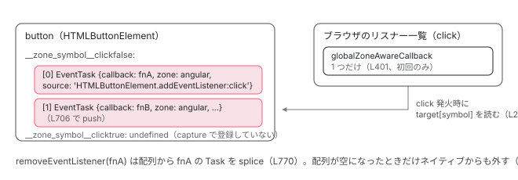

[目次](../README.md) › [zone.js の内側](README.md) › 第 7 回 / 全 13 回

# addEventListener のパッチ：EventTask

> patchEventTarget が addEventListener を置き換え、リスナーを EventTask で包む。要素ごとに \_\_zone\_symbol\_\_clickfalse という配列でタスクを持つ。

angular/angular · 読了 約 12 分 · 発展 · [サイトで読む（デモが動きます）](https://angular-deep-dive-cyan.vercel.app/chapter/zone-events)

---

`setTimeout` は 1 回で終わり、`Promise.then` は 1 回で終わる。`addEventListener` だけが「何度も呼ばれ、いつ呼ばれるか分からず、明示的に外すまで残る」Task です。この章では `patchEventTarget` が `EventTarget.prototype.addEventListener` を何に差し替え、**あなたが渡したリスナーが `EventTask` になって要素のどこに保存され、ブラウザには何が登録され、`removeEventListener` がそれをどう探すか**を読みます。

読む対象は `packages/zone.js/lib/common/events.ts`（957 行）、`browser/event-target.ts`、`browser/browser.ts` の L58-66 です。

1. 概観
2. Zone とは
3. モンキーパッチ
4. Task のライフサイクル
5. ZoneDelegate
6. マイクロタスクキュー
7. **addEventListener**（この章）
8. hasTask
9. NgZone の fork
10. onEnter・onLeave・checkStable
11. NgZoneChangeDetectionScheduler
12. coalescing と runOutsideAngular
13. 1 クリックの全行程

## 1. 登録：EventTarget.prototype を 1 回だけパッチする

📄 `angular/packages/zone.js/lib/browser/browser.ts` L58–66 （▶ の行: 58–60）

```ts
58 ▶   Zone.__load_patch('EventTarget', (global: any, Zone: ZoneType, api: _ZonePrivate) => {
59 ▶     patchEvent(global, api);
60 ▶     eventTargetPatch(global, api);
61 │     // patch XMLHttpRequestEventTarget's addEventListener/removeEventListener
62 │     const XMLHttpRequestEventTarget = (global as any)['XMLHttpRequestEventTarget'];
63 │     if (XMLHttpRequestEventTarget && XMLHttpRequestEventTarget.prototype) {
64 │       api.patchEventTarget(global, api, [XMLHttpRequestEventTarget.prototype]);
65 │     }
66 │   });
```

📄 `angular/packages/zone.js/lib/browser/event-target.ts` L9–35 （▶ の行: 17, 19–22, 24–25, 28, 32）

```ts
 9 │ export function eventTargetPatch(_global: any, api: _ZonePrivate) {
10 │   if ((Zone as any)[api.symbol('patchEventTarget')]) {
11 │     // EventTarget is already patched.
12 │     return;
13 │   }
14 │   const {eventNames, zoneSymbolEventNames, TRUE_STR, FALSE_STR, ZONE_SYMBOL_PREFIX} =
15 │     api.getGlobalObjects()!;
16 │   //  predefine all __zone_symbol__ + eventName + true/false string
17 ▶   for (let i = 0; i < eventNames.length; i++) {
18 │     const eventName = eventNames[i];
19 ▶     const falseEventName = eventName + FALSE_STR;
20 ▶     const trueEventName = eventName + TRUE_STR;
21 ▶     const symbol = ZONE_SYMBOL_PREFIX + falseEventName;
22 ▶     const symbolCapture = ZONE_SYMBOL_PREFIX + trueEventName;
23 │     zoneSymbolEventNames[eventName] = {};
24 ▶     zoneSymbolEventNames[eventName][FALSE_STR] = symbol;
25 ▶     zoneSymbolEventNames[eventName][TRUE_STR] = symbolCapture;
26 │   }
27 │ 
28 ▶   const EVENT_TARGET = _global['EventTarget'];
29 │   if (!EVENT_TARGET || !EVENT_TARGET.prototype) {
30 │     return;
31 │   }
32 ▶   api.patchEventTarget(_global, api, [EVENT_TARGET && EVENT_TARGET.prototype]);
33 │ 
34 │   return true;
35 │ }
```

`__load_patch('EventTarget')`（58 行目）から `eventTargetPatch`（60 行目）へ。17〜26 行目、`window` の `onclick` などから集めたイベント名すべてについて、**`'__zone_symbol__click' + 'false'` と `'__zone_symbol__click' + 'true'`** の 2 つの文字列を先に作って `zoneSymbolEventNames['click']` に入れておきます（24〜25 行目）。`false` / `true` は `capture` の値です。**この文字列が、要素ごとに Task の配列を隠すプロパティ名になります。**

28〜32 行目、対象は `EventTarget.prototype` 1 つだけ。`HTMLButtonElement` も `window` も `document` もプロトタイプチェーンで `EventTarget` に行き着くので、1 回のパッチで全部に効きます。

📄 `angular/packages/zone.js/lib/common/events.ts` L331–345 （▶ の行: 332–333, 343–344）

```ts
331 │     let proto = obj;
332 ▶     while (proto && !Object.hasOwn(proto, ADD_EVENT_LISTENER)) {
333 ▶       proto = ObjectGetPrototypeOf(proto);
334 │     }
335 │     if (!proto && obj[ADD_EVENT_LISTENER]) {
336 │       // somehow we did not find it, but we can see it. This happens on IE for Window properties.
337 │       proto = obj;
338 │     }
339 │ 
340 │     if (!proto) {
341 │       return false;
342 │     }
343 ▶     if (proto[zoneSymbolAddEventListener]) {
344 ▶       return false;
345 │     }
```

📄 `angular/packages/zone.js/lib/common/events.ts` L357–366 （▶ の行: 357, 359–361）

```ts
357 ▶     const taskData: InternalGlobalTaskData = {};
358 │ 
359 ▶     const nativeAddEventListener = (proto[zoneSymbolAddEventListener] = proto[ADD_EVENT_LISTENER]);
360 ▶     const nativeRemoveEventListener = (proto[zoneSymbol(REMOVE_EVENT_LISTENER)] =
361 ▶       proto[REMOVE_EVENT_LISTENER]);
362 │ 
363 │     const nativeListeners = (proto[zoneSymbol(LISTENERS_EVENT_LISTENER)] =
364 │       proto[LISTENERS_EVENT_LISTENER]);
365 │     const nativeRemoveAllListeners = (proto[zoneSymbol(REMOVE_ALL_LISTENERS_EVENT_LISTENER)] =
366 │       proto[REMOVE_ALL_LISTENERS_EVENT_LISTENER]);
```

`patchEventTarget` → `patchEventTargetMethods` の中です。332〜333 行目、[3 章](03-zone-patching.md)の `patchMethod` と同じ手順で `addEventListener` を本当に持つプロトタイプを探し、343〜344 行目で既に退避済みなら何もしません。359〜361 行目で **`EventTarget.prototype.__zone_symbol__addEventListener` / `__zone_symbol__removeEventListener` にネイティブを退避**します。357 行目の `taskData` は「1 回の `addEventListener` 呼び出しのあいだだけ値を入れる使い回しオブジェクト」です（349〜356 行目のコメント）。

## 2. addEventListener('click', fn) を呼んだ瞬間

📄 `angular/packages/zone.js/lib/common/events.ts` L717–723 （▶ の行: 717–718, 720–721）

```ts
717 ▶     proto[ADD_EVENT_LISTENER] = makeAddListener(
718 ▶       nativeAddEventListener,
719 │       ADD_EVENT_LISTENER_SOURCE,
720 ▶       customSchedule,
721 ▶       customCancel,
722 │       returnTarget,
723 │     );
```

717 行目、`proto['addEventListener'] = makeAddListener(ネイティブ, '.addEventListener:', customSchedule, customCancel, ...)`。`makeAddListener` が返す関数（527〜714 行目）が、あなたが呼ぶ `addEventListener` です。順に読みます。

📄 `angular/packages/zone.js/lib/common/events.ts` L519–536 （▶ の行: 527–529, 533–535）

```ts
519 │     const makeAddListener = function (
520 │       nativeListener: any,
521 │       addSource: string,
522 │       customScheduleFn: any,
523 │       customCancelFn: any,
524 │       returnTarget = false,
525 │       prepend = false,
526 │     ) {
527 ▶       return function (this: unknown) {
528 ▶         const target = this || _global;
529 ▶         let eventName = arguments[0];
530 │         if (patchOptions && patchOptions.transferEventName) {
531 │           eventName = patchOptions.transferEventName(eventName);
532 │         }
533 ▶         let delegate: EventListenerOrEventListenerObject = arguments[1];
534 ▶         if (!delegate) {
535 ▶           return nativeListener.apply(this, arguments);
536 │         }
```

528 行目 `target` は `this`（`button`）、529 行目 `eventName` は `'click'`、533 行目 `delegate` があなたの `fn`。534〜535 行目、`fn` が無ければネイティブに丸投げ。以下 544〜578 行目で `{handleEvent}` 形式の判定、`options` のコピー、`AbortSignal`、`UNPATCHED_EVENTS`（パッチしないイベント名の一覧）の確認が続きます。

📄 `angular/packages/zone.js/lib/common/events.ts` L580–605 （▶ の行: 580, 583–584, 589–590, 592, 594, 597–599, 604）

```ts
580 ▶         const capture = !options ? false : typeof options === 'boolean' ? true : options.capture;
581 │         const once = options && typeof options === 'object' ? options.once : false;
582 │ 
583 ▶         const zone = Zone.current;
584 ▶         let symbolEventNames = zoneSymbolEventNames[eventName];
585 │         if (!symbolEventNames) {
586 │           prepareEventNames(eventName, eventNameToString);
587 │           symbolEventNames = zoneSymbolEventNames[eventName];
588 │         }
589 ▶         const symbolEventName = symbolEventNames[capture ? TRUE_STR : FALSE_STR];
590 ▶         let existingTasks = target[symbolEventName];
591 │         let isExisting = false;
592 ▶         if (existingTasks) {
593 │           // already have task registered
594 ▶           isExisting = true;
595 │           if (checkDuplicate) {
596 │             for (let i = 0; i < existingTasks.length; i++) {
597 ▶               if (compare(existingTasks[i], delegate)) {
598 ▶                 // same callback, same capture, same event name, just return
599 ▶                 return;
600 │               }
601 │             }
602 │           }
603 │         } else {
604 ▶           existingTasks = target[symbolEventName] = [];
605 │         }
```

1. **580 行目：`capture` を決める**

   第 3 引数が `true` か `{capture: true}` なら `true`。
2. **583 行目：`Zone.current` を捕まえる**

   `addEventListener` を呼んだ瞬間の zone。Angular のテンプレートの `(click)` は angular zone の中で登録されるので、angular zone です。
3. **584〜589 行目：プロパティ名を決める**

   `zoneSymbolEventNames['click']['false']` → **`'__zone_symbol__clickfalse'`**。1 節で先に作っておいた文字列です。カスタムイベント名なら 586 行目でその場で作ります。
4. **590〜605 行目：要素の配列を取り出す／作る**

   `button['__zone_symbol__clickfalse']` が既にあれば `isExisting = true`（594 行目）。597〜599 行目、**同じ `fn` が既に入っていたら何もせず return**（ネイティブの「同じリスナーは二重登録されない」仕様の再現）。無ければ 604 行目で `button['__zone_symbol__clickfalse'] = []`。**これが「要素ごとに `__zone_symbol__clickfalse` という配列でタスクを持つ」の正体です。**

📄 `angular/packages/zone.js/lib/common/events.ts` L606–617 （▶ の行: 607, 613–616）

```ts
606 │         let source;
607 ▶         const constructorName = target.constructor['name'];
608 │         const targetSource = globalSources[constructorName];
609 │         if (targetSource) {
610 │           source = targetSource[eventName];
611 │         }
612 │         if (!source) {
613 ▶           source =
614 ▶             constructorName +
615 ▶             addSource +
616 ▶             (eventNameToString ? eventNameToString(eventName) : eventName);
617 │         }
```

607〜616 行目、Task の `source` を `'HTMLButtonElement' + '.addEventListener:' + 'click'` と組み立てます。DevTools の Performance パネルで `HTMLButtonElement.addEventListener:click` と出るのはこの文字列です。

📄 `angular/packages/zone.js/lib/common/events.ts` L624–642 （▶ の行: 624, 632–635, 637）

```ts
624 ▶         taskData.options = options;
625 │ 
626 │         if (once) {
627 │           // When using `addEventListener` with the `once` option, we don't pass
628 │           // the `once` option directly to the native `addEventListener` method.
629 │           // Instead, we keep the `once` setting and handle it ourselves.
630 │           taskData.options.once = false;
631 │         }
632 ▶         taskData.target = target;
633 ▶         taskData.capture = capture;
634 ▶         taskData.eventName = eventName;
635 ▶         taskData.isExisting = isExisting;
636 │ 
637 ▶         const data = useGlobalCallback ? OPTIMIZED_ZONE_EVENT_TASK_DATA : undefined;
638 │ 
639 │         // keep taskData into data to allow onScheduleEventTask to access the task information
640 │         if (data) {
641 │           data.taskData = taskData;
642 │         }
```

📄 `angular/packages/zone.js/lib/common/events.ts` L655–661 （▶ の行: 655–660）

```ts
655 ▶         const task: InternalEventTask = zone.scheduleEventTask(
656 ▶           source,
657 ▶           <Function>delegate,
658 ▶           data,
659 ▶           customScheduleFn,
660 ▶           customCancelFn,
661 │         );
```

624〜635 行目、使い回しの `taskData` に `options` / `target` / `capture` / `eventName` / `isExisting` を書き込み、637 行目で `data = OPTIMIZED_ZONE_EVENT_TASK_DATA`（`{useG: true}`。84〜86 行目）。655 行目、**`zone.scheduleEventTask(source, fn, data, customScheduleGlobal, customCancelGlobal)`**。[4 章](04-zone-task.md)の `scheduleTask` が走り、`eventTask` のカウンタが +1 され、末端で `customScheduleGlobal` が呼ばれます。

📄 `angular/packages/zone.js/lib/zone-impl.ts` L1415–1423 （▶ の行: 1417–1418, 1420–1421）

```ts
1415 │       const self = this;
1416 │       // TODO: @JiaLiPassion options should have interface
1417 ▶       if (type === eventTask && options && (options as any).useG) {
1418 ▶         this.invoke = ZoneTask.invokeTask;
1419 │       } else {
1420 ▶         this.invoke = function () {
1421 ▶           return ZoneTask.invokeTask.call(global, self, this, <any>arguments);
1422 │         };
1423 │       }
```

4 章で保留にした分岐です。1417〜1418 行目、`eventTask` で `useG` が立っているので、`task.invoke` はクロージャ（1420〜1422 行目）ではなく static な `ZoneTask.invokeTask` そのものになります。リスナー 1 つごとにクロージャを作らないための最適化で、呼ぶ側（`invokeTask`、221 行目）が引数で `task` を渡します。

## 3. ブラウザに登録されるのは globalZoneAwareCallback 1 つ

📄 `angular/packages/zone.js/lib/common/events.ts` L395–407 （▶ の行: 398–399, 401–405）

```ts
395 │     const customScheduleGlobal = function (task: Task) {
396 │       // if there is already a task for the eventName + capture,
397 │       // just return, because we use the shared globalZoneAwareCallback here.
398 ▶       if (taskData.isExisting) {
399 ▶         return;
400 │       }
401 ▶       return nativeAddEventListener.call(
402 ▶         taskData.target,
403 ▶         taskData.eventName,
404 ▶         taskData.capture ? globalZoneAwareCaptureCallback : globalZoneAwareCallback,
405 ▶         taskData.options,
406 │       );
407 │     };
```

📄 `angular/packages/zone.js/lib/common/events.ts` L300–308 （▶ の行: 301–302, 306–307）

```ts
300 │   // global shared zoneAwareCallback to handle all event callback with capture = false
301 ▶   const globalZoneAwareCallback = function (this: unknown, event: Event) {
302 ▶     return globalCallback(this, event, false);
303 │   };
304 │ 
305 │   // global shared zoneAwareCallback to handle all event callback with capture = true
306 ▶   const globalZoneAwareCaptureCallback = function (this: unknown, event: Event) {
307 ▶     return globalCallback(this, event, true);
308 │   };
```

ここが `setTimeout` と最も違う点です。398〜399 行目、**同じ要素・同じイベント名・同じ `capture` の Task が既にあれば（`isExisting`）、ネイティブの `addEventListener` は呼びません**。初回だけ 401〜406 行目で、**あなたの `fn` ではなく `globalZoneAwareCallback`（301〜303 行目。`capture` なら 306〜308 行目のもう 1 つ）**をネイティブに登録します。

つまり `button` に click リスナーを 10 個付けても、ブラウザから見ると `globalZoneAwareCallback` が 1 つ付いているだけです。10 個の `fn` は `button.__zone_symbol__clickfalse` の配列の中に Task として並んでいます。

📄 `angular/packages/zone.js/lib/common/events.ts` L692–714 （▶ の行: 696, 698–700, 706）

```ts
692 │         if (typeof task.options !== 'boolean') {
693 │           // We should save the options on the task (if it's an object) because
694 │           // we'll be using `task.options` later when removing the event listener
695 │           // and passing it back to `removeEventListener`.
696 ▶           task.options = options;
697 │         }
698 ▶         task.target = target;
699 ▶         task.capture = capture;
700 ▶         task.eventName = eventName;
701 │         if (isEventListenerObject) {
702 │           // save original delegate for compare to check duplicate
703 │           task.originalDelegate = <EventListenerObject>delegate;
704 │         }
705 │         if (!prepend) {
706 ▶           existingTasks.push(task);
707 │         } else {
708 │           existingTasks.unshift(task);
709 │         }
710 │ 
711 │         if (returnTarget) {
712 │           return target;
713 │         }
714 │       };
```

`scheduleEventTask` が返った後、696〜700 行目で Task に `options` / `target` / `capture` / `eventName` を保存し （`cancelTask` が `removeEventListener` するときに必要）、**706 行目で `existingTasks.push(task)`**。配列に入って登録完了です。戻り値は `undefined`（ネイティブと同じ）。



*button に fnA と fnB を addEventListener('click') したあと。ブラウザには globalZoneAwareCallback が 1 つだけ。fnA / fnB は button.\_\_zone\_symbol\_\_clickfalse の配列に EventTask として入っている。*

## 4. click が発火した瞬間

📄 `angular/packages/zone.js/lib/common/events.ts` L254–284 （▶ の行: 263–264, 269–270, 276–278, 281）

```ts
254 │   function globalCallback(context: unknown, event: Event, isCapture: boolean) {
255 │     // https://github.com/angular/zone.js/issues/911, in IE, sometimes
256 │     // event will be undefined, so we need to use window.event
257 │     event = event || _global.event;
258 │     if (!event) {
259 │       return;
260 │     }
261 │     // event.target is needed for Samsung TV and SourceBuffer
262 │     // || global is needed https://github.com/angular/zone.js/issues/190
263 ▶     const target: any = context || event.target || _global;
264 ▶     const tasks = target[zoneSymbolEventNames[event.type][isCapture ? TRUE_STR : FALSE_STR]];
265 │     if (tasks) {
266 │       const errors = [];
267 │       // invoke all tasks which attached to current target with given event.type and capture = false
268 │       // for performance concern, if task.length === 1, just invoke
269 ▶       if (tasks.length === 1) {
270 ▶         const err = invokeTask(tasks[0], target, event);
271 │         err && errors.push(err);
272 │       } else {
273 │         // https://github.com/angular/zone.js/issues/836
274 │         // copy the tasks array before invoke, to avoid
275 │         // the callback will remove itself or other listener
276 ▶         const copyTasks = tasks.slice();
277 ▶         for (let i = 0; i < copyTasks.length; i++) {
278 ▶           if (event && (event as any)[IMMEDIATE_PROPAGATION_SYMBOL] === true) {
279 │             break;
280 │           }
281 ▶           const err = invokeTask(copyTasks[i], target, event);
282 │           err && errors.push(err);
283 │         }
284 │       }
```

1. **263〜264 行目：要素から配列を取り出す**

   `target = this`（ブラウザが `this` に入れてくれる要素）、`tasks = target['__zone_symbol__clickfalse']`。
2. **269〜270 行目：1 件なら直接**

   配列コピーを省く最適化です。
3. **276〜283 行目：複数ならコピーして順に**

   276 行目で `slice()`。リスナーの中で `removeEventListener` されても配列が壊れないためです。278 行目、`stopImmediatePropagation` が呼ばれていたら残りを飛ばします（後述）。

📄 `angular/packages/zone.js/lib/common/events.ts` L221–252 （▶ の行: 224, 227–228, 230, 239, 244, 249）

```ts
221 │   const invokeTask = function (task: any, target: any, event: Event): Error | undefined {
222 │     // for better performance, check isRemoved which is set
223 │     // by removeEventListener
224 ▶     if (task.isRemoved) {
225 │       return;
226 │     }
227 ▶     const delegate = task.callback;
228 ▶     if (typeof delegate === 'object' && delegate.handleEvent) {
229 │       // create the bind version of handleEvent when invoke
230 ▶       task.callback = (event: Event) => delegate.handleEvent(event);
231 │       task.originalDelegate = delegate;
232 │     }
233 │     // invoke static task.invoke
234 │     // need to try/catch error here, otherwise, the error in one event listener
235 │     // will break the executions of the other event listeners. Also error will
236 │     // not remove the event listener when `once` options is true.
237 │     let error;
238 │     try {
239 ▶       task.invoke(task, target, [event]);
240 │     } catch (err: any) {
241 │       error = err;
242 │     }
243 │     const options = task.options;
244 ▶     if (options && typeof options === 'object' && options.once) {
245 │       // if options.once is true, after invoke once remove listener here
246 │       // only browser need to do this, nodejs eventEmitter will cal removeListener
247 │       // inside EventEmitter.once
248 │       const delegate = task.originalDelegate ? task.originalDelegate : task.callback;
249 ▶       target[REMOVE_EVENT_LISTENER].call(target, event.type, delegate, options);
250 │     }
251 │     return error;
252 │   };
```

224 行目、`removeEventListener` 済み（`isRemoved`）なら呼びません。227〜232 行目、`{handleEvent}` 形式なら初回にここで関数に変換します。**239 行目、`task.invoke(task, target, [event])`**。`useG` なので `invoke === ZoneTask.invokeTask`、[4 章](04-zone-task.md)の `runCount++` → `zone.runTask` → `_zoneDelegate.invokeTask` → Angular の `onInvokeTask`（`onEnter` / `onLeave`）→ `task.callback` = あなたの `fn(event)`。244〜249 行目、`{once: true}` は zone.js が自分で `removeEventListener` します（ネイティブには `once` を渡していない。630 行目）。

> [!NOTE]
> **ポイント**
>
> 1 クリックで `fnA`、`fnB` の 2 つが呼ばれるとき、`runTask` は 2 回走り、Angular の `onEnter` / `onLeave` も 2 回です。ただし 4 章で見たとおり `eventTask` は `running → scheduled` に戻るので、カウンタは変わりません。`onLeave` → `checkStable` が 2 回走ることになり、これを 1 回に抑えるのが `eventCoalescing` です （[12 章](12-zone-coalescing.md)）。

## 5. removeEventListener(fn) はどう対応するか

📄 `angular/packages/zone.js/lib/common/events.ts` L735–747 （▶ の行: 735, 743–746）

```ts
735 ▶     proto[REMOVE_EVENT_LISTENER] = function () {
736 │       const target = this || _global;
737 │       let eventName = arguments[0];
738 │       if (patchOptions && patchOptions.transferEventName) {
739 │         eventName = patchOptions.transferEventName(eventName);
740 │       }
741 │       const options = arguments[2];
742 │ 
743 ▶       const capture = !options ? false : typeof options === 'boolean' ? true : options.capture;
744 ▶       const delegate = arguments[1];
745 ▶       if (!delegate) {
746 ▶         return nativeRemoveEventListener.apply(this, arguments);
747 │       }
```

📄 `angular/packages/zone.js/lib/common/events.ts` L756–777 （▶ の行: 756, 759, 761, 766, 769–770, 772–773, 776–777）

```ts
756 ▶       const symbolEventNames = zoneSymbolEventNames[eventName];
757 │       let symbolEventName;
758 │       if (symbolEventNames) {
759 ▶         symbolEventName = symbolEventNames[capture ? TRUE_STR : FALSE_STR];
760 │       }
761 ▶       const existingTasks: InternalEventTask[] = symbolEventName && target[symbolEventName];
762 │       // `existingTasks` may not exist if the `addEventListener` was called before
763 │       // it was patched by zone.js. Please refer to the attached issue for
764 │       // clarification, particularly after the `if` condition, before calling
765 │       // the native `removeEventListener`.
766 ▶       if (existingTasks) {
767 │         for (let i = 0; i < existingTasks.length; i++) {
768 │           const existingTask = existingTasks[i];
769 ▶           if (compare(existingTask, delegate)) {
770 ▶             existingTasks.splice(i, 1);
771 │             // set isRemoved to data for faster invokeTask check
772 ▶             existingTask.isRemoved = true;
773 ▶             if (existingTasks.length === 0) {
774 │               // all tasks for the eventName + capture have gone,
775 │               // remove globalZoneAwareCallback and remove the task cache from target
776 ▶               existingTask.allRemoved = true;
777 ▶               target[symbolEventName] = null;
```

📄 `angular/packages/zone.js/lib/common/events.ts` L487–495 （▶ の行: 490–491）

```ts
487 │     const compareTaskCallbackVsDelegate = function (task: any, delegate: any) {
488 │       const typeOfDelegate = typeof delegate;
489 │       return (
490 ▶         (typeOfDelegate === 'function' && task.callback === delegate) ||
491 ▶         (typeOfDelegate === 'object' && task.originalDelegate === delegate)
492 │       );
493 │     };
494 │ 
495 │     const compare = patchOptions?.diff || compareTaskCallbackVsDelegate;
```

1. **743〜744 行目：同じ `capture` と `fn` で探す**

   ネイティブと同じく、`capture` が違えば別物です。
2. **756〜761 行目：同じプロパティ名で配列を取り出す**

   `button['__zone_symbol__clickfalse']`。
3. **769 行目：`compare` で一致する Task を探す**

   490 行目、**`task.callback === delegate`**。あなたが渡したのと同じ関数参照かどうかです。`{handleEvent}` 形式なら 491 行目で `originalDelegate` と比べます。`addEventListener(fn.bind(this))` と `removeEventListener(fn.bind(this))` が外れないのは、ネイティブと同じくここで参照が違うからです。
4. **770〜772 行目：配列から外し、`isRemoved` を立てる**

   4 節の 224 行目が見るフラグです。
5. **773〜777 行目：空になったら `allRemoved`、プロパティを `null` に**

📄 `angular/packages/zone.js/lib/common/events.ts` L793–808 （▶ の行: 793, 807）

```ts
793 ▶             existingTask.zone.cancelTask(existingTask);
794 │             if (returnTarget) {
795 │               return target;
796 │             }
797 │             return;
798 │           }
799 │         }
800 │       }
801 │       // https://github.com/angular/zone.js/issues/930
802 │       // We may encounter a situation where the `addEventListener` was
803 │       // called on the event target before zone.js is loaded, resulting
804 │       // in no task being stored on the event target due to its invocation
805 │       // of the native implementation. In this scenario, we simply need to
806 │       // invoke the native `removeEventListener`.
807 ▶       return nativeRemoveEventListener.apply(this, arguments);
808 │     };
```

**793 行目、`existingTask.zone.cancelTask(existingTask)`**。4 章の `cancelTask` です。`eventTask` のカウンタが -1 され、`canceling → notScheduled`、`runCount = -1`。末端で `customCancelGlobal` が呼ばれます。807 行目、配列に無い（zone.js 読み込み前に登録されたなど）ならネイティブに丸投げです。

📄 `angular/packages/zone.js/lib/common/events.ts` L415–447 （▶ の行: 419, 425, 429–430, 432, 437, 440–441）

```ts
415 │     const customCancelGlobal = function (task: InternalEventTask) {
416 │       // if task is not marked as isRemoved, this call is directly
417 │       // from Zone.prototype.cancelTask, we should remove the task
418 │       // from tasksList of target first
419 ▶       if (!task.isRemoved) {
420 │         const symbolEventNames = zoneSymbolEventNames[task.eventName!];
421 │         let symbolEventName;
422 │         if (symbolEventNames) {
423 │           symbolEventName = symbolEventNames[task.capture ? TRUE_STR : FALSE_STR];
424 │         }
425 ▶         const existingTasks = symbolEventName && task.target[symbolEventName];
426 │         if (existingTasks) {
427 │           for (let i = 0; i < existingTasks.length; i++) {
428 │             const existingTask = existingTasks[i];
429 ▶             if (existingTask === task) {
430 ▶               existingTasks.splice(i, 1);
431 │               // set isRemoved to data for faster invokeTask check
432 ▶               task.isRemoved = true;
433 │               if (task.removeAbortListener) {
434 │                 task.removeAbortListener();
435 │                 task.removeAbortListener = null;
436 │               }
437 ▶               if (existingTasks.length === 0) {
438 │                 // all tasks for the eventName + capture have gone,
439 │                 // remove globalZoneAwareCallback and remove the task cache from target
440 ▶                 task.allRemoved = true;
441 ▶                 task.target[symbolEventName] = null;
442 │               }
443 │               break;
444 │             }
445 │           }
446 │         }
447 │       }
```

📄 `angular/packages/zone.js/lib/common/events.ts` L448–460 （▶ の行: 451–452, 454–457）

```ts
448 │       // if all tasks for the eventName + capture have gone,
449 │       // we will really remove the global event callback,
450 │       // if not, return
451 ▶       if (!task.allRemoved) {
452 ▶         return;
453 │       }
454 ▶       return nativeRemoveEventListener.call(
455 ▶         task.target,
456 ▶         task.eventName,
457 ▶         task.capture ? globalZoneAwareCaptureCallback : globalZoneAwareCallback,
458 │         task.options,
459 │       );
460 │     };
```

419〜447 行目は、`removeEventListener` を経由せず直接 `task.zone.cancelTask(task)` と呼ばれたとき用の同じ処理です （`isRemoved` がまだ無いので配列から探して外す）。**451〜452 行目、まだ他の Task が残っているなら何もせず return。** 454〜459 行目、全部無くなったときだけ、ネイティブの `removeEventListener` で `globalZoneAwareCallback` を外します。登録と対称です。

> **🧪 DEMO — button.\_\_zone\_symbol\_\_clickfalse とネイティブのリスナー**
>
> 1 つの `button` に `fnA` / `fnB` を付けたり外したりします。左が zone.js が要素に隠した配列、右がブラウザに実際に登録されている関数です。
>
> ▶ [このデモはサイトで動かせます](https://angular-deep-dive-cyan.vercel.app/chapter/zone-events)

## 6. stopImmediatePropagation も自前

📄 `angular/packages/zone.js/lib/common/events.ts` L941–957 （▶ の行: 946, 949）

```ts
941 │ export function patchEventPrototype(global: any, api: _ZonePrivate) {
942 │   const Event = global['Event'];
943 │   if (Event && Event.prototype) {
944 │     api.patchMethod(
945 │       Event.prototype,
946 ▶       'stopImmediatePropagation',
947 │       (delegate: Function) =>
948 │         function (self: any, args: any[]) {
949 ▶           self[IMMEDIATE_PROPAGATION_SYMBOL] = true;
950 │           // we need to call the native stopImmediatePropagation
951 │           // in case in some hybrid application, some part of
952 │           // application will be controlled by zone, some are not
953 │           delegate && delegate.apply(self, args);
954 │         },
955 │     );
956 │   }
957 │ }
```

ブラウザから見るとリスナーは 1 つなので、ネイティブの `stopImmediatePropagation` だけでは「同じ要素の残りのリスナーを止める」ことができません。946〜949 行目で `Event.prototype.stopImmediatePropagation` も差し替え、`event.__zone_symbol__propagationStopped = true` を立てます。4 節の 278 行目がこれを見てループを抜けます。**ネイティブの仕組みを置き換えた以上、その仕組みが前提にしていた振る舞いも自分で再現する**必要がある、という例です。

## ここまでの呼び出し

- 👤 `button.addEventListener('click', fnA)` — あなたのコード（angular zone の中）
  - `makeAddListener が返した関数` — common/events.ts L527 — *zone = Zone.current（L583）、symbol = '\_\_zone\_symbol\_\_clickfalse'（L589）*
    - `button['__zone_symbol__clickfalse'] = []` — L604 — *初回のみ*
    - `zone.scheduleEventTask(source, fnA, {useG: true}, customScheduleGlobal, customCancelGlobal)` — L655 → zone-impl.ts L1041 — *4 章の scheduleTask。eventTask カウンタ +1*
      - `customScheduleGlobal(task)` — L395 — *isExisting でなければ nativeAddEventListener(button, 'click', globalZoneAwareCallback)（L401）*
    - `existingTasks.push(task)` — L706
- `（ユーザーがクリック）globalZoneAwareCallback(event)` — L301
  - `globalCallback(button, event, false)` — L254 — *tasks = button\['\_\_zone\_symbol\_\_clickfalse'\]（L264）*
    - `invokeTask(task, button, event)` — L221 — *isRemoved なら return（L224）*
      - `task.invoke(task, button, [event])` — L239 = ZoneTask.invokeTask（zone-impl.ts L1426） — *runCount++*
        - `zone.runTask → _zoneDelegate.invokeTask → onInvokeTask → fnA(event)` — zone-impl.ts L920 → ng\_zone.ts L438 — *onEnter / onLeave。finally で running → scheduled（L964）*
- 👤 `button.removeEventListener('click', fnA)` — あなたのコード
  - `compare(existingTask, fnA)` — L769 → L490 — *task.callback === fnA*
  - `existingTasks.splice(i, 1); isRemoved = true` — L770-772
  - `existingTask.zone.cancelTask(existingTask)` — L793 → zone-impl.ts L1053 — *eventTask カウンタ -1、runCount = -1*
    - `customCancelGlobal(task)` — L415 — *allRemoved のときだけ nativeRemoveEventListener（L454）*

## 聞かれそうな質問

**Q. addEventListener('click', fn) で登録した fn は、zone.js の中では何になりますか？**

`type: 'eventTask'`、`callback: fn`、`source: 'HTMLButtonElement.addEventListener:click'` の `ZoneTask` になります （events.ts 655 行目の `zone.scheduleEventTask`）。その Task は 706 行目で `button['__zone_symbol__clickfalse']` という配列に push されます。`fn` 自身はブラウザに渡されません。

**Q. ブラウザには何が登録されていますか？**

`globalZoneAwareCallback`（301〜303 行目）1 つです（`capture: true` なら `globalZoneAwareCaptureCallback`）。`customScheduleGlobal`（395〜407 行目）が、同じ要素・イベント名・capture で初回のときだけネイティブの `addEventListener` を呼びます（398〜401 行目）。2 つ目以降のリスナーは配列に増えるだけです。

**Q. removeEventListener(fn) はどうやって対応する Task を見つけますか？**

同じ `capture` から同じプロパティ名（`'__zone_symbol__clickfalse'`）を作り（756〜759 行目）、配列を `compare`（487〜493 行目、`task.callback === fn`）で走査します（767〜769 行目）。見つかったら `splice` して `isRemoved = true`（770〜772 行目）、`zone.cancelTask(task)`（793 行目）。配列が空になったときだけ `customCancelGlobal`（454 行目）がネイティブから `globalZoneAwareCallback` を外します。

**Q. click が発火したとき、fn はどの zone で動きますか？**

`addEventListener` を呼んだ瞬間の zone（583 行目の `Zone.current`）です。`globalCallback`（254 行目）→ `invokeTask`（221 行目）→ 239 行目 `task.invoke` → `ZoneTask.invokeTask` → `task.zone.runTask` で、その zone のフレームを積んで `onInvokeTask` を通り、`fn(event)` が呼ばれます。

**Q. 同じ fn を 2 回 addEventListener すると？**

2 回目は 595〜599 行目で配列に同じ `callback` を見つけ、何もせず return します。ネイティブと同じ振る舞いです。ただし `fn.bind(this)` のように毎回新しい関数を渡すと別物として積まれるので、外すには同じ参照を保持しておく必要があります（490 行目）。

## 読み終えて

- `EventTarget.prototype.addEventListener` が `makeAddListener` の関数に差し替わる（717 行目）。ネイティブは `__zone_symbol__addEventListener` に退避（359 行目）
- リスナーは `eventTask` の `ZoneTask` になり、要素の `__zone_symbol__<event><capture>` という配列に push される（604、706 行目）
- ブラウザに登録されるのは `globalZoneAwareCallback` 1 つだけ。初回だけネイティブを呼ぶ（398〜401 行目）
- 発火時は配列を順に `invokeTask` → `ZoneTask.invokeTask` → `runTask`（239 行目）。リスナーごとに `onInvokeTask` が走る
- `removeEventListener` は `callback` の参照一致で配列から外し（769〜770 行目）、`cancelTask`（793 行目）。配列が空になったときだけネイティブからも外す（454 行目）

---

← 前: [マイクロタスクキュー：ZoneAwarePromise と drainMicroTaskQueue](06-zone-microtask.md)  
次: [hasTask と \_updateTaskCount：残りタスクを数える](08-zone-hastask.md) →
