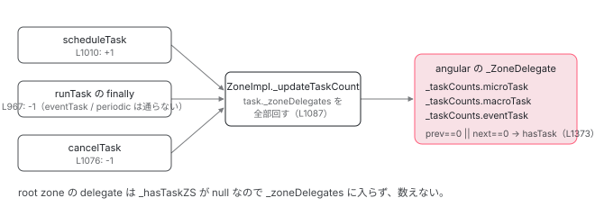

[目次](../README.md) › [zone.js の内側](README.md) › 第 8 回 / 全 13 回

# hasTask と \_updateTaskCount：残りタスクを数える

> ZoneDelegate.\_taskCounts が microTask / macroTask / eventTask の数を持つ。0 と 1 の境目をまたいだときだけ onHasTask が呼ばれる。NgZone はこれを聞いている。

angular/angular · 読了 約 11 分 · 中核 · [サイトで読む（デモが動きます）](https://angular-deep-dive-cyan.vercel.app/chapter/zone-hastask)

---

[概観](01-ngzone.md)の `checkStable` には「マイクロタスクが残っていない」という条件がありました。`NgZone` はそれをどうやって知るのか。答えは zone.js の `onHasTask` フックで、**`_ZoneDelegate` が `microTask` / `macroTask` / `eventTask` の数を持ち、0 と 1 の境目をまたいだときだけ通知する**という仕組みです。この章ではカウンタの置き場所、増減する 3 か所、通知の条件、そして `NgZone` がそれをどう聞いているかまでを読みます。

読む対象は `packages/zone.js/lib/zone-impl.ts` の L615-625、L1082-1090、L1125-1129、L1218-1242、L1294-1306、L1350-1382 と、`packages/core/src/zone/ng_zone.ts` の L498-516 です。

1. 概観
2. Zone とは
3. モンキーパッチ
4. Task のライフサイクル
5. ZoneDelegate
6. マイクロタスクキュー
7. addEventListener
8. **hasTask**（この章）
9. NgZone の fork
10. onEnter・onLeave・checkStable
11. NgZoneChangeDetectionScheduler
12. coalescing と runOutsideAngular
13. 1 クリックの全行程

## 1. HasTaskState：通知の形

📄 `angular/packages/zone.js/lib/zone-impl.ts` L615–625 （▶ の行: 616–619, 625）

```ts
615 │ export type HasTaskState = {
616 ▶   microTask: boolean;
617 ▶   macroTask: boolean;
618 ▶   eventTask: boolean;
619 ▶   change: TaskType;
620 │ };
621 │ 
622 │ /**
623 │  * Task type: `microTask`, `macroTask`, `eventTask`.
624 │  */
625 ▶ export type TaskType = 'microTask' | 'macroTask' | 'eventTask';
```

📄 `angular/packages/zone.js/lib/zone-impl.ts` L550–564 （▶ の行: 558, 562）

```ts
550 │   /**
551 │    * Notifies of changes to the task queue empty status.
552 │    *
553 │    * @param parentZoneDelegate Delegate which performs the parent [ZoneSpec] operation.
554 │    * @param currentZone The current [Zone] where the current interceptor has been declared.
555 │    * @param targetZone The [Zone] which originally received the request.
556 │    * @param hasTaskState
557 │    */
558 ▶   onHasTask?: (
559 │     parentZoneDelegate: ZoneDelegate,
560 │     currentZone: Zone,
561 │     targetZone: Zone,
562 ▶     hasTaskState: HasTaskState,
563 │   ) => void;
564 │ }
```

616〜618 行目、3 種類それぞれについて「1 つ以上あるか」の `boolean`。数ではなく真偽値です。619 行目の `change` が、**今回どの種類が 0 をまたいだか**。`onHasTask`（558 行目）はこのオブジェクトを第 4 引数（562 行目）で受け取ります。

## 2. カウンタは \_ZoneDelegate にある

📄 `angular/packages/zone.js/lib/zone-impl.ts` L1125–1129 （▶ の行: 1125–1128）

```ts
1125 ▶     private _taskCounts: {[key in TaskType]: number} = {
1126 ▶       'microTask': 0,
1127 ▶       'macroTask': 0,
1128 ▶       'eventTask': 0,
1129 │     };
```

[5 章](05-zone-delegate.md)で飛ばしたフィールドです。zone ではなく **`_ZoneDelegate` が 1 つずつ**`_taskCounts` を持ちます。zone と delegate は 1 対 1 なので実質 zone ごとですが、「どの delegate が数えるか」は後で見るとおり選ばれます。

📄 `angular/packages/zone.js/lib/zone-impl.ts` L1366–1382 （▶ の行: 1368–1371, 1373–1378, 1380）

```ts
1366 │     _updateTaskCount(type: TaskType, count: number) {
1367 │       const counts = this._taskCounts;
1368 ▶       const prev = counts[type];
1369 ▶       const next = (counts[type] = prev + count);
1370 ▶       if (next < 0) {
1371 ▶         throw new Error('More tasks executed then were scheduled.');
1372 │       }
1373 ▶       if (prev == 0 || next == 0) {
1374 ▶         const isEmpty: HasTaskState = {
1375 ▶           microTask: counts['microTask'] > 0,
1376 ▶           macroTask: counts['macroTask'] > 0,
1377 ▶           eventTask: counts['eventTask'] > 0,
1378 ▶           change: type,
1379 │         };
1380 ▶         this.hasTask(this._zone, isEmpty);
1381 │       }
1382 │     }
```

1. **1368〜1369 行目：加減する**

   `count` は `+1` か `-1`。`prev` と `next` を両方取ります。
2. **1370〜1371 行目：負になったらエラー**

   「More tasks executed then were scheduled.」。予約より多く終わったことになり、zone.js のバグか、パッチをすり抜けた API があることを意味します。
3. **1373 行目：`prev == 0 || next == 0` のときだけ**

   **0 → 1 になった（最初の Task が予約された）か、1 → 0 になった（最後の Task が終わった）か**。3 → 4 や 2 → 1 では何も通知しません。これが「0 と 1 の境目をまたいだときだけ」です。
4. **1374〜1379 行目：`HasTaskState` を組む**

   3 種類すべての「0 より大きいか」と、今回変わった `type` を `change` に。`microTask` が 1 → 0 になっても、`macroTask` が残っていれば `macroTask: true` です。
5. **1380 行目：`this.hasTask(this._zone, isEmpty)`**

   自分の zone を `targetZone` にして通知します。

📄 `angular/packages/zone.js/lib/zone-impl.ts` L1350–1364 （▶ の行: 1354–1358, 1362）

```ts
1350 │     hasTask(targetZone: ZoneImpl, isEmpty: HasTaskState) {
1351 │       // hasTask should not throw error so other ZoneDelegate
1352 │       // can still trigger hasTask callback
1353 │       try {
1354 ▶         this._hasTaskZS &&
1355 ▶           this._hasTaskZS.onHasTask!(
1356 ▶             this._hasTaskDlgt!,
1357 ▶             this._hasTaskCurrZone!,
1358 ▶             targetZone,
1359 │             isEmpty,
1360 │           );
1361 │       } catch (err) {
1362 ▶         this.handleError(targetZone, err);
1363 │       }
1364 │     }
```

1354〜1360 行目、`_hasTaskZS` があればその `onHasTask(_hasTaskDlgt, _hasTaskCurrZone, targetZone, isEmpty)`。5 章で見た他のメソッドと同じ形ですが、1353 行目から `try` で包まれ、例外は 1362 行目で `handleError` に流して**外に出しません**。フックの中で例外が出てもカウンタが壊れないようにするためです。

> **🧪 DEMO — \_taskCounts と hasTask の発火条件**
>
> angular zone の delegate のカウンタです。Task を予約（+1）・完了（-1）して、`_updateTaskCount`（L1366）がいつ `hasTask` を呼ぶかを見ます。右端は Angular の `onHasTask`（ng\_zone.ts L498）の反応です。
>
> ▶ [このデモはサイトで動かせます](https://angular-deep-dive-cyan.vercel.app/chapter/zone-hastask)

## 3. 誰が数えるか：\_zoneDelegates の一覧

`_updateTaskCount` を呼ぶ側を見ます。[4 章](04-zone-task.md)の `scheduleTask` からです。

📄 `angular/packages/zone.js/lib/zone-impl.ts` L1294–1306 （▶ の行: 1297–1298）

```ts
1294 │     scheduleTask(targetZone: ZoneImpl, task: Task): Task {
1295 │       let returnTask: ZoneTask<any> = task as ZoneTask<any>;
1296 │       if (this._scheduleTaskZS) {
1297 ▶         if (this._hasTaskZS) {
1298 ▶           returnTask._zoneDelegates!.push(this._hasTaskDlgtOwner!);
1299 │         }
1300 │         returnTask = this._scheduleTaskZS.onScheduleTask!(
1301 │           this._scheduleTaskDlgt!,
1302 │           this._scheduleTaskCurrZone!,
1303 │           targetZone,
1304 │           task,
1305 │         ) as ZoneTask<any>;
1306 │         if (!returnTask) returnTask = task as ZoneTask<any>;
```

`_ZoneDelegate.scheduleTask` は鎖を上がりながら呼ばれます（5 章）。1297〜1298 行目、**`_hasTaskZS` を持つ delegate だけが、自分（`_hasTaskDlgtOwner`）を `task._zoneDelegates` に push します**。鎖に `onHasTask` を持つ zone が 1 つ（Angular の zone）なら、配列には angular zone の delegate が 1 つ入ります。子 zone で予約された Task なら、5 章の `DELEGATE_ZS` によって子の delegate も `_hasTaskZS` を持つので、子と angular の 2 つが入ります。

📄 `angular/packages/zone.js/lib/zone-impl.ts` L1008–1014 （▶ の行: 1008, 1010）

```ts
1008 ▶       if ((task as any as ZoneTask<any>)._zoneDelegates === zoneDelegates) {
1009 │         // we have to check because internally the delegate can reschedule the task.
1010 ▶         this._updateTaskCount(task as any as ZoneTask<any>, 1);
1011 │       }
1012 │       if ((task as any as ZoneTask<any>).state == scheduling) {
1013 │         (task as any as ZoneTask<any>)._transitionTo(scheduled, scheduling);
1014 │       }
```

📄 `angular/packages/zone.js/lib/zone-impl.ts` L1082–1090 （▶ の行: 1083–1085, 1087–1088）

```ts
1082 │     private _updateTaskCount(task: ZoneTask<any>, count: number) {
1083 ▶       const zoneDelegates = task._zoneDelegates!;
1084 ▶       if (count == -1) {
1085 ▶         task._zoneDelegates = null;
1086 │       }
1087 ▶       for (let i = 0; i < zoneDelegates.length; i++) {
1088 ▶         zoneDelegates[i]._updateTaskCount(task.type, count);
1089 │       }
1090 │     }
```

鎖を回り終えた後、1010 行目で `ZoneImpl._updateTaskCount(task, 1)`。1087〜1088 行目、**`task._zoneDelegates` に入っている delegate 全部の `_updateTaskCount(type, count)` を呼びます**。1084〜1085 行目、`-1` のとき（完了・キャンセル）は配列を `null` にして二重減算を防ぎます。

つまり Task 1 つの予約で、`onHasTask` を持つ祖先 zone それぞれのカウンタが +1 されます。angular zone のカウンタは、**angular zone とその子孫で予約された Task の合計**です。

### 減らす 2 か所

📄 `angular/packages/zone.js/lib/zone-impl.ts` L958–977 （▶ の行: 962–964, 966–968）

```ts
958 │       } finally {
959 │         // if the task's state is notScheduled or unknown, then it has already been cancelled
960 │         // we should not reset the state to scheduled
961 │         const state = task.state;
962 ▶         if (state !== notScheduled && state !== unknown) {
963 ▶           if (type == eventTask || isPeriodic || (isRefreshable && state === scheduling)) {
964 ▶             reEntryGuard && zoneTask._transitionTo(scheduled, running, scheduling);
965 │           } else {
966 ▶             const zoneDelegates = zoneTask._zoneDelegates;
967 ▶             this._updateTaskCount(zoneTask, -1);
968 ▶             reEntryGuard && zoneTask._transitionTo(notScheduled, running, notScheduled);
969 │ 
970 │             if (isRefreshable) {
971 │               zoneTask._zoneDelegates = zoneDelegates;
972 │             }
973 │           }
974 │         }
975 │         _currentZoneFrame = _currentZoneFrame.parent!;
976 │         _currentTask = previousTask;
977 │       }
```

📄 `angular/packages/zone.js/lib/zone-impl.ts` L1076–1078 （▶ の行: 1076）

```ts
1076 ▶       this._updateTaskCount(task as ZoneTask<any>, -1);
1077 │       (task as ZoneTask<any>)._transitionTo(notScheduled, canceling);
1078 │       task.runCount = -1;
```

4 章の再掲です。967 行目、1 回きりの `macroTask` と `microTask` は実行が終わった `finally` で -1。963〜964 行目、`eventTask` と `isPeriodic` はここを通らず `scheduled` に戻るので**減りません**。1076 行目、`cancelTask`（`clearTimeout`、`removeEventListener`）で -1。`eventTask` が減るのはここだけです。



*increment は scheduleTask の 1 か所、decrement は runTask の finally と cancelTask の 2 か所。どれも task.\_zoneDelegates に入った delegate 全部に届く。*

## 4. onHasTask を持たない zone も数える場合がある

📄 `angular/packages/zone.js/lib/zone-impl.ts` L1218–1242 （▶ の行: 1218–1220, 1223–1226, 1228, 1233, 1238）

```ts
1218 ▶       const zoneSpecHasTask = zoneSpec && zoneSpec.onHasTask;
1219 ▶       const parentHasTask = parentDelegate && parentDelegate._hasTaskZS;
1220 ▶       if (zoneSpecHasTask || parentHasTask) {
1221 │         // If we need to report hasTask, than this ZS needs to do ref counting on tasks. In such
1222 │         // a case all task related interceptors must go through this ZD. We can't short circuit it.
1223 ▶         this._hasTaskZS = zoneSpecHasTask ? zoneSpec : DELEGATE_ZS;
1224 ▶         this._hasTaskDlgt = parentDelegate;
1225 ▶         this._hasTaskDlgtOwner = this;
1226 ▶         this._hasTaskCurrZone = this._zone;
1227 │         if (!zoneSpec!.onScheduleTask) {
1228 ▶           this._scheduleTaskZS = DELEGATE_ZS;
1229 │           this._scheduleTaskDlgt = parentDelegate!;
1230 │           this._scheduleTaskCurrZone = this._zone;
1231 │         }
1232 │         if (!zoneSpec!.onInvokeTask) {
1233 ▶           this._invokeTaskZS = DELEGATE_ZS;
1234 │           this._invokeTaskDlgt = parentDelegate!;
1235 │           this._invokeTaskCurrZone = this._zone;
1236 │         }
1237 │         if (!zoneSpec!.onCancelTask) {
1238 ▶           this._cancelTaskZS = DELEGATE_ZS;
1239 │           this._cancelTaskDlgt = parentDelegate!;
1240 │           this._cancelTaskCurrZone = this._zone;
1241 │         }
1242 │       }
```

📄 `angular/packages/zone.js/lib/zone-impl.ts` L1093–1100 （▶ の行: 1095, 1100）

```ts
1093 │   const DELEGATE_ZS: ZoneSpec = {
1094 │     name: '',
1095 ▶     onHasTask: (
1096 │       delegate: ZoneDelegate,
1097 │       _: AmbientZone,
1098 │       target: AmbientZone,
1099 │       hasTaskState: HasTaskState,
1100 ▶     ): void => delegate.hasTask(target, hasTaskState),
```

5 章の再掲ですが、この章の視点で読み直します。1219〜1220 行目、**親が `_hasTaskZS` を持っていれば、自分に `onHasTask` が無くても数える側に回ります**。1223 行目でその場合の `_hasTaskZS` は `DELEGATE_ZS`、その `onHasTask`（1095〜1100 行目）は `delegate.hasTask(target, hasTaskState)` と親に渡すだけです。1225 行目の `_hasTaskDlgtOwner = this` が、3 節の `_zoneDelegates` に push される本人です。

なぜ子も数える必要があるのか。子 zone で予約された Task が終わったとき、**子の delegate の `hasTask` → `DELEGATE_ZS` → 親（angular）の `delegate.hasTask`** と、`targetZone = 子` のまま通知が上がってきます。親は自分のカウンタでも別途 `hasTask` を呼ぶので、angular zone の `onHasTask` には**「子の状態変化」と「自分の状態変化」の 2 回**届きます。次の節で、Angular がそれをどう区別しているかを見ます。

## 5. NgZone はどこでそれを聞いているか

📄 `angular/packages/core/src/zone/ng_zone.ts` L498–516 （▶ の行: 504–505, 508–509, 511–513）

```ts
498 │     onHasTask: (
499 │       delegate: ZoneDelegate,
500 │       current: Zone,
501 │       target: Zone,
502 │       hasTaskState: HasTaskState,
503 │     ) => {
504 ▶       delegate.hasTask(target, hasTaskState);
505 ▶       if (current === target) {
506 │         // We are only interested in hasTask events which originate from our zone
507 │         // (A child hasTask event is not interesting to us)
508 ▶         if (hasTaskState.change == 'microTask') {
509 ▶           zone._hasPendingMicrotasks = hasTaskState.microTask;
510 │           updateMicroTaskStatus(zone);
511 ▶           checkStable(zone);
512 ▶         } else if (hasTaskState.change == 'macroTask') {
513 ▶           zone.hasPendingMacrotasks = hasTaskState.macroTask;
514 │         }
515 │       }
516 │     },
```

1. **504 行目：まず親に委ねる**

   root zone の delegate は `_hasTaskZS` が `null` なので何も起きませんが、形式どおり呼びます。
2. **505 行目：`current === target` のときだけ**

   4 節の「2 回届く」のうち、**自分の zone のカウンタが変わった通知だけ**を扱います。子 zone から上がってきた `targetZone = 子` の通知は無視です（506〜507 行目のコメント）。
3. **508〜511 行目：`change == 'microTask'`**

   `_hasPendingMicrotasks = hasTaskState.microTask`、そして **`checkStable(zone)`**。[6 章](06-zone-microtask.md)の drain で最後の `runTask` が終わり、`microTask` が 1 → 0 になった瞬間に `hasTaskState.microTask === false` でここに来ます。これが「マイクロタスクが残っていない」の情報源です。
4. **512〜513 行目：`change == 'macroTask'`**

   `hasPendingMacrotasks` を更新するだけ。`checkStable` は呼びません。`setTimeout` が残っていても「安定」と判定する、つまり**変更検知は `setTimeout` の完了を待たない**ということです。`hasPendingMacrotasks` は E2E テストの待機（`Testability`）などが読みます。
5. **`change == 'eventTask'`：分岐が無い**

   `addEventListener` / `removeEventListener` による変化は無視されます。[前章](07-zone-events.md)で見たとおり、リスナーは残り続けるので、これを待っていたら永遠に安定しません。

`checkStable` の 3 条件（`_nesting == 0`、`!hasPendingMicrotasks`、`!isStable`）と、そこから `onMicrotaskEmpty` → `ApplicationRef.tick` に至る道は [10 章](10-zone-ngzone-stability.md)と[11 章](11-zone-ngzone-scheduler.md)で読みます。

> [!TIP]
> **新卒エンジニアへ**
>
> 「`hasTask` の `change` が `'microTask'` のとき何を意味するか」を一文で言うと、**「この zone（と子孫）で予約されたまだ終わっていない `Promise.then` / `queueMicrotask` の数が、0 から 1 になった、または 1 から 0 になった」**です。`hasTaskState.microTask` が `true` なら前者、`false` なら後者。Angular は後者を「もう待つものがない」の合図に使います。

## ここまでの呼び出し（angular zone の中で Promise.then を 1 つ予約し、それが終わるまで）

- 👤 `promise.then(cb)` — あなたのコード（angular zone の Task の中）
  - `angular.scheduleMicroTask('Promise.then', ...)` — promise.ts L290 → zone-impl.ts L1018
    - `scheduleTask(task)` — L980 — *task.\_zoneDelegates = \[\]（L996）*
      - `angular の delegate.scheduleTask` — L1294 — *\_hasTaskZS あり → \_zoneDelegates.push(angular の delegate)（L1298）*
      - `ZoneImpl._updateTaskCount(task, 1)` — L1010 → L1082
        - `angular の delegate._updateTaskCount('microTask', 1)` — L1366 — *0 → 1。prev == 0 なので hasTask*
          - `hasTask(angular, {microTask: true, macroTask: ..., eventTask: ..., change: 'microTask'})` — L1380 → L1350
            - `NgZone の onHasTask` — ng\_zone.ts L498 — *current === target、change == 'microTask' → \_hasPendingMicrotasks = true、checkStable（まだ安定しない）*
- `（Task 終了 → drain）task.zone.runTask(task)` — zone-impl.ts L1561 → L920 — *cb が動く*
  - `finally: _updateTaskCount(zoneTask, -1)` — L967 → L1082 — *\_zoneDelegates を null に（L1085）*
    - `angular の delegate._updateTaskCount('microTask', -1)` — L1366 — *1 → 0。next == 0 なので hasTask*
      - `hasTask(angular, {microTask: false, ..., change: 'microTask'})` — L1380
        - `NgZone の onHasTask` — ng\_zone.ts L498 — *\_hasPendingMicrotasks = false → checkStable → onMicrotaskEmpty（10 章）*

## 聞かれそうな質問

**Q. hasTask の change が 'microTask' のとき、何を意味しますか？**

その delegate の `_taskCounts.microTask` が 0 ↔ 1 をまたいだ、という意味です（zone-impl.ts 1373 行目の `prev == 0 || next == 0`）。`hasTaskState.microTask` が `true` なら最初の microTask が予約された（1010 行目経由）、`false` なら最後の microTask が終わった（967 行目経由）ことを示します。2 → 1 のような変化では呼ばれません。

**Q. NgZone はどこでそれを聞いていますか？**

`fork` に渡した `onHasTask`（ng\_zone.ts 498〜516 行目）です。505 行目で `current === target`（自分の zone の変化だけ）を確認し、508〜511 行目で `change == 'microTask'` なら `_hasPendingMicrotasks` を更新して `checkStable` を呼びます。`'macroTask'` は 512〜513 行目で `hasPendingMacrotasks` を更新するだけ、`'eventTask'` は無視です。

**Q. カウンタは zone ごとですか？全体で 1 つですか？**

`_ZoneDelegate` ごと（1125〜1129 行目）、つまり zone ごとです。ただし数えるのは `_hasTaskZS` を持つ delegate だけ（1297〜1298 行目で `task._zoneDelegates` に自分を push）で、Task の増減はその配列に入った delegate 全部に届きます（1087〜1088 行目）。root zone は `onHasTask` を持たないので数えません。

**Q. setTimeout が残っていても Angular は「安定」と言いますか？**

言います。ng\_zone.ts 512〜513 行目、`change == 'macroTask'` では `hasPendingMacrotasks` を更新するだけで `checkStable` を呼びません。`checkStable` が見るのは `hasPendingMicrotasks` だけです。`hasPendingMacrotasks` は `NgZone` の公開プロパティとして読めますが、変更検知のタイミングには使われていません。

**Q. addEventListener したリスナーは eventTask の数に入り続けますか？**

入り続けます。`runTask` の 963〜964 行目で `eventTask` は `scheduled` に戻り、967 行目の -1 を通りません。減るのは `cancelTask`（1076 行目）= `removeEventListener` のときだけです。だから Angular の `onHasTask` には `'eventTask'` の分岐が無く、画面にリスナーがいくつ付いていても安定判定に影響しません。

## 読み終えて

- `_taskCounts` は `_ZoneDelegate` のフィールド（1125 行目）。`microTask` / `macroTask` / `eventTask` の 3 つの数
- 増やすのは `scheduleTask`（1010 行目）、減らすのは `runTask` の finally（967 行目）と `cancelTask`（1076 行目）。`eventTask` と周期タスクは finally では減らない
- `_updateTaskCount`（1366 行目）は `prev == 0 || next == 0` のときだけ `HasTaskState` を組んで `hasTask` → `onHasTask`
- 数えるのは `_hasTaskZS` を持つ delegate だけ。`task._zoneDelegates` に push され（1298 行目）、増減はその全部に届く（1087 行目）
- `NgZone` は `onHasTask`（ng\_zone.ts 498 行目）で `current === target` かつ `change == 'microTask'` のときだけ `checkStable` を呼ぶ。`macroTask` は記録のみ、`eventTask` は無視

---

← 前: [addEventListener のパッチ：EventTask](07-zone-events.md)  
次: [NgZone：Angular が fork する 1 つの zone](09-zone-ngzone-fork.md) →
