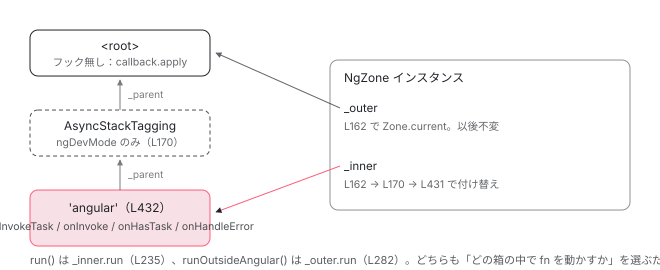

[目次](../README.md) › [zone.js の内側](README.md) › 第 9 回 / 全 13 回

# NgZone：Angular が fork する 1 つの zone

> constructor で Zone.current を \_outer に取り、fork した子を \_inner にする。forkInnerZoneWithAngularBehavior が渡す 4 つのフックと isAngularZone プロパティ。

angular/angular · 読了 約 12 分 · 中核 · [サイトで読む（デモが動きます）](https://angular-deep-dive-cyan.vercel.app/chapter/zone-ngzone-fork)

---

[概観の章](01-ngzone.md)では「`NgZone` は入れ子カウンタで安定を判定する」とだけ見ました。この章は、その `NgZone` が **constructor の中で zone をどう作るか**を 1 行ずつ追います。`_outer` と `_inner` という 2 つの参照が何を指すのか、`fork` に渡す 4 つのフックと 3 つのプロパティが何のためにあるのか、そして `run()` / `runOutsideAngular()` がどちらの zone を選ぶのかが分かります。

読む対象は `packages/core/src/zone/ng_zone.ts` と、`fork` の実体がある `packages/zone.js/lib/zone-impl.ts` です。

1. 概観
2. Zone とは
3. モンキーパッチ
4. Task のライフサイクル
5. ZoneDelegate
6. マイクロタスクキュー
7. addEventListener
8. hasTask
9. **NgZone の fork**（この章）
10. onEnter・onLeave・checkStable
11. NgZoneChangeDetectionScheduler
12. coalescing と runOutsideAngular
13. 1 クリックの全行程

## 1. クラスの表側：公開されている 4 つの EventEmitter

📄 `angular/packages/core/src/zone/ng_zone.ts` L106–137 （▶ の行: 107–108, 113, 118, 125, 132, 137）

```ts
106 │ export class NgZone {
107 ▶   readonly hasPendingMacrotasks: boolean = false;
108 ▶   readonly hasPendingMicrotasks: boolean = false;
109 │ 
110 │   /**
111 │    * Whether there are no outstanding microtasks or macrotasks.
112 │    */
113 ▶   readonly isStable: boolean = true;
114 │ 
115 │   /**
116 │    * Notifies when code enters Angular Zone. This gets fired first on VM Turn.
117 │    */
118 ▶   readonly onUnstable: EventEmitter<any> = new EventEmitter(false);
119 │ 
120 │   /**
121 │    * Notifies when there is no more microtasks enqueued in the current VM Turn.
122 │    * This is a hint for Angular to do change detection, which may enqueue more microtasks.
123 │    * For this reason this event can fire multiple times per VM Turn.
124 │    */
125 ▶   readonly onMicrotaskEmpty: EventEmitter<any> = new EventEmitter(false);
126 │ 
127 │   /**
128 │    * Notifies when the last `onMicrotaskEmpty` has run and there are no more microtasks, which
129 │    * implies we are about to relinquish VM turn.
130 │    * This event gets called just once.
131 │    */
132 ▶   readonly onStable: EventEmitter<any> = new EventEmitter(false);
133 │ 
134 │   /**
135 │    * Notifies that an error has been delivered.
136 │    */
137 ▶   readonly onError: EventEmitter<any> = new EventEmitter(false);
```

107〜108 行目と 113 行目が状態、118・125・132・137 行目が通知です。`isStable` の初期値は `true`（113 行目）。「まだ何もしていない＝安定」から始まります。4 つの `EventEmitter` はすべて `new EventEmitter(false)`、つまり**同期 emit**です。購読者は `emit` の呼び出しの中で、その場で呼ばれます。誰がいつ `emit` するかは[次章](10-zone-ngzone-stability.md)の主題なので、ここでは「同期である」ことだけ覚えてください。

## 2. constructor 前半：Zone.current を 2 つの名前で持つ

📄 `angular/packages/core/src/zone/ng_zone.ts` L139–162 （▶ の行: 148, 151, 158, 160, 162）

```ts
139 │   constructor(options: {
140 │     enableLongStackTrace?: boolean;
141 │     shouldCoalesceEventChangeDetection?: boolean;
142 │     shouldCoalesceRunChangeDetection?: boolean;
143 │   }) {
144 │     const {
145 │       enableLongStackTrace = false,
146 │       shouldCoalesceEventChangeDetection = false,
147 │       shouldCoalesceRunChangeDetection = false,
148 ▶       scheduleInRootZone = SCHEDULE_IN_ROOT_ZONE_DEFAULT,
149 │     } = options as InternalNgZoneOptions;
150 │ 
151 ▶     if (typeof Zone == 'undefined') {
152 │       throw new RuntimeError(
153 │         RuntimeErrorCode.MISSING_ZONEJS,
154 │         ngDevMode && `In this configuration Angular requires Zone.js`,
155 │       );
156 │     }
157 │ 
158 ▶     Zone.assertZonePatched();
159 │     const self = this as any as NgZonePrivate;
160 ▶     self._nesting = 0;
161 │ 
162 ▶     self._outer = self._inner = Zone.current;
```

1. **144〜149 行目：オプションを既定値つきで分解する**

   `enableLongStackTrace`、`shouldCoalesceEventChangeDetection`、`shouldCoalesceRunChangeDetection` はすべて `false` が既定。148 行目の `scheduleInRootZone` は公開型には無い内部オプションで、既定値 `SCHEDULE_IN_ROOT_ZONE_DEFAULT` は `flags.ts` 9 行目で `false` です。
2. **151〜156 行目：zone.js が無ければ例外**

   `typeof Zone == 'undefined'` なら `RuntimeError`（`MISSING_ZONEJS`）を投げます。`provideZoneChangeDetection()` を書いたのに `polyfills` に zone.js が無いときに出るのがこれです。
3. **158 行目：`Zone.assertZonePatched()`**

   グローバルの `Promise` が zone.js の `ZoneAwarePromise` のままかを確かめます （zone-impl.ts 783〜793 行目）。zone.js より後に Promise ポリフィルを読み込むと、ここで落ちます。
4. **160 行目：`_nesting = 0`**

   概観の章で見た入れ子カウンタの初期化です。
5. **162 行目：`_outer = _inner = Zone.current`**

   この章でいちばん大事な 1 行です。**両方とも、いま実行中の zone**を指します。通常の起動では `new NgZone()` は `bootstrap()` の外側、つまり zone.js の `<root>` zone で呼ばれるので、`_outer` は `<root>` です。この時点では `_inner` も同じ `<root>` を指しています。ここから `_inner` だけが、fork されるたびに付け替えられていきます。

## 3. constructor 後半：\_inner を fork で深くしていく

📄 `angular/packages/core/src/zone/ng_zone.ts` L164–188 （▶ の行: 169–170, 173–174, 177–178, 182–187）

```ts
164 │     // AsyncStackTaggingZoneSpec provides `linked stack traces` to show
165 │     // where the async operation is scheduled. For more details, refer
166 │     // to this article, https://developer.chrome.com/blog/devtools-better-angular-debugging/
167 │     // And we only import this AsyncStackTaggingZoneSpec in development mode,
168 │     // in the production mode, the AsyncStackTaggingZoneSpec will be tree shaken away.
169 ▶     if (ngDevMode) {
170 ▶       self._inner = self._inner.fork(new AsyncStackTaggingZoneSpec('Angular'));
171 │     }
172 │ 
173 ▶     if ((Zone as any)['TaskTrackingZoneSpec']) {
174 ▶       self._inner = self._inner.fork(new ((Zone as any)['TaskTrackingZoneSpec'] as any)());
175 │     }
176 │ 
177 ▶     if (enableLongStackTrace && (Zone as any)['longStackTraceZoneSpec']) {
178 ▶       self._inner = self._inner.fork((Zone as any)['longStackTraceZoneSpec']);
179 │     }
180 │     // if shouldCoalesceRunChangeDetection is true, all tasks including event tasks will be
181 │     // coalesced, so shouldCoalesceEventChangeDetection option is not necessary and can be skipped.
182 ▶     self.shouldCoalesceEventChangeDetection =
183 ▶       !shouldCoalesceRunChangeDetection && shouldCoalesceEventChangeDetection;
184 ▶     self.shouldCoalesceRunChangeDetection = shouldCoalesceRunChangeDetection;
185 ▶     self.callbackScheduled = false;
186 ▶     self.scheduleInRootZone = scheduleInRootZone;
187 ▶     forkInnerZoneWithAngularBehavior(self);
188 │   }
```

`_inner = _inner.fork(...)` が最大 3 回（169〜179 行目）、さらに 187 行目の `forkInnerZoneWithAngularBehavior` の中で 1 回。**fork は常に `_inner` を更新し、`_outer` は一度も触りません**。

1. **169〜171 行目：開発モードだけ `AsyncStackTaggingZoneSpec('Angular')`**

   Chrome DevTools に「この非同期処理はどこで予約されたか」を結びつけるための zone です。`ngDevMode` が偽（プロダクションビルド）なら、この分岐ごとツリーシェイクされます。
2. **173〜175 行目：`Zone['TaskTrackingZoneSpec']` が居れば fork**

   `zone.js/plugins/task-tracking` を読み込んだときだけグローバルに生えるクラスです。読み込んでいなければスキップ。
3. **177〜179 行目：`enableLongStackTrace` かつ `Zone['longStackTraceZoneSpec']` が居れば fork**

   `getNgZoneOptions()`（ng\_zone\_scheduling.ts 225 行目）は開発モードで `enableLongStackTrace: true` を渡しますが、`longStackTraceZoneSpec` 自体は `zone.js/plugins/long-stack-trace-zone` を読み込まないと存在しません。つまり「開発モードなら自動で有効」ではなく、**両方の条件**が要ります。
4. **182〜184 行目：coalescing フラグの正規化**

   `shouldCoalesceRunChangeDetection` が `true` なら、イベントも含めて全部まとめられるので、`shouldCoalesceEventChangeDetection` は `false` に落とされます（182〜183 行目）。中身は[coalescing の章](12-zone-coalescing.md)で読みます。
5. **185〜187 行目：`callbackScheduled = false`、`scheduleInRootZone` を保存し、本命の fork へ**

## 4. fork は zone.js 側で何をするか

`fork` という言葉を「分岐」と理解したままだと、この先が読めません。実物は**親への参照を持った新しい `ZoneImpl` を 1 つ new すること**です。

📄 `angular/packages/zone.js/lib/zone-impl.ts` L841–871 （▶ の行: 842–845, 853, 860, 863, 870）

```ts
841 │     constructor(parent: ZoneImpl | null, zoneSpec: ZoneSpec | null) {
842 ▶       this._parent = parent as ZoneImpl;
843 ▶       this._name = zoneSpec ? zoneSpec.name || 'unnamed' : '<root>';
844 ▶       this._properties = (zoneSpec && zoneSpec.properties) || {};
845 ▶       this._zoneDelegate = new _ZoneDelegate(
846 │         this,
847 │         this._parent && this._parent._zoneDelegate,
848 │         zoneSpec,
849 │       );
850 │     }
851 │ 
852 │     public get(key: string): any {
853 ▶       const zone: ZoneImpl = this.getZoneWith(key) as ZoneImpl;
854 │       if (zone) return zone._properties[key];
855 │     }
856 │ 
857 │     public getZoneWith(key: string): AmbientZone | null {
858 │       let current: ZoneImpl | null = this;
859 │       while (current) {
860 ▶         if (Object.hasOwn(current._properties, key)) {
861 │           return current;
862 │         }
863 ▶         current = current._parent;
864 │       }
865 │       return null;
866 │     }
867 │ 
868 │     public fork(zoneSpec: ZoneSpec): AmbientZone {
869 │       if (!zoneSpec) throw new Error('ZoneSpec required!');
870 ▶       return this._zoneDelegate.fork(this, zoneSpec);
871 │     }
```

870 行目、`zone.fork(spec)` は `_zoneDelegate.fork(this, spec)` に委譲し、その先（1245〜1249 行目）で `new ZoneImpl(targetZone, zoneSpec)` が呼ばれます。constructor（841〜850 行目）がやることは 4 つだけです。

1. **842 行目：`_parent` に fork 元を記録**

   これが「`_inner` の親をたどれば `_outer` に着く」根拠です。
2. **843 行目：`_name`**

   spec の `name`。`NgZone` は `'angular'` を渡します（次節 432 行目）。
3. **844 行目：`_properties`**

   spec の `properties` をそのまま保持します。853 行目の `get(key)` は 857〜866 行目の `getZoneWith` で **自分から親へ向かって**`Object.hasOwn` で探します（860・863 行目）。子 zone は親のプロパティを「継承」して見えるわけです。
4. **845〜849 行目：`_zoneDelegate`**

   親の `_zoneDelegate` と spec を渡して `_ZoneDelegate` を new します。フックの解決（どのフックを誰が持つか）はこの constructor で済んでいます。[ZoneDelegate の章](05-zone-delegate.md)の内容なので、ここでは `onInvokeTask` の分だけ確認します。

📄 `angular/packages/zone.js/lib/zone-impl.ts` L1192–1204 （▶ の行: 1199–1204）

```ts
1192 │       this._scheduleTaskZS =
1193 │         zoneSpec && (zoneSpec.onScheduleTask ? zoneSpec : parentDelegate!._scheduleTaskZS);
1194 │       this._scheduleTaskDlgt =
1195 │         zoneSpec && (zoneSpec.onScheduleTask ? parentDelegate! : parentDelegate!._scheduleTaskDlgt);
1196 │       this._scheduleTaskCurrZone =
1197 │         zoneSpec && (zoneSpec.onScheduleTask ? this._zone : parentDelegate!._scheduleTaskCurrZone);
1198 │ 
1199 ▶       this._invokeTaskZS =
1200 ▶         zoneSpec && (zoneSpec.onInvokeTask ? zoneSpec : parentDelegate!._invokeTaskZS);
1201 ▶       this._invokeTaskDlgt =
1202 ▶         zoneSpec && (zoneSpec.onInvokeTask ? parentDelegate! : parentDelegate!._invokeTaskDlgt);
1203 ▶       this._invokeTaskCurrZone =
1204 ▶         zoneSpec && (zoneSpec.onInvokeTask ? this._zone : parentDelegate!._invokeTaskCurrZone);
```

1199〜1204 行目。spec に `onInvokeTask` が**あれば**、`_invokeTaskZS` はその spec、`_invokeTaskDlgt` は親の delegate、`_invokeTaskCurrZone` は自分の zone。**なければ**親の 3 つをそのままコピーします。`NgZone` の spec は 4 つのフックを全部持つので、`'angular'` zone の delegate はすべて自分の spec を指します。一方、開発モードで挟まる `AsyncStackTaggingZoneSpec` は `onInvokeTask` を持たないので、その zone で `invokeTask` しても親（`<root>`）の既定動作 `task.callback.apply` に抜けます。

## 5. forkInnerZoneWithAngularBehavior：spec の中身

📄 `angular/packages/core/src/zone/ng_zone.ts` L426–437 （▶ の行: 427, 430–432, 434–436）

```ts
426 │ function forkInnerZoneWithAngularBehavior(zone: NgZonePrivate) {
427 ▶   const delayChangeDetectionForEventsDelegate = () => {
428 │     delayChangeDetectionForEvents(zone);
429 │   };
430 ▶   const instanceId = ngZoneInstanceId++;
431 ▶   zone._inner = zone._inner.fork({
432 ▶     name: 'angular',
433 │     properties: <any>{
434 ▶       [isAngularZoneProperty]: true,
435 ▶       [angularZoneInstanceIdProperty]: instanceId,
436 ▶       [angularZoneInstanceIdProperty + instanceId]: true,
437 │     },
```

431 行目でまた `_inner = _inner.fork(...)`。これが最後の fork で、名前は `'angular'`（432 行目）です。`properties` に 3 つ入れています（434〜436 行目）。

📄 `angular/packages/core/src/zone/ng_zone.ts` L20–27 （▶ の行: 24–25, 27）

```ts
20 │ // The below is needed as otherwise a number of targets fail in G3 due to:
21 │ // ERROR - [JSC_UNDEFINED_VARIABLE] variable Zone is undeclared
22 │ declare const Zone: any;
23 │ 
24 ▶ const isAngularZoneProperty = 'isAngularZone';
25 ▶ export const angularZoneInstanceIdProperty = isAngularZoneProperty + '_ID';
26 │ 
27 ▶ let ngZoneInstanceId = 0;
```

| キー（実際の文字列） | 値 | 誰が読むか |
| --- | --- | --- |
| `'isAngularZone'`（24 行目） | `true` | `NgZone.isInAngularZone()`（195 行目）。「いま Angular zone の中か」 |
| `'isAngularZone_ID'`（25 行目） | `instanceId`（0, 1, 2…） | `ChangeDetectionSchedulerImpl` の constructor（zoneless\_scheduling\_impl.ts 71 行目）が自分の `NgZone` の ID を控える |
| `'isAngularZone_ID' + instanceId`（例 `'isAngularZone_ID0'`） | `true` | `shouldScheduleTick`（同 240 行目）が「**この** NgZone の中か」を判定する。[11 章](11-zone-ngzone-scheduler.md) |

なぜ 2 つ目と 3 つ目が分かれているのか。`get` は親方向にしか探さないので、テストや複数アプリで `NgZone` が 2 つあるとき、`'isAngularZone_ID'` だけでは 「どの NgZone の中か」を `get` 1 回で確認できません。`'isAngularZone_ID' + 自分の ID` というキーなら、`get` が `true` を返すかどうかだけで判定できます。430 行目の `ngZoneInstanceId++` はモジュール変数（27 行目）なので、`NgZone` を作るたびに 1 ずつ増えます。

### 4 つのフック

📄 `angular/packages/core/src/zone/ng_zone.ts` L438–445 （▶ の行: 438–442）

```ts
438 ▶     onInvokeTask: (
439 ▶       delegate: ZoneDelegate,
440 ▶       current: Zone,
441 ▶       target: Zone,
442 ▶       task: Task,
443 │       applyThis: any,
444 │       applyArgs: any,
445 │     ): any => {
```

spec には `onInvokeTask`（438 行目）、`onInvoke`（465 行目）、`onHasTask`（498 行目）、`onHandleError`（518 行目）の 4 つがあります。引数の並び（439〜442 行目）は zone.js が決めたもので、`delegate` が「親に渡すための窓口」、`current` がこのフックを持つ zone、`target` が実際に `runTask` された zone です。

| フック | zone.js が呼ぶ瞬間 | NgZone がすること | 読む章 |
| --- | --- | --- | --- |
| `onInvokeTask` | `zone.runTask(task)`。setTimeout のコールバック、DOM イベント、Promise.then の実行 | `onEnter` → 本体 → `onLeave` で挟む | [10](10-zone-ngzone-stability.md) |
| `onInvoke` | `zone.run(fn)`。`ngZone.run()` の中身 | 同じく `onEnter` / `onLeave` で挟む | [10](10-zone-ngzone-stability.md) |
| `onHasTask` | この zone のタスク数が 0 ↔ 1 を跨いだとき | `hasPendingMicrotasks` / `hasPendingMacrotasks` を更新し `checkStable` | [10](10-zone-ngzone-stability.md) |
| `onHandleError` | zone 内で捕まえられなかった例外 | `onError` を emit（下） | この章 |

📄 `angular/packages/core/src/zone/ng_zone.ts` L518–524 （▶ の行: 519–521）

```ts
518 │     onHandleError: (delegate: ZoneDelegate, current: Zone, target: Zone, error: any): boolean => {
519 ▶       delegate.handleError(target, error);
520 ▶       zone.runOutsideAngular(() => zone.onError.emit(error));
521 ▶       return false;
522 │     },
523 │   });
524 │ }
```

519 行目で親にも回してから、520 行目で `onError.emit(error)`。emit を `runOutsideAngular` で包んでいるのは、購読者（`ErrorHandler` を呼ぶコード）が `onEnter` を通って再び「不安定」になるのを防ぐためです。521 行目の `return false` は「zone.js 側はこれ以上 rethrow しなくてよい」の合図です （zone-impl.ts の `runGuarded` は `handleError` が `true` を返したときだけ再 throw します）。



*通常起動時の zone の木。\_outer は &lt;root&gt; を指したまま。\_inner は fork ごとに付け替えられ、最後に 'angular' を指す。'angular' zone だけが 4 つのフックを持つ。*

> **🧪 DEMO — constructor が作る zone の木**
>
> 条件を切り替えると、`_inner` が最終的にどの zone を指すかが変わります。`_outer` は変わりません。
>
> ▶ [このデモはサイトで動かせます](https://angular-deep-dive-cyan.vercel.app/chapter/zone-ngzone-fork)

## 6. run / runTask / runOutsideAngular が選ぶ zone

📄 `angular/packages/core/src/zone/ng_zone.ts` L222–236 （▶ の行: 235）

```ts
222 │   /**
223 │    * Executes the `fn` function synchronously within the Angular zone and returns value returned by
224 │    * the function.
225 │    *
226 │    * Running functions via `run` allows you to reenter Angular zone from a task that was executed
227 │    * outside of the Angular zone (typically started via {@link #runOutsideAngular}).
228 │    *
229 │    * Any future tasks or microtasks scheduled from within this function will continue executing from
230 │    * within the Angular zone.
231 │    *
232 │    * If a synchronous error happens it will be rethrown and not reported via `onError`.
233 │    */
234 │   run<T>(fn: (...args: any[]) => T, applyThis?: any, applyArgs?: any[]): T {
235 ▶     return (this as any as NgZonePrivate)._inner.run(fn, applyThis, applyArgs);
236 │   }
```

📄 `angular/packages/core/src/zone/ng_zone.ts` L268–284 （▶ の行: 282）

```ts
268 │   /**
269 │    * Executes the `fn` function synchronously in Angular's parent zone and returns value returned by
270 │    * the function.
271 │    *
272 │    * Running functions via {@link #runOutsideAngular} allows you to escape Angular's zone and do
273 │    * work that
274 │    * doesn't trigger Angular change-detection or is subject to Angular's error handling.
275 │    *
276 │    * Any future tasks or microtasks scheduled from within this function will continue executing from
277 │    * outside of the Angular zone.
278 │    *
279 │    * Use {@link #run} to reenter the Angular zone and do work that updates the application model.
280 │    */
281 │   runOutsideAngular<T>(fn: (...args: any[]) => T): T {
282 ▶     return (this as any as NgZonePrivate)._outer.run(fn);
283 │   }
284 │ }
```

235 行目は `_inner.run`、282 行目は `_outer.run`。**違いはどの zone オブジェクトの `run` を呼ぶかだけ**です。zone.js 側の `run` を見ると、何が変わるのかが分かります。

📄 `angular/packages/zone.js/lib/zone-impl.ts` L884–897 （▶ の行: 891, 893, 895）

```ts
884 │     public run(callback: Function, applyThis?: any, applyArgs?: any[], source?: string): any;
885 │     public run<T>(
886 │       callback: (...args: any[]) => T,
887 │       applyThis?: any,
888 │       applyArgs?: any[],
889 │       source?: string,
890 │     ): T {
891 ▶       _currentZoneFrame = {parent: _currentZoneFrame, zone: this};
892 │       try {
893 ▶         return this._zoneDelegate.invoke(this, callback, applyThis, applyArgs, source);
894 │       } finally {
895 ▶         _currentZoneFrame = _currentZoneFrame.parent!;
896 │       }
897 │     }
```

891 行目で `_currentZoneFrame` に自分を積み（`Zone.current` がこの zone になる）、893 行目で `_zoneDelegate.invoke`、895 行目で戻します。`_inner`（`'angular'`）の delegate は `onInvoke` を持つので `onEnter` / `onLeave` が走り、`_outer`（`<root>`）の delegate は持たないので `callback.apply` だけです。さらに、`fn` の中で `setTimeout` を呼ぶと、そのタスクは `Zone.current`、つまり**いま積まれている zone に所属**します（[Task の章](04-zone-task.md)）。`runOutsideAngular` の中で予約した非同期処理のコールバックが Angular に気づかれないのは、タスクの所属が `<root>` になり、`onInvokeTask` を持つ zone を通らないからです。

📄 `angular/packages/core/src/zone/ng_zone.ts` L250–258 （▶ の行: 252, 254, 256）

```ts
250 │   runTask<T>(fn: (...args: any[]) => T, applyThis?: any, applyArgs?: any[], name?: string): T {
251 │     const zone = (this as any as NgZonePrivate)._inner;
252 ▶     const task = zone.scheduleEventTask('NgZoneEvent: ' + name, fn, EMPTY_PAYLOAD, noop, noop);
253 │     try {
254 ▶       return zone.runTask(task, applyThis, applyArgs);
255 │     } finally {
256 ▶       zone.cancelTask(task);
257 │     }
258 │   }
```

`runTask` は `run` の兄弟ですが、252 行目で `'NgZoneEvent: ' + name` という名前の `eventTask` を **その場で作り**、254 行目で `runTask`、256 行目で `cancelTask` しています。`onInvoke` ではなく `onInvokeTask` を通したいときの入口で、`task.type === 'eventTask'` になるため、[eventCoalescing](12-zone-coalescing.md) の対象になります。

## 7. isInAngularZone と NgZonePrivate

📄 `angular/packages/core/src/zone/ng_zone.ts` L190–196 （▶ の行: 195）

```ts
190 │   /**
191 │     This method checks whether the method call happens within an Angular Zone instance.
192 │   */
193 │   static isInAngularZone(): boolean {
194 │     // Zone needs to be checked, because this method might be called even when NoopNgZone is used.
195 ▶     return typeof Zone !== 'undefined' && Zone.current.get(isAngularZoneProperty) === true;
196 │   }
```

195 行目。`Zone.current.get('isAngularZone') === true`。4 節で見た `get` は親方向に探すので、`'angular'` zone の**子孫**にいても `true` です （たとえば `'angular'` の中でさらに `fork` したテスト用 zone）。`typeof Zone !== 'undefined'` を先に見るのは、`NoopNgZone` のときにも静的メソッドとして呼ばれるからです。

📄 `angular/packages/core/src/zone/ng_zone.ts` L288–308 （▶ の行: 289–292, 296, 307）

```ts
288 │ export interface NgZonePrivate extends NgZone {
289 ▶   _outer: Zone;
290 ▶   _inner: Zone;
291 ▶   _nesting: number;
292 ▶   _hasPendingMicrotasks: boolean;
293 │ 
294 │   hasPendingMacrotasks: boolean;
295 │   hasPendingMicrotasks: boolean;
296 ▶   callbackScheduled: boolean;
297 │   /**
298 │    * A flag to indicate if NgZone is currently inside
299 │    * checkStable and to prevent re-entry. The flag is
300 │    * needed because it is possible to invoke the change
301 │    * detection from within change detection leading to
302 │    * incorrect behavior.
303 │    *
304 │    * For detail, please refer here,
305 │    * https://github.com/angular/angular/pull/40540
306 │    */
307 ▶   isCheckStableRunning: boolean;
308 │   isStable: boolean;
```

`NgZonePrivate` は公開クラスにない内部フィールドを型として並べたものです。constructor は 159 行目で `this as any as NgZonePrivate` にキャストしてこれらを書いています。289〜291 行目がこの章で追った 3 つ、292 行目の `_hasPendingMicrotasks`（`onHasTask` が書く生の値）と 296 行目の `callbackScheduled`、307 行目の `isCheckStableRunning` は次の 2 章で使います。

## 8. 誰が new NgZone を呼ぶか

📄 `angular/packages/core/src/zone/ng_zone.ts` L611–622 （▶ の行: 615–616, 618–619）

```ts
611 │ export function getNgZone(
612 │   ngZoneToUse: NgZone | 'zone.js' | 'noop' = 'zone.js',
613 │   options: InternalNgZoneOptions,
614 │ ): NgZone {
615 ▶   if (ngZoneToUse === 'noop') {
616 ▶     return new NoopNgZone();
617 │   }
618 ▶   if (ngZoneToUse === 'zone.js') {
619 ▶     return new NgZone(options);
620 │   }
621 │   return ngZoneToUse;
622 │ }
```

`getNgZone` は `bootstrapModule` 系の `BootstrapOptions.ngZone`（`'zone.js'` / `'noop'` / インスタンス）を 実体に変える関数です。`bootstrapApplication` の経路では `provideZoneChangeDetection()` の `useFactory`（ng\_zone\_scheduling.ts 162 行目）が直接 `new NgZone(ngZoneOptions)` します。どちらも `R3Injector` が `NgZone` トークンを最初に解決した瞬間に走ります。その瞬間とは `bootstrap()`（platform/bootstrap.ts 87 行目）の `envInjector.get(NgZone)` で、**まだどの zone にも入っていない `<root>` の中**です。だから `_outer` は `<root>` になります。

## ここまでの呼び出し

- `bootstrap(config)` — core/src/platform/bootstrap.ts L81 — *Zone.current は &lt;root&gt;*
  - `envInjector.get(NgZone)` — bootstrap.ts L87
    - `ngZoneFactory()` — ng\_zone\_scheduling.ts L156 — *provideZoneChangeDetection の useFactory*
      - `new NgZone(ngZoneOptions)` — core/src/zone/ng\_zone.ts L139
        - `Zone.assertZonePatched()` — zone-impl.ts L783
        - `_outer = _inner = Zone.current` — ng\_zone.ts L162 — *両方 &lt;root&gt;*
        - `_inner = _inner.fork(new AsyncStackTaggingZoneSpec('Angular'))` — ng\_zone.ts L170 — *ngDevMode のみ*
          - `new ZoneImpl(parent, spec)` — zone-impl.ts L841 — *\_parent を記録、\_ZoneDelegate を作る*
        - `forkInnerZoneWithAngularBehavior(self)` — ng\_zone.ts L187
          - `_inner = _inner.fork({ name: 'angular', properties, onInvokeTask, onInvoke, onHasTask, onHandleError })` — ng\_zone.ts L431
            - `new _ZoneDelegate(zone, parentDelegate, spec)` — zone-impl.ts L845 — *4 フックすべて自分の spec を指す（L1199-1204）*
  - `ngZone.run(() => ...)` — bootstrap.ts L88 — *ここから先は 'angular' zone の中。初めて onInvoke → onEnter が走る*

## 聞かれそうな質問

**Q. NgZone は zone をいくつ作りますか？\_outer と \_inner の違いは？**

本番ビルドでは **1 つ**（`'angular'`、ng\_zone.ts 431 行目）。開発モードでは `AsyncStackTaggingZoneSpec` が先に 1 つ増えて **2 つ**（170 行目）。`task-tracking` / `long-stack-trace` プラグインを読み込んでいればさらに 1 つずつ（174・178 行目）。`_outer` は 162 行目で `Zone.current`（通常 `<root>`）を取ったあと一度も変わらず、`_inner` は fork されるたびに付け替えられて、最後は `'angular'` zone を指します。

**Q. runOutsideAngular は「zone を抜ける」のですか？**

抜けるのではなく、**`_outer.run(fn)`（282 行目）で親 zone に入り直す**のです。zone.js の `run`（zone-impl.ts 891 行目）が `_currentZoneFrame` に `_outer` を積むので、`fn` の中では `Zone.current` が `<root>` になり、そこで予約した非同期タスクは `<root>` に所属します。`<root>` の delegate は `onInvokeTask` を持たないので、コールバックが実行されても `onEnter` は呼ばれません。

**Q. isInAngularZone() は何を見ていますか？**

`Zone.current.get('isAngularZone') === true`（195 行目）。このプロパティは `forkInnerZoneWithAngularBehavior` が 434 行目で `'angular'` zone に付けたものです。`get` は zone-impl.ts 857〜866 行目のとおり親方向に探すので、`'angular'` の子孫 zone でも `true` です。

**Q. properties に ID が 2 種類あるのはなぜですか？**

`'isAngularZone_ID'`（値は番号、435 行目）は `ChangeDetectionSchedulerImpl` が 自分の `NgZone` の番号を控えるため（zoneless\_scheduling\_impl.ts 71 行目）。`'isAngularZone_ID' + 番号`（値は `true`、436 行目）は、実行時に `Zone.current.get(そのキー)` 1 回で「**自分の** NgZone の中か」を判定するため（同 240 行目）です。`NgZone` が複数あるときに、別の NgZone の中を自分の中と誤認しないための設計です。

**Q. new NgZone() を自分で呼んでも動きますか？**

動きます。ただし `_outer` は**呼んだ場所の `Zone.current`**になります（162 行目）。`'angular'` zone の中で new すると、`_outer` がその `'angular'` zone になり、`runOutsideAngular` しても親 NgZone の `onInvokeTask` は通り続けます。フレームワークが `<root>` で作る（bootstrap.ts 87 行目）のはこのためです。

## 読み終えて

- `_outer = _inner = Zone.current`（162 行目）から始まり、`_inner` だけが fork で深くなる
- fork の実体は `new ZoneImpl(parent, spec)`（zone-impl.ts 841 行目）。親参照・name・properties・delegate の 4 つを持つだけ
- `'angular'` zone の spec は 3 つの properties と 4 つのフック。フックは delegate の constructor で解決済み
- `run` は `_inner.run`、`runOutsideAngular` は `_outer.run`。選ぶ zone が変わるとフックの有無とタスクの所属が変わる
- 次章では 4 つのフックのうち 3 つ（`onInvokeTask` / `onInvoke` / `onHasTask`）が `checkStable` へ合流する様子を追う

---

← 前: [hasTask と \_updateTaskCount：残りタスクを数える](08-zone-hastask.md)  
次: [onEnter / onLeave / checkStable：「安定」の判定](10-zone-ngzone-stability.md) →
