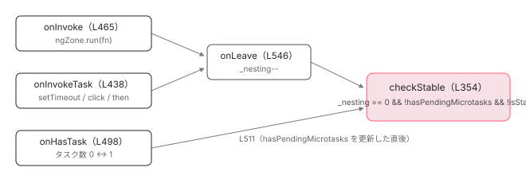

[目次](../README.md) › [zone.js の内側](README.md) › 第 10 回 / 全 13 回

# onEnter / onLeave / checkStable：「安定」の判定

> \_nesting が 0、マイクロタスクが残っていない、まだ安定と言っていない。3 条件がそろったら onMicrotaskEmpty を emit し、その後で onStable。

angular/angular · 読了 約 12 分 · 中核 · [サイトで読む（デモが動きます）](https://angular-deep-dive-cyan.vercel.app/chapter/zone-ngzone-stability)

---

[前章](09-zone-ngzone-fork.md)で `'angular'` zone に 4 つのフックが付いたところまで来ました。この章はそのうち 3 つ（`onInvoke` / `onInvokeTask` / `onHasTask`）が **すべて `checkStable` という 1 つの関数に合流する**様子を追います。`_nesting` が 0、マイクロタスクが残っていない、まだ安定と言っていない。3 条件がそろったときに `onMicrotaskEmpty` が emit され、その後で `onStable` が emit される。その順序と、「マイクロタスクが残っていない」を zone.js の誰が教えてくれるのかが分かります。

読む対象は `packages/core/src/zone/ng_zone.ts` の 354〜549 行目、タスク数の増減を伝える `packages/zone.js/lib/zone-impl.ts`、そして `onStable` を `PendingTasks` につなぐ `ng_zone_scheduling.ts` の `ZoneStablePendingTask` です。

1. 概観
2. Zone とは
3. モンキーパッチ
4. Task のライフサイクル
5. ZoneDelegate
6. マイクロタスクキュー
7. addEventListener
8. hasTask
9. NgZone の fork
10. **onEnter・onLeave・checkStable**（この章）
11. NgZoneChangeDetectionScheduler
12. coalescing と runOutsideAngular
13. 1 クリックの全行程

## 1. 3 つの EventEmitter が約束していること

📄 `angular/packages/core/src/zone/ng_zone.ts` L110–132 （▶ の行: 116, 118, 121, 123, 125, 128, 130, 132）

```ts
110 │   /**
111 │    * Whether there are no outstanding microtasks or macrotasks.
112 │    */
113 │   readonly isStable: boolean = true;
114 │ 
115 │   /**
116 ▶    * Notifies when code enters Angular Zone. This gets fired first on VM Turn.
117 │    */
118 ▶   readonly onUnstable: EventEmitter<any> = new EventEmitter(false);
119 │ 
120 │   /**
121 ▶    * Notifies when there is no more microtasks enqueued in the current VM Turn.
122 │    * This is a hint for Angular to do change detection, which may enqueue more microtasks.
123 ▶    * For this reason this event can fire multiple times per VM Turn.
124 │    */
125 ▶   readonly onMicrotaskEmpty: EventEmitter<any> = new EventEmitter(false);
126 │ 
127 │   /**
128 ▶    * Notifies when the last `onMicrotaskEmpty` has run and there are no more microtasks, which
129 │    * implies we are about to relinquish VM turn.
130 ▶    * This event gets called just once.
131 │    */
132 ▶   readonly onStable: EventEmitter<any> = new EventEmitter(false);
```

コメントが仕様です。116 行目、`onUnstable` は「Angular zone に入ったとき、VM ターンで**最初に**」。121〜123 行目、`onMicrotaskEmpty` は「マイクロタスクが空になったとき。変更検知の合図。変更検知が新しいマイクロタスクを積むので、**1 ターンに複数回**鳴りうる」。128〜130 行目、`onStable` は「最後の `onMicrotaskEmpty` のあと、もうマイクロタスクが無いとき。**1 回だけ**」。この 3 つの約束を、以下のコードがどう守っているかを確かめます。

## 2. onEnter と onLeave

📄 `angular/packages/core/src/zone/ng_zone.ts` L538–549 （▶ の行: 539–542, 547–548）

```ts
538 │ function onEnter(zone: NgZonePrivate) {
539 ▶   zone._nesting++;
540 ▶   if (zone.isStable) {
541 ▶     zone.isStable = false;
542 ▶     zone.onUnstable.emit(null);
543 │   }
544 │ }
545 │ 
546 │ function onLeave(zone: NgZonePrivate) {
547 ▶   zone._nesting--;
548 ▶   checkStable(zone);
549 │ }
```

539 行目で `_nesting++`。540〜542 行目、`isStable` が `true` だったときだけ `false` に落として `onUnstable` を emit します。入れ子で 2 回目に入っても `isStable` はもう `false` なので、`onUnstable` は**安定状態から抜けた最初の 1 回しか鳴りません**。これが 116 行目の「最初に」の実装です。

547 行目で `_nesting--`、548 行目で `checkStable`。`onLeave` は判定を `checkStable` に丸投げしています。

## 3. 誰が onEnter / onLeave を呼ぶか：onInvoke と onInvokeTask

📄 `angular/packages/core/src/zone/ng_zone.ts` L465–496 （▶ の行: 475–476, 494）

```ts
465 │     onInvoke: (
466 │       delegate: ZoneDelegate,
467 │       current: Zone,
468 │       target: Zone,
469 │       callback: Function,
470 │       applyThis: any,
471 │       applyArgs?: any[],
472 │       source?: string,
473 │     ): any => {
474 │       try {
475 ▶         onEnter(zone);
476 ▶         return delegate.invoke(target, callback, applyThis, applyArgs, source);
477 │       } finally {
478 │         if (
479 │           zone.shouldCoalesceRunChangeDetection &&
480 │           // Do not delay change detection when the task is the scheduler's tick.
481 │           // We need to synchronously trigger the stability logic so that the
482 │           // zone-based scheduler can prevent a duplicate ApplicationRef.tick
483 │           // by first checking if the scheduler tick is running. This does seem a bit roundabout,
484 │           // but we _do_ still want to trigger all the correct events when we exit the zone.run
485 │           // (`onMicrotaskEmpty` and `onStable` _should_ emit; developers can have code which
486 │           // relies on these events happening after change detection runs).
487 │           // Note: `zone.callbackScheduled` is already in delayChangeDetectionForEventsDelegate
488 │           // but is added here as well to prevent reads of applyArgs when not necessary
489 │           !zone.callbackScheduled &&
490 │           !isSchedulerTick(applyArgs)
491 │         ) {
492 │           delayChangeDetectionForEventsDelegate();
493 │         }
494 ▶         onLeave(zone);
495 │       }
496 │     },
```

`onInvoke` は `zone.run(fn)`（= `ngZone.run(fn)`）のたびに呼ばれます。475 行目 `onEnter`、476 行目で親に委譲して `fn` 本体、`finally` の 494 行目で `onLeave`。478〜493 行目の条件分岐は `runCoalescing` のときだけ真になるので、[次々章](12-zone-coalescing.md)に回します。

📄 `angular/packages/core/src/zone/ng_zone.ts` L438–463 （▶ の行: 447–448, 452–453, 461）

```ts
438 │     onInvokeTask: (
439 │       delegate: ZoneDelegate,
440 │       current: Zone,
441 │       target: Zone,
442 │       task: Task,
443 │       applyThis: any,
444 │       applyArgs: any,
445 │     ): any => {
446 │       // Prevent triggering change detection when the flag is detected.
447 ▶       if (shouldBeIgnoredByZone(applyArgs)) {
448 ▶         return delegate.invokeTask(target, task, applyThis, applyArgs);
449 │       }
450 │ 
451 │       try {
452 ▶         onEnter(zone);
453 ▶         return delegate.invokeTask(target, task, applyThis, applyArgs);
454 │       } finally {
455 │         if (
456 │           (zone.shouldCoalesceEventChangeDetection && task.type === 'eventTask') ||
457 │           zone.shouldCoalesceRunChangeDetection
458 │         ) {
459 │           delayChangeDetectionForEventsDelegate();
460 │         }
461 ▶         onLeave(zone);
462 │       }
463 │     },
```

`onInvokeTask` は `zone.runTask(task)`、つまり `setTimeout` のコールバック・DOM イベント・`Promise.then` が 実行されるたびに呼ばれます（[Task の章](04-zone-task.md)）。形は `onInvoke` と同じで、452 行目 `onEnter`、453 行目で本体、461 行目 `onLeave`。447〜448 行目だけが違いで、`applyArgs[0].data.__ignore_ng_zone__ === true` の印が付いたタスクは 挟まずに素通りさせます。`packages` 配下でこの印を付けている本番コードは無く（grep で該当するのは 582 行目の判定だけ）、「`runTask` には通すが変更検知は起こしたくない」呼び出し側のための抜け道です。



*3 つのフックは入口が違うだけで、すべて checkStable に合流する。onInvoke / onInvokeTask は onLeave 経由、onHasTask は直接。*

## 4. checkStable：3 条件と 2 つの emit

📄 `angular/packages/core/src/zone/ng_zone.ts` L354–385 （▶ の行: 370, 372–373, 375–376, 378, 380）

```ts
354 │ function checkStable(zone: NgZonePrivate) {
355 │   // TODO: @JiaLiPassion, should check zone.isCheckStableRunning to prevent
356 │   // re-entry. The case is:
357 │   //
358 │   // @Component({...})
359 │   // export class AppComponent {
360 │   // constructor(private ngZone: NgZone) {
361 │   //   this.ngZone.onStable.subscribe(() => {
362 │   //     this.ngZone.run(() => console.log('stable'););
363 │   //   });
364 │   // }
365 │   //
366 │   // The onStable subscriber run another function inside ngZone
367 │   // which causes `checkStable()` re-entry.
368 │   // But this fix causes some issues in g3, so this fix will be
369 │   // launched in another PR.
370 ▶   if (zone._nesting == 0 && !zone.hasPendingMicrotasks && !zone.isStable) {
371 │     try {
372 ▶       zone._nesting++;
373 ▶       zone.onMicrotaskEmpty.emit(null);
374 │     } finally {
375 ▶       zone._nesting--;
376 ▶       if (!zone.hasPendingMicrotasks) {
377 │         try {
378 ▶           zone.runOutsideAngular(() => zone.onStable.emit(null));
379 │         } finally {
380 ▶           zone.isStable = true;
381 │         }
382 │       }
383 │     }
384 │   }
385 │ }
```

1. **370 行目：3 条件**

   `_nesting == 0`（同期の入れ子をすべて抜けた）、`!hasPendingMicrotasks`（マイクロタスクが残っていない）、`!isStable`（まだ安定と宣言していない）。1 つでも欠けると何もしないで戻ります。3 つ目があるので、`checkStable` が何度呼ばれても `onStable` は 1 回で済みます。
2. **372〜373 行目：`_nesting++` してから `onMicrotaskEmpty.emit`**

   emit は同期なので、購読者である `NgZoneChangeDetectionScheduler`（[次章](11-zone-ngzone-scheduler.md)）が この場で `zone.run(() => tick())` を呼びます。`zone.run` は `onInvoke` → `onEnter` で `_nesting` を 1 → 2 にし、戻りで `onLeave` → 2 → 1 → `checkStable`。**ここで 370 行目の `_nesting == 0` が偽になる**ので、再入しません。372 行目の `++` は、変更検知の中から `checkStable` が再帰するのを防ぐためのガードです。
3. **375 行目：`_nesting--` で 0 に戻す**
4. **376 行目：もう一度 `hasPendingMicrotasks` を見る**

   変更検知の中で `Promise.resolve().then(...)` が積まれていれば（`NgModel` などがやります）、`onHasTask` が `hasPendingMicrotasks` を `true` にしているので、ここで止まります。`isStable` は `false` のまま。マイクロタスクが片付いたあと `onHasTask` → `checkStable` が また呼ばれ、370 行目を通って **2 回目の `onMicrotaskEmpty`** が鳴ります。これが 123 行目「1 ターンに複数回」の正体です。
5. **378 行目：`runOutsideAngular` の中で `onStable.emit`**

   購読者が `onEnter` を踏まないように `_outer` で emit します。だから `onStable` の購読者の中で `NgZone.isInAngularZone()` は `false` です （`ZoneStablePendingTask` は 252 行目でそれを assert しています。6 節）。
6. **380 行目：`isStable = true`**

   `finally` なので、購読者が例外を投げても安定状態に戻ります。次に `onEnter` が呼ばれると 540 行目の条件が真になり、`onUnstable` が鳴ります。

> [!WARNING]
> **ハマりどころ**
>
> `onMicrotaskEmpty` と `onStable` は**どちらも `checkStable` の中で、この順で、同期に**鳴ります。変更検知を起動するのは `onMicrotaskEmpty` の購読者であって `onStable` ではありません。`onStable` が鳴る時点では、変更検知はすでに終わっています。

## 5. hasPendingMicrotasks は誰が書くか

📄 `angular/packages/core/src/zone/ng_zone.ts` L498–516 （▶ の行: 504–505, 508–511, 513）

```ts
498 │     onHasTask: (
499 │       delegate: ZoneDelegate,
500 │       current: Zone,
501 │       target: Zone,
502 │       hasTaskState: HasTaskState,
503 │     ) => {
504 ▶       delegate.hasTask(target, hasTaskState);
505 ▶       if (current === target) {
506 │         // We are only interested in hasTask events which originate from our zone
507 │         // (A child hasTask event is not interesting to us)
508 ▶         if (hasTaskState.change == 'microTask') {
509 ▶           zone._hasPendingMicrotasks = hasTaskState.microTask;
510 ▶           updateMicroTaskStatus(zone);
511 ▶           checkStable(zone);
512 │         } else if (hasTaskState.change == 'macroTask') {
513 ▶           zone.hasPendingMacrotasks = hasTaskState.macroTask;
514 │         }
515 │       }
516 │     },
```

504 行目でまず親へ回し、505 行目で `current === target` を確かめます。`current` はこのフックを持つ `'angular'` zone、`target` はタスク数が変わった zone。`'angular'` の**子** zone で数が変わった通知は `DELEGATE_ZS`（zone-impl.ts 1093〜1100 行目）を経由して `target` が子のまま届くので、ここで弾かれます。508〜511 行目、変化が `microTask` なら `_hasPendingMicrotasks` に生の値を書き、`updateMicroTaskStatus` で公開値 `hasPendingMicrotasks` に反映し、**すぐ `checkStable`**。513 行目、`macroTask` なら `hasPendingMacrotasks` を更新するだけで `checkStable` は呼びません （`setTimeout` が残っていても「安定」です。`isStable` の定義は 370 行目のとおりマイクロタスクだけを見ます）。

📄 `angular/packages/core/src/zone/ng_zone.ts` L526–536 （▶ の行: 528–530, 532, 534）

```ts
526 │ function updateMicroTaskStatus(zone: NgZonePrivate) {
527 │   if (
528 ▶     zone._hasPendingMicrotasks ||
529 ▶     ((zone.shouldCoalesceEventChangeDetection || zone.shouldCoalesceRunChangeDetection) &&
530 ▶       zone.callbackScheduled === true)
531 │   ) {
532 ▶     zone.hasPendingMicrotasks = true;
533 │   } else {
534 ▶     zone.hasPendingMicrotasks = false;
535 │   }
536 │ }
```

528 行目の `_hasPendingMicrotasks` が zone.js から来た真実です。529〜530 行目は coalescing のときだけ意味を持ち、「rAF で予約した `checkStable` がまだ走っていない」間も `hasPendingMicrotasks` を `true` に見せかけて、378 行目の `onStable` を遅らせます（[次々章](12-zone-coalescing.md)）。

### zone.js 側：数が 0 ↔ 1 を跨いだときだけ hasTask

📄 `angular/packages/zone.js/lib/zone-impl.ts` L1366–1382 （▶ の行: 1369, 1373, 1378, 1380）

```ts
1366 │     _updateTaskCount(type: TaskType, count: number) {
1367 │       const counts = this._taskCounts;
1368 │       const prev = counts[type];
1369 ▶       const next = (counts[type] = prev + count);
1370 │       if (next < 0) {
1371 │         throw new Error('More tasks executed then were scheduled.');
1372 │       }
1373 ▶       if (prev == 0 || next == 0) {
1374 │         const isEmpty: HasTaskState = {
1375 │           microTask: counts['microTask'] > 0,
1376 │           macroTask: counts['macroTask'] > 0,
1377 │           eventTask: counts['eventTask'] > 0,
1378 ▶           change: type,
1379 │         };
1380 ▶         this.hasTask(this._zone, isEmpty);
1381 │       }
1382 │     }
```

1369 行目で種類別カウンタを更新し、1373 行目、**`prev == 0 || next == 0` のときだけ** 1380 行目で `hasTask`。マイクロタスクが 3 個積まれても呼ばれるのは最初の 1 個目（0 → 1）と最後の 1 個が消えたとき（1 → 0）の 2 回だけです。1378 行目の `change` がどの種類のカウンタが跨いだかを示し、508・512 行目の分岐がそれを読みます。`_updateTaskCount` を呼ぶのは 2 か所です。

📄 `angular/packages/zone.js/lib/zone-impl.ts` L1008–1016 （▶ の行: 1010）

```ts
1008 │       if ((task as any as ZoneTask<any>)._zoneDelegates === zoneDelegates) {
1009 │         // we have to check because internally the delegate can reschedule the task.
1010 ▶         this._updateTaskCount(task as any as ZoneTask<any>, 1);
1011 │       }
1012 │       if ((task as any as ZoneTask<any>).state == scheduling) {
1013 │         (task as any as ZoneTask<any>)._transitionTo(scheduled, scheduling);
1014 │       }
1015 │       return task;
1016 │     }
```

📄 `angular/packages/zone.js/lib/zone-impl.ts` L958–978 （▶ の行: 963–964, 967）

```ts
958 │       } finally {
959 │         // if the task's state is notScheduled or unknown, then it has already been cancelled
960 │         // we should not reset the state to scheduled
961 │         const state = task.state;
962 │         if (state !== notScheduled && state !== unknown) {
963 ▶           if (type == eventTask || isPeriodic || (isRefreshable && state === scheduling)) {
964 ▶             reEntryGuard && zoneTask._transitionTo(scheduled, running, scheduling);
965 │           } else {
966 │             const zoneDelegates = zoneTask._zoneDelegates;
967 ▶             this._updateTaskCount(zoneTask, -1);
968 │             reEntryGuard && zoneTask._transitionTo(notScheduled, running, notScheduled);
969 │ 
970 │             if (isRefreshable) {
971 │               zoneTask._zoneDelegates = zoneDelegates;
972 │             }
973 │           }
974 │         }
975 │         _currentZoneFrame = _currentZoneFrame.parent!;
976 │         _currentTask = previousTask;
977 │       }
978 │     }
```

1010 行目、`scheduleTask` の末尾で `+1`。`Promise.then` を呼んだ瞬間がこれです。967 行目、`runTask` の `finally` で `-1`。ただし 963〜964 行目のとおり `eventTask` と周期タスク（`setInterval`）は `scheduled` に戻るだけで数を減らしません。マイクロタスクは一度きりなので 967 行目を通ります。

ここで順序に注目してください。`runTask` は 952 行目で `invokeTask`（→ `onInvokeTask` → `onEnter` / 本体 / `onLeave`）を呼び、**それが戻ったあと**の `finally` で 967 行目に来ます。つまりマイクロタスク本体の `onLeave` → `checkStable` の時点では、そのマイクロタスク自身がまだ数に入っていて `hasPendingMicrotasks` は `true`、370 行目で止まります。その直後の 967 行目 → `onHasTask` → 511 行目の `checkStable` で初めて条件がそろう。**マイクロタスク経由の安定判定は、`onLeave` ではなく `onHasTask` から emit されます。**

📄 `angular/packages/zone.js/lib/zone-impl.ts` L1350–1364 （▶ の行: 1354–1355, 1361–1362）

```ts
1350 │     hasTask(targetZone: ZoneImpl, isEmpty: HasTaskState) {
1351 │       // hasTask should not throw error so other ZoneDelegate
1352 │       // can still trigger hasTask callback
1353 │       try {
1354 ▶         this._hasTaskZS &&
1355 ▶           this._hasTaskZS.onHasTask!(
1356 │             this._hasTaskDlgt!,
1357 │             this._hasTaskCurrZone!,
1358 │             targetZone,
1359 │             isEmpty,
1360 │           );
1361 ▶       } catch (err) {
1362 ▶         this.handleError(targetZone, err);
1363 │       }
1364 │     }
```

1354〜1360 行目で spec の `onHasTask` を呼びます。1361〜1362 行目、`onHasTask` の中で例外が出ても `handleError` に流して飲み込みます。`checkStable` の中で変更検知が例外を投げても、zone.js のカウンタが壊れないようにするためです。

### マイクロタスクはいつ実行されるか

📄 `angular/packages/zone.js/lib/zone-impl.ts` L1426–1443 （▶ の行: 1430, 1433, 1436–1437）

```ts
1426 │     static invokeTask(task: any, target: any, args: any): any {
1427 │       if (!task) {
1428 │         task = this;
1429 │       }
1430 ▶       _numberOfNestedTaskFrames++;
1431 │       try {
1432 │         task.runCount++;
1433 ▶         return task.zone.runTask(task, target, args);
1434 │       } finally {
1435 │         try {
1436 ▶           if (_numberOfNestedTaskFrames === 1 && !global[enableNativeMicrotaskDraining]) {
1437 ▶             drainMicroTaskQueueSynchronously();
1438 │           }
1439 │         } finally {
1440 │           _numberOfNestedTaskFrames--;
1441 │         }
1442 │       }
1443 │     }
```

📄 `angular/packages/zone.js/lib/zone-impl.ts` L1547–1566 （▶ の行: 1555–1557, 1561）

```ts
1547 │   function drainMicroTaskQueueSynchronously() {
1548 │     if (_isDrainingMicrotaskQueue) {
1549 │       return;
1550 │     }
1551 │ 
1552 │     _isDrainingMicrotaskQueue = true;
1553 │ 
1554 │     try {
1555 ▶       while (_microTaskQueue.length) {
1556 ▶         const queue = _microTaskQueue;
1557 ▶         _microTaskQueue = [];
1558 │ 
1559 │         for (const task of queue) {
1560 │           try {
1561 ▶             task.zone.runTask(task, null, null);
1562 │           } catch (error) {
1563 │             _api.onUnhandledError(error as Error);
1564 │           }
1565 │         }
1566 │       }
```

1433 行目で本体のタスクを `runTask` し、1436〜1437 行目、**いちばん外側のタスクが終わった直後**に `drainMicroTaskQueueSynchronously`。1555〜1561 行目で積まれたマイクロタスクを順に `runTask` します （[マイクロタスクキューの章](06-zone-microtask.md)）。したがって「クリックハンドラの中で `await` した」場合、ハンドラの `onLeave` では安定せず、同じ `invokeTask` の 1437 行目で drain が走り、最後のマイクロタスクの 967 行目 → `onHasTask` → `checkStable` で安定します。すべて**ブラウザに制御を返す前**です。

> **🧪 DEMO — \_nesting / hasPendingMicrotasks / isStable の推移**
>
> ソースの行番号どおりに状態を 1 ステップずつ進めます。「emit」列が空のステップでは何も鳴りません。
>
> onMicrotaskEmpty の回数: **1** / onStable の回数: **1**
>
> ▶ [このデモはサイトで動かせます](https://angular-deep-dive-cyan.vercel.app/chapter/zone-ngzone-stability)

## 6. onStable を PendingTasks につなぐ：ZoneStablePendingTask

`ApplicationRef.isStable` や SSR の「レンダリング完了」は、zone ではなく `PendingTasksInternal` を見ています （[PendingTasks の章](../zoneless/09-zoneless-pending-tasks.md)）。zone.js ありのとき両者をつなぐのが `ZoneStablePendingTask` です。

📄 `angular/packages/core/src/change_detection/scheduling/ng_zone_scheduling.ts` L231–247 （▶ の行: 245–246）

```ts
231 │ @Service()
232 │ export class ZoneStablePendingTask {
233 │   private readonly subscription = new Subscription();
234 │   private initialized = false;
235 │   private readonly zone = inject(NgZone);
236 │   private readonly pendingTasks = inject(PendingTasksInternal);
237 │ 
238 │   initialize() {
239 │     if (this.initialized) {
240 │       return;
241 │     }
242 │     this.initialized = true;
243 │ 
244 │     let task: number | null = null;
245 ▶     if (!this.zone.isStable && !this.zone.hasPendingMacrotasks && !this.zone.hasPendingMicrotasks) {
246 ▶       task = this.pendingTasks.add();
247 │     }
```

245〜246 行目、初期化の時点で「zone は不安定なのにタスクが 1 つも無い」なら、先にタスクを 1 つ登録します。`initialize()` は `ENVIRONMENT_INITIALIZER` から、つまり `bootstrap()` の `ngZone.run` の中で呼ばれるので、この時点で `_nesting` は 1 以上、`isStable` は `false` です。その状態を `PendingTasks` 側にも写しています。

📄 `angular/packages/core/src/change_detection/scheduling/ng_zone_scheduling.ts` L249–276 （▶ の行: 249, 251–252, 256, 262, 271–273）

```ts
249 ▶     this.zone.runOutsideAngular(() => {
250 │       this.subscription.add(
251 ▶         this.zone.onStable.subscribe(() => {
252 ▶           NgZone.assertNotInAngularZone();
253 │ 
254 │           // Check whether there are no pending macro/micro tasks in the next tick
255 │           // to allow for NgZone to update the state.
256 ▶           queueMicrotask(() => {
257 │             if (
258 │               task !== null &&
259 │               !this.zone.hasPendingMacrotasks &&
260 │               !this.zone.hasPendingMicrotasks
261 │             ) {
262 ▶               this.pendingTasks.remove(task);
263 │               task = null;
264 │             }
265 │           });
266 │         }),
267 │       );
268 │     });
269 │ 
270 │     this.subscription.add(
271 ▶       this.zone.onUnstable.subscribe(() => {
272 ▶         NgZone.assertInAngularZone();
273 ▶         task ??= this.pendingTasks.add();
274 │       }),
275 │     );
276 │   }
```

1. **271〜273 行目：`onUnstable` で `pendingTasks.add()`**

   `task ??=` なので、すでに持っていれば増やしません。272 行目の `assertInAngularZone` は、`onUnstable` が `onEnter`（542 行目）の中、つまり `'angular'` zone の中で鳴ることを前提にしています。
2. **249〜252 行目：`onStable` の購読は `runOutsideAngular` の中で**

   購読自体を外で行い、252 行目で「`'angular'` zone の外で呼ばれている」と assert しています。これは `checkStable` 378 行目が `runOutsideAngular` で emit している事実と対になっています。
3. **256〜265 行目：1 マイクロタスク待ってから `remove`**

   `onStable` の直後ではなく `queueMicrotask` で 1 つ遅らせ、そのときにも `hasPendingMacrotasks` / `hasPendingMicrotasks` が両方 `false` なら 262 行目で `remove`。`onStable` の購読者（`Testability` など）が新しいタスクを積む可能性があるため、1 拍置いて確かめ直しています。`onStable` 自体はマクロタスクを見ませんが、`PendingTasks` 側は 259 行目でマクロタスクも条件に入れています。

📄 `angular/packages/core/src/pending_tasks_internal.ts` L48–69 （▶ の行: 50–51, 66–67）

```ts
48 │   add(): number {
49 │     // Emitting a value to a closed subject throws an error.
50 ▶     if (!this.hasPendingTasks && !this.destroyed) {
51 ▶       this.pendingTask.next(true);
52 │     }
53 │     const taskId = this.taskId++;
54 │     this.pendingTasks.add(taskId);
55 │     this.debugTaskTracker?.add(taskId);
56 │     return taskId;
57 │   }
58 │ 
59 │   has(taskId: number): boolean {
60 │     return this.pendingTasks.has(taskId);
61 │   }
62 │ 
63 │   remove(taskId: number): void {
64 │     this.pendingTasks.delete(taskId);
65 │     this.debugTaskTracker?.remove(taskId);
66 ▶     if (this.pendingTasks.size === 0 && this.hasPendingTasks) {
67 ▶       this.pendingTask.next(false);
68 │     }
69 │   }
```

50〜51 行目、最初の `add` で `BehaviorSubject` が `true` に、66〜67 行目、最後の `remove` で `false` に。`ApplicationRef.isStable` はこの `BehaviorSubject` を見ているので、zone.js ありのときは `onUnstable` → `add`、`onStable` + 1 マイクロタスク → `remove` という形で 「zone の安定」が「アプリの安定」に翻訳されます。

## ここまでの呼び出し（setTimeout のコールバックが 1 つ動く場合）

- `ZoneTask.invokeTask(task)` — zone-impl.ts L1426 — *ブラウザのタイマーから*
  - `task.zone.runTask(task)` — zone-impl.ts L1433 — *task.zone は 'angular'*
    - `_zoneDelegate.invokeTask(...)` — zone-impl.ts L952
      - `onInvokeTask(delegate, current, target, task, ...)` — ng\_zone.ts L438
        - `onEnter(zone)` — ng\_zone.ts L452 → L538 — *\_nesting 0→1、isStable true→false、onUnstable.emit*
        - 👤 `delegate.invokeTask(...)` → あなたのコールバック — ng\_zone.ts L453
        - `onLeave(zone)` — ng\_zone.ts L461 → L546 — *\_nesting 1→0*
          - `checkStable(zone)` — ng\_zone.ts L548 → L354 — *3 条件が真*
            - `_nesting++; onMicrotaskEmpty.emit(null)` — ng\_zone.ts L372-373 — *→ 次章の購読者が tick（その中の zone.run は \_nesting 1→2→1 で再入しない）*
            - `_nesting--` — ng\_zone.ts L375 — *1→0*
            - `runOutsideAngular(() => onStable.emit(null))` — ng\_zone.ts L378 — *hasPendingMicrotasks が false のとき*
              - `ZoneStablePendingTask` の購読者 — ng\_zone\_scheduling.ts L251 — *queueMicrotask 後に pendingTasks.remove*
            - `isStable = true` — ng\_zone.ts L380
    - `_updateTaskCount(zoneTask, -1)` — zone-impl.ts L967 — *macroTask 1→0 → onHasTask（L512-513）→ hasPendingMacrotasks = false。checkStable は呼ばれない*
  - `drainMicroTaskQueueSynchronously()` — zone-impl.ts L1437 — *L378 の購読者が積んだ queueMicrotask がここで実行される*

## 聞かれそうな質問

**Q. onMicrotaskEmpty と onStable の違いは何ですか？どちらで変更検知が走りますか？**

どちらも `checkStable`（ng\_zone.ts 354 行目）の中で鳴ります。先に 373 行目で `onMicrotaskEmpty`、その購読者（`NgZoneChangeDetectionScheduler`）が変更検知を走らせ、それが戻ってから 376 行目でマイクロタスクが残っていないことを確かめ、378 行目で `onStable`。**変更検知を起動するのは `onMicrotaskEmpty`**です。`onStable` は「変更検知も終わり、もう何も残っていない」の通知で、380 行目で `isStable = true` になるため 1 ターンに 1 回しか鳴りません。`onMicrotaskEmpty` は変更検知が新しいマイクロタスクを積むと、それが片付いたあとにもう一度鳴ります（121〜123 行目のコメントどおり）。

**Q. onMicrotaskEmpty の購読者が ngZone.run を呼んでも無限ループしないのはなぜですか？**

372 行目で `_nesting++` してから emit しているからです。購読者の `zone.run` は `onEnter` で 1 → 2、`onLeave` で 2 → 1 になり、そのときの `checkStable` は 370 行目の `_nesting == 0` で止まります。375 行目で 0 に戻すのは emit が終わったあとです。

**Q. setTimeout が残っていても isStable は true になりますか？**

なります。370 行目の条件にはマクロタスクが含まれていません。`onHasTask` も 512〜513 行目で `hasPendingMacrotasks` を更新するだけで `checkStable` を呼びません。ただし `ZoneStablePendingTask` は 259 行目で `hasPendingMacrotasks` も見るので、`ApplicationRef.isStable`（`PendingTasks` 経由）はタイマーが残っている間 `false` のままです。

**Q. ハンドラの中で await したら、変更検知はいつ走りますか？**

ハンドラの `onLeave` 時点では `hasPendingMicrotasks` が `true` なので走りません。最外のタスクが終わった直後の `drainMicroTaskQueueSynchronously`（zone-impl.ts 1437 行目）で `then` の続きが `runTask` され、その `finally`（967 行目）でマイクロタスク数が 1 → 0 になると `onHasTask`（ng\_zone.ts 509〜511 行目）→ `checkStable` → `onMicrotaskEmpty`。ブラウザに制御が戻る前、同じ JavaScript の実行の中です。

**Q. onStable の購読者の中で NgZone.isInAngularZone() は何を返しますか？**

`false` です。378 行目が `runOutsideAngular` の中で emit しているからです。`ZoneStablePendingTask` は 252 行目で `assertNotInAngularZone()` を置いてこれを前提にしています。逆に `onUnstable` は `onEnter`（542 行目）の中、zone の内側で鳴るので 272 行目は `assertInAngularZone()` です。

## 読み終えて

- `onInvoke` と `onInvokeTask` は `onEnter` / `onLeave` で挟み、`onLeave` が `checkStable` を呼ぶ
- `onHasTask` はマイクロタスク数が 0 ↔ 1 を跨いだときだけ呼ばれ、`hasPendingMicrotasks` を更新して直接 `checkStable` を呼ぶ
- `checkStable` は `_nesting == 0 && !hasPendingMicrotasks && !isStable` のとき、`onMicrotaskEmpty` → （マイクロタスクが無ければ）`onStable` → `isStable = true` の順で同期に進む
- マイクロタスク経由の安定は `runTask` の `finally`（`-1`）→ `onHasTask` から emit される。`onLeave` からではない
- `ZoneStablePendingTask` が `onUnstable` / `onStable` を `PendingTasksInternal` の add / remove に翻訳する

---

← 前: [NgZone：Angular が fork する 1 つの zone](09-zone-ngzone-fork.md)  
次: [NgZoneChangeDetectionScheduler：onMicrotaskEmpty → tick](11-zone-ngzone-scheduler.md) →
