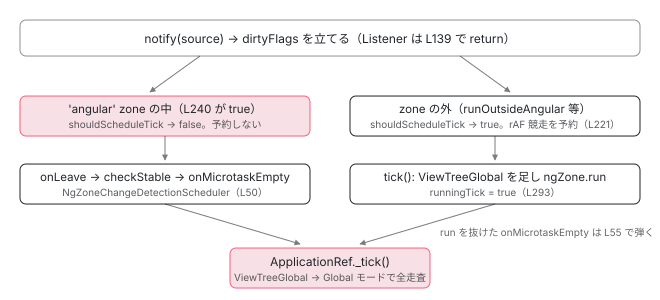

[目次](../README.md) › [zone.js の内側](README.md) › 第 11 回 / 全 13 回

# NgZoneChangeDetectionScheduler：onMicrotaskEmpty → tick

> provideZoneChangeDetection が ZONELESS\_ENABLED を false にし、NgZone を本物に差し替え、ENVIRONMENT\_INITIALIZER で購読を開始する。tick は ViewTreeGlobal で全走査。

angular/angular · 読了 約 12 分 · 中核 · [サイトで読む（デモが動きます）](https://angular-deep-dive-cyan.vercel.app/chapter/zone-ngzone-scheduler)

---

[前章](10-zone-ngzone-stability.md)で `onMicrotaskEmpty` が鳴るところまで来ました。この章はその購読者、`NgZoneChangeDetectionScheduler` を読みます。誰がそれを登録するのか（`provideZoneChangeDetection`）、購読者は何をするのか（`ViewTreeGlobal` を立てて `_tick`）、そして zone.js ありのときも消えずに残っている `ChangeDetectionSchedulerImpl` が、どうやって**二重に tick しないようにしているか**が分かります。

読む対象は `packages/core/src/change_detection/scheduling/ng_zone_scheduling.ts`、同じディレクトリの `zoneless_scheduling_impl.ts`、`application_ref.ts` の `tick` 周辺です。

1. 概観
2. Zone とは
3. モンキーパッチ
4. Task のライフサイクル
5. ZoneDelegate
6. マイクロタスクキュー
7. addEventListener
8. hasTask
9. NgZone の fork
10. onEnter・onLeave・checkStable
11. **NgZoneChangeDetectionScheduler**（この章）
12. coalescing と runOutsideAngular
13. 1 クリックの全行程

## 1. provideZoneChangeDetection が provide する 5 つ

📄 `angular/packages/core/src/change_detection/scheduling/ng_zone_scheduling.ts` L153–167 （▶ の行: 154–158, 162, 166）

```ts
153 │ export function provideZoneChangeDetection(options?: NgZoneOptions): EnvironmentProviders {
154 ▶   const scheduleInRootZone = (options as any)?.scheduleInRootZone;
155 ▶   const zoneProviders = internalProvideZoneChangeDetection({
156 ▶     ngZoneFactory: () => {
157 ▶       const ngZoneOptions = getNgZoneOptions(options);
158 ▶       ngZoneOptions.scheduleInRootZone = scheduleInRootZone;
159 │       if (ngZoneOptions.shouldCoalesceEventChangeDetection) {
160 │         performanceMarkFeature('NgZone_CoalesceEvent');
161 │       }
162 ▶       return new NgZone(ngZoneOptions);
163 │     },
164 │     scheduleInRootZone,
165 │   });
166 ▶   return makeEnvironmentProviders([{provide: PROVIDED_NG_ZONE, useValue: true}, zoneProviders]);
167 │ }
```

155〜165 行目、公開関数は `internalProvideZoneChangeDetection` に `ngZoneFactory` を渡すだけです。その factory（156〜163 行目）が 157 行目でオプションを変換し、162 行目で `new NgZone(ngZoneOptions)` を返します。[fork の章](09-zone-ngzone-fork.md)で読んだ constructor はここから呼ばれます。166 行目の `PROVIDED_NG_ZONE: true` は「明示的に呼んだ」印で、`bootstrapModule` との併用を検出するためだけにあります。

📄 `angular/packages/core/src/change_detection/scheduling/ng_zone_scheduling.ts` L223–229 （▶ の行: 225–227）

```ts
223 │ export function getNgZoneOptions(options?: NgZoneOptions): InternalNgZoneOptions {
224 │   return {
225 ▶     enableLongStackTrace: typeof ngDevMode === 'undefined' ? false : !!ngDevMode,
226 ▶     shouldCoalesceEventChangeDetection: options?.eventCoalescing ?? false,
227 ▶     shouldCoalesceRunChangeDetection: options?.runCoalescing ?? false,
228 │   };
229 │ }
```

225〜227 行目。公開オプション名 `eventCoalescing` / `runCoalescing` が、`NgZone` constructor の名前 `shouldCoalesceEventChangeDetection` / `shouldCoalesceRunChangeDetection` に写されます。既定は両方 `false`。`enableLongStackTrace` は `ngDevMode` と同じ値です。

📄 `angular/packages/core/src/change_detection/scheduling/ng_zone_scheduling.ts` L84–95 （▶ の行: 91–92, 94–95）

```ts
84 │ export function internalProvideZoneChangeDetection({
85 │   ngZoneFactory,
86 │   scheduleInRootZone,
87 │ }: {
88 │   ngZoneFactory?: () => NgZone;
89 │   scheduleInRootZone?: boolean;
90 │ }): StaticProvider[] {
91 ▶   ngZoneFactory ??= () =>
92 ▶     new NgZone({...getNgZoneOptions(), scheduleInRootZone} as InternalNgZoneOptions);
93 │   return [
94 ▶     {provide: ZONELESS_ENABLED, useValue: false},
95 ▶     {provide: NgZone, useFactory: ngZoneFactory},
```

94 行目で `ZONELESS_ENABLED` を `false` に、95 行目で `NgZone` を factory に。[zoneless-default の章](../zoneless/01-zoneless-default.md)で見たとおり、この 2 つが既定の `ZONELESS_ENABLED → true` / `NgZone → NoopNgZone` を**後勝ちで上書き**します。**`ChangeDetectionScheduler` はこの配列に居ません。** したがって zone.js ありでも `ChangeDetectionSchedulerImpl` はそのまま生きています。5 節で何をしているかを見ます。

📄 `angular/packages/core/src/change_detection/scheduling/ng_zone_scheduling.ts` L96–115 （▶ の行: 97–98, 100, 113）

```ts
 96 │     {
 97 ▶       provide: ENVIRONMENT_INITIALIZER,
 98 ▶       multi: true,
 99 │       useFactory: () => {
100 ▶         const ngZoneChangeDetectionScheduler = inject(NgZoneChangeDetectionScheduler, {
101 │           optional: true,
102 │         });
103 │         if (
104 │           (typeof ngDevMode === 'undefined' || ngDevMode) &&
105 │           ngZoneChangeDetectionScheduler === null
106 │         ) {
107 │           throw new RuntimeError(
108 │             RuntimeErrorCode.MISSING_REQUIRED_INJECTABLE_IN_BOOTSTRAP,
109 │             `A required Injectable was not found in the dependency injection tree. ` +
110 │               'If you are bootstrapping an NgModule, make sure that the `BrowserModule` is imported.',
111 │           );
112 │         }
113 ▶         return () => ngZoneChangeDetectionScheduler!.initialize();
114 │       },
115 │     },
```

📄 `angular/packages/core/src/change_detection/scheduling/ng_zone_scheduling.ts` L116–131 （▶ の行: 120, 122, 127–128）

```ts
116 │     {
117 │       provide: ENVIRONMENT_INITIALIZER,
118 │       multi: true,
119 │       useFactory: () => {
120 ▶         const service = inject(ZoneStablePendingTask);
121 │         return () => {
122 ▶           service.initialize();
123 │         };
124 │       },
125 │     },
126 │     {
127 ▶       provide: SCHEDULE_IN_ROOT_ZONE,
128 ▶       useValue: scheduleInRootZone ?? SCHEDULE_IN_ROOT_ZONE_DEFAULT,
129 │     },
130 │   ];
131 │ }
```

97〜115 行目と 116〜125 行目が `ENVIRONMENT_INITIALIZER`（`multi: true`）。100 行目で `NgZoneChangeDetectionScheduler` を inject し、113 行目で返す関数が `initialize()` を呼びます。120〜122 行目は前章の `ZoneStablePendingTask.initialize()`。127〜128 行目の `SCHEDULE_IN_ROOT_ZONE` は既定 `false`（`flags.ts`）で、`ChangeDetectionSchedulerImpl` が 76 行目で読みます。

## 2. initialize() はどの zone の中で呼ばれるか

📄 `angular/packages/core/src/platform/bootstrap.ts` L81–92 （▶ の行: 87–88, 90）

```ts
81 │ export function bootstrap<M>(
82 │   config: ModuleBootstrapConfig<M> | ApplicationBootstrapConfig,
83 │ ): Promise<ApplicationRef> | Promise<NgModuleRef<M>> {
84 │   const envInjector = isApplicationBootstrapConfig(config)
85 │     ? config.r3Injector
86 │     : config.moduleRef.injector;
87 ▶   const ngZone = envInjector.get(NgZone);
88 ▶   return ngZone.run(() => {
89 │     if (isApplicationBootstrapConfig(config)) {
90 ▶       config.r3Injector.resolveInjectorInitializers();
91 │     } else {
92 │       config.moduleRef.resolveInjectorInitializers();
```

87 行目で `NgZone` を取り出し（ここで初めて `new NgZone` が走る）、88 行目の `ngZone.run` の中で 90 行目 `resolveInjectorInitializers()`。`ENVIRONMENT_INITIALIZER` はここで全部実行されます。つまり `initialize()` も、その中の `onMicrotaskEmpty.subscribe` も、**`'angular'` zone の中、`_nesting` が 1 以上の状態**で行われます。この `ngZone.run` を抜けるときの `onLeave` → `checkStable` が、アプリ起動後**最初の**`onMicrotaskEmpty` になります。

## 3. NgZoneChangeDetectionScheduler：購読者の全文

📄 `angular/packages/core/src/change_detection/scheduling/ng_zone_scheduling.ts` L36–49 （▶ の行: 38–41, 46–47）

```ts
36 │ @Service()
37 │ export class NgZoneChangeDetectionScheduler implements OnDestroy {
38 ▶   private readonly zone = inject(NgZone);
39 ▶   private readonly changeDetectionScheduler = inject(ChangeDetectionScheduler);
40 ▶   private readonly applicationRef = inject(ApplicationRef);
41 ▶   private readonly applicationErrorHandler = inject(INTERNAL_APPLICATION_ERROR_HANDLER);
42 │ 
43 │   private _onMicrotaskEmptySubscription?: Subscription;
44 │ 
45 │   initialize(): void {
46 ▶     if (this._onMicrotaskEmptySubscription) {
47 ▶       return;
48 │     }
49 │ 
```

38〜41 行目、inject するのは `NgZone`、`ChangeDetectionScheduler`（= `ChangeDetectionSchedulerImpl`）、`ApplicationRef`、エラーハンドラの 4 つ。46〜47 行目、2 回呼ばれても購読は 1 つです。

📄 `angular/packages/core/src/change_detection/scheduling/ng_zone_scheduling.ts` L50–68 （▶ の行: 50, 55–56, 58, 60–61, 63）

```ts
50 ▶     this._onMicrotaskEmptySubscription = this.zone.onMicrotaskEmpty.subscribe({
51 │       next: () => {
52 │         // `onMicroTaskEmpty` can happen _during_ the zoneless scheduler change detection because
53 │         // zone.run(() => {}) will result in `checkStable` at the end of the `zone.run` closure
54 │         // and emit `onMicrotaskEmpty` synchronously if run coalsecing is false.
55 ▶         if (this.changeDetectionScheduler.runningTick) {
56 ▶           return;
57 │         }
58 ▶         this.zone.run(() => {
59 │           try {
60 ▶             this.applicationRef.dirtyFlags |= ApplicationRefDirtyFlags.ViewTreeGlobal;
61 ▶             this.applicationRef._tick();
62 │           } catch (e) {
63 ▶             this.applicationErrorHandler(e);
64 │           }
65 │         });
66 │       },
67 │     });
68 │   }
```

1. **50 行目：`onMicrotaskEmpty` を購読**

   `onStable` ではありません。前章 373 行目の emit がここに届きます。`onStable`（378 行目）はこの購読者が戻ったあとに鳴ります。
2. **55〜56 行目：`changeDetectionScheduler.runningTick` なら何もしない**

   `ChangeDetectionSchedulerImpl` が自分の `tick()` の中で `ngZone.run` を呼ぶと（5 節 291 行目）、その `run` を抜けるときに `onLeave` → `checkStable` → `onMicrotaskEmpty` が同期に鳴ります。そのとき `runningTick` は `true`（293 行目で立て、`finally` の 303 行目 `cleanup` で下ろす）なので、ここで戻ります。**二重 tick を防ぐ 1 つ目のガード**です。
3. **58 行目：`zone.run` の中で**

   `checkStable` はすでに `_nesting` を 1 にしてから emit しているので、この `run` は 1 → 2 → 1 で動き、中からの `checkStable` は何もしません。変更検知の中で予約された非同期タスクが `'angular'` zone に所属するようにするための `run` です。
4. **60 行目：`dirtyFlags |= ViewTreeGlobal`**

   **無条件**です。何が dirty かを知らないまま「全ビューを見ろ」と立てます。これが zone.js ありのときの変更検知が「全走査」になる根拠です。
5. **61 行目：`applicationRef._tick()`**

   公開 API の `tick()` ではなく内部の `_tick()` を呼びます。違いは次節。
6. **63 行目：例外は `INTERNAL_APPLICATION_ERROR_HANDLER` へ**

   `onMicrotaskEmpty` の emit は `checkStable` の `try` の中なので、ここで捕まえておかないと zone.js の `onHasTask`（前章 1361 行目）か `onInvokeTask` まで例外が上がります。

## 4. ApplicationRef.tick と \_tick、ViewTreeGlobal の行き先

📄 `angular/packages/core/src/application/application_ref.ts` L533–552 （▶ の行: 534–535, 537, 541, 548, 550）

```ts
533 │   tick(): void {
534 ▶     if (!this.zonelessEnabled) {
535 ▶       this.dirtyFlags |= ApplicationRefDirtyFlags.ViewTreeGlobal;
536 │     }
537 ▶     this._tick();
538 │   }
539 │ 
540 │   /** @internal */
541 ▶   _tick(): void {
542 │     profiler(ProfilerEvent.ChangeDetectionStart);
543 │ 
544 │     if (this.tracingSnapshot !== null) {
545 │       // Ensure we always run `tickImpl()` in the context of the most recent snapshot,
546 │       // if one exists. Snapshots may be reference counted by the implementation so
547 │       // we want to ensure that if we request a snapshot that we use it.
548 ▶       this.tracingSnapshot.run(TracingAction.CHANGE_DETECTION, this.tickImpl);
549 │     } else {
550 ▶       this.tickImpl();
551 │     }
552 │   }
```

534〜535 行目、公開 `tick()` は `zonelessEnabled` が偽なら `ViewTreeGlobal` を立てて 537 行目で `_tick()`。`NgZoneChangeDetectionScheduler` は 60 行目で自分で立ててから `_tick()` を直接呼ぶので、結果は同じです。541〜551 行目、`_tick()` はトレーシングのスナップショットの有無で分岐して `tickImpl` へ。その先の `synchronize` ループは[tick の章](../zoneless/05-zoneless-tick.md)で読んでいるので、ここでは `ViewTreeGlobal` が効く 1 か所だけ見ます。

📄 `angular/packages/core/src/application/application_ref.ts` L624–655 （▶ の行: 626, 630, 639, 641, 645–646, 650, 652–653）

```ts
624 │     // First check dirty views, if there are any.
625 │     let ranDetectChanges = false;
626 ▶     if (this.dirtyFlags & ApplicationRefDirtyFlags.ViewTreeAny) {
627 │       // Change detection on views starts in targeted mode (only check components if they're
628 │       // marked as dirty) unless global checking is specifically requested via APIs like
629 │       // `ApplicationRef.tick()` and the `NgZone` integration.
630 ▶       const useGlobalCheck = Boolean(this.dirtyFlags & ApplicationRefDirtyFlags.ViewTreeGlobal);
631 │ 
632 │       // Clear the view-related dirty flags.
633 │       this.dirtyFlags &= ~ApplicationRefDirtyFlags.ViewTreeAny;
634 │ 
635 │       // Set the AfterRender bit, as we're checking views and will need to run afterRender hooks.
636 │       this.dirtyFlags |= ApplicationRefDirtyFlags.AfterRender;
637 │ 
638 │       // Check all potentially dirty views.
639 ▶       for (let {_lView} of this.allViews) {
640 │         // When re-checking, only check views which actually need it.
641 ▶         if (!useGlobalCheck && !requiresRefreshOrTraversal(_lView)) {
642 │           continue;
643 │         }
644 │ 
645 ▶         const mode =
646 ▶           useGlobalCheck && !this.zonelessEnabled
647 │             ? // Global mode includes `CheckAlways` views.
648 │               // When using zoneless, all root views must be explicitly marked for refresh, even if they are
649 │               // `CheckAlways`.
650 ▶               ChangeDetectionMode.Global
651 │             : // Only refresh views with the `RefreshView` flag or views is a changed signal
652 ▶               ChangeDetectionMode.Targeted;
653 ▶         detectChangesInternal(_lView, mode);
654 │         ranDetectChanges = true;
655 │       }
```

630 行目で `useGlobalCheck` を取り、639 行目で全ルートビューを回します。641 行目、`useGlobalCheck` が真ならビューが dirty かどうかを**見ずに**続行。645〜652 行目、`useGlobalCheck && !zonelessEnabled` のとき `ChangeDetectionMode.Global`、それ以外は `Targeted`。653 行目の `detectChangesInternal(_lView, mode)` 以降は[変更検知シリーズ](../cd/02-cd-detect-changes-in-view.md)です。`Global` モードは `CheckAlways`（`ChangeDetectionStrategy.Eager`、旧 `Default`）のビューをすべて更新するモードで、「zone.js ありでは関係ないコンポーネントも再評価される」と言われる理由がこの 2 行です。

## 5. zone.js ありでも ChangeDetectionSchedulerImpl は生きている

📄 `angular/packages/core/src/change_detection/scheduling/zoneless_scheduling_impl.ts` L59–76 （▶ の行: 64–65, 67–68, 70–71, 73–76）

```ts
59 │ @Service()
60 │ export class ChangeDetectionSchedulerImpl implements ChangeDetectionScheduler, OnDestroy {
61 │   private readonly applicationErrorHandler = inject(INTERNAL_APPLICATION_ERROR_HANDLER);
62 │   private readonly appRef = inject(ApplicationRef);
63 │   private readonly taskService = inject(PendingTasksInternal);
64 ▶   private readonly ngZone = inject(NgZone);
65 ▶   private readonly zonelessEnabled = inject(ZONELESS_ENABLED);
66 │   private readonly tracing = inject(TracingService, {optional: true});
67 ▶   private readonly zoneIsDefined = typeof Zone !== 'undefined' && !!Zone.root.run;
68 ▶   private readonly schedulerTickApplyArgs = [{data: {'__scheduler_tick__': true}}];
69 │   private readonly subscriptions = new Subscription();
70 ▶   private readonly angularZoneId = this.zoneIsDefined
71 ▶     ? (this.ngZone as NgZonePrivate)._inner?.get(angularZoneInstanceIdProperty)
72 │     : null;
73 ▶   private readonly scheduleInRootZone =
74 ▶     !this.zonelessEnabled &&
75 ▶     this.zoneIsDefined &&
76 ▶     (inject(SCHEDULE_IN_ROOT_ZONE, {optional: true}) ?? false);
```

1. **64〜65 行目：`NgZone` と `ZONELESS_ENABLED` を inject**

   zone.js ありなら本物の `NgZone` と `false` が入ります。
2. **67 行目：`zoneIsDefined`**

   グローバル `Zone` が存在し `Zone.root.run` が関数か。zone.js が**読み込まれているか**の判定で、provide とは独立です。
3. **68 行目：`schedulerTickApplyArgs`**

   `[{ data: { '__scheduler_tick__': true } }]`。自分の tick を `ngZone.run` するときに渡し、`NgZone` の `onInvoke`（`isSchedulerTick`、ng\_zone.ts 585 行目）に「これはスケジューラの tick だ」と知らせます。意味を持つのは `runCoalescing` のときだけなので[次章](12-zone-coalescing.md)で扱います。
4. **70〜72 行目：`angularZoneId`**

   `_inner.get('isAngularZone_ID')`。fork の章の 435 行目で付けた番号です。`NoopNgZone` には `_inner` が無いので `?.` で `undefined`。
5. **73〜76 行目：`scheduleInRootZone`**

   zoneless でなく、zone.js があり、`SCHEDULE_IN_ROOT_ZONE` が真のときだけ。既定では `false`。

### notify：Listener だけは無視する

📄 `angular/packages/core/src/change_detection/scheduling/zoneless_scheduling_impl.ts` L138–149 （▶ の行: 139, 148）

```ts
138 │   notify(source: NotificationSource): void {
139 ▶     if (!this.zonelessEnabled && source === NotificationSource.Listener) {
140 │       // When the notification comes from a listener, we skip the notification unless the
141 │       // application has enabled zoneless. Ideally, listeners wouldn't notify the scheduler at all
142 │       // automatically. We do not know that a developer made a change in the listener callback that
143 │       // requires an `ApplicationRef.tick` (synchronize templates / run render hooks). We do this
144 │       // only for an easier migration from OnPush components to zoneless. Because listeners are
145 │       // usually executed inside the Angular zone and listeners automatically call `markViewDirty`,
146 │       // developers never needed to manually use `ChangeDetectorRef.markForCheck` or some other API
147 │       // to make listener callbacks work correctly with `OnPush` components.
148 ▶       return;
149 │     }
```

139 行目、zone.js ありで `source === NotificationSource.Listener` なら 148 行目で即 return。`dirtyFlags` にも触りません。コメントのとおり、zone.js ありではリスナーは `'angular'` zone の中で動くので `onLeave` → `checkStable` が面倒を見てくれる、という前提です。`markViewDirty` が `LView` に `Dirty` フラグを立てる部分（[(click) 経路の章](../zoneless/08-zoneless-listener-path.md)）は この return の影響を受けません。

### shouldScheduleTick：zone の中なら予約しない

📄 `angular/packages/core/src/change_detection/scheduling/zoneless_scheduling_impl.ts` L201–225 （▶ の行: 201, 214–219, 221–222）

```ts
201 ▶     if (!this.shouldScheduleTick()) {
202 │       return;
203 │     }
204 │ 
205 │     if (typeof ngDevMode === 'undefined' || ngDevMode) {
206 │       if (this.useMicrotaskScheduler) {
207 │         trackMicrotaskNotificationForDebugging();
208 │       } else {
209 │         consecutiveMicrotaskNotifications = 0;
210 │         stackFromLastFewNotifications.length = 0;
211 │       }
212 │     }
213 │ 
214 ▶     const scheduleCallback = this.useMicrotaskScheduler
215 ▶       ? scheduleCallbackWithMicrotask
216 ▶       : scheduleCallbackWithRafRace;
217 ▶     this.pendingRenderTaskId = this.taskService.add();
218 ▶     if (this.scheduleInRootZone) {
219 ▶       this.cancelScheduledCallback = Zone.root.run(() => scheduleCallback(() => this.tick()));
220 │     } else {
221 ▶       this.cancelScheduledCallback = this.ngZone.runOutsideAngular(() =>
222 ▶         scheduleCallback(() => this.tick()),
223 │       );
224 │     }
225 │   }
```

📄 `angular/packages/core/src/change_detection/scheduling/zoneless_scheduling_impl.ts` L227–246 （▶ の行: 232, 237–240, 242）

```ts
227 │   private shouldScheduleTick(): boolean {
228 │     if (this.appRef.destroyed) {
229 │       return false;
230 │     }
231 │     // already scheduled or running
232 ▶     if (this.pendingRenderTaskId !== null || this.runningTick || this.appRef._runningTick) {
233 │       return false;
234 │     }
235 │     // If we're inside the zone don't bother with scheduler. Zone will stabilize
236 │     // eventually and run change detection.
237 ▶     if (
238 ▶       !this.zonelessEnabled &&
239 ▶       this.zoneIsDefined &&
240 ▶       Zone.current.get(angularZoneInstanceIdProperty + this.angularZoneId)
241 │     ) {
242 ▶       return false;
243 │     }
244 │ 
245 │     return true;
246 │   }
```

`Listener` 以外の通知（signal の書き換え、`markForCheck`、`afterRender` の登録など）は `switch` を通って `dirtyFlags` を立てたあと、201 行目で `shouldScheduleTick()` に聞きます。232 行目は「予約済み・実行中」の除外。237〜242 行目が zone 用の判定で、`!zonelessEnabled && zoneIsDefined && Zone.current.get('isAngularZone_ID' + angularZoneId)` なら **`false`**。「いま `'angular'` zone の中にいるなら、どうせ `onLeave` → `checkStable` が来る。自分は予約しない」。**二重 tick を防ぐ 2 つ目のガード**で、`dirtyFlags` は立てたまま残るので、zone の tick が拾います。

判定が `true` になるのは `'angular'` zone の**外**で通知が来たときです。典型は `runOutsideAngular` の中の `setTimeout` から signal を書いた場合。214〜216 行目で `scheduleCallbackWithRafRace`（[rAF 競走の章](../zoneless/04-zoneless-raf-race.md)）を選び、221〜222 行目、予約自体は `runOutsideAngular` の中で行います。予約を `'angular'` zone の中でやると、その `setTimeout` がマクロタスクとして数えられ、コールバックが `onInvokeTask` を通ってさらに `checkStable` を呼んでしまうからです。

### tick：ngZone.run の中で \_tick し、戻りの onMicrotaskEmpty は runningTick で弾く

📄 `angular/packages/core/src/change_detection/scheduling/zoneless_scheduling_impl.ts` L257–271 （▶ の行: 261, 268–269）

```ts
257 │   private tick(): void {
258 │     // When ngZone.run below exits, onMicrotaskEmpty may emit if the zone is
259 │     // stable. We want to prevent double ticking so we track whether the tick is
260 │     // already running and skip it if so.
261 ▶     if (this.runningTick || this.appRef.destroyed) {
262 │       return;
263 │     }
264 │ 
265 │     // If we reach the tick and there is no work to be done in ApplicationRef.tick,
266 │     // skip it altogether and clean up. There may be no work if, for example, the only
267 │     // event that notified the scheduler was the removal of a pending task.
268 ▶     if (this.appRef.dirtyFlags === ApplicationRefDirtyFlags.None) {
269 ▶       this.cleanup();
270 │       return;
271 │     }
```

📄 `angular/packages/core/src/change_detection/scheduling/zoneless_scheduling_impl.ts` L285–305 （▶ の行: 285–286, 291, 293–294, 297, 303）

```ts
285 ▶     if (!this.zonelessEnabled && this.appRef.dirtyFlags & ApplicationRefDirtyFlags.ViewTreeAny) {
286 ▶       this.appRef.dirtyFlags |= ApplicationRefDirtyFlags.ViewTreeGlobal;
287 │     }
288 │ 
289 │     const task = this.taskService.add();
290 │     try {
291 ▶       this.ngZone.run(
292 │         () => {
293 ▶           this.runningTick = true;
294 ▶           this.appRef._tick();
295 │         },
296 │         undefined,
297 ▶         this.schedulerTickApplyArgs,
298 │       );
299 │     } catch (e: unknown) {
300 │       this.applicationErrorHandler(e);
301 │     } finally {
302 │       this.taskService.remove(task);
303 ▶       this.cleanup();
304 │     }
305 │   }
```

285〜286 行目、zone.js ありで何かビューが dirty なら `ViewTreeGlobal` を足します（コメントにあるとおり互換性のためで、zone.js ありでは「スケジューラ経由の tick も全走査」になります）。291〜298 行目、`ngZone.run` の中で `runningTick = true` にして `_tick()`。この `run` を抜ける瞬間に `onInvoke` の `finally` → `onLeave` → `checkStable` → `onMicrotaskEmpty` が 鳴りますが、`runningTick` はまだ `true` なので 3 節 55〜56 行目で弾かれます。303 行目の `cleanup()` が `runningTick` を `false` に戻すのは `run` が完全に戻ったあとです。

### onUnstable と afterTick：予約の取り消し

📄 `angular/packages/core/src/change_detection/scheduling/zoneless_scheduling_impl.ts` L110–119 （▶ の行: 111, 115–116）

```ts
110 │     this.subscriptions.add(
111 ▶       this.ngZone.onUnstable.subscribe(() => {
112 │         // If the zone becomes unstable when we're not running tick (this happens from the zone.run),
113 │         // we should cancel any scheduled change detection here because at this point we
114 │         // know that the zone will stabilize at some point and run change detection itself.
115 ▶         if (!this.runningTick) {
116 ▶           this.cleanup();
117 │         }
118 │       }),
119 │     );
```

111 行目、`onUnstable`（前章 542 行目）を購読し、115〜116 行目、自分の tick 中でなければ `cleanup()`。「`runOutsideAngular` で signal を書いて rAF を予約した直後に、別のクリックで zone に入った」ような場合、zone がどうせ tick するので、予約した rAF / setTimeout をキャンセルします。

📄 `angular/packages/core/src/change_detection/scheduling/zoneless_scheduling_impl.ts` L84–108 （▶ の行: 85, 92–93, 101–103, 106）

```ts
 84 │     this.subscriptions.add(
 85 ▶       this.appRef.afterTick.subscribe(() => {
 86 │         // Prevent stabilization if cleanup causes the last task to be removed
 87 │         // before we can switch to the microtask scheduler.
 88 │         const task = this.taskService.add();
 89 │         // If the scheduler isn't running a tick but the application ticked, that means
 90 │         // someone called ApplicationRef.tick manually. In this case, we should cancel
 91 │         // any change detections that had been scheduled so we don't run an extra one.
 92 ▶         if (!this.runningTick) {
 93 ▶           this.cleanup();
 94 │           // Ticks that happen when ZoneJS is present do not get the microtask scheduling treatment.
 95 │           // ZoneJS is responsible for rerunning change detection on microtask queue empty.
 96 │           // Ticks initiated from tests also do not get microtask treatment so those ticks
 97 │           // do not affect stability timing, which tests are quite sensitive to.
 98 │           // TODO(atscott): we really should not use microtask scheduler
 99 │           // _ever_ when ZoneJS is enabled because ZoneJS is responsible for rerunning change
100 │           // detection on microtask queue empty. This change breaks some tests
101 ▶           if (!this.zonelessEnabled || this.appRef.includeAllTestViews) {
102 ▶             this.taskService.remove(task);
103 ▶             return;
104 │           }
105 │         }
106 ▶         this.switchToMicrotaskScheduler();
107 │         this.taskService.remove(task);
108 │       }),
```

85 行目、`ApplicationRef.afterTick`（`tickImpl` の `finally` で `next()`）を購読。92〜93 行目、自分の tick でなければ（zone の tick か手動の `tick()`）`cleanup()` で予約を消し、101〜103 行目、**zone.js ありなら 106 行目のマイクロタスクスケジューラへの切り替えをしない**で戻ります。zoneless のときだけ使う「1 マイクロタスク以内の再通知は同じフレームで再 tick」という仕組み（[microtask スケジューラの章](../zoneless/06-zoneless-microtask.md)）を、zone.js ありでは `checkStable` が同じ役目を果たすので切っています。



*通知が来た場所で経路が分かれる。'angular' zone の中なら ChangeDetectionSchedulerImpl は dirtyFlags を立てるだけで予約せず、zone の onMicrotaskEmpty が tick する。外なら rAF 競走で予約し、tick の中の ngZone.run から鳴る onMicrotaskEmpty は runningTick で弾く。*

> **🧪 DEMO — 通知の出どころと tick の回数**
>
> zone.js あり（`provideZoneChangeDetection()`）で、以下の操作をしたときに `_tick` が何回呼ばれるか。行番号はこの章で引用したものです。
>
> ▶ [このデモはサイトで動かせます](https://angular-deep-dive-cyan.vercel.app/chapter/zone-ngzone-scheduler)

## ここまでの呼び出し（ngZone.run の中で signal を書いた場合）

- 👤 `ngZone.run(() => count.set(1))` — あなたのコード
  - `onInvoke` → `onEnter` — ng\_zone.ts L475 — *\_nesting 0→1、onUnstable → ChangeDetectionSchedulerImpl.cleanup（L116。予約は無いので何もしない）*
    - `count.set(1)` → consumer → `markAncestorsForTraversal` → `notify(MarkAncestorsForTraversal)` — zoneless\_scheduling\_impl.ts L138 — *dirtyFlags |= ViewTreeTraversal*
      - `shouldScheduleTick()` — zoneless\_scheduling\_impl.ts L227 — *L240 Zone.current.get('isAngularZone\_ID0') === true → false。予約しない*
  - `onLeave` → `checkStable` — ng\_zone.ts L494 → L354 — *\_nesting 1→0、3 条件そろう*
    - `onMicrotaskEmpty.emit(null)` — ng\_zone.ts L373
      - `NgZoneChangeDetectionScheduler` の next — ng\_zone\_scheduling.ts L51 — *runningTick は false → 続行*
        - `zone.run(...)` — ng\_zone\_scheduling.ts L58 — *\_nesting 1→2*
          - `dirtyFlags |= ViewTreeGlobal` — ng\_zone\_scheduling.ts L60
          - `applicationRef._tick()` — application\_ref.ts L541
            - `tickImpl` → `synchronize` → `synchronizeOnce` — application\_ref.ts L554 → L588 → L617 — *useGlobalCheck = true → ChangeDetectionMode.Global（L650）*
              - `detectChangesInternal(_lView, Global)` × ルートビュー — application\_ref.ts L653 — *DOM が更新される*
            - `afterTick.next()` — application\_ref.ts L578 — *ChangeDetectionSchedulerImpl: runningTick false → cleanup → !zonelessEnabled → return（L101-103）*
        - `zone.run` を抜ける → `onLeave` → `checkStable` — ng\_zone.ts L494 — *\_nesting 2→1 → L370 で何もしない*
    - `_nesting--` → `onStable.emit` → `isStable = true` — ng\_zone.ts L375-380

## 聞かれそうな質問

**Q. provideZoneChangeDetection() は何を provide し、何を provide しませんか？**

`internalProvideZoneChangeDetection`（ng\_zone\_scheduling.ts 93〜130 行目）が返すのは `ZONELESS_ENABLED: false`（94 行目）、`NgZone` の factory（95 行目）、`ENVIRONMENT_INITIALIZER` × 2（97・117 行目。`NgZoneChangeDetectionScheduler.initialize` と `ZoneStablePendingTask.initialize`）、`SCHEDULE_IN_ROOT_ZONE`（127 行目）の 5 つ。**`ChangeDetectionScheduler` は含まれません**。既定の `ChangeDetectionSchedulerImpl` がそのまま残ります。

**Q. zone.js ありのとき、ChangeDetectionSchedulerImpl は何をしていますか？二重に tick しないのはなぜですか？**

`notify` で `dirtyFlags` を立てることは続けます（`Listener` だけ 139 行目で無視）。ただし `shouldScheduleTick` の 237〜242 行目で「`'angular'` zone の中なら予約しない」と判定するので、zone の中からの通知は `onMicrotaskEmpty` → `NgZoneChangeDetectionScheduler` だけが tick します（ガード 1）。zone の外からの通知は自分で rAF 競走を予約し、`tick()` の 291〜298 行目で `ngZone.run` の中で `_tick` しますが、その `run` を抜けるときに鳴る `onMicrotaskEmpty` は `runningTick === true` なので `NgZoneChangeDetectionScheduler` が 55〜56 行目で弾きます（ガード 2）。さらに `onUnstable`（115〜116 行目）と `afterTick`（92〜93 行目）で、zone が tick するなら自分の予約を取り消します。

**Q. ngZone.run() の中で signal を書いたら変更検知は何回走りますか？**

1 回です。`set` からの `notify` は `dirtyFlags` を立てますが、240 行目で zone の中と判定されて予約しません。`run` を抜けるときの `onLeave` → `checkStable` → `onMicrotaskEmpty` → 60〜61 行目で `ViewTreeGlobal` を立てて `_tick`。`afterTick` では `runningTick` が `false` なので 101〜103 行目で戻り、マイクロタスクでの再 tick も予約されません。上の trace がその全行程です。

**Q. zone.js ありの変更検知が「全コンポーネントを見る」のはどの行のせいですか？**

`NgZoneChangeDetectionScheduler` の 60 行目 `dirtyFlags |= ViewTreeGlobal`（無条件）と、`synchronizeOnce` の 645〜652 行目 `useGlobalCheck && !zonelessEnabled ? Global : Targeted` です。`Global` モードは `CheckAlways` のビューをすべて更新します。`ChangeDetectionSchedulerImpl` 経由の tick も 285〜286 行目で `ViewTreeGlobal` を足すので同じです。

**Q. ApplicationRef.tick() を手で呼ぶのと、zone に任せるのは同じですか？**

どちらも `ViewTreeGlobal` を立てて `_tick()` です（534〜537 行目 / 60〜61 行目）。違いは回数です。`'angular'` zone の中で手動 `tick()` を呼ぶと、その後 zone を抜けるときに `onMicrotaskEmpty` が鳴り、60 行目が**無条件に**`ViewTreeGlobal` を立てるので、もう 1 回 `_tick` が走ります。手動 tick は zone.js ありでは原則不要です。

## 読み終えて

- `provideZoneChangeDetection` は `ZONELESS_ENABLED=false`、`NgZone`、2 つの `ENVIRONMENT_INITIALIZER`、`SCHEDULE_IN_ROOT_ZONE` を provide し、`ChangeDetectionScheduler` は触らない
- `initialize()` は `bootstrap()` の `ngZone.run` の中で呼ばれ、`onMicrotaskEmpty` を購読する。購読者は `runningTick` を見てから `ViewTreeGlobal` を立てて `_tick()`
- `ViewTreeGlobal` は `synchronizeOnce` で `ChangeDetectionMode.Global` になり、全ビューを走査する
- `ChangeDetectionSchedulerImpl` は zone.js ありでも `dirtyFlags` を立て続けるが、zone の中なら予約せず、外なら予約して `ngZone.run` で tick し、戻りの `onMicrotaskEmpty` は `runningTick` で弾かれる

---

← 前: [onEnter / onLeave / checkStable：「安定」の判定](10-zone-ngzone-stability.md)  
次: [eventCoalescing / runCoalescing と runOutsideAngular](12-zone-coalescing.md) →
