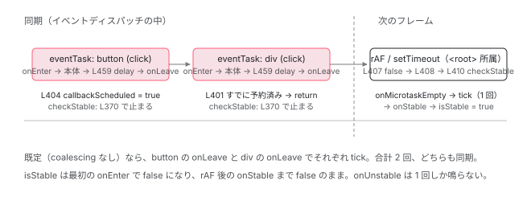

[目次](../README.md) › [zone.js の内側](README.md) › 第 12 回 / 全 13 回

# eventCoalescing / runCoalescing と runOutsideAngular

> delayChangeDetectionForEvents が checkStable を rAF まで遅らせる。1 クリックで複数のイベントが連続しても変更検知は 1 回。\_outer.run で外に出る抜け道。

angular/angular · 読了 約 11 分 · 発展 · [サイトで読む（デモが動きます）](https://angular-deep-dive-cyan.vercel.app/chapter/zone-coalescing)

---

`provideZoneChangeDetection({ eventCoalescing: true })` と書くと「イベントがまとめられる」と覚えている人が多いと思います。この章では、そのフラグが `NgZone` のどの行で読まれ、`checkStable` の呼び出しを**どこまで遅らせるのか**を追います。合わせて、`runOutsideAngular` が「外側の zone で `run` する」だけで変更検知を止められる理由を、タスクの所属という観点で確認します。

読む対象は `packages/core/src/zone/ng_zone.ts` の `delayChangeDetectionForEvents`（387 行目）と `forkInnerZoneWithAngularBehavior` の 2 つのフック、`packages/core/src/util/callback_scheduler.ts` です。

1. 概観
2. Zone とは
3. モンキーパッチ
4. Task のライフサイクル
5. ZoneDelegate
6. マイクロタスクキュー
7. addEventListener
8. hasTask
9. NgZone の fork
10. onEnter・onLeave・checkStable
11. NgZoneChangeDetectionScheduler
12. **coalescing と runOutsideAngular**（この章）
13. 1 クリックの全行程

## 1. 2 つのオプションが解決したい問題

📄 `angular/packages/core/src/change_detection/scheduling/ng_zone_scheduling.ts` L185–218 （▶ の行: 187–190, 197, 205–209, 212–214, 217）

````ts
185 │    * ```
186 │    *
187 ▶    * When button is clicked, because of the event bubbling, both
188 ▶    * event handlers will be called and 2 change detections will be
189 ▶    * triggered. We can coalesce such kind of events to trigger
190 ▶    * change detection only once.
191 │    *
192 │    * By default, this option is set to false, meaning events will
193 │    * not be coalesced, and change detection will be triggered multiple times.
194 │    * If this option is set to true, change detection will be triggered
195 │    * once in the scenario described above.
196 │    */
197 ▶   eventCoalescing?: boolean;
198 │ 
199 │   /**
200 │    * Optionally specify if `NgZone#run()` method invocations should be coalesced
201 │    * into a single change detection.
202 │    *
203 │    * Consider the following case.
204 │    * ```ts
205 ▶    * for (let i = 0; i < 10; i ++) {
206 ▶    *   ngZone.run(() => {
207 ▶    *     // do something
208 ▶    *   });
209 ▶    * }
210 │    * ```
211 │    *
212 ▶    * This case triggers the change detection multiple times.
213 ▶    * With ngZoneRunCoalescing options, all change detections in an event loop trigger only once.
214 ▶    * In addition, the change detection executes in requestAnimation.
215 │    *
216 │    */
217 ▶   runCoalescing?: boolean;
218 │ }
````

187〜190 行目、`eventCoalescing` の動機はイベントバブリングです。`<div (click)>` の中の `<button (click)>` を押すと、ブラウザは 2 つのリスナーを**別々に**呼びます。zone.js から見ればそれは 2 つの `eventTask` で、[前々章](10-zone-ngzone-stability.md)のとおり それぞれの `onLeave` で `checkStable` → 変更検知が走る。合計 2 回です。205〜214 行目、`runCoalescing` の動機はループの中の `ngZone.run()`。`onInvoke` の `finally` ごとに 1 回、計 10 回です。どちらも「1 つのイベントループの中で何度も `checkStable` が真になる」問題で、解決の方向も同じ、**「今すぐ判定せず、`requestAnimationFrame` まで待つ」**です（213〜214 行目）。

📄 `angular/packages/core/src/change_detection/scheduling/ng_zone_scheduling.ts` L223–229 （▶ の行: 226–227）

```ts
223 │ export function getNgZoneOptions(options?: NgZoneOptions): InternalNgZoneOptions {
224 │   return {
225 │     enableLongStackTrace: typeof ngDevMode === 'undefined' ? false : !!ngDevMode,
226 ▶     shouldCoalesceEventChangeDetection: options?.eventCoalescing ?? false,
227 ▶     shouldCoalesceRunChangeDetection: options?.runCoalescing ?? false,
228 │   };
229 │ }
```

📄 `angular/packages/core/src/zone/ng_zone.ts` L180–187 （▶ の行: 182–185）

```ts
180 │     // if shouldCoalesceRunChangeDetection is true, all tasks including event tasks will be
181 │     // coalesced, so shouldCoalesceEventChangeDetection option is not necessary and can be skipped.
182 ▶     self.shouldCoalesceEventChangeDetection =
183 ▶       !shouldCoalesceRunChangeDetection && shouldCoalesceEventChangeDetection;
184 ▶     self.shouldCoalesceRunChangeDetection = shouldCoalesceRunChangeDetection;
185 ▶     self.callbackScheduled = false;
186 │     self.scheduleInRootZone = scheduleInRootZone;
187 │     forkInnerZoneWithAngularBehavior(self);
```

226〜227 行目で名前が変わり、182〜184 行目で `NgZone` に保存されます。`shouldCoalesceRunChangeDetection` が真なら `shouldCoalesceEventChangeDetection` は `false` に落とされます（182〜183 行目）。`runCoalescing` はイベントも含めて全部まとめるので、イベント用のフラグは不要になるからです（2 節で確認します）。185 行目の `callbackScheduled = false` が、この章の主役の状態変数です。

## 2. フラグを読む場所は 2 つのフックの finally

📄 `angular/packages/core/src/zone/ng_zone.ts` L438–463 （▶ の行: 455–459, 461）

```ts
438 │     onInvokeTask: (
439 │       delegate: ZoneDelegate,
440 │       current: Zone,
441 │       target: Zone,
442 │       task: Task,
443 │       applyThis: any,
444 │       applyArgs: any,
445 │     ): any => {
446 │       // Prevent triggering change detection when the flag is detected.
447 │       if (shouldBeIgnoredByZone(applyArgs)) {
448 │         return delegate.invokeTask(target, task, applyThis, applyArgs);
449 │       }
450 │ 
451 │       try {
452 │         onEnter(zone);
453 │         return delegate.invokeTask(target, task, applyThis, applyArgs);
454 │       } finally {
455 ▶         if (
456 ▶           (zone.shouldCoalesceEventChangeDetection && task.type === 'eventTask') ||
457 ▶           zone.shouldCoalesceRunChangeDetection
458 ▶         ) {
459 ▶           delayChangeDetectionForEventsDelegate();
460 │         }
461 ▶         onLeave(zone);
462 │       }
463 │     },
```

455〜459 行目。本体が終わって `finally` に入ったとき、「`eventCoalescing` かつこのタスクが `eventTask`」または「`runCoalescing`」なら `delayChangeDetectionForEventsDelegate()` を呼び、**そのあと** 461 行目で `onLeave`。順序が大事です。`delay...` が先に `callbackScheduled = true` にしておくことで、直後の `onLeave` → `checkStable` が止まります（3 節）。`setTimeout` のコールバックは `macroTask` なので `eventCoalescing` だけでは対象になりません。`runCoalescing` はタスクの種類を見ないので、すべてのタスクが対象です。

📄 `angular/packages/core/src/zone/ng_zone.ts` L465–496 （▶ の行: 478–479, 489–490, 492, 494）

```ts
465 │     onInvoke: (
466 │       delegate: ZoneDelegate,
467 │       current: Zone,
468 │       target: Zone,
469 │       callback: Function,
470 │       applyThis: any,
471 │       applyArgs?: any[],
472 │       source?: string,
473 │     ): any => {
474 │       try {
475 │         onEnter(zone);
476 │         return delegate.invoke(target, callback, applyThis, applyArgs, source);
477 │       } finally {
478 ▶         if (
479 ▶           zone.shouldCoalesceRunChangeDetection &&
480 │           // Do not delay change detection when the task is the scheduler's tick.
481 │           // We need to synchronously trigger the stability logic so that the
482 │           // zone-based scheduler can prevent a duplicate ApplicationRef.tick
483 │           // by first checking if the scheduler tick is running. This does seem a bit roundabout,
484 │           // but we _do_ still want to trigger all the correct events when we exit the zone.run
485 │           // (`onMicrotaskEmpty` and `onStable` _should_ emit; developers can have code which
486 │           // relies on these events happening after change detection runs).
487 │           // Note: `zone.callbackScheduled` is already in delayChangeDetectionForEventsDelegate
488 │           // but is added here as well to prevent reads of applyArgs when not necessary
489 ▶           !zone.callbackScheduled &&
490 ▶           !isSchedulerTick(applyArgs)
491 │         ) {
492 ▶           delayChangeDetectionForEventsDelegate();
493 │         }
494 ▶         onLeave(zone);
495 │       }
496 │     },
```

`onInvoke`（`ngZone.run`）側は 478〜491 行目。`runCoalescing` のときだけで、489 行目 `!callbackScheduled`（すでに予約済みなら読まない。コメントどおり `applyArgs` を見るコストを省くため）と 490 行目 `!isSchedulerTick(applyArgs)`。`eventCoalescing` は `onInvoke` には**効きません**。`ngZone.run` は `eventTask` ではないからです。

### isSchedulerTick：スケジューラの tick だけは遅らせない

📄 `angular/packages/core/src/zone/ng_zone.ts` L581–601 （▶ の行: 582, 586, 596, 600）

```ts
581 │ function shouldBeIgnoredByZone(applyArgs: unknown): boolean {
582 ▶   return hasApplyArgsData(applyArgs, '__ignore_ng_zone__');
583 │ }
584 │ 
585 │ function isSchedulerTick(applyArgs: unknown): boolean {
586 ▶   return hasApplyArgsData(applyArgs, '__scheduler_tick__');
587 │ }
588 │ 
589 │ function hasApplyArgsData(applyArgs: unknown, key: string) {
590 │   if (!Array.isArray(applyArgs)) {
591 │     return false;
592 │   }
593 │ 
594 │   // We should only ever get 1 arg passed through to invokeTask.
595 │   // Short circuit here incase that behavior changes.
596 ▶   if (applyArgs.length !== 1) {
597 │     return false;
598 │   }
599 │ 
600 ▶   return applyArgs[0]?.data?.[key] === true;
601 │ }
```

📄 `angular/packages/core/src/change_detection/scheduling/zoneless_scheduling_impl.ts` L289–305 （▶ の行: 291, 297）

```ts
289 │     const task = this.taskService.add();
290 │     try {
291 ▶       this.ngZone.run(
292 │         () => {
293 │           this.runningTick = true;
294 │           this.appRef._tick();
295 │         },
296 │         undefined,
297 ▶         this.schedulerTickApplyArgs,
298 │       );
299 │     } catch (e: unknown) {
300 │       this.applicationErrorHandler(e);
301 │     } finally {
302 │       this.taskService.remove(task);
303 │       this.cleanup();
304 │     }
305 │   }
```

`ChangeDetectionSchedulerImpl.tick` は 291〜298 行目で `ngZone.run(fn, undefined, schedulerTickApplyArgs)` を呼びます。297 行目の第 3 引数が `onInvoke` の `applyArgs` にそのまま届き、586 行目 → 600 行目で `applyArgs[0].data.__scheduler_tick__ === true` と判定されます。なぜ遅らせないのか。480〜486 行目のコメントが理由を書いています。[前章](11-zone-ngzone-scheduler.md)で見た「`run` を抜けた直後に `onMicrotaskEmpty` が同期に鳴り、`runningTick` が `true` なので `NgZoneChangeDetectionScheduler` が弾く」というガードは、`checkStable` が**同期に**走ることが前提です。rAF まで遅らせると、そのとき `runningTick` はもう `false` で、二重 tick になります。だからスケジューラの tick だけは例外です。

## 3. delayChangeDetectionForEvents：checkStable を rAF まで預ける

📄 `angular/packages/core/src/zone/ng_zone.ts` L387–424 （▶ の行: 401–402, 404, 406–411, 414–415, 419, 423）

```ts
387 │ function delayChangeDetectionForEvents(zone: NgZonePrivate) {
388 │   /**
389 │    * We also need to check _nesting here
390 │    * Consider the following case with shouldCoalesceRunChangeDetection = true
391 │    *
392 │    * ngZone.run(() => {});
393 │    * ngZone.run(() => {});
394 │    *
395 │    * We want the two `ngZone.run()` only trigger one change detection
396 │    * when shouldCoalesceRunChangeDetection is true.
397 │    * And because in this case, change detection run in async way(requestAnimationFrame),
398 │    * so we also need to check the _nesting here to prevent multiple
399 │    * change detections.
400 │    */
401 ▶   if (zone.isCheckStableRunning || zone.callbackScheduled) {
402 ▶     return;
403 │   }
404 ▶   zone.callbackScheduled = true;
405 │   function scheduleCheckStable() {
406 ▶     scheduleCallbackWithRafRace(() => {
407 ▶       zone.callbackScheduled = false;
408 ▶       updateMicroTaskStatus(zone);
409 ▶       zone.isCheckStableRunning = true;
410 ▶       checkStable(zone);
411 ▶       zone.isCheckStableRunning = false;
412 │     });
413 │   }
414 ▶   if (zone.scheduleInRootZone) {
415 ▶     Zone.root.run(() => {
416 │       scheduleCheckStable();
417 │     });
418 │   } else {
419 ▶     zone._outer.run(() => {
420 │       scheduleCheckStable();
421 │     });
422 │   }
423 ▶   updateMicroTaskStatus(zone);
424 │ }
```

1. **401〜402 行目：すでに予約済み、または `checkStable` 実行中なら何もしない**

   バブリングの 2 つ目のリスナー、ループの 2 回目以降の `run` はここで戻ります。`isCheckStableRunning` は 409〜411 行目で立つので、「遅らせた `checkStable` の中で起きた変更検知」の中から さらにイベントが来ても、二重に予約しません。
2. **404 行目：`callbackScheduled = true`**
3. **414〜422 行目：`_outer`（または `Zone.root`）の中で予約する**

   `scheduleInRootZone` は既定 `false` なので 419 行目、`_outer.run` の中で `scheduleCheckStable()`。予約に使う `setTimeout` / `requestAnimationFrame` を `'angular'` zone の中で呼ぶと、それ自体が `macroTask` として `onInvokeTask` を通り、`onEnter` / `onLeave` → `checkStable` → さらに `delay`… と循環します。外で予約すれば、そのコールバックは `<root>` 所属で、フックは一切通りません。
4. **423 行目：`updateMicroTaskStatus(zone)`**

   ここが「遅らせる」仕組みの核心です。次の引用で見ます。
5. **406〜412 行目：rAF（か setTimeout）が来たら**

   407 行目で予約フラグを下ろし、408 行目で `hasPendingMicrotasks` を再計算、409〜411 行目で `isCheckStableRunning` を立てたまま `checkStable`。`_nesting` は 0（イベントはすべて `onLeave` を通過済み）、`isStable` は `false`（最初の `onEnter` で落ちたまま）なので、マイクロタスクが残っていなければ 3 条件がそろい、**ここで初めて**`onMicrotaskEmpty` → tick です。

📄 `angular/packages/core/src/zone/ng_zone.ts` L526–536 （▶ の行: 529–530, 532）

```ts
526 │ function updateMicroTaskStatus(zone: NgZonePrivate) {
527 │   if (
528 │     zone._hasPendingMicrotasks ||
529 ▶     ((zone.shouldCoalesceEventChangeDetection || zone.shouldCoalesceRunChangeDetection) &&
530 ▶       zone.callbackScheduled === true)
531 │   ) {
532 ▶     zone.hasPendingMicrotasks = true;
533 │   } else {
534 │     zone.hasPendingMicrotasks = false;
535 │   }
536 │ }
```

📄 `angular/packages/core/src/zone/ng_zone.ts` L370–385 （▶ の行: 370, 376）

```ts
370 ▶   if (zone._nesting == 0 && !zone.hasPendingMicrotasks && !zone.isStable) {
371 │     try {
372 │       zone._nesting++;
373 │       zone.onMicrotaskEmpty.emit(null);
374 │     } finally {
375 │       zone._nesting--;
376 ▶       if (!zone.hasPendingMicrotasks) {
377 │         try {
378 │           zone.runOutsideAngular(() => zone.onStable.emit(null));
379 │         } finally {
380 │           zone.isStable = true;
381 │         }
382 │       }
383 │     }
384 │   }
385 │ }
```

529〜530 行目。coalescing が有効で `callbackScheduled === true` の間、**実際のマイクロタスクが無くても `hasPendingMicrotasks` を `true` にする**。すると 461 行目の `onLeave` → `checkStable` は 370 行目の `!hasPendingMicrotasks` で止まります。`checkStable` 自身には coalescing の分岐が 1 行も無く、「まだマイクロタスクがある」と**見せかける**だけで遅延を実現しています。rAF 側で 407〜408 行目が `callbackScheduled = false` → `updateMicroTaskStatus` をすると見せかけが解け、370 行目が真になります。376 行目も同じ値を見るので、`onStable` もまとめて rAF 後に 1 回だけです。

📄 `angular/packages/core/src/util/callback_scheduler.ts` L37–66 （▶ の行: 41, 54, 59, 65）

```ts
37 │ export function scheduleCallbackWithRafRace(callback: Function): () => void {
38 │   let timeoutId: number;
39 │   let animationFrameId: number;
40 │   function cleanup() {
41 ▶     callback = noop;
42 │     try {
43 │       if (animationFrameId !== undefined && typeof cancelAnimationFrame === 'function') {
44 │         cancelAnimationFrame(animationFrameId);
45 │       }
46 │       if (timeoutId !== undefined) {
47 │         clearTimeout(timeoutId);
48 │       }
49 │     } catch {
50 │       // Clearing/canceling can fail in tests due to the timing of functions being patched and unpatched
51 │       // Just ignore the errors - we protect ourselves from this issue by also making the callback a no-op.
52 │     }
53 │   }
54 ▶   timeoutId = setTimeout(() => {
55 │     callback();
56 │     cleanup();
57 │   }) as unknown as number;
58 │   if (typeof requestAnimationFrame === 'function') {
59 ▶     animationFrameId = requestAnimationFrame(() => {
60 │       callback();
61 │       cleanup();
62 │     });
63 │   }
64 │ 
65 ▶   return () => cleanup();
66 │ }
```

予約に使う `scheduleCallbackWithRafRace` は zoneless スケジューラと同じ関数です（[rAF 競走の章](../zoneless/04-zoneless-raf-race.md)）。54 行目 `setTimeout` と 59 行目 `requestAnimationFrame` を両方予約し、先に来たほうが `callback()` を呼び、41 行目で `callback = noop` にして負けたほうを無効化します。「rAF まで遅らせる」と書きましたが、正確には「`setTimeout(0)` と rAF の早いほう」です。背景タブでは rAF が止まるので `setTimeout` が勝ちます。65 行目が返すキャンセル関数は、`delayChangeDetectionForEvents` では捨てられています（406 行目）。一度予約したら必ず走ります。

📄 `angular/packages/zone.js/lib/zone-impl.ts` L795–801 （▶ の行: 796–798）

```ts
795 │     static get root(): AmbientZone {
796 ▶       let zone = ZoneImpl.current;
797 ▶       while (zone.parent) {
798 ▶         zone = zone.parent;
799 │       }
800 │       return zone;
801 │     }
```

414〜417 行目の `Zone.root` は 796〜798 行目のとおり「`Zone.current` から `parent` を辿った最上位」です。`_outer` は `NgZone` を作った場所の zone（[fork の章](09-zone-ngzone-fork.md)）なので、テストなど `<root>` 以外で `new NgZone` した場合に両者は違う zone になります。通常のアプリでは `_outer === Zone.root` で、`scheduleInRootZone` の既定 `false` との差はありません。



*eventCoalescing: true のときのバブリング。2 つの eventTask はそれぞれ onEnter / onLeave を通るが、callbackScheduled が hasPendingMicrotasks を true に見せかけるので checkStable は止まる。rAF（か setTimeout）で 1 回だけ checkStable が真になる。*

> **🧪 DEMO — 何回 tick するか、いつ tick するか**
>
> ネストした `(click)` の段数と、ループで呼ぶ `ngZone.run()` の回数を変えて、オプションごとの結果を比べます。数字はこの章で引用した分岐（455〜459 行目、478〜491 行目、401 行目）から導いたものです。
>
> ▶ [このデモはサイトで動かせます](https://angular-deep-dive-cyan.vercel.app/chapter/zone-coalescing)

## 4. runOutsideAngular：フックの無い zone でタスクを作る

📄 `angular/packages/core/src/zone/ng_zone.ts` L234–236 （▶ の行: 235）

```ts
234 │   run<T>(fn: (...args: any[]) => T, applyThis?: any, applyArgs?: any[]): T {
235 ▶     return (this as any as NgZonePrivate)._inner.run(fn, applyThis, applyArgs);
236 │   }
```

📄 `angular/packages/core/src/zone/ng_zone.ts` L268–284 （▶ の行: 282）

```ts
268 │   /**
269 │    * Executes the `fn` function synchronously in Angular's parent zone and returns value returned by
270 │    * the function.
271 │    *
272 │    * Running functions via {@link #runOutsideAngular} allows you to escape Angular's zone and do
273 │    * work that
274 │    * doesn't trigger Angular change-detection or is subject to Angular's error handling.
275 │    *
276 │    * Any future tasks or microtasks scheduled from within this function will continue executing from
277 │    * outside of the Angular zone.
278 │    *
279 │    * Use {@link #run} to reenter the Angular zone and do work that updates the application model.
280 │    */
281 │   runOutsideAngular<T>(fn: (...args: any[]) => T): T {
282 ▶     return (this as any as NgZonePrivate)._outer.run(fn);
283 │   }
284 │ }
```

📄 `angular/packages/zone.js/lib/zone-impl.ts` L884–897 （▶ の行: 891, 893）

```ts
884 │     public run(callback: Function, applyThis?: any, applyArgs?: any[], source?: string): any;
885 │     public run<T>(
886 │       callback: (...args: any[]) => T,
887 │       applyThis?: any,
888 │       applyArgs?: any[],
889 │       source?: string,
890 │     ): T {
891 ▶       _currentZoneFrame = {parent: _currentZoneFrame, zone: this};
892 │       try {
893 ▶         return this._zoneDelegate.invoke(this, callback, applyThis, applyArgs, source);
894 │       } finally {
895 │         _currentZoneFrame = _currentZoneFrame.parent!;
896 │       }
897 │     }
```

235 行目と 282 行目の違いは `_inner` か `_outer` か。zone.js の `run`（891 行目）は `_currentZoneFrame` にその zone を積むので、`fn` の中では `Zone.current` が `_outer`（`<root>`）です。`fn` の中で `setTimeout` / `addEventListener` / `Promise.then` を呼ぶと、パッチ版はその時点の `Zone.current` で `scheduleTask` するので（[Task の章](04-zone-task.md)）、タスクの `zone` は `<root>` になります。後でそのタスクが `runTask` されるとき、`<root>` の delegate は `onInvokeTask` を持たないので `task.callback.apply` だけが走り、`onEnter` / `onLeave` / `checkStable` は呼ばれません。**「変更検知が起きない」のは、フックが無い zone にタスクが所属しているから**です。

> [!WARNING]
> **ハマりどころ**
>
> ただし、`runOutsideAngular` の中で **signal** を書くと話が変わります。`set` からの `notify` は zone とは無関係に `ChangeDetectionSchedulerImpl` に届き、`shouldScheduleTick`（zoneless\_scheduling\_impl.ts 237〜242 行目）が「zone の外」と判定して rAF 競走を予約します。zone.js ありでも signal の書き換えは `runOutsideAngular` で隠せません。隠せるのは「ただのフィールド書き換え」と「`markForCheck` を呼ばない変更」だけです。

## ここまでの呼び出し（eventCoalescing: true、button → div のバブリング）

- `globalZoneAwareCallback` → `invokeTask`（button） — zone.js/lib/common/events.ts
  - `onInvokeTask` → `onEnter` — ng\_zone.ts L452 — *\_nesting 0→1、onUnstable*
  - 👤 button のハンドラ — ng\_zone.ts L453
  - `finally`: L456 真 → `delayChangeDetectionForEvents` — ng\_zone.ts L459 → L387
    - `callbackScheduled = true` — ng\_zone.ts L404
    - `_outer.run(() => scheduleCallbackWithRafRace(...))` — ng\_zone.ts L419 → callback\_scheduler.ts L37 — *setTimeout と rAF を &lt;root&gt; で予約*
    - `updateMicroTaskStatus` — ng\_zone.ts L423 → L529 — *hasPendingMicrotasks = true（見せかけ）*
  - `onLeave` → `checkStable` — ng\_zone.ts L461 → L370 — *\_nesting 1→0。!hasPendingMicrotasks が偽 → 何もしない*
- `globalZoneAwareCallback` → `invokeTask`（div） — events.ts — *バブリングで 2 つ目の eventTask*
  - `onEnter` — L452 — *\_nesting 0→1。isStable はすでに false → onUnstable は鳴らない*
  - 👤 div のハンドラ — L453
  - `delayChangeDetectionForEvents` — L459 → L401 — *callbackScheduled が true → return*
  - `onLeave` → `checkStable` — L461 → L370 — *何もしない*
- `requestAnimationFrame` のコールバック（&lt;root&gt; 所属。フック無し） — callback\_scheduler.ts L59
  - `callbackScheduled = false; updateMicroTaskStatus` — ng\_zone.ts L407-408 — *hasPendingMicrotasks = false*
  - `isCheckStableRunning = true; checkStable(zone)` — ng\_zone.ts L409-410 — *3 条件そろう*
    - `onMicrotaskEmpty.emit` → `NgZoneChangeDetectionScheduler` → `_tick()` — ng\_zone.ts L373 → ng\_zone\_scheduling.ts L61 — *1 回だけ*
    - `onStable.emit` → `isStable = true` — ng\_zone.ts L378-380
  - `isCheckStableRunning = false` — ng\_zone.ts L411

## 聞かれそうな質問

**Q. eventCoalescing: true は何を遅らせるのですか？**

`eventTask` の `onInvokeTask` の `finally`（ng\_zone.ts 455〜459 行目）で `delayChangeDetectionForEvents` を呼び、`callbackScheduled = true`（404 行目）にします。`updateMicroTaskStatus`（529〜530 行目）がそれを見て `hasPendingMicrotasks` を `true` にするので、直後の `onLeave` → `checkStable` は 370 行目で止まります。遅らせているのは **`checkStable` が真になる瞬間**、つまり `onMicrotaskEmpty` と `onStable` の emit です。ハンドラ本体も `onEnter` / `onLeave` も遅れません。実際の判定は `_outer.run` で予約した `setTimeout` / rAF の早いほう（callback\_scheduler.ts 54・59 行目）で 1 回だけ行われます。

**Q. eventCoalescing と runCoalescing の違いは？両方書いたら？**

`eventCoalescing` は `onInvokeTask` で `task.type === 'eventTask'` のときだけ（456 行目）。`runCoalescing` は `onInvokeTask` のすべてのタスク（457 行目）と `onInvoke`（478〜491 行目、`ngZone.run`）が対象です。両方 `true` にすると constructor の 182〜183 行目で `shouldCoalesceEventChangeDetection` が `false` に落とされ、`runCoalescing` だけが残ります。結果は `runCoalescing` 単独と同じです。

**Q. runOutsideAngular の中で setTimeout を呼び、そのコールバックでフィールドを書き換えたら画面は変わりますか？**

変わりません。`runOutsideAngular` は `_outer.run(fn)`（282 行目）なので、`fn` の中の `Zone.current` は `<root>`。そこで呼んだ `setTimeout` のタスクは `<root>` に所属し、コールバック実行時に `'angular'` zone の `onInvokeTask` は通りません。`onLeave` も `checkStable` も呼ばれず、ただのフィールド書き換えは `notify` も出さないので、誰も変更検知を始めません。次に別のイベントが `'angular'` zone で起きたとき、その tick（`ViewTreeGlobal` で全走査）でまとめて反映されます。ただし書き換えるのが signal なら、`notify` → `shouldScheduleTick` が「zone の外」と判定して rAF 競走で tick するので、変わります。

**Q. coalescing 中に onStable を購読していたらいつ鳴りますか？**

rAF（か setTimeout）の中で `checkStable` が真になったあと、378 行目で 1 回です。`onLeave` 時点では 376 行目の `!hasPendingMicrotasks` も偽なので、`onStable` も遅れます。つまり `isStable`（`NgZone` の）はクリックの瞬間から次のフレームまで `false` のままです。

**Q. ChangeDetectionSchedulerImpl の tick は coalescing されないのですか？**

されません。`tick` は 297 行目で `schedulerTickApplyArgs` を渡して `ngZone.run` し、`onInvoke` の 490 行目 `!isSchedulerTick(applyArgs)` が偽になるので `delay` を呼びません。`checkStable` が同期に走って `onMicrotaskEmpty` を鳴らし、`runningTick === true` で `NgZoneChangeDetectionScheduler` が弾く、という[前章](11-zone-ngzone-scheduler.md)のガードを壊さないためです（480〜486 行目のコメント）。

## 読み終えて

- フラグを読むのは `onInvokeTask` の `finally`（455〜459 行目）と `onInvoke` の `finally`（478〜491 行目）。`eventCoalescing` は `eventTask` だけ、`runCoalescing` はすべて
- `delayChangeDetectionForEvents` は `callbackScheduled = true` にして `_outer` で rAF 競走を予約する。`updateMicroTaskStatus` が `hasPendingMicrotasks` を `true` に見せかけ、`checkStable` を止める
- rAF で `callbackScheduled = false` → `checkStable`。`onMicrotaskEmpty` / `onStable` はそこで 1 回ずつ
- `ChangeDetectionSchedulerImpl` の tick は `__scheduler_tick__` の印で coalescing から除外される
- `runOutsideAngular` は `_outer.run`。そこで作ったタスクは `<root>` 所属になり、フックを通らない。signal の `notify` は zone と無関係なので隠せない

---

← 前: [NgZoneChangeDetectionScheduler：onMicrotaskEmpty → tick](11-zone-ngzone-scheduler.md)  
次: [1 クリックの全行程（zone.js あり）](13-zone-click-trace.md) →
