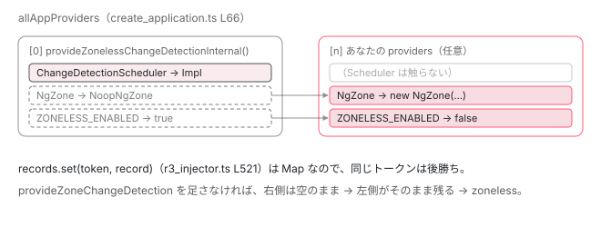

[目次](../README.md) › [zoneless の内側](README.md) › 第 1 回 / 全 11 回

# zoneless は既定になった：internalCreateApplication が差し込む 3 つのプロバイダ

> ChangeDetectionScheduler → ChangeDetectionSchedulerImpl、NgZone → NoopNgZone、ZONELESS\_ENABLED → true。provideZoneChangeDetection はこれを上書きしているだけ。

angular/angular · 読了 約 11 分 · 中核 · [サイトで読む（デモが動きます）](https://angular-deep-dive-cyan.vercel.app/chapter/zoneless-default)

---

「zoneless にするには `provideZonelessChangeDetection()` を足す」と覚えている人が多いと思います。v22 ではそれは半分だけ正しくて、**何も足さなければ zoneless** です。この章では「何も足さない」ときに何が provide されるのか、`provideZoneChangeDetection()` を足すと何が上書きされるのかを、ソースの行を 1 つずつ指して確認します。

読む対象は `packages/core/src/application/create_application.ts` と `packages/core/src/change_detection/scheduling/` の 3 ファイルです。

1. **既定で provide される 3 つ**（この章）
2. 通知の種類（NotificationSource）
3. notify → dirtyFlags
4. setTimeout と rAF の競走
5. tick → synchronize
6. microtask スケジューラ
7. signal.set() からの経路
8. (click) からの経路
9. PendingTasks と isStable
10. zone.js との同居
11. 動く条件・動かない書き方

## 1. main.ts から 3 回の関数呼び出し

あなたが書く `main.ts` は `bootstrapApplication(App, appConfig)` の 1 行です。その関数の中身はこれだけです。

📄 `angular/packages/platform-browser/src/browser.ts` L123–138 （▶ の行: 128, 130, 137）

```ts
123 │ export async function bootstrapApplication(
124 │   rootComponent: Type<unknown>,
125 │   options?: ApplicationConfig,
126 │   context?: BootstrapContext,
127 │ ): Promise<ApplicationRef> {
128 ▶   const config = {
129 │     rootComponent,
130 ▶     ...createProvidersConfig(options, context),
131 │   };
132 │ 
133 │   if ((typeof ngJitMode === 'undefined' || ngJitMode) && typeof fetch === 'function') {
134 │     await resolveJitResources();
135 │   }
136 │ 
137 ▶   return internalCreateApplication(config);
138 │ }
```

128〜131 行目で設定オブジェクトを組み、137 行目で `internalCreateApplication` に渡します。130 行目の `createProvidersConfig` が何を足しているかも見ておきます。

📄 `angular/packages/platform-browser/src/browser.ts` L166–172 （▶ の行: 169–170）

```ts
166 │ function createProvidersConfig(options?: ApplicationConfig, context?: BootstrapContext) {
167 │   return {
168 │     platformRef: context?.platformRef,
169 ▶     appProviders: [...BROWSER_MODULE_PROVIDERS, ...(options?.providers ?? [])],
170 ▶     platformProviders: INTERNAL_BROWSER_PLATFORM_PROVIDERS,
171 │   };
172 │ }
```

169 行目。**あなたの `providers` は、ブラウザ用プロバイダのあとに並べられます**。この「あとに並ぶ」が、この章の結論に直接つながります。覚えておいてください。

## 2. internalCreateApplication が先頭に差し込むもの

📄 `angular/packages/core/src/application/create_application.ts` L56–85 （▶ の行: 66–67, 70, 72–74）

```ts
56 │   try {
57 │     const platformInjector =
58 │       platformRef?.injector ?? createOrReusePlatformInjector(platformProviders as StaticProvider[]);
59 │ 
60 │     if ((typeof ngDevMode === 'undefined' || ngDevMode) && rootComponent !== undefined) {
61 │       assertStandaloneComponentType(rootComponent);
62 │     }
63 │ 
64 │     // Create root application injector based on a set of providers configured at the platform
65 │     // bootstrap level as well as providers passed to the bootstrap call by a user.
66 ▶     const allAppProviders = [
67 ▶       provideZonelessChangeDetectionInternal(),
68 │       errorHandlerEnvironmentInitializer,
69 │       ...(ngDevMode ? [validAppIdInitializer] : []),
70 ▶       ...(appProviders || []),
71 │     ];
72 ▶     const adapter = new EnvironmentNgModuleRefAdapter({
73 ▶       providers: allAppProviders,
74 ▶       parent: platformInjector as EnvironmentInjector,
75 │       debugName: typeof ngDevMode === 'undefined' || ngDevMode ? 'Environment Injector' : '',
76 │       // We skip environment initializers because we need to run them inside the NgZone, which
77 │       // happens after we get the NgZone instance from the Injector.
78 │       runEnvironmentInitializers: false,
79 │     });
80 │ 
81 │     return bootstrap({
82 │       r3Injector: adapter.injector,
83 │       platformInjector,
84 │       rootComponent,
85 │     });
```

66〜71 行目が、アプリケーション用インジェクタに渡すプロバイダの全リストです。**67 行目、先頭に `provideZonelessChangeDetectionInternal()` があります**。70 行目の `appProviders`（あなたの `providers`）はその後ろです。

72〜79 行目でそのリストから `R3Injector` が作られます （`EnvironmentNgModuleRefAdapter` は `R3Injector` を new する薄い包みです）。ここに `provideZoneChangeDetection` という文字は一度も出てきません。つまり**既定の経路に zone.js の設定は存在しない**のです。

## 3. 「3 つのプロバイダ」の中身

📄 `angular/packages/core/src/change_detection/scheduling/zoneless_scheduling_impl.ts` L390–396 （▶ の行: 392–394）

```ts
390 │ export function provideZonelessChangeDetectionInternal(): Provider[] {
391 │   return [
392 ▶     {provide: ChangeDetectionScheduler, useExisting: ChangeDetectionSchedulerImpl},
393 ▶     {provide: NgZone, useClass: NoopNgZone},
394 ▶     {provide: ZONELESS_ENABLED, useValue: true},
395 │   ];
396 │ }
```

たった 3 行です。1 つずつ、それが誰に効くのかを追います。

1. **392 行目：`ChangeDetectionScheduler` → `ChangeDetectionSchedulerImpl`**

   抽象クラス `ChangeDetectionScheduler` をトークンにして、実装クラスに結びつけます。`useExisting` なので、インスタンスは `ChangeDetectionSchedulerImpl` 側で 1 つだけ作られ、抽象クラスを inject しても同じインスタンスが返ります。誰が inject しているかは次の節で見ます。
2. **393 行目：`NgZone` → `NoopNgZone`**

   `NgZone` を inject しているコードは、フレームワーク内外に大量にあります （`ApplicationRef.bootstrap` も `ngZone.run(...)` で始まります）。それらを壊さないために、**何もしない `NgZone`** を差し込みます。
3. **394 行目：`ZONELESS_ENABLED` → `true`**

   単なる `boolean` のトークンです。これを読んで挙動を分けている場所は `ApplicationRef` と `ChangeDetectionSchedulerImpl` の 2 か所だけです（5 節）。

### 抽象クラスとトークンの定義

📄 `angular/packages/core/src/change_detection/scheduling/zoneless_scheduling.ts` L58–76 （▶ の行: 61–62, 67, 69, 73, 75）

```ts
58 │ /**
59 │  * Injectable that is notified when an `LView` is made aware of changes to application state.
60 │  */
61 ▶ export abstract class ChangeDetectionScheduler {
62 ▶   abstract notify(source: NotificationSource): void;
63 │   abstract runningTick: boolean;
64 │ }
65 │ 
66 │ /** Token used to indicate if zoneless was enabled via provideZonelessChangeDetection(). */
67 ▶ export const ZONELESS_ENABLED = new InjectionToken<boolean>(
68 │   typeof ngDevMode === 'undefined' || ngDevMode ? 'Zoneless enabled' : '',
69 ▶   {factory: () => true},
70 │ );
71 │ 
72 │ /** Token used to indicate `provideZonelessChangeDetection` was used. */
73 ▶ export const PROVIDED_ZONELESS = new InjectionToken<boolean>(
74 │   typeof ngDevMode === 'undefined' || ngDevMode ? 'Zoneless provided' : '',
75 ▶   {factory: () => false},
76 │ );
```

61〜64 行目、スケジューラの契約は `notify(source)` と `runningTick` の 2 つだけです。67〜70 行目、`ZONELESS_ENABLED` の `factory` は `true` を返します。つまり**誰も provide しなかった場合の既定値も `true`** です。二重に zoneless が既定になっています。

73〜76 行目の `PROVIDED_ZONELESS` は別物です。既定は `false` で、`provideZonelessChangeDetection()` を*明示的に*呼んだときだけ `true` になります（6 節）。

### NoopNgZone は本当に何もしない

📄 `angular/packages/core/src/zone/ng_zone.ts` L555–579 （▶ の行: 558, 565, 573）

```ts
555 │ export class NoopNgZone implements NgZone {
556 │   readonly hasPendingMicrotasks = false;
557 │   readonly hasPendingMacrotasks = false;
558 ▶   readonly isStable = true;
559 │   readonly onUnstable = new EventEmitter<any>();
560 │   readonly onMicrotaskEmpty = new EventEmitter<any>();
561 │   readonly onStable = new EventEmitter<any>();
562 │   readonly onError = new EventEmitter<any>();
563 │ 
564 │   run<T>(fn: (...args: any[]) => T, applyThis?: any, applyArgs?: any): T {
565 ▶     return fn.apply(applyThis, applyArgs);
566 │   }
567 │ 
568 │   runGuarded<T>(fn: (...args: any[]) => any, applyThis?: any, applyArgs?: any): T {
569 │     return fn.apply(applyThis, applyArgs);
570 │   }
571 │ 
572 │   runOutsideAngular<T>(fn: (...args: any[]) => T): T {
573 ▶     return fn();
574 │   }
575 │ 
576 │   runTask<T>(fn: (...args: any[]) => T, applyThis?: any, applyArgs?: any, name?: string): T {
577 │     return fn.apply(applyThis, applyArgs);
578 │   }
579 │ }
```

565 行目、`run(fn)` は `fn.apply(...)` を呼んで返すだけ。573 行目、`runOutsideAngular(fn)` も `fn()` を呼ぶだけ。558 行目で `isStable` は常に `true`。`onMicrotaskEmpty` などの `EventEmitter` は作られますが、**emit するコードがどこにもない**ので、購読しても何も届きません。

> [!TIP]
> **新卒エンジニアへ**
>
> 「zoneless だと `NgZone` を inject するとエラーになる」は誤りです。inject はできて、`NoopNgZone` が返ります。`ngZone.run(() => ...)` と書いても壊れません。ただ、run したことで変更検知が走ることもありません。

## 4. なぜ provideZoneChangeDetection を足すと上書きできるのか

2 節で「zoneless 用の 3 つが先頭、あなたの providers が後ろ」と確認しました。`R3Injector` はこの配列を先頭から順に処理します。

📄 `angular/packages/core/src/di/r3_injector.ts` L216–226 （▶ の行: 224–225）

```ts
216 │   constructor(
217 │     providers: Array<Provider | EnvironmentProviders>,
218 │     readonly parent: Injector,
219 │     readonly source: string | null,
220 │     readonly scopes: Set<InjectorScope>,
221 │   ) {
222 │     super();
223 │     // Start off by creating Records for every provider.
224 ▶     forEachSingleProvider(providers as Array<Provider | InternalEnvironmentProviders>, (provider) =>
225 ▶       this.processProvider(provider),
226 │     );
```

📄 `angular/packages/core/src/di/r3_injector.ts` L513–522 （▶ の行: 521）

```ts
513 │     } else {
514 │       if (ngDevMode) {
515 │         const existing = this.records.get(token);
516 │         if (existing && existing.multi !== undefined) {
517 │           throwMixedMultiProviderError();
518 │         }
519 │       }
520 │     }
521 ▶     this.records.set(token, record);
522 │   }
```

521 行目、`this.records.set(token, record)`。`Map.set` なので、**同じトークンが 2 回来たら、後から来たものが前のものを消します** （`multi: true` のときだけ 497〜512 行目の別経路で配列に積まれます）。

では `provideZoneChangeDetection()` は何を provide しているでしょうか。

📄 `angular/packages/core/src/change_detection/scheduling/ng_zone_scheduling.ts` L84–95 （▶ の行: 94–95）

```ts
84 │ export function internalProvideZoneChangeDetection({
85 │   ngZoneFactory,
86 │   scheduleInRootZone,
87 │ }: {
88 │   ngZoneFactory?: () => NgZone;
89 │   scheduleInRootZone?: boolean;
90 │ }): StaticProvider[] {
91 │   ngZoneFactory ??= () =>
92 │     new NgZone({...getNgZoneOptions(), scheduleInRootZone} as InternalNgZoneOptions);
93 │   return [
94 ▶     {provide: ZONELESS_ENABLED, useValue: false},
95 ▶     {provide: NgZone, useFactory: ngZoneFactory},
```

94 行目で `ZONELESS_ENABLED` を `false` に、95 行目で `NgZone` を本物の `new NgZone(...)` に。3 節の 393・394 行目と**同じトークン**です。あなたの providers は後ろに並ぶので、こちらが勝ちます。

注目してほしいのは、`ChangeDetectionScheduler` を**上書きしていない**ことです。zone.js ありのときも `ChangeDetectionSchedulerImpl` はそのまま残ります。「zone.js あり = 別のスケジューラ」ではなく、「同じスケジューラ + 横に NgZone の監視が足される」が正しい理解です。

📄 `angular/packages/core/src/change_detection/scheduling/ng_zone_scheduling.ts` L96–115 （▶ の行: 97, 100, 113）

```ts
 96 │     {
 97 ▶       provide: ENVIRONMENT_INITIALIZER,
 98 │       multi: true,
 99 │       useFactory: () => {
100 ▶         const ngZoneChangeDetectionScheduler = inject(NgZoneChangeDetectionScheduler, {
101 │           optional: true,
102 │         });
103 │         if (
104 │           (typeof ngDevMode === 'undefined' || ngDevMode) &&
105 │           ngZoneChangeDetectionScheduler === null
106 │         ) {
107 │           throw new RuntimeError(
108 │             RuntimeErrorCode.MISSING_REQUIRED_INJECTABLE_IN_BOOTSTRAP,
109 │             `A required Injectable was not found in the dependency injection tree. ` +
110 │               'If you are bootstrapping an NgModule, make sure that the `BrowserModule` is imported.',
111 │           );
112 │         }
113 ▶         return () => ngZoneChangeDetectionScheduler!.initialize();
114 │       },
115 │     },
```

97〜115 行目で `ENVIRONMENT_INITIALIZER` が追加されます。113 行目、インジェクタの初期化時に `NgZoneChangeDetectionScheduler.initialize()` が呼ばれ、ここで `onMicrotaskEmpty` の購読が始まります。その中身は [zone.js シリーズの該当章](../zone/11-zone-ngzone-scheduler.md)で読みます。



*同じ R3Injector に、既定の 3 つ（先頭）と利用者の providers（後ろ）が順に入る。同じトークンは後勝ち。ChangeDetectionScheduler だけは両方に共通。*

> **🧪 DEMO — providers に足すと records がどう変わるか**
>
> 既定の 3 つの上に、あなたの providers が重なったあとの Map の中身です。
>
> ▶ [このデモはサイトで動かせます](https://angular-deep-dive-cyan.vercel.app/chapter/zoneless-default)

## 5. ZONELESS\_ENABLED を読んでいるのは 2 か所だけ

`packages/core/src` 全体で `inject(ZONELESS_ENABLED)` と書かれている場所は 2 つです。

📄 `angular/packages/core/src/application/application_ref.ts` L261–264 （▶ の行: 263）

```ts
261 │   private readonly internalErrorHandler = inject(INTERNAL_APPLICATION_ERROR_HANDLER);
262 │   private readonly afterRenderManager = inject(AfterRenderManager);
263 ▶   private readonly zonelessEnabled = inject(ZONELESS_ENABLED);
264 │   private readonly rootEffectScheduler = inject(EffectScheduler);
```

📄 `angular/packages/core/src/application/application_ref.ts` L533–538 （▶ の行: 534–535）

```ts
533 │   tick(): void {
534 ▶     if (!this.zonelessEnabled) {
535 ▶       this.dirtyFlags |= ApplicationRefDirtyFlags.ViewTreeGlobal;
536 │     }
537 │     this._tick();
538 │   }
```

534〜536 行目。`ApplicationRef.tick()` は、zone.js ありのときだけ `ViewTreeGlobal`（全ビューを走査する印）を立てます。zoneless のときは立てないので、**通知で立てられた dirtyFlags だけ**を見て走査します。この違いが [tick の章](05-zoneless-tick.md)の主題です。

📄 `angular/packages/core/src/change_detection/scheduling/zoneless_scheduling_impl.ts` L60–66 （▶ の行: 64–65）

```ts
60 │ export class ChangeDetectionSchedulerImpl implements ChangeDetectionScheduler, OnDestroy {
61 │   private readonly applicationErrorHandler = inject(INTERNAL_APPLICATION_ERROR_HANDLER);
62 │   private readonly appRef = inject(ApplicationRef);
63 │   private readonly taskService = inject(PendingTasksInternal);
64 ▶   private readonly ngZone = inject(NgZone);
65 ▶   private readonly zonelessEnabled = inject(ZONELESS_ENABLED);
66 │   private readonly tracing = inject(TracingService, {optional: true});
```

64〜65 行目、`ChangeDetectionSchedulerImpl` も `NgZone` と `ZONELESS_ENABLED` を両方 inject しています。「zone.js がいるなら zone に任せ、いないなら自分で予約する」という分岐がこの先に 3 か所あります （[同居の章](10-zoneless-hybrid.md)）。

## 6. 公開 API の provideZonelessChangeDetection は何を足すのか

📄 `angular/packages/core/src/change_detection/scheduling/zoneless_scheduling_impl.ts` L369–388 （▶ の行: 372, 383, 385）

```ts
369 │ export function provideZonelessChangeDetection(): EnvironmentProviders {
370 │   performanceMarkFeature('NgZoneless');
371 │ 
372 ▶   if ((typeof ngDevMode === 'undefined' || ngDevMode) && typeof Zone !== 'undefined' && Zone) {
373 │     const message = formatRuntimeError(
374 │       RuntimeErrorCode.UNEXPECTED_ZONEJS_PRESENT_IN_ZONELESS_MODE,
375 │       `The application is using zoneless change detection, but is still loading Zone.js. ` +
376 │         `Consider removing Zone.js to get the full benefits of zoneless. ` +
377 │         `In applications using the Angular CLI, Zone.js is typically included in the "polyfills" section of the angular.json file.`,
378 │     );
379 │     console.warn(message);
380 │   }
381 │ 
382 │   return makeEnvironmentProviders([
383 ▶     ...provideZonelessChangeDetectionInternal(),
384 │     typeof ngDevMode === 'undefined' || ngDevMode
385 ▶       ? [{provide: PROVIDED_ZONELESS, useValue: true}]
386 │       : [],
387 │   ]);
388 │ }
```

383 行目、中身は同じ `provideZonelessChangeDetectionInternal()` です。追加されるのは 385 行目の `PROVIDED_ZONELESS: true`（開発モードのみ）だけ。つまり**既定と機能的には同じ**で、「明示的に選んだ」という印を残すための関数です。

372〜380 行目、開発モードで `Zone` がグローバルに存在すると警告が出ます。zone.js を `polyfills` から外し忘れている状態を知らせるためです。既定の経路（`Internal` 版）ではこの警告は出ません。

📄 `angular/packages/core/src/platform/bootstrap.ts` L94–105 （▶ の行: 96）

```ts
 94 │     const exceptionHandler = envInjector.get(INTERNAL_APPLICATION_ERROR_HANDLER);
 95 │     if (typeof ngDevMode === 'undefined' || ngDevMode) {
 96 ▶       if (envInjector.get(PROVIDED_ZONELESS) && envInjector.get(PROVIDED_NG_ZONE)) {
 97 │         console.warn(
 98 │           formatRuntimeError(
 99 │             RuntimeErrorCode.PROVIDED_BOTH_ZONE_AND_ZONELESS,
100 │             'Both provideZoneChangeDetection and provideZonelessChangeDetection are provided. ' +
101 │               'This is likely a mistake. Update the application providers to use only one of the two.',
102 │           ),
103 │         );
104 │       }
105 │     }
```

96 行目、`PROVIDED_ZONELESS` と `PROVIDED_NG_ZONE` が両方 `true` なら警告です。どちらも「明示的に呼んだ印」なので、両方呼んだときだけ検知されます。実際にどちらが勝つかは 4 節のとおり、配列で後ろにあるほうです。

## 7. NgModule で bootstrapModule する場合

📄 `angular/packages/core/src/platform/platform_ref.ts` L47–56 （▶ の行: 52–53）

```ts
47 │   bootstrapModuleFactory<M>(
48 │     moduleFactory: NgModuleFactory<M>,
49 │     options?: BootstrapOptions & {applicationProviders?: Array<Provider | EnvironmentProviders>},
50 │   ): Promise<NgModuleRef<M>> {
51 │     const allAppProviders = [
52 ▶       provideZonelessChangeDetectionInternal(),
53 ▶       ...(options?.applicationProviders ?? []),
54 │       errorHandlerEnvironmentInitializer,
55 │       ...(ngDevMode ? [validAppIdInitializer] : []),
56 │     ];
```

52 行目。`bootstrapModule` の経路でも、先頭は同じ `provideZonelessChangeDetectionInternal()` です。53 行目の `applicationProviders` に `provideZoneChangeDetection()` を渡すと上書きされます。`BrowserModule` を import するだけでは zone.js ありにはなりません （`BROWSER_MODULE_PROVIDERS` に `NgZone` は含まれていませんでした。1 節の `browser.ts` を見返してください）。`bootstrapModule` 経路の全手順と `BROWSER_MODULE_PROVIDERS` の中身は [NgModule シリーズ第 11 回](../ngmodule/11-ngmodule-bootstrap-module.md)と [第 12 回](../ngmodule/12-ngmodule-browser-module.md)で追います。

## ここまでの呼び出し

- 👤 `bootstrapApplication(App, appConfig)` — src/main.ts
  - `createProvidersConfig(options)` — platform-browser/src/browser.ts L166 — *BROWSER\_MODULE\_PROVIDERS のあとに appConfig.providers を並べる*
  - `internalCreateApplication(config)` — core/src/application/create\_application.ts L38
    - `provideZonelessChangeDetectionInternal()` — zoneless\_scheduling\_impl.ts L390 — *Scheduler / NoopNgZone / ZONELESS\_ENABLED=true を配列の先頭に*
    - `new EnvironmentNgModuleRefAdapter(...)` — core/src/render3/ng\_module\_ref.ts L119
      - `new R3Injector(providers, parent, ...)` — core/src/di/r3\_injector.ts L216
        - `processProvider(p)` × 件数 — r3\_injector.ts L473 — *records.set(token, record)。同じトークンは後勝ち*
    - `bootstrap({ r3Injector, platformInjector, rootComponent })` — core/src/platform/bootstrap.ts L81 — *envInjector.get(NgZone) → ここで初めて NoopNgZone か NgZone が実体化する*

## 聞かれそうな質問

**Q. v22 で新規に作ったアプリは zone.js を使っていますか？**

使っていません。`internalCreateApplication`（create\_application.ts 67 行目）が `provideZonelessChangeDetectionInternal()` を先頭に置くので、何も足さなければ `NgZone` は `NoopNgZone`、`ZONELESS_ENABLED` は `true` です。CLI の新規プロジェクトも zone.js を入れません。application schematic の `zoneless` オプションは既定が `true` で、`false` のときだけ `polyfills` に `zone.js` が足されます。

📄 `angular-cli/packages/schematics/angular/application/schema.json` L131–135 （▶ の行: 134）

```json
131 │     "zoneless": {
132 │       "description": "Generate an application that does not use `zone.js`.",
133 │       "type": "boolean",
134 ▶       "default": true
135 │     },
```

📄 `angular-cli/packages/schematics/angular/application/index.ts` L303–308 （▶ の行: 307）

```ts
303 │         builder: Builders.BuildApplication,
304 │         defaultConfiguration: 'production',
305 │         options: {
306 │           browser: `${sourceRoot}/main.ts`,
307 ▶           polyfills: options.zoneless ? undefined : ['zone.js'],
308 │           tsConfig: `${projectRoot}tsconfig.app.json`,
```

307 行目。`ng new --no-zoneless` としたときだけ zone.js が polyfills に入り、そのときは `app.config.ts` に `provideZoneChangeDetection({ eventCoalescing: true })` も生成されます（files/standalone-files/src/app/app.config.ts.template）。

**Q. provideZonelessChangeDetection() を書く意味はもう無いのですか？**

機能的には既定と同じです（zoneless\_scheduling\_impl.ts 383 行目で同じ Internal 関数を呼ぶ）。違いは 2 つ。開発モードで `PROVIDED_ZONELESS` を `true` にすること（385 行目）と、`Zone` がまだグローバルにいれば警告を出すこと（372〜380 行目）。移行中に「意図して zoneless にしている」と明示したいときに書きます。

**Q. provideZoneChangeDetection() を足すと、zoneless のスケジューラは消えるのですか？**

消えません。`internalProvideZoneChangeDetection`（ng\_zone\_scheduling.ts 93〜130 行目）が 上書きするのは `ZONELESS_ENABLED` と `NgZone` だけで、`ChangeDetectionScheduler` には触りません。`ChangeDetectionSchedulerImpl` はそのまま残り、`ZONELESS_ENABLED === false` を見て 「zone の中にいるときは自分で予約しない」ように振る舞いを変えます。

**Q. 両方書いたらどうなりますか？**

`R3Injector.processProvider` の `records.set`（r3\_injector.ts 521 行目）は Map なので、**providers 配列で後ろに書いたほうが勝ちます**。開発モードでは bootstrap.ts 96 行目の判定で「両方 provide されている」という警告が出ます。

**Q. zoneless で NgZone を inject したらエラーになりますか？**

なりません。`NoopNgZone`（ng\_zone.ts 555 行目）が返ります。`run` / `runOutsideAngular` は関数をそのまま呼ぶだけで、`onStable` などは emit されないので購読しても何も起きません。

**Q. ZONELESS\_ENABLED を provide し忘れたらどうなりますか？**

トークンの `factory`（zoneless\_scheduling.ts 69 行目）が `true` を返すので、既定値も zoneless 側です。`false` になるのは `provideZoneChangeDetection()` が明示的に `false` を provide したときだけです。

## 読み終えて

- `bootstrapApplication` → `internalCreateApplication` の 67 行目で、zoneless 用の 3 プロバイダが**必ず先頭に**入る
- 3 つとは `ChangeDetectionScheduler → Impl`、`NgZone → NoopNgZone`、`ZONELESS_ENABLED → true`
- `R3Injector` は同じトークンを後勝ちで上書きする。利用者の providers は後ろに並ぶので、`provideZoneChangeDetection()` を足せば `NgZone` と `ZONELESS_ENABLED` だけが差し替わる
- `ZONELESS_ENABLED` を読むのは `ApplicationRef` と `ChangeDetectionSchedulerImpl` の 2 か所。次章からその中身を追う

---

← 前: [1 クリックの全行程（zone.js あり）](../zone/13-zone-click-trace.md)  
次: [15 種類の通知：NotificationSource を全部読む](02-zoneless-notification-source.md) →
