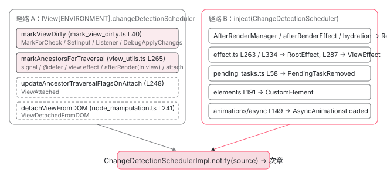

[目次](../README.md) › [zoneless の内側](README.md) › 第 2 回 / 全 11 回

# 15 種類の通知：NotificationSource を全部読む

> MarkAncestorsForTraversal / SetInput / MarkForCheck / Listener / RootEffect …。それぞれ誰が、どのコード行から送っているのかを 1 つずつ特定する。

angular/angular · 読了 約 14 分 · 中核 · [サイトで読む（デモが動きます）](https://angular-deep-dive-cyan.vercel.app/chapter/zoneless-notification-source)

---

zoneless の変更検知は「誰かが `ChangeDetectionScheduler.notify(source)` を呼ぶ」ことから始まります。`source` は `NotificationSource` という 15 値の enum です。この章では 15 個すべてについて、**どのファイルの何行目が送っているか**を `packages/core/src` 全体を grep して特定します。「signal を set したら何が送られるのか」「`(click)` は何を送るのか」に、行番号で答えられるようになります。

読む対象は `packages/core/src/change_detection/scheduling/zoneless_scheduling.ts`（enum の定義）と、送信元の 12 ファイル（`mark_view_dirty.ts`、`view_utils.ts`、`view_ref.ts`、`listeners.ts`、`effect.ts`、`after_render/manager.ts` など）です。

1. 既定で provide される 3 つ
2. **通知の種類（NotificationSource）**（この章）
3. notify → dirtyFlags
4. setTimeout と rAF の競走
5. tick → synchronize
6. microtask スケジューラ
7. signal.set() からの経路
8. (click) からの経路
9. PendingTasks と isStable
10. zone.js との同居
11. 動く条件・動かない書き方

## 1. enum は 2 つのグループに分かれている

📄 `angular/packages/core/src/change_detection/scheduling/zoneless_scheduling.ts` L11–30 （▶ の行: 12–13, 15, 17, 19, 21, 23, 27, 30）

```ts
11 │ export const enum NotificationSource {
12 ▶   // Change detection needs to run in order to synchronize application state
13 ▶   // with the DOM when the following notifications are received:
14 │   // This operation indicates that a subtree needs to be traversed during change detection.
15 ▶   MarkAncestorsForTraversal,
16 │   // A component/directive gets a new input.
17 ▶   SetInput,
18 │   // Defer block state updates need change detection to fully render the state.
19 ▶   DeferBlockStateUpdate,
20 │   // Debugging tools updated state and have requested change detection.
21 ▶   DebugApplyChanges,
22 │   // ChangeDetectorRef.markForCheck indicates the component is dirty/needs to refresh.
23 ▶   MarkForCheck,
24 │ 
25 │   // Bound listener callbacks execute and can update state without causing other notifications from
26 │   // above.
27 ▶   Listener,
28 │ 
29 │   // Custom elements do sometimes require checking directly.
30 ▶   CustomElement,
```

12〜13 行目のコメントがグループの境界です。ここから 30 行目までの 7 つ （`MarkAncestorsForTraversal`、`SetInput`、`DeferBlockStateUpdate`、`DebugApplyChanges`、`MarkForCheck`、`Listener`、`CustomElement`）は **「ビューを refresh する必要がある」通知**です。テンプレートの再評価、つまり `refreshView` まで行く通知はこの 7 つだけです。

📄 `angular/packages/core/src/change_detection/scheduling/zoneless_scheduling.ts` L32–56 （▶ の行: 32–33, 35, 41, 46, 48, 51, 53, 55）

```ts
32 ▶   // The following notifications do not require views to be refreshed
33 ▶   // but we should execute render hooks:
34 │   // Render hooks are guaranteed to execute with the schedulers timing.
35 ▶   RenderHook,
36 │   // Views might be created outside and manipulated in ways that
37 │   // we cannot be aware of. When a view is attached, Angular now "knows"
38 │   // about it and we now know that DOM might have changed (and we should
39 │   // run render hooks). If the attached view is dirty, the `MarkAncestorsForTraversal`
40 │   // notification should also be received.
41 ▶   ViewAttached,
42 │   // When DOM removal happens, render hooks may be interested in the new
43 │   // DOM state but we do not need to refresh any views unless. If change
44 │   // detection is required after DOM removal, another notification should
45 │   // be received (i.e. `markForCheck`).
46 ▶   ViewDetachedFromDOM,
47 │   // Applying animations might result in new DOM state and should rerun render hooks
48 ▶   AsyncAnimationsLoaded,
49 │   // The scheduler is notified when a pending task is removed via the public API.
50 │   // This allows us to make stability async, delayed until the next application tick.
51 ▶   PendingTaskRemoved,
52 │   // An `effect()` outside of the view tree became dirty and might need to run.
53 ▶   RootEffect,
54 │   // An `effect()` within the view tree became dirty.
55 ▶   ViewEffect,
56 │ }
```

32〜33 行目で 2 つ目のグループが始まります。`RenderHook`、`ViewAttached`、`ViewDetachedFromDOM`、`AsyncAnimationsLoaded` の 4 つは **「ビューは refresh しなくてよいが、render hook（`afterRender` 系）は実行する」**通知です。51 行目の `PendingTaskRemoved` はどちらでもなく、「安定（isStable）を次の tick まで遅らせる」ためだけの通知です。53・55 行目の `RootEffect` / `ViewEffect` は `effect()` 専用です。

> [!NOTE]
> **ポイント**
>
> enum の値は `const enum` なので、ビルド後は数字（0〜14）になり、文字列は残りません。次章の `notify` の `switch` 文が、この分類を `ApplicationRefDirtyFlags` の 4 ビットに畳みます。この章では「誰が送るか」だけに集中します。

## 2. 通知が通る 2 本の経路

送信元を読む前に、送り手がどうやって `ChangeDetectionSchedulerImpl` のインスタンスにたどり着くかを確認します。経路は 2 本です。

📄 `angular/packages/core/src/render3/interfaces/view.ts` L386–400 （▶ の行: 389, 397）

```ts
386 │ /**
387 │  * Contextual data that is shared across multiple instances of `LView` in the same application.
388 │  */
389 ▶ export interface LViewEnvironment {
390 │   /** Factory to be used for creating Renderer. */
391 │   rendererFactory: RendererFactory;
392 │ 
393 │   /** An optional custom sanitizer. */
394 │   sanitizer: Sanitizer | null;
395 │ 
396 │   /** Scheduler for change detection to notify when application state changes. */
397 ▶   changeDetectionScheduler: ChangeDetectionScheduler | null;
398 │ 
399 │   /** Service used for tracing different parts of the application. */
400 │   tracingService: TracingService<TracingSnapshot> | null;
```

📄 `angular/packages/core/src/render3/component_ref.ts` L159–175 （▶ の行: 160, 171）

```ts
159 │   const sanitizer = rootLViewInjector.get(Sanitizer, null);
160 ▶   const changeDetectionScheduler = rootLViewInjector.get(ChangeDetectionScheduler, null);
161 │   const tracingService = rootLViewInjector.get(TracingService, null, {optional: true});
162 │ 
163 │   let ngReflect = false;
164 │   if (typeof ngDevMode === 'undefined' || ngDevMode) {
165 │     ngReflect = rootLViewInjector.get(NG_REFLECT_ATTRS_FLAG, NG_REFLECT_ATTRS_FLAG_DEFAULT);
166 │   }
167 │ 
168 │   return {
169 │     rendererFactory,
170 │     sanitizer,
171 ▶     changeDetectionScheduler,
172 │     ngReflect,
173 │     tracingService,
174 │   };
175 │ }
```

1. **経路 A：`lView[ENVIRONMENT].changeDetectionScheduler`**

   `LViewEnvironment`（389 行目）は、1 つのアプリの全 `LView` が共有するオブジェクトです。その 397 行目に `changeDetectionScheduler` があります。`component_ref.ts` の 160 行目で、ルートコンポーネントを作るときに `rootLViewInjector.get(ChangeDetectionScheduler, null)` で取り出し、171 行目で環境に入れます。**ビューを起点にする通知**（`markViewDirty`、`markAncestorsForTraversal`、attach/detach）は全部この経路です。`?.` が付いているのは、`ChangeDetectionScheduler` が無い環境（古い `TestBed` 設定など）で `null` になるためです。
2. **経路 B：`inject(ChangeDetectionScheduler)`**

   ビューに紐づかないサービスは、DI で直接 `ChangeDetectionScheduler` を inject します。`PendingTasks`、`AfterRenderManager`、`effect()`、`@angular/elements`、非同期アニメーションがこちらです。[前章](01-zoneless-default.md)で見たとおり、どちらの経路でも `useExisting` で同じ `ChangeDetectionSchedulerImpl` が返ります。

## 3. 15 個の送信元を全部並べる

`packages/core/src` で `grep -rn "NotificationSource\."` を実行し、`zoneless_scheduling_impl.ts` の `switch` 文を除いた結果を、enum の順に並べたのがこの表です。core の外（`elements`、`platform-browser/animations/async`）にある 2 つも含めています。

| NotificationSource | 送信元（ファイル : 行） | 経路 | 開発者が呼ぶ API |
| --- | --- | --- | --- |
| `MarkAncestorsForTraversal` | `render3/util/view_utils.ts:265`（`markAncestorsForTraversal`） | A | テンプレートで読んだ signal の `set()`、`@defer` の状態変化、ビュー内 `effect()`、ビュー内 `afterRender` 登録 |
| `SetInput` | `render3/component_ref.ts:630`、`render3/dynamic_bindings.ts:88` → `mark_view_dirty.ts:40` | A | `ComponentRef.setInput`、`inputBinding()` |
| `DeferBlockStateUpdate` | **送信元なし**（5 節） | — | — |
| `DebugApplyChanges` | `render3/util/change_detection_utils.ts:28` → `mark_view_dirty.ts:40` | A | `ng.applyChanges(component)`（DevTools 用） |
| `MarkForCheck` | `render3/view_ref.ts:163` → `mark_view_dirty.ts:40` | A | `ChangeDetectorRef.markForCheck`（`AsyncPipe` も内部で呼ぶ） |
| `Listener` | `render3/view/listeners.ts:65` → `mark_view_dirty.ts:40` | A | テンプレートの `(event)`、`host: { '(event)': ... }` |
| `CustomElement` | `elements/src/component-factory-strategy.ts:191` | B | `createCustomElement` で作った要素のプロパティ代入 |
| `RenderHook` | `render3/after_render/manager.ts:145`、`:116`、`render3/reactivity/after_render_effect.ts:107`、`hydration/api.ts:295` | B | `afterRenderEffect` / `afterNextRender` / `afterEveryRender` の登録・再 dirty、hydration 完了 |
| `ViewAttached` | `render3/util/view_utils.ts:248`（`updateAncestorTraversalFlagsOnAttach`） | A | `ApplicationRef.attachView`、`ChangeDetectorRef.reattach` |
| `ViewDetachedFromDOM` | `render3/node_manipulation.ts:241`（`detachViewFromDOM`） | A | `ApplicationRef.detachView`、`ViewContainerRef.remove / detach`、`ViewRef.destroy` |
| `AsyncAnimationsLoaded` | `platform-browser/animations/async/src/async_animation_renderer.ts:149` | B | `provideAnimationsAsync()` 使用時、アニメーションモジュールの遅延読み込み完了 |
| `PendingTaskRemoved` | `pending_tasks.ts:58` | B | `PendingTasks.add()` が返した cleanup 関数 |
| `RootEffect` | `render3/reactivity/effect.ts:263`（dirty 化）、`:334`（作成時） | B | ビュー外（サービス等）の `effect()` |
| `ViewEffect` | `render3/reactivity/effect.ts:287` | B | コンポーネント内の `effect()` |

見てわかるとおり、送信元の関数は実質 **3 つに集約**されます。`markViewDirty`（4 種類の通知を運ぶ）、`markAncestorsForTraversal`（1 種類だが呼び元が最多）、そして各サービスからの直接呼び出しです。順番に読みます。

## 4. markViewDirty：4 種類の通知を運ぶ共通関数

📄 `angular/packages/core/src/render3/instructions/mark_view_dirty.ts` L26–52 （▶ の行: 26–27, 33, 39–40, 42, 45）

```ts
26 ▶ export function markViewDirty(lView: LView, source: NotificationSource): LView | null {
27 ▶   const dirtyBitsToUse = isRefreshingViews()
28 │     ? // When we are actively refreshing views, we only use the `Dirty` bit to mark a view
29 │       // for check. This bit is ignored in ChangeDetectionMode.Targeted, which is used to
30 │       // synchronously rerun change detection on a specific set of views (those which have
31 │       // the `RefreshView` flag and those with dirty signal consumers). `LViewFlags.Dirty`
32 │       // does not support re-entrant change detection on its own.
33 ▶       LViewFlags.Dirty
34 │     : // When we are not actively refreshing a view tree, it is absolutely
35 │       // valid to update state and mark views dirty. We use the `RefreshView` flag in this
36 │       // case to allow synchronously rerunning change detection. This applies today to
37 │       // afterRender hooks as well as animation listeners which execute after detecting
38 │       // changes in a view when the render factory flushes.
39 ▶       LViewFlags.RefreshView | LViewFlags.Dirty;
40 ▶   lView[ENVIRONMENT].changeDetectionScheduler?.notify(source);
41 │   while (lView) {
42 ▶     lView[FLAGS] |= dirtyBitsToUse;
43 │     const parent = getLViewParent(lView);
44 │     // Stop traversing up as soon as you find a root view that wasn't attached to any container
45 ▶     if (isRootView(lView) && !parent) {
46 │       return lView;
47 │     }
48 │     // continue otherwise
49 │     lView = parent!;
50 │   }
51 │   return null;
52 │ }
```

26 行目、第 2 引数が `source` です。呼び元が「自分は何者か」を渡します。**40 行目で、ビューのフラグを書く前に `notify(source)` が呼ばれます**。通知が先、フラグが後です。42 行目から上に向かって `FLAGS` にビットを足し、45 行目でルートビューに着いたら止まります。

27〜39 行目は足すビットの選択です。`isRefreshingViews()` が true、つまり **変更検知の最中**に呼ばれたときは `Dirty` だけ（33 行目）、それ以外は `RefreshView | Dirty`（39 行目）です。この違いは [Targeted 走査の章](../cd/06-cd-targeted-traversal.md)で効いてきます。ここでは「送られる通知は `isRefreshingViews` に関係なく同じ」とだけ押さえてください。

### markViewDirty を呼ぶ 4 か所

📄 `angular/packages/core/src/render3/view_ref.ts` L162–164 （▶ の行: 163）

```ts
162 │   markForCheck(): void {
163 ▶     markViewDirty(this._cdRefInjectingView || this._lView, NotificationSource.MarkForCheck);
164 │   }
```

📄 `angular/packages/core/src/render3/component_ref.ts` L626–631 （▶ の行: 630）

```ts
626 │     const lView = this._rootLView;
627 │     const hasSetInput = setAllInputsForProperty(tNode, lView[TVIEW], lView, name, value);
628 │     this.previousInputValues.set(name, value);
629 │     const childComponentLView = getComponentLViewByIndex(tNode.index, lView);
630 ▶     markViewDirty(childComponentLView, NotificationSource.SetInput);
631 │ 
```

📄 `angular/packages/core/src/render3/dynamic_bindings.ts` L80–89 （▶ の行: 83, 88）

```ts
80 │ function inputBindingUpdate(targetDirectiveIdx: number, publicName: string, value: unknown) {
81 │   const lView = getLView();
82 │   const bindingIndex = nextBindingIndex();
83 ▶   if (bindingUpdated(lView, bindingIndex, value)) {
84 │     const tView = lView[TVIEW];
85 │     const tNode = getSelectedTNode();
86 │ 
87 │     const componentLView = getComponentLViewByIndex(tNode.index, lView);
88 ▶     markViewDirty(componentLView, NotificationSource.SetInput);
89 │ 
```

📄 `angular/packages/core/src/render3/view/listeners.ts` L53–66 （▶ の行: 64–65）

```ts
53 │   return function wrapListenerIn_markDirtyAndPreventDefault(event: any) {
54 │     // When a native element is stored on this function (set by listenToDomEvent for
55 │     // non-global-target listeners), mark the (event, element) pair as handled so that
56 │     // jsaction does not replay an event already dispatched by the real DOM listener.
57 │     const nativeEl = (wrapListenerIn_markDirtyAndPreventDefault as any).__ngNativeEl__;
58 │     if (nativeEl !== undefined) {
59 │       markEventHandledForElement(event, nativeEl);
60 │     }
61 │ 
62 │     // In order to be backwards compatible with View Engine, events on component host nodes
63 │     // must also mark the component view itself dirty (i.e. the view that it owns).
64 ▶     const startView = isComponentHost(tNode) ? getComponentLViewByIndex(tNode.index, lView) : lView;
65 ▶     markViewDirty(startView, NotificationSource.Listener);
66 │ 
```

📄 `angular/packages/core/src/render3/util/change_detection_utils.ts` L26–30 （▶ の行: 28）

```ts
26 │ export function applyChanges(component: {}): void {
27 │   ngDevMode && assertDefined(component, 'component');
28 ▶   markViewDirty(getComponentViewByInstance(component), NotificationSource.DebugApplyChanges);
29 │   getRootComponents(component).forEach((rootComponent) => detectChanges(rootComponent));
30 │ }
```

1. **`MarkForCheck`：view\_ref.ts 163 行目**

   `ChangeDetectorRef.markForCheck()` の中身は、この 1 行だけです。`_cdRefInjectingView` はディレクティブから inject したときに「そのディレクティブが載っているビュー」を指す値で、無ければ自分の `_lView` から始めます。
2. **`SetInput`：component\_ref.ts 630 行目、dynamic\_bindings.ts 88 行目**

   `ComponentRef.setInput` は、子コンポーネントの `LView`（`getComponentLViewByIndex`）を起点に `SetInput` を送ります。`inputBinding()` 側は 83 行目の `bindingUpdated` が true、つまり値が変わったときだけ 88 行目に進みます。
3. **`Listener`：listeners.ts 65 行目**

   テンプレートのイベントハンドラは `wrapListener` で包まれています。64 行目で「コンポーネントのホスト要素のイベントなら、そのコンポーネントのビューから」を選び、65 行目で **あなたのハンドラ本体を実行する前に**`Listener` を送ります。ハンドラが何も変えなくても通知は出ます。経路の全体は [8 回目](08-zoneless-listener-path.md)です。
4. **`DebugApplyChanges`：change\_detection\_utils.ts 28 行目**

   ブラウザのコンソールで使う `ng.applyChanges(component)` の実装です。アプリケーションコードから呼ぶものではありません。

## 5. markAncestorsForTraversal：呼び元が最も多い 1 行

📄 `angular/packages/core/src/render3/util/view_utils.ts` L264–280 （▶ の行: 264–265, 270, 274–275）

```ts
264 ▶ export function markAncestorsForTraversal(lView: LView) {
265 ▶   lView[ENVIRONMENT].changeDetectionScheduler?.notify(NotificationSource.MarkAncestorsForTraversal);
266 │   let parent = getLViewParent(lView);
267 │   while (parent !== null) {
268 │     // We stop adding markers to the ancestors once we reach one that already has the marker. This
269 │     // is to avoid needlessly traversing all the way to the root when the marker already exists.
270 ▶     if (parent[FLAGS] & LViewFlags.HasChildViewsToRefresh) {
271 │       break;
272 │     }
273 │ 
274 ▶     parent[FLAGS] |= LViewFlags.HasChildViewsToRefresh;
275 ▶     if (!viewAttachedToChangeDetector(parent)) {
276 │       break;
277 │     }
278 │     parent = getLViewParent(parent);
279 │   }
280 │ }
```

265 行目が `MarkAncestorsForTraversal` の**唯一の送信元**です。`markViewDirty` との違いは、起点のビュー自身には何もせず、274 行目で**親から上に**`HasChildViewsToRefresh` を立てていく点です。270 行目で既に立っている親に当たったら止まり、275 行目で変更検知ツリーから外れたビューに当たっても止まります。

この関数を呼ぶのは次の 5 か所です。

📄 `angular/packages/core/src/render3/util/view_utils.ts` L208–216 （▶ の行: 212, 214）

```ts
208 │ export function markViewForRefresh(lView: LView) {
209 │   if (lView[FLAGS] & LViewFlags.RefreshView) {
210 │     return;
211 │   }
212 ▶   lView[FLAGS] |= LViewFlags.RefreshView;
213 │   if (viewAttachedToChangeDetector(lView)) {
214 ▶     markAncestorsForTraversal(lView);
215 │   }
216 │ }
```

📄 `angular/packages/core/src/defer/rendering.ts` L282–292 （▶ の行: 292）

```ts
282 │     const embeddedLView = createAndRenderEmbeddedLView(hostLView, activeBlockTNode, null, {
283 │       injector,
284 │       dehydratedView,
285 │     });
286 │     addLViewToLContainer(
287 │       lContainer,
288 │       embeddedLView,
289 │       viewIndex,
290 │       shouldAddViewToDom(activeBlockTNode, dehydratedView),
291 │     );
292 ▶     markViewForRefresh(embeddedLView);
```

1. **`REACTIVE_LVIEW_CONSUMER.consumerMarkedDirty`（テンプレートの signal）**

   📄 `angular/packages/core/src/render3/reactive_lview_consumer.ts` L43–49 （▶ の行: 47–48）

   ```ts
   43 │ export const REACTIVE_LVIEW_CONSUMER_NODE: Omit<ReactiveLViewConsumer, 'lView'> = {
   44 │   ...REACTIVE_NODE,
   45 │   consumerIsAlwaysLive: true,
   46 │   kind: 'template',
   47 ▶   consumerMarkedDirty: (node: ReactiveLViewConsumer) => {
   48 ▶     markAncestorsForTraversal(node.lView!);
   49 │   },
   ```

   テンプレートで読んだ signal が変わると、そのビューの reactive consumer の `consumerMarkedDirty`（47 行目）が呼ばれ、48 行目で `markAncestorsForTraversal(node.lView)` を呼びます。**これが「signal を set したら送られる通知」の正体**です。関数の連なりは [7 回目](07-zoneless-signal-path.md)で 1 本に並べます。
2. **`markViewForRefresh`（view\_utils.ts 214 行目）← `@defer`**

   212 行目で自分に `RefreshView` を立て、214 行目で祖先に伝えます。呼び元は `defer/rendering.ts` 292 行目、`@defer` ブロックが placeholder → loading → 本体と切り替わるときです。
3. **`VIEW_EFFECT_NODE.consumerMarkedDirty`（effect.ts 286 行目）**

   コンポーネント内の `effect()` が dirty になったとき。8 節で読みます。
4. **`AfterRenderManager.register`（manager.ts 132 行目）**

   📄 `angular/packages/core/src/render3/after_render/manager.ts` L125–139 （▶ の行: 127, 132, 135, 137）

   ```ts
   125 │   register(sequence: AfterRenderSequence): void {
   126 │     const {view} = sequence;
   127 ▶     if (view !== undefined) {
   128 │       // Delay adding it to the manager, add it to the view instead.
   129 │       (view[AFTER_RENDER_SEQUENCES_TO_ADD] ??= []).push(sequence);
   130 │ 
   131 │       // Mark the view for traversal to ensure we eventually schedule the afterNextRender.
   132 ▶       markAncestorsForTraversal(view);
   133 │       view[FLAGS] |= LViewFlags.HasChildViewsToRefresh;
   134 │     } else if (!this.executing) {
   135 ▶       this.addSequence(sequence);
   136 │     } else {
   137 ▶       this.deferredRegistrations.add(sequence);
   138 │     }
   139 │   }
   ```

   ビューの中で `afterRenderEffect` などを登録したとき（127 行目で `view` がある）は、132 行目で `markAncestorsForTraversal` を呼びます。ビューの外なら 135 行目か 137 行目で、7 節の `RenderHook` になります。
5. **`updateAncestorTraversalFlagsOnAttach`（view\_utils.ts 253 行目）**

   dirty なビューを attach したとき。6 節で読みます。

> [!NOTE]
> **さらに深く**
>
> `DeferBlockStateUpdate` は enum（19 行目）と `notify` の `switch` 文には残っていますが、`packages/` 全体を grep しても送っている行はありません。2026-02-24 のコミット `e1bc34285`「Ensure idle scheduler batching accounts for change detection」で、`defer/rendering.ts` の `markViewDirty(embeddedLView, NotificationSource.DeferBlockStateUpdate)` が `markViewForRefresh(embeddedLView)` に置き換わりました。`@defer` は現在 `MarkAncestorsForTraversal` として届きます。「15 種類」のうち**実際に流れるのは 14 種類**です。

## 6. ViewAttached と ViewDetachedFromDOM

📄 `angular/packages/core/src/render3/util/view_utils.ts` L247–255 （▶ の行: 248–250, 252–253）

```ts
247 │ export function updateAncestorTraversalFlagsOnAttach(lView: LView) {
248 ▶   lView[ENVIRONMENT].changeDetectionScheduler?.notify(NotificationSource.ViewAttached);
249 ▶   if (lView[FLAGS] & LViewFlags.Dirty) {
250 ▶     lView[FLAGS] |= LViewFlags.RefreshView;
251 │   }
252 ▶   if (requiresRefreshOrTraversal(lView)) {
253 ▶     markAncestorsForTraversal(lView);
254 │   }
255 │ }
```

📄 `angular/packages/core/src/render3/view_ref.ts` L362–376 （▶ の行: 369, 375）

```ts
362 │   attachToAppRef(appRef: ApplicationRef) {
363 │     if (this._attachedToViewContainer) {
364 │       throw new RuntimeError(
365 │         RuntimeErrorCode.VIEW_ALREADY_ATTACHED,
366 │         ngDevMode && 'This view is already attached to a ViewContainer!',
367 │       );
368 │     }
369 ▶     this._appRef = appRef;
370 │     const isRoot = isRootView(this._lView);
371 │     const declarationContainer = this._lView[DECLARATION_LCONTAINER];
372 │     if (declarationContainer !== null && !isRoot) {
373 │       trackMovedView(declarationContainer, this._lView);
374 │     }
375 ▶     updateAncestorTraversalFlagsOnAttach(this._lView);
376 │   }
```

248 行目、attach では**まず無条件に `ViewAttached`** を送ります。これは「DOM が変わったかもしれないので render hook を走らせる」通知です（enum 36〜40 行目のコメント）。249〜250 行目で、attach されたビューが `Dirty` なら `RefreshView` に昇格させ、252〜253 行目で `requiresRefreshOrTraversal` が true なら `markAncestorsForTraversal` を呼びます。つまり **dirty なビューを attach すると通知は 2 つ**（`ViewAttached` と `MarkAncestorsForTraversal`）です。

📄 `angular/packages/core/src/render3/view_ref.ts` L281–284 （▶ の行: 282）

```ts
281 │   reattach(): void {
282 ▶     updateAncestorTraversalFlagsOnAttach(this._lView);
283 │     this._lView[FLAGS] |= LViewFlags.Attached;
284 │   }
```

呼び元は `ViewRef.attachToAppRef` の 375 行目（`ApplicationRef.attachView` から）と、`ViewRef.reattach` の 282 行目（`ChangeDetectorRef.reattach()`）です。

📄 `angular/packages/core/src/render3/node_manipulation.ts` L237–243 （▶ の行: 238–239, 241）

```ts
237 │ export function detachViewFromDOM(tView: TView, lView: LView) {
238 ▶   // When we remove a view from the DOM, we need to rerun afterRender hooks
239 ▶   // We don't necessarily needs to run change detection. DOM removal only requires
240 │   // change detection if animations are enabled (this notification is handled by animations).
241 ▶   lView[ENVIRONMENT].changeDetectionScheduler?.notify(NotificationSource.ViewDetachedFromDOM);
242 │   applyView(tView, lView, lView[RENDERER], WalkTNodeTreeAction.Detach, null, null);
243 │ }
```

241 行目。DOM からノードを外すときは `ViewDetachedFromDOM` です。238〜240 行目のコメントが理由を書いています。「DOM を外したら render hook は走らせたい。ビューの refresh は不要。アニメーションが必要なら、それは別の通知（`AsyncAnimationsLoaded`）が担う」。`ApplicationRef.detachView`（`detachFromAppRef` 経由）も、`ViewContainerRef.remove() / detach()` も、`ViewRef.destroy()` もここを通ります。後の 2 つは `view/container.ts` の `detachView` が 165 行目で `removeViewFromDOM` を呼び、その 199 行目が `detachViewFromDOM` を呼ぶ経路です。

📄 `angular/packages/core/src/render3/view/container.ts` L161–166 （▶ の行: 165）

```ts
161 │     if (removeIndex > 0) {
162 │       lContainer[indexInContainer - 1][NEXT] = viewToDetach[NEXT] as LView;
163 │     }
164 │     const removedLView = removeFromArray(lContainer, CONTAINER_HEADER_OFFSET + removeIndex);
165 ▶     removeViewFromDOM(viewToDetach[TVIEW], viewToDetach);
166 │ 
```

📄 `angular/packages/core/src/render3/node_manipulation.ts` L198–202 （▶ の行: 199）

```ts
198 │ export function removeViewFromDOM(tView: TView, lView: LView): void {
199 ▶   detachViewFromDOM(tView, lView);
200 │   lView[HOST] = null;
201 │   lView[T_HOST] = null;
202 │ }
```

## 7. RenderHook：4 か所から同じ通知

📄 `angular/packages/core/src/render3/after_render/manager.ts` L141–146 （▶ の行: 145）

```ts
141 │   addSequence(sequence: AfterRenderSequence): void {
142 │     this.sequences.add(sequence);
143 │     // Trigger an `ApplicationRef.tick()` if one is not already pending/running, because we have a
144 │     // new render hook that needs to run.
145 ▶     this.scheduler.notify(NotificationSource.RenderHook);
146 │   }
```

📄 `angular/packages/core/src/render3/after_render/manager.ts` L112–118 （▶ の行: 115–116）

```ts
112 │     for (const sequence of this.deferredRegistrations) {
113 │       this.sequences.add(sequence);
114 │     }
115 ▶     if (this.deferredRegistrations.size > 0) {
116 ▶       this.scheduler.notify(NotificationSource.RenderHook);
117 │     }
118 │     this.deferredRegistrations.clear();
```

📄 `angular/packages/core/src/render3/reactivity/after_render_effect.ts` L105–108 （▶ の行: 107）

```ts
105 │     // Either hooks are not running, or we're marking a node dirty that has already run within its
106 │     // sequence.
107 ▶     this.sequence.scheduler.notify(NotificationSource.RenderHook);
108 │   },
```

📄 `angular/packages/core/src/hydration/api.ts` L289–296 （▶ の行: 289, 294–295）

```ts
289 ▶                 cleanupDehydratedViews(appRef);
290 │                 if (typeof ngDevMode !== 'undefined' && ngDevMode) {
291 │                   countBlocksSkippedByHydration(appRef.injector);
292 │                   printHydrationStats(appRef.injector);
293 │                 }
294 ▶                 // We need to schedule the execution of the render hooks because the hydration cleanup alters the DOM.
295 ▶                 scheduler.notify(NotificationSource.RenderHook);
296 │               });
```

1. **manager.ts 145 行目：hook の登録**

   `afterNextRender` / `afterEveryRender` / `afterRenderEffect` を **ビューの外で**登録すると `addSequence` に来て、即 `RenderHook` を送ります。ビューの中で登録したときは `register`（125〜139 行目）が `markAncestorsForTraversal` を使うので、届く通知は `MarkAncestorsForTraversal` になります。
2. **manager.ts 116 行目：実行中に登録された hook**

   hook の実行中（`executing === true`）に新しく登録された sequence は `deferredRegistrations` に積まれ、実行が終わった 115〜116 行目で 1 件以上あれば `RenderHook` を送って、もう 1 回 tick を予約します。
3. **after\_render\_effect.ts 107 行目：`afterRenderEffect` が再 dirty**

   `afterRenderEffect` の中で読んだ signal が変わると `consumerMarkedDirty` が呼ばれ、107 行目で `RenderHook` を送ります。
4. **hydration/api.ts 295 行目：hydration の後片付け**

   289 行目の `cleanupDehydratedViews` が DOM を触るので、294〜295 行目で render hook を走らせる通知を送ります。

## 8. RootEffect と ViewEffect

📄 `angular/packages/core/src/render3/reactivity/effect.ts` L259–264 （▶ の行: 262–263）

```ts
259 │ > = /* @__PURE__ */ (() => ({
260 │   ...EFFECT_NODE,
261 │   consumerMarkedDirty(this: RootEffectNode) {
262 ▶     this.scheduler.schedule(this);
263 ▶     this.notifier.notify(NotificationSource.RootEffect);
264 │   },
```

📄 `angular/packages/core/src/render3/reactivity/effect.ts` L322–336 （▶ の行: 333–334）

```ts
322 │ export function createRootEffect(
323 │   fn: (onCleanup: EffectCleanupRegisterFn) => void,
324 │   scheduler: EffectScheduler,
325 │   notifier: ChangeDetectionScheduler,
326 │ ): RootEffectNode {
327 │   const node = Object.create(ROOT_EFFECT_NODE) as RootEffectNode;
328 │   node.userFn = fn;
329 │   node.fn = createEffectFn(node, fn);
330 │   node.scheduler = scheduler;
331 │   node.notifier = notifier;
332 │   node.zone = typeof Zone !== 'undefined' ? Zone.current : null;
333 ▶   node.scheduler.add(node);
334 ▶   node.notifier.notify(NotificationSource.RootEffect);
335 │   return node;
336 │ }
```

📄 `angular/packages/core/src/render3/reactivity/effect.ts` L282–288 （▶ の行: 285–287）

```ts
282 │ > = /* @__PURE__ */ (() => ({
283 │   ...EFFECT_NODE,
284 │   consumerMarkedDirty(this: ViewEffectNode): void {
285 ▶     this.view[FLAGS] |= LViewFlags.HasChildViewsToRefresh;
286 ▶     markAncestorsForTraversal(this.view);
287 ▶     this.notifier.notify(NotificationSource.ViewEffect);
288 │   },
```

ビューの外で作った `effect()`（`RootEffectNode`）は、262 行目で `EffectScheduler` に自分を積み、263 行目で `RootEffect` を送ります。作成時も同じで、333〜334 行目です。**root effect は「次の tick で流す」ものであり、同期には走りません**。実際に流れるのは [5 回目](05-zoneless-tick.md)の `synchronizeOnce` 冒頭です。

コンポーネント内の `effect()`（`ViewEffectNode`）は 285 行目で自分のビューに `HasChildViewsToRefresh` を立て、286 行目で `markAncestorsForTraversal`（→ `MarkAncestorsForTraversal` 通知）、287 行目で `ViewEffect` 通知。**1 回の dirty 化で 2 通知**です。2 つ目は次章で見るとおり同じビットを立てるだけで、次章で引用する `notify` の `switch` 文のコメント（zoneless\_scheduling\_impl.ts 176〜177 行目）も「技術的には no-op」と書いています。

## 9. PendingTaskRemoved：dirtyFlags を変えない通知

📄 `angular/packages/core/src/pending_tasks.ts` L50–61 （▶ の行: 53, 57–59）

```ts
50 │   add(): () => void {
51 │     const taskId = this.internalPendingTasks.add();
52 │     return () => {
53 ▶       if (!this.internalPendingTasks.has(taskId)) {
54 │         // This pending task has already been cleared.
55 │         return;
56 │       }
57 ▶       // Notifying the scheduler will hold application stability open until the next tick.
58 ▶       this.scheduler.notify(NotificationSource.PendingTaskRemoved);
59 ▶       this.internalPendingTasks.remove(taskId);
60 │     };
61 │   }
```

`PendingTasks.add()` が返す cleanup 関数（52〜60 行目）は、53 行目で二重呼び出しを弾いたあと、**58 行目でまず `PendingTaskRemoved` を送り、59 行目でタスクを消します**。順番が大事です。通知で tick が予約されると `pendingRenderTaskId` として別のタスクが追加されるので、59 行目で消しても `isStable` は false のままです。「安定になるのは次の tick の後」という挙動の根拠がこの 2 行です。詳細は [9 回目](09-zoneless-pending-tasks.md)。

## 10. core の外から来る 2 つ

📄 `angular/packages/elements/src/component-factory-strategy.ts` L178–194 （▶ の行: 179, 182, 187, 191）

```ts
178 │     this.runInZone(() => {
179 ▶       this.componentRef!.setInput(this.inputMap.get(property) ?? property, value);
180 │ 
181 │       // `setInput` won't mark the view dirty if the input didn't change from its previous value.
182 ▶       if (isViewDirty(this.componentRef!.hostView as ViewRef<unknown>)) {
183 │         // `setInput` will have marked the view dirty already, but also mark it for refresh. This
184 │         // guarantees the view will be checked even if the input is being set from within change
185 │         // detection. This provides backwards compatibility, since we used to unconditionally
186 │         // schedule change detection in addition to the current zone run.
187 ▶         markForRefresh(this.componentRef!.changeDetectorRef as ViewRef<unknown>);
188 │ 
189 │         // Notifying the scheduler with `NotificationSource.CustomElement` causes a `tick()` to be
190 │         // scheduled unconditionally, even if the scheduler is otherwise disabled.
191 ▶         this.cdScheduler.notify(NotificationSource.CustomElement);
192 │       }
193 │     });
194 │   }
```

📄 `angular/packages/platform-browser/animations/async/src/async_animation_renderer.ts` L141–150 （▶ の行: 148–149）

```ts
141 │     this._rendererFactoryPromise
142 │       ?.then((animationRendererFactory) => {
143 │         const animationRenderer = animationRendererFactory.createRenderer(
144 │           hostElement,
145 │           rendererType,
146 │         );
147 │         dynamicRenderer.use(animationRenderer);
148 ▶         this.scheduler ??= this.injector.get(ChangeDetectionScheduler, null, {optional: true});
149 ▶         this.scheduler?.notify(NotificationSource.AsyncAnimationsLoaded);
150 │       })
```

`@angular/elements` は 179 行目で `setInput` を呼び（ここで `SetInput` が出る）、182 行目でビューが dirty になっていれば 187 行目で `markForRefresh`、191 行目で `CustomElement` を送ります。コメント（189〜190 行目）にあるとおり、この通知は「スケジューラが無効でも tick を予約させる」ための念押しです。

`provideAnimationsAsync()` は、アニメーションモジュールの読み込みが終わった 149 行目で `AsyncAnimationsLoaded` を送ります。148 行目で `ChangeDetectionScheduler` を `optional` で取っているので、無ければ送りません。

📄 `angular/packages/core/src/core_private_export.ts` L48–51 （▶ の行: 49–50）

```ts
48 │ export {
49 ▶   ChangeDetectionScheduler as ɵChangeDetectionScheduler,
50 ▶   NotificationSource as ɵNotificationSource,
51 │   PROVIDED_ZONELESS as ɵPROVIDED_ZONELESS,
```

core の外からは、どちらも `ɵNotificationSource` / `ɵChangeDetectionScheduler` という **private export**（`core_private_export.ts` 49〜50 行目）を使っています。`ɵ` 付きは公開 API ではないので、アプリケーションコードから `notify` を呼ぶ道はありません。



*15 値のうち 14 値に送信元がある。ビューを起点にする通知は LViewEnvironment 経由（A）、サービスからは inject 経由（B）。どちらも同じ ChangeDetectionSchedulerImpl.notify に着く。*

> **🧪 DEMO — あなたが呼んだ API は、どの通知をどこから送るか**
>
> 開発者コードの操作を選ぶと、送られる `NotificationSource` と送信元の行を表示します。
>
> ▶ [このデモはサイトで動かせます](https://angular-deep-dive-cyan.vercel.app/chapter/zoneless-notification-source)

## ここまでの呼び出し（markForCheck の例）

- 👤 `this.cdRef.markForCheck()` — あなたのコンポーネント
  - `ViewRef.markForCheck()` — core/src/render3/view\_ref.ts L162
    - `markViewDirty(lView, NotificationSource.MarkForCheck)` — render3/instructions/mark\_view\_dirty.ts L26
      - `lView[ENVIRONMENT].changeDetectionScheduler?.notify(source)` — mark\_view\_dirty.ts L40 — *フラグを立てる前に通知*
        - `ChangeDetectionSchedulerImpl.notify(MarkForCheck)` — zoneless\_scheduling\_impl.ts L138 — *次章*
      - `lView[FLAGS] |= RefreshView | Dirty` を親まで繰り返す — mark\_view\_dirty.ts L41-50

## 聞かれそうな質問

**Q. 開発者が `notify` を直接呼ぶことはありますか？**

ありません。`ChangeDetectionScheduler` と `NotificationSource` は `core_private_export.ts` 49〜50 行目で `ɵ` 付きの private export としてだけ公開されています。開発者が呼ぶのは `markForCheck`（view\_ref.ts 163 行目）、`setInput`（component\_ref.ts 630 行目）、signal の `set`、イベントハンドラなどで、その内側で `notify` が呼ばれます。

**Q. テンプレートで読んでいる signal を `set()` したら、何という通知が送られますか？**

`MarkAncestorsForTraversal` です。送信元は `view_utils.ts` 265 行目で、ビューの reactive consumer が dirty になったときに `markAncestorsForTraversal` が呼ばれます。`markViewDirty` は通りません。つまりそのビューに `Dirty` は立たず、祖先に `HasChildViewsToRefresh`（274 行目）が立つだけです。

**Q. `(click)` のハンドラが何も変更しなくても通知は出ますか？**

出ます。`listeners.ts` 65 行目の `markViewDirty(startView, NotificationSource.Listener)` は 68 行目でハンドラ本体を実行する前にあります。ハンドラの中身は見ていません。zone.js ありの構成ではこの通知は次章の `notify` 139 行目で捨てられます。

**Q. `DeferBlockStateUpdate` は誰が送るのですか？**

誰も送りません。`packages/` 全体を grep しても `switch` 文（zoneless\_scheduling\_impl.ts 153 行目）にしか現れません。コミット `e1bc34285`（2026-02-24）で `defer/rendering.ts` の送信が `markViewForRefresh`（292 行目）に置き換わったため、`@defer` は `MarkAncestorsForTraversal` として届きます。

**Q. コンポーネント内の `effect()` は、依存が 1 回変わると何回 `notify` しますか？**

2 回です。`effect.ts` 286 行目の `markAncestorsForTraversal` が `MarkAncestorsForTraversal` を送り、287 行目が `ViewEffect` を送ります。ビュー外の `effect()` は 263 行目の `RootEffect` 1 回だけです。

**Q. `attachView` すると通知が 2 つ出るのはなぜですか？**

`view_utils.ts` 248 行目で無条件に `ViewAttached`（render hook 用）を送り、252〜253 行目でビューが refresh を必要としていれば `markAncestorsForTraversal` が `MarkAncestorsForTraversal`（ビュー refresh 用）を送るからです。enum 36〜40 行目のコメントがこの 2 段構えを説明しています。

## 読み終えて

- `NotificationSource` は 15 値。11〜30 行目の 7 つが「ビューを refresh する」通知、32〜56 行目の残りが「render hook だけ」「安定を遅らせる」「effect」の通知
- 通知は `lView[ENVIRONMENT].changeDetectionScheduler`（view.ts 397 行目）か `inject(ChangeDetectionScheduler)` の 2 経路で、同じ `ChangeDetectionSchedulerImpl` に着く
- 送信元の関数は実質 3 つ。`markViewDirty` 40 行目（4 種類）、`markAncestorsForTraversal` 265 行目（1 種類・呼び元 5 つ）、各サービスの直接呼び出し
- `DeferBlockStateUpdate` には送信元が無く、実際に流れるのは 14 種類
- `markViewDirty` も `PendingTasks` の cleanup も、**状態を変える前に通知を送る**順序になっている

---

← 前: [zoneless は既定になった：internalCreateApplication が差し込む 3 つのプロバイダ](01-zoneless-default.md)  
次: [notify：通知が ApplicationRefDirtyFlags になる](03-zoneless-notify.md) →
