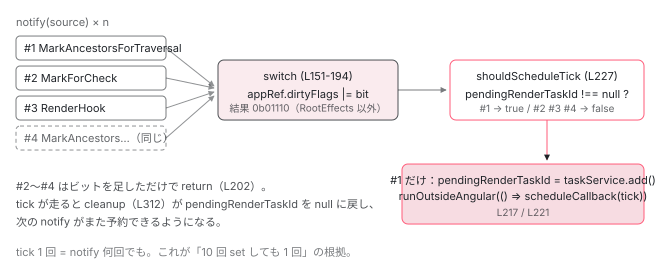

[目次](../README.md) › [zoneless の内側](README.md) › 第 3 回 / 全 11 回

# notify：通知が ApplicationRefDirtyFlags になる

> switch 文で 15 種類が 4 つのビットに畳まれる。ViewTreeTraversal / ViewTreeCheck / RootEffects / AfterRender。shouldScheduleTick が「もう予約済み」を弾く。

angular/angular · 読了 約 12 分 · 中核 · [サイトで読む（デモが動きます）](https://angular-deep-dive-cyan.vercel.app/chapter/zoneless-notify)

---

[前章](02-zoneless-notification-source.md)で 15 種類の通知が `ChangeDetectionSchedulerImpl.notify(source)` に集まることを確認しました。この章はその `notify` の中身、88 行（138〜225 行目）を全部読みます。通知は `switch` 文で `ApplicationRefDirtyFlags` の**ビット 4 つ**に畳まれ、`shouldScheduleTick` が「もう予約済み」を弾いてから、tick が 1 回だけ予約されます。「signal を 10 回連続で set したら tick は何回走るのか」に、行番号で答えられるようになります。

読む対象は `packages/core/src/change_detection/scheduling/zoneless_scheduling_impl.ts` と、ビットの定義がある `packages/core/src/application/application_ref.ts` の末尾です。

1. 既定で provide される 3 つ
2. 通知の種類（NotificationSource）
3. **notify → dirtyFlags**（この章）
4. setTimeout と rAF の競走
5. tick → synchronize
6. microtask スケジューラ
7. signal.set() からの経路
8. (click) からの経路
9. PendingTasks と isStable
10. zone.js との同居
11. 動く条件・動かない書き方

## 1. 畳む先：ApplicationRefDirtyFlags の 5 ビット

📄 `angular/packages/core/src/application/application_ref.ts` L867–899 （▶ の行: 873, 878, 883, 888, 893, 898）

```ts
867 │ export const enum ApplicationRefDirtyFlags {
868 │   None = 0,
869 │ 
870 │   /**
871 │    * A global change detection round has been requested.
872 │    */
873 ▶   ViewTreeGlobal = 0b00000001,
874 │ 
875 │   /**
876 │    * Part of the view tree is marked for traversal.
877 │    */
878 ▶   ViewTreeTraversal = 0b00000010,
879 │ 
880 │   /**
881 │    * Part of the view tree is marked to be checked (dirty).
882 │    */
883 ▶   ViewTreeCheck = 0b00000100,
884 │ 
885 │   /**
886 │    * Helper for any view tree bit being set.
887 │    */
888 ▶   ViewTreeAny = ViewTreeGlobal | ViewTreeTraversal | ViewTreeCheck,
889 │ 
890 │   /**
891 │    * After render hooks need to run.
892 │    */
893 ▶   AfterRender = 0b00001000,
894 │ 
895 │   /**
896 │    * Effects at the `ApplicationRef` level.
897 │    */
898 ▶   RootEffects = 0b00010000,
899 │ }
```

ビットは 5 つです。873 行目 `ViewTreeGlobal`（全ビューを走査）、878 行目 `ViewTreeTraversal`（ツリーの一部に走査の印がある）、883 行目 `ViewTreeCheck`（ツリーの一部に dirty の印がある）、893 行目 `AfterRender`（render hook を走らせる）、898 行目 `RootEffects`（ルート effect を流す）。888 行目の `ViewTreeAny` はビューに関する 3 ビットをまとめた「どれか立っているか」用のマスクです。

📄 `angular/packages/core/src/application/application_ref.ts` L266–274 （▶ の行: 270, 274）

```ts
266 │   /**
267 │    * Current dirty state of the application across a number of dimensions (views, afterRender hooks,
268 │    * etc).
269 │    *
270 ▶    * A flag set here means that `tick()` will attempt to resolve the dirtiness when executed.
271 │    *
272 │    * @internal
273 │    */
274 ▶   dirtyFlags = ApplicationRefDirtyFlags.None;
```

この値を持っているのは **`ApplicationRef` の `dirtyFlags`（274 行目）**で、スケジューラではありません。スケジューラは `this.appRef.dirtyFlags |= ...` と、他人のフィールドに書き込みます。270 行目のコメントどおり、「ここに立っているビットを `tick()` が解消する」という契約です。`ApplicationRef.tick()` を手で呼んだときも同じフィールドを見るので、置き場所は `ApplicationRef` である必要があります。

## 2. 入口の門番：zone.js ありなら Listener を捨てる

📄 `angular/packages/core/src/change_detection/scheduling/zoneless_scheduling_impl.ts` L138–149 （▶ の行: 138–139, 148）

```ts
138 ▶   notify(source: NotificationSource): void {
139 ▶     if (!this.zonelessEnabled && source === NotificationSource.Listener) {
140 │       // When the notification comes from a listener, we skip the notification unless the
141 │       // application has enabled zoneless. Ideally, listeners wouldn't notify the scheduler at all
142 │       // automatically. We do not know that a developer made a change in the listener callback that
143 │       // requires an `ApplicationRef.tick` (synchronize templates / run render hooks). We do this
144 │       // only for an easier migration from OnPush components to zoneless. Because listeners are
145 │       // usually executed inside the Angular zone and listeners automatically call `markViewDirty`,
146 │       // developers never needed to manually use `ChangeDetectorRef.markForCheck` or some other API
147 │       // to make listener callbacks work correctly with `OnPush` components.
148 ▶       return;
149 │     }
```

139 行目。`ZONELESS_ENABLED` が `false`（`provideZoneChangeDetection()` を足した構成）で、通知が `Listener` なら、148 行目で**何もせず return** します。140〜147 行目のコメントが理由です。zone.js ありの世界では、イベントハンドラはもともと zone の中で実行されて `markViewDirty` も呼ばれるので、スケジューラが別に tick を予約する必要がありません。zoneless の世界ではイベントだけが「状態が変わったかもしれない」合図なので、`Listener` を受け取ります。詳しくは [8 回目](08-zoneless-listener-path.md)と [10 回目](10-zoneless-hybrid.md)。

## 3. switch 文：15 種類 → 4 ビット

📄 `angular/packages/core/src/change_detection/scheduling/zoneless_scheduling_impl.ts` L151–170 （▶ の行: 152–154, 157–161, 164, 168）

```ts
151 │     switch (source) {
152 ▶       case NotificationSource.MarkAncestorsForTraversal:
153 ▶       case NotificationSource.DeferBlockStateUpdate: {
154 ▶         this.appRef.dirtyFlags |= ApplicationRefDirtyFlags.ViewTreeTraversal;
155 │         break;
156 │       }
157 ▶       case NotificationSource.DebugApplyChanges:
158 ▶       case NotificationSource.MarkForCheck:
159 ▶       case NotificationSource.Listener:
160 ▶       case NotificationSource.SetInput: {
161 ▶         this.appRef.dirtyFlags |= ApplicationRefDirtyFlags.ViewTreeCheck;
162 │         break;
163 │       }
164 ▶       case NotificationSource.CustomElement: {
165 │         // We use `ViewTreeTraversal` to ensure we refresh the element even if this is triggered
166 │         // during CD. In practice this is a no-op since the elements code also calls via a
167 │         // `markForRefresh()` API which sends `NotificationSource.MarkAncestorsForTraversal` anyway.
168 ▶         this.appRef.dirtyFlags |= ApplicationRefDirtyFlags.ViewTreeTraversal;
169 │         break;
170 │       }
```

📄 `angular/packages/core/src/change_detection/scheduling/zoneless_scheduling_impl.ts` L171–194 （▶ の行: 171–172, 175, 178, 181–182, 184–188, 192）

```ts
171 ▶       case NotificationSource.RootEffect: {
172 ▶         this.appRef.dirtyFlags |= ApplicationRefDirtyFlags.RootEffects;
173 │         break;
174 │       }
175 ▶       case NotificationSource.ViewEffect: {
176 │         // This is technically a no-op, since view effects will also send a
177 │         // `MarkAncestorsForTraversal` notification. Still, we set this for logical consistency.
178 ▶         this.appRef.dirtyFlags |= ApplicationRefDirtyFlags.ViewTreeTraversal;
179 │         break;
180 │       }
181 ▶       case NotificationSource.PendingTaskRemoved: {
182 ▶         break;
183 │       }
184 ▶       case NotificationSource.ViewDetachedFromDOM:
185 ▶       case NotificationSource.ViewAttached:
186 ▶       case NotificationSource.RenderHook:
187 ▶       case NotificationSource.AsyncAnimationsLoaded:
188 ▶       default: {
189 │         // These notifications only schedule a tick but do not change whether we should refresh
190 │         // views. Instead, we only need to run render hooks unless another notification from the
191 │         // other set is also received before `tick` happens.
192 ▶         this.appRef.dirtyFlags |= ApplicationRefDirtyFlags.AfterRender;
193 │       }
194 │     }
```

| 立てるビット | 通知 | 行 |
| --- | --- | --- |
| `ViewTreeTraversal` | `MarkAncestorsForTraversal`、`DeferBlockStateUpdate`、`CustomElement`、`ViewEffect` | 154、168、178 |
| `ViewTreeCheck` | `DebugApplyChanges`、`MarkForCheck`、`Listener`、`SetInput` | 161 |
| `RootEffects` | `RootEffect` | 172 |
| （変えない） | `PendingTaskRemoved` | 182 |
| `AfterRender` | `ViewDetachedFromDOM`、`ViewAttached`、`RenderHook`、`AsyncAnimationsLoaded`、`default` | 192 |

1. **152〜155 行目：`ViewTreeTraversal`**

   `MarkAncestorsForTraversal` は前章で見たとおり、祖先ビューに `HasChildViewsToRefresh` を立てる通知でした。それに対応するビットが `ViewTreeTraversal`、「ルートから降りていけば印の付いたビューが見つかる」という意味です。`CustomElement`（164〜169 行目）と `ViewEffect`（175〜179 行目）も同じビットですが、コメントにあるとおりどちらも「別の通知が同じビットを立てるので実質 no-op」です。
2. **157〜162 行目：`ViewTreeCheck`**

   `markViewDirty` 経由の 4 つ（`DebugApplyChanges`、`MarkForCheck`、`Listener`、`SetInput`）です。`markViewDirty` はビューと祖先に `Dirty`（と `RefreshView`）を立てるので、「dirty な印の付いたビューがある」という意味の `ViewTreeCheck` になります。
3. **171〜173 行目：`RootEffects`**

   ビュー外の `effect()` が dirty になったとき。ビューとは無関係なので、ビュー用のビットは立てません。次の tick の冒頭で `EffectScheduler.flush()` を呼ばせるための印です（[5 回目](05-zoneless-tick.md)）。
4. **181〜183 行目：`PendingTaskRemoved` は何も立てない**

   `break` だけです。ビットを立てずに、この後の予約処理（201 行目以降）には進みます。つまり **「仕事は無いが tick は予約する」**通知です。tick が実際に走るとき `dirtyFlags` が `None` なので何もしません。その意味は [9 回目](09-zoneless-pending-tasks.md)で扱います。
5. **184〜193 行目：`AfterRender`**

   前章の「render hook だけ」グループが全部ここに来ます。`default` もここなので、将来 enum に値が増えても、取りこぼしは「hook だけ走らせる」側に落ちます。

> [!WARNING]
> **ハマりどころ**
>
> `ViewTreeTraversal` と `ViewTreeCheck` は、zoneless の tick では**どちらも同じ扱い**で、`ViewTreeAny` として見られて Targeted モードで走査されます。違いが出るのは 5 回目で読む `synchronizeOnce` の 660 行目、「走査中に `markForCheck` が立てた `ViewTreeCheck` は再走査の理由にしない」という後方互換の 1 行だけです。「意味が違う 2 ビット」として覚えておけば、そこで迷いません。

## 4. switch の後：予約まで

📄 `angular/packages/core/src/change_detection/scheduling/zoneless_scheduling_impl.ts` L196–225 （▶ の行: 199, 201–202, 205–206, 214–219, 221–222）

```ts
196 │     // If not already defined, attempt to capture a tracing snapshot of this
197 │     // notification so that the resulting CD run can be attributed to the
198 │     // context which produced the notification.
199 ▶     this.appRef.tracingSnapshot = this.tracing?.snapshot(this.appRef.tracingSnapshot) ?? null;
200 │ 
201 ▶     if (!this.shouldScheduleTick()) {
202 ▶       return;
203 │     }
204 │ 
205 ▶     if (typeof ngDevMode === 'undefined' || ngDevMode) {
206 ▶       if (this.useMicrotaskScheduler) {
207 │         trackMicrotaskNotificationForDebugging();
208 │       } else {
209 │         consecutiveMicrotaskNotifications = 0;
210 │         stackFromLastFewNotifications.length = 0;
211 │       }
212 │     }
213 │ 
214 ▶     const scheduleCallback = this.useMicrotaskScheduler
215 ▶       ? scheduleCallbackWithMicrotask
216 ▶       : scheduleCallbackWithRafRace;
217 ▶     this.pendingRenderTaskId = this.taskService.add();
218 ▶     if (this.scheduleInRootZone) {
219 ▶       this.cancelScheduledCallback = Zone.root.run(() => scheduleCallback(() => this.tick()));
220 │     } else {
221 ▶       this.cancelScheduledCallback = this.ngZone.runOutsideAngular(() =>
222 ▶         scheduleCallback(() => this.tick()),
223 │       );
224 │     }
225 │   }
```

1. **199 行目：tracing のスナップショット**

   `TracingService`（任意、通常は無い）があれば、最初の通知の文脈を記録します。後の tick がどの通知のせいで走ったかを紐づけるためのもので、変更検知の流れには影響しません。
2. **201〜203 行目：`shouldScheduleTick()` が false なら終わり**

   ここまでで `dirtyFlags` には書き込み済みです。予約が弾かれても**ビットは残ります**。つまり「2 回目以降の通知はビットを追加するだけで、予約は 1 回目のものを使う」のがここの仕組みです。中身は 5 節。
3. **205〜212 行目：開発モードの無限ループ検出**

   `useMicrotaskScheduler` が true のときだけ数えます。[6 回目](06-zoneless-microtask.md)の主題です。
4. **214〜216 行目：予約方法を選ぶ**

   既定は `scheduleCallbackWithRafRace`（[次章](04-zoneless-raf-race.md)）、tick 直後の 1 マイクロタスクの間だけ `scheduleCallbackWithMicrotask`（6 回目）です。
5. **217 行目：`pendingRenderTaskId = this.taskService.add()`**

   `PendingTasksInternal` にタスクを 1 つ登録し、その ID を覚えます。この ID は 2 つの役目を持ちます。(a) `shouldScheduleTick` が「予約済み」を判定する目印（232 行目）、(b) アプリが `isStable` にならないようにする錘（おもり）。tick が終わるまで `isStable` は false です。
6. **218〜224 行目：Angular zone の外で予約する**

   221 行目、`ngZone.runOutsideAngular(() => scheduleCallback(() => this.tick()))`。zoneless では `NoopNgZone.runOutsideAngular` は関数をそのまま呼ぶだけなので、素の `setTimeout` / `requestAnimationFrame` が呼ばれます。zone.js ありのときに zone の外で予約するのは、予約自体が zone を unstable にして、また変更検知を呼ぶ循環を避けるためです。戻り値（キャンセル関数）を `cancelScheduledCallback` に保存します。218〜219 行目の `SCHEDULE_IN_ROOT_ZONE` 分岐は zone.js あり専用で、10 回目で触れます。

## 5. shouldScheduleTick：弾く条件は 3 つ

📄 `angular/packages/core/src/change_detection/scheduling/zoneless_scheduling_impl.ts` L78–81 （▶ の行: 78, 80–81）

```ts
78 ▶   private cancelScheduledCallback: null | (() => void) = null;
79 │   private useMicrotaskScheduler = false;
80 ▶   runningTick = false;
81 ▶   pendingRenderTaskId: number | null = null;
```

📄 `angular/packages/core/src/change_detection/scheduling/zoneless_scheduling_impl.ts` L227–246 （▶ の行: 228, 232, 237–240, 245）

```ts
227 │   private shouldScheduleTick(): boolean {
228 ▶     if (this.appRef.destroyed) {
229 │       return false;
230 │     }
231 │     // already scheduled or running
232 ▶     if (this.pendingRenderTaskId !== null || this.runningTick || this.appRef._runningTick) {
233 │       return false;
234 │     }
235 │     // If we're inside the zone don't bother with scheduler. Zone will stabilize
236 │     // eventually and run change detection.
237 ▶     if (
238 ▶       !this.zonelessEnabled &&
239 ▶       this.zoneIsDefined &&
240 ▶       Zone.current.get(angularZoneInstanceIdProperty + this.angularZoneId)
241 │     ) {
242 │       return false;
243 │     }
244 │ 
245 ▶     return true;
246 │   }
```

1. **228〜230 行目：アプリが destroy 済み**

   破棄後の通知は無視します。
2. **232〜234 行目：予約済み、または実行中**

   `pendingRenderTaskId !== null`（217 行目で入れた ID がまだある）、`runningTick`（スケジューラが tick を実行中、80 行目）、`appRef._runningTick`（`ApplicationRef` 側が tick を実行中。手動 `tick()` も含む）。どれか 1 つでも true なら false。**signal を 10 回連続で set しても、2 回目以降はここで止まります**。tick 実行中に出た通知も止まりますが、ビットは残っているので、tick 側のループが拾います（5 回目）。
3. **237〜243 行目：zone.js ありで、いま Angular zone の中にいる**

   zoneless では `zonelessEnabled` が true なので 238 行目で短絡し、この判定は走りません。zone.js ありのときだけ、「zone がいずれ安定して自分で tick を呼ぶから、ここでは予約しない」と判断します（10 回目）。

## 6. cleanup：予約を解く側

📄 `angular/packages/core/src/change_detection/scheduling/zoneless_scheduling_impl.ts` L312–328 （▶ の行: 313–315, 323–326）

```ts
312 │   private cleanup() {
313 ▶     this.runningTick = false;
314 ▶     this.cancelScheduledCallback?.();
315 ▶     this.cancelScheduledCallback = null;
316 │     // If this is the last task, the service will synchronously emit a stable
317 │     // notification. If there is a subscriber that then acts in a way that
318 │     // tries to notify the scheduler again, we need to be able to respond to
319 │     // schedule a new change detection. Therefore, we should clear the task ID
320 │     // before removing it from the pending tasks (or the tasks service should
321 │     // not synchronously emit stable, similar to how Zone stableness only
322 │     // happens if it's still stable after a microtask).
323 ▶     if (this.pendingRenderTaskId !== null) {
324 ▶       const taskId = this.pendingRenderTaskId;
325 ▶       this.pendingRenderTaskId = null;
326 ▶       this.taskService.remove(taskId);
327 │     }
328 │   }
```

`notify` が立てた状態を元に戻すのが `cleanup` です。313 行目で `runningTick = false`、314〜315 行目で予約していたコールバックをキャンセルして捨てます。323〜327 行目が `pendingRenderTaskId` の後片付けですが、順番に注意してください。**324〜325 行目で先に `null` を代入し、326 行目で後からタスクを消します**。

📄 `angular/packages/core/src/pending_tasks_internal.ts` L48–69 （▶ の行: 51, 54, 66–67）

```ts
48 │   add(): number {
49 │     // Emitting a value to a closed subject throws an error.
50 │     if (!this.hasPendingTasks && !this.destroyed) {
51 ▶       this.pendingTask.next(true);
52 │     }
53 │     const taskId = this.taskId++;
54 ▶     this.pendingTasks.add(taskId);
55 │     this.debugTaskTracker?.add(taskId);
56 │     return taskId;
57 │   }
58 │ 
59 │   has(taskId: number): boolean {
60 │     return this.pendingTasks.has(taskId);
61 │   }
62 │ 
63 │   remove(taskId: number): void {
64 │     this.pendingTasks.delete(taskId);
65 │     this.debugTaskTracker?.remove(taskId);
66 ▶     if (this.pendingTasks.size === 0 && this.hasPendingTasks) {
67 ▶       this.pendingTask.next(false);
68 │     }
69 │   }
```

理由は `PendingTasksInternal.remove`（63〜69 行目）にあります。66〜67 行目、最後のタスクを消すと**同期的に**`pendingTask.next(false)` が流れ、`isStable` の購読者がその場で動きます。購読者が signal を書けば、その場で `notify` が呼ばれます。もし `pendingRenderTaskId` がまだ残っていたら、232 行目で「予約済み」と誤判定されて、新しい tick が予約されません。316〜322 行目のコメントは、まさにその事故の説明です。



*notify は 3 段。ビットを OR → shouldScheduleTick で 1 回目だけ通す → setTimeout/rAF を予約して pendingRenderTaskId を持つ。2 回目以降の通知はビットを足すだけ。*

> **🧪 DEMO — notify を押して dirtyFlags のビットと予約の有無を見る**
>
> 本物の `notify` と同じ分岐（139 / 151〜194 / 232 / 217 行目）を数字で再現しています。「tick が走る」で `cleanup`（312〜328 行目）の効果を再現します。
>
> ▶ [このデモはサイトで動かせます](https://angular-deep-dive-cyan.vercel.app/chapter/zoneless-notify)

## ここまでの呼び出し

- 👤 `this.count.set(1)`（テンプレートで読んでいる signal） — あなたのコンポーネント
  - `REACTIVE_LVIEW_CONSUMER_NODE.consumerMarkedDirty` — render3/reactive\_lview\_consumer.ts L47
    - `markAncestorsForTraversal(lView)` — render3/util/view\_utils.ts L264
      - `ChangeDetectionSchedulerImpl.notify(MarkAncestorsForTraversal)` — zoneless\_scheduling\_impl.ts L138
        - `appRef.dirtyFlags |= ViewTreeTraversal` — L154
        - `shouldScheduleTick()` → true — L227 — *pendingRenderTaskId === null*
        - `pendingRenderTaskId = taskService.add()` — L217 — *isStable が false になる*
        - `ngZone.runOutsideAngular(() => scheduleCallbackWithRafRace(() => this.tick()))` — L221 — *次章*
- 👤 `this.count.set(2)`（直後にもう 1 回） — あなたのコンポーネント
  - `notify(MarkAncestorsForTraversal)` — L138
    - `appRef.dirtyFlags |= ViewTreeTraversal` — L154 — *既に立っているので変化なし*
      - `shouldScheduleTick()` → false — L232 — *pendingRenderTaskId !== null → return（L202）*

## 聞かれそうな質問

**Q. signal を 1 回 set したら tick は何回走りますか？10 回連続で set したら？**

どちらも 1 回です。1 回目の `notify` が 217 行目で `pendingRenderTaskId` に ID を入れ、2 回目以降は `shouldScheduleTick` の 232 行目で `pendingRenderTaskId !== null` により false を返して 202 行目で return します。`dirtyFlags` への OR（154 行目）は毎回行われますが、同じビットなので値は変わりません。

**Q. `dirtyFlags` の `ViewTreeTraversal` と `ViewTreeCheck` の違いは何ですか？**

立てる通知が違います。`ViewTreeTraversal`（878 行目）は `markAncestorsForTraversal` 系、つまり祖先に `HasChildViewsToRefresh` が付いた状態（154・168・178 行目）。`ViewTreeCheck`（883 行目）は `markViewDirty` 系、つまりビューに `Dirty` が付いた状態（161 行目）です。tick の中では `ViewTreeAny`（888 行目）としてまとめて見られ、どちらでも Targeted 走査が走ります。違いが効くのは走査後の 1 行（[5 回目](05-zoneless-tick.md)の 660 行目）だけです。

**Q. `dirtyFlags` を変えない通知はありますか？**

`PendingTaskRemoved` です。181〜183 行目で `break` するだけです。ただし予約処理（201 行目以降）には進むので、tick は予約されます。その tick は `dirtyFlags === None` を見て `cleanup` だけして終わります（5 回目の 268〜271 行目）。

**Q. `notify` を呼んだら、その場で変更検知が走りますか？**

走りません。`notify` がするのは `dirtyFlags` への書き込みと、221 行目の予約だけです。実際の `tick` は `setTimeout` か `requestAnimationFrame` のコールバックで、いまの JavaScript の実行が終わってから走ります。同期的に走らせたいなら `ChangeDetectorRef.detectChanges()` か `ApplicationRef.tick()` を自分で呼びます。

**Q. zone.js ありの構成で `(click)` が鳴ると、スケジューラは何をしますか？**

何もしません。139 行目で `!this.zonelessEnabled && source === NotificationSource.Listener` が true になり、148 行目で return します。変更検知は zone.js 側の `onMicrotaskEmpty` が担います。

**Q. なぜ `cleanup` は `pendingRenderTaskId` を先に `null` にしてからタスクを消すのですか？**

`PendingTasksInternal.remove` の 66〜67 行目が、最後のタスクを消した瞬間に同期的に `isStable` を流すからです。その購読者が `notify` を呼んだとき、`pendingRenderTaskId` が残っていると 232 行目で「予約済み」と誤判定されて、新しい tick が予約されません。324〜326 行目の順序がそれを防いでいます。

## 読み終えて

- `notify` は 3 段。`switch` でビットを OR（151〜194 行目）→ `shouldScheduleTick`（201 行目）→ `taskService.add()` と `scheduleCallback`（217〜224 行目）
- ビットの置き場所は `ApplicationRef.dirtyFlags`（application\_ref.ts 274 行目）。スケジューラは他人のフィールドに書く
- 15 種類は 4 ビットに畳まれる。`PendingTaskRemoved` だけはビットを立てずに tick を予約する
- `pendingRenderTaskId !== null`（232 行目）が「予約済み」の目印。何回 `notify` しても tick は 1 回
- zone.js ありでは `Listener` を 139 行目で捨て、Angular zone の中では 237〜243 行目で予約しない。zoneless ではどちらも通る

---

← 前: [15 種類の通知：NotificationSource を全部読む](02-zoneless-notification-source.md)  
次: [scheduleCallbackWithRafRace：setTimeout と requestAnimationFrame の競走](04-zoneless-raf-race.md) →
