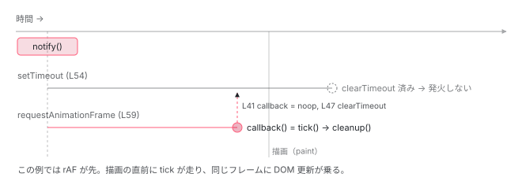

[目次](../README.md) › [zoneless の内側](README.md) › 第 4 回 / 全 11 回

# scheduleCallbackWithRafRace：setTimeout と requestAnimationFrame の競走

> 先に来たほうで tick を走らせ、負けたほうは cancel する。rAF だけだと背景タブで止まり、setTimeout だけだと描画と同じフレームに乗らない。

angular/angular · 読了 約 10 分 · 中核 · [サイトで読む（デモが動きます）](https://angular-deep-dive-cyan.vercel.app/chapter/zoneless-raf-race)

---

[前章](03-zoneless-notify.md)の最後、`notify` の 221 行目で `scheduleCallbackWithRafRace(() => this.tick())` が呼ばれました。この章はその 30 行の関数を読みます。`setTimeout` と `requestAnimationFrame` を**両方**予約し、先に来たほうで tick を走らせ、負けたほうは cancel します。「なぜ片方だけではだめなのか」を、ソースに書かれた 4 つの理由から答えられるようになります。

読む対象は `packages/core/src/util/callback_scheduler.ts`（74 行、全部読みます）と、呼び元の `zoneless_scheduling_impl.ts` の数行、同じ関数を使っている `zone/ng_zone.ts` です。

1. 既定で provide される 3 つ
2. 通知の種類（NotificationSource）
3. notify → dirtyFlags
4. **setTimeout と rAF の競走**（この章）
5. tick → synchronize
6. microtask スケジューラ
7. signal.set() からの経路
8. (click) からの経路
9. PendingTasks と isStable
10. zone.js との同居
11. 動く条件・動かない書き方

## 1. 呼び元：zone の外で予約し、キャンセル関数を持つ

📄 `angular/packages/core/src/change_detection/scheduling/zoneless_scheduling_impl.ts` L214–224 （▶ の行: 214, 216, 221–222）

```ts
214 ▶     const scheduleCallback = this.useMicrotaskScheduler
215 │       ? scheduleCallbackWithMicrotask
216 ▶       : scheduleCallbackWithRafRace;
217 │     this.pendingRenderTaskId = this.taskService.add();
218 │     if (this.scheduleInRootZone) {
219 │       this.cancelScheduledCallback = Zone.root.run(() => scheduleCallback(() => this.tick()));
220 │     } else {
221 ▶       this.cancelScheduledCallback = this.ngZone.runOutsideAngular(() =>
222 ▶         scheduleCallback(() => this.tick()),
223 │       );
224 │     }
```

📄 `angular/packages/core/src/zone/ng_zone.ts` L572–574 （▶ の行: 573）

```ts
572 │   runOutsideAngular<T>(fn: (...args: any[]) => T): T {
573 ▶     return fn();
574 │   }
```

214〜216 行目で予約関数を選びます。既定は `scheduleCallbackWithRafRace` です （`useMicrotaskScheduler` が true になる時間帯は [6 回目](06-zoneless-microtask.md)）。221〜223 行目、`ngZone.runOutsideAngular(...)` の中で予約します。zoneless の `NgZone` は `NoopNgZone` なので、573 行目のとおり `fn()` を呼ぶだけ。つまりブラウザ素の `setTimeout` / `requestAnimationFrame` が呼ばれます。戻り値（キャンセル関数）は `cancelScheduledCallback` に保存されます（4 節）。

## 2. 関数本体：先着 1 名、残りは取り消し

📄 `angular/packages/core/src/util/callback_scheduler.ts` L37–66 （▶ の行: 37, 40–41, 43–44, 46–47, 54–56, 58–61, 65）

```ts
37 ▶ export function scheduleCallbackWithRafRace(callback: Function): () => void {
38 │   let timeoutId: number;
39 │   let animationFrameId: number;
40 ▶   function cleanup() {
41 ▶     callback = noop;
42 │     try {
43 ▶       if (animationFrameId !== undefined && typeof cancelAnimationFrame === 'function') {
44 ▶         cancelAnimationFrame(animationFrameId);
45 │       }
46 ▶       if (timeoutId !== undefined) {
47 ▶         clearTimeout(timeoutId);
48 │       }
49 │     } catch {
50 │       // Clearing/canceling can fail in tests due to the timing of functions being patched and unpatched
51 │       // Just ignore the errors - we protect ourselves from this issue by also making the callback a no-op.
52 │     }
53 │   }
54 ▶   timeoutId = setTimeout(() => {
55 ▶     callback();
56 ▶     cleanup();
57 │   }) as unknown as number;
58 ▶   if (typeof requestAnimationFrame === 'function') {
59 ▶     animationFrameId = requestAnimationFrame(() => {
60 ▶       callback();
61 ▶       cleanup();
62 │     });
63 │   }
64 │ 
65 ▶   return () => cleanup();
66 │ }
```

1. **54〜57 行目：`setTimeout` を予約する**

   第 2 引数（遅延）がありません。遅延 0 で**次のマクロタスク**に積まれます。コールバックは 55 行目で `callback()`（= `this.tick()`）を呼び、56 行目で `cleanup()` を呼びます。
2. **58〜63 行目：`requestAnimationFrame` があれば、こちらも予約する**

   58 行目の `typeof requestAnimationFrame === 'function'` は、Node.js（SSR / prerender）対策です。サーバーには `requestAnimationFrame` が無いので、`setTimeout` だけの一本勝負になります。ブラウザでは 59 行目で予約され、コールバックは `setTimeout` 側と同じ形（60〜61 行目）です。
3. **40〜53 行目：`cleanup` が「負けたほう」を黙らせる**

   **41 行目が肝心です。`callback = noop`**。先に来たほうが `cleanup()` を呼ぶと、まず `callback` 変数が何もしない関数に差し替わります。その後 43〜48 行目で両方の予約を `cancelAnimationFrame` / `clearTimeout` します （勝ったほうの ID も渡しますが、既に実行済みなので何も起きません）。49〜52 行目の `try/catch` はテストで zone.js のパッチが途中で外れたときの保険で、cancel に失敗しても 41 行目のおかげで負けたほうは `noop` を呼ぶだけです。**tick は必ず 1 回だけ**、が二重に守られています。
4. **65 行目：キャンセル関数を返す**

   `() => cleanup()` です。呼び元がこれを呼べば、どちらも走る前に取り消せます。誰がいつ呼ぶかは 4 節。



*1 回の notify で 2 つの予約。先に発火したほうが tick を実行し、cleanup で callback を noop にして相手を cancel する。*

## 3. なぜ両方なのか：コメントに書かれた 4 つの理由

📄 `angular/packages/core/src/util/callback_scheduler.ts` L11–36 （▶ の行: 15, 18, 21–22, 24, 27, 32）

```ts
11 │ /**
12 │  * Gets a scheduling function that runs the callback after the first of setTimeout and
13 │  * requestAnimationFrame resolves.
14 │  *
15 ▶  * - `requestAnimationFrame` ensures that change detection runs ahead of a browser repaint.
16 │  * This ensures that the create and update passes of a change detection always happen
17 │  * in the same frame.
18 ▶  * - When the browser is resource-starved, `rAF` can execute _before_ a `setTimeout` because
19 │  * rendering is a very high priority process. This means that `setTimeout` cannot guarantee
20 │  * same-frame create and update pass, when `setTimeout` is used to schedule the update phase.
21 ▶  * - While `rAF` gives us the desirable same-frame updates, it has two limitations that
22 ▶  * prevent it from being used alone. First, it does not run in background tabs, which would
23 │  * prevent Angular from initializing an application when opened in a new tab (for example).
24 ▶  * Second, repeated calls to requestAnimationFrame will execute at the refresh rate of the
25 │  * hardware (~16ms for a 60Hz display). This would cause significant slowdown of tests that
26 │  * are written with several updates and asserts in the form of "update; await stable; assert;".
27 ▶  * - Both `setTimeout` and `rAF` are able to "coalesce" several events from a single user
28 │  * interaction into a single change detection. Importantly, this reduces view tree traversals when
29 │  * compared to an alternative timing mechanism like `queueMicrotask`, where change detection would
30 │  * then be interleaves between each event.
31 │  *
32 ▶  * By running change detection after the first of `setTimeout` and `rAF` to execute, we get the
33 │  * best of both worlds.
34 │  *
35 │  * @returns a function to cancel the scheduled callback
36 │  */
```

1. **15〜17 行目：rAF は「描画の直前」に走る**

   `requestAnimationFrame` のコールバックは、ブラウザが次の描画をする直前に呼ばれます。ここで tick を走らせれば、DOM の変更と描画が**同じフレーム**に収まります。変更検知の結果が 1 フレーム遅れて見える、ということが起きません。
2. **18〜20 行目：忙しいとき `setTimeout` は rAF に負ける**

   描画は優先度が高いので、ブラウザが重いときは `setTimeout(fn, 0)` より先に rAF が来ることがあります。`setTimeout` だけで予約していると、「rAF → 描画 → やっと setTimeout → tick」となり、tick の結果が次のフレームまで見えません。だから `setTimeout` だけでは不十分です。
3. **21〜26 行目：rAF だけでも困る理由が 2 つ**

   1 つ目、**背景タブでは rAF が止まります**。新しいタブで開かれたアプリが、ユーザーが見に来るまで初期化すら終わらないことになります。2 つ目、rAF は**ディスプレイのリフレッシュレート**（60Hz なら約 16ms）でしか回りません。「更新 → 安定を待つ → 検証」を何百回も繰り返すテストが、1 回あたり 16ms 遅くなります。
4. **27〜30 行目：どちらも「まとめる」ことができる**

   `setTimeout` も rAF も、いまの JavaScript 実行が終わってから走ります。1 回のユーザー操作で複数のイベント（`keydown` → `input` → `keyup` など）が立て続けに起きても、前章の `pendingRenderTaskId` と合わせて tick は 1 回です。`queueMicrotask` で予約すると、イベントとイベントの間に tick が割り込んで、走査の回数が増えます。

32〜33 行目が結論です。**先に来たほうを採る**ことで、描画と同じフレームに乗る（rAF の利点）、背景タブでも止まらずテストも速い（`setTimeout` の利点）の両方を得ています。

📄 `angular/packages/core/src/util/callback_scheduler.ts` L68–74 （▶ の行: 68–69, 72）

```ts
68 ▶ export function scheduleCallbackWithMicrotask(callback: Function): () => void {
69 ▶   queueMicrotask(() => callback());
70 │ 
71 │   return () => {
72 ▶     callback = noop;
73 │   };
74 │ }
```

比較のために、同じファイルのもう 1 つの関数も見ておきます。69 行目、`queueMicrotask` で予約するだけです。cancel の仕組みが無いので、72 行目でやはり `callback = noop` にして黙らせます。27〜30 行目のコメントで「イベントの間に割り込む」と書かれていたのがこの予約方法で、特定の 1 マイクロタスクの間だけ使われます（6 回目）。

## 4. 誰が予約を取り消すのか

📄 `angular/packages/core/src/change_detection/scheduling/zoneless_scheduling_impl.ts` L312–315 （▶ の行: 314–315）

```ts
312 │   private cleanup() {
313 │     this.runningTick = false;
314 ▶     this.cancelScheduledCallback?.();
315 ▶     this.cancelScheduledCallback = null;
```

314 行目、`ChangeDetectionSchedulerImpl.cleanup` が `cancelScheduledCallback?.()` を呼びます。これが 65 行目で返した `() => cleanup()` です。`cleanup` が呼ばれる場面は 4 つあります。

| 場面 | 呼び元（zoneless\_scheduling\_impl.ts） | 取り消される予約 |
| --- | --- | --- |
| 予約した tick が走り終わった | `tick()` の `finally`（303 行目） | 自分自身（実行済みなので実質 no-op） |
| 誰かが `ApplicationRef.tick()` を手で呼んだ | `afterTick` 購読（92〜93 行目） | 走る前の予約。手動 tick で仕事が終わったので、二重に走らせない |
| zone.js ありで zone が unstable になった | `onUnstable` 購読（115〜116 行目） | 走る前の予約。zone 側が tick を担う |
| スケジューラが destroy された | `ngOnDestroy`（309 行目） | 残っている予約すべて |

📄 `angular/packages/core/src/change_detection/scheduling/zoneless_scheduling_impl.ts` L299–305 （▶ の行: 303）

```ts
299 │     } catch (e: unknown) {
300 │       this.applicationErrorHandler(e);
301 │     } finally {
302 │       this.taskService.remove(task);
303 ▶       this.cleanup();
304 │     }
305 │   }
```

📄 `angular/packages/core/src/change_detection/scheduling/zoneless_scheduling_impl.ts` L89–93 （▶ の行: 92–93）

```ts
89 │         // If the scheduler isn't running a tick but the application ticked, that means
90 │         // someone called ApplicationRef.tick manually. In this case, we should cancel
91 │         // any change detections that had been scheduled so we don't run an extra one.
92 ▶         if (!this.runningTick) {
93 ▶           this.cleanup();
```

📄 `angular/packages/core/src/change_detection/scheduling/zoneless_scheduling_impl.ts` L110–118 （▶ の行: 115–116）

```ts
110 │     this.subscriptions.add(
111 │       this.ngZone.onUnstable.subscribe(() => {
112 │         // If the zone becomes unstable when we're not running tick (this happens from the zone.run),
113 │         // we should cancel any scheduled change detection here because at this point we
114 │         // know that the zone will stabilize at some point and run change detection itself.
115 ▶         if (!this.runningTick) {
116 ▶           this.cleanup();
117 │         }
118 │       }),
```

📄 `angular/packages/core/src/change_detection/scheduling/zoneless_scheduling_impl.ts` L307–310 （▶ の行: 309）

```ts
307 │   ngOnDestroy() {
308 │     this.subscriptions.unsubscribe();
309 ▶     this.cleanup();
310 │   }
```

2 つ目と 3 つ目が、`cancelScheduledCallback` を保存している理由です。「予約したが、走る前に別の誰かが変更検知を済ませてしまった」ときに、余分な tick を 1 回省きます。どちらも [6 回目](06-zoneless-microtask.md)と [10 回目](10-zoneless-hybrid.md)で読みます。

## 5. 同じ関数を NgZone も使っている

📄 `angular/packages/core/src/zone/ng_zone.ts` L401–421 （▶ の行: 404, 406, 410, 419）

```ts
401 │   if (zone.isCheckStableRunning || zone.callbackScheduled) {
402 │     return;
403 │   }
404 ▶   zone.callbackScheduled = true;
405 │   function scheduleCheckStable() {
406 ▶     scheduleCallbackWithRafRace(() => {
407 │       zone.callbackScheduled = false;
408 │       updateMicroTaskStatus(zone);
409 │       zone.isCheckStableRunning = true;
410 ▶       checkStable(zone);
411 │       zone.isCheckStableRunning = false;
412 │     });
413 │   }
414 │   if (zone.scheduleInRootZone) {
415 │     Zone.root.run(() => {
416 │       scheduleCheckStable();
417 │     });
418 │   } else {
419 ▶     zone._outer.run(() => {
420 │       scheduleCheckStable();
421 │     });
```

`scheduleCallbackWithRafRace` を使っているのは、core 全体で 2 か所だけです。1 つがこの章の `ChangeDetectionSchedulerImpl`、もう 1 つが `ng_zone.ts` 406 行目、`provideZoneChangeDetection({ eventCoalescing: true })` のときの `checkStable` の遅延実行です。404 行目で `callbackScheduled = true` にして二重予約を防ぎ、419 行目で `_outer.run`（Angular zone の外）で予約する、という構造も同じです。zone.js の側は [zone シリーズの coalescing の章](../zone/12-zone-coalescing.md)で読みます。

> [!TIP]
> **新卒エンジニアへ**
>
> 「zoneless は rAF で変更検知する」という説明をよく見ますが、半分です。`setTimeout` も同時に予約されていて、**先に来たほう**が走ります。普通のフォアグラウンドのタブでは rAF が先に来ることが多いですが、下のデモで実測すると `setTimeout` が勝つ回もあります。どちらが勝っても tick は 1 回です。

> **🧪 DEMO — 本物の setTimeout と requestAnimationFrame を競走させる**
>
> 37〜66 行目と同じ構造で両方を予約し、先に来たほうを記録します。負けたほうは `cleanup` で cancel されます。タブを背景にして戻ってくると、その間の rAF が止まっていたことが分かります。
>
> ▶ [このデモはサイトで動かせます](https://angular-deep-dive-cyan.vercel.app/chapter/zoneless-raf-race)

## ここまでの呼び出し

- `ChangeDetectionSchedulerImpl.notify(source)` — zoneless\_scheduling\_impl.ts L138 — *前章*
  - `this.ngZone.runOutsideAngular(fn)` — L221
    - `NoopNgZone.runOutsideAngular` → `fn()` — zone/ng\_zone.ts L572
      - `scheduleCallbackWithRafRace(() => this.tick())` — util/callback\_scheduler.ts L37
        - `setTimeout(...)` — L54 — *遅延 0*
        - `requestAnimationFrame(...)` — L59 — *ブラウザのみ*
        - return `() => cleanup()` — L65 — *→ cancelScheduledCallback に保存*
- （いまの JavaScript が終わる。先に来たほうのコールバック）
  - `callback()` = `this.tick()` — L55 または L60 — *次章*
  - `cleanup()` — L40 — *callback = noop、相手を cancel*

## 聞かれそうな質問

**Q. なぜ `setTimeout` と `requestAnimationFrame` を両方使うのですか？**

callback\_scheduler.ts 15〜30 行目のコメントが理由です。rAF は描画の直前に走るので DOM 更新と描画が同じフレームに収まる（15〜17 行目）が、背景タブで止まり、リフレッシュレート（約 16ms）でしか回らない（21〜26 行目）。`setTimeout` は背景でも動くが、忙しいときは rAF に負けて描画が 1 フレーム遅れる（18〜20 行目）。両方予約して先に来たほうを採れば、どちらの欠点も消えます（32〜33 行目）。

**Q. rAF だけにしたら何が困りますか？`setTimeout` だけなら？**

rAF だけ：新しいタブで開かれたアプリは、タブが前面になるまで最初の tick が走らず、初期化が止まります（22〜23 行目）。テストは 1 更新ごとに約 16ms 待ちます（24〜26 行目）。`setTimeout` だけ：負荷が高いとき rAF と描画が先に走り、tick の結果が次のフレームに持ち越されます（18〜20 行目）。

**Q. 負けたほうのコールバックは実行されないのですか？**

されません。勝ったほうが呼ぶ `cleanup`（40〜53 行目）が、41 行目で `callback = noop` に差し替え、44 行目か 47 行目で相手を cancel します。cancel が例外で失敗しても（49〜52 行目）、負けたほうが呼ぶのは既に `noop` なので、tick が 2 回走ることはありません。

**Q. SSR / prerender のときはどうなりますか？**

Node.js には `requestAnimationFrame` が無いので、58 行目の `typeof` 判定が false になり、54 行目の `setTimeout` だけが予約されます。競走は起きず、次のマクロタスクで tick が走ります。

**Q. 予約した tick を取り消すことはありますか？**

あります。65 行目で返したキャンセル関数は `cancelScheduledCallback` に保存され、`cleanup`（314 行目）から呼ばれます。手動で `ApplicationRef.tick()` が呼ばれたとき（92〜93 行目）と、zone.js ありで zone が unstable になったとき（115〜116 行目）に、走る前の予約が取り消されます。

**Q. zone.js ありの構成でもこの関数は使われますか？**

使われます。`ng_zone.ts` 406 行目で、`eventCoalescing: true` のときの `checkStable` を遅らせるのに同じ関数を使っています。また `ChangeDetectionSchedulerImpl` は zone.js ありでも消えないので、Angular zone の外で出た通知はこの関数で予約されます（10 回目）。

## 読み終えて

- `scheduleCallbackWithRafRace`（callback\_scheduler.ts 37〜66 行目）は `setTimeout`（54 行目）と `requestAnimationFrame`（59 行目）を両方予約し、先に来たほうで tick を走らせる
- `cleanup` は 41 行目で `callback = noop` にしてから相手を cancel する。tick は必ず 1 回
- 両方使う理由はコメント 15〜33 行目。rAF は同じフレームに乗るが背景タブで止まり遅い。`setTimeout` は止まらないが忙しいと描画に負ける
- Node.js では 58 行目の判定で `setTimeout` だけになる
- 戻り値のキャンセル関数は `cancelScheduledCallback` に保存され、手動 tick や zone の unstable で予約を取り消すのに使われる

---

← 前: [notify：通知が ApplicationRefDirtyFlags になる](03-zoneless-notify.md)  
次: [scheduler.tick → ApplicationRef.\_tick → synchronize](05-zoneless-tick.md) →
