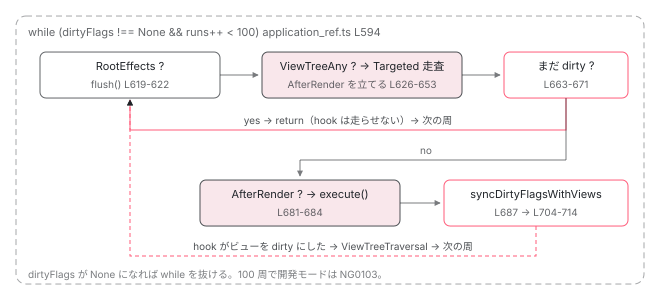

[目次](../README.md) › [zoneless の内側](README.md) › 第 5 回 / 全 11 回

# scheduler.tick → ApplicationRef.\_tick → synchronize

> dirtyFlags が None なら何もしない。RootEffects を流し、ビューを Targeted で走査し、afterRender を実行し、まだ dirty なら最大 100 回ループする。

angular/angular · 読了 約 14 分 · 中核 · [サイトで読む（デモが動きます）](https://angular-deep-dive-cyan.vercel.app/chapter/zoneless-tick)

---

[前章](04-zoneless-raf-race.md)で予約したコールバックが発火すると、`ChangeDetectionSchedulerImpl.tick()` → `ApplicationRef._tick()` → `synchronize()` と進みます。この章はその 3 段を全部読みます。`dirtyFlags` が `None` なら何もしない、`RootEffects` を流す、ビューを Targeted で走査する、`afterRender` を実行する、まだ dirty なら最大 100 回ループする。「tick の中でまた signal を書いたらどうなるか」に行番号で答えられるようになります。

読む対象は `zoneless_scheduling_impl.ts` の `tick`（257〜305 行目）と、`packages/core/src/application/application_ref.ts` の 533〜714 行目です。

1. 既定で provide される 3 つ
2. 通知の種類（NotificationSource）
3. notify → dirtyFlags
4. setTimeout と rAF の競走
5. **tick → synchronize**（この章）
6. microtask スケジューラ
7. signal.set() からの経路
8. (click) からの経路
9. PendingTasks と isStable
10. zone.js との同居
11. 動く条件・動かない書き方

## 1. scheduler.tick：仕事が無ければ何もしない

📄 `angular/packages/core/src/change_detection/scheduling/zoneless_scheduling_impl.ts` L257–271 （▶ の行: 257, 261, 268–270）

```ts
257 ▶   private tick(): void {
258 │     // When ngZone.run below exits, onMicrotaskEmpty may emit if the zone is
259 │     // stable. We want to prevent double ticking so we track whether the tick is
260 │     // already running and skip it if so.
261 ▶     if (this.runningTick || this.appRef.destroyed) {
262 │       return;
263 │     }
264 │ 
265 │     // If we reach the tick and there is no work to be done in ApplicationRef.tick,
266 │     // skip it altogether and clean up. There may be no work if, for example, the only
267 │     // event that notified the scheduler was the removal of a pending task.
268 ▶     if (this.appRef.dirtyFlags === ApplicationRefDirtyFlags.None) {
269 ▶       this.cleanup();
270 ▶       return;
271 │     }
```

261 行目、既に tick 実行中かアプリが破棄済みなら return。**268〜271 行目、`dirtyFlags` が `None` なら `cleanup()` だけして return** します。前章までで見た `PendingTaskRemoved`（ビットを立てない通知）だけで予約された tick は、ここで終わります。`ApplicationRef._tick` は呼ばれません。

📄 `angular/packages/core/src/change_detection/scheduling/zoneless_scheduling_impl.ts` L273–305 （▶ の行: 285–286, 289, 291, 293–294, 300, 302–303）

```ts
273 │     // The scheduler used to pass "whether to check views" as a boolean flag instead of setting
274 │     // fine-grained dirtiness flags, and global checking was always used on the first pass. This
275 │     // created an interesting edge case: if a notification made a view dirty and then ticked via the
276 │     // scheduler (and not the zone) a global check was still performed.
277 │     //
278 │     // Ideally, this would not be the case, and only zone-based ticks would do global passes.
279 │     // However this is a breaking change and requires fixes in g3. Until this cleanup can be done,
280 │     // we add the `ViewTreeGlobal` flag to request a global check if any views are dirty in a
281 │     // scheduled tick (unless zoneless is enabled, in which case global checks aren't really a
282 │     // thing).
283 │     //
284 │     // TODO(alxhub): clean up and remove this workaround as a breaking change.
285 ▶     if (!this.zonelessEnabled && this.appRef.dirtyFlags & ApplicationRefDirtyFlags.ViewTreeAny) {
286 ▶       this.appRef.dirtyFlags |= ApplicationRefDirtyFlags.ViewTreeGlobal;
287 │     }
288 │ 
289 ▶     const task = this.taskService.add();
290 │     try {
291 ▶       this.ngZone.run(
292 │         () => {
293 ▶           this.runningTick = true;
294 ▶           this.appRef._tick();
295 │         },
296 │         undefined,
297 │         this.schedulerTickApplyArgs,
298 │       );
299 │     } catch (e: unknown) {
300 ▶       this.applicationErrorHandler(e);
301 │     } finally {
302 ▶       this.taskService.remove(task);
303 ▶       this.cleanup();
304 │     }
305 │   }
```

285〜287 行目は zone.js あり専用です。`zonelessEnabled` が true なら短絡して、`ViewTreeGlobal` は立ちません。273〜284 行目の長いコメントは「昔は scheduled tick でも全走査していた。互換のため zone.js ありでは残す」という経緯の説明です。289 行目でタスクを 1 つ追加し（tick 中も `isStable` を false に保つ）、291〜298 行目で `ngZone.run` の中で `runningTick = true` にして `appRef._tick()` を呼びます。zoneless では `NoopNgZone.run` なので、関数がそのまま呼ばれるだけです。300 行目で例外は `applicationErrorHandler` に渡し、302〜303 行目でタスクを消して `cleanup()`。`cleanup` が `pendingRenderTaskId` を `null` に戻すので、ここから次の `notify` が新しい予約をできるようになります。

## 2. ApplicationRef.tick と \_tick の違い

📄 `angular/packages/core/src/application/application_ref.ts` L533–552 （▶ の行: 533–535, 537, 541, 548, 550）

```ts
533 ▶   tick(): void {
534 ▶     if (!this.zonelessEnabled) {
535 ▶       this.dirtyFlags |= ApplicationRefDirtyFlags.ViewTreeGlobal;
536 │     }
537 ▶     this._tick();
538 │   }
539 │ 
540 │   /** @internal */
541 ▶   _tick(): void {
542 │     profiler(ProfilerEvent.ChangeDetectionStart);
543 │ 
544 │     if (this.tracingSnapshot !== null) {
545 │       // Ensure we always run `tickImpl()` in the context of the most recent snapshot,
546 │       // if one exists. Snapshots may be reference counted by the implementation so
547 │       // we want to ensure that if we request a snapshot that we use it.
548 ▶       this.tracingSnapshot.run(TracingAction.CHANGE_DETECTION, this.tickImpl);
549 │     } else {
550 ▶       this.tickImpl();
551 │     }
552 │   }
```

公開 API の `tick()`（533 行目）は、534〜536 行目で zone.js ありのときだけ `ViewTreeGlobal` を立ててから `_tick()` を呼びます（[1 回目](01-zoneless-default.md)で見た分岐です）。スケジューラは 294 行目で `_tick()` を直接呼ぶので、この分岐を通りません。**zoneless では、手動の `ApplicationRef.tick()` も `ViewTreeGlobal` を立てない**ことに注意してください。548・550 行目、`tracingSnapshot` があればその文脈で、無ければそのまま `tickImpl` へ。

> [!WARNING]
> **ハマりどころ**
>
> zone.js 時代の「`appRef.tick()` を呼べば全部再描画される」は、zoneless では成り立ちません。534 行目で `ViewTreeGlobal` が立たないので、5 節の 641 行目で印の無いルートビューは飛ばされ、646〜652 行目でモードは `Targeted` になります。普通のフィールドを書き換えたあとに `tick()` を呼んでも、signal も `markForCheck` も無ければ画面は変わりません。

## 3. tickImpl：再入を禁止し、終わったら afterTick

📄 `angular/packages/core/src/application/application_ref.ts` L554–582 （▶ の行: 556, 558, 564, 566–567, 569–570, 574, 578）

```ts
554 │   private tickImpl = (): void => {
555 │     (typeof ngDevMode === 'undefined' || ngDevMode) && warnIfDestroyed(this._destroyed);
556 ▶     if (this._runningTick) {
557 │       profiler(ProfilerEvent.ChangeDetectionEnd);
558 ▶       throw new RuntimeError(
559 │         RuntimeErrorCode.RECURSIVE_APPLICATION_REF_TICK,
560 │         ngDevMode && 'ApplicationRef.tick is called recursively',
561 │       );
562 │     }
563 │ 
564 ▶     const prevConsumer = setActiveConsumer(null);
565 │     try {
566 ▶       this._runningTick = true;
567 ▶       this.synchronize();
568 │       if (typeof ngDevMode === 'undefined' || ngDevMode) {
569 ▶         for (let view of this.allViews) {
570 ▶           view.checkNoChanges();
571 │         }
572 │       }
573 │     } finally {
574 ▶       this._runningTick = false;
575 │       this.tracingSnapshot?.dispose();
576 │       this.tracingSnapshot = null;
577 │       setActiveConsumer(prevConsumer);
578 ▶       this.afterTick.next();
579 │ 
580 │       profiler(ProfilerEvent.ChangeDetectionEnd);
581 │     }
582 │   };
```

1. **556〜562 行目：再入の禁止**

   `_runningTick` が true のまま呼ばれたら、`NG0101 RECURSIVE_APPLICATION_REF_TICK` を throw します。「変更検知の中で `ApplicationRef.tick()` を呼んだ」ときのエラーです。スケジューラ経由の予約は前章の `shouldScheduleTick` 232 行目で `appRef._runningTick` を見て弾かれるので、ここには来ません。
2. **564 行目：`setActiveConsumer(null)`**

   tick を呼んだ側が reactive context（`effect` や `computed` の中）だったとしても、変更検知中の signal 読み取りがそこに依存として記録されないようにします。
3. **566〜567 行目：`_runningTick = true` にして `synchronize()`**

   本体です。4 節。
4. **568〜572 行目：開発モードの `checkNoChanges`**

   全ビューに対して「もう 1 回評価して、値が変わっていないか」を検査します。`ExpressionChangedAfterItHasBeenChecked` の出どころで、[cd シリーズの章](../cd/07-cd-check-no-changes.md)に任せます。
5. **574〜578 行目：後片付けと `afterTick.next()`**

   例外が出ても必ず `_runningTick = false` に戻し、578 行目で `afterTick` を流します。`ChangeDetectionSchedulerImpl` はこれを購読していて、[次章](06-zoneless-microtask.md)の microtask スケジューラへの切り替えがここから始まります。

## 4. synchronize：dirtyFlags が消えるまで、最大 100 回

📄 `angular/packages/core/src/application/application_ref.ts` L588–612 （▶ の行: 593–594, 597, 603–605）

```ts
588 │   private synchronize(): void {
589 │     if (this._rendererFactory === null && !(this._injector as R3Injector).destroyed) {
590 │       this._rendererFactory = this._injector.get(RendererFactory2, null, {optional: true});
591 │     }
592 │ 
593 ▶     let runs = 0;
594 ▶     while (this.dirtyFlags !== ApplicationRefDirtyFlags.None && runs++ < MAXIMUM_REFRESH_RERUNS) {
595 │       profiler(ProfilerEvent.ChangeDetectionSyncStart);
596 │       try {
597 ▶         this.synchronizeOnce();
598 │       } finally {
599 │         profiler(ProfilerEvent.ChangeDetectionSyncEnd);
600 │       }
601 │     }
602 │ 
603 ▶     if ((typeof ngDevMode === 'undefined' || ngDevMode) && runs >= MAXIMUM_REFRESH_RERUNS) {
604 ▶       throw new RuntimeError(
605 ▶         RuntimeErrorCode.INFINITE_CHANGE_DETECTION,
606 │         ngDevMode &&
607 │           'Infinite change detection while refreshing application views. ' +
608 │             'Ensure views are not calling `markForCheck` on every template execution or ' +
609 │             'that afterRender hooks always mark views for check.',
610 │       );
611 │     }
612 │   }
```

📄 `angular/packages/core/src/render3/instructions/change_detection.ts` L85–88 （▶ の行: 88）

```ts
85 │ /**
86 │  * The maximum number of times the change detection traversal will rerun before throwing an error.
87 │  */
88 ▶ export const MAXIMUM_REFRESH_RERUNS = 100;
```

594 行目が心臓部です。**`dirtyFlags !== None` の間、`synchronizeOnce()` を繰り返す**。上限は `MAXIMUM_REFRESH_RERUNS`（change\_detection.ts 88 行目）= 100 回です。603〜610 行目、開発モードで 100 回に達したら `NG0103 INFINITE_CHANGE_DETECTION` を throw します。メッセージが原因を 2 つ挙げています。「テンプレート評価のたびに `markForCheck` を呼んでいる」か、「`afterRender` hook が毎回ビューを dirty にしている」か。本番モードでは throw せず、100 回で**黙って止まります**。

## 5. synchronizeOnce：1 周の中身

📄 `angular/packages/core/src/application/application_ref.ts` L617–636 （▶ の行: 619–621, 626, 630, 633, 636）

```ts
617 │   private synchronizeOnce(): void {
618 │     // First, process any dirty root effects.
619 ▶     if (this.dirtyFlags & ApplicationRefDirtyFlags.RootEffects) {
620 ▶       this.dirtyFlags &= ~ApplicationRefDirtyFlags.RootEffects;
621 ▶       this.rootEffectScheduler.flush();
622 │     }
623 │ 
624 │     // First check dirty views, if there are any.
625 │     let ranDetectChanges = false;
626 ▶     if (this.dirtyFlags & ApplicationRefDirtyFlags.ViewTreeAny) {
627 │       // Change detection on views starts in targeted mode (only check components if they're
628 │       // marked as dirty) unless global checking is specifically requested via APIs like
629 │       // `ApplicationRef.tick()` and the `NgZone` integration.
630 ▶       const useGlobalCheck = Boolean(this.dirtyFlags & ApplicationRefDirtyFlags.ViewTreeGlobal);
631 │ 
632 │       // Clear the view-related dirty flags.
633 ▶       this.dirtyFlags &= ~ApplicationRefDirtyFlags.ViewTreeAny;
634 │ 
635 │       // Set the AfterRender bit, as we're checking views and will need to run afterRender hooks.
636 ▶       this.dirtyFlags |= ApplicationRefDirtyFlags.AfterRender;
```

📄 `angular/packages/core/src/render3/reactivity/root_effect_scheduler.ts` L103–121 （▶ の行: 103–104, 109, 111）

```ts
103 ▶   flush(): void {
104 ▶     while (this.dirtyEffectCount > 0) {
105 │       let ranOneEffect = false;
106 │       for (const [zone, queue] of this.queues) {
107 │         // `zone` here must be defined.
108 │         if (zone === null) {
109 ▶           ranOneEffect ||= this.flushQueue(queue);
110 │         } else {
111 ▶           ranOneEffect ||= zone.run(() => this.flushQueue(queue));
112 │         }
113 │       }
114 │ 
115 │       // Safeguard against infinite looping if somehow our dirty effect count gets out of sync with
116 │       // the dirty flag across all the effects.
117 │       if (!ranOneEffect) {
118 │         this.dirtyEffectCount = 0;
119 │       }
120 │     }
121 │   }
```

1. **619〜622 行目：まずルート effect**

   `RootEffects` ビットが立っていたら、**消してから**`rootEffectScheduler.flush()`。`flush`（root\_effect\_scheduler.ts 103〜121 行目）は 104 行目で dirty な effect が無くなるまで回り、zone ごとのキューを 109・111 行目で実行します。effect の中で signal を書けば、その通知が来て `dirtyFlags` にビットが立ちます。ビューより先に effect を流すのは、effect が書いた値を同じ周でビューに反映するためです。
2. **626 行目：ビューに関するビットがあるか**

   `ViewTreeAny`（Global / Traversal / Check のどれか）です。630 行目で `ViewTreeGlobal` だけを `useGlobalCheck` に取り出し、633 行目で**3 ビットをまとめて消し**、636 行目で `AfterRender` を立てます。「ビューを走査したら必ず render hook を走らせる」という契約がこの 1 行です。

📄 `angular/packages/core/src/application/application_ref.ts` L638–672 （▶ の行: 639, 641–642, 645–646, 650, 652–653, 660, 663–664, 670）

```ts
638 │       // Check all potentially dirty views.
639 ▶       for (let {_lView} of this.allViews) {
640 │         // When re-checking, only check views which actually need it.
641 ▶         if (!useGlobalCheck && !requiresRefreshOrTraversal(_lView)) {
642 ▶           continue;
643 │         }
644 │ 
645 ▶         const mode =
646 ▶           useGlobalCheck && !this.zonelessEnabled
647 │             ? // Global mode includes `CheckAlways` views.
648 │               // When using zoneless, all root views must be explicitly marked for refresh, even if they are
649 │               // `CheckAlways`.
650 ▶               ChangeDetectionMode.Global
651 │             : // Only refresh views with the `RefreshView` flag or views is a changed signal
652 ▶               ChangeDetectionMode.Targeted;
653 ▶         detectChangesInternal(_lView, mode);
654 │         ranDetectChanges = true;
655 │       }
656 │ 
657 │       // If `markForCheck()` was called during view checking, it will have set the `ViewTreeCheck`
658 │       // flag. We clear the flag here because, for backwards compatibility, `markForCheck()`
659 │       // during view checking doesn't cause the view to be re-checked.
660 ▶       this.dirtyFlags &= ~ApplicationRefDirtyFlags.ViewTreeCheck;
661 │ 
662 │       // Check if any views are still dirty after checking and we need to loop back.
663 ▶       this.syncDirtyFlagsWithViews();
664 ▶       if (
665 │         this.dirtyFlags &
666 │         (ApplicationRefDirtyFlags.ViewTreeAny | ApplicationRefDirtyFlags.RootEffects)
667 │       ) {
668 │         // If any views or effects are still dirty after checking, loop back before running render
669 │         // hooks.
670 ▶         return;
671 │       }
672 │     }
```

📄 `angular/packages/core/src/render3/util/view_utils.ts` L236–241 （▶ の行: 236, 238–239）

```ts
236 ▶ export function requiresRefreshOrTraversal(lView: LView) {
237 │   return !!(
238 ▶     lView[FLAGS] & (LViewFlags.RefreshView | LViewFlags.HasChildViewsToRefresh) ||
239 ▶     lView[REACTIVE_TEMPLATE_CONSUMER]?.dirty
240 │   );
241 │ }
```

📄 `angular/packages/core/src/render3/instructions/change_detection.ts` L169–179 （▶ の行: 174, 178）

```ts
169 │ export const enum ChangeDetectionMode {
170 │   /**
171 │    * In `Global` mode, `Dirty` and `CheckAlways` views are refreshed as well as views with the
172 │    * `RefreshView` flag.
173 │    */
174 ▶   Global,
175 │   /**
176 │    * In `Targeted` mode, only views with the `RefreshView` flag or updated signals are refreshed.
177 │    */
178 ▶   Targeted,
179 │ }
```

1. **639〜643 行目：走査するルートビューを選ぶ**

   `allViews` は `ApplicationRef.attachView` されたルートビュー（普通は `bootstrapApplication` のルートコンポーネント 1 つ）です。641 行目、Global でなければ `requiresRefreshOrTraversal(_lView)` が false のビューは**飛ばします**。その判定（view\_utils.ts 236〜241 行目）は「`RefreshView` か `HasChildViewsToRefresh` が立っている、またはテンプレートの reactive consumer が dirty」です。前章までで立ててきた印そのものです。
2. **645〜653 行目：モードは zoneless なら常に Targeted**

   646 行目、`useGlobalCheck && !this.zonelessEnabled` のときだけ `Global`。**zoneless では `zonelessEnabled` が true なので、必ず `Targeted`**（652 行目）です。`Targeted`（change\_detection.ts 178 行目）は「`RefreshView` か dirty な signal があるビューだけ refresh」。`Global`（174 行目）の「`CheckAlways`（Eager 戦略）のビューも全部 refresh」は zoneless では一度も起きません。653 行目で `detectChangesInternal` に入り、以降は [cd シリーズ](../cd/06-cd-targeted-traversal.md)の領域です。
3. **660 行目：走査中の `markForCheck` は再走査の理由にしない**

   [3 回目](03-zoneless-notify.md)で予告した 1 行です。走査中に `markForCheck` が呼ばれると `ViewTreeCheck` が立ちますが、ここで消します。657〜659 行目のコメントどおり後方互換のためで、昔から「変更検知中の `markForCheck` は次回に効く」という挙動でした。`ViewTreeTraversal` は消しません。ここが 2 ビットの唯一の違いです。
4. **663〜671 行目：まだ dirty なら、render hook の前にループへ**

   663 行目で `syncDirtyFlagsWithViews()`（6 節）を呼び、ビューの実際の状態を `dirtyFlags` に反映します。664〜671 行目、ビューか effect のビットが残っていれば **return**。`synchronize` の while に戻って、もう 1 周です。render hook はまだ走りません。

📄 `angular/packages/core/src/application/application_ref.ts` L673–688 （▶ の行: 673, 676–677, 681–683, 687）

```ts
673 ▶     if (!ranDetectChanges) {
674 │       // If we skipped refreshing views above, there might still be unflushed animations
675 │       // because we never called `detectChangesInternal` on the views.
676 ▶       this._rendererFactory?.begin?.();
677 ▶       this._rendererFactory?.end?.();
678 │     }
679 │ 
680 │     // Even if there were no dirty views, afterRender hooks might still be dirty.
681 ▶     if (this.dirtyFlags & ApplicationRefDirtyFlags.AfterRender) {
682 ▶       this.dirtyFlags &= ~ApplicationRefDirtyFlags.AfterRender;
683 ▶       this.afterRenderManager.execute();
684 │ 
685 │       // afterRender hooks might influence dirty flags.
686 │     }
687 ▶     this.syncDirtyFlagsWithViews();
688 │   }
```

1. **673〜678 行目：ビューを走査しなかったとき**

   `AfterRender` だけで来た周では `detectChangesInternal` が呼ばれていないので、`rendererFactory.begin() / end()` だけを呼びます。アニメーションレンダラの flush のためです。
2. **681〜684 行目：render hook の実行**

   `AfterRender` を消してから `afterRenderManager.execute()`。`afterNextRender` / `afterEveryRender` / `afterRenderEffect` がここで走ります。hook の中で signal を書いたり `markForCheck` を呼べば、通知が来て `dirtyFlags` にビットが立ちます。
3. **687 行目：最後にもう一度 `syncDirtyFlagsWithViews`**

   hook がビューを dirty にしていれば `ViewTreeTraversal` が立ち、`synchronize` の while がもう 1 周します。何も無ければ `dirtyFlags` は `None` になり、ループが終わります。

## 6. syncDirtyFlagsWithViews：ビューの実態をビットに写す

📄 `angular/packages/core/src/application/application_ref.ts` L704–714 （▶ の行: 705, 707, 712）

```ts
704 │   private syncDirtyFlagsWithViews(): void {
705 ▶     if (this.allViews.some(({_lView}) => requiresRefreshOrTraversal(_lView))) {
706 │       // If after running all afterRender callbacks new views are dirty, ensure we loop back.
707 ▶       this.dirtyFlags |= ApplicationRefDirtyFlags.ViewTreeTraversal;
708 │       return;
709 │     } else {
710 │       // Even though this flag may be set, none of _our_ views require traversal, and so the
711 │       // `ApplicationRef` doesn't require any repeated checking.
712 ▶       this.dirtyFlags &= ~ApplicationRefDirtyFlags.ViewTreeAny;
713 │     }
714 │   }
```

705 行目、`allViews` のどれかが `requiresRefreshOrTraversal` なら 707 行目で `ViewTreeTraversal` を立てます。通常は通知が既に立てているので no-op ですが、「走査中に signal が書かれて、走査後もビューが dirty」というケースを確実に拾います。どれも dirty でなければ 712 行目で `ViewTreeAny` を**消します**。通知は来たがそのビューが `allViews` から辿れない（detach されている）ときに、無駄なループをしないためです。



*synchronizeOnce の 1 周。effect → ビュー（Targeted）→ まだ dirty なら戻る → render hook → まだ dirty なら戻る。戻れる回数は合計 100 回。*

> **🧪 DEMO — tick 開始時の dirtyFlags から、synchronize がどの行を通るか**
>
> 本物の分岐（594 / 619 / 626 / 660 / 664 / 681 / 705 行目）と同じ条件で、通る行を順に並べます。
>
> ▶ [このデモはサイトで動かせます](https://angular-deep-dive-cyan.vercel.app/chapter/zoneless-tick)

## ここまでの呼び出し

- `setTimeout` または `requestAnimationFrame` のコールバック — util/callback\_scheduler.ts L55 / L60 — *前章*
  - `ChangeDetectionSchedulerImpl.tick()` — zoneless\_scheduling\_impl.ts L257 — *dirtyFlags === None なら cleanup して終わり（L268）*
    - `this.ngZone.run(() => { runningTick = true; appRef._tick(); })` — L291-298
      - `ApplicationRef._tick()` — application\_ref.ts L541 — *public tick() の ViewTreeGlobal 分岐は通らない*
        - `tickImpl()` — L554 — *\_runningTick = true、setActiveConsumer(null)*
          - `synchronize()` — L588 — *while (dirtyFlags !== None && runs++ &lt; 100)*
            - `synchronizeOnce()` — L617
              - `rootEffectScheduler.flush()` — L621 — *RootEffects が立っていれば*
              - `detectChangesInternal(_lView, ChangeDetectionMode.Targeted)` × dirty なルートビュー — L653 — *cd シリーズへ*
              - `syncDirtyFlagsWithViews()` — L663 — *まだ dirty なら return → 次の周*
              - `afterRenderManager.execute()` — L683
              - `syncDirtyFlagsWithViews()` — L687
        - 開発モード: `view.checkNoChanges()` × allViews — L569-571
        - `afterTick.next()` — L578 — *次章*
    - `cleanup()` — L303 — *pendingRenderTaskId = null → 次の notify が予約できる*

## 聞かれそうな質問

**Q. tick の中でまた signal を書いたらどうなりますか？無限ループは何回で止まりますか？**

テンプレート評価中に別のビューが読んでいる signal を書くと、そのビューの consumer が dirty になります。走査後の `syncDirtyFlagsWithViews`（663 → 705〜707 行目）が `ViewTreeTraversal` を立て直し、664〜670 行目で return して `synchronize` の while（594 行目）がもう 1 周します。周回は 100 回（change\_detection.ts 88 行目）で止まり、開発モードでは 603〜610 行目が `NG0103` を throw、本番では黙って止まります。1 つのルートビューの中での再走査は、別のループ（[次章](06-zoneless-microtask.md)で読む `detectChangesInViewWhileDirty`）が先に 100 回で止めます。

**Q. zoneless では Global モードの変更検知は使われないのですか？**

使われません。646 行目の条件 `useGlobalCheck && !this.zonelessEnabled` が常に false なので、652 行目の `Targeted` になります。`ApplicationRef.tick()` を手で呼んでも、534 行目の `ViewTreeGlobal` は zoneless では立たないので同じです。つまり zoneless で「全コンポーネントを無条件に再評価する」経路はありません。`ChangeDetectionStrategy.Eager`（旧 `Default`）のコンポーネントも、印が付いていなければ飛ばされます。

**Q. `afterRender` の hook はいつ走りますか？**

ビューの走査が終わって、もう dirty なビューが無いことを確認したあと（664〜671 行目で return しなかったあと）、681〜683 行目で `afterRenderManager.execute()` が呼ばれます。hook の中でビューを dirty にすると、687 行目の `syncDirtyFlagsWithViews` がビットを立て、次の周でまたビューが走査されます。

**Q. ルート effect とビューの refresh はどちらが先ですか？**

effect が先です。`synchronizeOnce` の冒頭 619〜622 行目で `RootEffects` を消して `flush()` を呼び、その後 626 行目からビューを見ます。effect が signal を書けば、同じ周のビュー走査に反映されます。

**Q. `dirtyFlags` が `None` のまま tick が走ることはありますか？**

`PendingTaskRemoved` だけで予約された tick がそうです。`ChangeDetectionSchedulerImpl.tick` の 268〜271 行目で `cleanup()` だけして return し、`ApplicationRef._tick` は呼ばれません。ビューも hook も走りません。

**Q. 変更検知の中で `ApplicationRef.tick()` を呼んだら？**

`tickImpl` の 556〜562 行目で `_runningTick` が true なので `NG0101 RECURSIVE_APPLICATION_REF_TICK` が throw されます。代わりに signal を書くか `markForCheck` を呼べば、通知が `dirtyFlags` にビットを立て、同じ tick の次の周で処理されます。

## 読み終えて

- `scheduler.tick`（257 行目）は `dirtyFlags === None` なら `cleanup` だけ（268〜271 行目）。仕事があれば `appRef._tick()`（294 行目）
- `synchronize`（588 行目）は `dirtyFlags` が `None` になるまで `synchronizeOnce` を回す。上限 100 回、開発モードは `NG0103`
- `synchronizeOnce` の順番は、RootEffects の flush（619〜622）→ ビューを Targeted で走査（626〜653）→ まだ dirty なら戻る（664〜671）→ render hook（681〜684）→ もう一度確認（687）
- zoneless では `ChangeDetectionMode.Global` は使われない（646 行目）。手動 `tick()` も `ViewTreeGlobal` を立てない（534 行目）
- `ViewTreeCheck` は走査後に消される（660 行目）。`ViewTreeTraversal` と違う扱いを受けるのはここだけ

---

← 前: [scheduleCallbackWithRafRace：setTimeout と requestAnimationFrame の競走](04-zoneless-raf-race.md)  
次: [連続通知と microtask スケジューラ](06-zoneless-microtask.md) →
