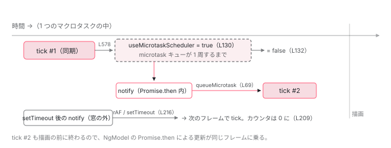

[目次](../README.md) › [zoneless の内側](README.md) › 第 6 回 / 全 11 回

# 連続通知と microtask スケジューラ

> tick 直後の 1 マイクロタスクの間だけ、次の tick を queueMicrotask で予約する。同じ描画フレームに収めるための切り替えと、100 回で止める安全装置。

angular/angular · 読了 約 11 分 · 発展 · [サイトで読む（デモが動きます）](https://angular-deep-dive-cyan.vercel.app/chapter/zoneless-microtask)

---

[4 回目](04-zoneless-raf-race.md)で「予約は `setTimeout` と rAF の競走」と読みましたが、`notify` の 214〜216 行目には例外がありました。`useMicrotaskScheduler` が true のときは `scheduleCallbackWithMicrotask` です。この章では、そのフラグが**いつ true になり、いつ false に戻るのか** （答え：tick 直後の 1 マイクロタスクの間だけ）と、それが何のためにあるのか、そしてそのせいで無限ループになったとき**何回で止まるのか**を読みます。

読む対象は `zoneless_scheduling_impl.ts` の冒頭（36〜57 行目）とコンストラクタ（83〜136 行目）、`application_ref.ts` の `afterTick`、そして「100」が出てくる 3 つのループです。

1. 既定で provide される 3 つ
2. 通知の種類（NotificationSource）
3. notify → dirtyFlags
4. setTimeout と rAF の競走
5. tick → synchronize
6. **microtask スケジューラ**（この章）
7. signal.set() からの経路
8. (click) からの経路
9. PendingTasks と isStable
10. zone.js との同居
11. 動く条件・動かない書き方

## 1. 起点：ApplicationRef.afterTick

📄 `angular/packages/core/src/application/application_ref.ts` L292–293 （▶ の行: 293）

```ts
292 │   /** @internal */
293 ▶   afterTick = new Subject<void>();
```

📄 `angular/packages/core/src/application/application_ref.ts` L573–582 （▶ の行: 573–574, 578）

```ts
573 ▶     } finally {
574 ▶       this._runningTick = false;
575 │       this.tracingSnapshot?.dispose();
576 │       this.tracingSnapshot = null;
577 │       setActiveConsumer(prevConsumer);
578 ▶       this.afterTick.next();
579 │ 
580 │       profiler(ProfilerEvent.ChangeDetectionEnd);
581 │     }
582 │   };
```

293 行目、`afterTick` は `@internal` の `Subject` です。[前章](05-zoneless-tick.md)で読んだ `tickImpl` の `finally`（573 行目）、578 行目で `afterTick.next()` が流れます。`finally` なので例外が出ても必ず流れ、スケジューラ経由の tick でも、手動の `ApplicationRef.tick()` でも流れます。

## 2. 購読側：手動 tick なら予約を捨て、zoneless なら切り替える

📄 `angular/packages/core/src/change_detection/scheduling/zoneless_scheduling_impl.ts` L83–109 （▶ の行: 85, 88, 92–93, 101–103, 106–107）

```ts
 83 │   constructor() {
 84 │     this.subscriptions.add(
 85 ▶       this.appRef.afterTick.subscribe(() => {
 86 │         // Prevent stabilization if cleanup causes the last task to be removed
 87 │         // before we can switch to the microtask scheduler.
 88 ▶         const task = this.taskService.add();
 89 │         // If the scheduler isn't running a tick but the application ticked, that means
 90 │         // someone called ApplicationRef.tick manually. In this case, we should cancel
 91 │         // any change detections that had been scheduled so we don't run an extra one.
 92 ▶         if (!this.runningTick) {
 93 ▶           this.cleanup();
 94 │           // Ticks that happen when ZoneJS is present do not get the microtask scheduling treatment.
 95 │           // ZoneJS is responsible for rerunning change detection on microtask queue empty.
 96 │           // Ticks initiated from tests also do not get microtask treatment so those ticks
 97 │           // do not affect stability timing, which tests are quite sensitive to.
 98 │           // TODO(atscott): we really should not use microtask scheduler
 99 │           // _ever_ when ZoneJS is enabled because ZoneJS is responsible for rerunning change
100 │           // detection on microtask queue empty. This change breaks some tests
101 ▶           if (!this.zonelessEnabled || this.appRef.includeAllTestViews) {
102 ▶             this.taskService.remove(task);
103 ▶             return;
104 │           }
105 │         }
106 ▶         this.switchToMicrotaskScheduler();
107 ▶         this.taskService.remove(task);
108 │       }),
109 │     );
```

1. **88 行目：タスクを 1 つ追加して「安定」を抑える**

   86〜87 行目のコメントどおり、次の 93 行目の `cleanup` が最後のタスクを消して `isStable` が流れてしまう前に、錘を 1 つ置きます。107 行目で外します。
2. **92〜93 行目：`runningTick` が false なら、手動 tick**

   スケジューラ自身が tick を走らせているなら `runningTick` は true です（前章 293 行目）。false なのに `afterTick` が来た、ということは**誰かが `ApplicationRef.tick()` を直接呼んだ**。そのときは 93 行目で `cleanup()`、つまり予約してあった `setTimeout` / rAF を取り消します。変更検知は済んだので、もう 1 回走らせる理由が無いからです。
3. **101〜104 行目：zone.js ありか、テストならここで終わり**

   手動 tick で、かつ `!this.zonelessEnabled`（zone.js あり）か `includeAllTestViews`（`TestBed` の fixture）なら、タスクを外して return します。microtask スケジューラへは切り替えません。94〜100 行目のコメントが理由です。zone.js ありなら、microtask が空になったときの再実行は zone が担います。テストでは安定判定のタイミングに敏感なので、余計な microtask 待ちを入れません。
4. **106 行目：`switchToMicrotaskScheduler()`**

   スケジューラ自身の tick のあと、または zoneless アプリでの手動 tick のあとは、ここに来ます。3 節。

## 3. switchToMicrotaskScheduler：1 マイクロタスクだけ開く窓

📄 `angular/packages/core/src/change_detection/scheduling/zoneless_scheduling_impl.ts` L122–136 （▶ の行: 122–124, 128–133）

```ts
122 ▶   // If we're notified of a change within 1 microtask of running change
123 ▶   // detection, run another round in the same event loop. This allows code
124 ▶   // which uses Promise.resolve (see NgModel) to avoid
125 │   // ExpressionChanged...Error to still be reflected in a single browser
126 │   // paint, even if that spans multiple rounds of change detection.
127 │   private switchToMicrotaskScheduler(): void {
128 ▶     this.ngZone.runOutsideAngular(() => {
129 ▶       const task = this.taskService.add();
130 ▶       this.useMicrotaskScheduler = true;
131 ▶       queueMicrotask(() => {
132 ▶         this.useMicrotaskScheduler = false;
133 ▶         this.taskService.remove(task);
134 │       });
135 │     });
136 │   }
```

128 行目、Angular zone の外で（zoneless では `fn()` そのまま）、129 行目でタスクを追加し、**130 行目で `useMicrotaskScheduler = true`**。131 行目で `queueMicrotask` を積み、その中（132〜133 行目）で false に戻してタスクを外します。

つまり窓が開いているのは、**tick が終わってから、マイクロタスクキューが 1 周するまで**です。いま実行中の JavaScript（tick を呼んだコールバックの残り）と、tick の最中に `Promise.resolve().then(...)` で積まれた処理は、この窓の中で動きます。`setTimeout` や次のイベントは窓の外です。

122〜126 行目のコメントが目的です。`NgModel` は、値を書き込むときに `ExpressionChangedAfterItHasBeenChecked` を避けるため `Promise.resolve().then(...)` を使って**変更検知の後に**値を更新します。その更新が通知を出したとき、普通に rAF / `setTimeout` で予約すると、描画が 1 回挟まってから 2 回目の tick が走ります。ユーザーには「一瞬古い値が見える」。窓の中では `queueMicrotask` で予約するので、2 回目の tick も**同じ描画フレームの前に**終わります。

## 4. notify 側：窓の中なら queueMicrotask、カウンタも動く

📄 `angular/packages/core/src/change_detection/scheduling/zoneless_scheduling_impl.ts` L205–217 （▶ の行: 205–207, 209–210, 214–216）

```ts
205 ▶     if (typeof ngDevMode === 'undefined' || ngDevMode) {
206 ▶       if (this.useMicrotaskScheduler) {
207 ▶         trackMicrotaskNotificationForDebugging();
208 │       } else {
209 ▶         consecutiveMicrotaskNotifications = 0;
210 ▶         stackFromLastFewNotifications.length = 0;
211 │       }
212 │     }
213 │ 
214 ▶     const scheduleCallback = this.useMicrotaskScheduler
215 ▶       ? scheduleCallbackWithMicrotask
216 ▶       : scheduleCallbackWithRafRace;
217 │     this.pendingRenderTaskId = this.taskService.add();
```

📄 `angular/packages/core/src/util/callback_scheduler.ts` L68–74 （▶ の行: 69）

```ts
68 │ export function scheduleCallbackWithMicrotask(callback: Function): () => void {
69 ▶   queueMicrotask(() => callback());
70 │ 
71 │   return () => {
72 │     callback = noop;
73 │   };
74 │ }
```

214〜216 行目、`useMicrotaskScheduler` が true なら `scheduleCallbackWithMicrotask`。中身（callback\_scheduler.ts 69 行目）は `queueMicrotask(() => callback())` だけです。tick は「いまの JavaScript が終わった直後、描画の前」に走ります。

205〜212 行目は開発モード専用です。窓の中で通知が来たら 207 行目で `trackMicrotaskNotificationForDebugging()` を呼んで数え、窓の外で通知が来たら 209〜210 行目でカウンタとスタックの記録を**ゼロに戻します**。「連続して」microtask で予約され続けた回数だけを数えている、ということです。

## 5. 安全装置：連続 100 回で止める

📄 `angular/packages/core/src/change_detection/scheduling/zoneless_scheduling_impl.ts` L36–38 （▶ の行: 36–38）

```ts
36 ▶ const CONSECUTIVE_MICROTASK_NOTIFICATION_LIMIT = 100;
37 ▶ let consecutiveMicrotaskNotifications = 0;
38 ▶ let stackFromLastFewNotifications: string[] = [];
```

📄 `angular/packages/core/src/change_detection/scheduling/zoneless_scheduling_impl.ts` L40–57 （▶ の行: 41–42, 45, 49–51）

```ts
40 │ function trackMicrotaskNotificationForDebugging() {
41 ▶   consecutiveMicrotaskNotifications++;
42 ▶   if (CONSECUTIVE_MICROTASK_NOTIFICATION_LIMIT - consecutiveMicrotaskNotifications < 5) {
43 │     const stack = new Error().stack;
44 │     if (stack) {
45 ▶       stackFromLastFewNotifications.push(stack);
46 │     }
47 │   }
48 │ 
49 ▶   if (consecutiveMicrotaskNotifications === CONSECUTIVE_MICROTASK_NOTIFICATION_LIMIT) {
50 ▶     throw new RuntimeError(
51 ▶       RuntimeErrorCode.INFINITE_CHANGE_DETECTION,
52 │       'Angular could not stabilize because there were endless change notifications within the browser event loop. ' +
53 │         'The stack from the last several notifications: \n' +
54 │         stackFromLastFewNotifications.join('\n'),
55 │     );
56 │   }
57 │ }
```

36〜38 行目、上限は 100、カウンタとスタックの配列はモジュール変数です。41 行目で 1 つ数え、42〜47 行目で**残り 5 回を切ったらスタックトレースを保存**します。49〜55 行目、100 回目で `NG0103 INFINITE_CHANGE_DETECTION` を throw。メッセージに「最後の数回のスタック」が付くので、どのコードが通知を出し続けているかが分かります。

この仕組みが捕まえるのは、「tick → その直後に通知 → microtask で tick → その直後に通知 → …」という、**tick をまたいだ**ループです。前章の `synchronize` の 100 回は **1 つの tick の中の**ループでした。どう違うのかを次節で並べます。

> [!WARNING]
> **ハマりどころ**
>
> 205 行目の `ngDevMode` 判定のとおり、この検出は**開発モードだけ**です。本番ビルドでは `trackMicrotaskNotificationForDebugging` は呼ばれず、通知を出し続けるコードがあれば microtask で tick が続きます。開発中に `NG0103` を見たら、必ず直してください。

## 6. 「100」は 3 つある

📄 `angular/packages/core/src/application/application_ref.ts` L593–611 （▶ の行: 594, 603）

```ts
593 │     let runs = 0;
594 ▶     while (this.dirtyFlags !== ApplicationRefDirtyFlags.None && runs++ < MAXIMUM_REFRESH_RERUNS) {
595 │       profiler(ProfilerEvent.ChangeDetectionSyncStart);
596 │       try {
597 │         this.synchronizeOnce();
598 │       } finally {
599 │         profiler(ProfilerEvent.ChangeDetectionSyncEnd);
600 │       }
601 │     }
602 │ 
603 ▶     if ((typeof ngDevMode === 'undefined' || ngDevMode) && runs >= MAXIMUM_REFRESH_RERUNS) {
604 │       throw new RuntimeError(
605 │         RuntimeErrorCode.INFINITE_CHANGE_DETECTION,
606 │         ngDevMode &&
607 │           'Infinite change detection while refreshing application views. ' +
608 │             'Ensure views are not calling `markForCheck` on every template execution or ' +
609 │             'that afterRender hooks always mark views for check.',
610 │       );
611 │     }
```

📄 `angular/packages/core/src/render3/instructions/change_detection.ts` L125–144 （▶ の行: 130–132, 140, 143）

```ts
125 │     let retries = 0;
126 │     // If after running change detection, this view still needs to be refreshed or there are
127 │     // descendants views that need to be refreshed due to re-dirtying during the change detection
128 │     // run, detect changes on the view again. We run change detection in `Targeted` mode to only
129 │     // refresh views with the `RefreshView` flag.
130 ▶     while (requiresRefreshOrTraversal(lView)) {
131 ▶       if (retries === MAXIMUM_REFRESH_RERUNS) {
132 ▶         throw new RuntimeError(
133 │           RuntimeErrorCode.INFINITE_CHANGE_DETECTION,
134 │           ngDevMode &&
135 │             'Infinite change detection while trying to refresh views. ' +
136 │               'There may be components which each cause the other to require a refresh, ' +
137 │               'causing an infinite loop.',
138 │         );
139 │       }
140 ▶       retries++;
141 │       // Even if this view is detached, we still detect changes in targeted mode because this was
142 │       // the root of the change detection run.
143 ▶       detectChangesInView(lView, ChangeDetectionMode.Targeted);
144 │     }
```

| ループ | 場所 | 何を数えるか | 止め方 |
| --- | --- | --- | --- |
| 内側 | `detectChangesInViewWhileDirty`（change\_detection.ts 130〜144 行目） | 1 つのルートビューに対する `detectChangesInView` の再実行回数（140 行目） | 131 行目、`retries === 100` で throw（開発・本番とも） |
| 中 | `ApplicationRef.synchronize`（application\_ref.ts 594 行目） | 1 つの tick の中での `synchronizeOnce` の回数 | 594 行目で 100 回を超えたら while を抜け、603 行目で開発モードのみ throw |
| 外側 | `trackMicrotaskNotificationForDebugging`（zoneless\_scheduling\_impl.ts 40〜57 行目） | microtask で予約された tick が連続した回数。窓の外の通知でリセット（209 行目） | 49 行目、100 回目で throw（開発モードのみ） |

内側のループは「テンプレート評価中に、同じルートビューの下のビューが dirty になった」ときに回ります。130 行目の `requiresRefreshOrTraversal(lView)` が true の間、143 行目で Targeted に再走査します。こちらは本番でも throw します（131〜138 行目に `ngDevMode` の分岐はありません。メッセージだけが落ちます）。中のループは「`afterRender` hook が書いた」「ルート effect が書いた」など、ビュー走査の**外**で dirty になったとき。外側のループは、tick が**終わった後**に通知が来るときです。



*tick が終わると 1 マイクロタスクだけ窓が開く。窓の中の通知は queueMicrotask で tick を予約し、描画の前に終わる。窓の外の通知は rAF/setTimeout に戻る。*

> **🧪 DEMO — 本物の queueMicrotask / setTimeout で、窓の中と外を再現する**
>
> `useMicrotaskScheduler`、`switchToMicrotaskScheduler`、予約関数の選択、連続カウンタだけを取り出した最小スケジューラです。時刻は最初の notify からの経過です。
>
> ▶ [このデモはサイトで動かせます](https://angular-deep-dive-cyan.vercel.app/chapter/zoneless-microtask)

## ここまでの呼び出し（シナリオ A）

- `ChangeDetectionSchedulerImpl.tick()` → `appRef._tick()` — zoneless\_scheduling\_impl.ts L294 — *前章*
  - `synchronize()` の中でテンプレートが評価される — application\_ref.ts L567
    - 👤 `NgModel` が `Promise.resolve().then(() => 値を書く)` を積む — （あなたの \[(ngModel)\]）
  - `afterTick.next()` — L578 — *finally*
    - `afterTick` 購読のコールバック — zoneless\_scheduling\_impl.ts L85 — *runningTick は true → 106 行目へ*
      - `switchToMicrotaskScheduler()` — L127 — *useMicrotaskScheduler = true、queueMicrotask(false に戻す)*
  - `cleanup()` — L303 — *pendingRenderTaskId = null*
- （マイクロタスクキュー 1 周目）
  - 👤 `Promise.then` → 値を書く → `markForCheck` — NgModel
    - `notify(MarkForCheck)` — L138 — *useMicrotaskScheduler === true*
      - `trackMicrotaskNotificationForDebugging()` — L207 — *consecutive = 1*
      - `scheduleCallbackWithMicrotask(() => this.tick())` — L215 → callback\_scheduler.ts L69
  - 131 行目で積んだ microtask → `useMicrotaskScheduler = false` — L132
  - `tick()` 2 回目 — L257 — *描画の前に終わる*

## 聞かれそうな質問

**Q. microtask スケジューラに切り替わるのはいつですか？何のためですか？**

tick が終わって `afterTick`（application\_ref.ts 578 行目）が流れた直後、`switchToMicrotaskScheduler`（zoneless\_scheduling\_impl.ts 127〜136 行目）が 130 行目で `useMicrotaskScheduler = true` にします。目的は 122〜126 行目のコメントどおり、`NgModel` のように `Promise.resolve().then` で変更検知の後に値を書くコードの更新を、同じ描画フレームに収めることです。

**Q. 切り替わっている時間はどれくらいですか？**

1 マイクロタスクです。131 行目で `queueMicrotask` を積み、その中の 132 行目で false に戻します。tick を呼んだコールバックの残りと、tick 中に積まれた Promise のコールバックだけが窓の中に入ります。`setTimeout` や次のユーザーイベントは窓の外なので、普通の rAF / `setTimeout` 予約に戻ります。

**Q. zone.js ありの構成でも切り替わりますか？**

手動 tick のあとは切り替わりません。101〜104 行目で `!this.zonelessEnabled` なら return します。94〜100 行目のコメントにあるとおり、microtask が空になったときの再実行は zone.js の `onMicrotaskEmpty` が担うからです。

**Q. 無限ループは何回で止まりますか？**

3 段階あります。1 つのルートビューの再走査は `detectChangesInViewWhileDirty` の 131 行目で 100 回（本番でも throw）。1 つの tick の中の `synchronizeOnce` は 594 行目で 100 回（開発モードのみ 603 行目で throw）。tick をまたいで microtask 予約が連続するケースは `trackMicrotaskNotificationForDebugging` の 49 行目で 100 回（開発モードのみ）。どれも `NG0103 INFINITE_CHANGE_DETECTION` ですが、メッセージが違うので、どのループかはメッセージで分かります。

**Q. 手動で `ApplicationRef.tick()` を呼んだら、予約済みの tick はどうなりますか？**

取り消されます。`afterTick` の購読（85 行目）で、`runningTick` が false（スケジューラの tick ではない）なら 93 行目で `cleanup()` を呼び、`cancelScheduledCallback` で rAF / `setTimeout` を cancel します。zoneless アプリなら、そのあと 106 行目で microtask の窓も開きます。

**Q. 連続カウンタが「連続」を数えているとはどういうことですか？**

209〜210 行目で、窓の外から通知が来るたびにカウンタとスタックの配列をゼロに戻しています。数えているのは「microtask で予約された tick が、間に普通の予約を挟まずに何回続いたか」です。ユーザー操作のたびに 1 回ずつ余分な tick が走るような書き方は、ここでは捕まりません。

## 読み終えて

- `afterTick`（application\_ref.ts 293 行目）は `tickImpl` の `finally`（578 行目）で毎回流れる
- 購読側（zoneless\_scheduling\_impl.ts 83〜109 行目）は、手動 tick なら予約を `cleanup`（93 行目）し、zoneless なら `switchToMicrotaskScheduler`（106 行目）
- 窓は `useMicrotaskScheduler = true`（130 行目）から 1 マイクロタスク後（132 行目）まで。その中の通知は `queueMicrotask` で tick を予約し、描画の前に終わる
- 連続 100 回で `NG0103`（49 行目）。ただし開発モードのみ（205 行目）。窓の外の通知でカウンタはリセット（209 行目）
- 「100」は 3 つ。ビュー内の再走査（change\_detection.ts 131 行目）、tick 内の `synchronizeOnce`（application\_ref.ts 594 行目）、tick をまたぐ microtask 連鎖（36 行目）

---

← 前: [scheduler.tick → ApplicationRef.\_tick → synchronize](05-zoneless-tick.md)  
次: [signal.set() から画面更新まで](07-zoneless-signal-path.md) →
