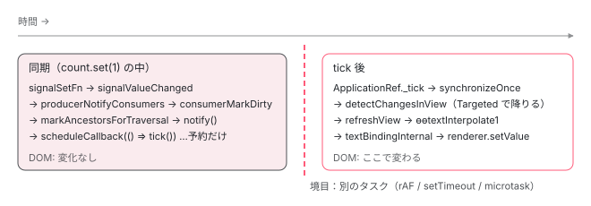

[目次](../README.md) › [zoneless の内側](README.md) › 第 7 回 / 全 11 回

# signal.set() から画面更新まで

> signalSetFn → producerNotifyConsumers → REACTIVE\_LVIEW\_CONSUMER.consumerMarkedDirty → markAncestorsForTraversal → notify → tick → Targeted → refreshView。全関数を順に。

angular/angular · 読了 約 14 分 · 中核 · [サイトで読む（デモが動きます）](https://angular-deep-dive-cyan.vercel.app/chapter/zoneless-signal-path)

---

テンプレートで `{{ count() }}` と書き、どこかで `count.set(1)` を呼ぶ。画面が変わる。zone.js はいません。では、`set()` の中で誰が誰を呼んで、どこで DOM が書き換わるのか。この章はその経路を**最初の関数から最後の関数まで、1 つも飛ばさずに**並べます。途中に「同期で終わる範囲」と「tick 後に起きる範囲」の境目が 1 本あります。そこが一番大事です。

読む対象は `packages/core/primitives/signals/src/signal.ts`・`graph.ts`、`packages/core/src/render3/reactive_lview_consumer.ts`、`render3/util/view_utils.ts`、`render3/instructions/change_detection.ts`、`render3/instructions/text_interpolation.ts` です。

1. 既定で provide される 3 つ
2. 通知の種類（NotificationSource）
3. notify → dirtyFlags
4. setTimeout と rAF の競走
5. tick → synchronize
6. microtask スケジューラ
7. **signal.set() からの経路**（この章）
8. (click) からの経路
9. PendingTasks と isStable
10. zone.js との同居
11. 動く条件・動かない書き方

## 0. 前提：テンプレートが signal を「読んだ」ときに作られる線

`set()` が誰かに届くのは、その前に**読まれた**ことがあるからです。まず、最初の描画で `refreshView` がテンプレートを実行するとき、何が記録されるかを確認します。

📄 `angular/packages/core/src/render3/instructions/change_detection.ts` L207–217 （▶ の行: 215–217）

```ts
207 │   // Start component reactive context
208 │   // - We might already be in a reactive context if this is an embedded view of the host.
209 │   // - We might be descending into a view that needs a consumer.
210 │   enterView(lView);
211 │   let returnConsumerToPool = true;
212 │   let prevConsumer: ReactiveNode | null = null;
213 │   let currentConsumer: ReactiveLViewConsumer | null = null;
214 │   if (!isInCheckNoChangesPass) {
215 ▶     if (viewShouldHaveReactiveConsumer(tView)) {
216 ▶       currentConsumer = getOrBorrowReactiveLViewConsumer(lView);
217 ▶       prevConsumer = consumerBeforeComputation(currentConsumer);
```

215 行目、コンポーネントのビュー（埋め込みビュー以外）なら、216 行目で `ReactiveLViewConsumer` （LView 1 つにつき 1 つの「読み手」。signal グラフ上の consumer ノード）を取り出し、217 行目の `consumerBeforeComputation` で**これを「いま計算中の consumer」として登録**します。この状態でテンプレート関数が走ります。

📄 `angular/packages/core/src/render3/instructions/text_interpolation.ts` L72–83 （▶ の行: 78, 80）

```ts
72 │ export function ɵɵtextInterpolate1(
73 │   prefix: string,
74 │   v0: any,
75 │   suffix?: string,
76 │ ): typeof ɵɵtextInterpolate1 {
77 │   const lView = getLView();
78 ▶   const interpolated = interpolation1(lView, prefix, v0, suffix);
79 │   if (interpolated !== NO_CHANGE) {
80 ▶     textBindingInternal(lView, getSelectedIndex(), interpolated as string);
81 │   }
82 │   return ɵɵtextInterpolate1;
83 │ }
```

`{{ count() }}` はコンパイルされると `ɵɵtextInterpolate1('', ctx.count(), '')` になります。引数を評価する瞬間に `count()`、つまり `signalGetFn` → `producerAccessed` が呼ばれます。78 行目はその結果を受け取っているだけです。

📄 `angular/packages/core/primitives/signals/src/graph.ts` L212–234 （▶ の行: 221, 226）

```ts
212 │ export function producerAccessed(node: ReactiveNode): void {
213 │   if (inNotificationPhase) {
214 │     throw new Error(
215 │       typeof ngDevMode !== 'undefined' && ngDevMode
216 │         ? `Assertion error: signal read during notification phase`
217 │         : '',
218 │     );
219 │   }
220 │ 
221 ▶   if (activeConsumer === null) {
222 │     // Accessed outside of a reactive context, so nothing to record.
223 │     return;
224 │   }
225 │ 
226 ▶   activeConsumer.consumerOnSignalRead(node);
227 │ 
228 │   const prevProducerLink = activeConsumer.producersTail;
229 │ 
230 │   // If the last producer we accessed is the same as the current one, we can skip adding a new
231 │   // link
232 │   if (prevProducerLink !== undefined && prevProducerLink.producer === node) {
233 │     return;
234 │   }
```

221 行目、`activeConsumer` が無ければ何も記録しません（`(click)` ハンドラの中などがこれ）。いまは 217 行目で登録した consumer がいるので先へ進み、226 行目で `consumerOnSignalRead` を呼びます。

📄 `angular/packages/core/src/render3/reactive_lview_consumer.ts` L43–53 （▶ の行: 45, 47–48, 50–51）

```ts
43 │ export const REACTIVE_LVIEW_CONSUMER_NODE: Omit<ReactiveLViewConsumer, 'lView'> = {
44 │   ...REACTIVE_NODE,
45 ▶   consumerIsAlwaysLive: true,
46 │   kind: 'template',
47 ▶   consumerMarkedDirty: (node: ReactiveLViewConsumer) => {
48 ▶     markAncestorsForTraversal(node.lView!);
49 │   },
50 ▶   consumerOnSignalRead(this: ReactiveLViewConsumer): void {
51 ▶     this.lView![REACTIVE_TEMPLATE_CONSUMER] = this;
52 │   },
53 │ };
```

50〜52 行目、`consumerOnSignalRead` は `lView[REACTIVE_TEMPLATE_CONSUMER] = this` と書き込みます。**signal を 1 つでも読んだ LView だけが consumer を持ち続ける**仕組みです。47〜49 行目の `consumerMarkedDirty` は後で（2 節）呼ばれます。45 行目の `consumerIsAlwaysLive: true` も次で効きます。

📄 `angular/packages/core/primitives/signals/src/graph.ts` L268–295 （▶ の行: 269–270, 285, 292–293）

```ts
268 │   // If we got here, it means that we need to create a new link between the producer and the consumer.
269 ▶   const isLive = consumerIsLive(activeConsumer);
270 ▶   const newLink: ReactiveLink = {
271 │     producer: node,
272 │     consumer: activeConsumer,
273 │     // instead of eagerly destroying the previous link, we delay until we've finished recomputing
274 │     // the producers list, so that we can destroy all of the old links at once.
275 │     nextProducer: nextProducerLink,
276 │     // Don't set prevConsumer here — it's only meaningful when the link is part of
277 │     // the producer's consumer list. producerAddLiveConsumer sets it correctly when
278 │     // the link is actually inserted. Setting it eagerly would create a dangling
279 │     // reference into the consumer list that prevents GC of removed entries.
280 │     prevConsumer: undefined,
281 │     knownValidAtEpoch: epoch,
282 │     lastReadVersion: node.version,
283 │     nextConsumer: undefined,
284 │   };
285 ▶   activeConsumer.producersTail = newLink;
286 │   if (prevProducerLink !== undefined) {
287 │     prevProducerLink.nextProducer = newLink;
288 │   } else {
289 │     activeConsumer.producers = newLink;
290 │   }
291 │ 
292 ▶   if (isLive) {
293 ▶     producerAddLiveConsumer(node, newLink);
294 │   }
295 │ }
```

📄 `angular/packages/core/primitives/signals/src/graph.ts` L572–574 （▶ の行: 573）

```ts
572 │ function consumerIsLive(node: ReactiveNode): boolean {
573 ▶   return node.consumerIsAlwaysLive || node.consumers !== undefined;
574 │ }
```

270〜284 行目で `producer`（signal）と `consumer`（テンプレート）を結ぶ `ReactiveLink` を 1 本作り、285 行目で consumer 側の「読んだ producer 一覧」に繋ぎます。269 行目の `consumerIsLive` は 573 行目のとおり `consumerIsAlwaysLive` が `true` なので真。293 行目の `producerAddLiveConsumer` で**signal 側の `consumers` 一覧にも同じ link が繋がれます**。この「signal → consumer」方向の線が、`set()` の通知が通る線です。

📄 `angular/packages/core/src/render3/instructions/change_detection.ts` L408–416 （▶ の行: 410）

```ts
408 │   } finally {
409 │     if (currentConsumer !== null) {
410 ▶       consumerAfterComputation(currentConsumer, prevConsumer);
411 │       if (returnConsumerToPool) {
412 │         maybeReturnReactiveLViewConsumer(currentConsumer);
413 │       }
414 │     }
415 │     leaveView();
416 │   }
```

410 行目、テンプレートの実行が終わると `consumerAfterComputation` で `activeConsumer` を元に戻します。ここまでが「読んだ」側。線は張られました。

## 1. set() の同期部分：値・version・dirty・フラグ・予約

あなたのコードが `count.set(1)` を呼びます。ここから同期で起きることを順に見ます。

📄 `angular/packages/core/primitives/signals/src/signal.ts` L86–95 （▶ の行: 91–93）

```ts
86 │ export function signalSetFn<T>(node: SignalNode<T>, newValue: T) {
87 │   if (!producerUpdatesAllowed()) {
88 │     throwInvalidWriteToSignalError(node);
89 │   }
90 │ 
91 ▶   if (!node.equal(node.value, newValue)) {
92 ▶     node.value = newValue;
93 ▶     signalValueChanged(node);
94 │   }
95 │ }
```

91 行目、`equal`（既定は `Object.is`）で同じなら**何もしません**。違えば 92 行目で値を入れ、93 行目へ。

📄 `angular/packages/core/primitives/signals/src/signal.ts` L120–125 （▶ の行: 121–123）

```ts
120 │ function signalValueChanged<T>(node: SignalNode<T>): void {
121 ▶   node.version++;
122 ▶   producerIncrementEpoch();
123 ▶   producerNotifyConsumers(node);
124 │   postSignalSetFn?.(node);
125 │ }
```

📄 `angular/packages/core/primitives/signals/src/graph.ts` L297–304 （▶ の行: 303）

```ts
297 │ /**
298 │  * Increment the global epoch counter.
299 │  *
300 │  * Called by source producers (that is, not computeds) whenever their values change.
301 │  */
302 │ export function producerIncrementEpoch(): void {
303 ▶   epoch++;
304 │ }
```

121 行目でこの signal の `version` を 1 増やします（あとで「変わったか」を比べる番号）。122 行目、303 行目のグローバルな `epoch` も 1 増やします。123 行目で consumer たちへ通知に入ります。

📄 `angular/packages/core/primitives/signals/src/graph.ts` L336–361 （▶ の行: 340, 346, 348, 354–355）

```ts
336 │ /**
337 │  * Propagate a dirty notification to live consumers of this producer.
338 │  */
339 │ export function producerNotifyConsumers(node: ReactiveNode): void {
340 ▶   if (node.consumers === undefined) {
341 │     return;
342 │   }
343 │ 
344 │   // Prevent signal reads when we're updating the graph
345 │   const prev = inNotificationPhase;
346 ▶   inNotificationPhase = true;
347 │   try {
348 ▶     for (
349 │       let link: ReactiveLink | undefined = node.consumers;
350 │       link !== undefined;
351 │       link = link.nextConsumer
352 │     ) {
353 │       const consumer = link.consumer;
354 ▶       if (!consumer.dirty) {
355 ▶         consumerMarkDirty(consumer);
356 │       }
357 │     }
358 │   } finally {
359 │     inNotificationPhase = prev;
360 │   }
361 │ }
```

340 行目、**誰にも読まれていない signal はここで終わり**です。テンプレートで使っていない signal を set しても 変更検知は予約されません。346 行目で「通知中」フラグを立て（この間に signal を読むとエラー。`producerAccessed` 213 行目）、348〜357 行目で 0 節の 293 行目が繋いだ `consumers` 一覧を辿ります。354 行目、**もう dirty な consumer は飛ばします**。同じ signal を同期で 3 回 set しても、2 回目以降はここで止まります。

📄 `angular/packages/core/primitives/signals/src/graph.ts` L371–375 （▶ の行: 372–374）

```ts
371 │ export function consumerMarkDirty(node: ReactiveNode): void {
372 ▶   node.dirty = true;
373 ▶   producerNotifyConsumers(node);
374 ▶   node.consumerMarkedDirty?.(node);
375 │ }
```

372 行目、consumer を dirty にします。373 行目、その consumer 自身が producer でもある場合（`computed`）は、さらにその先の consumer へ再帰的に伝えます。`count` → `computed` → テンプレート、という形でも 最終的にテンプレートの consumer に届くのはこの行のおかげです。374 行目、ノード種別ごとのフック `consumerMarkedDirty` を呼びます。テンプレート consumer のそれは 0 節で見た 47〜49 行目、`markAncestorsForTraversal(node.lView)` です。

📄 `angular/packages/core/src/render3/util/view_utils.ts` L257–280 （▶ の行: 265–266, 270–271, 274–275, 278）

```ts
257 │ /**
258 │  * Ensures views above the given `lView` are traversed during change detection even when they are
259 │  * not dirty.
260 │  *
261 │  * This is done by setting the `HAS_CHILD_VIEWS_TO_REFRESH` flag up to the root, stopping when the
262 │  * flag is already `true` or the `lView` is detached.
263 │  */
264 │ export function markAncestorsForTraversal(lView: LView) {
265 ▶   lView[ENVIRONMENT].changeDetectionScheduler?.notify(NotificationSource.MarkAncestorsForTraversal);
266 ▶   let parent = getLViewParent(lView);
267 │   while (parent !== null) {
268 │     // We stop adding markers to the ancestors once we reach one that already has the marker. This
269 │     // is to avoid needlessly traversing all the way to the root when the marker already exists.
270 ▶     if (parent[FLAGS] & LViewFlags.HasChildViewsToRefresh) {
271 ▶       break;
272 │     }
273 │ 
274 ▶     parent[FLAGS] |= LViewFlags.HasChildViewsToRefresh;
275 ▶     if (!viewAttachedToChangeDetector(parent)) {
276 │       break;
277 │     }
278 ▶     parent = getLViewParent(parent);
279 │   }
280 │ }
```

順番に注意してください。**265 行目、まずスケジューラに `notify(MarkAncestorsForTraversal)`**。その後 266〜279 行目で親へ親へと登り、274 行目で `HasChildViewsToRefresh` （「この下に更新したい子がいる」印）を立てます。270 行目、すでに印がある親に出会ったら止まります。その上はもう誰かが印を付け終えているからです。275 行目、変更検知ツリーから外れた（detach された）ビューに出会っても止まります。

ここで立つのは `HasChildViewsToRefresh` だけで、`Dirty` でも `RefreshView` でもありません。親は「通り道」になるだけで「更新対象」にはなりません。これが 3 節で効きます。

📄 `angular/packages/core/src/change_detection/scheduling/zoneless_scheduling_impl.ts` L151–156 （▶ の行: 152, 154）

```ts
151 │     switch (source) {
152 ▶       case NotificationSource.MarkAncestorsForTraversal:
153 │       case NotificationSource.DeferBlockStateUpdate: {
154 ▶         this.appRef.dirtyFlags |= ApplicationRefDirtyFlags.ViewTreeTraversal;
155 │         break;
156 │       }
```

📄 `angular/packages/core/src/change_detection/scheduling/zoneless_scheduling_impl.ts` L227–234 （▶ の行: 232）

```ts
227 │   private shouldScheduleTick(): boolean {
228 │     if (this.appRef.destroyed) {
229 │       return false;
230 │     }
231 │     // already scheduled or running
232 ▶     if (this.pendingRenderTaskId !== null || this.runningTick || this.appRef._runningTick) {
233 │       return false;
234 │     }
```

📄 `angular/packages/core/src/change_detection/scheduling/zoneless_scheduling_impl.ts` L201–224 （▶ の行: 201, 214, 217, 221–222）

```ts
201 ▶     if (!this.shouldScheduleTick()) {
202 │       return;
203 │     }
204 │ 
205 │     if (typeof ngDevMode === 'undefined' || ngDevMode) {
206 │       if (this.useMicrotaskScheduler) {
207 │         trackMicrotaskNotificationForDebugging();
208 │       } else {
209 │         consecutiveMicrotaskNotifications = 0;
210 │         stackFromLastFewNotifications.length = 0;
211 │       }
212 │     }
213 │ 
214 ▶     const scheduleCallback = this.useMicrotaskScheduler
215 │       ? scheduleCallbackWithMicrotask
216 │       : scheduleCallbackWithRafRace;
217 ▶     this.pendingRenderTaskId = this.taskService.add();
218 │     if (this.scheduleInRootZone) {
219 │       this.cancelScheduledCallback = Zone.root.run(() => scheduleCallback(() => this.tick()));
220 │     } else {
221 ▶       this.cancelScheduledCallback = this.ngZone.runOutsideAngular(() =>
222 ▶         scheduleCallback(() => this.tick()),
223 │       );
224 │     }
```

152〜154 行目、`MarkAncestorsForTraversal` は `ApplicationRef.dirtyFlags` に `ViewTreeTraversal` を立てます（分岐の全体は [notify の章](03-zoneless-notify.md)）。201 行目、232 行目で `pendingRenderTaskId !== null`、つまり**すでに予約済みなら帰る**。初回だけ 214〜216 行目でスケジューラを選び（[rAF 競走](04-zoneless-raf-race.md) か [microtask](06-zoneless-microtask.md)）、217 行目で PendingTask を 1 つ足し （[次々章](09-zoneless-pending-tasks.md)）、221〜223 行目で `this.tick()` を予約します。

> [!NOTE]
> **ポイント**
>
> **ここが境目です。**`count.set(1)` から戻った瞬間に起きているのは次の 5 つだけです。① `node.value` と `node.version` が変わった、② テンプレート consumer の `dirty` が `true`、③ 親 LView の `FLAGS` に `HasChildViewsToRefresh`、④ `appRef.dirtyFlags` に `ViewTreeTraversal`、⑤ `tick` のコールバックが予約済み。**DOM には何も起きていません**。



*set() から戻るまで（左）に DOM は触られない。予約されたコールバックが別タスクで tick を呼び、そこで初めて refreshView が DOM を書く（右）。*

> **🧪 DEMO — set() 直後に DOM を読むと、まだ古い**
>
> ボタンのハンドラは `count.set(count() + 1)` の直後に `<output>` の `textContent` を読んで記録します。記録先も signal なので、次の tick で両方が一緒に描かれます。
>
> 「set() 直後の DOM」は常に count() より 1 小さい値です。`set()` は予約までしか進まないからです。
>
> ▶ [このデモはサイトで動かせます](https://angular-deep-dive-cyan.vercel.app/chapter/zoneless-signal-path)

## 2. tick 後：Targeted モードで「通り道」を降りる

予約されたコールバックが `ChangeDetectionSchedulerImpl.tick()` → `ApplicationRef._tick()` → `synchronize()` と進むところは [tick の章](05-zoneless-tick.md)で追っています。ここでは signal の経路に関係する判定だけを見ます。

📄 `angular/packages/core/src/application/application_ref.ts` L626–655 （▶ の行: 630, 641, 645–646, 652–653）

```ts
626 │     if (this.dirtyFlags & ApplicationRefDirtyFlags.ViewTreeAny) {
627 │       // Change detection on views starts in targeted mode (only check components if they're
628 │       // marked as dirty) unless global checking is specifically requested via APIs like
629 │       // `ApplicationRef.tick()` and the `NgZone` integration.
630 ▶       const useGlobalCheck = Boolean(this.dirtyFlags & ApplicationRefDirtyFlags.ViewTreeGlobal);
631 │ 
632 │       // Clear the view-related dirty flags.
633 │       this.dirtyFlags &= ~ApplicationRefDirtyFlags.ViewTreeAny;
634 │ 
635 │       // Set the AfterRender bit, as we're checking views and will need to run afterRender hooks.
636 │       this.dirtyFlags |= ApplicationRefDirtyFlags.AfterRender;
637 │ 
638 │       // Check all potentially dirty views.
639 │       for (let {_lView} of this.allViews) {
640 │         // When re-checking, only check views which actually need it.
641 ▶         if (!useGlobalCheck && !requiresRefreshOrTraversal(_lView)) {
642 │           continue;
643 │         }
644 │ 
645 ▶         const mode =
646 ▶           useGlobalCheck && !this.zonelessEnabled
647 │             ? // Global mode includes `CheckAlways` views.
648 │               // When using zoneless, all root views must be explicitly marked for refresh, even if they are
649 │               // `CheckAlways`.
650 │               ChangeDetectionMode.Global
651 │             : // Only refresh views with the `RefreshView` flag or views is a changed signal
652 ▶               ChangeDetectionMode.Targeted;
653 ▶         detectChangesInternal(_lView, mode);
654 │         ranDetectChanges = true;
655 │       }
```

📄 `angular/packages/core/src/render3/util/view_utils.ts` L236–241 （▶ の行: 238–239）

```ts
236 │ export function requiresRefreshOrTraversal(lView: LView) {
237 │   return !!(
238 ▶     lView[FLAGS] & (LViewFlags.RefreshView | LViewFlags.HasChildViewsToRefresh) ||
239 ▶     lView[REACTIVE_TEMPLATE_CONSUMER]?.dirty
240 │   );
241 │ }
```

630 行目、立っているのは `ViewTreeTraversal` なので `useGlobalCheck` は `false`。641 行目、ルートビューごとに `requiresRefreshOrTraversal` を見ます。1 節の 274 行目でルートまで `HasChildViewsToRefresh` が立っているので 238 行目が真です（239 行目は consumer 自身が dirty な場合。ルートコンポーネント自身が signal を読んでいればこちら）。645〜652 行目、zoneless では必ず `ChangeDetectionMode.Targeted`。653 行目で木を降り始めます。

📄 `angular/packages/core/src/render3/instructions/change_detection.ts` L502–531 （▶ の行: 506, 509–510, 519, 521, 526, 529）

```ts
502 │ function detectChangesInView(lView: LView, mode: ChangeDetectionMode) {
503 │   const isInCheckNoChangesPass = ngDevMode && isInCheckNoChangesMode();
504 │   const tView = lView[TVIEW];
505 │   const flags = lView[FLAGS];
506 ▶   const consumer = lView[REACTIVE_TEMPLATE_CONSUMER];
507 │ 
508 │   // Refresh CheckAlways views in Global mode.
509 ▶   let shouldRefreshView: boolean = !!(
510 ▶     mode === ChangeDetectionMode.Global && flags & LViewFlags.CheckAlways
511 │   );
512 │ 
513 │   // Refresh Dirty views in Global mode, as long as we're not in checkNoChanges.
514 │   // CheckNoChanges never worked with `OnPush` components because the `Dirty` flag was
515 │   // cleared before checkNoChanges ran. Because there is now a loop for to check for
516 │   // backwards views, it gives an opportunity for `OnPush` components to be marked `Dirty`
517 │   // before the CheckNoChanges pass. We don't want existing errors that are hidden by the
518 │   // current CheckNoChanges bug to surface when making unrelated changes.
519 ▶   shouldRefreshView ||= !!(
520 │     flags & LViewFlags.Dirty &&
521 ▶     mode === ChangeDetectionMode.Global &&
522 │     !isInCheckNoChangesPass
523 │   );
524 │ 
525 │   // Always refresh views marked for refresh, regardless of mode.
526 ▶   shouldRefreshView ||= !!(flags & LViewFlags.RefreshView);
527 │ 
528 │   // Refresh views when they have a dirty reactive consumer, regardless of mode.
529 ▶   shouldRefreshView ||= !!(consumer?.dirty && consumerPollProducersForChange(consumer));
530 │ 
531 │   shouldRefreshView ||= !!(ngDevMode && isExhaustiveCheckNoChanges());
```

`detectChangesInView` は、通り道の親と、signal を読んだ子の両方で呼ばれます。4 つの条件を 2 回評価してみます。

1. **通り道の親（`HasChildViewsToRefresh` だけが立っている）**

   509〜511 行目：`Targeted` なので `CheckAlways` でも偽。519〜523 行目：`Dirty` は立っていないし、立っていても `Targeted` では偽。526 行目：`RefreshView` は立っていない。529 行目：506 行目の consumer は dirty ではない。→ `shouldRefreshView = false`。**この親のテンプレートは実行されません**。親が `OnPush` でも `Default` でも結果は同じです。
2. **signal を読んだ子（consumer が dirty）**

   最初の 3 つは同じく偽。529 行目、`consumer.dirty` が真なので `consumerPollProducersForChange` で本当に変わったかを確かめます。

📄 `angular/packages/core/primitives/signals/src/graph.ts` L472–496 （▶ の行: 474, 476, 480–481）

```ts
472 │ export function consumerPollProducersForChange(node: ReactiveNode): boolean {
473 │   // Poll producers for change.
474 ▶   for (let link = node.producers; link !== undefined; link = link.nextProducer) {
475 │     const producer = link.producer;
476 ▶     const seenVersion = link.lastReadVersion;
477 │ 
478 │     // First check the versions. A mismatch means that the producer's value is known to have
479 │     // changed since the last time we read it.
480 ▶     if (seenVersion !== producer.version) {
481 ▶       return true;
482 │     }
483 │ 
484 │     // The producer's version is the same as the last time we read it, but it might itself be
485 │     // stale. Force the producer to recompute its version (calculating a new value if necessary).
486 │     producerUpdateValueVersion(producer);
487 │ 
488 │     // Now when we do this check, `producer.version` is guaranteed to be up to date, so if the
489 │     // versions still match then it has not changed since the last time we read it.
490 │     if (seenVersion !== producer.version) {
491 │       return true;
492 │     }
493 │   }
494 │ 
495 │   return false;
496 │ }
```

474 行目、0 節で張った「読んだ producer 一覧」を辿ります。476 行目、link に残っている「最後に読んだときの version」と 480 行目で現在の `producer.version`（1 節の 121 行目で増えた）を比べ、違えば 481 行目で `true`。これで子の `shouldRefreshView` が真になります。

📄 `angular/packages/core/src/render3/instructions/change_detection.ts` L533–561 （▶ の行: 536, 538, 540–542, 549, 552）

```ts
533 │   // Mark the Flags and `ReactiveNode` as not dirty before refreshing the component, so that they
534 │   // can be re-dirtied during the refresh process.
535 │   if (consumer) {
536 ▶     consumer.dirty = false;
537 │   }
538 ▶   lView[FLAGS] &= ~(LViewFlags.HasChildViewsToRefresh | LViewFlags.RefreshView);
539 │ 
540 ▶   if (shouldRefreshView) {
541 ▶     refreshView(tView, lView, tView.template, lView[CONTEXT]);
542 ▶   } else if (flags & LViewFlags.HasChildViewsToRefresh) {
543 │     // Set active consumer to null to avoid inheriting an improper reactive context
544 │     const prevConsumer = setActiveConsumer(null);
545 │     try {
546 │       if (!isInCheckNoChangesPass) {
547 │         runEffectsInView(lView);
548 │       }
549 ▶       detectChangesInEmbeddedViews(lView, ChangeDetectionMode.Targeted);
550 │       const components = tView.components;
551 │       if (components !== null) {
552 ▶         detectChangesInChildComponents(lView, components, ChangeDetectionMode.Targeted);
553 │       }
554 │       if (!isInCheckNoChangesPass) {
555 │         addAfterRenderSequencesForView(lView);
556 │       }
557 │     } finally {
558 │       setActiveConsumer(prevConsumer);
559 │     }
560 │   }
561 │ }
```

536 行目で consumer の dirty を、538 行目で `HasChildViewsToRefresh | RefreshView` を**先に下ろします** （refresh 中にまた汚れたら再び立つように）。親では 540 行目が偽、542 行目で `HasChildViewsToRefresh`（`flags` は 538 行目より前に取った値）が真なので、549 行目と 552 行目で **`Targeted` のまま子へ降ります**。子では 541 行目、ついに `refreshView` です。この「通り道」の仕組みの一般論は [cd シリーズの章](../cd/06-cd-targeted-traversal.md)にあります。

## 3. refreshView：DOM が変わる 1 行

子の `refreshView` に入ると、0 節の 216〜217 行目で consumer をまた `activeConsumer` にして テンプレート関数を実行します。読まれる signal の線はこのとき張り直されます。`{{ count() }}` の部分は再び `ɵɵtextInterpolate1` です（0 節の引用）。78 行目の `interpolation1` が `bindingUpdated` で LView に保存してある前回値と比べ、違っていれば 80 行目へ。

📄 `angular/packages/core/src/render3/instructions/text_interpolation.ts` L457–467 （▶ の行: 464, 466）

```ts
457 │ /**
458 │  * Updates a text binding at a given index in a given LView.
459 │  */
460 │ function textBindingInternal(lView: LView, index: number, value: string): void {
461 │   ngDevMode && assertString(value, 'Value should be a string');
462 │   ngDevMode && assertNotSame(value, NO_CHANGE as any, 'value should not be NO_CHANGE');
463 │   ngDevMode && assertIndexInRange(lView, index);
464 ▶   const element = getNativeByIndex(index, lView) as any as RText;
465 │   ngDevMode && assertDefined(element, 'native element should exist');
466 ▶   updateTextNode(lView[RENDERER], element, value);
467 │ }
```

464 行目でテキストノードを LView から取り出し、**466 行目の `updateTextNode` （中身は `renderer.setValue(rNode, value)`）で DOM が変わります**。`count.set(1)` から数えて、ここが最初で唯一の DOM 書き込みです。最後に 2 節の 410 行目で consumer を外し、tick 全体は [afterRender → afterTick](05-zoneless-tick.md) へ続きます。

## ここまでの呼び出し

- 👤 `count.set(1)` — あなたのコンポーネント
  - `signalSetFn(node, 1)` — primitives/signals/src/signal.ts L86 — *equal で比較、違えば value を更新*
    - `signalValueChanged(node)` — signal.ts L120 — *version++*
      - `producerIncrementEpoch()` — graph.ts L302 — *epoch++*
      - `producerNotifyConsumers(node)` — graph.ts L339 — *consumers 一覧を辿る。無ければ即 return*
        - `consumerMarkDirty(templateConsumer)` — graph.ts L371 — *dirty = true*
          - `REACTIVE_LVIEW_CONSUMER_NODE.consumerMarkedDirty(node)` — render3/reactive\_lview\_consumer.ts L47
            - `markAncestorsForTraversal(lView)` — render3/util/view\_utils.ts L264 — *先に notify、次に親へ HasChildViewsToRefresh*
              - `ChangeDetectionSchedulerImpl.notify(MarkAncestorsForTraversal)` — zoneless\_scheduling\_impl.ts L138 — *dirtyFlags |= ViewTreeTraversal*
                - `shouldScheduleTick()` — zoneless\_scheduling\_impl.ts L227 — *予約済みなら false*
                - `scheduleCallbackWithRafRace(() => this.tick())` — core/src/util/callback\_scheduler.ts L37 — *── ここまで同期。set() から戻る ──*
  - `ChangeDetectionSchedulerImpl.tick()` — zoneless\_scheduling\_impl.ts L257 — *── ここから別タスク ──*
    - `ApplicationRef._tick()` — application/application\_ref.ts L541
      - `synchronize()` → `synchronizeOnce()` — application\_ref.ts L588 / L617 — *Targeted を選ぶ*
        - `detectChangesInternal(rootLView, Targeted)` — render3/instructions/change\_detection.ts L90
          - `detectChangesInView(rootLView, Targeted)` — change\_detection.ts L502 — *通り道：refresh せず子へ*
            - `detectChangesInChildComponents(...)` → `detectChangesInComponent(...)` — change\_detection.ts L564 / L464
              - `detectChangesInView(childLView, Targeted)` — change\_detection.ts L502 — *consumer.dirty && consumerPollProducersForChange → true*
                - `refreshView(tView, lView, template, ctx)` — change\_detection.ts L190 — *consumerBeforeComputation で線を張り直す*
                  - `ɵɵtextInterpolate1('', ctx.count(), '')` — render3/instructions/text\_interpolation.ts L72 — *count() → producerAccessed*
                    - `interpolation1(...)` → `bindingUpdated(...)` — interpolation.ts L60 / bindings.ts L44 — *前回値と Object.is*
                    - `textBindingInternal(lView, index, value)` — text\_interpolation.ts L460
                      - `updateTextNode(renderer, rText, value)` — render3/dom\_node\_manipulation.ts L20 — *renderer.setValue — DOM が変わる*

## 聞かれそうな質問

**Q. signal.set() を呼んだ直後、同じ関数の中で DOM はもう変わっていますか？**

変わっていません。`set()` の同期部分は `signalSetFn`（signal.ts 86 行目）から `notify` の 221〜223 行目（zoneless\_scheduling\_impl.ts）で `tick` を**予約する**ところまでです。DOM を書くのは tick の中の `textBindingInternal` 466 行目（text\_interpolation.ts）で、予約されたコールバックが別タスクとして動いたときに初めて到達します。上の DEMO で確認できます。

**Q. OnPush のコンポーネントの奥で signal を set したら、親が OnPush でも更新されますか？なぜ？**

更新されます。`markAncestorsForTraversal`（view\_utils.ts 274 行目）が親に `HasChildViewsToRefresh` を立てるので、`detectChangesInView` 542 行目（change\_detection.ts）で 親は「refresh しないが子へ降りる」経路に入り、549・552 行目で `Targeted` のまま子へ到達します。子は 529 行目の `consumer.dirty && consumerPollProducersForChange` が真なので refresh されます。親の `Dirty` も `CheckAlways` も見ていないので、OnPush かどうかは関係ありません。

**Q. テンプレートで読んでいない signal を set したら何が起きますか？**

値と version は変わりますが、`producerNotifyConsumers` 340 行目（graph.ts）で `consumers === undefined` のため即 return します。`notify` は呼ばれず、tick も予約されません。読まれていない signal の変更は Angular から見えない、が正確な言い方です。

**Q. 同期で同じ signal を 3 回 set したら、変更検知も 3 回走りますか？**

1 回です。2 回目以降は `producerNotifyConsumers` 354 行目で consumer がすでに dirty なので `consumerMarkDirty` に入らず、たとえ入っても `shouldScheduleTick` 232 行目で `pendingRenderTaskId !== null` のため予約しません。tick が走るときには最後の値だけが残っています。

**Q. computed() を挟んだ場合、テンプレートまで通知は届きますか？**

届きます。`consumerMarkDirty` 373 行目（graph.ts）が `producerNotifyConsumers(node)` を 再帰的に呼ぶので、signal → computed → テンプレート consumer と dirty が伝播します。最後のテンプレート consumer の `consumerMarkedDirty`（reactive\_lview\_consumer.ts 47 行目）が呼ばれる点は同じです。

**Q. set() の値が前と同じだったら？**

`signalSetFn` 91 行目の `equal` が真なので、何も起きません。version も epoch も増えず、通知もありません。

## 読み終えて

- 最初の描画で `refreshView` が consumer を `activeConsumer` にし、`producerAccessed` が signal と LView の間に `ReactiveLink` を張る。この線が通知の道
- `set()` の同期部分は value / version / consumer.dirty / 親の `HasChildViewsToRefresh` / `appRef.dirtyFlags` を変え、`tick` を**予約する**ところで終わる。DOM は触らない
- tick は `Targeted` で木を降りる。親は `HasChildViewsToRefresh` で通り道になるだけ、子は `consumer.dirty && consumerPollProducersForChange` で refresh される
- DOM が変わる行は `textBindingInternal` → `updateTextNode` の `renderer.setValue` 1 か所

この章で通った `producerNotifyConsumers` と、読む側が version を確かめる pull の仕組みは [push と pull の章](../signals/05-signals-push-pull.md)、`equal` と NG0600 は [set と update の章](../signals/04-signals-set.md)にまとめました。

---

← 前: [連続通知と microtask スケジューラ](06-zoneless-microtask.md)  
次: [(click) から画面更新まで（zoneless）](08-zoneless-listener-path.md) →
