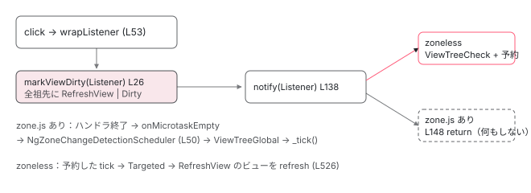

[目次](../README.md) › [zoneless の内側](README.md) › 第 8 回 / 全 11 回

# (click) から画面更新まで（zoneless）

> wrapListener → markViewDirty(Listener) → notify(Listener) → ViewTreeCheck → tick。zone.js ありのときは Listener 通知が無視される理由も。

angular/angular · 読了 約 12 分 · 中核 · [サイトで読む（デモが動きます）](https://angular-deep-dive-cyan.vercel.app/chapter/zoneless-listener-path)

---

`(click)="count = count + 1"`。`count` は signal ではない普通のフィールドです。zone.js はいないのに、クリックすると画面が変わります。誰が気づいたのでしょう。この章は、テンプレートの `(click)` が**登録されるとき**と**発火したとき**の 2 本の経路を 全関数で並べ、「あなたのハンドラが呼ばれる前に何が済んでいるか」を確認します。最後に、zone.js ありのときだけこの通知が無視される理由を読みます。

読む対象は `packages/core/src/render3/instructions/listener.ts`、`render3/view/listeners.ts`、`render3/instructions/mark_view_dirty.ts`、`change_detection/scheduling/zoneless_scheduling_impl.ts`、そして `packages/platform-browser/src/dom/` の 3 ファイルです。

1. 既定で provide される 3 つ
2. 通知の種類（NotificationSource）
3. notify → dirtyFlags
4. setTimeout と rAF の競走
5. tick → synchronize
6. microtask スケジューラ
7. signal.set() からの経路
8. **(click) からの経路**（この章）
9. PendingTasks と isStable
10. zone.js との同居
11. 動く条件・動かない書き方

## 1. 登録：(click) が addEventListener になるまで

`<button (click)="inc()">` はコンパイルされると、作成モードのテンプレート関数の中で `ɵɵlistener('click', function() { return ctx.inc(); })` になります。

📄 `angular/packages/core/src/render3/instructions/listener.ts` L33–51 （▶ の行: 38, 40–41, 44）

```ts
33 │ export function ɵɵlistener(
34 │   eventName: string,
35 │   listenerFn: EventCallback,
36 │   eventTargetResolver?: GlobalTargetResolver,
37 │ ): typeof ɵɵlistener {
38 ▶   const lView = getLView<{} | null>();
39 │   const tView = getTView();
40 ▶   const tNode = getCurrentTNode()!;
41 ▶   listenerInternal(
42 │     tView,
43 │     lView,
44 ▶     lView[RENDERER],
45 │     tNode,
46 │     eventName,
47 │     listenerFn,
48 │     eventTargetResolver,
49 │   );
50 │   return ɵɵlistener;
51 │ }
```

38〜40 行目で「いまのビュー・TView・いまのノード」を取り、41 行目で `listenerInternal` に渡します。44 行目の `lView[RENDERER]` がブラウザでは `DomRenderer` です。

📄 `angular/packages/core/src/render3/instructions/listener.ts` L122–157 （▶ の行: 140–142, 150）

```ts
122 │ export function listenerInternal(
123 │   tView: TView,
124 │   lView: LView<{} | null>,
125 │   renderer: Renderer,
126 │   tNode: TNode,
127 │   eventName: string,
128 │   listenerFn: EventCallback,
129 │   eventTargetResolver?: GlobalTargetResolver,
130 │ ): void {
131 │   ngDevMode && assertTNodeType(tNode, TNodeType.AnyRNode | TNodeType.AnyContainer);
132 │ 
133 │   let processOutputs = true;
134 │   let wrappedListener: WrappedEventCallback | null = null;
135 │ 
136 │   // Adding a native event listener is applicable when:
137 │   // - The corresponding TNode represents a DOM element.
138 │   // - The event target has a resolver (usually resulting in a global object,
139 │   //   such as `window` or `document`).
140 ▶   if (tNode.type & TNodeType.AnyRNode || eventTargetResolver) {
141 ▶     wrappedListener ??= wrapListener(tNode, lView, listenerFn);
142 ▶     const hasCoalescedDomEvent = listenToDomEvent(
143 │       tNode,
144 │       tView,
145 │       lView,
146 │       eventTargetResolver,
147 │       renderer,
148 │       eventName,
149 │       listenerFn,
150 ▶       wrappedListener,
151 │     );
152 │ 
153 │     // Context: https://github.com/angular/angular/pull/30144
154 │     if (hasCoalescedDomEvent) {
155 │       processOutputs = false;
156 │     }
157 │   }
```

140 行目、DOM 要素なら 141 行目で `wrapListener` が**あなたの関数を包んだ別の関数**を作ります （中身は 2 節）。142〜151 行目、その包んだ関数を `listenToDomEvent` に渡します。150 行目、DOM に登録されるのは包んだほうです。

📄 `angular/packages/core/src/render3/view/listeners.ts` L168–181 （▶ の行: 169–170, 181）

```ts
168 │   } else {
169 ▶     const native = getNativeByTNode(tNode, lView) as RElement;
170 ▶     const target = eventTargetResolver ? eventTargetResolver(native) : native;
171 │ 
172 │     stashEventListenerImpl(lView, target, eventName, wrappedListener);
173 │ 
174 │     // For element-local listeners (not global targets like document/window), store the
175 │     // native element on the wrapped listener so that when it fires it can mark the
176 │     // (event, element) pair as handled, preventing jsaction from replaying an event that
177 │     // was already dispatched by the real DOM listener post-hydration (see #67328).
178 │     if (!eventTargetResolver) {
179 │       (wrappedListener as any).__ngNativeEl__ = native as unknown as Element;
180 │     }
181 ▶     const cleanupFn = renderer.listen(target as RElement, eventName, wrappedListener);
```

169〜170 行目で DOM 要素を取り出し、181 行目で `renderer.listen(target, 'click', wrappedListener)`。ここから `platform-browser` に入ります。

📄 `angular/packages/platform-browser/src/dom/dom_renderer.ts` L497–509 （▶ の行: 497, 503）

```ts
497 ▶     let wrappedCallback = this.decoratePreventDefault(callback);
498 │ 
499 │     if (this.tracingService?.wrapEventListener) {
500 │       wrappedCallback = this.tracingService.wrapEventListener(target, event, wrappedCallback);
501 │     }
502 │ 
503 ▶     return this.eventManager.addEventListener(
504 │       target,
505 │       event,
506 │       wrappedCallback,
507 │       options,
508 │     ) as VoidFunction;
509 │   }
```

📄 `angular/packages/platform-browser/src/dom/events/event_manager.ts` L77–85 （▶ の行: 83–84）

```ts
77 │   addEventListener(
78 │     element: HTMLElement,
79 │     eventName: string,
80 │     handler: Function,
81 │     options?: ListenerOptions,
82 │   ): Function {
83 ▶     const plugin = this._findPluginFor(eventName);
84 ▶     return plugin.addEventListener(element, eventName, handler, options);
85 │   }
```

📄 `angular/packages/platform-browser/src/dom/events/dom_events.ts` L25–33 （▶ の行: 31）

```ts
25 │   override addEventListener(
26 │     element: HTMLElement,
27 │     eventName: string,
28 │     handler: Function,
29 │     options?: ListenerOptions,
30 │   ): Function {
31 ▶     element.addEventListener(eventName, handler as EventListener, options);
32 │     return () => this.removeEventListener(element, eventName, handler as EventListener, options);
33 │   }
```

497 行目で「`false` を返したら `preventDefault`」の層を足し、503 行目で `EventManager` へ。83〜84 行目でイベント名に合うプラグインを選び（`click` は最後の `DomEventsPlugin`）、**31 行目、素の `element.addEventListener`** です。`NgZone` も `runOutsideAngular` も出てきません。zone.js ありのときにここが特別になるのは、zone.js が `addEventListener` 自体をパッチしているからで、Angular 側のコードは同じです （[zone シリーズ](../zone/03-zone-patching.md)）。

## 2. 発火：あなたのハンドラより前に markViewDirty

ユーザーがクリックします。ブラウザが呼ぶのは 1 節の 141 行目で作った「包んだ関数」です。

📄 `angular/packages/core/src/render3/view/listeners.ts` L46–80 （▶ の行: 53, 64–65, 67–68）

```ts
46 │ export function wrapListener(
47 │   tNode: TNode,
48 │   lView: LView,
49 │   listenerFn: EventCallback,
50 │ ): WrappedEventCallback {
51 │   // Note: we are performing most of the work in the listener function itself
52 │   // to optimize listener registration.
53 ▶   return function wrapListenerIn_markDirtyAndPreventDefault(event: any) {
54 │     // When a native element is stored on this function (set by listenToDomEvent for
55 │     // non-global-target listeners), mark the (event, element) pair as handled so that
56 │     // jsaction does not replay an event already dispatched by the real DOM listener.
57 │     const nativeEl = (wrapListenerIn_markDirtyAndPreventDefault as any).__ngNativeEl__;
58 │     if (nativeEl !== undefined) {
59 │       markEventHandledForElement(event, nativeEl);
60 │     }
61 │ 
62 │     // In order to be backwards compatible with View Engine, events on component host nodes
63 │     // must also mark the component view itself dirty (i.e. the view that it owns).
64 ▶     const startView = isComponentHost(tNode) ? getComponentLViewByIndex(tNode.index, lView) : lView;
65 ▶     markViewDirty(startView, NotificationSource.Listener);
66 │ 
67 ▶     const context = lView[CONTEXT];
68 ▶     let result = executeListenerWithErrorHandling(lView, context, listenerFn, event);
69 │     // A just-invoked listener function might have coalesced listeners so we need to check for
70 │     // their presence and invoke as needed.
71 │     let nextListenerFn = (<any>wrapListenerIn_markDirtyAndPreventDefault).__ngNextListenerFn__;
72 │     while (nextListenerFn) {
73 │       // We should prevent default if any of the listeners explicitly return false
74 │       result = executeListenerWithErrorHandling(lView, context, nextListenerFn, event) && result;
75 │       nextListenerFn = (<any>nextListenerFn).__ngNextListenerFn__;
76 │     }
77 │ 
78 │     return result;
79 │   } as WrappedEventCallback;
80 │ }
```

53 行目、これが DOM に登録されていた関数です。64 行目、コンポーネントのホスト要素に付いたリスナーならそのコンポーネントのビューを、そうでなければ今のビューを起点にします。**65 行目、`markViewDirty(startView, NotificationSource.Listener)`。あなたの関数はまだ呼ばれていません。** 67〜68 行目で初めて `listenerFn`（あなたの `inc()`）が実行されます。

📄 `angular/packages/core/src/render3/view/listeners.ts` L82–100 （▶ の行: 88, 92, 98）

```ts
 82 │ function executeListenerWithErrorHandling(
 83 │   lView: LView,
 84 │   context: unknown,
 85 │   listenerFn: EventCallback,
 86 │   e: any,
 87 │ ): boolean {
 88 ▶   const prevConsumer = setActiveConsumer(null);
 89 │   try {
 90 │     profiler(ProfilerEvent.OutputStart, context as {} | null, listenerFn);
 91 │     // Only explicitly returning false from a listener should preventDefault
 92 ▶     return listenerFn(e) !== false;
 93 │   } catch (error) {
 94 │     handleUncaughtError(lView, error);
 95 │     return false;
 96 │   } finally {
 97 │     profiler(ProfilerEvent.OutputEnd, context, listenerFn);
 98 ▶     setActiveConsumer(prevConsumer);
 99 │   }
100 │ }
```

88 行目、`setActiveConsumer(null)`。ハンドラの中で signal を読んでも、テンプレートの依存にはなりません。92 行目であなたの関数を呼び、`false` を返したときだけ `preventDefault` になります。98 行目で consumer を戻します。

📄 `angular/packages/core/src/render3/instructions/mark_view_dirty.ts` L26–52 （▶ の行: 27, 33, 39–40, 42–43, 45–46）

```ts
26 │ export function markViewDirty(lView: LView, source: NotificationSource): LView | null {
27 ▶   const dirtyBitsToUse = isRefreshingViews()
28 │     ? // When we are actively refreshing views, we only use the `Dirty` bit to mark a view
29 │       // for check. This bit is ignored in ChangeDetectionMode.Targeted, which is used to
30 │       // synchronously rerun change detection on a specific set of views (those which have
31 │       // the `RefreshView` flag and those with dirty signal consumers). `LViewFlags.Dirty`
32 │       // does not support re-entrant change detection on its own.
33 ▶       LViewFlags.Dirty
34 │     : // When we are not actively refreshing a view tree, it is absolutely
35 │       // valid to update state and mark views dirty. We use the `RefreshView` flag in this
36 │       // case to allow synchronously rerunning change detection. This applies today to
37 │       // afterRender hooks as well as animation listeners which execute after detecting
38 │       // changes in a view when the render factory flushes.
39 ▶       LViewFlags.RefreshView | LViewFlags.Dirty;
40 ▶   lView[ENVIRONMENT].changeDetectionScheduler?.notify(source);
41 │   while (lView) {
42 ▶     lView[FLAGS] |= dirtyBitsToUse;
43 ▶     const parent = getLViewParent(lView);
44 │     // Stop traversing up as soon as you find a root view that wasn't attached to any container
45 ▶     if (isRootView(lView) && !parent) {
46 ▶       return lView;
47 │     }
48 │     // continue otherwise
49 │     lView = parent!;
50 │   }
51 │   return null;
52 │ }
```

27 行目、変更検知の最中でなければ（クリック時は最中ではない）39 行目の `RefreshView | Dirty` を使います。**40 行目、先にスケジューラへ `notify(Listener)`**。41〜50 行目、起点のビューから親へ親へと登り、42 行目で両方のビットを立て、45〜46 行目でルートに着いたら返します。[signal の経路](07-zoneless-signal-path.md)では親に立つのは `HasChildViewsToRefresh` だけでしたが、ここでは**ルートまでの全ビューが `RefreshView`** です。この違いが 3 節で出ます。`markViewDirty` そのものの詳細は [cd シリーズ](../cd/04-cd-onpush-markforcheck.md)にあります。

📄 `angular/packages/core/src/change_detection/scheduling/zoneless_scheduling_impl.ts` L138–149 （▶ の行: 139, 148）

```ts
138 │   notify(source: NotificationSource): void {
139 ▶     if (!this.zonelessEnabled && source === NotificationSource.Listener) {
140 │       // When the notification comes from a listener, we skip the notification unless the
141 │       // application has enabled zoneless. Ideally, listeners wouldn't notify the scheduler at all
142 │       // automatically. We do not know that a developer made a change in the listener callback that
143 │       // requires an `ApplicationRef.tick` (synchronize templates / run render hooks). We do this
144 │       // only for an easier migration from OnPush components to zoneless. Because listeners are
145 │       // usually executed inside the Angular zone and listeners automatically call `markViewDirty`,
146 │       // developers never needed to manually use `ChangeDetectorRef.markForCheck` or some other API
147 │       // to make listener callbacks work correctly with `OnPush` components.
148 ▶       return;
149 │     }
```

📄 `angular/packages/core/src/change_detection/scheduling/zoneless_scheduling_impl.ts` L157–163 （▶ の行: 159, 161）

```ts
157 │       case NotificationSource.DebugApplyChanges:
158 │       case NotificationSource.MarkForCheck:
159 ▶       case NotificationSource.Listener:
160 │       case NotificationSource.SetInput: {
161 ▶         this.appRef.dirtyFlags |= ApplicationRefDirtyFlags.ViewTreeCheck;
162 │         break;
163 │       }
```

139 行目、zoneless では `!this.zonelessEnabled` が偽なので 148 行目には入りません（4 節で戻ってきます）。159〜161 行目、`Listener` は `dirtyFlags` に `ViewTreeCheck` を立てます。

📄 `angular/packages/core/src/change_detection/scheduling/zoneless_scheduling_impl.ts` L201–224 （▶ の行: 201, 217, 221–222）

```ts
201 ▶     if (!this.shouldScheduleTick()) {
202 │       return;
203 │     }
204 │ 
205 │     if (typeof ngDevMode === 'undefined' || ngDevMode) {
206 │       if (this.useMicrotaskScheduler) {
207 │         trackMicrotaskNotificationForDebugging();
208 │       } else {
209 │         consecutiveMicrotaskNotifications = 0;
210 │         stackFromLastFewNotifications.length = 0;
211 │       }
212 │     }
213 │ 
214 │     const scheduleCallback = this.useMicrotaskScheduler
215 │       ? scheduleCallbackWithMicrotask
216 │       : scheduleCallbackWithRafRace;
217 ▶     this.pendingRenderTaskId = this.taskService.add();
218 │     if (this.scheduleInRootZone) {
219 │       this.cancelScheduledCallback = Zone.root.run(() => scheduleCallback(() => this.tick()));
220 │     } else {
221 ▶       this.cancelScheduledCallback = this.ngZone.runOutsideAngular(() =>
222 ▶         scheduleCallback(() => this.tick()),
223 │       );
224 │     }
```

201 行目で予約済みでないことを確かめ、217 行目で PendingTask を足し、221〜223 行目で `tick` を予約します （[notify の章](03-zoneless-notify.md)・[rAF 競走の章](04-zoneless-raf-race.md)）。ここまでが `markViewDirty`、つまり**あなたのハンドラが呼ばれる前**に済んでいます。

> [!NOTE]
> **ポイント**
>
> **境目。**クリック 1 回の同期部分で起きる順番は、① 全祖先に `RefreshView | Dirty`、② `dirtyFlags |= ViewTreeCheck`、③ `tick` 予約、④ **そのあとで**あなたの `inc()` が走り `count` が変わる、です。`count++` を誰も監視していないのに動くのは、監視する必要がないからです。「このビューを次の tick で必ず refresh する」と、ハンドラが走る前に決まっています。

> **🧪 DEMO — signal ではないフィールドが (click) だけで更新される**
>
> `plainClicks` は `number` のフィールドです。この章のコンポーネントは `OnPush` ですが、`(click)` の中で `++` するだけで画面が変わります。
>
> 「何も変えないハンドラ」でも tick は走ります（65 行目は無条件）。ただし `bindingUpdated` が 「前回と同じ」と判定するので DOM は書き換わりません。
>
> ▶ [このデモはサイトで動かせます](https://angular-deep-dive-cyan.vercel.app/chapter/zoneless-listener-path)

## 3. tick 後：RefreshView はモードに関係なく refresh

📄 `angular/packages/core/src/application/application_ref.ts` L626–655 （▶ の行: 626, 630, 641, 652–653）

```ts
626 ▶     if (this.dirtyFlags & ApplicationRefDirtyFlags.ViewTreeAny) {
627 │       // Change detection on views starts in targeted mode (only check components if they're
628 │       // marked as dirty) unless global checking is specifically requested via APIs like
629 │       // `ApplicationRef.tick()` and the `NgZone` integration.
630 ▶       const useGlobalCheck = Boolean(this.dirtyFlags & ApplicationRefDirtyFlags.ViewTreeGlobal);
631 │ 
632 │       // Clear the view-related dirty flags.
633 │       this.dirtyFlags &= ~ApplicationRefDirtyFlags.ViewTreeAny;
634 │ 
635 │       // Set the AfterRender bit, as we're checking views and will need to run afterRender hooks.
636 │       this.dirtyFlags |= ApplicationRefDirtyFlags.AfterRender;
637 │ 
638 │       // Check all potentially dirty views.
639 │       for (let {_lView} of this.allViews) {
640 │         // When re-checking, only check views which actually need it.
641 ▶         if (!useGlobalCheck && !requiresRefreshOrTraversal(_lView)) {
642 │           continue;
643 │         }
644 │ 
645 │         const mode =
646 │           useGlobalCheck && !this.zonelessEnabled
647 │             ? // Global mode includes `CheckAlways` views.
648 │               // When using zoneless, all root views must be explicitly marked for refresh, even if they are
649 │               // `CheckAlways`.
650 │               ChangeDetectionMode.Global
651 │             : // Only refresh views with the `RefreshView` flag or views is a changed signal
652 ▶               ChangeDetectionMode.Targeted;
653 ▶         detectChangesInternal(_lView, mode);
654 │         ranDetectChanges = true;
655 │       }
```

📄 `angular/packages/core/src/render3/util/view_utils.ts` L236–241 （▶ の行: 238）

```ts
236 │ export function requiresRefreshOrTraversal(lView: LView) {
237 │   return !!(
238 ▶     lView[FLAGS] & (LViewFlags.RefreshView | LViewFlags.HasChildViewsToRefresh) ||
239 │     lView[REACTIVE_TEMPLATE_CONSUMER]?.dirty
240 │   );
241 │ }
```

626 行目、`ViewTreeCheck` は `ViewTreeAny` に含まれるので中へ。630 行目、`ViewTreeGlobal` は無いので `useGlobalCheck` は `false`。641 行目、ルートビューの `FLAGS` には 2 節で `RefreshView` が立っているので 238 行目が真。652〜653 行目、`Targeted` で降ります。

📄 `angular/packages/core/src/render3/instructions/change_detection.ts` L525–541 （▶ の行: 526, 538, 540–541）

```ts
525 │   // Always refresh views marked for refresh, regardless of mode.
526 ▶   shouldRefreshView ||= !!(flags & LViewFlags.RefreshView);
527 │ 
528 │   // Refresh views when they have a dirty reactive consumer, regardless of mode.
529 │   shouldRefreshView ||= !!(consumer?.dirty && consumerPollProducersForChange(consumer));
530 │ 
531 │   shouldRefreshView ||= !!(ngDevMode && isExhaustiveCheckNoChanges());
532 │ 
533 │   // Mark the Flags and `ReactiveNode` as not dirty before refreshing the component, so that they
534 │   // can be re-dirtied during the refresh process.
535 │   if (consumer) {
536 │     consumer.dirty = false;
537 │   }
538 ▶   lView[FLAGS] &= ~(LViewFlags.HasChildViewsToRefresh | LViewFlags.RefreshView);
539 │ 
540 ▶   if (shouldRefreshView) {
541 ▶     refreshView(tView, lView, tView.template, lView[CONTEXT]);
```

**526 行目、`RefreshView` が立っていれば、モードが `Targeted` でも `shouldRefreshView` は真**です。`Dirty` のほうは `Global` でしか見られません（519〜523 行目、[前章](07-zoneless-signal-path.md)の引用）が、`markViewDirty` が両方立てていたので問題ありません。538 行目でフラグを下ろし、541 行目で `refreshView`。2 節で**ルートまでの全ビューに**`RefreshView` が立っているので、クリックしたコンポーネントの祖先はすべて refresh されます（signal の経路では通り道だった）。祖先のテンプレートは実行されますが、変わっていないバインディングは `bindingUpdated` が弾くので DOM は触られません。

📄 `angular/packages/core/src/render3/instructions/change_detection.ts` L360–364 （▶ の行: 363）

```ts
360 │     if (!isInCheckNoChangesPass) {
361 │       addAfterRenderSequencesForView(lView);
362 │ 
363 ▶       lView[FLAGS] &= ~(LViewFlags.Dirty | LViewFlags.FirstLViewPass);
364 │     }
```

363 行目、`refreshView` の最後で `Dirty` が下ろされます（`RefreshView` は 538 行目で先に下りている）。次のクリックまで、このビューは静かです。

## 4. zone.js ありのとき、Listener 通知が無視される理由

2 節の 139 行目に戻ります。`provideZoneChangeDetection()` を足して `ZONELESS_ENABLED` が `false` （[1 回目](01-zoneless-default.md)）だと、`notify(Listener)` は 148 行目で **`dirtyFlags` にも触らず、予約もせずに**帰ります。140〜147 行目のコメントが理由を言っています。「リスナーは普通 Angular zone の中で実行されるので、開発者は `markForCheck` を書かなくても OnPush が動いていた。この通知は zoneless への移行を楽にするためだけにある」。

では zone.js ありのとき誰が tick を呼ぶのか。1 節の 31 行目 `element.addEventListener` は zone.js にパッチされていて、ハンドラは Angular zone の中で走ります。ハンドラが終わって microtask が空になると `onMicrotaskEmpty` が出ます。

📄 `angular/packages/core/src/change_detection/scheduling/ng_zone_scheduling.ts` L50–67 （▶ の行: 50, 55, 60–61）

```ts
50 ▶     this._onMicrotaskEmptySubscription = this.zone.onMicrotaskEmpty.subscribe({
51 │       next: () => {
52 │         // `onMicroTaskEmpty` can happen _during_ the zoneless scheduler change detection because
53 │         // zone.run(() => {}) will result in `checkStable` at the end of the `zone.run` closure
54 │         // and emit `onMicrotaskEmpty` synchronously if run coalsecing is false.
55 ▶         if (this.changeDetectionScheduler.runningTick) {
56 │           return;
57 │         }
58 │         this.zone.run(() => {
59 │           try {
60 ▶             this.applicationRef.dirtyFlags |= ApplicationRefDirtyFlags.ViewTreeGlobal;
61 ▶             this.applicationRef._tick();
62 │           } catch (e) {
63 │             this.applicationErrorHandler(e);
64 │           }
65 │         });
66 │       },
67 │     });
```

📄 `angular/packages/core/src/application/application_ref.ts` L533–538 （▶ の行: 534–535）

```ts
533 │   tick(): void {
534 ▶     if (!this.zonelessEnabled) {
535 ▶       this.dirtyFlags |= ApplicationRefDirtyFlags.ViewTreeGlobal;
536 │     }
537 │     this._tick();
538 │   }
```

50 行目、`NgZoneChangeDetectionScheduler` が `onMicrotaskEmpty` を購読していて、60〜61 行目で `ViewTreeGlobal` を立てて `_tick()` を呼びます（`ApplicationRef.tick()` も 534〜535 行目で同じ）。`Global` モードなら 2 節の `markViewDirty` が立てた `Dirty` だけで OnPush のビューは refresh されます （`detectChangesInView` 519〜523 行目）。つまり zone.js ありでは「zone が必ず tick を呼ぶ」ので、Listener からの予約は二重になるだけです。それを 148 行目で避けています。55 行目は逆向きの二重防止で、[同居の章](10-zoneless-hybrid.md)で読みます。



*markViewDirty は両方で同じ。違うのは notify(Listener) の先。zoneless は自分で tick を予約し、zone.js ありは何もせず zone の onMicrotaskEmpty に任せる。*

### output イベントも同じ包み方

📄 `angular/packages/core/src/render3/instructions/listener.ts` L159–178 （▶ の行: 172, 174–175）

```ts
159 │   if (processOutputs) {
160 │     const outputConfig = tNode.outputs?.[eventName];
161 │     const hostDirectiveOutputConfig = tNode.hostDirectiveOutputs?.[eventName];
162 │ 
163 │     if (hostDirectiveOutputConfig && hostDirectiveOutputConfig.length) {
164 │       for (let i = 0; i < hostDirectiveOutputConfig.length; i += 2) {
165 │         const index = hostDirectiveOutputConfig[i] as number;
166 │         const lookupName = hostDirectiveOutputConfig[i + 1] as string;
167 │         wrappedListener ??= wrapListener(tNode, lView, listenerFn);
168 │         listenToOutput(tNode, lView, index, lookupName, eventName, wrappedListener);
169 │       }
170 │     }
171 │ 
172 ▶     if (outputConfig && outputConfig.length) {
173 │       for (const index of outputConfig) {
174 ▶         wrappedListener ??= wrapListener(tNode, lView, listenerFn);
175 ▶         listenToOutput(tNode, lView, index, eventName, eventName, wrappedListener);
176 │       }
177 │     }
178 │   }
```

172〜176 行目、`(saved)="onSaved()"` のような子コンポーネントの `output` も、174 行目で同じ `wrapListener` を使い、175 行目で `listenToOutput` に渡します。子が `emit()` すると 2 節の 53 行目の関数が呼ばれ、同じく `markViewDirty(Listener)` が先に走ります。

## ここまでの呼び出し

- 👤 `<button (click)="inc()">` — あなたのテンプレート — *── 登録（作成モード）──*
  - `ɵɵlistener('click', fn)` — render3/instructions/listener.ts L33
    - `listenerInternal(tView, lView, renderer, tNode, 'click', fn)` — listener.ts L122
      - `wrapListener(tNode, lView, fn)` — render3/view/listeners.ts L46 — *包んだ関数を返す*
      - `listenToDomEvent(..., wrappedListener)` — listeners.ts L117
        - `DomRenderer.listen(target, 'click', wrappedListener)` — platform-browser/src/dom/dom\_renderer.ts L477
          - `EventManager.addEventListener(...)` — platform-browser/src/dom/events/event\_manager.ts L77
            - `DomEventsPlugin.addEventListener(...)` — platform-browser/src/dom/events/dom\_events.ts L25 — *element.addEventListener*
- 👤 `ユーザーがクリック` — ブラウザ — *── 発火（同期）──*
  - `wrapListenerIn_markDirtyAndPreventDefault(event)` — listeners.ts L53
    - `markViewDirty(startView, Listener)` — render3/instructions/mark\_view\_dirty.ts L26 — *先に notify、次にルートまで RefreshView | Dirty*
      - `ChangeDetectionSchedulerImpl.notify(Listener)` — zoneless\_scheduling\_impl.ts L138 — *zoneless: ViewTreeCheck。zone.js あり: L148 で return*
        - `shouldScheduleTick()` → `scheduleCallbackWithRafRace(() => this.tick())` — zoneless\_scheduling\_impl.ts L227 / callback\_scheduler.ts L37 — *予約*
    - `executeListenerWithErrorHandling(lView, ctx, fn, event)` — listeners.ts L82 — *setActiveConsumer(null)*
      - 👤 `inc()` — あなたのコンポーネント — *count++。── ここで同期部分が終わる ──*
  - `ChangeDetectionSchedulerImpl.tick()` — zoneless\_scheduling\_impl.ts L257 — *── 別タスク ──*
    - `ApplicationRef._tick()` → `synchronizeOnce()` — application\_ref.ts L541 / L617 — *Targeted*
      - `detectChangesInternal(rootLView, Targeted)` — change\_detection.ts L90
        - `detectChangesInView(lView, Targeted)` × 祖先ぶん — change\_detection.ts L502 — *RefreshView → refresh（L526）*
          - `refreshView(...)` — change\_detection.ts L190 — *ɵɵtextInterpolate1 → bindingUpdated → DOM*

## 聞かれそうな質問

**Q. (click) ハンドラの中で this.count++ と書いただけで画面が変わるのはなぜですか？zone.js はいないのに。**

DOM に登録されているのはあなたの関数ではなく `wrapListener`（listeners.ts 46 行目）が返した関数で、その 65 行目があなたの関数を呼ぶ**前に**`markViewDirty(startView, Listener)` を呼びます。`markViewDirty`（mark\_view\_dirty.ts 39・42 行目）がルートまで `RefreshView | Dirty` を立て、40 行目の `notify(Listener)` が `ViewTreeCheck`（zoneless\_scheduling\_impl.ts 161 行目）と tick の予約をします。tick では `detectChangesInView` 526 行目（change\_detection.ts）が `RefreshView` を見て refresh します。`count++` を監視する必要はありません。

**Q. ハンドラが何も変更しなくても変更検知は走りますか？**

走ります。65 行目の `markViewDirty` は無条件です。ただし `refreshView` の中の `bindingUpdated`（bindings.ts 44 行目）が前回値と `Object.is` で比べるので、変わっていないバインディングは DOM に触りません。

**Q. zone.js ありのときは Listener 通知が無視されるのはなぜですか？**

`notify` 139〜148 行目（zoneless\_scheduling\_impl.ts）で `!zonelessEnabled && source === Listener` なら即 return します。zone.js ありではハンドラが Angular zone 内で走り、終わると `onMicrotaskEmpty` → `NgZoneChangeDetectionScheduler`（ng\_zone\_scheduling.ts 50〜61 行目）が `ViewTreeGlobal` で `_tick()` を呼ぶので、スケジューラが別に予約すると二重になるからです。`markViewDirty` が立てた `Dirty` は `Global` モードで読まれるので、OnPush のビューも refresh されます。

**Q. (click) の中で signal を読むと、テンプレートの依存に追加されますか？**

されません。`executeListenerWithErrorHandling` 88 行目（listeners.ts）が `setActiveConsumer(null)` にしてから あなたの関数を呼ぶので、`producerAccessed` は「reactive な文脈の外」として何も記録しません。

**Q. (click) の中で setTimeout を使い、その中で this.count++ したら？**

画面は変わりません。`setTimeout` のコールバックは 53 行目の包んだ関数の外で走るので `markViewDirty` は呼ばれず、`count++` を誰も知りません。直し方は [最終章](11-zoneless-migration.md)で 3 つ示します。

**Q. 子コンポーネントの output（(saved)="..."）でも同じですか？**

同じです。`listenerInternal` 174 行目（listener.ts）で同じ `wrapListener` の結果を `listenToOutput` に渡すので、子が `emit()` したときも先に `markViewDirty(Listener)` が走ります。

## 読み終えて

- 登録経路は `ɵɵlistener` → `listenerInternal` → `wrapListener` → `listenToDomEvent` → `DomRenderer.listen` → `EventManager` → `DomEventsPlugin` の素の `addEventListener`
- 発火時、あなたのハンドラより**前に**`markViewDirty(Listener)` がルートまで `RefreshView | Dirty` を立て、`notify(Listener)` が `ViewTreeCheck` と tick の予約を済ませる
- tick は `Targeted` だが、`RefreshView` はモードに関係なく refresh される。signal の経路との違いは 「祖先が通り道ではなく更新対象になる」こと
- zone.js ありでは `notify(Listener)` は 148 行目で何もしない。zone の `onMicrotaskEmpty` が `ViewTreeGlobal` で tick するので、二重予約を避けている

---

← 前: [signal.set() から画面更新まで](07-zoneless-signal-path.md)  
次: [PendingTasks と isStable：安定は zone ではなくカウンタで判定](09-zoneless-pending-tasks.md) →
