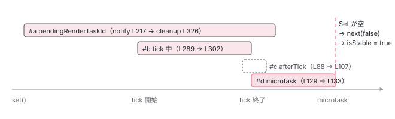

[目次](../README.md) › [zoneless の内側](README.md) › 第 9 回 / 全 11 回

# PendingTasks と isStable：安定は zone ではなくカウンタで判定

> PendingTasksInternal.add / remove が数を持ち、hasPendingTasksObservable が isStable になる。tick の予約、HttpClient、ルーターのナビゲーションが同じカウンタを使う。

angular/angular · 読了 約 12 分 · 中核 · [サイトで読む（デモが動きます）](https://angular-deep-dive-cyan.vercel.app/chapter/zoneless-pending-tasks)

---

zone.js ありの Angular は「zone の中にタスクが残っていない」ことで安定（stable）を判定していました。zoneless にはその zone がありません。では SSR はいつ HTML を書き出し、テストはいつ assert してよいのか。答えは `PendingTasksInternal` という**ただの Set** です。この章では、その Set に誰が入れて誰が消すのか、そして `ApplicationRef.isStable` がどうやってその Set から作られるのかを追います。

読む対象は `packages/core/src/pending_tasks_internal.ts`、`pending_tasks.ts`、`application/application_ref.ts`、`change_detection/scheduling/zoneless_scheduling_impl.ts`、それから利用側として `common/http/src/backend.ts`、`router/src/router.ts`、`platform-server/src/utils.ts` です。

1. 既定で provide される 3 つ
2. 通知の種類（NotificationSource）
3. notify → dirtyFlags
4. setTimeout と rAF の競走
5. tick → synchronize
6. microtask スケジューラ
7. signal.set() からの経路
8. (click) からの経路
9. **PendingTasks と isStable**（この章）
10. zone.js との同居
11. 動く条件・動かない書き方

## 1. PendingTasksInternal：Set と BehaviorSubject だけ

📄 `angular/packages/core/src/pending_tasks_internal.ts` L20–31 （▶ の行: 21–22, 24, 29）

```ts
20 │ export class PendingTasksInternal implements OnDestroy {
21 ▶   private taskId = 0;
22 ▶   private pendingTasks = new Set<number>();
23 │   private destroyed = false;
24 ▶   private pendingTask = new BehaviorSubject<boolean>(false);
25 │   private debugTaskTracker = inject(DEBUG_TASK_TRACKER, {optional: true});
26 │ 
27 │   get hasPendingTasks(): boolean {
28 │     // Accessing the value of a closed `BehaviorSubject` throws an error.
29 ▶     return this.destroyed ? false : this.pendingTask.value;
30 │   }
31 │ 
```

21 行目、連番を出すカウンタ。22 行目、**いま進行中のタスク ID を入れる `Set`**。24 行目、「1 件以上あるか」を流す `BehaviorSubject<boolean>`（最後の値を覚えていて、購読した瞬間にそれを流す Subject）。初期値は `false`、つまり起動直後は「タスク無し」です。29 行目の `hasPendingTasks` は Subject の現在値をそのまま返します。

📄 `angular/packages/core/src/pending_tasks_internal.ts` L48–69 （▶ の行: 50–51, 53–54, 56, 64, 66–67）

```ts
48 │   add(): number {
49 │     // Emitting a value to a closed subject throws an error.
50 ▶     if (!this.hasPendingTasks && !this.destroyed) {
51 ▶       this.pendingTask.next(true);
52 │     }
53 ▶     const taskId = this.taskId++;
54 ▶     this.pendingTasks.add(taskId);
55 │     this.debugTaskTracker?.add(taskId);
56 ▶     return taskId;
57 │   }
58 │ 
59 │   has(taskId: number): boolean {
60 │     return this.pendingTasks.has(taskId);
61 │   }
62 │ 
63 │   remove(taskId: number): void {
64 ▶     this.pendingTasks.delete(taskId);
65 │     this.debugTaskTracker?.remove(taskId);
66 ▶     if (this.pendingTasks.size === 0 && this.hasPendingTasks) {
67 ▶       this.pendingTask.next(false);
68 │     }
69 │   }
```

1. **`add()`：50〜51 行目、空から 1 件になる瞬間だけ `next(true)`**

   2 件目以降は Subject に流しません。53〜54 行目で ID を発行して Set に入れ、56 行目で ID を返します。呼び手はこの ID を持っていて、終わったら `remove(id)` します。
2. **`remove(taskId)`：64 行目で Set から消し、66〜67 行目、空になった瞬間だけ `next(false)`**

   `this.hasPendingTasks` も見ているので、すでに `false` なら流しません。「安定／不安定」が切り替わるのは**0 件 ↔ 1 件の境目だけ**です。

📄 `angular/packages/core/src/pending_tasks_internal.ts` L36–46 （▶ の行: 36, 45）

```ts
36 ▶   get hasPendingTasksObservable(): Observable<boolean> {
37 │     if (this.destroyed) {
38 │       // Manually creating the observable pulls less symbols from RxJS than `of(false)`.
39 │       return new Observable<boolean>((subscriber) => {
40 │         subscriber.next(false);
41 │         subscriber.complete();
42 │       });
43 │     }
44 │ 
45 ▶     return this.pendingTask;
46 │   }
```

36〜46 行目、外から購読するための Observable。45 行目、普段はその `BehaviorSubject` そのものです。

> **🧪 DEMO — Set の出入りと、Subject が流れる瞬間**
>
> 上の `add` / `remove` と同じ条件で動く模型です。Subject に値が流れるのは「空 ↔ 1 件」の境目だけです。
>
> ID のボタンを押すと `remove(id)` です。3 件入れて 2 件消しても Subject は動きません。
>
> ▶ [このデモはサイトで動かせます](https://angular-deep-dive-cyan.vercel.app/chapter/zoneless-pending-tasks)

## 2. ApplicationRef.isStable はこの Subject を反転しただけ

📄 `angular/packages/core/src/application/application_ref.ts` L320–328 （▶ の行: 320, 327）

```ts
320 ▶   private internalPendingTask = inject(PendingTasksInternal);
321 │ 
322 │   /**
323 │    * Returns an Observable that indicates when the application is stable or unstable.
324 │    */
325 │   public get isStable(): Observable<boolean> {
326 │     // This is a getter because it might be invoked after the application has been destroyed.
327 ▶     return this.internalPendingTask.hasPendingTasksObservable.pipe(map((pending) => !pending));
328 │   }
```

320 行目で `PendingTasksInternal` を inject し、**327 行目、`hasPendingTasksObservable` を `map(pending => !pending)` したものが `isStable`** です。`NgZone` も `Zone.current` も登場しません。`isStable` が `true` になる条件は 1 節の 66〜67 行目そのもの、「Set が空になった」です。

📄 `angular/packages/core/src/application/application_ref.ts` L338–351 （▶ の行: 341, 343–344, 348–349）

```ts
338 │   whenStable(): Promise<void> {
339 │     let subscription: Subscription;
340 │     return new Promise<void>((resolve) => {
341 ▶       subscription = this.isStable.subscribe({
342 │         next: (stable) => {
343 ▶           if (stable) {
344 ▶             resolve();
345 │           }
346 │         },
347 │       });
348 ▶     }).finally(() => {
349 ▶       subscription.unsubscribe();
350 │     });
351 │   }
```

341 行目で `isStable` を購読し、343〜344 行目、`true` が来たら resolve。348〜349 行目で購読を解除します。`BehaviorSubject` は購読した瞬間に現在値を流すので、**すでに安定なら `whenStable()` は同じ tick 内で resolve** します （Promise なので `await` の再開は microtask 後）。

## 3. 公開 API の PendingTasks：remove のたびに tick を 1 回挟む

📄 `angular/packages/core/src/pending_tasks.ts` L42–61 （▶ の行: 43–44, 51, 53, 58–59）

```ts
42 │ export class PendingTasks {
43 ▶   private readonly internalPendingTasks = inject(PendingTasksInternal);
44 ▶   private readonly scheduler = inject(ChangeDetectionScheduler);
45 │   private readonly errorHandler = inject(INTERNAL_APPLICATION_ERROR_HANDLER);
46 │   /**
47 │    * Adds a new task that should block application's stability.
48 │    * @returns A cleanup function that removes a task when called.
49 │    */
50 │   add(): () => void {
51 ▶     const taskId = this.internalPendingTasks.add();
52 │     return () => {
53 ▶       if (!this.internalPendingTasks.has(taskId)) {
54 │         // This pending task has already been cleared.
55 │         return;
56 │       }
57 │       // Notifying the scheduler will hold application stability open until the next tick.
58 ▶       this.scheduler.notify(NotificationSource.PendingTaskRemoved);
59 ▶       this.internalPendingTasks.remove(taskId);
60 │     };
61 │   }
```

43〜44 行目、公開クラスは内部の `PendingTasksInternal` と `ChangeDetectionScheduler` の両方を持ちます。51 行目で内部の `add()` を呼び、返すのは ID ではなく「後片付け関数」です。その関数は 53 行目で二重呼び出しを弾き、**58 行目、消す前に `notify(PendingTaskRemoved)`**、59 行目で消します。なぜ消す前に通知するのかは、通知の行き先を見ると分かります。

📄 `angular/packages/core/src/change_detection/scheduling/zoneless_scheduling_impl.ts` L181–183 （▶ の行: 181–182）

```ts
181 ▶       case NotificationSource.PendingTaskRemoved: {
182 ▶         break;
183 │       }
```

📄 `angular/packages/core/src/change_detection/scheduling/zoneless_scheduling_impl.ts` L214–224 （▶ の行: 217, 221）

```ts
214 │     const scheduleCallback = this.useMicrotaskScheduler
215 │       ? scheduleCallbackWithMicrotask
216 │       : scheduleCallbackWithRafRace;
217 ▶     this.pendingRenderTaskId = this.taskService.add();
218 │     if (this.scheduleInRootZone) {
219 │       this.cancelScheduledCallback = Zone.root.run(() => scheduleCallback(() => this.tick()));
220 │     } else {
221 ▶       this.cancelScheduledCallback = this.ngZone.runOutsideAngular(() =>
222 │         scheduleCallback(() => this.tick()),
223 │       );
224 │     }
```

181〜182 行目、`PendingTaskRemoved` は `dirtyFlags` を**変えません**。ただし `switch` を抜けた後は他の通知と同じ道で（[notify の章](03-zoneless-notify.md)）217 行目に着き、**スケジューラ自身が `taskService.add()` で 1 件入れ**、221 行目で tick を予約します。つまり 59 行目で利用者のタスクが消えても、Set にはスケジューラの 1 件が残っていて `isStable` は `false` のままです。

📄 `angular/packages/core/src/change_detection/scheduling/zoneless_scheduling_impl.ts` L265–271 （▶ の行: 268–269）

```ts
265 │     // If we reach the tick and there is no work to be done in ApplicationRef.tick,
266 │     // skip it altogether and clean up. There may be no work if, for example, the only
267 │     // event that notified the scheduler was the removal of a pending task.
268 ▶     if (this.appRef.dirtyFlags === ApplicationRefDirtyFlags.None) {
269 ▶       this.cleanup();
270 │       return;
271 │     }
```

予約された tick が動くと 268 行目、`dirtyFlags` が `None`（この通知しか来ていなかった）なら 269 行目の `cleanup()` へ。そこで 217 行目の 1 件が消え（5 節）、ここで初めて `isStable` が `true` になります。`NotificationSource` の定義にあるコメントがこの経路のことを言っています。「`await` してから signal を set する」ような非同期処理の最後の描画を、安定判定の前に必ず 1 回入れるためです。

📄 `angular/packages/core/src/change_detection/scheduling/zoneless_scheduling.ts` L49–51 （▶ の行: 49–50）

```ts
49 ▶   // The scheduler is notified when a pending task is removed via the public API.
50 ▶   // This allows us to make stability async, delayed until the next application tick.
51 │   PendingTaskRemoved,
```

49〜50 行目、「安定を非同期にし、次の tick まで遅らせる」。消す前に通知するのはこのためです。

📄 `angular/packages/core/src/pending_tasks.ts` L76–84 （▶ の行: 77, 79）

```ts
76 │   run(fn: () => Promise<unknown>): void {
77 ▶     const removeTask = this.add();
78 │     try {
79 ▶       fn().catch(this.errorHandler).finally(removeTask);
80 │     } catch (err) {
81 │       this.errorHandler(err);
82 │       removeTask();
83 │     }
84 │   }
```

77 行目で `add()`、79 行目で Promise の `finally` に後片付け関数を繋ぐ。`run()` はこれだけの包み紙です。

> [!TIP]
> **新卒エンジニアへ**
>
> 「`isStable` が `true` になった＝描画が終わった」ではなく、「Set が空になった＝Angular が知っている非同期処理が無い」です。`fetch()` を直接呼ぶなど Angular が知らない処理は、`PendingTasks.run()` で包まないと数えられません（5 節）。

## 4. スケジューラ自身が Set を使う 3 つの場面

`ChangeDetectionSchedulerImpl` は `taskService`（`PendingTasksInternal`）を 3 か所で使います。どれも「変更検知が終わる前に安定と言わせない」ためです。

1. **tick の予約中：`pendingRenderTaskId`**

   3 節の 217 行目です。`signal.set()` や `(click)` で通知が来て tick が予約された瞬間から、`isStable` は `false` になります。
2. **tick の実行中**

   📄 `angular/packages/core/src/change_detection/scheduling/zoneless_scheduling_impl.ts` L289–304 （▶ の行: 289, 302–303）

   ```ts
   289 ▶     const task = this.taskService.add();
   290 │     try {
   291 │       this.ngZone.run(
   292 │         () => {
   293 │           this.runningTick = true;
   294 │           this.appRef._tick();
   295 │         },
   296 │         undefined,
   297 │         this.schedulerTickApplyArgs,
   298 │       );
   299 │     } catch (e: unknown) {
   300 │       this.applicationErrorHandler(e);
   301 │     } finally {
   302 ▶       this.taskService.remove(task);
   303 ▶       this.cleanup();
   304 │     }
   ```

   289 行目で 1 件足し、294 行目の `_tick()` が終わったら 302 行目で消し、303 行目で `cleanup()`。

   📄 `angular/packages/core/src/change_detection/scheduling/zoneless_scheduling_impl.ts` L312–328 （▶ の行: 323–326）

   ```ts
   312 │   private cleanup() {
   313 │     this.runningTick = false;
   314 │     this.cancelScheduledCallback?.();
   315 │     this.cancelScheduledCallback = null;
   316 │     // If this is the last task, the service will synchronously emit a stable
   317 │     // notification. If there is a subscriber that then acts in a way that
   318 │     // tries to notify the scheduler again, we need to be able to respond to
   319 │     // schedule a new change detection. Therefore, we should clear the task ID
   320 │     // before removing it from the pending tasks (or the tasks service should
   321 │     // not synchronously emit stable, similar to how Zone stableness only
   322 │     // happens if it's still stable after a microtask).
   323 ▶     if (this.pendingRenderTaskId !== null) {
   324 ▶       const taskId = this.pendingRenderTaskId;
   325 ▶       this.pendingRenderTaskId = null;
   326 ▶       this.taskService.remove(taskId);
   327 │     }
   328 │   }
   ```

   323〜326 行目で予約時の 1 件（`pendingRenderTaskId`）を消します。325 行目で**先に `null` にしてから** 326 行目で消すのは、316〜322 行目のコメントのとおり、`remove` が同期的に `next(false)` を流し、その購読者がまた `notify` を呼んだときに `shouldScheduleTick`（`pendingRenderTaskId !== null` なら予約しない）が正しく動くようにするためです。
3. **tick 直後の 1 microtask**

   📄 `angular/packages/core/src/change_detection/scheduling/zoneless_scheduling_impl.ts` L83–108 （▶ の行: 85, 88, 106–107）

   ```ts
    83 │   constructor() {
    84 │     this.subscriptions.add(
    85 ▶       this.appRef.afterTick.subscribe(() => {
    86 │         // Prevent stabilization if cleanup causes the last task to be removed
    87 │         // before we can switch to the microtask scheduler.
    88 ▶         const task = this.taskService.add();
    89 │         // If the scheduler isn't running a tick but the application ticked, that means
    90 │         // someone called ApplicationRef.tick manually. In this case, we should cancel
    91 │         // any change detections that had been scheduled so we don't run an extra one.
    92 │         if (!this.runningTick) {
    93 │           this.cleanup();
    94 │           // Ticks that happen when ZoneJS is present do not get the microtask scheduling treatment.
    95 │           // ZoneJS is responsible for rerunning change detection on microtask queue empty.
    96 │           // Ticks initiated from tests also do not get microtask treatment so those ticks
    97 │           // do not affect stability timing, which tests are quite sensitive to.
    98 │           // TODO(atscott): we really should not use microtask scheduler
    99 │           // _ever_ when ZoneJS is enabled because ZoneJS is responsible for rerunning change
   100 │           // detection on microtask queue empty. This change breaks some tests
   101 │           if (!this.zonelessEnabled || this.appRef.includeAllTestViews) {
   102 │             this.taskService.remove(task);
   103 │             return;
   104 │           }
   105 │         }
   106 ▶         this.switchToMicrotaskScheduler();
   107 ▶         this.taskService.remove(task);
   108 │       }),
   ```

   📄 `angular/packages/core/src/change_detection/scheduling/zoneless_scheduling_impl.ts` L127–136 （▶ の行: 129, 131, 133）

   ```ts
   127 │   private switchToMicrotaskScheduler(): void {
   128 │     this.ngZone.runOutsideAngular(() => {
   129 ▶       const task = this.taskService.add();
   130 │       this.useMicrotaskScheduler = true;
   131 ▶       queueMicrotask(() => {
   132 │         this.useMicrotaskScheduler = false;
   133 ▶         this.taskService.remove(task);
   134 │       });
   135 │     });
   136 │   }
   ```

   85 行目、`afterTick` を購読していて、88 行目で一時的に 1 件足し、106 行目で `switchToMicrotaskScheduler()`。その中の 129 行目で別の 1 件を足し、131〜133 行目の `queueMicrotask` で消します。107 行目で 88 行目の分を消します。結果、**tick が終わってから 1 microtask の間は不安定**です。この間に来た通知は microtask で tick されます（[microtask の章](06-zoneless-microtask.md)）。88 行目の一時タスクは、107 行目まで Set を空にしないための押さえです。



*1 回の signal.set() で Set に出入りするタスク。安定（Set が空）になるのは、tick が終わって 1 microtask 経ったあと。*

## 5. 同じ Set を使う利用者：HttpClient・Router・あなた

### HttpClient

📄 `angular/packages/common/http/src/backend.ts` L57–61 （▶ の行: 60–61）

```ts
57 │ @Injectable({providedIn: 'root'})
58 │ export class HttpInterceptorHandler implements HttpHandler {
59 │   private chain: ChainedInterceptorFn<unknown> | null = null;
60 ▶   private readonly pendingTasks = inject(PendingTasks);
61 ▶   private readonly contributeToStability = inject(REQUESTS_CONTRIBUTE_TO_STABILITY);
```

📄 `angular/packages/common/http/src/backend.ts` L124–135 （▶ の行: 125–126, 129）

```ts
124 │     const chain = this.chain;
125 ▶     if (this.contributeToStability) {
126 ▶       const removeTask = this.pendingTasks.add();
127 │       return untracked(() =>
128 │         chain(initialRequest, (downstreamRequest) => this.backend.handle(downstreamRequest)),
129 ▶       ).pipe(finalize(removeTask));
130 │     } else {
131 │       return untracked(() =>
132 │         chain(initialRequest, (downstreamRequest) => this.backend.handle(downstreamRequest)),
133 │       );
134 │     }
135 │   }
```

📄 `angular/packages/common/http/src/interceptor.ts` L215–221 （▶ の行: 220）

```ts
215 │ // Should the whole interceptor chain contribute to stability or just the backend request #55075?
216 │ // Should HttpClient contribute to stability automatically at all?
217 │ export const REQUESTS_CONTRIBUTE_TO_STABILITY = new InjectionToken<boolean>(
218 │   typeof ngDevMode !== 'undefined' && ngDevMode ? 'REQUESTS_CONTRIBUTE_TO_STABILITY' : '',
219 │   // Providing a factory implies that the token is provided in root by default
220 ▶   {factory: () => true},
221 │ );
```

60 行目、`HttpClient` の本体 `HttpInterceptorHandler` は公開 API の `PendingTasks` を使います。125〜126 行目、リクエストを流す前に `add()`、129 行目、Observable の `finalize`（完了・エラー・購読解除のどれでも）で後片付け。61 行目の `REQUESTS_CONTRIBUTE_TO_STABILITY` は 220 行目のとおり既定 `true` なので、**HttpClient のリクエスト中、`isStable` は `false`** です。公開 API 経由なので、完了時には 3 節の「tick を 1 回挟む」も付いてきます。

### Router

📄 `angular/packages/router/src/router.ts` L695–701 （▶ の行: 696, 700）

```ts
695 │     // Indicate that the navigation is happening.
696 ▶     const taskId = this.pendingTasks.add();
697 │     afterNextNavigation(this, () => {
698 │       // Remove pending task in a microtask to allow for cancelled
699 │       // initial navigations and redirects within the same task.
700 ▶       queueMicrotask(() => this.pendingTasks.remove(taskId));
701 │     });
```

696 行目、ナビゲーション開始で `add()`。`Router` は内部 API の `PendingTasksInternal` を直接使っているので ID が返ります。700 行目、ナビゲーションが終わった**次の microtask**で `remove(taskId)`。リダイレクトや初期ナビゲーションの取り消しが同じタスク内で続く場合に、一瞬だけ安定になるのを避けるためです（698〜699 行目のコメント）。

### あなたのコード

📄 `angular/adev/src/content/guide/zoneless.md` L85–100 （▶ の行: 89–90, 96）

````md
 85 │ ### `PendingTasks` for Server Side Rendering (SSR)
 86 │ 
 87 │ If you are using SSR with Angular, you may know that it relies on ZoneJS to help determine when the application
 88 │ is "stable" and can be serialized. If there are asynchronous tasks that should prevent serialization, an application
 89 ▶ not using ZoneJS must make Angular aware of these with the [PendingTasks](/api/core/PendingTasks) service. Serialization
 90 ▶ will wait for the first moment that all pending tasks have been removed.
 91 │ 
 92 │ The two most straightforward uses of pending tasks are the `run` method:
 93 │ 
 94 │ ```typescript
 95 │ const taskService = inject(PendingTasks);
 96 ▶ taskService.run(async () => {
 97 │   const someResult = await doSomeWorkThatNeedsToBeRendered();
 98 │   this.someState.set(someResult);
 99 │ });
100 │ ```
````

89〜90 行目、公式ガイドの言い方では「zone.js を使わないアプリは、シリアライズを待たせたい非同期処理を `PendingTasks` で Angular に知らせる」。96 行目の `run` は 3 節の 76〜84 行目です。`fetch()` を直接呼ぶ、`setTimeout` で待つ、といった Angular が知らない非同期はここで包みます。

## 6. SSR は whenStable を await してから HTML にする

📄 `angular/packages/platform-server/src/utils.ts` L360–375 （▶ の行: 362, 370, 373）

```ts
360 │   try {
361 │     startMeasuring(bootstrapLabel);
362 ▶     const applicationRef = await bootstrap({platformRef});
363 │     stopMeasuring(bootstrapLabel);
364 │ 
365 │     startMeasuring(_renderLabel);
366 │ 
367 │     const measuringLabel = 'whenStable';
368 │     startMeasuring(measuringLabel);
369 │     // Block until application is stable.
370 ▶     await applicationRef.whenStable();
371 │     stopMeasuring(measuringLabel);
372 │ 
373 ▶     const rendered = await renderInternal(platformRef, applicationRef);
374 │     stopMeasuring(_renderLabel);
375 │     return rendered;
```

362 行目で bootstrap し、**370 行目で `applicationRef.whenStable()` を `await`**、373 行目で DOM を文字列にします。2 節のとおり `whenStable` は Set が空になった瞬間に resolve するので、5 節の HttpClient・Router・`PendingTasks.run` の どれかが残っていれば HTML はまだ作られません。このサイト自身も `outputMode: static` で事前レンダリングされていて、各ページはこの 370 行目を通っています （[hydration の章](../platform/09-hydration.md)）。

## 7. zone.js ありでも、安定判定の出口は同じ Set

📄 `angular/packages/core/src/change_detection/scheduling/ng_zone_scheduling.ts` L238–268 （▶ の行: 245–246, 251, 256, 262）

```ts
238 │   initialize() {
239 │     if (this.initialized) {
240 │       return;
241 │     }
242 │     this.initialized = true;
243 │ 
244 │     let task: number | null = null;
245 ▶     if (!this.zone.isStable && !this.zone.hasPendingMacrotasks && !this.zone.hasPendingMicrotasks) {
246 ▶       task = this.pendingTasks.add();
247 │     }
248 │ 
249 │     this.zone.runOutsideAngular(() => {
250 │       this.subscription.add(
251 ▶         this.zone.onStable.subscribe(() => {
252 │           NgZone.assertNotInAngularZone();
253 │ 
254 │           // Check whether there are no pending macro/micro tasks in the next tick
255 │           // to allow for NgZone to update the state.
256 ▶           queueMicrotask(() => {
257 │             if (
258 │               task !== null &&
259 │               !this.zone.hasPendingMacrotasks &&
260 │               !this.zone.hasPendingMicrotasks
261 │             ) {
262 ▶               this.pendingTasks.remove(task);
263 │               task = null;
264 │             }
265 │           });
266 │         }),
267 │       );
268 │     });
```

`provideZoneChangeDetection()` を足したときだけ初期化される `ZoneStablePendingTask` です。245〜246 行目、zone が不安定なら Set に 1 件入れ、251 行目で `onStable` を購読、256〜262 行目で次の microtask にまだ安定なら消します。つまり zone.js ありでも `ApplicationRef.isStable` の出口は 2 節の 327 行目、同じ `BehaviorSubject` です。zone の状態は「Set の 1 件」として翻訳されて入ってきます。続きは [次章](10-zoneless-hybrid.md)。

## ここまでの呼び出し

- 👤 `await renderApplication(bootstrap, ...)` — サーバー側（platform-server/src/utils.ts L362）
  - `applicationRef.whenStable()` — application\_ref.ts L338 — *isStable を購読、true で resolve*
    - `get isStable()` — application\_ref.ts L325 — *hasPendingTasksObservable.pipe(map(p =&gt; !p))*
      - `PendingTasksInternal.hasPendingTasksObservable` — pending\_tasks\_internal.ts L36 — *BehaviorSubject(false)*
- 👤 `this.http.get('/api/x').subscribe(...)` — あなたのコンポーネント — *── Set に入る側 ──*
  - `HttpInterceptorHandler.handle(req)` — common/http/src/backend.ts L100
    - `PendingTasks.add()` — pending\_tasks.ts L50
      - `PendingTasksInternal.add()` — pending\_tasks\_internal.ts L48 — *空 → 1 件なら next(true) → isStable = false*
  - `finalize(removeTask)` — backend.ts L129 — *── 応答が来た ──*
    - `ChangeDetectionScheduler.notify(PendingTaskRemoved)` — pending\_tasks.ts L58 → zoneless\_scheduling\_impl.ts L138 — *dirtyFlags は変えず、L217 で 1 件足して tick 予約*
    - `PendingTasksInternal.remove(taskId)` — pending\_tasks\_internal.ts L63 — *スケジューラの 1 件が残るので next(false) はまだ*
  - `ChangeDetectionSchedulerImpl.tick()` — zoneless\_scheduling\_impl.ts L257 — *── 別タスク ──*
    - `cleanup()` — zoneless\_scheduling\_impl.ts L312 — *pendingRenderTaskId を remove → Set が空 → next(false)*
      - `isStable` が `true` を流す → `whenStable` resolve — application\_ref.ts L343
  - `renderInternal(platformRef, applicationRef)` — platform-server/src/utils.ts L373 — *DOM → HTML 文字列*

## 聞かれそうな質問

**Q. ApplicationRef.isStable はいつ true になりますか？HttpClient のリクエスト中は？**

`PendingTasksInternal` の `Set` が空のときです（application\_ref.ts 327 行目が `hasPendingTasksObservable` を反転しているだけ。空になる瞬間は pending\_tasks\_internal.ts 66〜67 行目）。HttpClient は backend.ts 126 行目でリクエスト前に `add()`、129 行目の `finalize` で消すので、リクエスト中は `false` です。`REQUESTS_CONTRIBUTE_TO_STABILITY`（interceptor.ts 220 行目）を `false` に provide すれば数えなくなります。

**Q. signal を set しただけでも isStable は false になりますか？**

なります。通知が `notify` 217 行目（zoneless\_scheduling\_impl.ts）に届いた時点で `pendingRenderTaskId = taskService.add()` が入り、tick の `cleanup()` 326 行目で消えるまで不安定です。さらに `afterTick` 購読（88・129 行目）で tick 後 1 microtask も不安定が続きます。

**Q. PendingTasks.add() の後片付け関数を呼んだのに、すぐには isStable が true になりません。なぜ？**

pending\_tasks.ts 58 行目が `remove` の**前に**`notify(PendingTaskRemoved)` を呼び、スケジューラが 217 行目で自分の 1 件を足して tick を予約するからです。tick が走り（`dirtyFlags` が `None` なら 268〜269 行目で `cleanup()` へ直行）、その 1 件が消えた時点で `true` になります。非同期処理の最後に `signal.set()` していれば、その描画が安定判定より先に必ず入る仕組みです。

**Q. whenStable() はすでに安定なときどう動きますか？2 回 resolve しますか？**

`BehaviorSubject` は購読時に現在値を流すので、application\_ref.ts 341〜344 行目の購読で即 `true` が届き resolve します。Promise は 1 回しか resolve しませんし、348〜349 行目で購読も解除するので 2 回目はありません。

**Q. SSR で fetch() を直接呼んだら、応答を待たずに HTML が出ますか？**

出ます。`fetch()` は Set に何も入れないので、platform-server/src/utils.ts 370 行目の `whenStable()` は待ちません。`HttpClient` を使う（backend.ts 126 行目）か、`PendingTasks.run()`（pending\_tasks.ts 76〜84 行目）で包みます。

**Q. zone.js ありのときは NgZone.isStable を見ているのですか？**

`ApplicationRef.isStable` は zone.js ありでも 327 行目の同じ式です。zone の状態は `ZoneStablePendingTask`（ng\_zone\_scheduling.ts 245〜262 行目）が「不安定なら Set に 1 件、`onStable` の次の microtask で消す」と翻訳して同じ Set に入れます。

## 読み終えて

- 安定判定は `PendingTasksInternal` の `Set<number>` 1 つ。`add` は空→1 件で `next(true)`、`remove` は 1 件→空で `next(false)`。それ以外では Subject は動かない
- `ApplicationRef.isStable` はその Subject を `map(p => !p)` しただけ。`whenStable` は最初の `true` で resolve
- スケジューラは tick の予約中・実行中・直後 1 microtask の 3 つの期間を Set に入れる。公開 `PendingTasks` の後片付けは `notify(PendingTaskRemoved)` で tick を 1 回挟んでから安定になる
- HttpClient（公開 API）・Router（内部 API）・あなたの `PendingTasks.run` が同じ Set に入れ、SSR の `renderApplication` は `whenStable()` を `await` してから HTML を作る

HttpClient の要求がインターセプタの連鎖とバックエンドをどう通るかは [HttpClient の内側](../http/README.md)のシリーズで 1 段ずつ追います。

サーバーでこの whenStable を待ったあと、HTML に書き出すまでの手順は [renderApplication の章](../platform/02-ssr-render-application.md)で追います。

---

← 前: [(click) から画面更新まで（zoneless）](08-zoneless-listener-path.md)  
次: [zone.js と同居するとき：ハイブリッドの判定](10-zoneless-hybrid.md) →
