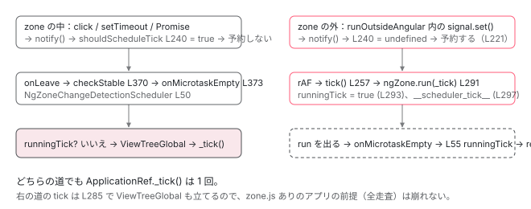

[目次](../README.md) › [zoneless の内側](README.md) › 第 10 回 / 全 11 回

# zone.js と同居するとき：ハイブリッドの判定

> zoneIsDefined / angularZoneId / shouldScheduleTick の zone 判定。zone の中にいるなら zone に任せ、外にいるならスケジューラが動く。onUnstable で予約を取り消す。

angular/angular · 読了 約 12 分 · 発展 · [サイトで読む（デモが動きます）](https://angular-deep-dive-cyan.vercel.app/chapter/zoneless-hybrid)

---

[1 回目](01-zoneless-default.md)で、`provideZoneChangeDetection()` を足しても `ChangeDetectionSchedulerImpl` は消えないことを見ました。つまり zone.js ありのアプリでは、zone の `onMicrotaskEmpty` と zoneless のスケジューラが**同時に**いる。2 人が同じ tick を呼んだら二重になります。この章は、スケジューラが「いまは zone に任せる」「いまは自分が予約する」を どの値を見て決めているか、そして二重 tick を両方向から防いでいる 2 つのガードを読みます。

読む対象は `packages/core/src/change_detection/scheduling/zoneless_scheduling_impl.ts` の zone 関連分岐すべて、`core/src/zone/ng_zone.ts`、`scheduling/ng_zone_scheduling.ts` です。

1. 既定で provide される 3 つ
2. 通知の種類（NotificationSource）
3. notify → dirtyFlags
4. setTimeout と rAF の競走
5. tick → synchronize
6. microtask スケジューラ
7. signal.set() からの経路
8. (click) からの経路
9. PendingTasks と isStable
10. **zone.js との同居**（この章）
11. 動く条件・動かない書き方

## 1. 判定に使う 3 つの値は constructor で確定する

📄 `angular/packages/core/src/change_detection/scheduling/zoneless_scheduling_impl.ts` L60–81 （▶ の行: 64–65, 67, 70–71, 73–75）

```ts
60 │ export class ChangeDetectionSchedulerImpl implements ChangeDetectionScheduler, OnDestroy {
61 │   private readonly applicationErrorHandler = inject(INTERNAL_APPLICATION_ERROR_HANDLER);
62 │   private readonly appRef = inject(ApplicationRef);
63 │   private readonly taskService = inject(PendingTasksInternal);
64 ▶   private readonly ngZone = inject(NgZone);
65 ▶   private readonly zonelessEnabled = inject(ZONELESS_ENABLED);
66 │   private readonly tracing = inject(TracingService, {optional: true});
67 ▶   private readonly zoneIsDefined = typeof Zone !== 'undefined' && !!Zone.root.run;
68 │   private readonly schedulerTickApplyArgs = [{data: {'__scheduler_tick__': true}}];
69 │   private readonly subscriptions = new Subscription();
70 ▶   private readonly angularZoneId = this.zoneIsDefined
71 ▶     ? (this.ngZone as NgZonePrivate)._inner?.get(angularZoneInstanceIdProperty)
72 │     : null;
73 ▶   private readonly scheduleInRootZone =
74 ▶     !this.zonelessEnabled &&
75 ▶     this.zoneIsDefined &&
76 │     (inject(SCHEDULE_IN_ROOT_ZONE, {optional: true}) ?? false);
77 │ 
78 │   private cancelScheduledCallback: null | (() => void) = null;
79 │   private useMicrotaskScheduler = false;
80 │   runningTick = false;
81 │   pendingRenderTaskId: number | null = null;
```

1. **65 行目 `zonelessEnabled`：DI から来る**

   既定 `true`、`provideZoneChangeDetection()` で `false`（1 回目の 94 行目）。「開発者が zone.js に任せると宣言したか」です。
2. **67 行目 `zoneIsDefined`：グローバルに `Zone` がいるか**

   `typeof Zone !== 'undefined' && !!Zone.root.run`。polyfills に zone.js が入っているかどうかで、DI とは無関係に決まります。`zonelessEnabled` と `zoneIsDefined` は独立した 2 軸です。
3. **70〜72 行目 `angularZoneId`：この `NgZone` の内側 zone の ID**

   64 行目で inject した `NgZone` の `_inner`（Angular zone 本体）からプロパティを読みます。`NoopNgZone` には `_inner` が無いので `undefined`。
4. **73〜76 行目 `scheduleInRootZone`**

   zone.js ありのときだけ意味を持つ設定。3 節で見ます。

📄 `angular/packages/core/src/zone/ng_zone.ts` L24–27 （▶ の行: 24–25）

```ts
24 ▶ const isAngularZoneProperty = 'isAngularZone';
25 ▶ export const angularZoneInstanceIdProperty = isAngularZoneProperty + '_ID';
26 │ 
27 │ let ngZoneInstanceId = 0;
```

📄 `angular/packages/core/src/zone/ng_zone.ts` L426–437 （▶ の行: 430–431, 434–436）

```ts
426 │ function forkInnerZoneWithAngularBehavior(zone: NgZonePrivate) {
427 │   const delayChangeDetectionForEventsDelegate = () => {
428 │     delayChangeDetectionForEvents(zone);
429 │   };
430 ▶   const instanceId = ngZoneInstanceId++;
431 ▶   zone._inner = zone._inner.fork({
432 │     name: 'angular',
433 │     properties: <any>{
434 ▶       [isAngularZoneProperty]: true,
435 ▶       [angularZoneInstanceIdProperty]: instanceId,
436 ▶       [angularZoneInstanceIdProperty + instanceId]: true,
437 │     },
```

430 行目、`NgZone` が作られるごとに連番 `instanceId` を取り、431 行目で `Zone.root` から fork した `_inner` に 3 つのプロパティを付けます。434 行目 `isAngularZone: true`、435 行目 `isAngularZone_ID: instanceId`（70〜71 行目が読むのはこれ）、**436 行目 `isAngularZone_ID<番号>: true`**。zone のプロパティは `Zone.current.get(name)` で**親 zone まで辿って**探される（[zone シリーズ](../zone/02-zone-what.md)）ので、「`isAngularZone_ID0` が取れる」＝「いまのコードは 0 番の NgZone の中（またはその子 zone）で走っている」と判定できます。番号付きにしてあるのは、同じページに複数の Angular アプリがいても他のアプリの zone と混ざらないためです。

📄 `angular/packages/core/src/zone/ng_zone.ts` L151–158 （▶ の行: 151–152）

```ts
151 ▶     if (typeof Zone == 'undefined') {
152 ▶       throw new RuntimeError(
153 │         RuntimeErrorCode.MISSING_ZONEJS,
154 │         ngDevMode && `In this configuration Angular requires Zone.js`,
155 │       );
156 │     }
157 │ 
158 │     Zone.assertZonePatched();
```

151〜152 行目、本物の `NgZone` は zone.js 無しでは作れません。「`provideZoneChangeDetection()` あり ＋ polyfills に zone.js 無し」は起動時に例外です。残る組み合わせは 3 つです。

| polyfills に zone.js | provideZoneChangeDetection() | zonelessEnabled | zoneIsDefined | 状態 |
| --- | --- | --- | --- | --- |
| 無し | 無し | true | false | 純粋な zoneless（このサイト） |
| あり | 無し | true | true | zoneless。zone.js は読み込まれているが NgZone は Noop |
| あり | あり | false | true | **ハイブリッド**。この章の主題 |
| 無し | あり | — | — | NgZone の constructor で例外（151 行目） |

## 2. shouldScheduleTick：zone の中なら予約しない

📄 `angular/packages/core/src/change_detection/scheduling/zoneless_scheduling_impl.ts` L227–246 （▶ の行: 232, 237–240, 242）

```ts
227 │   private shouldScheduleTick(): boolean {
228 │     if (this.appRef.destroyed) {
229 │       return false;
230 │     }
231 │     // already scheduled or running
232 ▶     if (this.pendingRenderTaskId !== null || this.runningTick || this.appRef._runningTick) {
233 │       return false;
234 │     }
235 │     // If we're inside the zone don't bother with scheduler. Zone will stabilize
236 │     // eventually and run change detection.
237 ▶     if (
238 ▶       !this.zonelessEnabled &&
239 ▶       this.zoneIsDefined &&
240 ▶       Zone.current.get(angularZoneInstanceIdProperty + this.angularZoneId)
241 │     ) {
242 ▶       return false;
243 │     }
244 │ 
245 │     return true;
246 │   }
```

232 行目は zone に関係なく「予約済み／実行中なら予約しない」。**237〜243 行目がハイブリッドの中心**です。3 条件すべてが真のとき、つまり 「開発者が zone に任せると言い」「zone.js が本当にいて」「`notify()` がこの NgZone の中から呼ばれた」なら、`false` を返して**何も予約しません**。240 行目の `Zone.current.get('isAngularZone_ID' + angularZoneId)` は 1 節の 436 行目のプロパティを探しています。

なぜ zone の中なら放っておけるのか。zone の中で走っているコードは、終わると `onLeave` → `checkStable` → `onMicrotaskEmpty` を必ず出し、それを `NgZoneChangeDetectionScheduler` が購読して tick するからです（4 節）。逆に `runOutsideAngular` の中や、zone.js のパッチが届かない場所（例：zone 外で登録した WebSocket のコールバック）から `signal.set()` されたときは 240 行目が偽で、スケジューラが自分で予約します。**ハイブリッドの価値はここ**で、zone が見ていない変更も signal 経由なら画面に届きます。

> **🧪 DEMO — shouldScheduleTick の zone 判定（L237-243）**
>
> 3 つの入力を切り替えると、どの行で決まるかが変わります。
>
> ▶ [このデモはサイトで動かせます](https://angular-deep-dive-cyan.vercel.app/chapter/zoneless-hybrid)

## 3. 予約するときは zone の外で

📄 `angular/packages/core/src/change_detection/scheduling/zoneless_scheduling_impl.ts` L214–224 （▶ の行: 218–219, 221–222）

```ts
214 │     const scheduleCallback = this.useMicrotaskScheduler
215 │       ? scheduleCallbackWithMicrotask
216 │       : scheduleCallbackWithRafRace;
217 │     this.pendingRenderTaskId = this.taskService.add();
218 ▶     if (this.scheduleInRootZone) {
219 ▶       this.cancelScheduledCallback = Zone.root.run(() => scheduleCallback(() => this.tick()));
220 │     } else {
221 ▶       this.cancelScheduledCallback = this.ngZone.runOutsideAngular(() =>
222 ▶         scheduleCallback(() => this.tick()),
223 │       );
224 │     }
```

予約が決まったら、221〜223 行目、**`ngZone.runOutsideAngular` の中で**`setTimeout` / `rAF` を呼びます。zone の中で `setTimeout` を呼ぶと、zone.js がそれをマクロタスクとして数え、発火時に `onEnter` → `onLeave` → `onMicrotaskEmpty` が出て zone 側が tick を呼んでしまうからです。予約自体を zone に見せないことで、スケジューラの tick は 1 回だけになります。

📄 `angular/packages/core/src/change_detection/scheduling/zoneless_scheduling.ts` L78–81 （▶ の行: 79）

```ts
78 │ // TODO(atscott): Remove in v19. Scheduler should be done with runOutsideAngular.
79 ▶ export const SCHEDULE_IN_ROOT_ZONE = new InjectionToken<boolean>(
80 │   typeof ngDevMode === 'undefined' || ngDevMode ? 'run changes outside zone in root' : '',
81 │ );
```

📄 `angular/packages/core/src/change_detection/scheduling/ng_zone_scheduling.ts` L126–130 （▶ の行: 127–128）

```ts
126 │     {
127 ▶       provide: SCHEDULE_IN_ROOT_ZONE,
128 ▶       useValue: scheduleInRootZone ?? SCHEDULE_IN_ROOT_ZONE_DEFAULT,
129 │     },
130 │   ];
```

218〜219 行目の `scheduleInRootZone` は、127〜128 行目で `provideZoneChangeDetection` が provide するトークンで、既定値は `flags.ts` の `SCHEDULE_IN_ROOT_ZONE_DEFAULT = false` です。`true` にすると `runOutsideAngular`（親 zone）ではなく `Zone.root` で予約します。79 行目のコメントのとおり削除予定の互換スイッチで、既定では 221 行目の経路です。

## 4. スケジューラの tick は zone の中で走る。そのときの二重防止

📄 `angular/packages/core/src/change_detection/scheduling/zoneless_scheduling_impl.ts` L285–298 （▶ の行: 285–286, 291, 293–294, 297）

```ts
285 ▶     if (!this.zonelessEnabled && this.appRef.dirtyFlags & ApplicationRefDirtyFlags.ViewTreeAny) {
286 ▶       this.appRef.dirtyFlags |= ApplicationRefDirtyFlags.ViewTreeGlobal;
287 │     }
288 │ 
289 │     const task = this.taskService.add();
290 │     try {
291 ▶       this.ngZone.run(
292 │         () => {
293 ▶           this.runningTick = true;
294 ▶           this.appRef._tick();
295 │         },
296 │         undefined,
297 ▶         this.schedulerTickApplyArgs,
298 │       );
```

285〜286 行目、zone.js ありでビューが汚れていれば `ViewTreeGlobal` を足します。zone.js ありのアプリは 「tick ＝ 全ビュー走査」を前提に書かれているため、互換のための処理です（直前のコメントに経緯が書かれています）。291 行目、**tick は `ngZone.run` の中で**実行します。ハンドラ内の `setTimeout` などを zone に数えさせるためです。293 行目で `runningTick = true`、294 行目で `_tick()`。297 行目の `schedulerTickApplyArgs`（`{data: {'__scheduler_tick__': true} }`）が zone 側への合図です。

📄 `angular/packages/core/src/zone/ng_zone.ts` L234–236 （▶ の行: 235）

```ts
234 │   run<T>(fn: (...args: any[]) => T, applyThis?: any, applyArgs?: any[]): T {
235 ▶     return (this as any as NgZonePrivate)._inner.run(fn, applyThis, applyArgs);
236 │   }
```

📄 `angular/packages/core/src/zone/ng_zone.ts` L465–496 （▶ の行: 475–476, 490, 494）

```ts
465 │     onInvoke: (
466 │       delegate: ZoneDelegate,
467 │       current: Zone,
468 │       target: Zone,
469 │       callback: Function,
470 │       applyThis: any,
471 │       applyArgs?: any[],
472 │       source?: string,
473 │     ): any => {
474 │       try {
475 ▶         onEnter(zone);
476 ▶         return delegate.invoke(target, callback, applyThis, applyArgs, source);
477 │       } finally {
478 │         if (
479 │           zone.shouldCoalesceRunChangeDetection &&
480 │           // Do not delay change detection when the task is the scheduler's tick.
481 │           // We need to synchronously trigger the stability logic so that the
482 │           // zone-based scheduler can prevent a duplicate ApplicationRef.tick
483 │           // by first checking if the scheduler tick is running. This does seem a bit roundabout,
484 │           // but we _do_ still want to trigger all the correct events when we exit the zone.run
485 │           // (`onMicrotaskEmpty` and `onStable` _should_ emit; developers can have code which
486 │           // relies on these events happening after change detection runs).
487 │           // Note: `zone.callbackScheduled` is already in delayChangeDetectionForEventsDelegate
488 │           // but is added here as well to prevent reads of applyArgs when not necessary
489 │           !zone.callbackScheduled &&
490 ▶           !isSchedulerTick(applyArgs)
491 │         ) {
492 │           delayChangeDetectionForEventsDelegate();
493 │         }
494 ▶         onLeave(zone);
495 │       }
496 │     },
```

📄 `angular/packages/core/src/zone/ng_zone.ts` L585–600 （▶ の行: 586, 600）

```ts
585 │ function isSchedulerTick(applyArgs: unknown): boolean {
586 ▶   return hasApplyArgsData(applyArgs, '__scheduler_tick__');
587 │ }
588 │ 
589 │ function hasApplyArgsData(applyArgs: unknown, key: string) {
590 │   if (!Array.isArray(applyArgs)) {
591 │     return false;
592 │   }
593 │ 
594 │   // We should only ever get 1 arg passed through to invokeTask.
595 │   // Short circuit here incase that behavior changes.
596 │   if (applyArgs.length !== 1) {
597 │     return false;
598 │   }
599 │ 
600 ▶   return applyArgs[0]?.data?.[key] === true;
```

235 行目、`run` は `_inner.run`。zone.js はこれを 1 節で fork したときの `onInvoke`（465 行目）に通します。475 行目 `onEnter`、476 行目で中身（`_tick()`）を実行、494 行目 `onLeave`。490 行目、`isSchedulerTick(applyArgs)`（586・600 行目で `__scheduler_tick__` を見る）が真なら、`shouldCoalesceRunChangeDetection` の遅延を**かけません**。スケジューラの tick は同期的に `onLeave` → `checkStable` まで進む必要があるからです。

📄 `angular/packages/core/src/zone/ng_zone.ts` L538–549 （▶ の行: 541–542, 548）

```ts
538 │ function onEnter(zone: NgZonePrivate) {
539 │   zone._nesting++;
540 │   if (zone.isStable) {
541 ▶     zone.isStable = false;
542 ▶     zone.onUnstable.emit(null);
543 │   }
544 │ }
545 │ 
546 │ function onLeave(zone: NgZonePrivate) {
547 │   zone._nesting--;
548 ▶   checkStable(zone);
549 │ }
```

📄 `angular/packages/core/src/zone/ng_zone.ts` L354–385 （▶ の行: 370, 373, 378, 380）

```ts
354 │ function checkStable(zone: NgZonePrivate) {
355 │   // TODO: @JiaLiPassion, should check zone.isCheckStableRunning to prevent
356 │   // re-entry. The case is:
357 │   //
358 │   // @Component({...})
359 │   // export class AppComponent {
360 │   // constructor(private ngZone: NgZone) {
361 │   //   this.ngZone.onStable.subscribe(() => {
362 │   //     this.ngZone.run(() => console.log('stable'););
363 │   //   });
364 │   // }
365 │   //
366 │   // The onStable subscriber run another function inside ngZone
367 │   // which causes `checkStable()` re-entry.
368 │   // But this fix causes some issues in g3, so this fix will be
369 │   // launched in another PR.
370 ▶   if (zone._nesting == 0 && !zone.hasPendingMicrotasks && !zone.isStable) {
371 │     try {
372 │       zone._nesting++;
373 ▶       zone.onMicrotaskEmpty.emit(null);
374 │     } finally {
375 │       zone._nesting--;
376 │       if (!zone.hasPendingMicrotasks) {
377 │         try {
378 ▶           zone.runOutsideAngular(() => zone.onStable.emit(null));
379 │         } finally {
380 ▶           zone.isStable = true;
381 │         }
382 │       }
383 │     }
384 │   }
385 │ }
```

541〜542 行目、zone に入った瞬間に `onUnstable`（5 節で使う）。548 行目、出た瞬間に `checkStable`。370 行目、ネストが 0 で microtask が残っていなければ、**373 行目で `onMicrotaskEmpty` が同期的に emit** されます。つまり 294 行目の `_tick()` が終わって `ngZone.run` から出る瞬間に、zone 側のスケジューラも起こされます。

📄 `angular/packages/core/src/change_detection/scheduling/ng_zone_scheduling.ts` L45–68 （▶ の行: 50, 55–56, 58, 60–61）

```ts
45 │   initialize(): void {
46 │     if (this._onMicrotaskEmptySubscription) {
47 │       return;
48 │     }
49 │ 
50 ▶     this._onMicrotaskEmptySubscription = this.zone.onMicrotaskEmpty.subscribe({
51 │       next: () => {
52 │         // `onMicroTaskEmpty` can happen _during_ the zoneless scheduler change detection because
53 │         // zone.run(() => {}) will result in `checkStable` at the end of the `zone.run` closure
54 │         // and emit `onMicrotaskEmpty` synchronously if run coalsecing is false.
55 ▶         if (this.changeDetectionScheduler.runningTick) {
56 ▶           return;
57 │         }
58 ▶         this.zone.run(() => {
59 │           try {
60 ▶             this.applicationRef.dirtyFlags |= ApplicationRefDirtyFlags.ViewTreeGlobal;
61 ▶             this.applicationRef._tick();
62 │           } catch (e) {
63 │             this.applicationErrorHandler(e);
64 │           }
65 │         });
66 │       },
67 │     });
68 │   }
```

50 行目、`NgZoneChangeDetectionScheduler` は `onMicrotaskEmpty` を購読しています。**55〜56 行目、`changeDetectionScheduler.runningTick` が `true` なら何もせず戻る**。293 行目で立てたフラグがここで読まれ、「スケジューラの tick の直後に zone が同じ tick をもう一度」を防ぎます。`runningTick` は tick の `finally` の `cleanup()`（[tick の章](05-zoneless-tick.md)）で下ろされますが、それは `ngZone.run` から**出たあと**なので、373 行目の emit の時点ではまだ `true` です。普通に zone が起こした場合は 58〜61 行目、`ViewTreeGlobal` を立てて `_tick()`。

> [!NOTE]
> **ポイント**
>
> 二重防止は 2 方向あります。**zone → スケジューラ**：zone の中からの `notify` は `shouldScheduleTick` 240 行目で予約しない。**スケジューラ → zone**：スケジューラの tick が出す `onMicrotaskEmpty` は `NgZoneChangeDetectionScheduler` 55 行目で `runningTick` を見て無視する。



*ハイブリッドでの 2 つの入口と 2 つのガード。zone 内の変更は左の道、zone 外の signal.set() は右の道を通り、どちらも ApplicationRef.\_tick は 1 回。*

## 5. onUnstable で予約を取り消す

📄 `angular/packages/core/src/change_detection/scheduling/zoneless_scheduling_impl.ts` L110–119 （▶ の行: 111, 115–116）

```ts
110 │     this.subscriptions.add(
111 ▶       this.ngZone.onUnstable.subscribe(() => {
112 │         // If the zone becomes unstable when we're not running tick (this happens from the zone.run),
113 │         // we should cancel any scheduled change detection here because at this point we
114 │         // know that the zone will stabilize at some point and run change detection itself.
115 ▶         if (!this.runningTick) {
116 ▶           this.cleanup();
117 │         }
118 │       }),
119 │     );
```

111 行目、`onUnstable`（4 節の 542 行目、zone に入った瞬間に emit）を購読しています。115〜116 行目、tick 実行中でなければ `cleanup()`、つまり**予約してあった rAF / setTimeout をキャンセル**します。場面はこうです。zone 外の `signal.set()` で tick を予約した直後、ユーザーがクリックして zone に入った。zone は出るときに必ず tick するので、予約は不要になりました。放っておくと zone の tick の後にもう 1 回走るので、ここで消します。`NoopNgZone` の `onUnstable` は emit されないので、純粋な zoneless ではこの購読は眠ったままです。

📄 `angular/packages/core/src/change_detection/scheduling/zoneless_scheduling_impl.ts` L83–108 （▶ の行: 92–93, 101–103, 106）

```ts
 83 │   constructor() {
 84 │     this.subscriptions.add(
 85 │       this.appRef.afterTick.subscribe(() => {
 86 │         // Prevent stabilization if cleanup causes the last task to be removed
 87 │         // before we can switch to the microtask scheduler.
 88 │         const task = this.taskService.add();
 89 │         // If the scheduler isn't running a tick but the application ticked, that means
 90 │         // someone called ApplicationRef.tick manually. In this case, we should cancel
 91 │         // any change detections that had been scheduled so we don't run an extra one.
 92 ▶         if (!this.runningTick) {
 93 ▶           this.cleanup();
 94 │           // Ticks that happen when ZoneJS is present do not get the microtask scheduling treatment.
 95 │           // ZoneJS is responsible for rerunning change detection on microtask queue empty.
 96 │           // Ticks initiated from tests also do not get microtask treatment so those ticks
 97 │           // do not affect stability timing, which tests are quite sensitive to.
 98 │           // TODO(atscott): we really should not use microtask scheduler
 99 │           // _ever_ when ZoneJS is enabled because ZoneJS is responsible for rerunning change
100 │           // detection on microtask queue empty. This change breaks some tests
101 ▶           if (!this.zonelessEnabled || this.appRef.includeAllTestViews) {
102 ▶             this.taskService.remove(task);
103 ▶             return;
104 │           }
105 │         }
106 ▶         this.switchToMicrotaskScheduler();
107 │         this.taskService.remove(task);
108 │       }),
```

もう 1 つの zone 分岐が `afterTick` の購読にあります。92〜93 行目、`runningTick` が偽なのに tick が終わった、つまり **zone 側（または `ApplicationRef.tick()` 直呼び）が tick した**場合、自分の予約を `cleanup()` で消します。5 節の `onUnstable` で消し損ねたケースの保険です。101〜103 行目、zone.js ありなら microtask スケジューラへの切り替え（106 行目、[microtask の章](06-zoneless-microtask.md)）も 行いません。94〜100 行目のコメントのとおり、microtask 後の再 tick は zone の仕事だからです。

## 6. Listener だけ特別扱い

📄 `angular/packages/core/src/change_detection/scheduling/zoneless_scheduling_impl.ts` L138–149 （▶ の行: 139, 148）

```ts
138 │   notify(source: NotificationSource): void {
139 ▶     if (!this.zonelessEnabled && source === NotificationSource.Listener) {
140 │       // When the notification comes from a listener, we skip the notification unless the
141 │       // application has enabled zoneless. Ideally, listeners wouldn't notify the scheduler at all
142 │       // automatically. We do not know that a developer made a change in the listener callback that
143 │       // requires an `ApplicationRef.tick` (synchronize templates / run render hooks). We do this
144 │       // only for an easier migration from OnPush components to zoneless. Because listeners are
145 │       // usually executed inside the Angular zone and listeners automatically call `markViewDirty`,
146 │       // developers never needed to manually use `ChangeDetectorRef.markForCheck` or some other API
147 │       // to make listener callbacks work correctly with `OnPush` components.
148 ▶       return;
149 │     }
```

139 行目、zone.js ありの `Listener` 通知は 2 節の判定より前に捨てられます。理由と、それでも OnPush が更新される仕組みは [前々章の 4 節](08-zoneless-listener-path.md)にあります。他の通知（`MarkAncestorsForTraversal` など）は捨てられず、2 節の 240 行目で「zone の中か」を見て決めます。

## ここまでの呼び出し（zone 外の signal.set() の場合）

- 👤 `ngZone.runOutsideAngular(() => count.set(1))` — あなたのコンポーネント（zone.js あり）
  - `… markAncestorsForTraversal → notify(MarkAncestorsForTraversal)` — [signal の経路](07-zoneless-signal-path.md)
    - `shouldScheduleTick()` — zoneless\_scheduling\_impl.ts L227 — *L240: Zone.current.get('isAngularZone\_ID0') → undefined → true*
    - `ngZone.runOutsideAngular(() => scheduleCallbackWithRafRace(() => this.tick()))` — zoneless\_scheduling\_impl.ts L221 — *zone に見せずに予約*
  - `ChangeDetectionSchedulerImpl.tick()` — zoneless\_scheduling\_impl.ts L257 — *── rAF ──*
    - `dirtyFlags |= ViewTreeGlobal` — L285-287 — *zone.js あり互換*
    - `ngZone.run(() => { runningTick = true; appRef._tick() }, undefined, schedulerTickApplyArgs)` — L291
      - `_inner.run(fn)` → `onInvoke` — ng\_zone.ts L235 / L465 — *onEnter → onUnstable → L116 cleanup()（発火済みの予約を片付ける。L289 の task があるので Set は空にならない）*
        - `ApplicationRef._tick()` — application\_ref.ts L541 — *Global で全走査 → DOM 更新*
      - `onLeave → checkStable → onMicrotaskEmpty.emit` — ng\_zone.ts L546 / L354 / L373 — *isSchedulerTick なので遅延なし*
        - `NgZoneChangeDetectionScheduler の購読` — ng\_zone\_scheduling.ts L50 — *L55: runningTick === true → return（二重防止）*
    - `finally: taskService.remove, cleanup()` — zoneless\_scheduling\_impl.ts L302-303 — *runningTick = false*

## 聞かれそうな質問

**Q. zone.js を読み込んだままで provideZonelessChangeDetection() を書いたら何が起きますか？**

`zonelessEnabled` が `true` なので、`shouldScheduleTick` 238 行目の `!this.zonelessEnabled` が偽になり、zone の中かどうかに関係なくスケジューラが予約します。`NgZone` は `NoopNgZone` なので zone.js が `setTimeout` などをパッチしていても、その状態変化を聞いている Angular のコードはありません。動作は zoneless、ただし zone.js のパッチのコストだけ払っている状態です。開発モードでは [次章](11-zoneless-migration.md)で読む警告が出ます。

**Q. ハイブリッドで、setTimeout の中で signal を set したら、誰が tick しますか？**

zone です。パッチされた `setTimeout` のコールバックは Angular zone の中で走るので、`notify` → `shouldScheduleTick` 240 行目が真で予約しません。コールバックが終わると `onLeave` → `checkStable`（ng\_zone.ts 370〜373 行目）→ `onMicrotaskEmpty` → `NgZoneChangeDetectionScheduler` 58〜61 行目が `ViewTreeGlobal` で `_tick()` を呼びます。

**Q. では runOutsideAngular の中で signal を set したら？**

スケジューラです。240 行目の `Zone.current.get(...)` が `undefined` なので予約し（221 行目）、rAF で `tick()` → 291 行目の `ngZone.run` の中で `_tick()`。zone.js なしでは消えてしまう 「zone 外の変更」が、signal を使っていれば届くのがハイブリッドの利点です。

**Q. なぜスケジューラは runOutsideAngular で予約するのですか？**

zone の中で `setTimeout` / `rAF` を呼ぶと、zone.js がそれをタスクとして追跡し、発火時に `onEnter`/`onLeave` → `onMicrotaskEmpty` が出て zone 側が tick してしまうからです（221〜223 行目）。予約を zone に見せないことで、tick を呼ぶのはスケジューラ自身の 294 行目だけになります。

**Q. スケジューラの tick が ngZone.run の中で走るなら、出た瞬間の onMicrotaskEmpty で二重に tick しませんか？**

しません。293 行目で `runningTick = true` にしてから `_tick()` を呼び、`run` を出るときの `onMicrotaskEmpty`（373 行目）を受けた `NgZoneChangeDetectionScheduler` は 55〜56 行目で `runningTick` を見て戻ります。`runningTick` が下りるのは `run` から出た後の `cleanup()` です。

**Q. 予約した直後にユーザーがクリックしたら、tick は 2 回走りますか？**

1 回です。クリックで zone に入ると `onEnter` 542 行目が `onUnstable` を emit し、スケジューラの購読 115〜116 行目が `cleanup()` で予約をキャンセルします。zone が出るときに tick するので、それで十分だからです。

## 読み終えて

- 判定材料は `zonelessEnabled`（DI）、`zoneIsDefined`（グローバル `Zone`）、`angularZoneId`（`_inner` の `isAngularZone_ID`）の 3 つ。すべて constructor で確定する
- `shouldScheduleTick` 237〜243 行目：zone.js に任せる設定で、本当に zone がいて、いま zone の中なら予約しない。zone の外なら予約する。これが「同居」の全部
- 予約は `runOutsideAngular` で、実行は `ngZone.run` の中で。`__scheduler_tick__` と `runningTick` が zone 側に「これはスケジューラの tick」と伝え、`onMicrotaskEmpty` 経由の二重 tick を止める
- `onUnstable` と `afterTick` の購読で、zone が先に tick したときの予約を取り消す

---

← 前: [PendingTasks と isStable：安定は zone ではなくカウンタで判定](09-zoneless-pending-tasks.md)  
次: [zoneless で動く条件、動かなくなる書き方](11-zoneless-migration.md) →
