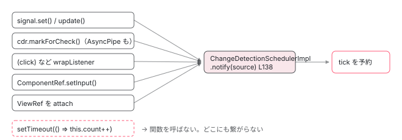

[目次](../README.md) › [zoneless の内側](README.md) › 第 11 回 / 全 11 回

# zoneless で動く条件、動かなくなる書き方

> setTimeout で普通のフィールドを書き換えると画面が変わらない。signal・markForCheck・async pipe・イベントは通知を出す。provideZonelessChangeDetection の警告の意味。

angular/angular · 読了 約 11 分 · 中核 · [サイトで読む（デモが動きます）](https://angular-deep-dive-cyan.vercel.app/chapter/zoneless-migration)

---

ここまでの 10 章で、zoneless の変更検知は「**通知**が来たときだけ tick を予約し、tick は印の付いたビューだけを更新する」仕組みだと分かりました。だから「zoneless で動かない書き方」は 1 種類しかありません。**通知を出さずに状態を変える**ことです。この章では、通知を出す操作をソースの行で確認し、出さない代表例 `setTimeout` の中のフィールド書き換えを実際に動かして、直し方を 3 つ示します。最後に `provideZonelessChangeDetection()` の警告の意味を読みます。

読む対象は `adev/src/content/guide/zoneless.md`（公式ガイド）、`packages/core/src/render3/bindings.ts`、`render3/view_ref.ts`、`common/src/pipes/async_pipe.ts`、`render3/component_ref.ts`、`render3/instructions/shared.ts`、`change_detection/scheduling/zoneless_scheduling_impl.ts` です。

1. 既定で provide される 3 つ
2. 通知の種類（NotificationSource）
3. notify → dirtyFlags
4. setTimeout と rAF の競走
5. tick → synchronize
6. microtask スケジューラ
7. signal.set() からの経路
8. (click) からの経路
9. PendingTasks と isStable
10. zone.js との同居
11. **動く条件・動かない書き方**（この章）

## 1. 通知を出す操作は 5 つ

📄 `angular/adev/src/content/guide/zoneless.md` L45–61 （▶ の行: 50–54, 61）

```md
45 │ ## Requirements for Zoneless compatibility
46 │ 
47 │ Angular relies on notifications from core APIs in order to determine when to run change detection and on which views.
48 │ These notifications include:
49 │ 
50 ▶ - `ChangeDetectorRef.markForCheck` (called automatically by `AsyncPipe`)
51 ▶ - `ComponentRef.setInput`
52 ▶ - Updating a signal that's read in a template
53 ▶ - Bound host or template listeners callbacks
54 ▶ - Attaching a view that was marked dirty by one of the above
55 │ 
56 │ ### `OnPush`-compatible components
57 │ 
58 │ One way to ensure that a component is using the correct notification mechanisms from above is to
59 │ use [ChangeDetectionStrategy.OnPush](/best-practices/skipping-subtrees#using-onpush).
60 │ 
61 ▶ The `OnPush` change detection strategy is not required, but it is a recommended step towards zoneless compatibility for application components. It is not always possible for library components to use `ChangeDetectionStrategy.OnPush`.
```

公式ガイドの 50〜54 行目です。1 行ずつ、この連載で読んだ関数に対応させます （61 行目、OnPush は推奨だが必須ではない、という点は「聞かれそうな質問」で戻ります）。

| ガイドの行 | 呼ばれる関数 | NotificationSource | 読んだ章 |
| --- | --- | --- | --- |
| 50：`ChangeDetectorRef.markForCheck`（AsyncPipe が自動で呼ぶ） | `markViewDirty(lView, MarkForCheck)` | `MarkForCheck` → `ViewTreeCheck` | 3 節、[cd-onpush-markforcheck](../cd/04-cd-onpush-markforcheck.md) |
| 51：`ComponentRef.setInput` | `markViewDirty(childLView, SetInput)` | `SetInput` → `ViewTreeCheck` | 4 節 |
| 52：テンプレートで読まれている signal の更新 | `signalSetFn` → … → `markAncestorsForTraversal` | `MarkAncestorsForTraversal` → `ViewTreeTraversal` | [signal.set() からの経路](07-zoneless-signal-path.md) |
| 53：テンプレート／host のリスナー | `wrapListener` → `markViewDirty(startView, Listener)` | `Listener` → `ViewTreeCheck` | [(click) からの経路](08-zoneless-listener-path.md) |
| 54：上のどれかで汚れたビューを attach | `updateAncestorTraversalFlagsOnAttach` | `ViewAttached`（＋ dirty なら `MarkAncestorsForTraversal`） | [通知の種類](02-zoneless-notification-source.md) |

どれも最終的に `ChangeDetectionSchedulerImpl.notify()` に着きます。**この表に無い操作は、何をしても tick を予約しません**。

## 2. 動かない例：setTimeout の中で普通のフィールドを変える

`this.count++` は代入です。関数を 1 つも呼びません。だから表のどの関数にも到達せず、`notify()` は呼ばれず、tick は予約されません。では「tick が走らない」と DOM がどう取り残されるのか、DOM が書かれる唯一の経路を確かめます。

📄 `angular/packages/core/src/render3/instructions/text_interpolation.ts` L72–83 （▶ の行: 77–78, 80）

```ts
72 │ export function ɵɵtextInterpolate1(
73 │   prefix: string,
74 │   v0: any,
75 │   suffix?: string,
76 │ ): typeof ɵɵtextInterpolate1 {
77 ▶   const lView = getLView();
78 ▶   const interpolated = interpolation1(lView, prefix, v0, suffix);
79 │   if (interpolated !== NO_CHANGE) {
80 ▶     textBindingInternal(lView, getSelectedIndex(), interpolated as string);
81 │   }
82 │   return ɵɵtextInterpolate1;
83 │ }
```

📄 `angular/packages/core/src/render3/bindings.ts` L44–56 （▶ の行: 52, 54–55）

```ts
44 │ export function bindingUpdated(lView: LView, bindingIndex: number, value: any): boolean {
45 │   ngDevMode &&
46 │     assertLessThan(bindingIndex, lView.length, `Slot should have been initialized to NO_CHANGE`);
47 │ 
48 │   if (value === NO_CHANGE) {
49 │     return false;
50 │   }
51 │ 
52 ▶   const oldValue = lView[bindingIndex];
53 │ 
54 ▶   if (Object.is(oldValue, value)) {
55 ▶     return false;
56 │   } else {
```

`{{ count }}` は 77〜80 行目の `ɵɵtextInterpolate1` で描かれます。78 行目の `interpolation1` が `bindingUpdated` を呼び、52 行目で LView に保存してある前回値を取り、54 行目で `Object.is` で比べ、違っていれば 80 行目で DOM へ。**この比較は `refreshView` がテンプレート関数を実行したときにしか起きません**。`refreshView` を呼ぶのは `detectChangesInView`、それを呼ぶのは tick です （[tick の章](05-zoneless-tick.md)）。tick が無ければ、フィールドの値がいくら変わっても 54 行目は実行されず、DOM は前回値のままです。

> **🧪 DEMO — このサイト自身は zoneless。実際に取り残されるところを見る**
>
> `plain` は `number` のフィールド、`sig` は signal。setTimeout は、クリックが予約した tick が 確実に終わったあと（300ms 後）に発火させています。
>
> 「動かない」を押して 300ms 待っても `plain` も「最後の書き換え」も変わりません。値は変わっています。そのあと「追いつかせる」を押すと、Listener 通知で tick が走り、`bindingUpdated` が差分に気づいて両方が表示されます。
>
> ▶ [このデモはサイトで動かせます](https://angular-deep-dive-cyan.vercel.app/chapter/zoneless-migration)

> [!WARNING]
> **ハマりどころ**
>
> 「動かない」のは `setTimeout` が悪いのではありません。`Promise.then`、`fetch().then`、`addEventListener` を自分で呼んだコールバック、RxJS の `subscribe` の中、WebSocket の `onmessage`。**Angular のテンプレート経由でない場所で、通知を出さない代入をする**と全部同じです。zone.js ありではこれらが全部パッチされていたので気づかなかっただけです。

## 3. 直し方は 3 つ：signal・markForCheck・AsyncPipe

### ① signal にする

📄 `angular/packages/core/primitives/signals/src/signal.ts` L86–95 （▶ の行: 92–93）

```ts
86 │ export function signalSetFn<T>(node: SignalNode<T>, newValue: T) {
87 │   if (!producerUpdatesAllowed()) {
88 │     throwInvalidWriteToSignalError(node);
89 │   }
90 │ 
91 │   if (!node.equal(node.value, newValue)) {
92 ▶     node.value = newValue;
93 ▶     signalValueChanged(node);
94 │   }
95 │ }
```

フィールドを `signal()` にして `set()` / `update()` で書き換えると、92 行目の代入の直後に 93 行目が通知の連鎖を始めます。テンプレートで `sig()` と読んでいれば、[signal の経路](07-zoneless-signal-path.md)で 必ず tick に届きます。`toSignal(observable)` や `resource()` が返すのもこの signal なので、非同期の結果は signal に入れる、が一番手数の少ない直し方です。

### ② markForCheck() を呼ぶ

📄 `angular/packages/core/src/render3/view_ref.ts` L144–164 （▶ の行: 153–154, 156, 162–163）

````ts
144 │    * ```ts
145 │    * @Component({
146 │    *   selector: 'app-root',
147 │    *   template: `Number of ticks: {{numberOfTicks}}`
148 │    * })
149 │    * class AppComponent {
150 │    *   numberOfTicks = 0;
151 │    *
152 │    *   constructor(private ref: ChangeDetectorRef) {
153 ▶    *     setInterval(() => {
154 ▶    *       this.numberOfTicks++;
155 │    *       // the following is required, otherwise the view will not be updated
156 ▶    *       this.ref.markForCheck();
157 │    *     }, 1000);
158 │    *   }
159 │    * }
160 │    * ```
161 │    */
162 ▶   markForCheck(): void {
163 ▶     markViewDirty(this._cdRefInjectingView || this._lView, NotificationSource.MarkForCheck);
164 │   }
````

`ViewRef.markForCheck` の doc コメント（144〜160 行目）が、まさに 2 節の状況を例にしています。153〜154 行目で `setInterval` の中でフィールドを変え、156 行目「これが無いとビューは更新されない」。実装は 163 行目、`markViewDirty(lView, MarkForCheck)` です。[(click) の章](08-zoneless-listener-path.md)で読んだ `markViewDirty` と同じ関数で、ルートまで `RefreshView | Dirty` を立て、`notify(MarkForCheck)` → `ViewTreeCheck` → tick 予約。古いコードを最小限の変更で直すならこれです。

### ③ AsyncPipe（または toSignal）に任せる

📄 `angular/packages/common/src/pipes/async_pipe.ts` L235–242 （▶ の行: 237–239）

```ts
235 │   private _updateLatestValue(async: any, value: Object): void {
236 │     if (async === this._obj) {
237 ▶       this._latestValue = value;
238 ▶       if (this.markForCheckOnValueUpdate) {
239 ▶         this._ref?.markForCheck();
240 │       }
241 │     }
242 │   }
```

📄 `angular/packages/common/src/pipes/async_pipe.ts` L178–192 （▶ の行: 185–186, 188）

```ts
178 │   transform<T>(obj: Observable<T> | Subscribable<T> | PromiseLike<T> | null | undefined): T | null {
179 │     if (!this._obj) {
180 │       if (obj) {
181 │         try {
182 │           // Only call `markForCheck` if the value is updated asynchronously.
183 │           // Synchronous updates _during_ subscription should not wastefully mark for check -
184 │           // this value is already going to be returned from the transform function.
185 ▶           this.markForCheckOnValueUpdate = false;
186 ▶           this._subscribe(obj);
187 │         } finally {
188 ▶           this.markForCheckOnValueUpdate = true;
189 │         }
190 │       }
191 │       return this._latestValue;
192 │     }
```

Observable を自分で `subscribe` してフィールドに入れるのではなく、`obs$ | async` とテンプレートに渡します。値が届くと 237 行目で保持し、**239 行目で ② の `markForCheck()` を呼びます**。185〜188 行目、最初の `subscribe` の間だけフラグを倒しているのは、購読と同時に同期的に届く値は `transform` の戻り値としてそのまま描かれるので通知が無駄だからです。AsyncPipe は zoneless でそのまま動きます（[async pipe の章](../template/08-async-pipe.md)）。

## 4. 自分で何もしなくても通知が出ている場所

「動かないのでは」と心配しがちな 3 つの場面は、フレームワークが代わりに通知を出しています。

📄 `angular/packages/core/src/render3/view/listeners.ts` L62–66 （▶ の行: 64–65）

```ts
62 │     // In order to be backwards compatible with View Engine, events on component host nodes
63 │     // must also mark the component view itself dirty (i.e. the view that it owns).
64 ▶     const startView = isComponentHost(tNode) ? getComponentLViewByIndex(tNode.index, lView) : lView;
65 ▶     markViewDirty(startView, NotificationSource.Listener);
66 │ 
```

64〜65 行目、`(click)` などテンプレートのイベントは、ハンドラの前に `markViewDirty(Listener)`。だからハンドラの中なら普通のフィールドを変えても動きます（DEMO の「動く」）。

📄 `angular/packages/core/src/render3/component_ref.ts` L626–630 （▶ の行: 627, 630）

```ts
626 │     const lView = this._rootLView;
627 ▶     const hasSetInput = setAllInputsForProperty(tNode, lView[TVIEW], lView, name, value);
628 │     this.previousInputValues.set(name, value);
629 │     const childComponentLView = getComponentLViewByIndex(tNode.index, lView);
630 ▶     markViewDirty(childComponentLView, NotificationSource.SetInput);
```

627 行目、`ComponentRef.setInput()` は値を入れたあと、630 行目で子のビューに `markViewDirty(SetInput)`。`createComponent()` で動的に作ったコンポーネントへの入力も通知付きです。

📄 `angular/packages/core/src/render3/instructions/shared.ts` L250–266 （▶ の行: 260, 262–263）

```ts
250 │ export function setPropertyAndInputs<T>(
251 │   tNode: TNode,
252 │   lView: LView,
253 │   propName: string,
254 │   value: T,
255 │   renderer: Renderer,
256 │   sanitizer: SanitizerFn | null | undefined,
257 │ ): void {
258 │   ngDevMode && assertNotSame(value, NO_CHANGE as any, 'Incoming value should never be NO_CHANGE.');
259 │   const tView = lView[TVIEW];
260 ▶   const hasSetInput = setAllInputsForProperty(tNode, tView, lView, propName, value);
261 │ 
262 ▶   if (hasSetInput) {
263 ▶     isComponentHost(tNode) && markDirtyIfOnPush(lView, tNode.index);
264 │     ngDevMode && setNgReflectProperties(lView, tView, tNode, propName, value);
265 │     return; // Stop propcessing if we've matched at least one input.
266 │   }
```

📄 `angular/packages/core/src/render3/instructions/shared.ts` L319–325 （▶ の行: 322–323）

```ts
319 │ export function markDirtyIfOnPush(lView: LView, viewIndex: number): void {
320 │   ngDevMode && assertLView(lView);
321 │   const childComponentLView = getComponentLViewByIndex(viewIndex, lView);
322 ▶   if (!(childComponentLView[FLAGS] & LViewFlags.CheckAlways)) {
323 ▶     childComponentLView[FLAGS] |= LViewFlags.Dirty;
324 │   }
325 │ }
```

📄 `angular/packages/core/src/render3/instructions/change_detection.ts` L304–308 （▶ の行: 307）

```ts
304 │     // Refresh child component views.
305 │     const components = tView.components;
306 │     if (components !== null) {
307 ▶       detectChangesInChildComponents(lView, components, ChangeDetectionMode.Global);
308 │     }
```

テンプレートの `[value]="x"` で子の input が変わる場合は少し違います。260 行目で input に値を入れ、262〜263 行目で `markDirtyIfOnPush`、322〜323 行目で子が OnPush なら `Dirty` を立てるだけで、**`notify` は呼びません**。これは親の `refreshView` の最中、つまり tick の中で起きているからです。親の `refreshView` は 307 行目で子コンポーネントを `ChangeDetectionMode.Global` で巡るので、`Dirty` が読まれて子は同じ tick 内で refresh されます。親が更新された理由（signal でも markForCheck でも）が、そのまま子にも届きます。

## 5. provideZonelessChangeDetection() の警告の意味

📄 `angular/packages/core/src/change_detection/scheduling/zoneless_scheduling_impl.ts` L369–388 （▶ の行: 372, 375–377, 379）

```ts
369 │ export function provideZonelessChangeDetection(): EnvironmentProviders {
370 │   performanceMarkFeature('NgZoneless');
371 │ 
372 ▶   if ((typeof ngDevMode === 'undefined' || ngDevMode) && typeof Zone !== 'undefined' && Zone) {
373 │     const message = formatRuntimeError(
374 │       RuntimeErrorCode.UNEXPECTED_ZONEJS_PRESENT_IN_ZONELESS_MODE,
375 ▶       `The application is using zoneless change detection, but is still loading Zone.js. ` +
376 ▶         `Consider removing Zone.js to get the full benefits of zoneless. ` +
377 ▶         `In applications using the Angular CLI, Zone.js is typically included in the "polyfills" section of the angular.json file.`,
378 │     );
379 ▶     console.warn(message);
380 │   }
381 │ 
382 │   return makeEnvironmentProviders([
383 │     ...provideZonelessChangeDetectionInternal(),
384 │     typeof ngDevMode === 'undefined' || ngDevMode
385 │       ? [{provide: PROVIDED_ZONELESS, useValue: true}]
386 │       : [],
387 │   ]);
388 │ }
```

372 行目、開発モードで `Zone` がグローバルに存在すると 379 行目で `console.warn`。375〜377 行目のメッセージは「zoneless なのに Zone.js を読み込んでいる。angular.json の polyfills から外せ」です。[前章](10-zoneless-hybrid.md)のとおり、`ZONELESS_ENABLED` が `true` なら zone.js がいてもスケジューラは 自分で予約するので**動作には影響しません**。警告しているのは、zone.js がブラウザ API をパッチし続けるコストを 払い続けているからです。`angular.json` の `polyfills` から `"zone.js"` を消し、テスト設定の `"zone.js/testing"` も消せば止まります。既定経路（`provideZonelessChangeDetectionInternal`、[1 回目](01-zoneless-default.md)）はこの警告を出さないので、移行中に見逃しを防ぎたいなら明示的に `provideZonelessChangeDetection()` を書いておく価値があります。

## 6. 「動かない書き方」を機械的に見つける

📄 `angular/adev/src/content/guide/zoneless.md` L168–175 （▶ の行: 171, 173）

```md
168 │ ### Debug-mode check to ensure updates are detected
169 │ 
170 │ Angular also provides an additional tool to help verify that an application is making
171 ▶ updates to state in a zoneless-compatible way. `provideCheckNoChangesConfig({exhaustive: true, interval: <milliseconds>})`
172 │ can be used to periodically check to ensure that no bindings have been updated
173 ▶ without a notification. Angular throws `ExpressionChangedAfterItHasBeenCheckedError`
174 │ if there is an updated binding that would not have refreshed by the zoneless change
175 │ detection.
```

171 行目、`provideCheckNoChangesConfig({exhaustive: true, interval: ms})` を開発時に足すと、一定間隔で**全ビュー**を checkNoChanges モードで巡ります。2 節の DEMO のように「値は変わったが通知が無かった」バインディングがあると、173 行目の `ExpressionChangedAfterItHasBeenCheckedError` が投げられ、どのバインディングかが分かります。仕組みは [cd-check-no-changes](../cd/07-cd-check-no-changes.md) にあります。



*通知を出す操作（上）だけが notify に着く。代入は関数呼び出しではないので、どの道にも乗らない。*

## 聞かれそうな質問

**Q. setTimeout の中で普通のフィールドを変えたら画面が変わりません。直し方は？**

3 つです。① フィールドを `signal()` にして `set()`/`update()`（signal.ts 93 行目から通知）。② 書き換えた直後に `ChangeDetectorRef.markForCheck()`（view\_ref.ts 163 行目が `markViewDirty(MarkForCheck)`）。③ 非同期の元が Observable なら `| async`（async\_pipe.ts 239 行目が `markForCheck` を呼ぶ）か `toSignal` で ① に寄せる。原因は `bindingUpdated`（bindings.ts 54 行目）が tick の中でしか実行されず、tick は `notify()` が無いと予約されないことです。

**Q. zoneless にするには全コンポーネントを OnPush にしないといけませんか？**

必須ではありません（ガイド 61 行目「required ではない」）。zoneless の tick は `Targeted` モードで始まるので、`Default` でも通知無しには更新されません。逆に、親が refresh されれば子は `refreshView` 307 行目 （change\_detection.ts）の `Global` で巡られるので、`Default` の子はそのまま更新されます。大事なのは戦略ではなく「状態を変えるときに通知が出ているか」です。OnPush は、通知が無いと見た目で分かるので移行中の検出に役立ちます。

**Q. @Input が変わったとき、子の OnPush コンポーネントは誰が通知しているのですか？**

誰も `notify` しません。親の `refreshView` が `setPropertyAndInputs`（shared.ts 260〜263 行目）で値を入れ、`markDirtyIfOnPush` 323 行目が子に `Dirty` を立てるだけです。親の tick の中なので、307 行目の `detectChangesInChildComponents(..., Global)` がその `Dirty` を読んで同じ tick で子を refresh します。`ComponentRef.setInput()`（component\_ref.ts 630 行目）は tick の外から呼ばれるので、こちらは `markViewDirty(SetInput)` で通知します。

**Q. provideZonelessChangeDetection() を書いたら警告が出ました。壊れていますか？**

壊れていません。zoneless\_scheduling\_impl.ts 372〜379 行目は「グローバルに `Zone` がいる」ことだけを見て `console.warn` しています。`ZONELESS_ENABLED` は `true` なのでスケジューラは自分で予約し、変更検知は zoneless として動きます。`angular.json` の `polyfills` から `zone.js` を外せば、パッチのコストも警告も無くなります。

**Q. AsyncPipe は zoneless で使えますか？**

使えます。async\_pipe.ts 239 行目で値が届くたびに `markForCheck()` を呼ぶので、Observable の値が非同期に来ても `markViewDirty(MarkForCheck)` → `notify` → tick になります。zone.js に依存した実装ではありません。

**Q. NgZone.onStable を使って「描画が終わったら」を待っていたコードはどうなりますか？**

`NoopNgZone` の `onStable` は emit されない（[1 回目](01-zoneless-default.md)）ので、コールバックは二度と呼ばれません。描画後の処理なら `afterNextRender` / `afterEveryRender`（[cd-after-render](../cd/08-cd-after-render.md)）、「非同期処理がすべて終わった」を待つなら `ApplicationRef.whenStable()` と `PendingTasks` （[前々章](09-zoneless-pending-tasks.md)）に置き換えます。

## 読み終えて

- zoneless で動く条件は 1 つ、「状態を変えるときに `notify()` まで届く関数を呼んでいるか」。届く入口は markForCheck / setInput / signal / リスナー / attach の 5 つ
- `setTimeout` の中の `this.count++` は関数を呼ばないので届かない。DOM を比べる `bindingUpdated` は tick の中でしか動かない
- 直し方は signal・`markForCheck()`・AsyncPipe（`toSignal`）の 3 つ。どれも最後は同じ `notify()` に着く
- `provideZonelessChangeDetection()` の警告は「zone.js がまだ読み込まれている」だけの意味。動作は zoneless のまま
- 見つけるには `provideCheckNoChangesConfig({exhaustive: true})`。通知の無い変更を `ExpressionChangedAfterItHasBeenCheckedError` として報告する

---

← 前: [zone.js と同居するとき：ハイブリッドの判定](10-zoneless-hybrid.md)  
次: [変更検知は何を見て「省略」するか（概観）](../cd/01-change-detection.md) →
